> **对象**：GoogleCloudPlatform/Agones —— Kubernetes 上的**专用游戏服务器（Dedicated Game Server）编排系统**
> **版本**：commit `2c9fadb5ea1d3ed09793cd8be87059cc19731eb1`（2026-10-15）
> **代码规模**：401 个 Go 文件，非测试代码约 **43758 行**（`pkg/` + `cmd/`）
> **核心依赖**：`k8s.io/client-go`、`k8s.io/apiextensions-apiserver`、`go.opencensus.io`、`grpc-gateway`、`Extism`（Wasm 插件）
> **文档定位**：面向"要在 K8s 上跑游戏服务器、需要改调度/分配/自动扩缩容行为"的工程师。全文逐文件精读，**所有结论标注 `路径:行号`**，可对照源码复验。
>
> 阅读前提：本文只讲 **Agones 控制面**。匹配器本身（Open Match）见 `open-match.md`；本文只覆盖 Agones 与匹配器的**衔接点**（`GameServerAllocation`）。
>
> ⚠️ 一个必须先破除的直觉：Agones 不是"Deployment 的游戏版"。**GameServer 是有状态且昂贵的**——`Allocated` 的实例绝不能被随意替换或缩掉。这一条约束贯穿 Fleet 滚动更新、缩容排序、自动扩缩容的全部设计。

---

## 目录

- [〇、全景地图](#〇全景地图)
- [速览：各讲做了什么（先看这个再进细节）](#速览各讲做了什么先看这个再进细节)
- [面试速通：Agones 高频问题一页纸](#面试速通agones-高频问题一页纸)
- [第一讲：数据模型 —— 三层 CRD 与 GameServer 状态机](#第一讲数据模型--三层-crd-与-gameserver-状态机)
- [第二讲：控制面骨架 —— controller 进程与 workerqueue](#第二讲控制面骨架--controller-进程与-workerqueue)
- [第三讲：GameServer 生命周期与 SDK Server](#第三讲gameserver-生命周期与-sdk-server)
- [第四讲：Fleet 与 GameServerSet 编排](#第四讲fleet-与-gameserverset-编排)
- [第五讲：GameServerAllocation —— 分配的两条路径](#第五讲gameserverallocation--分配的两条路径)
- [第六讲：FleetAutoscaler、可观测性与部署拓扑](#第六讲fleetautoscaler可观测性与部署拓扑)
- [附：学习路线、复习卡与文件索引](#附学习路线复习卡与文件索引)

---

## 〇、全景地图

Agones 的骨架可以压成一句话：**用 CRD 描述"游戏服务器"，用 controller 把 CRD 翻译成 Pod，用 SDK sidecar 让游戏进程反向参与生命周期管理**。

```
┌──────────────────────── 控制面（agones-system 命名空间）────────────────────────┐
│                                                                                  │
│  agones-controller        主控制器：gameservers / gameserversets /               │
│                           fleets / fleetautoscalers 四个 controller + 端口分配器  │
│  agones-extensions        Admission Webhook（默认值注入 + 校验）                 │
│                           + 集群内 Allocation API（聚合 API Server）              │
│  agones-allocator         独立 gRPC/REST 分配服务（mTLS，供外部匹配器调用）       │
│  agones-ping              UDP/HTTP 拨测（验证外部连通性）                        │
│  agones-processor         可选的 allocator 批处理后端（Feature Gate 控制）        │
└─────────────────────────────────────────────────────────────────────────────────┘

┌──────────────────── 数据面（每个 GameServer Pod 内）───────────────────────────┐
│   GameServer 容器（你的游戏二进制）                                              │
│        │  gRPC :9357                                                             │
│        ▼                                                                          │
│   agones-gameserver-sidecar（SDK Server）                                        │
│        │  JSON Patch 到 Kubernetes API                                            │
│        ▼                                                                          │
│   GameServer CRD 对象                                                             │
└─────────────────────────────────────────────────────────────────────────────────┘

        CRD 层级（类比 Deployment → ReplicaSet → Pod）：
        Fleet ──(ownerRef + label)──> GameServerSet ──(ownerRef + label)──> GameServer ──> Pod
```

渲染版：

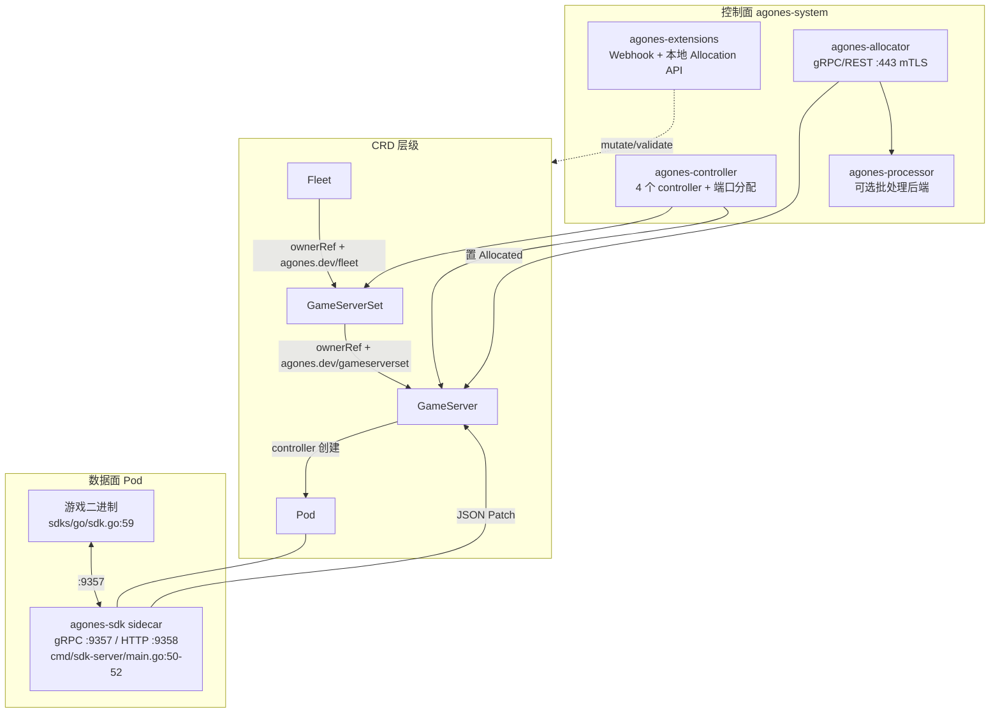

贯穿全系统的四条主线：

1. **状态流**：`PortAllocation → Creating → Starting → Scheduled → RequestReady → Ready → Allocated → Shutdown`。controller 负责推进前半段（建 Pod、填地址），**sidecar 负责推进后半段**（`Ready`/`Allocated`/`Shutdown` 由游戏进程发起）。
2. **所有权流**：`ownerReference` 串起 Fleet → GameServerSet → GameServer → Pod 四层，删除靠 K8s GC 级联；`label`（`agones.dev/fleet`、`agones.dev/gameserverset`）才是**查询**用的索引。
3. **分配流**：外部匹配器 → allocator → 从缓存里挑一个 Ready/Allocated 的 GameServer → 置 `Allocated` → 返回 IP:Port 给玩家。
4. **扩缩容流**：`FleetAutoscaler` per-resource ticker → 算目标副本 → 写 `Fleet.Spec.Replicas` → Fleet controller 调 GameServerSet → GameServerSet controller 多退少补。

---

## 速览：各讲做了什么（先看这个再进细节）

| 讲 | 主题 | 一句话结论 | 关键文件 |
|----|------|-----------|---------|
| 一 | 数据模型 | 三层 CRD（Fleet → GameServerSet → GameServer）靠 **ownerRef + label** 串起来；GameServer 有 **11 个状态**，其中 `Allocated`/`Reserved` **不可删除** | `pkg/apis/agones/v1/gameserver.go:40-69`、`pkg/apis/agones/v1/fleet.go:116-153` |
| 二 | 控制面骨架 | `cmd/controller/main.go` 起 4 个 runner，每个 controller 都是「informer + workqueue + syncHandler」；GameServer controller 用**三条队列**按状态分流 | `cmd/controller/main.go:207-222`、`pkg/util/workerqueue/workerqueue.go` |
| 三 | GameServer 生命周期 | controller 建 Pod 并推进到 `Scheduled`；之后由 **sidecar 通过 gRPC + JSON Patch** 接管，游戏进程自己声明 `Ready`/`Allocated`/`Shutdown` | `pkg/gameservers/controller.go:500-523`、`pkg/sdkserver/sdkserver.go:465-477` |
| 四 | Fleet 编排 | Fleet 只管 GameServerSet 的**数量**；滚动更新靠 `MaxSurge` 加新 Set、`MaxUnavailable` 减旧 Set；**缩容删除顺序由 Packed/Distributed 排序决定**，不是固定状态优先级 | `pkg/fleets/controller.go:501-547`、`pkg/gameserversets/gameserversets.go:46-119` |
| 五 | 分配 | 两条路径：集群内走**聚合 API**（只注册 `create` 动词），集群外走 **allocator gRPC**；核心是「排序列表 + 单 goroutine 批处理 + 5 次 10ms 重试」 | `pkg/gameserverallocations/allocator.go:467-630`、`pkg/gameserverallocations/allocation_cache.go` |
| 六 | 自动扩缩容与观测 | `FleetAutoscaler` 有 **7 种策略**；Buffer 算的是 `AllocatedReplicas + BufferSize`（**不是 ReadyReplicas**）；指标走 OpenCensus + Prometheus/Stackdriver 双 exporter | `pkg/fleetautoscalers/fleetautoscalers.go:73-91`、`pkg/metrics/controller_metrics.go:23-42` |

全流程图（一个 GameServer 从创建到被玩家连上）：

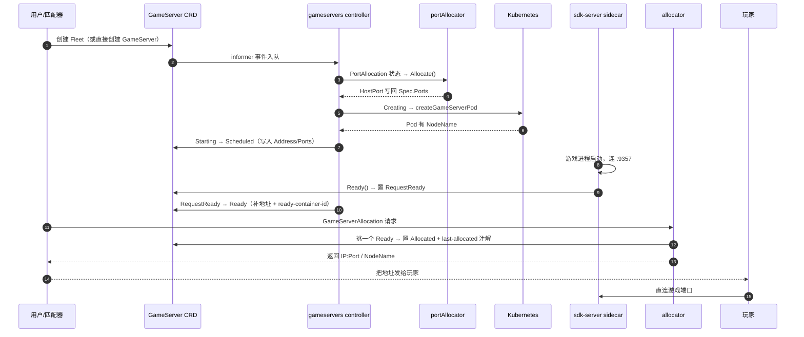

---

## 面试速通：Agones 高频问题一页纸

> 先给结论，再按讲次展开。
> Agones 的全部魔法可以压成两句话：
> **① 状态机是"controller 推前半段、sidecar 推后半段"的双人舞；**
> **② 一切扩缩容/删除决策都要先保护 `Allocated` 和 `Reserved`。**
> 面试先答这两句总分，被追问细节再往下走。
> 本页所有结论均提炼自对应讲次的小结与关键机制表，不引入文档之外的知识点。
> 用法：先扫表格建立全局印象，被问到哪条就讲哪条，再按「深入」列回查原文细节。

### 高频 Q&A（先结论）

22 道最高频题的「一句话答案」。题目覆盖 CRD/状态机/SDK/Fleet/分配/自动扩缩容六大块。

| # | 面试问题 | 一句话结论 | 深入 |
|---|---------|-----------|------|
| 1 | Agones 是干什么的？ | 在 K8s 上编排**专用游戏服务器**：管理其生命周期（创建/就绪/分配/关闭）、端口、健康检查与自动扩缩容 | 〇 |
| 2 | 三层 CRD 是什么关系？ | `Fleet → GameServerSet → GameServer → Pod`，类比 `Deployment → ReplicaSet → Pod`，靠 **ownerReference** 级联删除、靠 **label** 查询 | 第一讲 |
| 3 | GameServer 有哪些状态？ | 11 个：`PortAllocation / Creating / Starting / Scheduled / RequestReady / Ready / Shutdown / Error / Unhealthy / Reserved / Allocated` | 第一讲 |
| 4 | 哪些状态不可删除？ | `Allocated` 与 `Reserved`——`IsDeletable()` 要求它们**必须已有 DeletionTimestamp** 才可删 | 第一讲 |
| 5 | `PortAllocation` 状态什么时候出现？ | 只在创建期一次：当端口策略含 `Dynamic` 或 `Passthrough` 时，初始状态不是 `Creating` 而是 `PortAllocation` | 第一讲 |
| 6 | 状态机由谁推进？ | **前半段 controller**（建 Pod → Scheduled），**后半段 sidecar**（游戏进程调 `Ready()`/`Allocate()`/`Shutdown()` 反向写 CRD） | 第三讲 |
| 7 | SDK sidecar 的端口？ | gRPC **9357**、HTTP gateway **9358**、healthcheck **8080** | 第三讲 |
| 8 | 游戏进程怎么改 GameServer 对象？ | sidecar 用 **JSON Patch** 直接打 Kubernetes API（不走 controller），并 watch 自己那一个对象做本地缓存 | 第三讲 |
| 9 | 健康检查怎么做？ | 三层：SDK 心跳 → sidecar 每 `PeriodSeconds` 自检（默认 5s，失败 3 次判定）→ kubelet `/gshealthz` liveness probe；另外 `HealthController` 处理驱逐/容器崩溃等"非心跳"不健康 | 第三讲 |
| 10 | 端口怎么分配？ | `portAllocator` 维护**每 Node 一张端口位图**，`Dynamic` 分配 hostPort、`Passthrough` 同时把 containerPort 设成同值；失败即 `DeAllocate` 回滚 | 第三讲 |
| 11 | Fleet 滚动更新默认参数？ | `MaxSurge = MaxUnavailable = 25%`；**基数不同**——Surge 以 `Spec.Replicas` 为基数，Unavailable 以 `Status.ReadyReplicas` 为基数 | 第四讲 |
| 12 | 为什么滚动更新到处减 `sumAllocated`？ | 因为旧 Set 里 `Allocated` 的 GameServer **删不掉**，只能在目标副本里给它留位置 | 第四讲 |
| 13 | 缩容时先删哪些 GameServer？ | **按 Packed/Distributed 排序后取前 N 个**，不是固定状态优先级；`Allocated`/`Reserved` 连候选列表都进不去 | 第四讲 |
| 14 | GameServerSet 怎么删 GameServer？ | 不是直接 Delete，而是把状态**置为 `Shutdown`**，交给 gameservers controller 收尾 | 第四讲 |
| 15 | 分配有哪两条路径？ | 集群内走**聚合 API Server**（GSA 只注册 `create` 动词）；集群外走独立 **allocator** 的 gRPC/REST（默认 443，mTLS） | 第五讲 |
| 16 | `Packed` 与 `Distributed` 差在哪？ | Packed 把 **Allocated 排最前**、优先填满节点最挤的；Distributed **完全不看节点计数**，无 Priorities 时随机打散 | 第五讲 |
| 17 | 没有可用 GameServer 时返回什么？ | **不是错误码**。HTTP 返回 `201 Created` + `Status.State = UnAllocated`；竞争失败则是 `Contention` | 第五讲 |
| 18 | 分配怎么保证并发安全？ | 没有全局锁，而是 **单 goroutine 事件循环**消费 `pendingRequests`（容量 100）+ channel 串行化；缓存本身用 `sync.RWMutex` | 第五讲 |
| 19 | FleetAutoscaler 有几种策略？ | **7 种**：Buffer / Webhook / Counter / List / Schedule / Chain / Wasm | 第六讲 |
| 20 | Buffer 策略怎么算？ | `AllocatedReplicas + BufferSize`（百分比时是 `Allocated/(1-pct)`），再用 Min/MaxReplicas 夹逼——**注意是 Allocated 不是 Ready** | 第六讲 |
| 21 | Webhook 策略是 gRPC 吗？ | **不是**，是 HTTP/JSON，硬编码 **15s** 超时；`CABundle != nil` 时自动切 https | 第六讲 |
| 22 | 默认同步周期多少？ | **30s**，但这是 per-resource 的 ticker（`spec.sync.fixedInterval.seconds`），**没有全局 syncPeriod 常量** | 第六讲 |

### 易错点与面试坑

以下每条都是文档专门强调过的反直觉点——知道就加分，不知道必挂。

- **GameServer 的 `Status` 不是 subresource**（区别于 Fleet/GameServerSet）。这是刻意的：为了能在**一次原子操作里同时改 spec 与 status**，这对分配至关重要（`pkg/apis/agones/v1/gameserver.go:187-198`）。
- **`Allocated`/`Reserved` 是"免死金牌"**：`IsDeletable()` 对这两个状态要求**必须已有 DeletionTimestamp**。后果是——如果它们的数量已超过目标副本数，Fleet/GameServerSet **根本缩不下去**，只能等游戏结束。
- **Buffer 策略算的是 `AllocatedReplicas`，不是 `ReadyReplicas`**。很多人按字面理解成"保留 N 个 Ready"，源码是 `f.Status.AllocatedReplicas + BufferSize`（`pkg/fleetautoscalers/fleetautoscalers.go:383`）；API 注释明确说此处的 "ready" 指 "non-allocated"。
- **分配失败不是 HTTP 错误**。集群内 API 一律返回 `201 Created`，靠 `Status.State = UnAllocated`/`Contention` 区分；gRPC 侧默认映射为 `429 Too Many Requests`。
- **缩容没有"先删 Unhealthy"的固定优先级表**。它是把候选按调度策略**排序后取前 N**，方向恰好与分配相反：分配往"最挤"的节点塞，缩容从"最空"的节点收。
- **`Reserved` 是唯一会自动回退的状态**：`Reserve(seconds)` 到期后 sidecar 自动置回 `Ready`（`pkg/sdkserver/sdkserver.go:699-709`）。
- **`Recreate` 策略只减 `Allocated`，不减 `Reserved`**；而 `RollingUpdate` 的某条分支减的是 `Reserved + Allocated`。两者语义不一致（`pkg/fleets/controller.go:428-430` vs `:465-482`）。
- **Fleet 没有 `pod-template-hash`**。判定"哪个 GameServerSet 是当前版本"用 `apiequality.Semantic.DeepEqual` 全量比对 `Spec.Template`。
- **端口耗尽不会立刻判 Unhealthy**：`WaitOnFreePorts()` 为 true 的云产品（如 GKE Autopilot）会让 `HealthController` 放行，交给 Cluster Autoscaler 扩容重试。
- **`eviction.safe` 默认是 `Never`**，意味着 GameServer Pod 默认**不允许被 Cluster Autoscaler 驱逐**——这通过 `safe-to-evict: "false"` 注解 + 配套 PDB 实现。

### 关键数值速记

| 数值 | 含义 | 出处 |
|------|------|------|
| **9357 / 9358 / 8080** | SDK sidecar 的 gRPC / HTTP gateway / health 端口 | `cmd/sdk-server/main.go:50-52` |
| **11** | `GameServerState` 枚举数量 | `pkg/apis/agones/v1/gameserver.go:40-69` |
| `Shutdown` / `Error` / `Unhealthy` | 三个终态（`TerminalGameServerStates`） | `pkg/apis/agones/v1/gameserver.go:174-180` |
| **5 / 3 / 5** | Health 默认 `PeriodSeconds` / `FailureThreshold` / `InitialDelaySeconds` | `pkg/apis/agones/v1/gameserver.go:413/416/419` |
| `Dynamic`（默认）/ `Static` / `Passthrough` / `None` | 四种 `PortPolicy` | `pkg/apis/agones/v1/gameserver.go:74-86`、`:454` |
| `UDP`（默认）/ `TCP` / `TCPUDP` | 端口协议 | `pkg/apis/agones/v1/gameserver.go:462`、`:119` |
| `Never`（默认）/ `OnUpgrade` / `Always` | `eviction.safe` 三态 | `pkg/apis/agones/v1/gameserver.go:482` |
| `agones.dev/fleet` / `agones.dev/gameserverset` | 两个核心 label | `pkg/apis/agones/v1/fleet.go:31`、`gameserverset.go:28` |
| **25% / 25%** | Fleet 默认 `MaxSurge` / `MaxUnavailable` | `pkg/apis/agones/v1/fleet.go:170-176` |
| 1% ~ 99% | 滚动更新百分比合法区间 | `pkg/apis/agones/v1/fleet.go:196` |
| **30s** | Error 状态 GameServer 的删除宽限期 | `pkg/gameserversets/controller.go:64` |
| **64 / 64** | 默认单批最大创建/删除数 | `cmd/controller/main.go:282/284` |
| **5000** | 每个 GameServerSet 允许的最大 Pending Pod 数 | `cmd/controller/main.go:285` |
| **100 / 200** | controller 默认 API Server QPS / Burst | `cmd/controller/main.go:275-276` |
| **64** | controller 默认 worker 数 | `cmd/controller/main.go:274` |
| **30s** | informer resync 周期 | `cmd/controller/main.go:87` |
| 15s / 10s / 2s | Leader election 的 LeaseDuration / RenewDeadline / RetryPeriod | `cmd/controller/main.go:644-646` |
| 20ms×5 → 500ms | gameservers controller 的 fast/slow 限速器 | `pkg/gameservers/controller.go:270-274` |
| **100 / 100** | allocator 批处理队列容量与刷新阈值 | `pkg/gameserverallocations/allocator.go:83-84` |
| **5 次 10ms** / **7 次 100ms×2** | 本地 / 远程分配重试参数 | `pkg/gameserverallocations/allocator.go:88-99` |
| **443 → 8443** | allocator Helm 实际端口（gRPC 与 http 同端口复用） | `install/helm/agones/values.yaml:265-275` |
| **30s** | FleetAutoscaler 默认同步周期 | `pkg/apis/autoscaling/v1/fleetautoscaler.go:156` |
| **15s** | FleetAutoscaler Webhook HTTP 客户端超时 | `pkg/fleetautoscalers/fleetautoscalers.go:219` |
| **7** | FleetAutoscaler 策略类型数 | `pkg/apis/autoscaling/v1/fleetautoscaler.go:125-152` |
| **8080 / `/metrics`** | metrics HTTP 端口与路径 | `pkg/util/httpserver/server.go:49-51`、`pkg/metrics/exporter.go:154` |
| **15s / 60s** | Prometheus / Stackdriver 上报周期 | `pkg/metrics/exporter.go:96-101` |
| **600000** | `gameserver_state_duration` 的 LRU 容量 | `pkg/metrics/controller.go:60` |
| **30s** | Go SDK 连接握手超时 | `sdks/go/sdk.go:55-68` |

---

## 第一讲：数据模型 —— 三层 CRD 与 GameServer 状态机

### 先说人话：本讲每个阶段在干什么

Agones 的所有复杂度都源于一件事：**GameServer 不是无状态的 Pod**。它有 IP、有端口、有玩家、有生命周期，而且**被玩家占用时绝对不能动**。

本讲先建立三个认知：

1. **三层 CRD 怎么串起来的**（ownerRef 管删除，label 管查询）；
2. **11 个状态各自代表什么**、哪些是终态、哪些受保护；
3. **`GameServer.Status` 为什么不是 subresource**。

### 1.1 三层 CRD 的关联

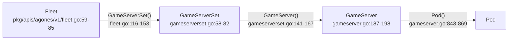

**Fleet → GameServerSet**（`pkg/apis/agones/v1/fleet.go:116-153`）：

```go
// pkg/apis/agones/v1/fleet.go:119-140
Spec: GameServerSetSpec{
    Template:   f.Spec.Template,
    Scheduling: f.Spec.Scheduling,
},
...
gsSet.ObjectMeta.GenerateName = f.ObjectMeta.Name + "-"   // :127
gsSet.ObjectMeta.Name = ""                                 // :128
...
ref := metav1.NewControllerRef(f, SchemeGroupVersion.WithKind("Fleet"))   // :133
gsSet.ObjectMeta.OwnerReferences = append(gsSet.ObjectMeta.OwnerReferences, *ref)  // :134
...
gsSet.ObjectMeta.Labels[FleetNameLabel] = f.ObjectMeta.Name  // :140
```

三个设计点：

| 点 | 做法 | 为什么 |
|----|------|--------|
| 命名 | `GenerateName = <parent>-`，`Name` 置空 | 保证永不撞名，滚动更新可同时存在多个 Set |
| 级联删除 | `metav1.NewControllerRef` 写 `ownerReferences` | 删 Fleet 自动删 GameServerSet → GameServer → Pod |
| 查询索引 | `FleetNameLabel = "agones.dev/fleet"` | 后续 `ListGameServerSetsByFleetOwner` 靠 label + ownerRef 双重过滤 |

**Fleet 名是"两跳透传"的**：`gs.ObjectMeta.Labels[FleetNameLabel] = gsSet.ObjectMeta.Labels[FleetNameLabel]`（`pkg/apis/agones/v1/gameserverset.go:165`）。所以可以直接用 `agones.dev/fleet=<name>` 选出整个 Fleet 的所有 GameServer——这一点在自动扩缩容和 metrics 里被大量使用。

### 1.2 GameServer：Status 不是 subresource

```go
// pkg/apis/agones/v1/gameserver.go:187-198
// It is worth noting that while there is a `GameServerStatus` Status entry for the `GameServer`, it is not
// defined as a subresource - unlike `Fleet` and other Agones resources.
// This is so that we can retain the ability to change multiple aspects of a `GameServer` in a single atomic operation,
// which is particularly useful for operations such as allocation.
type GameServer struct {
	metav1.TypeMeta   `json:",inline"`
	metav1.ObjectMeta `json:"metadata,omitempty"`
	Spec   GameServerSpec   `json:"spec"`
	Status GameServerStatus `json:"status"`
}
```

> 🔑 **这是 Agones 数据模型最重要的一个决定**。Kubernetes 里 `Status` 做成 subresource 是标准实践（Fleet/GameServerSet 都遵守了），但 GameServer **故意不遵守**——因为分配需要"一次 Update 同时改 spec（端口）+ status（状态）"。如果拆成 subresource，就要两次 API 调用，中间可能失败或被打断。

### 1.3 GameServer 的 11 个状态

```go
// pkg/apis/agones/v1/gameserver.go:40-69
GameServerStatePortAllocation GameServerState = "PortAllocation"  // :43
GameServerStateCreating       GameServerState = "Creating"        // :45
GameServerStateStarting       GameServerState = "Starting"        // :48
GameServerStateScheduled      GameServerState = "Scheduled"       // :51
GameServerStateRequestReady   GameServerState = "RequestReady"    // :53
GameServerStateReady          GameServerState = "Ready"           // :56
GameServerStateShutdown       GameServerState = "Shutdown"        // :59
GameServerStateError          GameServerState = "Error"           // :62
GameServerStateUnhealthy      GameServerState = "Unhealthy"       // :64
GameServerStateReserved       GameServerState = "Reserved"        // :66
GameServerStateAllocated      GameServerState = "Allocated"       // :68
```

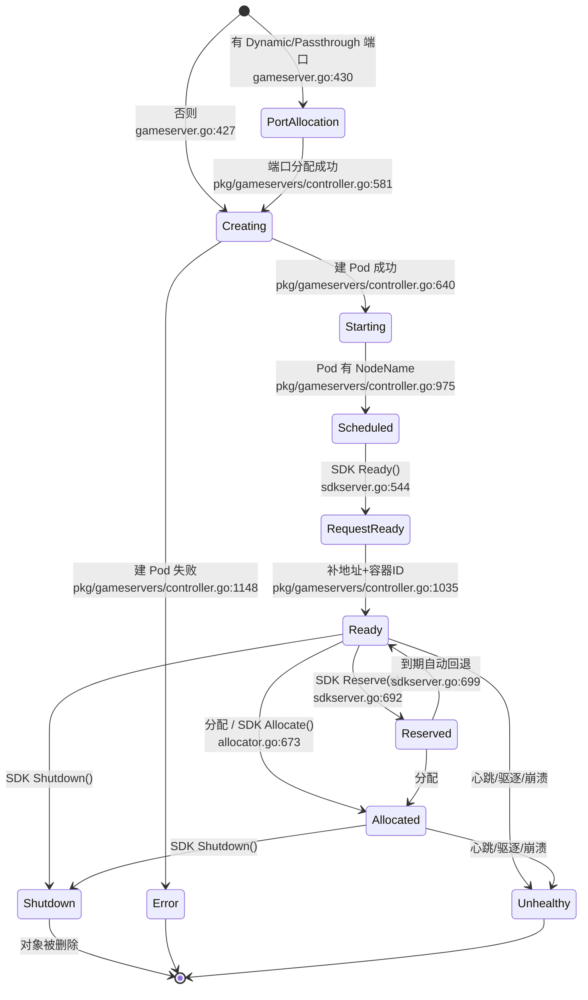

**三个语义判定方法**（业务含义的锚点）：

| 方法 | 含义 | 位置 |
|------|------|------|
| `IsBeforeReady()` | PortAllocation/Creating/Starting/Scheduled/RequestReady | `gameserver.go:674-689` |
| `IsActive()` | Allocated / Ready / Reserved | `gameserver.go:692-703` |
| `IsDeletable()` | **Allocated/Reserved 必须已有 DeletionTimestamp** | `gameserver.go:659-665` |

终态集合：`TerminalGameServerStates = {Shutdown, Error, Unhealthy}`（`gameserver.go:174-180`）。

> ⚠️ **没有 `Crashed` 状态**。容器崩溃被统一收敛为 `Unhealthy`（`pkg/gameservers/health.go:164-205`）。这是很多人凭 K8s 直觉猜错的地方。

### 1.4 GameServerSpec 关键字段

| 字段 | 行号 | 语义 |
|------|------|------|
| `Container` | 220 | 只在 Pod 有 >1 容器时必填 |
| `Ports []GameServerPort` | 222 | 可暴露的端口 |
| `Health` | 224 | 健康检查（4 个字段，见第三讲） |
| `Scheduling` | 226 | 默认 `Packed` |
| `SdkServer` | 228 | sidecar 参数（gRPC/HTTP 端口、日志级别） |
| `Template corev1.PodTemplateSpec` | 230 | 要创建的 Pod |
| `Players *PlayersSpec` | 233 | Alpha，`PlayerTracking` 门控 |
| `Counters` / `Lists` | 237 / 242 | Beta，`CountsAndLists` 门控，**key 必须创建时声明** |
| `Eviction *Eviction` | 245 | 默认 `Never` |

**`PortPolicy` 四种**（`gameserver.go:74-86`）：`Static`（用户指定 hostPort）/ `Dynamic`（系统分配）/ `Passthrough`（分配后 containerPort 也设成同值）/ `None`（忽略 hostPort）。默认 `Dynamic`（`:454`），默认 range 名 `default`（`:122`）。

### 1.5 Fleet / GameServerSet / FleetAutoscaler

**FleetSpec**（`pkg/apis/agones/v1/fleet.go:59-85`）：`Replicas`、`AllocationOverflow`、`Strategy`（默认 RollingUpdate）、`Scheduling`（默认 Packed）、`Priorities`、`Template`。

`FleetStatus`（`:88-113`）里有两个容易忽略的字段：
- `ReservedReplicas`（`:95`）：注释明说 "Reserved instances won't be deleted on scale down, but **won't cause an autoscaler to scale up**"——Reserved 不影响扩容决策。
- `Allocations int64`（`:99`）："a counter of the number of allocations observed"——**单调递增的分配计数**，不是当前副本数。

**GameServerSetSpec**（`gameserverset.go:58-82`）与 FleetSpec 几乎一样，但：
- `ValidateUpdate`（`:113-120`）规定 **`spec.template` 不可变更**——改模板只能靠 Fleet 滚动更新换新 Set。

**FleetAutoscaler 不在 `agones/v1` 下**，而在 `pkg/apis/autoscaling/v1/fleetautoscaler.go`（671 行）：

```go
// pkg/apis/autoscaling/v1/fleetautoscaler.go:59-67
type FleetAutoscalerSpec struct {
	FleetName string                `json:"fleetName"`
	Policy    FleetAutoscalerPolicy `json:"policy"`
	Sync      *FleetAutoscalerSync  `json:"sync,omitempty"`
}
```

7 种策略类型（`:122-157`）：`BufferPolicyType`(125) / `WebhookPolicyType`(128) / `CounterPolicyType`(133) / `ListPolicyType`(138) / `SchedulePolicyType`(143) / `ChainPolicyType`(148) / `WasmPolicyType`(152)；`defaultIntervalSyncSeconds int32 = 30`(156)。

### 1.6 GameServerAllocation

```go
// pkg/apis/allocation/v1/gameserverallocation.go:47
+genclient:onlyVerbs=create
```

> 这行注释是理解 GSA 的钥匙：**它只能 create，不是一个持久化的 CRD**。它是一次性的"分配请求"，POST 上去、同步返回、用完即弃。

`State` 枚举（`:33-41`）：`Allocated`(35) / `UnAllocated`(37) / `Contention`(40)。

Selector 结构（`:129-150`）：内联 `metav1.LabelSelector` + 可选 `GameServerState` + `Counters` / `Lists` 过滤。默认值 `GameServerState = Ready`（`:211`），**只允许 `Ready` 或 `Allocated`**（`:371-373`）。

**优先级排序**：`Spec.Preferred` 全部排在 `Spec.Required` **之前**，由 `Converter()` 拼成扁平 `Selectors` 数组：

```go
// pkg/apis/allocation/v1/gameserverallocation.go:586-593
func (gsa *GameServerAllocation) Converter() {
	if len(gsa.Spec.Selectors) == 0 {
		var selectors []GameServerSelector
		selectors = append(selectors, gsa.Spec.Preferred...)
		selectors = append(selectors, gsa.Spec.Required)
		gsa.Spec.Selectors = selectors
	}
}
```

**SchedulingStrategy**（`pkg/apis/scheduling.go:23` / `:30`）：
- `Packed`：优先分配到 **Allocated 最多、其次 Ready 最多**的节点上（bin pack）；
- `Distributed`：优先分配到 **Allocated 最少**的节点（打散）。

### 第一讲小结：三层 ownerRef + 一个非 subresource 的 Status

| 项 | 内容 |
|----|------|
| **一句话定位** | Fleet → GameServerSet → GameServer → Pod 靠 ownerRef 级联、label 查询；GameServer 的 Status **不做 subresource** 以换取原子分配 |
| **输入** | 用户提交的 CRD YAML |
| **输出** | 被 controller 消费的期望状态 |
| **三个最值得记住的点** | ① `IsDeletable()` 把 `Allocated`/`Reserved` 保护起来（`gameserver.go:659-665`），这是全系统所有"减 Allocated"逻辑的根源；② GameServer Status 非 subresource（`gameserver.go:187-198`）是刻意的原子性设计；③ Fleet 名通过 label **两跳透传**到 GameServer（`gameserverset.go:165`） |

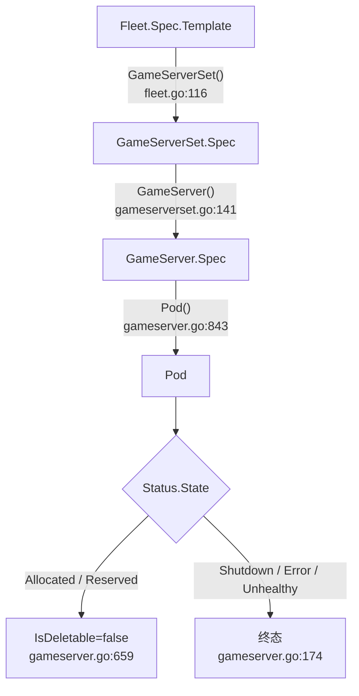

---

## 第二讲：控制面骨架 —— controller 进程与 workerqueue

### 先说人话：一个进程，四个 controller，一堆队列

Agones 的 controller 是**单进程多 controller** 形态，和 kube-controller-manager 同构。本讲解决三个问题：

1. `main()` 到各 controller 的启动链路；
2. workerqueue 这个自研封装到底做了什么；
3. GameServer controller 为什么要用**三条队列**。

### 2.1 `main()` 启动流程

```go
// cmd/controller/main.go:122-124
func main() {
	ctx, cancel := signals.NewSigKillContext()
	ctlConf := parseEnvFlags()
```

顺序：信号 context（`:123`）→ 解析配置（`:124`）→ 日志（`:126-137`）→ 建三个 client（`:150-171`）→ cloud product hooks（`:173-176`）→ 两个 informer factory（`:178-179`）→ metrics + health（`:181-203`）→ 构造 5 个 runner（`:207-222`）→ **先起 HTTP server**（`:232`）→ `whenLeader(...)` 里启动 informer 和 runner（`:234-244`）。

> 💡 **为什么 HTTP server 要先起**？源码注释解释得很清楚（`:230-231`）："Server has to be started earlier because it contains the health check. This allows the controller to not fail health check during install when there is replication"——安装期 controller 还没拿到 leader 锁，如果健康检查端点后起，Deployment 的 readiness probe 会一直失败导致滚动卡死。

**三个 client**（`cmd/controller/main.go:150-171`）：

```go
clientConf, err := runtime.InClusterBuildConfig(logger, ctlConf.KubeConfig)
clientConf.QPS = float32(ctlConf.APIServerSustainedQPS)   // 默认 100
clientConf.Burst = ctlConf.APIServerBurstQPS              // 默认 200
kubeClient, err := kubernetes.NewForConfig(clientConf)      // core
extClient, err := extclientset.NewForConfig(clientConf)     // CRD
agonesClient, err := versioned.NewForConfig(clientConf)     // Agones
```

**Leader election**（`:614-661`）：

```go
// cmd/controller/main.go:635-646
leaderelection.RunOrDie(ctx, leaderelection.LeaderElectionConfig{
	Lock:            lock,
	ReleaseOnCancel: true,        // :643
	LeaseDuration:   15 * time.Second,  // :644
	RenewDeadline:   10 * time.Second,  // :645
	RetryPeriod:     2 * time.Second,   // :646
	...
```

- Lease 名 `agones-controller-lock`（`:624`），namespace 默认 `agones-system`（`:270`）；
- **默认关闭**（`:271`），Helm 里 `replicas > 1` 时才注入 `LEADER_ELECTION=true`（`install/helm/agones/templates/controller.yaml:196-198`）；
- `ReleaseOnCancel: true` 有注释强调：必须让受保护的代码**先于** cancel 结束。

### 2.2 五个 runner

```go
// cmd/controller/main.go:207-222
runners := []runner{
	httpserver.Server,                       // :181, :232
	metrics.NewController,                   // :202（仅 Prometheus/Stackdriver 开启时）
	gameservers.NewPerNodeCounter,           // :207
	gameservers.NewController,               // :209-214
	gameserversets.NewController,            // :215-216
	fleets.NewController,                    // :217
	fleetautoscalers.NewController,          // :218-219
}
```

```go
// cmd/controller/main.go:610-612
type runner interface {
	Run(ctx context.Context, workers int) error
}
```

每个 runner 一个 goroutine，worker 数统一来自 `ctlConf.NumWorkers`，**默认 64**（`:274`）。

> ⚠️ ** allocation 不在 controller 进程里**。它是独立二进制 `cmd/allocator/`（另有集群内的聚合 API 由 `cmd/extensions/` 承载）。这是一个常见的误解点。

### 2.3 workerqueue：自研封装做了什么

`pkg/util/workerqueue/workerqueue.go`（267 行）是 client-go `workqueue` 的薄封装，但有几个 Agones 特有的设计：

**① 三种入队方式**：

| 方法 | 底层 | 用途 |
|------|------|------|
| `Enqueue` | `AddRateLimited` | 常规入队 |
| `EnqueueImmediately` | `Add` | 注释说用于 "continue partially completed work"（分批扩容时被截断，立刻再排一轮） |
| `EnqueueAfter` | `AddAfter` | 延迟入队 |

**② 两级限速器**：

```go
// pkg/util/workerqueue/workerqueue.go:88-102
func FastRateLimiter(maxDelay time.Duration) workqueue.TypedRateLimiter[any] {
	const numFastRetries = 5
	const fastDelay = 200 * time.Millisecond // first few retries up to 'numFastRetries' are fast
	return workqueue.NewTypedItemFastSlowRateLimiter[any](fastDelay, maxDelay, numFastRetries)
}
```

**③ `traceError` 机制**（`:41-64`）：有些错误想重试但**不想打 Error 日志**（比如正常的资源冲突），用 `NewTraceError` 包装后只以 Trace 级别记录（`:196-197`）。

**④ liveness 探针**：`Healthy()` 比对 `workers` 与 `running`（`:232-242`），被挂到健康检查（第三讲会看到三处）。

### 2.4 GameServer controller 的三条队列

这是 Agones 最值得学习的一处工程细节：

```go
// pkg/gameservers/controller.go:184-189
c.workerqueue = workerqueue.NewWorkerQueueWithRateLimiter(c.syncGameServer, ...)
c.creationWorkerQueue = workerqueue.NewWorkerQueueWithRateLimiter(c.syncGameServer, ..., "creation", ...)
c.deletionWorkerQueue = workerqueue.NewWorkerQueueWithRateLimiter(c.syncGameServer, ..., "deletion", ...)
health.AddLivenessCheck("gameserver-workerqueue", healthcheck.Check(c.workerqueue.Healthy))
```

**三条队列共用同一个 `syncGameServer` handler**，只按状态分流：

```go
// pkg/gameservers/controller.go:252-266
func (c *Controller) enqueueGameServerBasedOnState(gs *agonesv1.GameServer) {
	switch gs.Status.State {
	case agonesv1.GameServerStatePortAllocation, agonesv1.GameServerStateCreating:
		c.creationWorkerQueue.Enqueue(gs)     // 创建密集期
	case agonesv1.GameServerStateShutdown:
		c.deletionWorkerQueue.Enqueue(gs)     // 删除密集期
	default:
		c.workerqueue.Enqueue(gs)
	}
}
```

> 💡 **为什么值得学**：游戏服务器的创建（建 Pod）和删除（级联清理）都是**慢操作且会成批爆发**（Fleet 一次扩容几百个）。如果和稳态的 heartbeat/状态推进共用一条队列，一次大扩容就会把 `Ready → Allocated` 的实时性拖垮。分流后三条队列互不阻塞。

**informer 事件过滤**（`:197-199`）：GameServer 的 `UpdateFunc` 只在 **`Status.State` 变化或 `DeletionTimestamp` 非零**时才入队——避免 sidecar 频繁写 label/annotation 引发无谓的 sync。

### 2.5 syncHandler：一条串行的状态推进链

```go
// pkg/gameservers/controller.go:500-523
if gs, err = c.syncGameServerDeletionTimestamp(ctx, gs); err != nil {   // :500
if gs, err = c.syncGameServerPortAllocationState(ctx, gs); err != nil { // :503
if gs, err = c.syncGameServerCreatingState(ctx, gs); err != nil {       // :506
if gs, err = c.syncGameServerStartingState(ctx, gs); err != nil {       // :509
if gs, err = c.syncGameServerRequestReadyState(ctx, gs); err != nil {   // :512
if gs, err = c.syncGameServerPodIPs(ctx, gs); err != nil {              // :515
if gs, err = c.syncDevelopmentGameServer(ctx, gs); err != nil {         // :518
if err := c.syncGameServerShutdownState(ctx, gs); err != nil {          // :521
```

> 🔑 每个 `syncXxxState` **只在当前状态匹配时才动作**，所以一次 sync 可以连续推进多步（例如 `PortAllocation → Creating → Starting`）。这是一个"状态机的链式实现"——没有显式的 switch，而是让每个函数自己判断"现在该不该我干"。

### 第二讲小结：单进程 + 多队列 + 链式状态推进

| 项 | 内容 |
|----|------|
| **一句话定位** | `cmd/controller` 单进程起 5 个 runner；GameServer controller 用**三条队列按状态分流**；sync 是一条只在匹配状态时动作的**串行推进链** |
| **输入** | informer 事件（GameServer / Pod / Node） |
| **输出** | 写回 GameServer 对象 + 创建/删除 Pod |
| **三个最值得记住的点** | ① HTTP server **先于** leader election 启动（`:230-232`）；② 三条队列分流创建/删除/稳态（`:252-266`）避免大扩缩容拖垮实时性；③ sync 链靠"每个函数自己判断该不该干"实现状态推进（`:500-523`） |

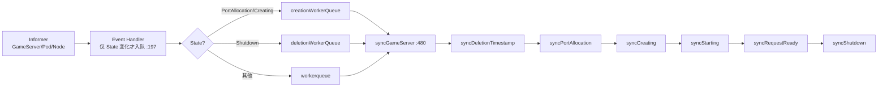

---

## 第三讲：GameServer 生命周期与 SDK Server

### 先说人话：controller 推前半段，sidecar 推后半段

这是 Agones 最独特的地方：**游戏进程自己决定什么时候 Ready、什么时候结束**。controller 只负责"把 Pod 建出来、把地址填进去"，之后控制权交给每个 Pod 里的 sidecar。

### 3.1 状态迁移总表

| 源状态 | 目标状态 | 触发条件 | 源码位置 |
|--------|---------|---------|---------|
| (创建) | `PortAllocation` | 端口策略含 Dynamic/Passthrough | `pkg/apis/agones/v1/gameserver.go:430` |
| (创建) | `Creating` | 全 Static/None | `gameserver.go:427` |
| `PortAllocation` | `Creating` | `portAllocator.Allocate()` 成功 | `pkg/gameservers/controller.go:579-581` |
| `Creating` | `Starting` | `createGameServerPod` 成功 | `pkg/gameservers/controller.go:629-644`（状态写于 `:640`） |
| `Creating` | `Error` | Pod 创建失败 | `pkg/gameservers/controller.go:698/728/732` → `moveToErrorState` `:1148-1163` |
| `Starting` | `Scheduled` | Pod 已有 `NodeName`，写 Address/Ports | `pkg/gameservers/controller.go:959-980`（`:975`） |
| `Scheduled` | `RequestReady` | SDK `Ready()` | `pkg/sdkserver/sdkserver.go:541-546` |
| `RequestReady` | `Ready` | controller 补地址 + ready-container-id | `pkg/gameservers/controller.go:988-1046`（`:1035`） |
| `Ready` | `Reserved` | SDK `Reserve(seconds)` | `sdkserver.go:678-695`（`:692`） |
| `Reserved` | `Ready` | 到期自动回退 | `sdkserver.go:699-709` |
| `Ready`/`Reserved` | `Allocated` | 分配 或 SDK `Allocate()` | `allocator.go:673` / `sdkserver.go:549-553` |
| 任意非终态 | `Shutdown` | SDK `Shutdown()` 或 Pod Succeeded | `sdkserver.go:558-564` / `succeeded.go:190` |
| 任意非终态 | `Unhealthy` | 心跳失败 / 驱逐 / 容器崩溃 / 无空闲端口 | `sdkserver.go:1418-1424`、`health.go:154-205` |
| `Shutdown` | (对象删除) | controller 删 GameServer，级联删 Pod | `pkg/gameservers/controller.go:1131-1145`（`:1139`） |

### 3.2 sdk-server：三个端口与三类 service

```go
// cmd/sdk-server/main.go:49-52
defaultGRPCPort   = 9357
defaultHTTPPort   = 9358
defaultHealthPort = 8080
```

启动后注册三个 gRPC service（`cmd/sdk-server/main.go:188-190`）：`sdk`（Stable）、`sdkalpha`、`sdkbeta`。HTTP 侧由 **grpc-gateway** 反代到 9357（`:267-293`），所以 REST 与 gRPC **共用同一套实现**。

**RPC 清单**：

| RPC | Stage | 位置 | 作用 |
|-----|-------|------|------|
| `Ready` | Stable | `sdkserver.go:541-546` | 置 `RequestReady`（controller 再转 `Ready`） |
| `Allocate` | Stable | `:549-553` | 置 `Allocated` + 写 `last-allocated` 注解 |
| `Shutdown` | Stable | `:558-564` | 置 `Shutdown` |
| `Health` (client-stream) | Stable | `:568-581` | 每收一帧刷新 `healthLastUpdated` |
| `GetGameServer` | Stable | `:646-653` | 只读 |
| `WatchGameServer` (server-stream) | Stable | `:657-675` | 订阅对象变化 |
| `SetLabel` / `SetAnnotation` | Stable | `:585-643` | 写 `agones.dev/sdk-<key>` 前缀的元数据 |
| `Reserve(Duration)` | Stable | `:678-695` | 置 `Reserved` + `ReservedUntil`，起回落定时器 |
| `PlayerConnect` / `PlayerDisconnect` | Alpha | `:725-778` | 玩家进出（FeatureGate 门控） |
| `GetCounter` / `UpdateCounter` | Beta | `:856-1000` | 计数器（批量合并 1s） |
| `GetList` / `AddListValue` / ... | Beta | `:1073-1355` | 列表（最大容量 1000） |

### 3.3 SDK 调用如何写回：本地缓存 + JSON Patch

**读**：sidecar 起一个**只 watch 自己这一个 GameServer** 的 informer：

```go
// pkg/sdkserver/sdkserver.go:157-164
resync := 0 * time.Second
tweakListOptions := func(opts *metav1.ListOptions) {
	s1 := fields.OneTermEqualSelector("metadata.name", gameServerName)
	opts.FieldSelector = s1.String()
}
factory := externalversions.NewSharedInformerFactoryWithOptions(agonesClient, resync,
	externalversions.WithNamespace(namespace), externalversions.WithTweakListOptions(tweakListOptions))
```

> 用 `metadata.name` 做 field selector，**每个 sidecar 只订阅一个对象**，这是 Sidecar 模式在 K8s 里的标准优化。

**写**：所有变更先进一个**单 worker 的限速队列**（默认 500ms 一个请求，`cmd/sdk-server/main.go:311`），再由 `syncGameServer` 分发（`:338-357`），最后用 JSON Patch 打回：

```go
// pkg/sdkserver/sdkserver.go:465-477
patch, err := gs.Patch(gsCopy)
gs, err = s.gameServerGetter.GameServers(s.namespace).Patch(ctx, gs.GetObjectMeta().GetName(),
	types.JSONPatchType, patch, metav1.PatchOptions{})
```

**状态写入的两个守卫**（`sdkserver.go:376-393`）：不允许覆盖正在删除的对象；**不允许从 `Unhealthy` 逃出**。

### 3.4 健康检查：三层

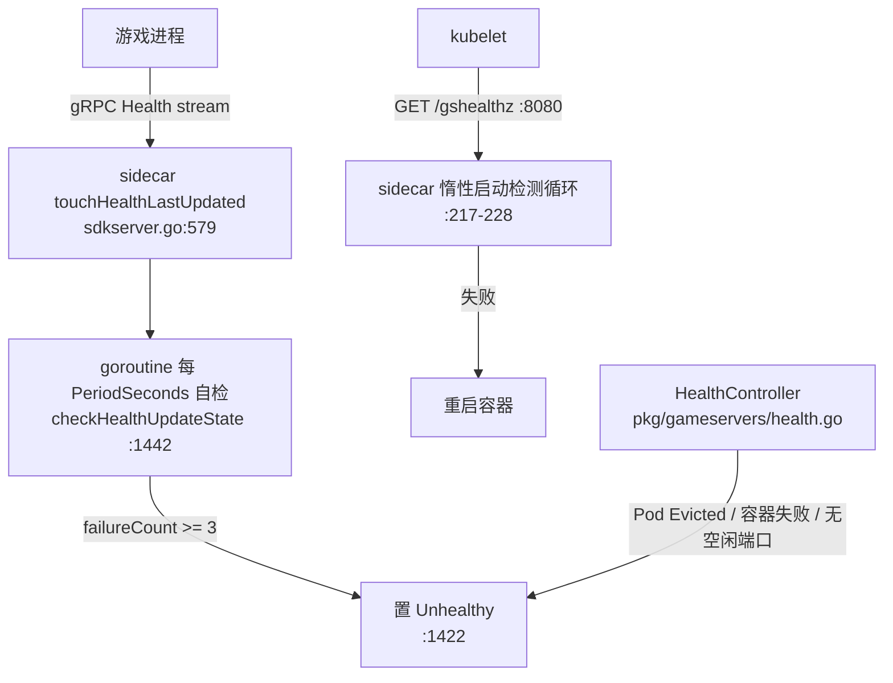

| 层 | 机制 | 默认值 | 位置 |
|----|------|--------|------|
| ① 心跳 | SDK 客户端流式 `Health()` | — | `sdkserver.go:568-581` |
| ② sidecar 自检 | `wait.Until(checkHealthUpdateState, healthTimeout, ...)` | `PeriodSeconds=5`、`FailureThreshold=3` | `:1442`、`gameserver.go:413/416` |
| ③ kubelet 探针 | `/gshealthz` liveness（controller 注入） | `InitialDelaySeconds=5` | `pkg/gameservers/controller.go:840-874`、`gameserver.go:419` |
| ④ controller 兜底 | `isUnhealthy(pod)` 判驱逐/崩溃/无端口 | — | `health.go:115-117` |

> ⚠️ **`Health` 结构只有 4 个字段，没有 `TimeoutSeconds`**：`Disabled` / `PeriodSeconds` / `FailureThreshold` / `InitialDelaySeconds`（`gameserver.go:263-273`）。`PeriodSeconds` 兼任"心跳间隔"和"超时窗口"两职（`:264` `s.healthTimeout = PeriodSeconds * time.Second`）。

**防误判的巧技**：`skipUnhealthyGameContainer`（`health.go:305-356`）用 `agones.dev/ready-container-id` 注解区分"Ready 之前崩溃（可重启）"与"Ready 之后崩溃（→ Unhealthy）"。

### 3.5 端口分配：每 Node 一张位图

```go
// pkg/portallocator/portallocator.go:40-58
type Interface interface {
	Run(ctx context.Context) error
	Allocate(gs *agonesv1.GameServer) *agonesv1.GameServer
	DeAllocate(gs *agonesv1.GameServer)
}
type PortRange struct { MinPort int32; MaxPort int32 }
```

核心扫描（`:193-210`）与 Passthrough 语义（`:236-240`）：

```go
gs.Spec.Ports[i].HostPort = a.port
if p.PortPolicy == agonesv1.Passthrough {
	gs.Spec.Ports[i].ContainerPort = a.port   // containerPort 也被改成同值
}
```

**端口耗尽时递归扩容位图**（`:272-274`），注释说明是为了配合 Cluster Autoscaler——**没有空闲端口 ≠ 游戏服务器坏了**，可能是节点不够。

**失败回滚**（`pkg/gameservers/controller.go:589`）：分配后 Update 失败立即 `DeAllocate`，避免端口泄漏。

### 3.6 Pod 创建与环境变量注入

```go
// pkg/gameservers/controller.go:692-720
func (c *Controller) createGameServerPod(ctx context.Context, gs *agonesv1.GameServer) (*agonesv1.GameServer, error) {
	sidecar := c.sidecar(gs)                        // :693
	pod, err := gs.Pod(c.controllerHooks, sidecar)  // :694
	...
	err = c.addGameServerHealthCheck(gs, pod)        // :713
	c.addSDKServerEnvVars(gs, pod)                   // :717
	pod, err = c.podGetter.Pods(...).Create(ctx, pod, metav1.CreateOptions{})  // :720
```

**sidecar 容器注入的环境变量**（`pkg/gameservers/controller.go:750-779`）：

| 变量 | 值 | 行号 |
|------|-----|------|
| `GAMESERVER_NAME` | `gs.ObjectMeta.Name` | `:751-754` |
| `POD_NAMESPACE` | `metadata.namespace`（fieldRef） | `:755-762` |
| `FEATURE_GATES` | `runtime.EncodeFeatures()` | `:763-766` |
| `LOG_LEVEL` | `gs.Spec.SdkServer.LogLevel` | `:767-770` |
| `REQUESTS_RATE_LIMIT` | 默认 `500ms` | `:771-774` |
| `MAX_LIST_ITEMS` | 默认 1000 | `:775-778` |

**游戏容器注入**：`AGONES_SDK_GRPC_PORT` / `AGONES_SDK_HTTP_PORT`（常量在 `pkg/gameservers/controller.go:65-66`，注入逻辑 `:918-933`）。SDK 客户端默认连 `localhost:9357`，30s 握手超时（`sdks/go/sdk.go:55-68`）。

### 3.7 Eviction：三态模型 + PDB

```go
// pkg/apis/agones/v1/gameserver.go:88-101
EvictionSafeAlways    EvictionSafe = "Always"     // :94
EvictionSafeOnUpgrade EvictionSafe = "OnUpgrade"  // :97
EvictionSafeNever     EvictionSafe = "Never"      // :100   ← 默认（:482）
```

落地到 Pod 的两个元数据（`pkg/cloudproduct/eviction/eviction.go:27-59`）：

| eviction.safe | `safe-to-evict` 注解 | `agones.dev/safe-to-evict` 标签 |
|---------------|---------------------|-------------------------------|
| `Always` | `"true"` | `"true"` |
| `OnUpgrade` | `"false"`（挡 CA 缩容） | `"true"`（不匹配严格 PDB） |
| `Never`（默认） | `"false"` | `"false"`（**匹配严格 PDB**） |

配套 PDB 名 `agones-gameserver-safe-to-evict-false`，selector `agones.dev/safe-to-evict: "false"`（`install/helm/agones/templates/pdb.yaml:20-26`）。

> 💡 这套"注解给 Cluster Autoscaler 看、标签给 PDB 看"的双元数据设计，是 K8s 上保护有状态工作负载的标准打法。

### 3.8 云厂商抽象

```go
// pkg/cloudproduct/cloudproduct.go:43-55
type ControllerHooksInterface interface {
	agonesv1.APIHooks
	SyncPodPortsToGameServer(*agonesv1.GameServer, *corev1.Pod) error
	NewPortAllocator(...) portallocator.Interface
	WaitOnFreePorts() bool
}
```

**本版本只有两个实现**（没有独立的 EKS/AKS 包）：

| 产品 | 位置 | 特殊处理 |
|------|------|---------|
| `generic`（含 EKS/AKS/GKE Standard） | `pkg/cloudproduct/generic/generic.go:32-55` | 全放行，标准端口分配器 |
| `gke-autopilot` | `pkg/cloudproduct/gke/gke.go:100-102` | 读 `autopilot.gke.io/host-port-assignment` 注解做端口重映射（`:104-125`）、强制 Packed（`:153-160`）、`WaitOnFreePorts()=true`（`:135`） |

### 第三讲小结：状态机是"双人舞"

| 项 | 内容 |
|----|------|
| **一句话定位** | controller 建 Pod 推到 `Scheduled`，之后由 **sidecar 通过 gRPC + JSON Patch 反向写 CRD**；健康检查三层；端口按 Node 位图分配 |
| **输入** | GameServer CRD + SDK 的 gRPC 调用 |
| **输出** | Pod + 状态迁移 + `Status.Ports/Address` |
| **三个最值得记住的点** | ① `Ready`/`Allocated`/`Shutdown` 由**游戏进程**发起（`sdkserver.go:541/549/558`），controller 无权决定；② sidecar 直连 API Server 做 JSON Patch（`:471`），不经过 controller；③ `Reserved` 是**唯一会自动回退**的状态（`:699-709`） |

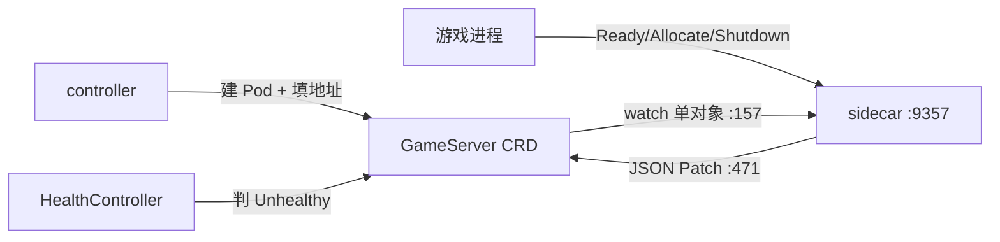

---

## 第四讲：Fleet 与 GameServerSet 编排

### 先说人话：Fleet 只管"数量"，GameServerSet 才管"生死"

Fleet controller **不直接创建 GameServer**。它把 `Fleet.Spec.Template` 摊平成若干 GameServerSet，通过改 `Replicas` 实现滚动更新，最后把各 Set 的 status 聚合回 Fleet。

### 4.1 Fleet controller 主流程

```go
// pkg/fleets/controller.go:330-355
list, err := ListGameServerSetsByFleetOwner(gameServerSetNamespacedLister, fleet)
active, rest := c.filterGameServerSetByActive(fleet, list)
if active == nil {
	active = fleet.GameServerSet()     // 内存里造一个，还没持久化
}
replicas, err := c.applyDeploymentStrategy(ctx, fleet, active, rest)
if err := c.deleteEmptyGameServerSets(ctx, fleet, rest); err != nil { ... }
if err := c.upsertGameServerSet(ctx, fleet, active, replicas); err != nil { ... }
return c.updateFleetStatus(ctx, fleet)
```

**`Replicas` 不是原始值，而是被策略"折减"后的目标**。

### 4.2 滚动更新：两个参数，两个基数

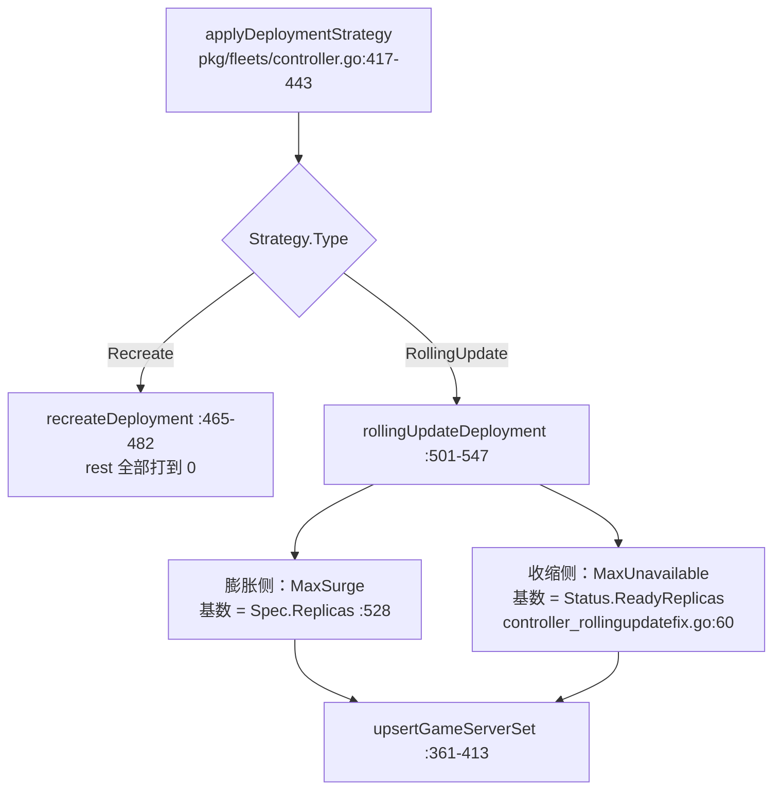

**膨胀侧的四道闸门**（`pkg/fleets/controller.go:501-547`）：

```go
// ① 正在滚动中 → 等
if active.Spec.Replicas != active.Status.Replicas {
	return replicas, nil
}
// ② 目标为 0 → 滚动无意义
if fleet.Spec.Replicas == 0 { return 0, nil }
// ③ 已够（给 Allocated 留位置）→ 直接返回
if active.Spec.Replicas >= (fleet.Spec.Replicas - sumAllocated) {
	return fleet.LowerBoundReplicas(fleet.Spec.Replicas - sumAllocated), nil
}
// ④ 按 MaxSurge 加，再夹逼
r, err := intstr.GetValueFromIntOrPercent(fleet.Spec.Strategy.RollingUpdate.MaxSurge, int(fleet.Spec.Replicas), true)
```

**收缩侧的核心不动点**（`pkg/fleets/controller_rollingupdatefix.go:59-89`）：

```go
minAvailable := min(fleet.Status.ReadyReplicas-unavailable, fleet.Spec.Replicas)
newGSSUnavailablePodCount := active.Spec.Replicas - active.Status.ReadyReplicas - active.Status.ReservedReplicas -
	active.Status.AllocatedReplicas - active.Status.ShutdownReplicas
maxScaledDown := readyReplicasCount - minAvailable - newGSSUnavailablePodCount

if maxScaledDown <= 0 {
	return nil    // ← 新 Set 还没起来一批 Ready，旧 Set 不许往下调
}
```

> 🔑 这与 K8s Deployment 的 `scaleDownOldReplicaSetsForRollingUpdate` 同构：**先起新的，再收旧的**。

**Recreate 与 RollingUpdate 的一处不一致**（值得记住）：`Recreate` 只减 `Allocated`（`pkg/fleets/controller.go:465-482`），而 `RollingUpdate` 的某条分支减的是 `Reserved + Allocated`（`:428-430`）。

### 4.3 GameServerSet 扩缩容：两趟扫描

```go
// pkg/gameserversets/controller.go:409-414
// pass 1 - count allocated/reserved servers only, since those can't be touched
for _, gs := range list {
	if !gs.IsDeletable() {
		upCount++
	}
}
```

**第一趟只数不可删的（Allocated/Reserved），它们连候选都进不去**；第二趟才扫其余状态。

**三个节流阀门**（`:473-487`）：

| 阀门 | 默认值 | 作用 |
|------|--------|------|
| `maxCreations` | 64 | 单批最大创建数 |
| `maxPending` | 5000 | 允许的最大 Pending Pod 总数（防打爆 kubelet） |
| `maxDeletions` | 64 | 单批最大删除数 |

被截断则 `partialReconciliation = true`，返回后 `defer c.workerqueue.EnqueueImmediately(gsSet)`（`:354-359`）立刻再排一轮。

### 4.4 删除顺序：按调度策略排序，不是固定优先级

```go
// pkg/gameserversets/controller.go:490-498
if deleteCount > 0 {
	potentialDeletions = SortGameServersByStrategy(strategy, potentialDeletions, counts, priorities)
	toDelete = append(toDelete, potentialDeletions[0:deleteCount]...)
}
```

排序实现在 `pkg/gameserversets/gameserversets.go:46-119`：

- **Packed**（`:55-102`）：未调度/节点已删的排最前 → 同节点内 `IsBeforeReady` 优先于 Ready → 节点 `(Allocated+Ready)` **少**的优先 → 按 `NodeName` 字典序（使同一节点被排空）。
- **Distributed**（`:106-119`）：先按 Counter/List Priorities，再按 `CreationTimestamp` **最老的排最前**。

> 💡 **这与分配侧的排序方向正好相反**：分配往"最挤"的节点塞（`allocation_cache.go:197-211` `(Allocated+Ready)` 多的排前），缩容从"最空"的节点收。二者互补，使 GameServer 密度收敛、缩容效率最高。

**删除动作是"置 Shutdown"而不是 Delete 对象**（`:550-562`）：

```go
// We should not delete the gameservers directly buy set their state to shutdown and let the gameserver controller to delete
gsCopy.Status.State = agonesv1.GameServerStateShutdown
```

**Error 状态的 30s 宽限期**（`:503-519`，常量 `gameServerErrorDeletionDelay = 30 * time.Second` 在 `:64`）：崩坏型 template 会被遏制创建 churn。

### 4.5 AllocationOverflow：溢出标记

由 GameServerSet 内一个**独立 controller** 实现（`pkg/gameserversets/allocation_overflow.go`）。触发条件 `Status.AllocatedReplicas > Spec.Replicas`（`:89`、`:134`）：

```go
// pkg/gameserversets/allocation_overflow.go:138-161
overflow := gsSet.Status.AllocatedReplicas - gsSet.Spec.Replicas
list, err := ListGameServersByGameServerSetOwner(c.gameServerLister, gsSet)
matches, rest := gsSet.Spec.AllocationOverflow.CountMatches(list)
if matches >= overflow { return nil }
rest = SortGameServersByStrategy(gsSet.Spec.Scheduling, rest, c.counter.Counts(), gsSet.Spec.Priorities)
rest = rest[:(overflow - matches)]
for _, gs := range rest {
	gsSet.Spec.AllocationOverflow.Apply(gsCopy)   // 打 label/annotation
	...
}
```

> 用途：当集群缩容但仍有 Allocated 的 GameServer 时，给"超出"的那部分打标记，供外部监控系统识别（"这些是溢出实例，别按常规告警"）。

### 第四讲小结：数量在 Fleet，生死在 GameServerSet

| 项 | 内容 |
|----|------|
| **一句话定位** | Fleet 只算 GameServerSet 的 `Replicas`；GameServerSet 做多退少补，**删除顺序由 Packed/Distributed 排序决定**，`Allocated`/`Reserved` 绝对保护 |
| **输入** | `Fleet.Spec.Replicas` / `Strategy` / `Scheduling` |
| **输出** | GameServerSet 的 `Replicas`；GameServer 的创建与置 `Shutdown` |
| **三个最值得记住的点** | ① `MaxSurge` 以 `Spec.Replicas` 为基数、`MaxUnavailable` 以 `Status.ReadyReplicas` 为基数（`:528` / `controller_rollingupdatefix.go:60`）；② 缩容删除**没有固定状态优先级**，是排序后取前 N（`:490-498`）；③ 删除是"置 Shutdown"而非 Delete（`:550-562`） |

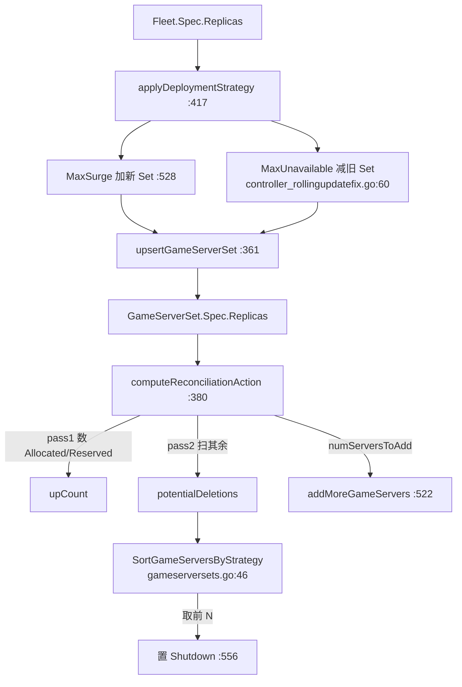

---

## 第五讲：GameServerAllocation —— 分配的两条路径

### 先说人话：一次 RPC 换来一个 IP:Port

匹配器拿到一批玩家后，向 Agones 要一个可用的游戏服务器。本讲回答：请求怎么进来的、怎么挑、并发怎么保证安全、没货时怎么返回。

### 5.1 两条路径

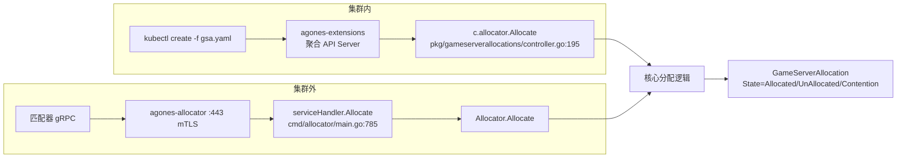

**集群内是"聚合 API Server + 只注册 create 动词"**：

```go
// pkg/gameserverallocations/controller.go:125-138
resource := metav1.APIResource{
	Name: "gameserverallocations", SingularName: "gameserverallocation",
	Namespaced: true, Kind: "GameServerAllocation",
	Verbs: []string{"create"},     // ← 只有 create
	ShortNames: []string{"gsa"},
}
c.api.AddAPIResource(allocationv1.SchemeGroupVersion.String(), resource, func(w http.ResponseWriter, r *http.Request, n string) error {
	return c.processAllocationRequest(ctx, w, r, n)
})
```

**集群外是独立二进制 `cmd/allocator`**，gRPC 与 REST **复用同一个端口**（443 → targetPort 8443，`install/helm/agones/values.yaml:265-275`），靠 `grpcHandlerFunc` 嗅探 Content-Type 分流（`cmd/allocator/main.go:223`、`:403-415`）。mTLS 客户端认证默认开启（`:115-116`）。

### 5.2 分配缓存：只收 Ready 与 Allocated

```go
// pkg/gameserverallocations/cache.go:23-29
type gameServerCache struct {
	mu    sync.RWMutex
	cache map[string]*agonesv1.GameServer   // key = namespace/name
}
```

⚠️ **注意不是按 fleet 分桶**，是**扁平的一个 map**。

**matcher 只收两个状态**（`pkg/gameserverallocations/allocation_cache.go:39-42`）：

```go
func readyOrAllocatedGameServerMatcher(gs *agonesv1.GameServer) bool {
	return gs.Status.State == agonesv1.GameServerStateReady || gs.Status.State == agonesv1.GameServerStateAllocated
}
```

> 🔑 **为什么要收 Allocated**？为了让**同一个已 Allocated 的 GameServer 能被反复分配**（多轮 Matchmaking 场景，玩家陆续加入同一局）。这也是为什么系统必须写 `agones.dev/last-allocated` 时间戳注解——保证每次 Update 都产生 resourceVersion 变化，被 webhook 视为有效更新。

**Store 有版本保护**（`cache.go:43-52`）：Generation 更小、或 ResourceVersion 相同则直接丢弃（顺带省一次 DeepCopy）。防的是**乱序 watch 事件回写旧对象**。

**watch 事件只有 Update/Delete，没有 AddFunc**（`allocation_cache.go:65-96`）：

```go
switch {
case newGs.IsBeingDeleted():
	c.cache.Delete(key)
case c.matcher(newGs):
	c.cache.Store(key, newGs)
case c.matcher(oldGs):
	c.cache.Delete(key)
}
```

### 5.3 Packed vs Distributed：三处差异

**① 排序阶段**（`allocator.go:566-573`）：

```go
if list == nil {
	if req.gsa.Spec.Scheduling == apis.Packed {
		list = c.allocationCache.ListSortedGameServers(req.gsa)
	} else {
		// If Scheduling == Distributed, sort game servers by Priorities
		list = c.allocationCache.ListSortedGameServersPriorities(req.gsa)
	}
}
```

Distributed 走 `ListSortedGameServersPriorities`，**完全不看节点计数**。

**② Packed 排序把 Allocated 排最前**（`allocation_cache.go:182-211`）：

```go
// Search Allocated GameServers first.
if gs1.Status.State != gs2.Status.State {
	return gs1.Status.State == agonesv1.GameServerStateAllocated
}
...
if c1.Allocated > c2.Allocated { return true }
...
// prefer nodes that have the most Ready gameservers on them - they are most likely to be
// completely filled and least likely target for scale down.
if c1.Ready > c2.Ready { return true }
```

**③ Distributed 遍历阶段随机化**（`pkg/gameserverallocations/find.go:49-76`）：无 Priorities 时 `rand.Shuffle` 打乱索引；**一旦配了 Priorities 就退化成顺序遍历**（注释在 `:68-70`）。

### 5.4 并发安全：单 goroutine 事件循环

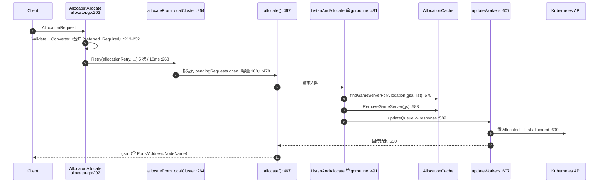

> 🔑 **没有全局锁**。并发安全靠两点：`gameServerCache` 自己的 `sync.RWMutex`；以及 **`ListenAndAllocate` 是单 goroutine**消费 `pendingRequests`，天然串行化"挑服"这个临界操作。

**Batch 失效条件**（`allocator.go:540-562`）：请求数达 `maxBatchBeforeRefresh = 100`（`:84`），或本请求的 `SortKey()` 与当前批不同 → 整列表作废重排。`SortKey` 是 `Spec` 的哈希，避免不同优先级的请求共用同一份排好序的列表。

### 5.5 失败语义：不是错误码

```go
// pkg/gameserverallocations/allocator.go:281-308
if err != nil && !goErrors.Is(err, ErrNoGameServer) && !goErrors.Is(err, ErrConflictInGameServerSelection) {
	c.allocationCache.Resync()
	return nil, err
}
switch {
case goErrors.Is(err, ErrNoGameServer), goErrors.Is(err, ErrGameServerUpdateConflict):
	gsa.Status.State = allocationv1.GameServerAllocationUnAllocated
case goErrors.Is(err, ErrConflictInGameServerSelection):
	gsa.Status.State = allocationv1.GameServerAllocationContention
default:
	gsa.Status.State = allocationv1.GameServerAllocationAllocated
	...
}
```

HTTP 层最终给 **201 Created**（`pkg/gameserverallocations/controller.go:203-204`）；gRPC 侧默认映射 `429 Too Many Requests`（`cmd/allocator/main.go:122`）。

⚠️ **这是最容易踩的坑**：很多人在客户端判断 HTTP 状态码，结果"没货"时拿到 201 以为成功了。**必须看 `Status.State`**。

### 5.6 多集群分配

入口 `MultiClusterSetting.Enabled`（`allocator.go:235`），实现 `applyMultiClusterAllocation`（`:316-360`）：List `GameServerAllocationPolicy` → 按 `PolicySelector` 过滤 → `NewConnectionInfoIterator` 按权重/顺序迭代（`:332`）。

**防环机制**：远程调用前把 `MultiClusterSetting.Enabled = false`（`:377`），防止目的地集群再次转发。

**两套重试**（`:88-99`）：本地 5 次 10ms（Factor=1.0）；远程 7 次 100ms（**Factor=2.0 指数**）。且 `Retry()` 对 `ResourceExhausted` / `ErrNoGameServer` / `ErrTotalTimeoutExceeded` **立即返回不重试**（`:720-728`）——因为这些重试也没用。

### 第五讲小结：批处理 + 串行挑服 + 非错误码失败

| 项 | 内容 |
|----|------|
| **一句话定位** | 两条路径（聚合 API / 独立 allocator）共用同一套 `Allocator`；核心是「排序列表 + 单 goroutine 批处理 + 短重试」 |
| **输入** | `GameServerAllocation`（含 Selectors / Scheduling / MetaPatch） |
| **输出** | `GameServerAllocation` Status（Allocated 时带 Ports/Address/NodeName） |
| **三个最值得记住的点** | ① 缓存只收 Ready 与 Allocated（`allocation_cache.go:39-42`），**收 Allocated 是为了支持重复分配**；② 并发安全靠**单 goroutine 事件循环**而非全局锁（`allocator.go:491`）；③ 没货返回 **201 + UnAllocated**，不是错误码（`:286-288`） |

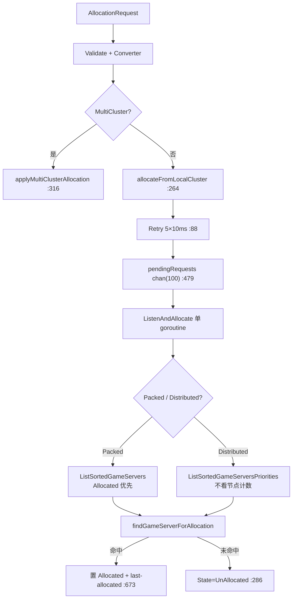

---

## 第六讲：FleetAutoscaler、可观测性与部署拓扑

### 先说人话：什么时候该多开几台游戏服务器

`FleetAutoscaler` 回答的问题很朴素：**保持多少个"空着的"游戏服务器，才能让玩家不用等**。

### 6.1 七种策略

```go
// pkg/fleetautoscalers/fleetautoscalers.go:73-91
switch pol.Type {
case autoscalingv1.BufferPolicyType:
	replicas, limited, err = applyBufferPolicy(state, pol.Buffer, f, fasLog)
case autoscalingv1.WebhookPolicyType:
	replicas, limited, err = applyWebhookPolicy(ctx, state, pol.Webhook, f, fasLog)
case autoscalingv1.CounterPolicyType:
	...
case autoscalingv1.ListPolicyType:
	...
case autoscalingv1.SchedulePolicyType:
	replicas, limited, err = applySchedulePolicy(ctx, state, pol.Schedule, f, ..., time.Now(), fasLog)
case autoscalingv1.ChainPolicyType:
	replicas, limited, err = applyChainPolicy(...)
case autoscalingv1.WasmPolicyType:
	replicas, limited, err = applyWasmPolicy(ctx, state, pol.Wasm, f, fasLog)
default:
	err = errs.New("wrong policy type, should be one of: Buffer, Webhook, Counter, List, Schedule, Chain")
}
```

| 策略 | 实现 | 依据 | 夹逼 | Feature Gate |
|------|------|------|------|--------------|
| Buffer | `fleetautoscalers.go:379-416` | `Fleet.Status.AllocatedReplicas` | Min/MaxReplicas | 默认开 |
| Webhook | `:288-377` | 外部 HTTP 服务 | 由服务决定 | 默认开 |
| Counter | `:442-561` | `Status.Counters[key]` 的 Count/Capacity | Min/MaxCapacity | `CountsAndLists` |
| List | 同上（`l != nil` 分支 `:479-500`） | `Status.Lists[key]` | 同上 | `CountsAndLists` |
| Schedule | `:563-578` + `isScheduleActive:651-702` | cron / 时间窗 | 由内层策略 | `ScheduledAutoscaler` |
| Chain | `:580-648` | 顺序尝试，第一个不报错者生效 | 由命中策略 | `ScheduledAutoscaler` |
| Wasm | `:101-207`（Extism） | Wasm 导出函数（默认 `scale`） | 由模块 | `WasmAutoscaler`（默认 **false**） |

### 6.2 Buffer：算的是 Allocated，不是 Ready

```go
// pkg/fleetautoscalers/fleetautoscalers.go:382-410
if b.BufferSize.Type == intstr.Int {
	replicas = f.Status.AllocatedReplicas + int32(b.BufferSize.IntValue())
} else {
	bufferPercent, err := intstr.GetValueFromIntOrPercent(&b.BufferSize, 100, true)
	replicas = int32(math.Ceil(float64(f.Status.AllocatedReplicas*100) / float64(100-bufferPercent)))
}
if replicas < b.MinReplicas { replicas = b.MinReplicas; scalingInLimited = true }
if replicas > b.MaxReplicas { replicas = b.MaxReplicas; scalingOutLimited = true }
```

> 🔑 **两处反直觉**：
> ① **是 `AllocatedReplicas`，不是 `ReadyReplicas`**。API 注释（`pkg/apis/autoscaling/v1/fleetautoscaler.go:177-179`）解释：此处的 "ready" 指 "non-allocated"，这样在"Fleet 刚创建 / 集群容量不足"等边界下计算才稳定。
> ② **百分比是"反解"的**：30% 不是"乘 1.3"，而是"让 non-allocated 占比到 30%"，公式 `Allocated / (1 - pct)`。这避免了"按当前值增幅"的收敛震荡。

### 6.3 Webhook：HTTP 而非 gRPC

```go
// pkg/fleetautoscalers/fleetautoscalers.go:216-235
config := &tls.Config{}
state.httpClient = &http.Client{
	Timeout: 15 * time.Second,
	Transport: &http.Transport{ TLSClientConfig: config },
}
if w.CABundle != nil {
	if err := setCABundle(config, w.CABundle); err != nil { return nil, err }
}
scheme := "http"
if w.CABundle != nil { scheme = "https" }   // ← CABundle 非空即自动切 https
```

契约结构体在 `pkg/apis/autoscaling/v1/fleetautoscaler.go`（**不在 `proto/`**）：`FleetAutoscaleRequest:339-355`、`FleetAutoscaleResponse{UID, Scale, Replicas}:358-366`、`FleetAutoscaleReview:370-373`。

⚠️ **失败语义宽松**：`Scale == false` 时直接返回当前 `f.Status.Replicas` 且不报错（`:372-376`）。

### 6.4 同步周期：per-resource ticker

```go
// pkg/fleetautoscalers/controller.go:496-531
duration := time.Duration(fas.Spec.Sync.FixedInterval.Seconds) * time.Second
...
c.workerqueue.Enqueue(fas)   // 加入时立刻触发一次
go func() {
	wait.Until(func() {
		c.workerqueue.Enqueue(fas)
	}, duration, ctx.Done())
}()
```

**没有全局 `syncPeriod` 常量**——每个 FleetAutoscaler 一份 goroutine，周期取自 `spec.sync.fixedInterval.seconds`，默认 30s（`pkg/apis/autoscaling/v1/fleetautoscaler.go:156`）。`fasThreads` 按 **UID** 索引（不是 name，因为 name 会随时间复用，`:502`）。

**Status 更新**（`:436-462`）：`AbleToScale`、`ScalingLimited`、`CurrentReplicas`、`DesiredReplicas`、`LastScaleTime`、`LastAppliedPolicy`；被夹逼时发 `ScalingLimited` Warning 事件。

### 6.5 可观测性：OpenCensus + 双 exporter

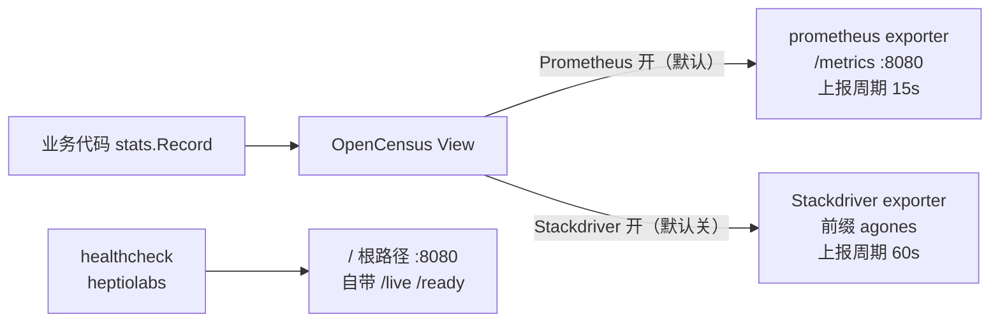

**指标清单**（`pkg/metrics/controller_metrics.go:23-42`）：

| 指标 | 常量行 | View 行 | 聚合 |
|------|--------|---------|------|
| `fleet_rollout_percent` | :24 | :73-78 | LastValue |
| `fleets_replicas_count` | :25 | :80-85 | LastValue |
| `fleet_autoscalers_buffer_limits` | :26 | :87-92 | LastValue |
| `fleet_autoscalers_buffer_size` | :27 | :94-99 | LastValue |
| `fleet_autoscalers_current_replicas_count` | :28 | :101-106 | LastValue |
| `fleet_autoscalers_desired_replicas_count` | :29 | :108-113 | LastValue |
| `fleet_autoscalers_able_to_scale` | :30 | :115-120 | LastValue |
| `fleet_autoscalers_limited` | :31 | :122-127 | LastValue |
| `fleet_counters` / `fleet_lists` | :32 / :33 | :129-141 | LastValue |
| `gameservers_count` | :34 | :143-148 | LastValue |
| `gameservers_total` | :35 | :150-155 | **Count** |
| `gameservers_allocations_total` | :36 | :157-162 | **Count** |
| `gameserver_player_connected_total` / `..._capacity_total` | :37 / :38 | :164-176 | LastValue |
| `nodes_count` | :39 | :178-183 | LastValue |
| `gameservers_node_count` | :40 | :185-189 | Distribution |
| `gameserver_state_duration` | :41 | :191-196 | Distribution（0…16384s） |

另有 K8s client 类指标（`pkg/metrics/kubernetes_client.go:34-52`）：HTTP 请求、cache list/watch、workqueue depth/latency/retries 等。

⚠️ **不存在 `gameserver_allocations_failed_total`**。分配失败语义体现在 `fleet_autoscalers_limited` 与 Event `ScalingLimited` / `FailedGetFleet`。

**内存开销的关键一段**：`gameserver_state_duration` 用 LRU 存状态变更时刻，`GameServersStateCount = 600_000`（`pkg/metrics/controller.go:60`），注释里按每条 400 字节估算共 **229 MiB**（`:52-59`）。

**日志**：logrus + JSON，`severity` / `message` 字段被重命名成 GCP 友好格式（`pkg/util/runtime/runtime.go:37-49`）。

### 6.6 部署拓扑

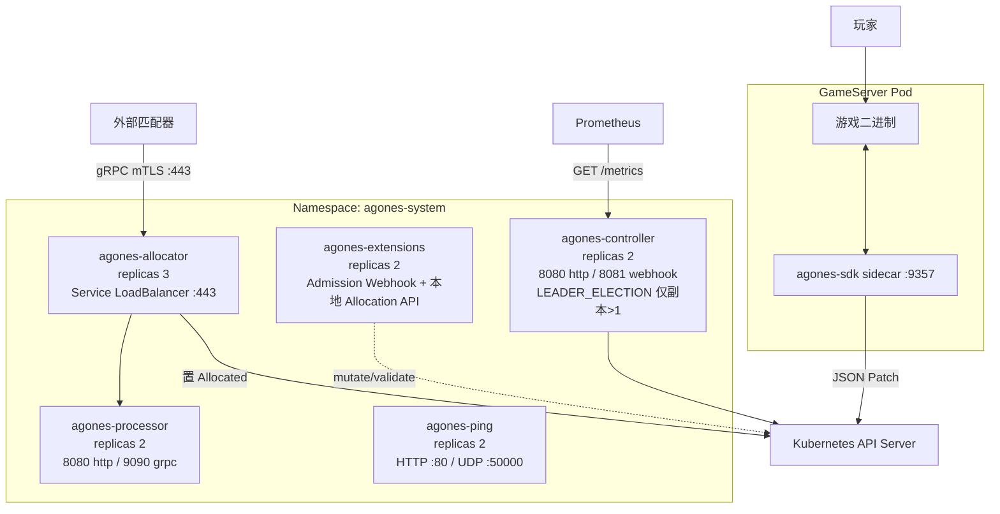

**组件默认值速记**：

| 组件 | 副本 | 端口 | 出处 |
|------|------|------|------|
| controller | 2 | http 8080 / webhook 8081 | `install/helm/agones/values.yaml:106,99` |
| extensions | 2 | webhook 8081 / http 8080 | `values.yaml:167,155,157` |
| allocator | 3 | Service LB 443（http + grpc 复用） | `values.yaml:251,254,265,273` |
| processor | 2 | http 8080 / grpc 9090 | `values.yaml:298,317,320` |
| ping | 2 | HTTP LB 80 / UDP LB 50000 | `values.yaml:191,195,207` |

**`cmd/extensions/main.go`** 是 Webhook 与本地 Allocation API 的宿主（`:151-159` 建 https server + 证书热加载，`:239-242` 注册四个 CRD 的 webhook）。
**`cmd/ping/main.go`** 是纯拨测（UDP echo + HTTP 固定响应，`:59-66`）。
**`cmd/processor/main.go`** 是 allocator 的可选批处理后端（`:241-246`）。

**SDK 语言覆盖**：`sdks/` 下有 go / cpp / csharp / nodejs / python / rust / swagger / unity / unreal 九个目录。

### 6.7 三个反直觉的全局结论

1. **`Allocated` 与 `Reserved` 是全局的"免死金牌"**。Fleet 滚动更新到处减 `sumAllocated`（`pkg/fleets/controller.go:428-430`、`:465-482`）、GameServerSet 第一趟扫描只数 `!IsDeletable()`（`gameserversets/controller.go:409-414`）、自动扩缩容的 Buffer 也以 `AllocatedReplicas` 为基数——**全都是同一条约束的不同投影**。
2. **"分配"与"缩容"的排序方向相反，是刻意设计的互补**。分配往最挤的节点塞（`allocation_cache.go:197-211`），缩容从最空的节点收（`gameserversets.go:83-84`），结果是 GameServer 密度收敛、缩容命中率最高。
3. **失败大多是"软失败"**。分配没货返回 201 + `UnAllocated`；Webhook `Scale=false` 不报错；端口耗尽不判 Unhealthy（`WaitOnFreePorts`）；`Recreate` 只减 Allocated 不减 Reserved。**排查问题时不能只看 error 日志**，要同时看 `Status.State` 与 Event。

### 第六讲小结：七种策略、Allocated 为基数、软失败

| 项 | 内容 |
|----|------|
| **一句话定位** | 7 种策略；Buffer 以 `AllocatedReplicas` 为基数；同步周期是 per-resource ticker（默认 30s）；指标走 OpenCensus + 双 exporter |
| **输入** | `FleetAutoscaler.Spec.Policy` + `Fleet.Status` |
| **输出** | `Fleet.Spec.Replicas` 的改写 + `FleetAutoscaler.Status` |
| **三个最值得记住的点** | ① Buffer 算 `AllocatedReplicas + BufferSize`（`fleetautoscalers.go:383`），百分比是反解公式；② Webhook 是 **HTTP** 不是 gRPC，15s 超时，CABundle 非空即 https（`:219`、`:231-234`）；③ **没有全局 syncPeriod**，每个 FleetAutoscaler 一份 goroutine（`pkg/fleetautoscalers/controller.go:496-531`） |

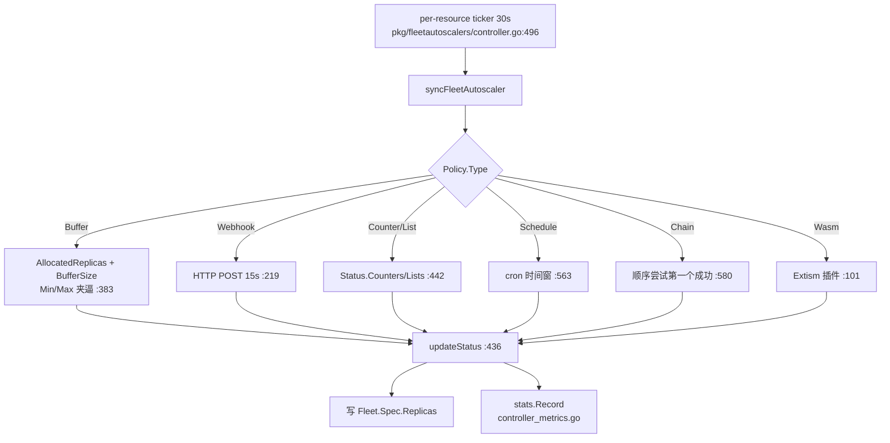

---

## 附：学习路线、复习卡与文件索引

### 学习路线（建议 3 天）

**Day 1 —— 数据模型与状态机**
1. `pkg/apis/agones/v1/gameserver.go` 通读（1207 行），把 11 个状态和三个 `Is*` 方法抄一遍；
2. `pkg/apis/agones/v1/fleet.go:116-153` + `gameserverset.go:141-167` 看懂三层关联；
3. 对照 `pkg/gameservers/controller.go:500-523` 的 sync 链，把状态迁移表画出来。

**Day 2 —— 生命周期与 SDK**
4. `pkg/gameservers/controller.go` 的 `syncGameServerCreatingState` / `StartingState` / `RequestReadyState`；
5. `cmd/sdk-server/main.go` + `pkg/sdkserver/sdkserver.go` 的 RPC 表，重点看 `:465-477` 的 JSON Patch；
6. `pkg/gameservers/health.go` 的三层健康检查。

**Day 3 —— 编排、分配、扩缩容**
7. `pkg/fleets/controller.go:501-547` + `controller_rollingupdatefix.go:59-89` 看懂双参数滚动更新；
8. `pkg/gameserversets/gameserversets.go:46-119` 的排序（对比 `allocation_cache.go:182-211`）；
9. `pkg/gameserverallocations/allocator.go:467-630` 的批处理链路；
10. `pkg/fleetautoscalers/fleetautoscalers.go:73-91` 的七路分发。

### 25 张复习卡

| # | 问题 | 答案 | 出处 |
|---|------|------|------|
| 1 | GameServer 有几个状态？ | 11 个 | `gameserver.go:40-69` |
| 2 | 哪些是终态？ | `Shutdown` / `Error` / `Unhealthy` | `gameserver.go:174-180` |
| 3 | 哪些状态不可删？ | `Allocated` / `Reserved`（除非已有 DeletionTimestamp） | `gameserver.go:659-665` |
| 4 | Status 是 subresource 吗？ | **不是**（为原子分配） | `gameserver.go:187-198` |
| 5 | `PortAllocation` 何时出现？ | 端口策略含 Dynamic/Passthrough | `gameserver.go:430` |
| 6 | SDK sidecar 三个端口？ | 9357 gRPC / 9358 HTTP / 8080 health | `cmd/sdk-server/main.go:50-52` |
| 7 | 谁把状态推到 Ready？ | sidecar 置 RequestReady，controller 转 Ready | `sdkserver.go:544` / `pkg/gameservers/controller.go:1035` |
| 8 | sidecar 怎么写回？ | JSON Patch 直连 API Server | `sdkserver.go:471` |
| 9 | Health 默认三个值？ | PeriodSeconds 5 / FailureThreshold 3 / InitialDelay 5 | `gameserver.go:413/416/419` |
| 10 | `Reserved` 会回退吗？ | 会，到期自动回 Ready（唯一自动回退状态） | `sdkserver.go:699-709` |
| 11 | 四种 PortPolicy？ | Static / Dynamic（默认）/ Passthrough / None | `gameserver.go:74-86`、`:454` |
| 12 | 默认 eviction.safe？ | `Never` | `gameserver.go:482` |
| 13 | controller 默认 worker 数？ | 64 | `cmd/controller/main.go:274` |
| 14 | GameServer controller 几条队列？ | 3 条（creation / deletion / 主） | `pkg/gameservers/controller.go:184-186`、`:252-266` |
| 15 | Fleet 默认 MaxSurge / MaxUnavailable？ | 都是 25% | `fleet.go:170-176` |
| 16 | 两个参数的基数？ | Surge→`Spec.Replicas`；Unavailable→`Status.ReadyReplicas` | `pkg/fleets/controller.go:528` / `controller_rollingupdatefix.go:60` |
| 17 | 缩容按什么顺序删？ | 按 Packed/Distributed 排序取前 N | `gameserversets.go:46-119`、`:490-498` |
| 18 | GameServerSet 怎么删 GS？ | 置 `Shutdown`，不直接 Delete | `gameserversets/controller.go:556` |
| 19 | Error GS 删除宽限？ | 30s | `gameserversets/controller.go:64` |
| 20 | 分配缓存收哪些状态？ | 只收 Ready 与 Allocated | `allocation_cache.go:39-42` |
| 21 | 没货时返回什么？ | 201 Created + `UnAllocated`（不是错误码） | `allocator.go:286` / `pkg/gameserverallocations/controller.go:203` |
| 22 | 分配并发安全靠什么？ | 单 goroutine 事件循环 + RWMutex 缓存 | `allocator.go:491`、`cache.go:27` |
| 23 | FleetAutoscaler 几种策略？ | 7 种 | `fleetautoscaler.go:125-152` |
| 24 | Buffer 算什么？ | `AllocatedReplicas + BufferSize`（非 Ready） | `fleetautoscalers.go:383` |
| 25 | 默认同步周期？ | 30s（per-resource ticker，无全局常量） | `fleetautoscaler.go:156`、`pkg/fleetautoscalers/controller.go:496-531` |

### 文件索引

| 文件 | 行数 | 本讲角色 |
|------|------|---------|
| `pkg/apis/agones/v1/gameserver.go` | 1207 | **核心**：GameServer 类型 + 11 状态 + 端口策略 + Health |
| `pkg/apis/agones/v1/fleet.go` | 259 | Fleet 类型 + `GameServerSet()` 转换 |
| `pkg/apis/agones/v1/gameserverset.go` | 167 | GameServerSet 类型 + `GameServer()` 转换 + 模板不可变校验 |
| `pkg/apis/autoscaling/v1/fleetautoscaler.go` | 671 | **核心**：FleetAutoscaler 7 种策略 + Webhook 契约 |
| `pkg/apis/allocation/v1/gameserverallocation.go` | 605 | GSA 请求/响应 + Selector + Converter |
| `pkg/apis/scheduling.go` | — | `Packed` / `Distributed` 调度策略定义 |
| `cmd/controller/main.go` | 662 | **核心**：controller 进程启动 + leader election + 5 个 runner |
| `pkg/gameservers/controller.go` | 1185 | **核心**：GameServer 状态机 + 三条队列 + Pod 创建 |
| `pkg/gameservers/health.go` | — | HealthController：驱逐/崩溃/无端口的不健康判定 |
| `pkg/sdkserver/sdkserver.go` | 1563 | **核心**：SDK Server 全部 RPC + JSON Patch + 心跳 |
| `cmd/sdk-server/main.go` | 411 | sidecar 入口（三端口 + local/test 模式） |
| `pkg/sdkserver/localsdk.go` | — | 本地调试的"假 SDK"（不连 K8s） |
| `pkg/portallocator/portallocator.go` | 451 | 每 Node 端口位图分配 |
| `pkg/fleets/controller.go` | 803 | **核心**：Fleet 编排 + 滚动更新 |
| `pkg/fleets/controller_rollingupdatefix.go` | — | 收缩侧 MaxUnavailable 实现 |
| `pkg/gameserversets/controller.go` | 802 | **核心**：多退少补 + 删除排序 |
| `pkg/gameserversets/gameserversets.go` | — | `SortGameServersByStrategy`（唯一的删除优先级实现） |
| `pkg/gameserversets/allocation_overflow.go` | — | 溢出实例打标 |
| `pkg/gameserverallocations/allocator.go` | 755 | **核心**：分配链路 + 批处理 + 重试 |
| `pkg/gameserverallocations/allocation_cache.go` | 316 | 分配缓存（只收 Ready/Allocated） |
| `pkg/gameserverallocations/cache.go` | — | `gameServerCache`（RWMutex + 版本保护） |
| `pkg/gameserverallocations/find.go` | — | `findGameServerForAllocation` + Distributed 随机化 |
| `pkg/gameserverallocations/controller.go` | — | 集群内聚合 API（只注册 create） |
| `cmd/allocator/main.go` | — | 独立分配服务入口（gRPC + REST 复用端口） |
| `pkg/fleetautoscalers/controller.go` | 606 | FleetAutoscaler controller + per-resource ticker |
| `pkg/fleetautoscalers/fleetautoscalers.go` | 906 | **核心**：7 种策略实现 |
| `pkg/metrics/controller_metrics.go` | 230 | 指标定义 + View |
| `pkg/metrics/exporter.go` | — | Prometheus / Stackdriver exporter |
| `pkg/util/workerqueue/workerqueue.go` | 267 | 自研队列封装（三种入队 + traceError） |
| `pkg/util/httpserver/server.go` | — | HTTP server（默认 8080）+ 优雅关停 |
| `pkg/cloudproduct/cloudproduct.go` | — | 云厂商抽象（generic / gke-autopilot） |
| `sdks/go/sdk.go` | 182 | Go SDK（`localhost:9357`，30s 超时） |

---

> **版本基准**：commit `2c9fadb5ea1d3ed09793cd8be87059cc19731eb1`，401 个 Go 文件，非测试代码约 43758 行。
> 所有 `文件:行号` 均可用 `verify_citations.py` 校验。
