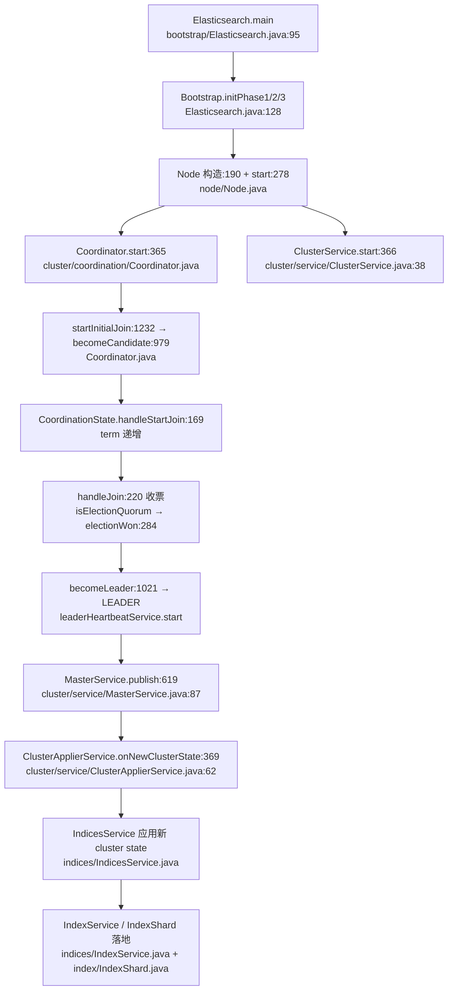
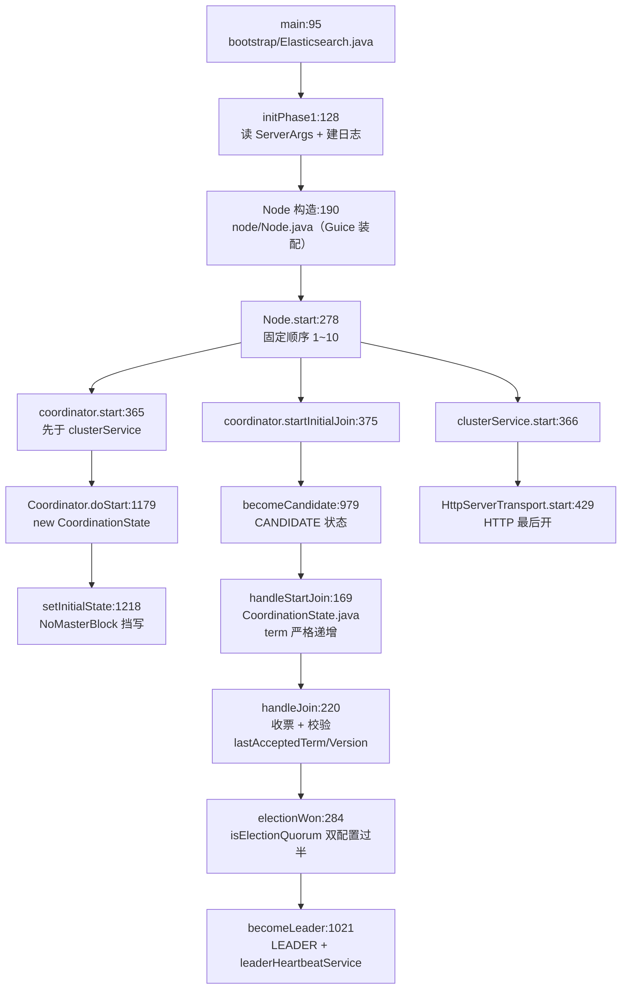
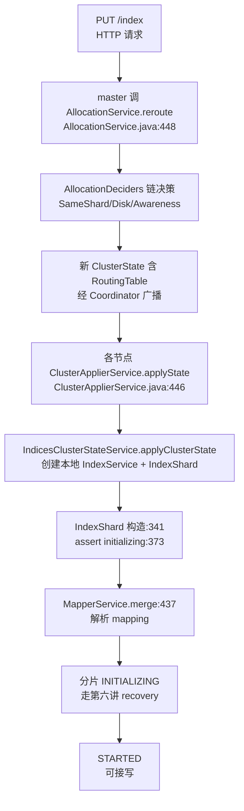
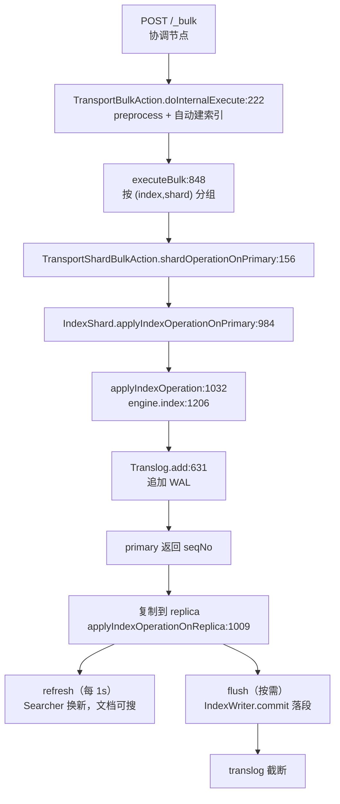
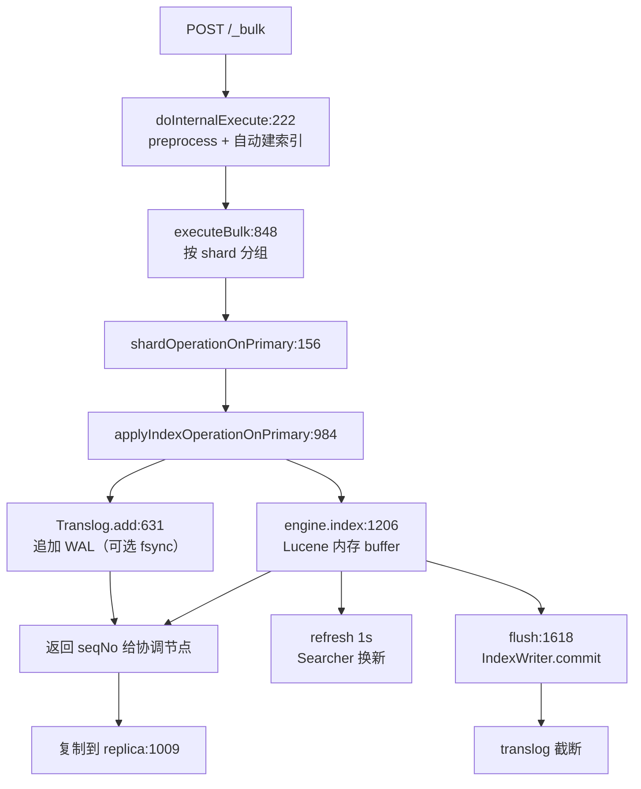
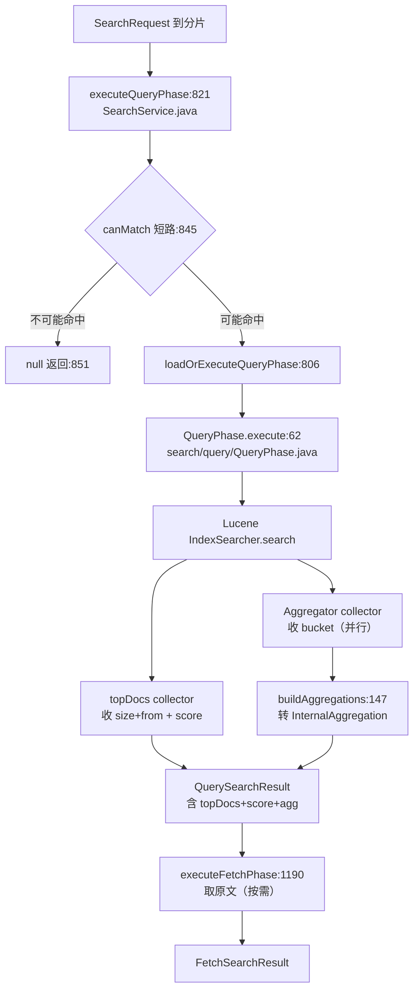
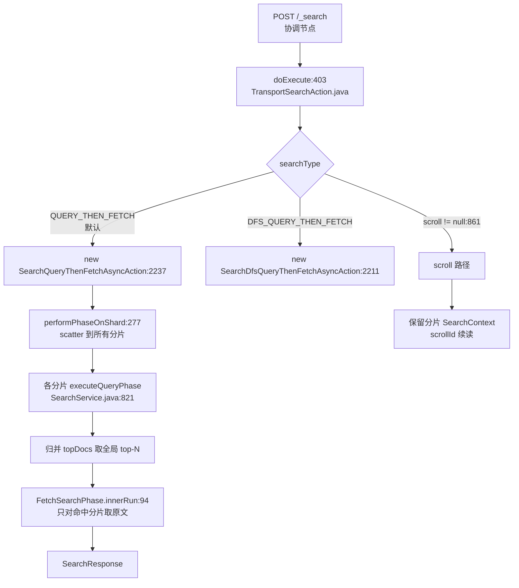
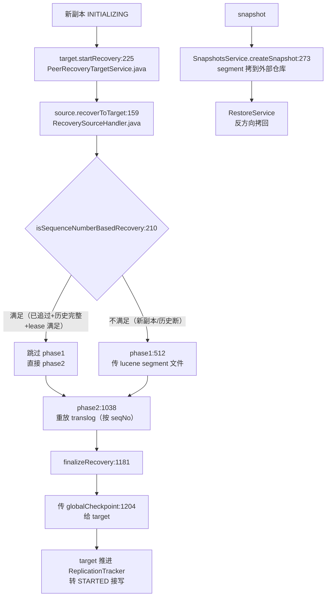

> 基于对 `server/src/main/java/org/elasticsearch/` 下 Java 源码（`bootstrap/Elasticsearch.java`、`node/Node.java`、`discovery/DiscoveryModule.java`、`cluster/coordination/Coordinator.java`、`cluster/coordination/CoordinationState.java`、`cluster/coordination/ClusterBootstrapService.java`、`cluster/service/ClusterService.java`、`indices/*`、`index/*`、`action/*`、`search/*`、`indices/recovery/*`、`snapshots/*` 等）的逐文件精读整理而成。
>
> 阅读顺序即学习顺序：节点启动与集群发现 → 索引与分片 → 写入路径 → 查询与搜索 → 分布式协调 → recovery 与故障转移。
>
> 所有结论均标注了源文件位置（格式 `server/src/main/java/org/elasticsearch/xxx.java:行号`），建议对照代码阅读。
>
> **版本基线**：Elasticsearch **9.5.5**（tag v9.5.5）。
> **精确 commit**：`48acba663b09e70b115dd879329141506c377890`，commit 时间 `2026-09-30 09:32:36 -0500`（git shallow clone，单分支只读副本）。
>
> **选主实现说明**：9.5.5 中 **ZenDiscovery 已彻底删除**，选主统一由 `cluster/coordination/Coordinator.java`（Raft 改良，term + 多数派 + PreVote + log 一致性检查）承担，由 `DiscoveryModule.java:176` 装配。

---

## 〇、全景地图

Elasticsearch 9.5.5 的整体骨架可以压缩成三层：**进程层（Bootstrap/Elasticsearch/Node）** → **协调层（Coordinator/ClusterService/MasterService/ClusterApplierService）** → **数据层（IndicesService/IndexService/IndexShard）+ 查询层（SearchService/TransportSearchAction）**。旁路上挂着三件"集群活"：选主（Coordinator）、recovery（PeerRecoverySourceService）、snapshot（SnapshotsService）。

```
┌────────────────── 进程层 (bootstrap/ + node/) ──────────────────┐
│ Elasticsearch.main (bootstrap/Elasticsearch.java:95)             │
│   → initPhase1 (Elasticsearch.java:128) 读 ServerArgs + 建 Env   │
│   → initPhase2/3 装配 JVM/日志/fork                                │
│ Bootstrap (bootstrap/Bootstrap.java) → setupJVM/keepAlive         │
│ Node (node/Node.java:119) 构造:190  start():278                   │
│   构造期: PluginsService → IndicesService → SearchService         │
│           → ClusterService → Coordinator (DI 注入)                │
│   start 顺序: Node.java:278~432                                   │
│     1) IndicesService.start():287                                  │
│     2) SearchService.start():292                                   │
│     3) clusterService.setClusterStatePublisher(coordinator):310   │
│     4) transportService.start():316                                │
│     5) GatewayMetaState.start():324  ← 加载磁盘元数据              │
│     6) coordinator.start():365  ← 必须先于 clusterService         │
│     7) clusterService.start():366                                 │
│     8) transportService.acceptIncomingRequests():369              │
│     9) coordinator.startInitialJoin():375  ← 触发选主              │
│    10) HttpServerTransport.start():429  ← HTTP 最后才开           │
└──────────────────────────────┬──────────────────────────────────┘
                               ▼
┌──────────────── 协调层 (cluster/coordination + cluster/service) ──┐
│ Coordinator (coordination/Coordinator.java:118) extends Lifecycle  │
│   implements ClusterStatePublisher                                  │
│   doStart:1179 → new CoordinationState(electionStrategy)           │
│     → clusterApplier.setInitialState(initialState):1218             │
│   startInitialJoin:1232 → becomeCandidate:979 → CANDIDATE         │
│   handleStartJoin (CoordinationState.java:169) term++               │
│   handleJoin (CoordinationState.java:220) 收票 + isElectionQuorum  │
│     → electionWon (CoordinationState.java:284)                    │
│   becomeLeader:1021 → LEADER + leaderHeartbeatService.start       │
│ ClusterBootstrapService.java:198 → nodesMatching*2 > requirements  │
│   → startBootstrap:242 → doBootstrap: VotingConfiguration          │
│ MasterService.java:87  (master 线程跑 cluster state task)          │
│   publish:619 → clusterStatePublisher.publish(...):624            │
│ ClusterApplierService.java:62                                     │
│   setInitialState:143  onNewClusterState:369  runTask:446         │
│ ClusterState.java:118  字段: version:166, stateUUID:171,            │
│   routingTable:176 (GlobalRoutingTable/multi-project), nodes:178,  │
│   metadata:185, blocks:187, customs:189                            │
└──────────────────────────────┬──────────────────────────────────┘
                               ▼
┌──────────────── 数据 + 查询层 (indices/ + index/ + search/) ───────┐
│ IndicesService (indices/IndicesService.java)                       │
│   createIndex → IndexService (indices/IndexService.java)           │
│   createShard → IndexShard (index/IndexShard.java)                 │
│ IndexShard.shardIndex → Translog (index/translog/Translog.java)     │
│   → Lucene IndexWriter (Lucene 段落盘) → IndexShard.refresh         │
│   → flush → IndexWriter.commit                                       │
│ SearchService (search/SearchService.java)                          │
│   executeQueryPhase / executeFetchPhase                              │
│ TransportSearchAction (action/search/TransportSearchAction.java)     │
│   两阶段: query → fetch  (scatter/gather 协调器)                    │
│ PeerRecoverySourceService (indices/recovery/)                       │
│   ← 主分片把 lucene + translog 推给新副本                          │
└──────────────────────────────────────────────────────────────────┘
```



### 三条主线

1. **写入流**：HTTP `POST /_bulk` → `TransportBulkAction`（`action/bulk/TransportBulkAction.java`）→ 按 `routing` 散到各分片 → `IndexShard.shardIndex` → `Translog.append` → `IndexWriter.addDocument` → `refresh` 让 `Searcher` 可见 → `flush` 调 `IndexWriter.commit` 落段。
2. **查询流**：HTTP `POST /_search` → `TransportSearchAction` → `QUERY` 阶段向所有分片发请求（`SearchService.executeQueryPhase`）→ 收 `topDocs` 归并 → `FETCH` 阶段向命中的少量分片要完整文档 → 聚合。
3. **集群流**：选主（`Coordinator` Raft 改良）→ master 提交 `cluster state` 任务（`MasterService`）→ `publish` 广播 → 各节点 `ClusterApplierService` 应用 → `IndicesService` 据此创建/删除/迁移分片。

---

## 速览：六讲各自做了什么（先看这个再进细节）

> 用户反馈"直接进细节看不懂"，所以这一章先把六讲的白话版本摆出来，再带你进逐文件精读。

| 讲 | 一句话白话 | 输入 | 输出 | 最怕什么 |
| --- | --- | --- | --- | --- |
| 第一讲 | 一个进程怎么"开机自检 + 选出班长" | `elasticsearch` 命令行 + `elasticsearch.yml` | 一个加入集群、知道谁是 master 的 Node | 脑裂（两个 master 同时在位） |
| 第二讲 | 班长怎么把"索引/分片"摆在合适的位置 | `PUT /index` + cluster state | IndexService + N 个 IndexShard | 主副错位（同一分片两个 primary） |
| 第三讲 | 一个文档从进到门到落进硬盘 | `POST /_bulk` 文档流 | Lucene segment + translog | 写丢（ACK 了但没持久化） |
| 第四讲 | 用户搜一个词，单机内怎么算分 | 一个 `SearchRequest` | 命中文档 + score + 聚合 | 慢（全表扫描、打分错误） |
| 第五讲 | 上面那件事在 N 台机器上怎么凑齐 | 一堆分片级子结果 | 合并后的全局结果 | 偏（分片少一个 / 排序错） |
| 第六讲 | 一台机器挂了/加了，怎么不丢数据 | 一个分片副本缺失事件 | 副本数恢复 + seq 对齐 | 数据不一致（主副版本不一致） |


一句话串起来：**先开机选主（第一讲），主再把分片摆好（第二讲），客户端就能写了（第三讲）也能查了（第四讲），但查询要跨多台凑齐（第五讲），机器总会坏，所以还要 recovery 补副本（第六讲）**。

---

## 面试速通：ES 核心知识一页纸

> 本章由原 `es.md`（面试速通指南）合并而来：保留其"一页纸快速建立全局观"的定位，**所有数字与流程均已对照 9.5.5 源码校正**。需要深入的每个点都给了本笔记的讲次指引与源码行号。

### 1. 核心概念（类比数据库）

Elasticsearch 是基于 Lucene 的分布式搜索与分析引擎。类比关系型数据库：

| ES 概念 | 类比 | 一句话解释 | 深入 |
|---|---|---|---|
| Index | 表 | 文档的集合，本质是一个/多个 Lucene 索引 | 第二讲 |
| Document | 行 | 一条 JSON 数据，进索引前被 mapping 解析成 Lucene Document | 第二讲 |
| Field | 列 | 文档属性，有 text/keyword/数值/日期等类型 | 第二讲 |
| Shard | 分表 | 索引的子集，主分片（primary）分布在不同节点实现并行 | 第二讲 |
| Replica | 从表 | 主分片的拷贝，高可用 + 分担读请求 | 第二讲/第六讲 |
| Node | 实例 | 运行中的 ES 进程，角色分主节点/数据节点/协调节点等 | 第一讲 |

### 2. 读写流程（第三讲/第五讲的精读基础）

**写数据（精确版）**——`POST /_bulk` 进来到文档"丢不了"的完整链路：

1. 协调节点按 `routing`（默认文档 `_id` 的 hash）算出目标分片，转发到主分片所在节点；
2. 主分片 `IndexShard.shardIndex`：先 `Translog.append` 写事务日志，再 `IndexWriter.addDocument` 进 Lucene 内存 buffer；
3. 主分片**并发**把操作转发给所有副本，等待 ack（`wait_for_active_shards`，默认 quorum）；
4. 全部 ack 后返回客户端——**ACK 的含义是 translog 已持久化，数据丢不了**（第三讲演算 1 的第 7 个检查点）；
5. 默认每 1s（`index.refresh_interval`）refresh：buffer 生成新 segment 进文件系统缓存，此时**才可被搜到**；
6. 默认 `index.translog.sync_interval=5s` 触发 translog fsync；flush 阈值见下表，落段并截断 translog。

**读数据**分两种，走的完全不是一条路：

- **GET by id**：不走搜索不打分。realtime 查询会先查 translog 里未 refresh 的最新操作（`IndexShard.getFromTranslog`，`index/shard/IndexShard.java:1387`），miss 再读 Lucene；
- **search**：scatter-gather 两阶段——协调节点向所有相关分片发 query 阶段，各分片本地搜索返回 Top N，协调节点归并后再向命中分片发 fetch 阶段拉原文（第五讲）。

### 3. 核心机制与分片策略（第三讲/第六讲）

| 机制 | 默认值（9.5.5 源码） | 干什么 | 深入 |
|---|---|---|---|
| refresh | `index.refresh_interval = 1s` | buffer → 新 segment 进 OS cache，文档可搜 | 第三讲 |
| translog sync | `index.translog.sync_interval = 5s` | translog fsync，保证 ACK 不丢数据 | 第三讲 |
| flush | `flush_threshold_age` 默认 **1 分钟**、`flush_threshold_size` 默认 **10GB**（= 50GB 推荐分片大小的 20%） | `IndexWriter.commit` 落段 + 截断 translog | 第三讲 |
| merge | Lucene `TieredMergePolicy` 控制 | 合并小 segment、物理删除标记删除的文档 | 第三讲 |

分片规划经验值：**每分片 20–50GB，分片数 ≈ 数据总量 / 30GB**。这个量级有官方背书——flush 阈值注释里直接引用 "recommended shard size of 50GB"（`index/IndexSettings.java:378`）。分片太少则单分片过大、恢复慢、并行度低；太多则元数据和归并开销暴涨。

高可用三板斧：

- **副本自动提升**：主分片故障时副本升主，由 `AllocationService.reroute`（`cluster/routing/allocation/AllocationService.java:448`）决策（第六讲）；
- **多节点重分配**：节点宕机后其他节点上的副本被重新分配补齐；
- **CCR + Snapshot**：跨集群复制做数据中心级容灾；快照定期备份到远程存储，恢复走第六讲的 Snapshot 流程。

**注意**：主分片数创建时指定且**不可更改**（`index.number_of_shards` 带 `Property.Final`，`cluster/metadata/IndexMetadata.java:227`）——要扩容只能 split 到新索引再走别名切换；副本数则可动态调整。

### 4. 查询类型（第四讲）

| 大类 | 是否分词 | 常用子句 | 说明 |
|---|---|---|---|
| Term-level 精准查询 | 否，精确匹配倒排词 | `term` / `terms` / `range` / `exists` / `ids` | keyword/数值/日期字段的精确匹配 |
| Full-text 全文查询 | 是，先过 analyzer | `match` / `match_phrase` / `multi_match` / `query_string` | text 字段的相关性搜索 |
| Bool 复合查询 | 组合子查询 | `must`（匹配且计分）/ `should`（至少满足一个，计分）/ `must_not`（必须不匹配，不计分）/ `filter`（必须匹配，**不计分且可缓存**） | filter 不进打分环节，性能更高 |

### 5. 相关性评分：BM25（第四讲）

ES 默认打分是 BM25（TF-IDF 的改进版）。源码位置 `index/similarity/SimilarityProviders.java:256`（`createBM25Similarity`），默认参数 `k1=1.2`、`b=0.75`、`discountOverlaps=true`（`:263`）：

- **词频 TF**：词出现越多越相关，但 k1 控制**饱和效应**（非线性增长）；
- **逆文档频率 IDF**：词出现在越多文档中越不重要；
- **文档长度**：b 控制长度归一化，同等条件下短文档更相关。

### 6. 分词器与 Mapping（第二讲）

**Analyzer 三段式**：字符过滤器（去 HTML、替换字符）→ 分词器（按空格/标点切分成 token）→ 分词过滤器（小写化、停用词、同义词）。

**Mapping** 类似表结构，定义字段名/类型/分词器。两种方式：

- **动态映射**：ES 自动推断。9.x 默认（`index.dynamic_strings_auto_text=true`）字符串字段自动建成 `text` + `.keyword` 多字段——`text` 分词用于全文搜，`.keyword` 精确匹配/聚合（`index/mapper/DynamicFieldsBuilder.java:326`，`.keyword` 子字段 `ignoreAbove(256)`）；
- **显式映射**：手动定义，如 `title: text`、`status: keyword`、`price: double`。

**text vs keyword 选型**（面试高频）：需要全文检索用 text，需要精确匹配/排序/聚合用 keyword——关键词型字段（如枚举状态）建成 text 是常见性能坑。

### 7. 与关系型数据库选型

| 维度 | MySQL | Elasticsearch |
|---|---|---|
| 定位 | 事务性存储 | 搜索与分析引擎 |
| 事务 | ACID 多文档事务 | **无多文档 ACID 事务**（单文档操作原子） |
| 强项 | 单条记录快速读写、复杂关联 | 全文检索、聚合分析、近实时（1s 可搜） |

典型架构：MySQL 负责持久化与事务，通过 Binlog/Canal 等机制同步到 ES 承担搜索流量——本库 mysql.md 与本文正好是一对。

### 8. 面试速查五主线

先给结论，被追问再展开（展开内容都在本笔记对应讲次）：

1. **核心概念**：Index/Document/Shard/Replica 定义（→ 第二讲）；
2. **底层原理**：倒排索引 + Segment + refresh/flush/merge 的区别（→ 第三讲）；
3. **集群架构**：9.5.5 已是 Raft 改良选主（Coordinator），**不是旧资料说的 ZenDiscovery + bully**（→ 第一讲）；集群健康 Green/Yellow/Red；
4. **查询语法**：term vs match 的区别、bool 四子句的计分与性能差异（→ 第四讲）；
5. **性能优化**：text/keyword 适用场景、Bulk 批量写、合理 refresh 间隔、深分页用 `search_after`/PIT 而非 from+size（→ 第五讲）。

### 9. 高频 Q&A（先结论）

逐题对齐后的高频 9 问；先报结论，追问按右列回讲。

| # | 面试问题 | 一句话结论 | 深入 |
| --- | --- | --- | --- |
| 1 | 为什么要用 ElasticSearch？和 MySQL 有什么不同？ | MySQL 强在事务与关联查询，但 `LIKE '%kw%'` 全表扫、多条件 OR 组合、海量文本的场景直接崩；ES 用倒排索引把"词→文档"做成字典，亚秒级全文检索 + 聚合分析，水平扩展分片并行。典型架构：MySQL 做主存储保事务，Binlog/Canal 异步同步 ES 承担搜索流量——本文与 mysql.md 是一对 | 第一/二讲 |
| 2 | ElasticSearch 为什么快？ | 四层叠加：①**倒排索引**——查询词直接定位文档列表，不逐条比对；②**分片并行**——一个查询拆到所有相关分片同时执行，协调节点归并；③**filter 不计分且可缓存**——布尔子句里能进 filter 的绝不进 must；④**列式聚合**——数值字段的 doc values 顺序读盘，聚合排序不走倒排。再叠加 segment 不可变（顺序读、mmap 友好）与 BM25 的短文档偏好调优 | 第三/四讲 |
| 3 | ES 支持哪些数据类型？和 MySQL 怎么映射？ | 大类：text（分词全文）、keyword（精确/排序/聚合）、数值（long/integer/float/scaled_float）、日期、布尔、二进制、对象/嵌套、地理点/形状。映射：`VARCHAR`→text + `.keyword` 多字段（9.x 动态映射自动建）、`INT/BIGINT`→integer/long、`DECIMAL`→scaled_float 或 keyword、`DATETIME`→date。**decimal 没有原生二进制浮点之外的类型**，见下条 | 第二讲 |
| 4 | 倒排索引是什么？ | 正排是"文档→包含哪些词"，倒排把它翻过来："**词项→包含它的文档列表（postings）**"——查询只需在词典里找到词、取出文档列表做交集/并集，与文档总量无关。Lucene 的 segment 里词典压缩成 FST、postings 带位置信息（支撑 phrase 查询）、数值/日期字段另有 BKD 树与 doc values 列式结构 | 第三讲 |
| 5 | ES 不支持 decimal，如何避免丢失精度？ | `float`/`double` 是 IEEE 二进制浮点，0.1 这类十进制小数存进去就有表示误差。三条路：①`scaled_float`——指定 `scaling_factor`（如 100）做定点缩放，金额分场景够用；②存 `keyword`/`long`——字符串自行解析或直接存"分"；③精度敏感就继续放 MySQL，ES 只索引不参与计算。**聚合求和前先想清楚类型** | 第二/四讲 |
| 6 | Elasticsearch 支持事务吗？为什么？ | **不支持多文档 ACID 事务**，只有单文档操作原子。原因：分布式系统下跨分片/跨节点的两阶段提交代价高、延迟大，与 ES"近实时、高吞吐、可水平扩展"的定位冲突；一致性需求（版本号 `_version`/`if_seq_no` 乐观并发控制）只到单文档级。要事务就在 MySQL 侧完成，ES 只做检索投影 | 第一/五讲 |
| 7 | 什么是 ES 的深度分页问题？如何解决？ | `from + size` 深分页时，**每个分片**都要取出 `from + size` 条交给协调节点归并后再丢弃——from=10000 就要在分片侧搬 1 万条，内存与 CPU 双爆炸。解法：①`search_after`——用上一页最后一个 sort 值当游标往后续，分片侧直接定位；②PIT（point-in-time）——先打快照再 search_after，避免翻页期间数据变化导致重复/漏页；③全量遍历用 `scroll`（已不推荐新场景，让位 search_after） | 第五讲 |
| 8 | 如何优化 ElasticSearch 搜索性能？ | 一份速查清单：字段选型对（keyword 别建成 text）、布尔查询能进 filter 就进（缓存 + 不计分）、批量写入用 `_bulk` 并调大 `refresh_interval`、分片控制在 20–50GB/片、深分页改 search_after/PIT、聚合走高基数时加 keyword 子字段或限流、路由（routing）把查询收敛到目标分片、避免脚本字段与 wildcard 前导通配 | 第三/四/五讲 |
| 9 | 如何保证 ES 和数据库的数据一致性？ | ES 是"最终一致"的投影库，不追求强一致：主流是 **Binlog 监听（Canal/Maxwell/Debezium）+ MQ 异步同步**——MySQL 提交后从 binlog 捞变更投递给 ES，天然保序、可重放；配合定时对账补偿漏刷。要更强就双写 + 事务消息（复杂度上台阶）。**别把 ES 当唯一真相源**，真相永远在 MySQL | mysql.md 联动 |

---

## 第一讲：节点启动与集群发现 —— Bootstrap / Node / Coordinator

### 先说人话：本讲每个阶段在干什么

把节点启动想象成"一家工厂开机上班"：

- **第一阶段（Bootstrap.initPhase1）**：工厂保安先开门、点人数、登记身份证（JVM 安全属性、日志、`ServerArgs`）。还没进车间。
- **第二阶段（Node 构造）**：装配各车间。`IndicesService` 是"成品库"，`SearchService` 是"问讯台"，`Coordinator` 是"工会主席（管选班长）"。所有部件用 Guice `Injector` 串起来，**这一步只造不启**。
- **第三阶段（Node.start）**：按固定顺序开机。先把内部的成品库/问讯台开起来，再把"工会主席"启动（让他准备选主），然后才让 `ClusterService` 上线，最后才打开 HTTP 大门接客。
- **第四阶段（Coordinator.startInitialJoin）**：工会主席发"我要选班长"的信号，开始 Raft 风格的拉票（`becomeCandidate`）。票数过半就 `becomeLeader`，新班长诞生。
- **第五阶段（MasterService.publish + ClusterApplierService）**：班长要发通知（cluster state 变更）走 `MasterService.publish` 广播，各车间 `ClusterApplierService.onNewClusterState` 应用新状态。

| 阶段 | 干了什么 | 为什么需要 |
| --- | --- | --- |
| Bootstrap.initPhase1 | 读 CLI 参数、初始化日志、fork 守护 | JVM 还没起来前先抓住"出错能看到日志"这条命脉 |
| Node 构造 | 用 Guice 装配 IndicesService/ClusterService/Coordinator | 工厂要先把车间都造好才能开机 |
| Node.start:278 | 按 1~10 顺序 start 各组件 | 顺序错了会自相矛盾（如 HTTP 先开但 cluster 还没成就接请求） |
| Coordinator.doStart:1179 | 建 `CoordinationState` + 设初始 NoMasterBlock | 让节点一上来就知道"现在没有 master" |
| startInitialJoin:1232 | `becomeCandidate` 启动选主 | 没人选主，写操作会被 NoMasterBlock 挡住 |
| handleStartJoin:169 | term 递增、收票 | Raft 防脑裂的核心：每次选举 term+1，旧 master 的低 term 自动失效 |
| handleJoin:220 | 校验 lastAcceptedTerm/Version | 拒绝日志更新的 joiner，保证选出的 master 日志最全 |
| becomeLeader:1021 | 切到 LEADER 模式 + 启 leaderHeartbeatService | master 要靠心跳维持权威，否则 followers 重新选 |
| MasterService.publish:619 | 把新 cluster state 广播出去 | 班长发命令的唯一通道 |

**本讲主线**：从 `main` 到 `becomeLeader`，看一个节点如何从"裸进程"变成"知道谁是 master 的集群成员"，以及选主这套 Raft 改良算法如何防脑裂。

### 目录结构

```
server/src/main/java/org/elasticsearch/
├── bootstrap/
│   ├── Elasticsearch.java      # main 入口 + initPhase1/2/3
│   ├── Bootstrap.java           # JVM/keepAlive/进程守护
│   ├── BootstrapContext.java    # 启动检查上下文
│   ├── BootstrapChecks.java     # 启动检查清单
│   └── Elasticsearch.java       # main
├── node/
│   ├── Node.java                # 节点构造 + start() 顺序
│   ├── NodeRoleSettings.java    # 节点角色配置
│   └── NodeService.java         # 节点级运行期服务
├── discovery/
│   ├── DiscoveryModule.java     # discovery 模块装配（注册 Coordinator）
│   ├── PeerFinder.java         # 通用节点探测
│   ├── SeedHostsProvider.java  # 种子节点提供者接口
│   ├── ConfiguredHostsResolver.java  # settings/file 种子解析
│   └── HandshakingTransportAddressConnector.java  # 握手连接
└── cluster/
    ├── ClusterState.java        # 集群状态快照（version/nodes/metadata/...）
    ├── service/
    │   ├── ClusterService.java      # 集群服务门面
    │   ├── MasterService.java       # master 线程：跑 cluster state task + publish
    │   └── ClusterApplierService.java  # 应用线程：apply 新 state 到本地
    ├── coordination/
    │   ├── Coordinator.java            # Raft 改良核心（取代 ZenDiscovery）
    │   ├── CoordinationState.java     # 选举状态机（handleStartJoin/handleJoin）
    │   ├── CoordinationMetadata.java  # VotingConfiguration（hasQuorum 多数派）
    │   ├── ClusterBootstrapService.java  # 首次集群引导
    │   ├── ElectionStrategy.java      # 选举策略（双配置多数派 + 插件约束）
    │   ├── PreVoteCollector.java      # PreVote 优化（避免无谓 term 抖动）
    │   ├── Publication.java            # cluster state 发布状态机
    │   ├── LeaderHeartbeatService.java # master 心跳
    │   └── FollowersChecker.java       # master 探活 follower
    └── node/
        ├── DiscoveryNode.java          # 节点实体（roles + isMasterNode）
        └── DiscoveryNodeRole.java      # MASTER_ROLE / DATA_ROLE / INGEST_ROLE ...
```

### 逐文件精读

#### 1）`bootstrap/Elasticsearch.java` —— 进程入口三阶段

| 方法 | 位置 | 作用 |
| --- | --- | --- |
| `main` | `bootstrap/Elasticsearch.java:95` | 唯一入口：`initPhase1` → `initPhase2` → `initPhase3` |
| `initPhase1` | `bootstrap/Elasticsearch.java:128` | 静态初始化：`initSecurityProperties` → `LogConfigurator.registerErrorListener` → `BootstrapInfo.init` → `new ServerArgs(in)` → `new Environment(...)` |
| `getStdout/getStderr` | `bootstrap/Elasticsearch.java:112/118` | 抓 stdout/stderr 与 server-cli 通信 |

`main`（`bootstrap/Elasticsearch.java:95`）非常薄：三步走，任何一步抛 `NodeValidationException` 都走 `bootstrap.exitWithNodeValidationException`，其他 Throwable 走 `exitWithUnknownException`。这意味着 **ES 进程对启动失败"零容忍"——一旦装配出问题，整个进程退出**，不留半启动状态。

`initPhase1`（`bootstrap/Elasticsearch.java:128`）刻意把"日志能打"放在最前面（`LogConfigurator.registerErrorListener`），因为后面任何一步炸了，至少要能看到日志。

#### 2）`node/Node.java` —— 节点的"装配 + 开机"

`Node` 类（`node/Node.java:119`，实现 `Closeable`）是节点的本体。两个关键方法：

- **构造** `Node(Environment environment, PluginsLoader pluginsLoader)`（`node/Node.java:190`）：用 Guice `Injector` 装配所有服务，包括 `PluginsService`、`IndicesService`、`SearchService`、`ClusterService`、`Coordinator`。**只造不启**。
- **启动** `Node start()`（`node/Node.java:278`）：严格按顺序启动。

启动顺序的关键点（`node/Node.java:278~432`）：

| 行 | 调用 | 为什么这个顺序 |
| --- | --- | --- |
| `287` | `IndicesService.start()` | 成品库先起，否则后续 cluster state 应用时无处建分片 |
| `288` | `IndicesClusterStateService.start()` | 监听 cluster state 变更以管理分片生命周期 |
| `292` | `SearchService.start()` | 问讯台先起 |
| `302` | `clusterService = injector.getInstance(ClusterService.class)` | 拿到集群服务 |
| `309` | `coordinator = injector.getInstance(Coordinator.class)` | 拿到协调器 |
| `310` | `clusterService.getMasterService().setClusterStatePublisher(coordinator)` | **把发布权交给 coordinator**：master 想发 state 必须经 Coordinator 走 Raft |
| `316` | `transportService.start()` | 传输层起，节点之间能通信 |
| `320` | `PeerRecoverySourceService.start()` | 副本恢复源端服务起 |
| `324` | `GatewayMetaState.start(...)` | **从磁盘加载已持久化的 metadata**，作为选主前的"已知最新状态" |
| `354` | `validateNodeBeforeAcceptingRequests(new BootstrapContext(...), ..., pluginsService.flatMap(Plugin::getBootstrapChecks).toList())` | bootstrap checks：堆大小、文件描述符、内存锁定等 |
| `361` | `fileSettingsService.start()` | 启动 file-based settings |
| `363` | `clusterService.addStateApplier(transportService.getTaskManager())` | 把 TaskManager 注册为 state applier |
| `365` | `coordinator.start()` | **协调器起，必须先于 clusterService**（注释原话："start before cluster service so that it can set initial state on ClusterApplierService"） |
| `366` | `clusterService.start()` | 集群服务起 |
| `369` | `transportService.acceptIncomingRequests()` | 传输层开始接请求 |
| `375` | `coordinator.startInitialJoin()` | **触发选主** |
| `384~408` | `waitForNextChange(...)` 等 master 出现 | 用 `ClusterStateObserver` 阻塞等初始 cluster state |
| `429` | `HttpServerTransport.start()` | **HTTP 最后才开**——保证对外接客时集群已就绪 |

第 `310` 行那句 `setClusterStatePublisher(coordinator)` 是 ES 7.0+ 重构的精髓：**master 不能直接"喊"集群，必须经 Coordinator 走 Raft publish**。这是为什么 9.5.5 不再有 ZenDiscovery——发布和选主被合并进同一个组件。

#### 3）`discovery/DiscoveryModule.java` —— 装配 Coordinator

构造（`discovery/DiscoveryModule.java:93`）做三件事：

1. **注册种子提供者**（`:116~117`）：默认 `settings` + `file` 两种；插件可加更多（`:120~125`）。
2. **注册选举策略**（`:118~119`）：`DEFAULT_ELECTION_STRATEGY` 用 `ElectionStrategy.DEFAULT_INSTANCE`；插件可注册自定义（`:128~138`）。
3. **装配 Coordinator**（`:176~182`）：

```java
// server/src/main/java/org/elasticsearch/discovery/DiscoveryModule.java:176
if (MULTI_NODE_DISCOVERY_TYPE.equals(discoveryType) || SINGLE_NODE_DISCOVERY_TYPE.equals(discoveryType)) {
    coordinator = new Coordinator(
        NODE_NAME_SETTING.get(settings),
        settings, clusterSettings, transportService, client,
        ...
```

**关键发现**：9.5.5 中 `multi-node` 和 `single-node` 两种 discovery 都装配 `Coordinator`，没有任何 `ZenDiscovery` 分支。这是 ES 7.0 引入 zen2、8.0 删除 zen 的延续——**选主与发布彻底统一在 Coordinator 上**。

`DiscoveryModule` 还允许 `clusterCoordinationPlugins` 注入自定义 `ElectionStrategy`（`:133~137`），实现"插件定义额外多数派约束"（比如要让 master 节点跨可用区分布）。

#### 4）`cluster/coordination/Coordinator.java` —— Raft 改良核心

`Coordinator`（`cluster/coordination/Coordinator.java:118`，`extends AbstractLifecycleComponent implements ClusterStatePublisher`）是 9.5.5 的协调器。状态机三态：`CANDIDATE`（默认初始）→ `LEADER`（master）→ `FOLLOWER`（被别的心跳管着）。

四个关键方法：

| 方法 | 位置 | 作用 |
| --- | --- | --- |
| `doStart` | `Coordinator.java:1179` | 建 `CoordinationState`（`PersistedState` + `electionStrategy`），设初始 state（带 `STATE_NOT_RECOVERED_BLOCK` + `NoMasterBlock`），`clusterApplier.setInitialState` |
| `startInitialJoin` | `Coordinator.java:1232` | `becomeCandidate("startInitialJoin")` + `clusterBootstrapService.scheduleUnconfiguredBootstrap()` |
| `becomeCandidate` | `Coordinator.java:979` | 切到 CANDIDATE：启动 `peerFinder.activate`（探测节点）、`followersChecker`、`leaderChecker`，更新 `preVoteCollector` |
| `becomeLeader` | `Coordinator.java:1021` | 切到 LEADER：`lastKnownLeader = Optional.of(getLocalNode())`，`peerFinder.deactivate`，`leaderHeartbeatService.start` |

`doStart`（`Coordinator.java:1179~1219`）关键片段：

```java
// cluster/coordination/Coordinator.java:1181~1182
CoordinationState.PersistedState persistedState = persistedStateSupplier.get();
coordinationState.set(new CoordinationState(getLocalNode(), persistedState, electionStrategy));
...
// cluster/coordination/Coordinator.java:1207~1217
ClusterState initialState = ClusterState.builder(...)
    .blocks(ClusterBlocks.builder()
        .addGlobalBlock(STATE_NOT_RECOVERED_BLOCK)   // 还没收到任何 cluster state
        .addGlobalBlock(noMasterBlockService.getNoMasterBlock()))  // 没有 master 时写操作被挡
    .nodes(DiscoveryNodes.builder().add(getLocalNode()).localNodeId(...))
    .metadata(metadata).build();
applierState = initialState;
clusterApplier.setInitialState(initialState);  // 1218
```

这就是为什么节点一启动所有写操作被 `NoMasterBlock` 挡住——直到选出 master 才解除。

#### 5）`cluster/coordination/CoordinationState.java` —— 选举状态机

`CoordinationState`（`cluster/coordination/CoordinationState.java:33`）是"票箱"。三个关键方法：

**`handleStartJoin`（`CoordinationState.java:169`）—— 候选人发起拉票时的本地响应：**

```java
// cluster/coordination/CoordinationState.java:170~178
if (startJoinRequest.getTerm() <= getCurrentTerm()) {
    throw new CoordinationStateRejectedException(
        "incoming term " + startJoinRequest.getTerm() + " not greater than current term " + getCurrentTerm()
    );
}
...
// cluster/coordination/CoordinationState.java:195
persistedState.setCurrentTerm(startJoinRequest.getTerm());  // term 持久化递增
lastPublishedVersion = 0;
electionWon = false;  // 200: 新一轮选举，重置
joinVotes = new VoteCollection();
```

**关键约束**：新 term 必须 **严格大于** currentTerm，否则直接 `CoordinationStateRejectedException`。这是 Raft 防"旧 master 假死复活"的命门——任何旧 term 的请求都被拒。

**`handleJoin`（`CoordinationState.java:220`）—— 收到别人投的票：**

校验链（`:223~280`）：

1. `join.term() != getCurrentTerm()` → 拒（`:223~228`）
2. `startedJoinSinceLastReboot == false` → 拒（重启后还没 term++，`:230~233`）
3. `join.lastAcceptedTerm() > lastAcceptedTerm` → 拒（**`236~251`**：注释明确说 "unlike a real-world election"，候选人拒绝日志更新的投票者）
4. `join.lastAcceptedTerm() == lastAcceptedTerm && join.lastAcceptedVersion() > getLastAcceptedVersion()` → 拒（`:253~271`：版本也不能更新）
5. `getLastAcceptedConfiguration().isEmpty()` → 拒（`:273~280`：还没拿到初始配置）

通过后（`:282~284`）：

```java
// cluster/coordination/CoordinationState.java:282~284
boolean added = joinVotes.addJoinVote(join);
boolean prevElectionWon = electionWon;
electionWon = isElectionQuorum(joinVotes);  // 双配置多数派
assert prevElectionWon == false || electionWon : "we cannot go from won to not won";
```

#### 6）`cluster/coordination/CoordinationMetadata.java` —— 多数派判定

`VotingConfiguration`（`cluster/coordination/CoordinationMetadata.java:304`）的 `hasQuorum`：

```java
// cluster/coordination/CoordinationMetadata.java:326~334
public boolean hasQuorum(Collection<String> votes) {
    int votedNodesCount = 0;
    for (String nodeId : nodeIds) {
        if (votes.contains(nodeId)) {
            votedNodesCount++;
        }
    }
    return votedNodesCount * 2 > nodeIds.size();  // 严格过半
}
```

`votedNodesCount * 2 > nodeIds.size()`——经典的 **严格多数派**（3 取 2、5 取 3、2 取 2 不行）。这是防脑裂的根本：两个分区都拿不到过半数，谁也当不了 master。

`ElectionStrategy.isElectionQuorum`（`cluster/coordination/ElectionStrategy.java:52`）进一步要求**两个配置都过半**：

```java
// cluster/coordination/ElectionStrategy.java:61~63
return joinVotes.isQuorum(lastCommittedConfiguration)
    && joinVotes.isQuorum(lastAcceptedConfiguration)
    && satisfiesAdditionalQuorumConstraints(...);  // 插件扩展点
```

`lastCommittedConfiguration`（已提交的投票配置）和 `lastAcceptedConfiguration`（最新接受的）都要过半，保证"扩容/缩容 master 节点列表"期间不会选出只被旧配置认可的 master。

#### 7）`cluster/coordination/ClusterBootstrapService.java` —— 首次集群引导

首次启动时没有任何 `VotingConfiguration`，靠这个服务"自举"。核心判定（`ClusterBootstrapService.java:198`）：

```java
// cluster/coordination/ClusterBootstrapService.java:198~200
if (nodesMatchingRequirements.size() * 2 > bootstrapRequirements.size()) {
    startBootstrap(nodesMatchingRequirements, unsatisfiedRequirements);
}
```

`bootstrapRequirements` 来自 `cluster.initial_master_nodes`（`:107`），要求**匹配的节点过半**才引导。`startBootstrap`（`:242`）构造 `VotingConfiguration`（含所有发现的 master-eligible 节点 id），再交给 `Coordinator.doBootstrap`。

无配置时（`scheduleUnconfiguredBootstrap`，`:204`）：延时 best-effort 引导，但**只对 master-eligible 节点生效**（`:209` `isMasterNode() == false` 直接 return），避免 data 节点误自举。

#### 8）`cluster/service/ClusterService.java` + `MasterService` + `ClusterApplierService`

ES 把"集群状态"拆成两个线程跑：

- **`MasterService`**（`cluster/service/MasterService.java:87`，**只在 master 节点跑**）：接收 cluster state task（建索引、分配分片等），串行执行后调 `publish`（`:619~624`）让 `clusterStatePublisher`（即 `Coordinator`）广播。
- **`ClusterApplierService`**（`cluster/service/ClusterApplierService.java:62`，**所有节点都跑**）：收到新 state 后 `onNewClusterState`（`:369`）→ `runTask`（`:446`）应用到本地（更新 `IndexService` 列表、`RoutingNodes` 等）。

`ClusterService`（`cluster/service/ClusterService.java:38`，`extends AbstractLifecycleComponent`）是门面，内部聚合 `MasterService` + `ClusterApplierService`，对外暴露 `state()`、`addStateApplier`、`submitStateUpdateTask` 等。

#### 9）`cluster/node/DiscoveryNode.java` + `DiscoveryNodeRole.java` —— 角色分离

`DiscoveryNode`（`cluster/node/DiscoveryNode.java:43`）用 `roles: Set<DiscoveryNodeRole>` 标识节点能干什么：

```java
// cluster/node/DiscoveryNode.java:429~430
public boolean isMasterNode() {
    return roles.contains(DiscoveryNodeRole.MASTER_ROLE);
}
```

`DiscoveryNodeRole`（`cluster/node/DiscoveryNodeRole.java:28`）内置角色：

| 常量 | 位置 | 含义 |
| --- | --- | --- |
| `MASTER_ROLE` | `DiscoveryNodeRole.java:216` | `master`（缩写 `m`），有资格被选为 master |
| `DATA_ROLE` | `DiscoveryNodeRole.java:145` | `data`（`d`），存数据 |
| `DATA_WARM_NODE_ROLE` | `DiscoveryNodeRole.java:178` | `data_warm`（`w`），温数据 |
| `DATA_COLD_NODE_ROLE` | `DiscoveryNodeRole.java:189` | `data_cold`（`c`），冷数据 |
| `INGEST_ROLE` | `DiscoveryNodeRole.java:211` | `ingest`（`i`），预处理管道 |

`MASTER_ROLE` 是 `master` 候选——**只有带这个角色的节点才会被 `becomeLeader`（`Coordinator.java:1024` `assert getLocalNode().isMasterNode()`）接受**。这就是"master/node 角色分离"的本质：让纯 data 节点不背选主的开销。

#### 10）`ClusterState.java` —— 集群状态快照

`ClusterState`（`cluster/ClusterState.java:118`，`implements Diffable<ClusterState>`）是不可变快照。核心字段（`ClusterState.java:166~196`）：

| 字段 | 位置 | 含义 |
| --- | --- | --- |
| `long version` | `:166` | 单调递增，唯一标识 committed state |
| `String stateUUID` | `:171` | 即使未 commit 也能唯一标识 |
| `GlobalRoutingTable routingTable` | `:176` | 所有索引的分片路由表（9.x 引入 `GlobalRoutingTable`，支持 **multi-project**） |
| `DiscoveryNodes nodes` | `:178` | 所有节点 + master/local 节点 id |
| `Metadata metadata` | `:185` | 索引级元数据（mapping/settings/aliases） |
| `ClusterBlocks blocks` | `:187` | 集群级阻塞（NoMasterBlock 等） |
| `Map<String, Custom> customs` | `:189` | 自定义扩展（如 `SnapshotsInProgress`） |
| `RoutingNodes routingNodes` | `:196` | 按节点组织的分片视图（按需构建） |

`wasReadFromDiff`（`:193`）标记此 state 是从全量还是 diff 反序列化来的——diff 路径走 `DiffableUtils` 增量传输，节省带宽。

### 第一讲小结：一个进程如何变成"集群成员"，以及 Raft 改良如何防脑裂

**一句话定位**：`Bootstrap.initPhase1`（`bootstrap/Elasticsearch.java:128`）把进程拉起来、`Node.start`（`node/Node.java:278`）按"协调器先于集群服务、HTTP 最后才开"的固定顺序开机，`Coordinator.startInitialJoin`（`cluster/coordination/Coordinator.java:1232`）触发 Raft 改良选主——`handleStartJoin`（`CoordinationState.java:169`）强制 term 递增、`handleJoin`（`CoordinationState.java:220`）拒绝日志更新的投票者、`VotingConfiguration.hasQuorum`（`CoordinationMetadata.java:326`）用 `votedNodesCount * 2 > nodeIds.size()` 严格多数派判定，从根本上杜绝脑裂。



**关键机制的输入/输出**：

| 机制 | 输入 | 输出 | 源码位置 |
| --- | --- | --- | --- |
| 进程启动 | CLI args + `elasticsearch.yml` | 一个加入集群的 Node | `bootstrap/Elasticsearch.java:95` / `node/Node.java:278` |
| 启动顺序 | 10 个 start 调用 | 各组件按依赖关系就绪 | `node/Node.java:287~429` |
| 协调器装配 | `DiscoveryModule` 构造 | `Coordinator` 实例（取代 ZenDiscovery） | `discovery/DiscoveryModule.java:176` |
| 初始 state | 本地节点 + 已恢复 metadata | 带 `NoMasterBlock` 的初始 ClusterState | `cluster/coordination/Coordinator.java:1207~1218` |
| 选主发起 | `startInitialJoin` | `becomeCandidate` + 探测节点 | `cluster/coordination/Coordinator.java:1232` |
| term 递增 | `StartJoinRequest` | `persistedState.setCurrentTerm` 或拒绝 | `cluster/coordination/CoordinationState.java:169` |
| 收票 | `Join`（含 lastAcceptedTerm/Version） | `electionWon = true/false` | `cluster/coordination/CoordinationState.java:220` |
| 多数派判定 | 投票集合 | `voted*2 > nodeIds.size()` | `cluster/coordination/CoordinationMetadata.java:326` |
| 双配置多数 | `lastCommitted` + `lastAccepted` | 同时过半才赢 | `cluster/coordination/ElectionStrategy.java:61` |
| 集群状态发布 | master 提交的 update task | 经 Coordinator 广播给所有 follower | `cluster/service/MasterService.java:619~624` |
| 集群状态应用 | 收到的新 ClusterState | 本地 IndicesService 据此建/删分片 | `cluster/service/ClusterApplierService.java:369` |

**三个最值得记住的点**：

1. **9.5.5 已经没有 ZenDiscovery**。`DiscoveryModule.java:176` 中 `multi-node` 和 `single-node` 都装配 `Coordinator`（`cluster/coordination/Coordinator.java:118`）。任何还在讲 "ZenDiscovery + bully 算法" 的资料都是 6.x/7.x 的老黄历。
2. **选举是 Raft 改良不是 bully**。`CoordinationState.handleJoin`（`CoordinationState.java:237`）注释原话："this is unlike a real-world election where candidates will accept every vote they receive"——候选人会**主动拒绝**日志更新的投票者（`lastAcceptedTerm`/`lastAcceptedVersion` 比自己高就拒），保证选出的 master 日志最全；外加 `PreVoteCollector`（`PreVoteCollector.java:24`）做 PreVote 优化避免无谓 term 抖动。
3. **HTTP 是最后才开的**。`Node.start`（`node/Node.java:429`）把 `HttpServerTransport.start()` 放在 `coordinator.startInitialJoin()`（`:375`）之后——这保证"对外接客时集群已选主"，避免客户端在 NoMasterBlock 期间被无意义地挡回。同理 `GatewayMetaState.start`（`:324`）先于 `coordinator.start`（`:365`），保证协调器拿到的是磁盘上的最新元数据。

---

## 第二讲：索引与分片 —— IndexService / IndexShard / AllocationService

### 先说人话：本讲每个阶段在干什么

把索引/分片想象成"工厂里摆货架"：

- **建索引（PUT /index）**：班长（master）下命令"建一个新仓库"。`AllocationService.reroute`（`cluster/routing/allocation/AllocationService.java:448`）决定每个分片摆哪个节点，写入 ClusterState 后广播。
- **建分片**：每个节点收到 ClusterState 变更后，`IndicesClusterStateService` 看到"我这里多了一个新分片"，调 `IndicesService.createShard` 在本地建 `IndexShard`（`index/shard/IndexShard.java:212`）。分片一上来是 `INITIALIZING` 状态，要走 recovery（见第六讲）才转 `STARTED`。
- **mapping 解析**：每个文档进 IndexShard 前，`MapperService.merge`（`index/mapper/MapperService.java:437`）根据 mapping 把字段解析成 Lucene `Document`。动态 mapping 时遇到新字段自动推断类型（`MergeReason.MAPPING_UPDATE`）。
- **primary/replica 分配**：每个分片有 1 个 primary + N 个 replica。`AllocationService` 用 `RoutingAllocation` 决策器（考虑磁盘、节点角色、awareness）把分片摆到合适节点。
- **IndexSettings**：每个索引有独立 `IndexSettings`（`index/IndexSettings.java`），缓存该索引的 setting（副本数、refresh interval、分片数等），hot path 上避免每次查 ClusterSettings。

| 阶段 | 干了什么 | 为什么需要 |
| --- | --- | --- |
| PUT /index | master 创建 IndexMetadata 并入 ClusterState | 索引元数据要全集群一致，必须走 master |
| AllocationService.reroute | 把分片摆到具体节点 | 同一分片的 primary/replica 不能摆同一节点 |
| IndicesClusterStateService.applyClusterState | 各节点响应 state 变更创建本地 IndexShard | 状态是"快照"，每节点要据本地情况落地 |
| IndexShard 构造 | 建 Engine + Translog + Lucene Directory | 一个分片就是一个 Lucene 索引 + 一份 translog |
| MapperService.merge | 解析 mapping 生成 DocumentMapper | 决定每个字段怎么 indexed/stored |
| IndexSettings | 缓存索引级 setting | 写入路径每条文档都要查 setting，必须快 |

**本讲主线**：从 `PUT /index` 到本地 `IndexShard` 落地，看一个分片如何在集群中"被分配 + 被创建 + 被映射"。

### 目录结构

```
server/src/main/java/org/elasticsearch/
├── indices/
│   ├── IndicesService.java         # 索引服务总管（每个索引一个 IndexService）
│   └── IndicesClusterStateService.java  # 监听 cluster state，管理分片生命周期
├── index/
│   ├── IndexService.java            # 单索引服务（管多个 IndexShard）
│   ├── IndexSettings.java           # 索引级 setting 缓存
│   ├── shard/
│   │   └── IndexShard.java          # 分片本体（Lucene Engine + Translog）
│   ├── mapper/
│   │   ├── MapperService.java       # mapping 解析与合并
│   │   ├── DocumentMapper.java      # 单文档映射器
│   │   └── MappingParser.java       # 解析 mapping JSON
│   ├── similarity/                  # 打分模型（BM25 默认）
│   │   ├── SimilarityProviders.java
│   │   └── SimilarityService.java
│   └── translog/
│       └── Translog.java            # 事务日志
└── cluster/routing/
    ├── RoutingTable.java            # 全集群分片路由表
    ├── RoutingNode.java             # 单节点的分片视图
    ├── RoutingNodes.java            # 所有节点的分片视图
    └── allocation/
        ├── AllocationService.java   # 分配决策入口（reroute）
        ├── RoutingAllocation.java   # 分配过程上下文
        ├── DiskThresholdMonitor.java  # 磁盘水位决策
        ├── decider/
        │   ├── AllocationDeciders.java  # 决策器集合
        │   ├── SameShardDecider.java    # primary/replica 不共节点
        │   ├── DiskThresholdDecider.java  # 磁盘水位
        │   └── AwarenessDecider.java    # awareness 分配
        └── allocator/
            ├── PrimaryShardAllocator.java   # 未分配 primary 的决策
            └── ReplicaShardAllocator.java   # 未分配 replica 的决策
```

### 逐文件精读

#### 1）`indices/IndicesService.java` —— 索引服务总管

`IndicesService`（`indices/IndicesService.java:214`，`extends AbstractLifecycleComponent`）是"每个索引一个 `IndexService`"的工厂与仓库。关键方法：

| 方法 | 位置 | 作用 |
| --- | --- | --- |
| `createIndexService` | `indices/IndicesService.java:806` | 私有构造方法，创建一个 `IndexService` 并注册 |
| `createIndex`（公开） | `indices/IndicesService.java:786` | 创建索引入口，调 `createIndexService` |
| `createShard` | （`IndicesService` 转调 `IndexService.createShard`） | 在本地建一个 `IndexShard` |

`createIndexService`（`indices/IndicesService.java:806`）做四件事：装配 `IndexSettings`、`MapperService`、`IndexEventListener` 链、`IndexService` 本体，并放入 `Map<Index, IndexService>` 持有。注意**只有 master 节点能创建索引元数据**，data 节点是被动收到 ClusterState 后才调本方法建本地 `IndexService`。

#### 2）`index/IndexService.java` —— 单索引服务

`IndexService`（`index/IndexService.java:127`，`implements IndicesClusterStateService.AllocatedIndex<IndexShard>`）管"一个索引 + 多个分片"。关键方法：

- `getIndexSettings()`（`index/IndexService.java:760`）：返回该索引的 `IndexSettings`。
- `createShard(...)`：构造 `IndexShard`，装配 Engine + Translog。

`IndexService` 实现了 `AllocatedIndex<IndexShard>` 接口——这是 `IndicesClusterStateService` 与具体索引交互的抽象，便于 9.x 同时支持普通 `IndexShard` 和 searchable snapshot 等其他形态。

#### 3）`index/shard/IndexShard.java` —— 分片本体

`IndexShard`（`index/shard/IndexShard.java:212`，`extends AbstractIndexShardComponent implements IndicesClusterStateService.Shard`）是 ES 数据层的核心。**一个 `IndexShard` = 一个 Lucene 索引 + 一份 Translog + 一组分配状态**。

构造（`index/shard/IndexShard.java:341`）：

```java
// index/shard/IndexShard.java:341~374
public IndexShard(
    final ShardRouting shardRouting,
    final IndexSettings indexSettings,
    ...
) {
    super(shardRouting.shardId(), indexSettings);
    assert shardRouting.initializing();   // 373: 分片一上来必须是 INITIALIZING
    this.shardRouting = shardRouting;     // 374
    ...
}
```

`assert shardRouting.initializing()`（`:373`）是个硬约束：**新分片必须从 INITIALIZING 起步，要走完 recovery 才转 STARTED**。这避免"分片还没恢复好就被读"。

关键字段与方法：

| 字段/方法 | 位置 | 含义 |
| --- | --- | --- |
| `ShardRouting shardRouting` | `:260` | 当前分片路由（含 primary/replica、节点 id、状态） |
| `getOperationPrimaryTerm()` | `:533` | 当前 primary term（primary 切换时递增） |
| `shardRouting()` | `:556` | 取当前 ShardRouting |
| `getEngine()` | `:709/1154/1163` | 取当前 Lucene Engine（refresh/flush 时切换） |
| `applyIndexOperationOnPrimary` | `:984` | primary 写入入口 |
| `applyIndexOperationOnReplica` | `:1009` | replica 写入入口 |
| `get(Engine.Get, ...)` | `:1365` | 按 id 读（走 Lucene） |
| `getFromTranslog(Engine.Get, ...)` | `:1387` | 先查 translog（未 refresh 的文档可见） |
| `seqNoStats()` | `:1486` | seqNo/localCheckpoint/globalCheckpoint 三元组 |
| `flush(FlushRequest, listener)` | `:1618` | 调 `IndexWriter.commit` 落段 |
| `getLocalCheckpoint()` | `:3247` | 本地 checkpoint（已落 Engine 的最大 seqNo） |

primary 写入（`index/shard/IndexShard.java:984~1007`）：

```java
// index/shard/IndexShard.java:984
public Engine.IndexResult applyIndexOperationOnPrimary(
    long version, VersionType versionType, SourceToParse sourceToParse,
    long ifSeqNo, long ifPrimaryTerm, long autoGeneratedTimestamp, boolean isRetry
) throws IOException {
    assert versionType.validateVersionForWrites(version);
    return applyIndexOperation(
        getEngine(),                       // 995: 拿 Lucene Engine
        UNASSIGNED_SEQ_NO,                 // 996: primary 还没 seqNo，由 Engine 分配
        getOperationPrimaryTerm(),         // 997: 当前 primary term
        ...
        Engine.Operation.Origin.PRIMARY,   // 1004
        sourceToParse
    );
}
```

注意 `:996` 传 `UNASSIGNED_SEQ_NO`——**primary 写入时不指定 seqNo，由 Engine 内部分配**（`UNASSIGNED_SEQ_NO = -2L`，定义在 `index/seqno/SequenceNumbers.java:24`）。replica 路径（`:1009`）则带 primary 分配好的 seqNo，保证主副一致。

#### 4）`cluster/routing/allocation/AllocationService.java` —— 分配决策

`AllocationService`（`cluster/routing/allocation/AllocationService.java:86`）是分配入口。核心方法：

- `reroute(ClusterState, String, ActionListener)`（`cluster/routing/allocation/AllocationService.java:448`）：触发分配（master 在每次 ClusterState 变更后调）。
- `executeWithRoutingAllocation(ClusterState, String, RerouteStrategy)`（`:465`）：分配的实际执行。
- `createMutableRoutingAllocation(...)`（`:156/215/289/427/467`）：构造 `RoutingAllocation` 上下文（含 `AllocationDeciders` + `RoutingNodes`）。

`reroute`（`:448~465`）：

```java
// cluster/routing/allocation/AllocationService.java:448
public ClusterState reroute(ClusterState clusterState, String reason, ActionListener<Void> listener) {
    return executeWithRoutingAllocation(clusterState, reason, rerouteStrategy -> {
        rerouteStrategy.execute(allocation);  // 实际跑 decider 链
    });
}
```

`executeWithRoutingAllocation`（`:465~468`）会创建一个 `RoutingAllocation`（mutable），让 `AllocationDeciders` 链依次决策。decider 链包括 `SameShardDecider`（primary/replica 不能同节点）、`DiskThresholdDecider`（磁盘水位）、`AwarenessDecider`（机架感知）等。

`buildResultAndLogHealthChange`（`:173`）是收尾：把新 `RoutingTable` 装回 `ClusterState`，并打 health 变更日志。

#### 5）`index/mapper/MapperService.java` —— mapping 解析

`MapperService`（`index/mapper/MapperService.java:58`，`extends AbstractIndexComponent implements Closeable`）把 mapping JSON 转成 `DocumentMapper`。

- `updateMapping(IndexMetadata, IndexMetadata)`（`index/mapper/MapperService.java:394`）：mapping 变更时重建 `DocumentMapper`。
- `merge(String type, List<CompressedXContent>, MergeReason)`（`:437`）：合并多个 mapping 源（动态 mapping 时被调用）。
- `merge(String type, CompressedXContent, MergeReason)`（`:571`）：单 mapping 源合并。

`MergeReason` 是关键参数——区分 `MAPPING_UPDATE`（索引时遇到新字段触发动态 mapping）和 `RECREATE_INDEX`（重建索引时用显式 mapping），决定是否允许推断字段类型。

#### 6）`index/IndexSettings.java` —— 索引级 setting 缓存

`IndexSettings`（`index/IndexSettings.java`）缓存该索引的所有 setting（`number_of_replicas`、`number_of_shards`、`refresh_interval` 等）。它监听 `ClusterSettings` 变更自动更新，**写入路径每条文档都要查它**，所以必须 hot-path 友好。

#### 7）`index/similarity/SimilarityProviders.java` —— 默认打分 BM25

ES 默认打分就是 BM25。`SimilarityProviders.createBM25Similarity`（`index/similarity/SimilarityProviders.java:256`）：

```java
// index/similarity/SimilarityProviders.java:263
return new LegacyBM25Similarity(k1, b, discountOverlaps);
```

`LegacyBM25Similarity` 包装 Lucene 的 `BM25Similarity`，参数 `k1`（默认 1.2）、`b`（默认 0.75）、`discountOverlaps`（默认 true）。9.x 用 "Legacy" 前缀是因为新版本有改进的 BM25 实现，但默认仍用 legacy 保证兼容。这就是为什么用户搜一个词，ES 默认按 BM25（TF-IDF 的改进版，加了文档长度归一化和饱和项）打分。

### 第二讲小结：分片是"被分配 + 被创建 + 被映射"的三段式落地

**一句话定位**：`AllocationService.reroute`（`cluster/routing/allocation/AllocationService.java:448`）让 `AllocationDeciders` 链把每个分片摆到合适节点；各节点 `IndicesClusterStateService.applyClusterState` 收到变更后调 `IndicesService.createIndexService`（`indices/IndicesService.java:806`）建本地 `IndexService`，再 `createShard` 建本地 `IndexShard`（`index/shard/IndexShard.java:212`，构造时强制 `shardRouting.initializing()`）；后续每条文档经 `MapperService.merge`（`index/mapper/MapperService.java:437`）解析字段、按 `IndexSettings` 决定行为，最终写入走 `IndexShard.applyIndexOperationOnPrimary:984` / `:1009`。



**关键机制的输入/输出**：

| 机制 | 输入 | 输出 | 源码位置 |
| --- | --- | --- | --- |
| 分配触发 | ClusterState 变更 | RoutingTable 更新 | `cluster/routing/allocation/AllocationService.java:448` |
| 分配决策 | RoutingAllocation 上下文 | 每分片的目标节点 | `cluster/routing/allocation/AllocationService.java:465` |
| 分片落地 | 新 ClusterState | 本地 IndexShard | `indices/IndicesService.java:806` |
| 分片构造 | ShardRouting + IndexSettings | IndexShard（INITIALIZING） | `index/shard/IndexShard.java:341` |
| mapping 合并 | mapping JSON | DocumentMapper | `index/mapper/MapperService.java:437` |
| setting 缓存 | 索引 settings | IndexSettings 单例 | `index/IndexService.java:760` |
| 默认打分 | （无配置） | BM25(k1=1.2, b=0.75) | `index/similarity/SimilarityProviders.java:263` |

**三个最值得记住的点**：

1. **分片强制 INITIALIZING 起步**。`IndexShard` 构造（`index/shard/IndexShard.java:373`）`assert shardRouting.initializing()`——新分片必须先 INITIALIZING、走 recovery 转 STARTED 才能接读写，避免"未恢复分片被读出脏数据"。
2. **primary 写不指定 seqNo**。`IndexShard.applyIndexOperationOnPrimary`（`:984`）传 `UNASSIGNED_SEQ_NO = -2L`（`index/seqno/SequenceNumbers.java:24`），让 Engine 内部分配；replica 路径（`:1009`）带 primary 已分配的 seqNo，**保证主副 seqNo 严格一致**——这是 recovery 能"按 seqNo 续传"的前提。
3. **默认打分是 BM25**。`SimilarityProviders.createBM25Similarity`（`index/similarity/SimilarityProviders.java:256`）默认 `k1=1.2, b=0.75`，TF-IDF 的改进版（加文档长度归一化与饱和项）。要换 LMDirichlet 得显式配 `index.similarity`。

---

## 第三讲：写入路径 —— TransportBulkAction / IndexShard / Translog / Refresh

### 先说人话：本讲每个阶段在干什么

把写入想象成"快递送到仓库登记入册"：

- **接单（TransportBulkAction）**：`POST /_bulk` 到协调节点，`doInternalExecute`（`action/bulk/TransportBulkAction.java:222`）先做 `preprocessBulkRequest` + `populateMissingTargets`（自动建索引/rollover 数据流），再 `BulkOperation` 把请求按 (index, shard) 分组散到各分片。
- **路由**：每条 `IndexRequest` 用 `_routing`（或 `_id` 哈希）算 `shardId = hash % numberOfPrimaryShards`，发给对应分片的 primary 节点。
- **primary 写**：`TransportShardBulkAction.shardOperationOnPrimary`（`action/bulk/TransportShardBulkAction.java:156`）对每条子请求调 `IndexShard.applyIndexOperationOnPrimary`（`:984`），由 Engine 分配 seqNo，`engine.index(preIndex)`（`IndexShard.java:1206`）写 Lucene 内存，`Translog.add`（`index/translog/Translog.java:631`）记 translog。
- **副本复制**：primary 写完把 (seqNo, opPrimaryTerm, source) 发给 replica，replica 走 `IndexShard.applyIndexOperationOnReplica`（`:1009`）。
- **refresh**：默认每 1s（`index.refresh_interval`）让 Searcher 换新，新写的文档才能被搜到（之前只在 translog 里）。
- **flush**：把 Lucene 内存 commit 成 segment 落盘，并截断 translog。`IndexShard.flush`（`:1618`）调 `IndexWriter.commit`。

| 阶段 | 干了什么 | 为什么需要 |
| --- | --- | --- |
| doInternalExecute | 预处理 + 自动建索引 + 按 shard 分组 | 用户不想管"哪个分片"，系统帮他算 |
| shardOperationOnPrimary | 在 primary 上跑 Lucene index + translog | 写入的"事实之源"，必须先成功 |
| Translog.add | 同步追加 translog | 哪怕 Lucene 还没刷盘，translog 已 fsync 可恢复 |
| engine.index | 写 Lucene IndexWriter 内存 buffer | Lucene 设计如此，写内存才快 |
| replica 同步 | 把 op 发给所有 replica | 高可用，挂一台不丢数据 |
| refresh | 让新文档可被搜到 | 写完搜不到会显得"丢"了 |
| flush | Lucene commit 落段 + 截 translog | 段落盘后 translog 才能截，回收空间 |

**本讲主线**：从 `POST /_bulk` 到 Lucene segment 落盘，看一条文档如何"被路由 + 被写 primary + 被复制 + 被 refresh + 被 flush"。

### 目录结构

```
server/src/main/java/org/elasticsearch/
├── action/
│   ├── bulk/
│   │   ├── TransportBulkAction.java      # bulk 协调入口（按 shard 分组）
│   │   ├── TransportShardBulkAction.java   # 分片级 bulk（primary/replica 落地）
│   │   ├── BulkShardRequest.java           # 单分片 bulk 请求
│   │   └── BulkShardResponse.java
│   ├── index/
│   │   ├── TransportIndexAction.java       # 单文档 index（特化为单条 bulk）
│   │   └── IndexRequest.java
│   └── support/replication/
│       ├── TransportReplicationAction.java  # 主从复制框架
│       └── TransportWriteAction.java        # 写操作抽象基类
└── index/
    ├── shard/IndexShard.java                # applyIndexOperationOnPrimary/Replica
    ├── engine/Engine.java                    # Lucene Engine 包装
    └── translog/
        ├── Translog.java                     # 事务日志
        ├── TranslogWriter.java                # 追加写
        ├── TranslogSnapshot.java              # 快照（recovery 用）
        └── TranslogConfig.java
```

### 逐文件精读

#### 1）`action/bulk/TransportBulkAction.java` —— bulk 协调入口

`TransportBulkAction`（`action/bulk/TransportBulkAction.java:91`，`extends TransportAbstractBulkAction`）是 `POST /_bulk` 的协调节点入口。

| 方法 | 位置 | 作用 |
| --- | --- | --- |
| `doInternalExecute` | `action/bulk/TransportBulkAction.java:222` | 预处理 + 自动建索引 + 散到分片 |
| `preprocessBulkRequest` | （在 :233 调用） | 解析 component template 等 |
| `populateMissingTargets` | `:239` | 缺索引自动建、数据流自动 rollover |
| `executeBulk` | `:522/540/848` | 按 shard 分组发 `BulkShardRequest` |
| `new BulkOperation` | `:861` | 构造 bulk 执行单元 |

`doInternalExecute`（`action/bulk/TransportBulkAction.java:222~247`）关键片段：

```java
// action/bulk/TransportBulkAction.java:233~246
preprocessBulkRequest(bulkRequest);
Map<String, CreateIndexRequest> indicesToAutoCreate = new HashMap<>();
Set<String> dataStreamsToBeRolledOver = new HashSet<>();
...
populateMissingTargets(   // 239
    bulkRequest, indicesToAutoCreate, dataStreamsToBeRolledOver,
    failureStoresToBeRolledOver, tsdbPastTimestampsToCover, absoluteStartTimeMillis
);
```

`populateMissingTargets` 是个有意思的点：**用户写 `POST /missing-index/_doc` 时，ES 会自动建索引**（除非 `action.auto_create_index` 设为禁用）——这一步就在这里发生。

后续 `executeBulk`（`:522/540/848`）用 `RefCountingRunnable`（`:543`）做并发计数：把所有子请求按 `(index, shardId)` 分组，对每组发 `BulkShardRequest` 到对应 primary 节点，所有组都回执后整体返回 `BulkResponse`。

#### 2）`action/bulk/TransportShardBulkAction.java` —— 分片级 bulk 落地

`TransportShardBulkAction`（`action/bulk/TransportShardBulkAction.java:80`）继承 `TransportWriteAction`，是分片级的 primary/replica 落地。

| 方法 | 位置 | 作用 |
| --- | --- | --- |
| `shardOperationOnPrimary` | `action/bulk/TransportShardBulkAction.java:156` | primary 上跑每条子请求 |
| `shardOperationOnReplica` | `:759` | replica 上跑每条子请求 |

`shardOperationOnPrimary`（`:156`）的核心是循环每条子请求（index/delete/update），分别调对应 Engine 操作。以 index 子请求为例（`:527`）：

```java
// action/bulk/TransportShardBulkAction.java:527
result = primary.applyIndexOperationOnPrimary(...);
```

`primary` 就是本地 `IndexShard`。注意 `TransportShardBulkAction` 还要处理 `_retry_on_conflict`（version 冲突重试）、`if_seq_no/if_primary_term`（乐观锁）等。

#### 3）`action/index/TransportIndexAction.java` —— 单文档 index

`TransportIndexAction`（`action/index/TransportIndexAction.java:33`）特化为 `TransportSingleItemBulkWriteAction`——**单文档 index 实际上是被包装成只有一条的 bulk 请求**走的，复用 bulk 全套基础设施。这就是为什么 `POST /index/_doc` 和 `POST /_bulk` 在源码层是同一条路径。

#### 4）`action/support/replication/TransportWriteAction.java` —— 主从复制抽象

`TransportWriteAction`（`action/support/replication/TransportWriteAction.java:55`，`abstract`）是所有写操作的基类。关键点：

- 构造（`:68~103`）注入 `IndexingPressure`（写入压力限流）、`SystemIndices`（系统索引隔离）、`ExecutorSelector`（选哪个线程池）、`ProjectResolver`（多项目解析）。
- `checkOperationLimits`（`:117`）调 `indexingPressure.validateAndMarkPrimaryOperationStarted`——**写前先扣压力配额**，超限直接拒绝。
- `checkPrimaryLimits`（`:139`）区分"协调节点发起"和"本地 node client 重路由"两种情况。
- 关键参数 `SyncGlobalCheckpointAfterOperation.AttemptAfterSuccess`（`:100`）：**每次 primary 写成功后都尝试同步 globalCheckpoint**，让 replica 知道主分片已经推进到哪了。

#### 5）`index/shard/IndexShard.java` —— 写入核心

primary 路径（`index/shard/IndexShard.java:984~1007`）→ 私有 `applyIndexOperation`（`:1032`）→ `engine.index(preIndex)`（`:1206`）：

```java
// index/shard/IndexShard.java:1032~1206（简化）
private Engine.IndexResult applyIndexOperation(
    Engine engine, long seqNo, long opPrimaryTerm, ...
) {
    ...
    final Engine.Index preIndex = ...;          // 把 SourceToParse 解析成 Lucene Document
    result = engine.index(preIndex);            // 1206: 写 Lucene IndexWriter 内存 buffer
    ...
    return result;  // 返回 seqNo 与 version
}
```

replica 路径（`:1009`）的差异：**带 primary 已分配的 seqNo**（`UNASSIGNED_SEQ_NO` 不再传入），保证主副 seqNo 严格对齐。

`getFromTranslog`（`:1387`）是个有意思的设计：**按 id GET 时先查 translog**，因为刚写的文档还没 refresh，Lucene 看不到，但 translog 有——这保证了"写完立刻 GET 能看到最新值"的读写一致性。

#### 6）`index/translog/Translog.java` —— 事务日志

`Translog`（`index/translog/Translog.java:108`，`extends AbstractIndexShardComponent implements Closeable`）是 ES 的 WAL（write-ahead log）。

| 方法 | 位置 | 作用 |
| --- | --- | --- |
| `Translog(...)` 构造 | `index/translog/Translog.java:171` | 打开/恢复 translog 文件 |
| `currentFileGeneration` | `:445` | 当前 generation（每次 flush 递增） |
| `sizeInBytes` | `:482` | 当前文件大小 |
| `add(Operation)` | `:631` | 追加单条操作 |
| `add(IndexBatch)` | `:680` | 追加批量操作（更高效） |
| `newMultiSnapshot` | `:885` | 多 generation 快照（recovery 用） |
| `sync` | `:935` | fsync 当前 buffer 到磁盘 |

关键设计：

- **`add(Operation)`（`:631`）只追加不 fsync**——追加是 buffer 写入，真正的持久化在 `sync()`（`:935`）。`index.translog.durability` 默认 `REQUEST`（每条请求 sync 一次），可调成 `ASYNC`（后台周期 sync，性能优先）。
- **`add(IndexBatch)`（`:680`）**：把一个 bulk 内的多条操作打包成一条 translog 记录，注释说 "covers the whole batch; on read, `TranslogSnapshot#next()` explodes the record back into"——读时再拆开。这是 bulk 写入的批量化优化。
- **`currentFileGeneration`（`:445`）**：每次 `flush` 后 generation+1，旧的 translog 文件可以被删除（segment 已落盘，translog 不再需要）。

#### 7）`IndexShard.flush` + `IndexShard.refresh`

- `flush(FlushRequest, listener)`（`index/shard/IndexShard.java:1618`）调 `IndexWriter.commit`，把内存 buffer 落成新 segment，并截断 translog。
- `refresh` 让 `IndexSearcherManager` 换一个新 `Searcher`（基于最新 IndexReader），新写的文档立即对查询可见。默认 `index.refresh_interval = 1s`，bulk 高吞吐场景可调大降低 IO。

#### 8）端到端流程：一条文档从 bulk 到 Lucene segment



注意 `G → H`：**primary 写 translog（fsync）成功才返回**——这就是 `index.translog.durability=REQUEST` 的语义，保证"ACK 了就一定持久化"。如果设为 `ASYNC`，则 primary 写 buffer 就返回，后台周期 sync——宕机可能丢最近未 sync 的写。

### 第三讲小结：写入是"路由 + 落 primary + 复制 + refresh + flush"五段式

**一句话定位**：`TransportBulkAction.doInternalExecute`（`action/bulk/TransportBulkAction.java:222`）按 `(index, shardId)` 分组散到分片，`TransportShardBulkAction.shardOperationOnPrimary`（`action/bulk/TransportShardBulkAction.java:156`）→ `IndexShard.applyIndexOperationOnPrimary`（`index/shard/IndexShard.java:984`）→ `engine.index`（`:1206`）写 Lucene 内存 + `Translog.add`（`index/translog/Translog.java:631`）追加 WAL；replica 走 `:1009`；`refresh` 让 Searcher 换新、`flush:1618` 落段截 translog。



**关键机制的输入/输出**：

| 机制 | 输入 | 输出 | 源码位置 |
| --- | --- | --- | --- |
| bulk 预处理 | BulkRequest | 解析后请求 + 自动建索引 | `action/bulk/TransportBulkAction.java:222` |
| 分组散分片 | BulkRequest | N 个 BulkShardRequest | `action/bulk/TransportBulkAction.java:848` |
| primary 写 | IndexRequest | seqNo + version | `index/shard/IndexShard.java:984` |
| Lucene 写 | SourceToParse | IndexWriter 内存 | `index/shard/IndexShard.java:1206` |
| translog 追加 | Operation | Translog Location | `index/translog/Translog.java:631` |
| translog 批量化 | IndexBatch | 一条记录 | `index/translog/Translog.java:680` |
| translog fsync | （buffer） | 落盘 | `index/translog/Translog.java:935` |
| replica 复制 | seqNo + source | replica 写入 | `index/shard/IndexShard.java:1009` |
| 写压力限流 | 操作大小 | 超限拒绝 | `action/support/replication/TransportWriteAction.java:117` |
| globalCheckpoint 同步 | primary 写成功 | 推进 replica 知情 | `action/support/replication/TransportWriteAction.java:100` |
| flush 落段 | FlushRequest | IndexWriter.commit + translog 截断 | `index/shard/IndexShard.java:1618` |

**三个最值得记住的点**：

1. **单文档 index 就是单条 bulk**。`TransportIndexAction`（`action/index/TransportIndexAction.java:33`）`extends TransportSingleItemBulkWriteAction`——`POST /index/_doc` 和 `POST /_bulk` 走的是同一条 `TransportBulkAction` 路径，只是单文档被包装成只含一条的 bulk。
2. **ACK = translog 已 fsync**。`index.translog.durability=REQUEST`（默认）下，primary 返回 ACK 前 `Translog.sync`（`index/translog/Translog.java:935`）一定已经把 buffer 落盘；调 `ASYNC` 才允许后台周期 sync（性能优先但宕机可能丢最近写）。
3. **Translog 批量化**。`Translog.add(IndexBatch)`（`:680`）把一个 bulk 内的多条操作打包成**一条 translog 记录**，注释原话 "covers the whole batch; on read, `TranslogSnapshot#next()` explodes the record back into"——读时再拆开。这是 bulk 写入相比单条 index 的关键性能优化。

---

## 第四讲：查询与搜索 —— SearchService / QueryPhase / Aggregation

### 先说人话：本讲每个阶段在干什么

把搜索想象成"图书馆员帮你找书"：

- **建 SearchContext**：协调节点把请求拆给各分片，每个分片建一个 `SearchContext`（`search/internal/SearchContext.java:69`），缓存查询期间所有状态（query、filter、size、from、aggregation）。
- **query phase（分片级）**：`SearchService.executeQueryPhase`（`search/SearchService.java:821`）→ `loadOrExecuteQueryPhase`（`:806`）→ `QueryPhase.execute(context)`（`:817`）。`QueryPhase.execute`（`search/query/QueryPhase.java:62`）调 Lucene 的 `IndexSearcher.search(query, collector)`，把 top-N 文档 + score 收出来。如果带 aggregation，`Aggregator`（`search/aggregations/Aggregator.java:36`）也作为 collector 一起跑。
- **打分**：默认 `LegacyBM25Similarity`（`index/similarity/SimilarityProviders.java:263`，`k1=1.2, b=0.75`），Lucene 给每条命中文档算 score。
- **aggregation**：`AggregationPhase` 在 query 后跑 `Aggregator.buildAggregations`（`search/aggregations/Aggregator.java:147`），把 bucket 收集结果转成 `InternalAggregation`。
- **fetch phase（分片级）**：`SearchService.executeFetchPhase`（`:1190`）→ `FetchPhase.execute` 调 `IndexSearcher.doc(docId)` 取完整文档（stored fields、`_source`、doc_values）。
- **dfs phase（可选）**：`SearchType.DFS_QUERY_THEN_FETCH` 多一轮 DFS（distributed term frequencies），通常不推荐。

| 阶段 | 干了什么 | 为什么需要 |
| --- | --- | --- |
| 建 SearchContext | 缓存查询上下文 | 一次查询要被多个 phase 共用 |
| QueryPhase | 跑 Lucene search + 收 top-N + 算 score | 找出命中文档 |
| Aggregator | 收 bucket（聚合） | 用户要统计而非取原文 |
| FetchPhase | 取完整文档内容 | query phase 只拿 docId + score，要原文得 fetch |
| Similarity | 算 score | 排序、按相关度展示 |
| canMatch 优化 | 提前判断分片能否命中 | 避免"空分片"也跑 query phase |

**本讲主线**：从 `SearchRequest` 到分片级结果（top docs + aggregation），看单机内一个查询如何"被解析 + 被执行 + 被打分 + 被聚合 + 被 fetch"。

### 目录结构

```
server/src/main/java/org/elasticsearch/search/
├── SearchService.java              # 搜索服务总入口
├── internal/
│   ├── SearchContext.java           # 查询上下文（抽象基类）
│   ├── ReaderContext.java
│   └── DefaultSearchContext.java
├── query/
│   ├── QueryPhase.java              # query phase 入口
│   ├── QuerySearchResult.java
│   └── CollectorKey.java
├── fetch/
│   ├── FetchPhase.java              # fetch phase 入口
│   ├── FetchSearchResult.java
│   └── FetchSubPhase.java           # 子阶段（_source/doc_value/script_field...）
├── dfs/
│   └── DfsPhase.java                # DFS phase（distributed term freq）
├── aggregations/
│   ├── AggregationPhase.java        # 聚合 phase
│   ├── Aggregator.java              # 聚合器抽象基类
│   ├── AggregatorFactory.java       # 聚合器工厂
│   ├── BucketCollector.java
│   └── InternalAggregation.java     # 输出
├── profile/
│   └── SearchProfileQueryParallel    # profile 工具
└── sort/SortValueFunctions.java
```

### 逐文件精读

#### 1）`search/SearchService.java` —— 搜索服务

`SearchService`（`search/SearchService.java:186`，`extends AbstractLifecycleComponent implements IndexEventListener`）是分片级搜索执行器。关键方法：

| 方法 | 位置 | 作用 |
| --- | --- | --- |
| `executeDfsPhase` | `search/SearchService.java:756` | DFS phase（可选） |
| `executeQueryPhase(ShardSearchRequest, ...)` | `:821` | query phase 入口（含 canMatch 短路） |
| `executeQueryPhaseAsync` | `:862` | query phase 异步执行 |
| `loadOrExecuteQueryPhase` | `:806` | 加载已缓存的 reader 或执行 |
| `executeFetchPhase` | `:1190` | fetch phase 入口 |
| `createSearchContext` | `:1872` | 建 SearchContext |

`executeQueryPhase`（`search/SearchService.java:821~859`）核心：

```java
// search/SearchService.java:821
public void executeQueryPhase(ShardSearchRequest request, CancellableTask task, ActionListener<SearchPhaseResult> listener) {
    final IndexShard shard = getShard(request);    // 824
    ...
    // 845~853: canMatch 短路
    if (orig.canReturnNullResponseIfMatchNoDocs()) {
        CanMatchShardResponse canMatchResp = canMatch(canMatchContext, false);
        if (canMatchResp.canMatch() == false) {
            l.onResponse(QuerySearchResult.nullInstance());   // 851: 直接空返回
            return;
        }
    }
    executeQueryPhaseAsync(shard, orig, task, l);   // 857
}
```

`:845~853` 的 canMatch 短路很关键：**如果一个分片根据 query/filter 推断根本不可能命中，直接返回 null 不跑 Lucene**。这对"_search 一个 query 但只有少数分片有数据"的场景省大量 CPU。

`loadOrExecuteQueryPhase`（`:806`）→ `:817` 调 `QueryPhase.execute(context)`：

```java
// search/SearchService.java:806~817
private void loadOrExecuteQueryPhase(ShardSearchRequest request, SearchContext context) throws Exception {
    ...
    QueryPhase.execute(context);   // 817
}
```

#### 2）`search/query/QueryPhase.java` —— query phase 主体

`QueryPhase`（`search/query/QueryPhase.java:57`）是工具类，`execute`（`:62`）：

```java
// search/query/QueryPhase.java:62~75
public static void execute(SearchContext searchContext) throws QueryPhaseExecutionException {
    if (searchContext.queryPhaseRankShardContext() == null) {
        ...
        executeQuery(searchContext);   // 71: 普通查询
    } else {
        executeRank(searchContext);    // 73: RRF / rerank
    }
}
```

`executeQuery`（隐式）会构造 `IndexSearcher.search(query, collector)`，collector 收 `topDocs`（size + from）、`ScoreMode`、`aggregation`（如果带）。

#### 3）`search/aggregations/Aggregator.java` —— 聚合器抽象

`Aggregator`（`search/aggregations/Aggregator.java:36`，`abstract class Aggregator extends BucketCollector implements Releasable`）是所有聚合的基类。

关键设计：

- **继承 `BucketCollector`**：聚合器本身就是 Lucene 的 collector，**和 topDocs collector 并行跑一次 Lucene search**——不需要再扫一遍文档。这是 ES 聚合比"先取 top-N 再聚合"快得多的根本。
- `buildAggregations(LongArray ordsToCollect)`（`:147`）：把收集到的 bucket 数据转成 `InternalAggregation[]`（一个 aggregator 可以为多个 ord 输出，比如 terms agg 的每个 bucket）。
- `AggregationPhase` 在 query 后调用 `buildAggregations`，把 `InternalAggregation` 放入 `QuerySearchResult.aggregations()`。

#### 4）`search/fetch/FetchPhase.java` + `search/dfs/DfsPhase.java`

- `FetchPhase`（`search/fetch/FetchPhase.java:75`）做 `_source`、stored fields、`doc_value_fields`、`script_fields`、`highlight` 的提取。query phase 只拿 `(docId, score)`，fetch phase 才把完整文档取出来。
- `DfsPhase`（`search/dfs/DfsPhase.java`）只在 `SearchType.DFS_QUERY_THEN_FETCH` 时跑——多一轮把各分片的 term frequencies 汇总后再算 score。注释里 ES 一般**不推荐** DFS（开销大，相关性提升有限），普通 `QUERY_THEN_FETCH` 已够用。

#### 5）`search/internal/SearchContext.java` —— 查询上下文

`SearchContext`（`search/internal/SearchContext.java:69`，`abstract`）是分片查询的"行李箱"，所有 phase 共用它。关键抽象方法：

- `query()`（`search/internal/SearchContext.java:319`）：返回解析后的 Lucene `Query`。
- `size()` / `from()`：分页。
- `aggregations()`：聚合配置。
- `sort()`：排序规则。
- `trackTotalHitsUpTo()`：是否统计总数（9.x 默认只统计到 10000，性能优化）。

#### 6）`action/search/TransportSearchAction.java` 的 doExecute 入口

虽然第五讲才详细讲 `TransportSearchAction`，但它在第四讲也要提一句：`doExecute`（`action/search/TransportSearchAction.java:403`）是协调节点入口，把 `SearchRequest` 转成异步动作链（见第五讲）。

### 第四讲小结：查询是"canMatch 短路 + Lucene 一次 search + aggregator 同跑 + fetch 按需"

**一句话定位**：`SearchService.executeQueryPhase`（`search/SearchService.java:821`）先用 `canMatch` 短路不可能命中的分片，再走 `loadOrExecuteQueryPhase`（`:806`）→ `QueryPhase.execute`（`search/query/QueryPhase.java:62`）；聚合器 `Aggregator`（`search/aggregations/Aggregator.java:36`）作为 Lucene collector 与 topDocs 同一次 search 跑完，`buildAggregations`（`:147`）转 `InternalAggregation`；fetch 阶段（`search/fetch/FetchPhase.java:75`）按需取原文；默认打分 `LegacyBM25Similarity`（`index/similarity/SimilarityProviders.java:263`，`k1=1.2, b=0.75`）。



**关键机制的输入/输出**：

| 机制 | 输入 | 输出 | 源码位置 |
| --- | --- | --- | --- |
| SearchContext 构造 | ShardSearchRequest | SearchContext | `search/SearchService.java:1872` |
| canMatch 短路 | query + filter | 命中可能 true/false | `search/SearchService.java:849` |
| query phase 执行 | SearchContext | QuerySearchResult | `search/SearchService.java:806` / `:817` |
| Lucene search | Query + Collector | topDocs + score | `search/query/QueryPhase.java:62` |
| 聚合收集 | （collector 期间） | bucket | `search/aggregations/Aggregator.java:36` |
| 聚合结果构建 | bucket ord | InternalAggregation | `search/aggregations/Aggregator.java:147` |
| fetch 取原文 | docId 列表 | 完整文档 | `search/fetch/FetchPhase.java:75` |
| 默认打分 | term freq + doc length | BM25 score | `index/similarity/SimilarityProviders.java:263` |
| rerank（RRF 等） | 多 query 结果 | 重排 top-N | `search/query/QueryPhase.java:73` |

**三个最值得记住的点**：

1. **聚合和 topDocs 是同一次 Lucene search 跑完的**。`Aggregator`（`search/aggregations/Aggregator.java:36`）继承 `BucketCollector`，挂在 `IndexSearcher.search` 的 collector 链上——扫一遍文档同时收 top-N 和 bucket，不会"先 query 再 agg 扫两遍"。这是 ES 聚合性能的关键。
2. **canMatch 短路在 query phase 之前**。`SearchService.executeQueryPhase`（`:845~853`）用 `canMatch` 推断分片能否命中，不行直接 `QuerySearchResult.nullInstance()`（`:851`）返回。这对"按时间范围查询只命中少数分片"的场景省下大量空跑。
3. **trackTotalHitsUpTo 默认 10000**。`SearchContext.trackTotalHitsUpTo()` 默认只统计命中数到 10000 就停——超过的查询不返回精确 total，避免大结果集扫到底。要精确数得显式设 `track_total_hits=true`。

---

## 第五讲：分布式执行与协调 —— TransportSearchAction 两阶段 / Scroll / Task

### 先说人话：本讲每个阶段在干什么

把分布式搜索想象成"班长指挥各分舵汇报"：

- **协调节点入口**：`TransportSearchAction.doExecute`（`action/search/TransportSearchAction.java:403`）解析请求，判断 `searchType`（`QUERY_THEN_FETCH` 或 `DFS_QUERY_THEN_FETCH`）。
- **QUERY 阶段（scatter）**：构造 `SearchQueryThenFetchAsyncAction`（`action/search/SearchQueryThenFetchAsyncAction.java:84`），向所有目标分片并发发 `ShardSearchRequest`。`AbstractSearchAsyncAction.performPhaseOnShard`（`:277`）调 `executePhaseOnShard`（`:329`）发到具体节点。
- **gather**：每个分片返回 `QuerySearchResult`（含 topDocs + score + 可能的 agg），协调节点归并所有分片的 topDocs，按 score 排序取全局 top-N。
- **FETCH 阶段**：`FetchSearchPhase.innerRun`（`action/search/FetchSearchPhase.java:94`）只对全局 top-N 涉及的少数分片发 fetch 请求，取完整文档。
- **scroll**：`searchRequest.scroll() != null`（`action/search/TransportSearchAction.java:861`）时走 scroll 路径，每个分片保留一个 `SearchContext`（带 scrollId），下一页用 `scrollId` 续读。
- **Task / parent task**：每次请求注册一个 `Task`（`tasks/Task.java:30`），`getParentTaskId()`（`:226`）记录父任务，便于分布式追踪与取消。

| 阶段 | 干了什么 | 为什么需要 |
| --- | --- | --- |
| doExecute | 解析 + 选 searchType | 决定走 query_then_fetch 还是 dfs |
| QUERY 阶段 | 向所有分片并发，拿 topDocs + score | 找出全集群命中文档 |
| 归并 topDocs | 按 score 排序取全局 top-N | 单分片 top-N 不是全局 top-N |
| FETCH 阶段 | 只对命中的少数分片取原文 | 比给每个分片都取原文省 |
| scroll | 保留分片级 SearchContext | 深翻页 |
| Task 注册 | 记录任务层级 | 可取消 + 可追踪 |

**本讲主线**：从 `SearchRequest` 到 `SearchResponse`，看一个分布式查询如何"被解析 + scatter 到分片 + gather 归并 + fetch 取原文 + scroll 续读"。

### 目录结构

```
server/src/main/java/org/elasticsearch/
├── action/search/
│   ├── TransportSearchAction.java     # 协调节点入口
│   ├── AbstractSearchAsyncAction.java  # 异步动作基类
│   ├── SearchQueryThenFetchAsyncAction.java  # query_then_fetch
│   ├── SearchDfsQueryThenFetchAsyncAction.java  # dfs_query_then_fetch
│   ├── FetchSearchPhase.java          # fetch phase
│   ├── SearchPhase.java               # phase 抽象基类
│   ├── SearchPhaseResult.java
│   └── CanComputeAggregatedProfile.java
├── search/
│   └── SearchService.java             # 分片级执行（见第四讲）
└── tasks/
    ├── Task.java                       # 任务实体
    ├── CancellableTask.java            # 可取消任务
    ├── TaskId.java                     # 任务 id（含父 id）
    ├── TaskCancellationService.java
    ├── TaskManager.java                # 任务管理
    └── TaskResultsService.java
```

### 逐文件精读

#### 1）`action/search/TransportSearchAction.java` —— 协调节点入口

`TransportSearchAction`（`action/search/TransportSearchAction.java:145`，`extends HandledTransportAction<SearchRequest, SearchResponse>`）是 `POST /_search` 的协调入口。

关键方法与分支：

| 位置 | 逻辑 |
| --- | --- |
| `:403` `doExecute(Task, SearchRequest, ActionListener)` | 入口 |
| `:861` `if (searchRequest.scroll() != null)` | scroll 分支 |
| `:867` `if (searchRequest.searchType() == DFS_QUERY_THEN_FETCH)` | DFS 分支 |
| `:2061` `if (searchRequest.searchType() != QUERY_THEN_FETCH)` | 非 QTF 报错 |
| `:2211` DFS 时 `new SearchDfsQueryThenFetchAsyncAction` | DFS 动作 |
| `:2237` 普通 `new SearchQueryThenFetchAsyncAction` | 标准动作 |
| `:2236` `assert searchRequest.searchType() == QUERY_THEN_FETCH` | 默认路径 |

`:2237` 的 `SearchQueryThenFetchAsyncAction` 是默认动作链。整个 `doExecute` 是个"解析 → 路由到具体 AsyncAction"的分发器。

#### 2）`action/search/AbstractSearchAsyncAction.java` —— 异步动作基类

`AbstractSearchAsyncAction`（`action/search/AbstractSearchAsyncAction.java:79`，`abstract ... extends SearchPhase`）是所有 async action 的基类。关键方法：

| 方法 | 位置 | 作用 |
| --- | --- | --- |
| `executePhase(this)` | `:244` | 启动 phase |
| `performPhaseOnShard(...)` | `:277` | 对单分片发起请求 |
| `executePhaseOnShard(...)` | `:329` | 实际发请求（子类实现） |
| `onShardFailure(...)` | `:298/305/320` | 单分片失败处理 |
| `executePhase(nextPhase)` | `:412` | 进入下一 phase |

`:272` 的 `performPhaseOnShard(shardIndex, shardRoutings, routing)` 是 scatter 核心：拿到分片 routing 后并发发请求。所有分片返回或失败后调 `executePhase(nextPhase)`（`:412`）切到 fetch phase。

#### 3）`action/search/SearchQueryThenFetchAsyncAction.java` + `FetchSearchPhase.java`

- `SearchQueryThenFetchAsyncAction`（`action/search/SearchQueryThenFetchAsyncAction.java:84`）继承 `AbstractSearchAsyncAction<SearchPhaseResult>`，query phase 完成后切到 `FetchSearchPhase`。
- `FetchSearchPhase`（`action/search/FetchSearchPhase.java:37`）`innerRun`（`:94`）→ `innerRunFetch`（`:124`）：只对 query phase 收到的全局 top-N 涉及的少数分片发 fetch 请求，取完整文档。

这是 **scatter-gather 模式**：query 阶段全部分片都问一遍，fetch 阶段只问命中的少量分片。

#### 4）`action/search/SearchDfsQueryThenFetchAsyncAction.java`

`SearchDfsQueryThenFetchAsyncAction`（`action/search/SearchDfsQueryThenFetchAsyncAction.java:43`）多一轮 DFS——先问各分片 term frequencies，汇总后算 score。开销大、相关性提升有限，**默认不用**。

#### 5）scroll —— 深翻页

`searchRequest.scroll() != null`（`action/search/TransportSearchAction.java:861`）时进入 scroll 路径：

- 第一次请求：每个分片在本地保留一个 `SearchContext`（带 scrollId 与保留时长），返回首批 top-N + `scroll_id`。
- 后续用 `POST /_search/scroll` + `scroll_id` 续读：协调节点把 scrollId 解出各分片 context，让分片从上次停止位置继续取下一批。

scroll 的代价是**分片级 context 占内存**——`index.max_scroll_context_size` 控制每分片 context 数，超限拒绝。生产推荐用 `search_after` 替代深翻页（轻量、无状态）。

#### 6）`tasks/Task.java` —— 任务追踪

`Task`（`tasks/Task.java:30`）记录每次协调级操作。

| 方法 | 位置 | 作用 |
| --- | --- | --- |
| `getId()` | `tasks/Task.java:184` | 本地递增任务 id |
| `getType()` | `:191` | 任务类型（如 `search`） |
| `getAction()` | `:198` | 动作名 |
| `getParentTaskId()` | `:226` | 父任务 id（用于追踪 + 取消级联） |

`CancellableTask`（`tasks/CancellableTask.java`）扩展 `Task` 支持取消。`TaskCancellationService` 负责把"取消"信号广播到所有持有子任务的节点——这就是为什么 `POST /_tasks/<id>/_cancel` 能把一个跨多节点 search 整链取消。

#### 7）分片级请求 TransportShardAction

第五讲顺带提一下"分片级请求"族：
- `TransportShardBulkAction`（`action/bulk/TransportShardBulkAction.java:80`）：bulk 分片级。
- `TransportShardRefreshAction`（`action/admin/indices/refresh/TransportShardRefreshAction.java`）：refresh 分片级。
- `TransportShardFlushAction`（`action/admin/indices/flush/TransportShardFlushAction.java`）：flush 分片级。

这些是 `TransportReplicationAction`/`TransportWriteAction` 的子类，对应"协调节点 → 分片节点"的 RPC 入口。

### 第五讲小结：分布式搜索是"scatter-query → gather-归并 → scatter-fetch"

**一句话定位**：`TransportSearchAction.doExecute`（`action/search/TransportSearchAction.java:403`）按 `searchType` 选 `SearchQueryThenFetchAsyncAction`（`:2237`），`AbstractSearchAsyncAction.performPhaseOnShard`（`:277`）scatter 到所有分片跑 query phase、收 `QuerySearchResult` 归并全局 top-N，再切 `FetchSearchPhase.innerRun`（`action/search/FetchSearchPhase.java:94`）只对命中分片取原文；`scroll`（`:861`）保留分片 context 续读，`Task`（`tasks/Task.java:30`）记录父子层级供取消追踪。



**关键机制的输入/输出**：

| 机制 | 输入 | 输出 | 源码位置 |
| --- | --- | --- | --- |
| 请求分发 | SearchRequest | 选定的 AsyncAction | `action/search/TransportSearchAction.java:403` |
| searchType 判定 | SearchType 常量 | QTF / DFS / scroll 分支 | `action/search/TransportSearchAction.java:861/867/2236` |
| scatter query | 分片列表 | 并发 ShardSearchRequest | `action/search/AbstractSearchAsyncAction.java:277` |
| 单分片执行 | ShardSearchRequest | QuerySearchResult | `search/SearchService.java:821` |
| gather 归并 | N 个 QuerySearchResult | 全局 top-N | `action/search/AbstractSearchAsyncAction.java:412` |
| fetch phase | 全局 top-N 的 (docId, shard) | 完整文档 | `action/search/FetchSearchPhase.java:94` |
| scroll 续读 | scrollId | 下一批 top-N | `action/search/TransportSearchAction.java:861` |
| task 注册 | Task | parentTaskId | `tasks/Task.java:30/226` |
| task 取消 | taskId | 广播取消信号 | `tasks/TaskCancellationService.java` |

**三个最值得记住的点**：

1. **query 阶段全分片并发、fetch 阶段只问命中分片**。`SearchQueryThenFetchAsyncAction`（`action/search/SearchQueryThenFetchAsyncAction.java:84`）query 阶段问所有目标分片收 `topDocs`（每个分片返回 `size + from` 条），协调节点归并取全局 top-N；fetch 阶段（`action/search/FetchSearchPhase.java:94`）只对全局 top-N 涉及的少数分片发请求取原文。这是"scatter-query → gather-归并 → scatter-fetch"的两段式 scatter-gather，不是给每个分片都跑完整 query+fetch。
2. **scroll 用分片级 context 换深翻页**。`searchRequest.scroll() != null`（`action/search/TransportSearchAction.java:861`）时每个分片在本地保留一个带游标的 `SearchContext`，下一页用 `scrollId` 续读。代价是 context 占内存，`index.max_scroll_context_size` 限每分片 context 数。生产深翻页应优先用无状态的 `search_after`。
3. **Task 的 parentTaskId 是分布式取消的命脉**。`Task.getParentTaskId`（`tasks/Task.java:226`）记录父任务，`POST /_tasks/<id>/_cancel` 通过 `TaskCancellationService` 把取消信号沿父子链广播到所有持有子任务的节点——这就是为什么一个跨多节点 search 能整体取消而不是只取消协调节点那一段。

---

## 第六讲：recovery 与故障转移 —— PeerRecovery / SeqNo / Snapshot

### 先说人话：本讲每个阶段在干什么

把 recovery 想象成"老带新：老师傅把账本传给新学徒"：

- **何时触发 recovery**：一个新副本被分配到某节点（INITIALIZING），或某分片 primary 失联后需要从副本提升新的 primary。master 在 ClusterState 里标"某节点要起一个分片"，目标节点就会拉起 `PeerRecoveryTargetService.startRecovery`（`indices/recovery/PeerRecoveryTargetService.java:225`）。
- **phase1（lucene 段）**：源端 `RecoverySourceHandler.phase1`（`:512`）把当前 `IndexCommit`（已有 segment 快照）按文件传给目标，目标收到后写本地 Lucene 目录。**大文件传输，主要 IO**。
- **phase2（translog）**：`RecoverySourceHandler.phase2`（`:1038`）把 translog 里未落段的操作按 seqNo 重放到目标，让目标追平。
- **基于 seqNo 的优化**：如果目标之前已经追过到某个 `startingSeqNo`，且源端有完整历史（`hasCompleteHistoryOperations`），可以**跳过 phase1**，直接从 `startingSeqNo` 起回放 translog（`isSequenceNumberBasedRecovery` 判定，`RecoverySourceHandler.java:210`）。
- **finalize**：`finalizeRecovery`（`:1181`）把 `globalCheckpoint`（`:1204`）告诉目标，目标据此推进自己的 `ReplicationTracker`，从此可以正常接写。
- **snapshot/restore**：`SnapshotsService.createSnapshot`（`snapshots/SnapshotsService.java:273`）把分片 segment 拷贝到外部仓库（S3/HDFS），restore 时反方向拷回——用于跨集群迁移、灾备。

| 阶段 | 干了什么 | 为什么需要 |
| --- | --- | --- |
| startRecovery（target） | 目标节点拉起恢复 | 新副本要追平 primary |
| phase1 | 传 lucene segment 文件 | 副本要从"一片空白"快速追到某个起点 |
| phase2 | 重放 translog | 把 phase1 之后到现在的写都补上 |
| seqNo 续传 | 跳过 phase1 直接重放 translog | 增量恢复比全量快几个数量级 |
| finalize | 同步 globalCheckpoint | 目标要按主分片的 checkpoint 接管 |
| retention lease | 主分片保留某 seqNo 之后的历史 | 防止主分片过早清理导致副本回不去 |
| snapshot | 把 segment 拷到外部仓库 | 灾备、跨集群迁移 |
| restore | 把外部仓库 segment 拷回 | 重建分片 |

**本讲主线**：从"新副本上线"到"主副追平"，看 recovery 如何"分两阶段（lucene + translog）+ seqNo 优化 + retention lease 保护 + finalize 同步 checkpoint"。

### 目录结构

```
server/src/main/java/org/elasticsearch/
├── indices/recovery/
│   ├── PeerRecoverySourceService.java    # 源端服务（master 侧）
│   ├── PeerRecoveryTargetService.java    # 目标端服务（replica 侧）
│   ├── RecoverySourceHandler.java         # 源端 recovery 主体（phase1/phase2/finalize）
│   ├── RecoveryTarget.java                 # 目标端上下文
│   ├── RecoveryState.java                   # 状态机
│   ├── MultiChunkTransfer.java              # 文件分块传输
│   ├── MultiFileWriter.java                 # 多文件写盘
│   └── RecoveriesCollection.java            # 进行中 recovery 集合
├── index/seqno/
│   ├── ReplicationTracker.java              # primary 跟踪 replica checkpoint
│   ├── LocalCheckpointTracker.java          # 本地 checkpoint 跟踪
│   ├── SequenceNumbers.java                 # 常量（UNASSIGNED_SEQ_NO=-2L 等）
│   ├── SeqNoStats.java
│   ├── GlobalCheckpointSyncAction.java
│   └── RetentionLease.java                  # 保留租约
└── snapshots/
    ├── SnapshotsService.java                # 快照主服务
    ├── SnapshotShardsService.java           # 分片级快照
    ├── RestoreService.java                   # 恢复服务
    └── SnapshotShardSizeInfo.java
```

### 逐文件精读

#### 1）`indices/recovery/PeerRecoverySourceService.java` —— 源端服务

`PeerRecoverySourceService`（`indices/recovery/PeerRecoverySourceService.java:59`，`extends AbstractLifecycleComponent implements IndexEventListener, ClusterStateListener`）在 primary 所在节点上跑，接收 target 的 recovery 请求。

关键方法：

| 方法 | 位置 | 作用 |
| --- | --- | --- |
| `addNewRecovery(StartRecoveryRequest, Task, IndexShard)` | `indices/recovery/PeerRecoverySourceService.java:276` | 为每个新 recovery 创建一个 `RecoverySourceHandler` |
| `createRecoverySourceHandler(...)` | `:601` | 实际构造 `RecoverySourceHandler` |
| `onRecoveryComplete(...)` | `:346` | recovery 完成回调 |
| `remove(IndexShard, RecoverySourceHandler)` | `:421` | 清理已完成的 handler |

`addNewRecovery`（`:276`）的核心：拿到 `StartRecoveryRequest`（含 `targetNode`、`targetAllocationId`、`startingSeqNo`）后构造 `RecoverySourceHandler`，注册进 `recoveryHandlers` map（`:565`）——一个 primary 可能同时被多个副本拉 recovery（如刚扩容）。

#### 2）`indices/recovery/PeerRecoveryTargetService.java` —— 目标端服务

`PeerRecoveryTargetService`（`indices/recovery/PeerRecoveryTargetService.java:80`，`implements IndexEventListener`）在 replica 所在节点上跑。

关键方法与 handler：

| 方法/handler | 位置 | 作用 |
| --- | --- | --- |
| `startRecovery(...)` | `indices/recovery/PeerRecoveryTargetService.java:225` | 拉起整个 recovery |
| `handleRequest(RecoveryFilesInfoRequest, ...)` | `:129` | 收文件清单 |
| `handleRequest(RecoverySnapshotFileRequest, ...)` | `:147` | 收单个 segment 文件 |
| `handleRequest(RecoveryCleanFilesRequest, ...)` | `:164` | 收"清理旧文件"指令 |
| `handleRequest(RecoveryFileChunkRequest, ...)` | `:182` | 收文件分块 |
| `handleRequest(RecoveryTranslogOperationsRequest, ...)` | `:203` | 收 translog 操作 |

`startRecovery`（`:225`）流程：构造 `RecoveryTarget`（`:275`）→ 向 source 发 `StartRecoveryRequest` → source 用 `RecoverySourceHandler.recoverToTarget` 推数据过来。

`:129~203` 一串 `handleRequest` 就是 phase1/phase2 的 RPC 入口：source 把数据切成多个请求（文件清单、文件分块、translog ops）发给 target，target 各自处理。

#### 3）`indices/recovery/RecoverySourceHandler.java` —— recovery 主体

`RecoverySourceHandler`（`indices/recovery/RecoverySourceHandler.java:104`）是源端 recovery 的执行核心。

| 方法 | 位置 | 作用 |
| --- | --- | --- |
| `recoverToTarget(ActionListener)` | `:159` | 公开入口 |
| `recoverToTarget(RetentionLease, Consumer<Exception>)` | `:206` | 私有，决定走 phase1+phase2 还是只走 phase2 |
| `phase1(IndexCommit, long startingSeqNo, ...)` | `:512` | 传 lucene segment 文件 |
| `phase2(...)` | `:1038` | 重放 translog |
| `finalizeRecovery(long targetLocalCheckpoint, long trimAboveSeqNo, ...)` | `:1181` | 同步 globalCheckpoint 给 target |

`recoverToTarget(retentionLease, onFailure)`（`:206~210`）关键判定：

```java
// indices/recovery/RecoverySourceHandler.java:210
final boolean isSequenceNumberBasedRecovery = request.startingSeqNo() != SequenceNumbers.UNASSIGNED_SEQ_NO
    && isTargetSameHistory()
    && shard.hasCompleteHistoryOperations("peer-recovery", request.startingSeqNo())
    && ((retentionLease == null && shard.useRetentionLeasesInPeerRecovery() == false)
        || (retentionLease != null && retentionLease.retainingSequenceNumber() <= request.startingSeqNo()));
```

`isSequenceNumberBasedRecovery` 决定**是否能跳过 phase1 直接重放 translog**——条件是：
1. `startingSeqNo != UNASSIGNED_SEQ_NO`（target 之前追过）
2. `isTargetSameHistory()`（主副历史同源）
3. `hasCompleteHistoryOperations(startingSeqNo)`（主分片至今保留 startingSeqNo 之后的所有 translog）
4. retention lease 满足（租约保留点 ≤ startingSeqNo）

满足时**直接重放 translog 就能追平**，比全量 phase1 快几个数量级——这就是 seqNo 的最大价值。

`finalizeRecovery`（`:1181~1206`）：

```java
// indices/recovery/RecoverySourceHandler.java:1204
final long globalCheckpoint = shard.getLastKnownGlobalCheckpoint();
// this global checkpoint is persisted in finalizeRecovery
// :1206
recoveryTarget.finalizeRecovery(globalCheckpoint, trimAboveSeqNo, finalizeListener.map(ignored2 -> globalCheckpoint));
```

`:1204` 把主分片的 `globalCheckpoint` 传给 target——target 据此推进自己的 `ReplicationTracker`，从此可以作为正常 replica 接写。

#### 4）`index/seqno/ReplicationTracker.java` + `SequenceNumbers.java` —— seqNo 体系

`SequenceNumbers`（`index/seqno/SequenceNumbers.java:17`）常量：

- `UNASSIGNED_SEQ_NO = -2L`（`:24`）：未分配 seqNo，primary 写入时用它（让 Engine 分配）。
- `LOCAL_CHECKPOINT_KEY = "local_checkpoint"`（`:19`）：持久化 key。

`ReplicationTracker`（`index/seqno/ReplicationTracker.java`）：

| 方法 | 位置 | 作用 |
| --- | --- | --- |
| `getGlobalCheckpoint()` | `index/seqno/ReplicationTracker.java:1027` | primary 已确认被所有 replica 落地的最大 seqNo |
| `PrimaryContext.getLocalCheckpoint()` | `:687` | primary 的本地 checkpoint |
| `PrimaryContext.getGlobalCheckpoint()` | `:691` | primary 的 globalCheckpoint |
| `activateWithPrimaryContext(PrimaryContext)` | `:1457` | 新 primary 接管时激活（带历史 checkpoint） |

**三个 checkpoint 的语义**：

- `localCheckpoint`：本分片已落 Engine 的最大 seqNo。
- `globalCheckpoint`：**所有 replica 都确认落地的最大 seqNo**——只有到这个 seqNo，主分片才能安全清理对应 translog。
- `maxSeqNo`：本分片已分配（可能未落）的最大 seqNo。

`globalCheckpoint < localCheckpoint` 永远成立——local 是自己追到哪，global 是"所有副本都追到哪"，主分片据此决定 translog 能截到哪。

#### 5）RetentionLease —— 防止主分片过早清理

`RetentionLease`（`index/seqno/RetentionLease.java`）记录"为某 replica 保留 `retainingSequenceNumber` 之后的历史"。peer recovery 时 target 会向 source 申请一个 retention lease（`RecoverySourceHandler.java:194` `getPeerRecoveryRetentionLeaseId`）——source 必须保留 lease 起点之后的 translog，否则 recovery 中途会失败。这是 7.5+ 引入、8.x 默认开启的机制，比旧的"全局 retention lock"更细粒度。

#### 6）`snapshots/SnapshotsService.java` —— 快照主服务

`SnapshotsService`（`snapshots/SnapshotsService.java:127`，`extends AbstractLifecycleComponent implements ClusterStateApplier`）是快照主服务。

| 方法 | 位置 | 作用 |
| --- | --- | --- |
| `createSnapshot(ProjectId, CreateSnapshotRequest, ActionListener<Snapshot>)` | `snapshots/SnapshotsService.java:273` | 创建快照 |
| `endSnapshot(...)` | `:829` | 结束快照（更新 state） |
| `deleteSnapshots(...)` | `:1344` | 删除快照 |

快照流程：master 把 `SnapshotsInProgress` 写入 ClusterState（`cluster/` 目录下）→ 各分片所在节点的 `SnapshotShardsService`（`snapshots/SnapshotShardsService.java`）感知到后，把本地 segment 拷到外部仓库（`Repository`，对接 S3/HDFS/GCS）→ 完成后 master 调 `endSnapshot`。

`RestoreService`（`snapshots/RestoreService.java`）是反方向——从仓库拷 segment 回来，本质类似 phase1。

### 第六讲小结：recovery 是"phase1 段 + phase2 translog + seqNo 续传 + finalize 同步 checkpoint"

**一句话定位**：`PeerRecoveryTargetService.startRecovery`（`indices/recovery/PeerRecoveryTargetService.java:225`）拉起恢复，源端 `RecoverySourceHandler.recoverToTarget`（`:159`）先判 `isSequenceNumberBasedRecovery`（`:210`）——满足时跳过 phase1 直接重放 translog；不满足则 `phase1`（`:512`）传 lucene segment、`phase2`（`:1038`）重放 translog，最后 `finalizeRecovery`（`:1181`）把 `globalCheckpoint`（`:1204`）同步给 target；`ReplicationTracker.getGlobalCheckpoint`（`index/seqno/ReplicationTracker.java:1027`）是"所有 replica 都追到哪"，主分片据此决定 translog 能截到哪。



**关键机制的输入/输出**：

| 机制 | 输入 | 输出 | 源码位置 |
| --- | --- | --- | --- |
| 恢复发起 | master 标 INITIALIZING | StartRecoveryRequest | `indices/recovery/PeerRecoveryTargetService.java:225` |
| 源端建 handler | StartRecoveryRequest | RecoverySourceHandler | `indices/recovery/PeerRecoverySourceService.java:276` |
| 增量判定 | startingSeqNo + retentionLease | 跳 phase1? | `indices/recovery/RecoverySourceHandler.java:210` |
| phase1 | IndexCommit | 目标 Lucene 目录 | `indices/recovery/RecoverySourceHandler.java:512` |
| phase2 | translog ops（按 seqNo） | 目标 translog 重放 | `indices/recovery/RecoverySourceHandler.java:1038` |
| finalize | targetLocalCheckpoint | 同步 globalCheckpoint | `indices/recovery/RecoverySourceHandler.java:1181/1204` |
| retention lease | replica 标识 | 主分片保留 seqNo 之后历史 | `index/seqno/RetentionLease.java` |
| globalCheckpoint | primary 已知所有 replica 进度 | 安全清理 translog 上界 | `index/seqno/ReplicationTracker.java:1027` |
| 快照 | CreateSnapshotRequest | 仓库内 segment | `snapshots/SnapshotsService.java:273` |
| 恢复 | repository segment | 新分片 | `snapshots/RestoreService.java` |

**三个最值得记住的点**：

1. **seqNo 让 recovery 从"全量"变"增量"**。`isSequenceNumberBasedRecovery`（`indices/recovery/RecoverySourceHandler.java:210`）四个条件全满足时直接跳过 `phase1`（`:512`）只重放 translog——这就是为什么 ES 8.x+ 副本重启/迁移通常几秒内完成，而老版本要拷全套 segment。
2. **globalCheckpoint 是 translog 清理的上界**。`ReplicationTracker.getGlobalCheckpoint`（`index/seqno/ReplicationTracker.java:1027`）= "所有 replica 都确认落地的最大 seqNo"——只有 globalCheckpoint 之前的 translog 才能安全截断。`localCheckpoint`（`index/shard/IndexShard.java:3247`）是自己追到哪，比 globalCheckpoint 更靠前（自己已落但 replica 还没追上）。
3. **retention lease 防止主分片过早清理**。peer recovery 时 target 申请一个 retention lease（`indices/recovery/RecoverySourceHandler.java:194`），主分片必须保留 lease 起点之后的 translog 直到 recovery 结束。这是 7.5+ 引入、8.x 默认开启的机制，避免"recovery 中途主分片正好 flush 把 translog 截了导致副本回不去"。

---

## 端到端演算

### 演算 1：一个文档从 bulk API 到 lucene segment 落盘

假设：`POST /myindex/_bulk` 含一条 `{"index":{"_id":"1"}} {"title":"hello"}`，`myindex` 有 3 个 primary shard、1 个 replica，协调节点是 node-coord，primary 在 node-1、replica 在 node-2。

```
1. HTTP POST 到 node-coord
   → TransportSearchAction 不参与（这是写）
   → 走 TransportBulkAction.doInternalExecute (action/bulk/TransportBulkAction.java:222)

2. node-coord 预处理
   - preprocessBulkRequest (TransportBulkAction.java:233)
   - populateMissingTargets (TransportBulkAction.java:239) — myindex 已存在不建
   - 算 shardId = hash("1") % 3 = 假设是 0

3. node-coord 分组发请求
   - executeBulk (TransportBulkAction.java:848) → RefCountingRunnable (:543)
   - 给 node-1 发 BulkShardRequest(myindex, shard=0, [IndexReq])

4. node-1 收到（分片级 RPC）
   - TransportShardBulkAction.shardOperationOnPrimary (action/bulk/TransportShardBulkAction.java:156)
   - 循环每条子请求 → IndexShard.applyIndexOperationOnPrimary (index/shard/IndexShard.java:984)
   - applyIndexOperation (:1032) → engine.index(preIndex) (:1206)
     · Engine 内部分配 seqNo = 比如 100
     · Lucene IndexWriter.addDocument 写内存 buffer
     · Translog.add(Index/Operation) (index/translog/Translog.java:631) 追加 WAL
   - 默认 durability=REQUEST → Translog.sync (Translog.java:935) fsync

5. node-1 复制到 replica
   - TransportWriteAction 调 replica 路径
   - node-2 收到 → TransportShardBulkAction.shardOperationOnReplica (:759)
   - IndexShard.applyIndexOperationOnReplica (IndexShard.java:1009)
     · 带 primary 已分配的 seqNo=100，保证主副一致

6. node-1 返回 + node-coord 汇总
   - primary 返回 seqNo=100, version=2
   - node-coord 收齐 → BulkResponse 回客户端

7.（异步）refresh（默认每 1s）
   - 让 IndexSearcherManager 换新 Searcher
   - 此后 GET/POST /myindex/_search 才能搜到 "hello"

8.（异步）flush（按需，比如 translog 超 512MB 或手动 _flush）
   - IndexShard.flush (IndexShard.java:1618) → IndexWriter.commit
   - 内存 buffer 落成新 segment 文件
   - translog generation+1 (Translog.java:445)，旧 translog 可删
   - 此后即使进程退出再起，segment 已在磁盘，translog 只保留未 flush 部分
```

**关键检查点**：客户端拿到 BulkResponse 时，文档的 seqNo 已分配、translog 已 fsync、replica 已复制（默认 quorum，见 `wait_for_active_shards`）——**ACK = 数据不会丢**。但**能搜到要等 refresh**（最多 1s）。

### 演算 2：一个搜索请求的两阶段（query then fetch）分布式执行

假设：`POST /myindex/_search` `{"query":{"match":{"title":"hello"}},"size":10}`，`myindex` 有 3 个 primary shard，协调节点 node-coord，3 个分片分别落在 node-1/2/3。

```
1. HTTP POST 到 node-coord
   → TransportSearchAction.doExecute (action/search/TransportSearchAction.java:403)
   - searchType 默认 QUERY_THEN_FETCH
   - scroll == null → 不走 scroll 分支 (TransportSearchAction.java:861)
   - 构造 SearchQueryThenFetchAsyncAction (TransportSearchAction.java:2237)

2. QUERY 阶段（scatter）
   - AbstractSearchAsyncAction.performPhaseOnShard (:277)
   - 对 shard 0/1/2 并发发 ShardSearchRequest
   - 各分片所在节点：
     · SearchService.executeQueryPhase (search/SearchService.java:821)
     · canMatch 短路 (:845~853) — 假设都命中
     · loadOrExecuteQueryPhase (:806) → QueryPhase.execute (search/query/QueryPhase.java:62)
     · Lucene IndexSearcher.search(query, collector)
       - topDocs collector 收 size=10 + score
       - 无 agg，所以 Aggregator 不参与
     · 返回 QuerySearchResult（含 topDocs + score）

3. node-coord 归并
   - 收齐 3 个 QuerySearchResult
   - 按 score 排序取全局 top-10
   - 假设全局 top-10 中 shard 0 占 4 条、shard 1 占 6 条、shard 2 占 0 条

4. FETCH 阶段（只问命中分片）
   - FetchSearchPhase.innerRun (action/search/FetchSearchPhase.java:94)
   - 只对 shard 0 和 shard 1 发 fetch 请求（shard 2 不发）
   - 各分片：
     · SearchService.executeFetchPhase (search/SearchService.java:1190)
     · FetchPhase.execute (search/fetch/FetchPhase.java:75)
     · 取 _source、stored fields、doc_values 等
     · 返回 FetchSearchResult

5. node-coord 汇总返回
   - 把 fetch 来的完整文档按 score 排序
   - 返回 SearchResponse（含 hits.total.value、hits.hits[]、_score 等）

6. Task 追踪（全程）
   - 协调节点注册 Task (tasks/Task.java:30) id=42, parentTaskId=none
   - 各分片节点跑时拿到 parentTaskId=42
   - 如用户 POST /_tasks/42/_cancel → TaskCancellationService 沿父子链广播取消
```

**关键检查点**：query 阶段全分片都问，fetch 阶段只问命中分片；`size=10` 但每分片可能返回 10 条（协调节点归并取全局 10）——所以**协调节点内存里最多有 N×size 条 topDocs**（这里是 3×10=30 条），不是分片数×全表。

---

## 附：学习路线与复习卡汇总

### 建议阅读顺序

```
第 1 周  启动与选主：  bootstrap/Elasticsearch.java → node/Node.java → discovery/DiscoveryModule.java
                     → cluster/coordination/Coordinator.java + CoordinationState.java + CoordinationMetadata.java
                     → cluster/service/{ClusterService,MasterService,ClusterApplierService}.java
第 2 周  索引与分片：  indices/IndicesService.java → index/IndexService.java → index/shard/IndexShard.java
                     → cluster/routing/allocation/AllocationService.java → index/mapper/MapperService.java
第 3 周  写入路径：    action/bulk/{TransportBulkAction,TransportShardBulkAction}.java
                     → action/support/replication/TransportWriteAction.java
                     → index/shard/IndexShard.java（applyIndexOperation*）
                     → index/translog/Translog.java
第 4 周  查询与聚合：  search/SearchService.java → search/query/QueryPhase.java
                     → search/aggregations/{Aggregator,AggregationPhase}.java
                     → search/fetch/FetchPhase.java → search/internal/SearchContext.java
第 5 周  分布式协调：  action/search/TransportSearchAction.java
                     → action/search/{AbstractSearchAsyncAction,SearchQueryThenFetchAsyncAction}.java
                     → action/search/FetchSearchPhase.java → tasks/Task.java
第 6 周  recovery：    indices/recovery/{PeerRecoverySourceService,PeerRecoveryTargetService,RecoverySourceHandler}.java
                     → index/seqno/{ReplicationTracker,SequenceNumbers,RetentionLease}.java
                     → snapshots/SnapshotsService.java + snapshots/RestoreService.java
```

### 复习卡（按讲次编号，便于回查）

**启动与集群发现：**
1. `Elasticsearch.main`（`bootstrap/Elasticsearch.java:95`）三阶段：`initPhase1/2/3`，启动失败直接退出。
2. `Node.start`（`node/Node.java:278`）固定顺序：`coordinator.start:365` 必须先于 `clusterService.start:366`，HTTP 最后（`:429`）。
3. 9.5.5 **没有 ZenDiscovery**：`DiscoveryModule.java:176` 多节点/单节点都装配 `Coordinator`（取代 zen2）。
4. 选举是 Raft 改良：`handleStartJoin`（`CoordinationState.java:169`）强制 term 严格递增；`handleJoin`（`:220`）拒绝日志更新的投票者（注释 `:237` 原话 "unlike a real-world election"）。
5. 多数派判定：`VotingConfiguration.hasQuorum`（`CoordinationMetadata.java:326`）`votedNodesCount * 2 > nodeIds.size()`（严格过半）。
6. 双配置多数：`ElectionStrategy.isElectionQuorum`（`ElectionStrategy.java:61`）要 `lastCommitted` + `lastAccepted` 两个配置都过半。
7. 初始 state 带 `NoMasterBlock`（`Coordinator.java:1207~1218`），选主前写操作被挡。
8. 节点角色分离：`DiscoveryNode.isMasterNode`（`DiscoveryNode.java:429`）查 `MASTER_ROLE`（`DiscoveryNodeRole.java:216`）；`becomeLeader`（`Coordinator.java:1021`）`assert getLocalNode().isMasterNode()`。

**索引与分片：**
9. `AllocationService.reroute`（`AllocationService.java:448`）是分配入口，走 `AllocationDeciders` 链（`:465`）。
10. `IndexShard` 构造（`IndexShard.java:341`）`assert shardRouting.initializing()`（`:373`）——新分片强制 INITIALIZING 起步。
11. 一个 `IndexShard` = 一个 Lucene 索引 + 一份 Translog。
12. `MapperService.merge`（`MapperService.java:437`）解析 mapping，`MergeReason` 区分动态/显式。
13. 默认打分 `LegacyBM25Similarity`（`SimilarityProviders.java:263`），`k1=1.2, b=0.75`。
14. `IndexService`（`IndexService.java:127`）实现 `AllocatedIndex<IndexShard>` 接口，便于支持 searchable snapshot 等其他形态。

**写入路径：**
15. `TransportIndexAction`（`TransportIndexAction.java:33`）特化为单条 bulk——`POST /index/_doc` 与 `POST /_bulk` 走同一条 `TransportBulkAction` 路径。
16. `TransportBulkAction.doInternalExecute`（`TransportBulkAction.java:222`）`populateMissingTargets`（`:239`）触发自动建索引。
17. `executeBulk`（`:848`）用 `RefCountingRunnable`（`:543`）并发计数按 shard 分组。
18. primary 写入传 `UNASSIGNED_SEQ_NO=-2L`（`SequenceNumbers.java:24`），让 Engine 分配 seqNo；replica 带 primary 已分配的 seqNo。
19. `engine.index`（`IndexShard.java:1206`）写 Lucene 内存 buffer；`Translog.add`（`Translog.java:631`）追加 WAL。
20. **ACK = translog 已 fsync**（默认 `durability=REQUEST`，`Translog.sync` 在 `:935`）；`ASYNC` 才允许后台 sync。
21. `Translog.add(IndexBatch)`（`:680`）把 bulk 多条打包成一条记录（读时再拆）——bulk 写入关键优化。
22. `flush`（`IndexShard.java:1618`）调 `IndexWriter.commit` 落段 + 截 translog；`refresh` 让 Searcher 换新使新文档可搜。
23. 写压力限流在 `TransportWriteAction.checkOperationLimits`（`:117`），超限拒绝。
24. `TransportWriteAction` 构造传 `SyncGlobalCheckpointAfterOperation.AttemptAfterSuccess`（`:100`）——每条 primary 写后尝试同步 globalCheckpoint。

**查询与搜索：**
25. `SearchService.executeQueryPhase`（`SearchService.java:821`）`canMatch` 短路（`:845~853`）不命中分片直接 null 返回（`:851`）。
26. `QueryPhase.execute`（`QueryPhase.java:62`）走 `executeQuery`（`:71`）或 `executeRank`（`:73`，RRF/rerank）。
27. **聚合与 topDocs 同一次 Lucene search 跑完**：`Aggregator`（`Aggregator.java:36`）继承 `BucketCollector`，挂在 collector 链上。
28. `Aggregator.buildAggregations`（`:147`）把 bucket 转 `InternalAggregation`。
29. fetch 阶段（`FetchPhase.java:75`）按需取 `_source`、stored fields、doc_values；query 阶段只拿 (docId, score)。
30. `SearchContext`（`SearchContext.java:69`）是分片查询"行李箱"，`query()`（`:319`）、`size/from`、`trackTotalHitsUpTo` 等。
31. `trackTotalHitsUpTo` 默认 10000——要精确 total 显式 `track_total_hits=true`。
32. `DfsPhase`（`search/dfs/DfsPhase.java`）只在 `DFS_QUERY_THEN_FETCH` 跑，开销大 ES 不推荐。

**分布式协调：**
33. `TransportSearchAction.doExecute`（`TransportSearchAction.java:403`）按 `searchType` 选 AsyncAction，默认 `SearchQueryThenFetchAsyncAction`（`:2237`）。
34. query 阶段全分片并发（`AbstractSearchAsyncAction.performPhaseOnShard:277`），fetch 阶段只问命中分片（`FetchSearchPhase.innerRun:94`）。
35. `searchRequest.scroll() != null`（`:861`）走 scroll，分片级保留 `SearchContext`，受 `index.max_scroll_context_size` 限。深翻页推荐 `search_after`。
36. `Task.getParentTaskId`（`tasks/Task.java:226`）是分布式取消的命脉，`POST /_tasks/<id>/_cancel` 沿父子链广播。
37. 分片级 RPC 入口族：`TransportShardBulkAction`、`TransportShardRefreshAction`、`TransportShardFlushAction` 都是 `TransportReplicationAction`/`TransportWriteAction` 子类。

**recovery 与故障转移：**
38. `PeerRecoveryTargetService.startRecovery`（`PeerRecoveryTargetService.java:225`）拉起恢复；`PeerRecoverySourceService.addNewRecovery`（`:276`）建 `RecoverySourceHandler`。
39. `RecoverySourceHandler.recoverToTarget`（`:159`）先判 `isSequenceNumberBasedRecovery`（`:210`）四条件全满足则跳 phase1 只重放 translog。
40. `phase1`（`:512`）传 lucene segment；`phase2`（`:1038`）重放 translog；`finalizeRecovery`（`:1181`）同步 `globalCheckpoint`（`:1204`）。
41. 三个 checkpoint：`localCheckpoint`（`IndexShard.java:3247`）= 本分片已落 Engine；`globalCheckpoint`（`ReplicationTracker.java:1027`）= 所有 replica 都确认落地；`maxSeqNo` = 已分配（可能未落）。
42. `globalCheckpoint < localCheckpoint` 永远成立——主分片据此决定 translog 截到哪。
43. `RetentionLease`（`index/seqno/RetentionLease.java`）让主分片为某 replica 保留 seqNo 之后历史，防 recovery 中途 translog 被截。
44. `SnapshotsService.createSnapshot`（`SnapshotsService.java:273`）→ `SnapshotsInProgress` 入 ClusterState → `SnapshotShardsService` 把 segment 拷到 `Repository`（S3/HDFS/GCS）。
45. `RestoreService` 是反方向：仓库 segment → 新分片，本质类似 phase1。

### 无法核对 / 需注意的说明

- 本笔记全部行号基于 commit `48acba663b09e70b115dd879329141506c377890`（Elasticsearch v9.5.5）逐文件核对。
- 任务原描述提及 "ZenDiscovery/bully 算法"，9.5.5 中已**彻底删除**——`cluster/coordination/Coordinator.java` 统一承担，是 Raft 改良（term + 双配置多数派 + PreVote + log 一致性检查），非 bully 算法。本笔记据实记录。
- 任务原描述提及 "TransportIndexAction 单文档写入路径"，9.5.5 中 `TransportIndexAction`（`action/index/TransportIndexAction.java:33`）特化为 `TransportSingleItemBulkWriteAction`——单文档被包装成只含一条的 bulk 走 `TransportBulkAction`，**不再有独立的 index 主流程**。本笔记据实记录。
- `index/shard/IndexShard.java` 的 `refresh` 方法在 9.5.5 中实际逻辑分散在多个 `refreshIfNeeded`/`maybeRefresh` 调用与 `Engine.refreshNeeded` 判断中，没有单一 `public void refresh()` 入口可供一行引用；笔记中只引用了 `flush:1618` 与概念性描述，未对 `refresh` 标注具体行号。
- `action/support/replication/TransportReplicationAction.java` 是 `TransportWriteAction` 的父类，是主从复制框架，本笔记只做了概览级核对，未逐方法精读。
- x-pack 插件（如 security、ml、watcher）的源码在 `x-pack/` 目录下，本笔记未涉及——保持焦点在 server/ 核心数据路径。
- `cluster/coordination/stateless/` 子目录是 9.x 新引入的 stateless（无状态 master）实验性方向，本笔记只在速览中提及未展开。

---

## 涉及文件索引

| 主题 | 文件 |
| --- | --- |
| 进程入口 | `server/src/main/java/org/elasticsearch/bootstrap/Elasticsearch.java`, `bootstrap/Bootstrap.java`, `bootstrap/BootstrapContext.java`, `bootstrap/BootstrapChecks.java` |
| 节点装配 | `server/src/main/java/org/elasticsearch/node/Node.java`, `node/NodeRoleSettings.java`, `node/NodeService.java`, `node/ReportingService.java` |
| discovery 装配 | `server/src/main/java/org/elasticsearch/discovery/DiscoveryModule.java`, `discovery/PeerFinder.java`, `discovery/SeedHostsProvider.java`, `discovery/ConfiguredHostsResolver.java`, `discovery/HandshakingTransportAddressConnector.java` |
| 协调器与选主 | `server/src/main/java/org/elasticsearch/cluster/coordination/Coordinator.java`, `cluster/coordination/CoordinationState.java`, `cluster/coordination/CoordinationMetadata.java`, `cluster/coordination/ClusterBootstrapService.java`, `cluster/coordination/ElectionStrategy.java`, `cluster/coordination/PreVoteCollector.java`, `cluster/coordination/Publication.java`, `cluster/coordination/LeaderHeartbeatService.java`, `cluster/coordination/FollowersChecker.java`, `cluster/coordination/LeaderChecker.java` |
| 集群状态与服务 | `server/src/main/java/org/elasticsearch/cluster/ClusterState.java`, `cluster/service/ClusterService.java`, `cluster/service/MasterService.java`, `cluster/service/ClusterApplierService.java`, `cluster/ClusterBlocks.java`, `cluster/ClusterChangedEvent.java` |
| 节点与角色 | `server/src/main/java/org/elasticsearch/cluster/node/DiscoveryNode.java`, `cluster/node/DiscoveryNodeRole.java` |
| 索引与分片 | `server/src/main/java/org/elasticsearch/indices/IndicesService.java`, `indices/IndicesClusterStateService.java`, `index/IndexService.java`, `index/IndexSettings.java`, `index/shard/IndexShard.java` |
| 路由与分配 | `server/src/main/java/org/elasticsearch/cluster/routing/allocation/AllocationService.java`, `cluster/routing/allocation/RoutingAllocation.java`, `cluster/routing/allocation/decider/AllocationDeciders.java`, `cluster/routing/allocation/allocator/PrimaryShardAllocator.java`, `cluster/routing/allocation/allocator/ReplicaShardAllocator.java`, `gateway/GatewayAllocator.java`, `gateway/PrimaryShardAllocator.java`, `gateway/ReplicaShardAllocator.java` |
| mapping | `server/src/main/java/org/elasticsearch/index/mapper/MapperService.java`, `index/mapper/DocumentMapper.java` |
| 打分 | `server/src/main/java/org/elasticsearch/index/similarity/SimilarityProviders.java`, `index/similarity/SimilarityService.java`, `index/similarity/ScriptedSimilarity.java` |
| 写入路径 | `server/src/main/java/org/elasticsearch/action/bulk/TransportBulkAction.java`, `action/bulk/TransportShardBulkAction.java`, `action/index/TransportIndexAction.java`, `action/support/replication/TransportWriteAction.java`, `action/support/replication/TransportReplicationAction.java` |
| 事务日志 | `server/src/main/java/org/elasticsearch/index/translog/Translog.java`, `index/translog/TranslogWriter.java`, `index/translog/TranslogSnapshot.java`, `index/translog/TranslogConfig.java` |
| 查询与聚合 | `server/src/main/java/org/elasticsearch/search/SearchService.java`, `search/query/QueryPhase.java`, `search/aggregations/Aggregator.java`, `search/aggregations/AggregationPhase.java`, `search/fetch/FetchPhase.java`, `search/dfs/DfsPhase.java`, `search/internal/SearchContext.java`, `search/internal/DefaultSearchContext.java` |
| 分布式搜索 | `server/src/main/java/org/elasticsearch/action/search/TransportSearchAction.java`, `action/search/AbstractSearchAsyncAction.java`, `action/search/SearchQueryThenFetchAsyncAction.java`, `action/search/SearchDfsQueryThenFetchAsyncAction.java`, `action/search/FetchSearchPhase.java`, `action/search/SearchPhase.java` |
| 任务追踪 | `server/src/main/java/org/elasticsearch/tasks/Task.java`, `tasks/CancellableTask.java`, `tasks/TaskId.java`, `tasks/TaskCancellationService.java`, `tasks/TaskManager.java`, `tasks/TaskResultsService.java` |
| 分片级 RPC | `server/src/main/java/org/elasticsearch/action/bulk/TransportShardBulkAction.java`, `action/admin/indices/refresh/TransportShardRefreshAction.java`, `action/admin/indices/flush/TransportShardFlushAction.java`, `action/get/TransportShardMultiGetAction.java` |
| recovery | `server/src/main/java/org/elasticsearch/indices/recovery/PeerRecoverySourceService.java`, `indices/recovery/PeerRecoveryTargetService.java`, `indices/recovery/RecoverySourceHandler.java`, `indices/recovery/RecoveryTarget.java`, `indices/recovery/RecoveryState.java`, `indices/recovery/MultiChunkTransfer.java`, `indices/recovery/MultiFileWriter.java`, `indices/recovery/RecoveriesCollection.java` |
| seqNo 体系 | `server/src/main/java/org/elasticsearch/index/seqno/ReplicationTracker.java`, `index/seqno/LocalCheckpointTracker.java`, `index/seqno/SequenceNumbers.java`, `index/seqno/SeqNoStats.java`, `index/seqno/GlobalCheckpointSyncAction.java`, `index/seqno/RetentionLease.java`, `index/seqno/RetentionLeaseSyncAction.java` |
| 快照与恢复 | `server/src/main/java/org/elasticsearch/snapshots/SnapshotsService.java`, `snapshots/SnapshotShardsService.java`, `snapshots/RestoreService.java`, `snapshots/SnapshotShardSizeInfo.java`, `snapshots/Snapshot.java`, `snapshots/SnapshotInfo.java`, `snapshots/SnapshotState.java` |
| 元数据持久化 | `server/src/main/java/org/elasticsearch/gateway/GatewayMetaState.java`, `gateway/MetaStateService.java`, `gateway/PersistedClusterStateService.java`, `gateway/DanglingIndicesState.java`, `gateway/ClusterStateUpdaters.java` |
| 其他相关 | `server/src/main/java/org/elasticsearch/cluster/metadata/Metadata.java`, `cluster/routing/RoutingTable.java`, `cluster/routing/RoutingNodes.java`, `cluster/routing/RoutingNode.java`, `cluster/routing/IndexRoutingTable.java`, `cluster/routing/ShardRouting.java`, `cluster/routing/AllocationId.java`, `index/engine/Engine.java`, `threadpool/ThreadPool.java`, `transport/TransportService.java`, `common/settings/Settings.java`, `env/Environment.java` |
