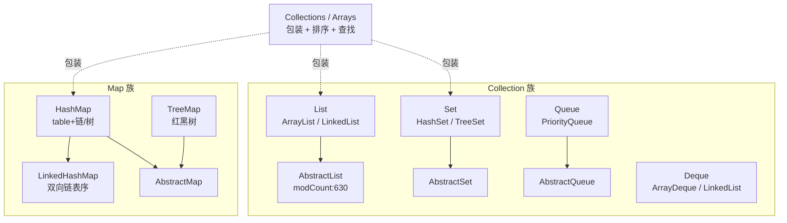
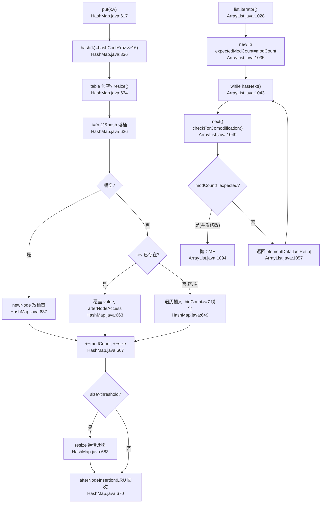
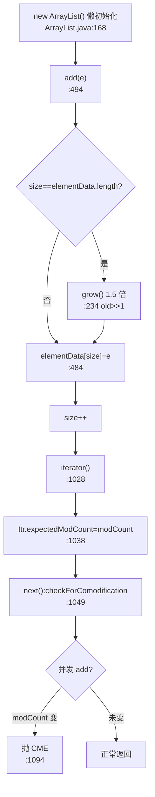
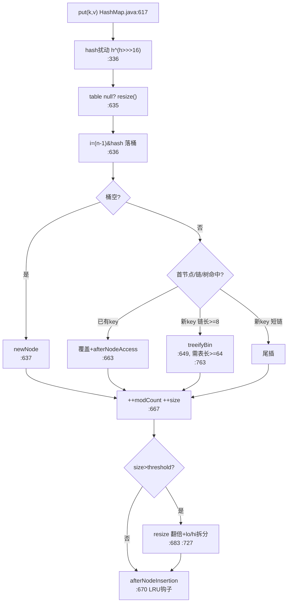
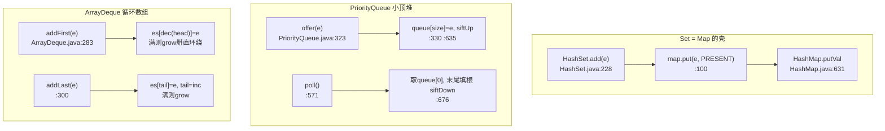
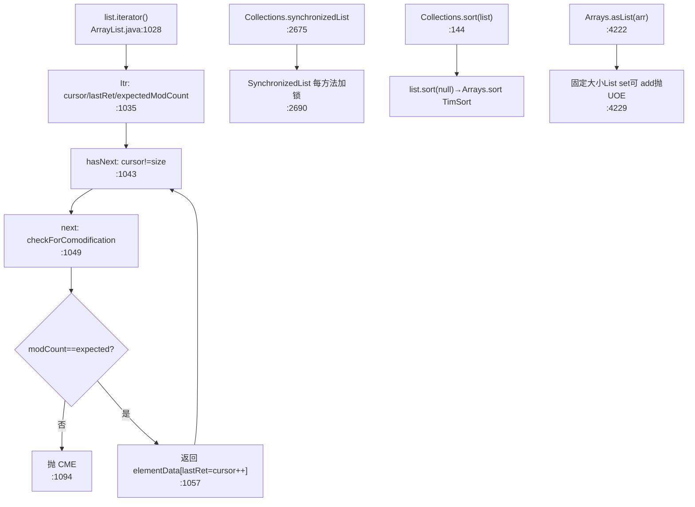
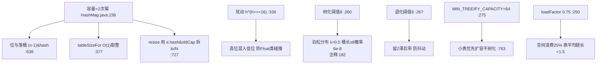
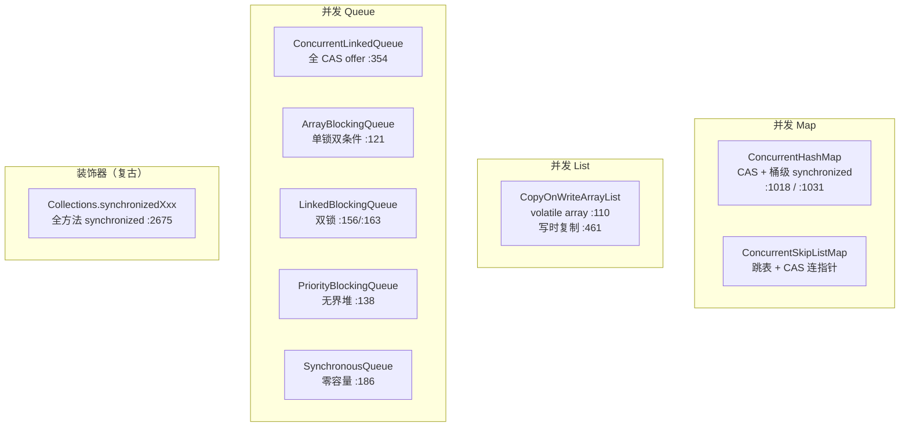
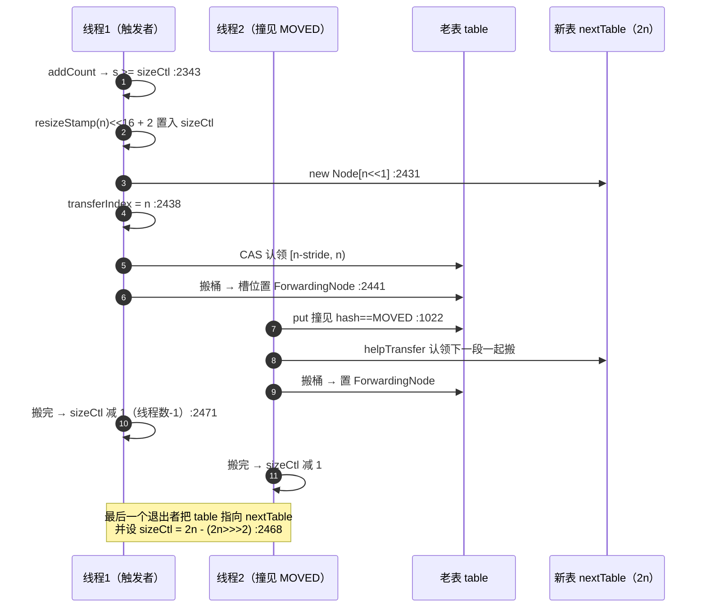
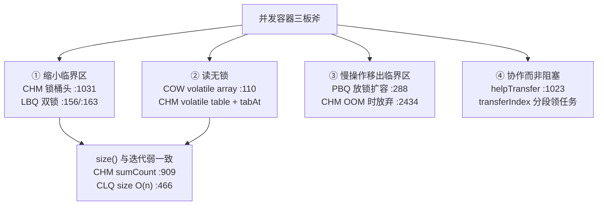

> 基于对 `src/java.base/share/classes/java/util/` 目录下 Java 集合源码（`ArrayList.java`、`LinkedList.java`、`HashMap.java`、`LinkedHashMap.java`、`TreeMap.java`、`HashSet.java`、`PriorityQueue.java`、`ArrayDeque.java`、`Collections.java`、`Arrays.java`、`AbstractList.java`、`Iterator.java` 等）的逐文件精读整理而成。
>
> 阅读顺序即学习顺序：List 家族 → Map 家族核心 → Set 与 Queue → 迭代器与工具类 → 散列原理与设计权衡 → **并发集合**。
>
> 所有结论均标注了源文件位置（格式 `src/java.base/share/classes/java/util/xxx.java:行号`），建议对照代码阅读。第一~五讲覆盖**非并发**集合，**第六讲覆盖并发集合**（`java.util.concurrent` 下的容器）；线程池/AQS/Lock 等见 `java-concurrent.md` 与 `java-lock.md`。
>
> **版本基线**：OpenJDK **21（jdk-21-ga）**。
> **精确 commit**：`890adb6410dab4606a4f26a942aed02fb2f55387`，commit 时间 `2023-08-09 20:19:41 +0000`（由 `git -C D:/work/2026/deep-dive/sources/jdk rev-parse HEAD` 与 `git log -1 --format=%ci` 取得）。

---

## 〇、全景地图

Java 集合框架（JDK 21 非并发部分）的骨架可以压成两大族系：**Collection 族**（`List`/`Set`/`Queue`/`Deque`）与 **Map 族**。前者靠 `AbstractCollection` → `AbstractList`/`AbstractSet`/`AbstractQueue` 这条抽象骨架串起来，后者靠 `AbstractMap` 串起来。两条主线上挂着各自的具体实现：数组/链表/哈希表/红黑树/堆/循环数组，外加 `Collections`/`Arrays` 两个工具箱做包装与排序。

```
┌──────────────────── Iterable (java.lang.Iterable) ────────────────────┐
│                          │                                             │
│                   Collection<E>                                        │
│        ┌────────────┬───┴──────┬──────────────┐                        │
│        ▼            ▼          ▼              ▼                        │
│      List<E>      Set<E>     Queue<E>      Deque<E>                     │
│        │            │          │              │                        │
│   ┌────┴───┐   ┌────┴───┐     │         ┌────┴────┐                   │
│   │ArrayLst│   │ HashSet│   PriorityQueue │ArrayDeque│                   │
│   │LinkedL │   │LinkedHS│                  │LinkedList│                  │
│   │Abstract│   │TreeSet │                  └──────────┘                  │
│   │List    │   │EnumSet │                                               │
│   └────────┘   └────────┘                                               │
└────────────────────────────────────────────────────────────────────────┘

┌──────────────────────── Map<K,V> ────────────────────────────────────┐
│      AbstractMap<K,V>                                                │
│        ┌─────────┬─────────┬────────────┬──────────────┐             │
│        ▼         ▼         ▼            ▼              ▼             │
│     HashMap  TreeMap  LinkedHashMap  IdentityHashMap  WeakHashMap     │
│   (数组+链/树) (红黑树) (双向链表序)    (== 比较)     (弱引用 key)    │
│        │                                                              │
│   HashMap.Node / TreeNode  ── table 数组 ── (n-1)&hash                 │
└──────────────────────────────────────────────────────────────────────┘

        两条横切主线：
        ① 查找流：get(key) → hash 扰动 → (n-1)&hash 落桶 → 链/树遍历
        ② 扩容流：add/put → size>threshold → resize/newLength → 迁移
        ③ 迭代流：iterator → cursor/lastRet → modCount 校验 → CME
```

渲染版（颜色与方向更直观）：



贯穿全集合框架的三条主线，记住它们就抓住了核心：

1. **查找流**：`get`/`contains` → 算 hash → 落桶 → 在桶内链表或红黑树里逐个比对 `equals`。HashMap 的 `(n-1) & hash`、TreeMap 的二叉搜索、ArrayList 的 `indexOf` 线性扫描，本质都是"定位 → 比对"。
2. **扩容流**：`add`/`put` → 检查容量 → 不够就 `grow`/`resize` → 搬迁老元素。ArrayList 1.5 倍、HashMap 2 倍、PriorityQueue 小数组翻倍否则 50%、ArrayDeque 循环数组翻倍。
3. **迭代流**：`iterator()` 创建快照式的 `cursor/lastRet` 状态 → 每步 `checkForComodification()` 比 `modCount` → 不一致抛 `ConcurrentModificationException`（fail-fast，best-effort）。

> **并发集合（第六讲）不在这三条主线的射程内**：`ConcurrentHashMap` 的散列算法与 HashMap 完全同构（容量 16 / 0.75 / 树化 8 / 退化 6），差别**全在并发控制**——空桶 CAS、`synchronized` 锁桶头、`sizeCtl` 状态机、多线程协作扩容；`CopyOnWriteArrayList` 则连"迭代流"都换成了"快照引用"。所以第六讲可以当作前五讲的**对照组**来读。

---

## 速览：各讲做了什么（先看这个再进细节）

先用大白话把五讲各自干了什么说清楚，再进逐文件精读。

| 讲次 | 主题 | 一句话干了什么 | 关键文件 |
| --- | --- | --- | --- |
| 第一讲 | List 家族 | ArrayList 是"会自己长个儿的数组"，LinkedList 是"两头都能捅的双链表"；扩容靠 System.arraycopy，迭代靠 modCount 防篡改 | ArrayList.java、LinkedList.java、AbstractList.java、Arrays.java |
| 第二讲 | Map 家族核心 | HashMap 是"数组挂链表，链长了变红黑树"的哈希表；LinkedHashMap 在外面再套一条双向链表记顺序；TreeMap 是裸的红黑树 | HashMap.java、LinkedHashMap.java、TreeMap.java |
| 第三讲 | Set 与 Queue | HashSet 就是 HashMap 套壳（value 用 PRESENT 占位）；PriorityQueue 是小顶堆；ArrayDeque 是循环数组双端队列 | HashSet.java、PriorityQueue.java、ArrayDeque.java |
| 第四讲 | 迭代器与工具类 | Iterator/ListIterator 是带游标的遍历器，modCount 是 fail-fast 的灵魂；Collections/Arrays 是包装与排序工具箱 | Iterator.java、Collections.java、Arrays.java |
| 第五讲 | 散列原理与设计权衡 | 为什么容量是 2 次幂（位与代替取模）、为什么树化阈值是 8（泊松分布）、loadFactor 0.75 的时空权衡 | HashMap.java 注释 |
| 第六讲 | 并发集合 | CHM 把锁粒度压到**单个桶**、读完全无锁、扩容时**所有线程一起搬**；COW 写时复制换读无锁；BlockingQueue 靠 Condition 阻塞 | ConcurrentHashMap.java、CopyOnWriteArrayList.java、ArrayBlockingQueue.java、PriorityBlockingQueue.java |

全流程图（一次 `map.put(k,v)` 从 hash 到落桶 + 一次 `list.iterator()` 遍历中并发修改抛 CME）：



---

## 面试速通：Java 集合高频问题一页纸

> 先给结论，再按讲次展开。
> ArrayList 的全部魔法是「一个 `Object[]` + `System.arraycopy` + `modCount`」三件套；
> HashMap 的全部魔法是「2 次幂容量 + `h ^ (h >>> 16)` 扰动 + 链长 8 树化兜底 + lo/hi 拆分迁移」四件事。
> 面试先答这两句总分，被追问细节再往下走：
> 第一讲 List 家族，第二讲 Map 家族核心，第三讲 Set 与 Queue，第四讲迭代器与工具类，第五讲散列原理与每个魔法数字背后的权衡。
> 本页所有结论均提炼自对应讲次的小结与关键机制表，不引入文档之外的知识点。
> 用法：先扫表格建立全局印象，被问到哪条就讲哪条，再按「深入」列回查原文细节。
> 适用场景：面试前 10 分钟过一遍建立全局，或被追问时按图索骥。

### 高频 Q&A（先结论）

27 道最高频题的「一句话答案」。先报结论占住阵地，面试官真追问时，按「深入」列展开到对应讲次。
题目覆盖 List/Map/Set/Queue/迭代器/散列原理/并发容器七大块，顺序大致按被问频率排。

| # | 面试问题 | 一句话结论 | 深入 |
| --- | --- | --- | --- |
| 1 | ArrayList 怎么扩容？ | 满则走 `grow()`：`ArraysSupport.newLength` 首选增长 0.5 倍（约 1.5 倍），`System.arraycopy` 批量搬迁，摊还 O(1) | 第一讲 |
| 2 | ArrayList 与 LinkedList 区别？ | ArrayList 把增删代价压到 arraycopy 上，换 O(1) 摊还随机访问；LinkedList 把代价压到指针改写上，换 O(1) 头尾操作，但 `get(i)` 要跨半个链表 | 第一讲 |
| 3 | `new ArrayList()` 一造出来就占 10 个坑位吗？ | 不是。无参构造持 `DEFAULTCAPACITY_EMPTY_ELEMENTDATA` 空数组懒初始化，首次 `add` 才扩到 `DEFAULT_CAPACITY=10` | 第一讲 |
| 4 | HashMap 底层结构？ | 数组 + 桶内链表/红黑树：2 次幂容量、`(n-1) & hash` 落桶、链长 8 且表长 ≥64 才树化、扩容 lo/hi 拆分迁移 | 第二讲 |
| 5 | hash 扰动函数 `h ^ (h >>> 16)` 有什么用？ | 把高 16 位异或进低位，防 `Float` 这类「低位全 0」的 hashCode 全挤同一个桶；`null` key 的 hash 固定为 0，落 0 号桶 | 第五讲 |
| 6 | 容量为什么必须是 2 次幂？ | 一个约束换三个优化：位与代替取模落桶、`tableSizeFor` O(1) 向上取整、`resize` 按 `e.hash & oldCap` 免重算拆分迁移 | 第五讲 |
| 7 | 负载因子为什么默认 0.75？ | 时空权衡：容忍约 25% 空间浪费，换查找时平均链长 <1.5；调大查找变慢，调小浪费内存 | 第五讲 |
| 8 | 树化阈值为什么是 8？ | 泊松分布 λ=0.5 下桶长 ≥8 的概率约 6e-8，正常随机 hash 几乎不可能发生；一旦出现即 hash 分布异常的信号，此时树化把最坏情况从 O(n) 降到 O(log n) 值得 | 第五讲 |
| 9 | 链长到 8 就一定树化吗？ | 不一定。双阈值：表长 <64 时 `treeifyBin` 选择 `resize()`——扩容能稀释所有桶，树化只救一个桶还吃 2 倍内存 | 第五讲 |
| 10 | HashMap 线程安全吗？ | 不安全。JDK 7 头插法扩容可能形成环形链表、`get` 死循环占满 CPU；JDK 8 改尾插法 + lo/hi 保序，理论上消除环化条件，但仍会丢数据、`size` 不准 | 第五讲 |
| 11 | 要线程安全用什么？ | `ConcurrentHashMap`（分段锁/CAS）或 `Collections.synchronizedMap` 装饰器；`modCount` 只是 best-effort 的 fail-fast，不是并发控制 | 第五讲 |
| 12 | LinkedHashMap 怎么实现 LRU？ | 不改 `putVal`/`resize` 主干，只覆盖钩子：`afterNodeAccess` 把访问节点挪尾，配合 `removeEldestEntry` 删头——教科书级开闭原则 | 第二讲 |
| 13 | TreeMap 怎么保证有序？ | 裸红黑树：key 走 `Comparator` 或 `Comparable` 自然序二分查找，插入/删除后旋转 + 重染，保「黑高一致、无连续红」五大性质 | 第二讲 |
| 14 | HashSet 怎么实现的？ | HashMap 套壳：value 全用共享的 `PRESENT` 占位，`add`/`contains`/`remove` 都是 `map.xxx` 一行包装，扩容、扰动、fail-fast 全继承 | 第三讲 |
| 15 | fail-fast 是什么？ | 迭代器创建时快照 `expectedModCount`，每次 `next()` 比对 `modCount`，不一致抛 `ConcurrentModificationException`；best-effort，不能作正确性保证 | 第四讲 |
| 16 | 遍历中想删除元素怎么做？ | 只能用 `iterator.remove()`：它内部调 `list.remove(lastRet)` 后会同步 `expectedModCount`，所以不触发 CME；直接 `list.remove` 必抛 | 第四讲 |
| 17 | ConcurrentHashMap 怎么保证线程安全？ | 四路降级：空桶 CAS 无锁 → 撞见 `MOVED` 帮忙搬 → `putIfAbsent` 命中首节点无锁 → 都不行才 `synchronized` 锁**桶头** | 第六讲 |
| 18 | CHM 与 JDK 7 的 Segment 段锁有什么区别？ | JDK 8 起没有 Segment 了，锁粒度从"一段"下沉到"一个桶"；并发度 ≈ 桶数，且无需预分配 Segment | 第六讲 |
| 19 | `ConcurrentHashMap.size()` 精确吗？ | 不精确。`baseCount` + `CounterCell[]` 分段求和，求和时别人还在改；元素数可能超 int，官方推荐 `mappingCount()` | 第六讲 |
| 20 | CHM 扩容时其他线程在干嘛？ | **一起搬**。撞见 `ForwardingNode`（`hash == MOVED`）就 `helpTransfer`，按 `stride` 从 `transferIndex` 认领一段桶 | 第六讲 |
| 21 | CopyOnWriteArrayList 为什么读不加锁？ | 写时 `Arrays.copyOf` 整份复制后 `volatile` 写回，读直接读 volatile 数组；迭代器持有创建时数组引用作快照，绝不 CME | 第六讲 |
| 22 | COW 适合什么场景？ | 读远多于写、且能容忍短暂过期（监听器/白名单/路由表）。写是 O(n) 复制 + 有锁，写多会致命 | 第六讲 |
| 23 | `ConcurrentLinkedQueue.size()` 为什么是 O(n)？ | 无锁队列维护不了精确原子计数（那会重新引入竞争点），只能遍历；判空请用 `isEmpty()` | 第六讲 |
| 24 | `ArrayBlockingQueue` 与 `LinkedBlockingQueue` 区别？ | ABQ 有界 + **单锁**双 Condition；LBQ 默认无界（`Integer.MAX_VALUE`）+ **双锁**（`putLock`/`takeLock`）+ `AtomicInteger count`，吞吐更高 | 第六讲 |
| 25 | `PriorityBlockingQueue` 怎么扩容？ | **先把主锁放了**，用 `allocationSpinLock` 只保护"分配新数组"，分配完再拿锁做 `arraycopy`——把慢操作移出临界区 | 第六讲 |
| 26 | ConcurrentHashMap 为什么不支持 null？ | `get(key)` 返回 null 必须唯一表示"不存在"；单线程的 HashMap 可以用 `containsKey` 兜底，并发下做不到 | 第六讲 |
| 27 | `synchronizedMap` 够用吗？ | 不够。它只保证**单方法**原子，复合操作（check-then-put）仍有竞态，还需外部 `synchronized(map)`；不如直接用 CHM 的 `putIfAbsent` | 第六讲 |

### 易错点与面试坑

以下每条都是文档专门强调过的反直觉点——知道就加分，不知道必挂。按被问到的频率从高到低排列。

- **`new HashMap<>()` 不分配 table**：无参构造下 `table` 为 `null`、threshold 为 0，第一次 `put` 才 `resize` 出容量 16 的表；
  而且传入的非 2 次幂初始容量会被 `tableSizeFor` 悄悄改成 2 次幂——「我要 17，实际拿到 32」。
  懒初始化不是 HashMap 专利：ArrayList 无参构造同样持空数组，首次 `add` 才扩到 10。
- **`subList` 是视图不是拷贝**：`SubList` 持 `root` 引用与 `offset`，读写穿透回原 ArrayList；
  反过来原表一旦结构性修改，subList 的 `checkForComodification` 就会抛 CME——视图和原表两边互相坑。
  这是「共享底层 + modCount 互检」的典型模式，不是免费的拷贝捷径。
- **`Arrays.asList` 是固定大小视图**：返回的内部类不是 `java.util.ArrayList`，没有 override `add`，`add`/`remove` 抛 `UnsupportedOperationException`；
  但 `set` 能改值，且写穿透回原数组——它是数组与集合 API 之间的桥，不是万能 List。
- **modCount 有「至多加 1」的契约**：一次结构性操作只计一次数——`addAll(c)` 加了 N 个元素也只 `++modCount` 一次，
  否则迭代器会误报 CME；`batchRemove` 的 `modCount += end-w` 是删多个的特例。
  这是 `AbstractList` 注释里写死的约束，为的是让快照比对可靠。
- **fail-fast 有漏检窗口**：结构性修改若发生在 `checkForComodification` 之后、返回元素之前，本轮可能不抛，但下一轮必抛；
  这正是 Javadoc 反复强调「不应依赖 CME 做正确性保证」的原因——它是调试辅助，不是并发控制。
  「不报错」不等于「线程安全」，这是全文档重复最多的告诫之一。
- **LinkedHashMap 的 `get` 也算结构性修改**：`accessOrder=true` 时 `afterNodeAccess` 挪尾会 `++modCount`，
  所以遍历中调用 `get` 同样可能触发 CME——「只读」操作在这里并不只读。
  LRU 缓存正是利用这一点：访问即挪尾，头节点就是最久未用。
- **PriorityQueue 与 ArrayDeque 显式拒绝 `null` 元素**：`offer`/`addFirst`/`addLast` 开头就是 null 检查，直接抛 `NullPointerException`；
  注意这与 HashMap 允许 null key（null 的 hash 固定为 0 落 0 号桶）正好相反——同一个框架里，不同容器对 null 的态度并不统一。
- **`Collections.unmodifiableList` 是拦写的视图不是拷贝**：它持原 List 引用直接转发，所有写操作抛 UOE；
  原表后续的改动会照样反映到这个「不可变」视图上——要真正不可变得自己拷贝一份。
  三类装饰器（synchronized/unmodifiable/checked）都是这个模式：持引用、转发、在转发前后加动作。
- **并发容器的迭代器不抛 CME，但也不是「正确」**：CHM 的 `Traverser` 是**弱一致**的——可能看不到遍历期间新插入的元素；
  COW 的 `COWIterator` 看到的是**创建那一刻的历史快照**，别人的修改永远看不见。
  「不抛异常」只说明不会因为并发修改而崩，不代表你拿到的是一致视图——需要精确快照就得自己在外面加锁。
- **`ConcurrentHashMap.size()` 不是精确值，而且可能溢出**：它是 `baseCount + Σ CounterCell` 的并发求和，
  求和时别人还在改；元素数超过 `Integer.MAX_VALUE` 时 `size()` 会**饱和**到 `Integer.MAX_VALUE`，所以官方给了 `mappingCount()` 返回 `long`。
  同理 `ConcurrentLinkedQueue.size()` 干脆是 **O(n) 遍历**，判空请用 `isEmpty()`。
- **`synchronizedMap` 挡不住复合操作的竞态**：`if (!map.containsKey(k)) map.put(k, v)` 即使套了 `synchronizedMap` 也一样有窗口，
  因为 `containsKey` 和 `put` 是两次独立加锁。要么外部 `synchronized (map) { ... }`，要么直接用 CHM 的 `putIfAbsent` —— 既然都要外部加锁，前者就没意义了。
- **`PriorityBlockingQueue` 是无界的**：默认初始容量 11，满了自动扩容，**永远不会阻塞生产者**，内存可能撑爆；
  而且它**不保证同优先级元素的 FIFO**。需要背压就用 `ArrayBlockingQueue`。
- **`CopyOnWriteArrayList` 的迭代器不支持 `remove`/`set`/`add`**：改快照毫无意义（快照是历史不是当前），
  源码注释直接写明，调用会抛 `UnsupportedOperationException`。

### 关键数值速记

被问数字时先报这张表，再补一句「每个魔法数字都是数学与工程的权衡，不是随意值」——这是第五讲的总纲。

| 数值 | 含义 | 讲次 |
| --- | --- | --- |
| `DEFAULT_CAPACITY = 10` | ArrayList 无参构造首次 `add` 的扩容目标 | 第一讲 |
| 1.5 倍（`old >> 1`） | ArrayList 首选增长率，摊还 O(1) 的来源 | 第一讲 |
| `DEFAULT_INITIAL_CAPACITY = 16` | HashMap 默认初始容量（`1 << 4`） | 第二讲 |
| `MAXIMUM_CAPACITY = 1 << 30` | HashMap 容量上限 | 第二讲 |
| `loadFactor = 0.75` | 默认负载因子：约 25% 空间浪费换平均链长 <1.5 | 第五讲 |
| `threshold = capacity × loadFactor` | 扩容触发线：`size` 超过它即 `resize` | 第二讲 |
| `TREEIFY_THRESHOLD = 8` | 树化阈值，来自泊松分布 λ=0.5 下 6e-8 的硬算 | 第五讲 |
| `UNTREEIFY_THRESHOLD = 6` | 退化阈值，与 8 留 2 的滞后带防抖动 | 第五讲 |
| `MIN_TREEIFY_CAPACITY = 64` | 表长不足 64 时优先 `resize` 而非树化 | 第五讲 |
| 约 6e-8（约 1/1600 万） | λ=0.5 时桶长 ≥8 的概率，树化「几乎不可能」的底气 | 第五讲 |
| 16 位（`h >>> 16`） | 扰动函数混入低位的高位位数 | 第五讲 |
| 期望链长约 0.5 | λ=0.5 下 0.75 负载因子达到的查找代价 | 第五讲 |
| `(k-1) >>> 1` 与 `2k+1`/`2k+2` | PriorityQueue 父子寻址（0-based 完全二叉树数组化） | 第三讲 |
| <64 翻倍、否则 +50% | PriorityQueue 的扩容策略 | 第三讲 |
| 预留 1 个 null 槽 | ArrayDeque 区分「空」与「满」的关键 | 第三讲 |
| TreeNode 约 2 倍于普通 Node | 树化的内存代价，所以小表优先扩容而非树化 | 第二讲 |
| O(n log n) 且稳定 | TimSort（`Collections.sort` 底层）的复杂度与稳定性 | 第四讲 |
| `DEFAULT_CAPACITY = 16` | ConcurrentHashMap 默认初始容量（与 HashMap 同） | 第六讲 |
| `MIN_TRANSFER_STRIDE = 16` | CHM 协作扩容时每个线程一次认领的桶数下限 | 第六讲 |
| `n >>> 3 / NCPU` | CHM 扩容步长 `stride` 的计算式，小于 16 取 16 | 第六讲 |
| `sizeCtl = -1` | CHM 正在初始化（`initTable` 的 CAS 锁） | 第六讲 |
| `sizeCtl < -1` | CHM 正在扩容：高 16 位 `resizeStamp(n)` + 低 16 位线程数+1 | 第六讲 |
| `MOVED=-1` / `TREEBIN=-2` / `RESERVED=-3` | CHM 三个负 hash 哨兵（普通节点 hash 恒非负，故负数可复用） | 第六讲 |
| `HASH_BITS = 0x7fffffff` | `spread` 用它把符号位清零，为负 hash 哨兵腾出空间 | 第六讲 |
| `DEFAULT_INITIAL_CAPACITY = 11` | PriorityBlockingQueue 默认初始容量（无界，自动扩容） | 第六讲 |
| `<64 则 +2，否则 >>1` | PriorityBlockingQueue 的扩容增长量 | 第六讲 |
| `Integer.MAX_VALUE` | LinkedBlockingQueue 默认容量（等于无界） | 第六讲 |
| `MAX_HOPS = 8` | ConcurrentLinkedQueue 从 head 跳多少步后放弃优化 | 第六讲 |

一句话收尾：集合框架所有的坑都能回到三条主线——查找流（定位 → 比对）、扩容流（不够就搬）、迭代流（modCount 校验）；并发容器再加一条——**缩小临界区 + 无锁读 + 协作搬迁**。
记住主线，具体数字忘了也能顺着推出来；本页所有结论都能在对应讲次里找到源码依据。
建议配合各讲小结的「三个最值得记住的点」一起复习——那一页是细节，这一页是索引。

---

## 第一讲：List 家族 —— ArrayList、LinkedList 与 AbstractList

### 先说人话：本讲每个阶段在干什么

把 List 家族想象成"两种装东西的盒子"：ArrayList 是一个**能自动加长的抽屉阵列**——你往里塞东西，塞满之前它会偷偷订一个更大的抽屉柜，把东西整批搬过去（`System.arraycopy`）；LinkedList 是一条**两头都能挂车厢的火车**——头尾加一节车厢是 O(1)，但你要去第 5 节车厢得从车头一节节走过去（O(n)）。

| 阶段 | 干了什么 | 为什么 |
| --- | --- | --- |
| 构造 | ArrayList 默认 `DEFAULTCAPACITY_EMPTY_ELEMENTDATA`（空数组），首次 add 才扩到 10 | 懒初始化，空列表不浪费内存（`ArrayList.java:130`、`168`） |
| 末尾 add | `modCount++` → 私有 `add(e, elementData, size)` → 满了 `grow()` | 偷偷把字节码拆小以利 C1 内联（`ArrayList.java:481` 注释） |
| 扩容 | `ArraysSupport.newLength(old, min, old>>1)`，首选增长 0.5 倍 | 摊还 O(1)，1.5 倍是时空与搬运量的折中（`ArrayList.java:234`） |
| 中间插入 | `System.arraycopy` 把 index 后的元素整体右移一格 | 数组连续，批量移动比逐个快（`ArrayList.java:516`） |
| 删除 | `fastRemove`：再 `arraycopy` 左移，末尾置 null 防 GC 泄漏（`ArrayList.java:719`） | 同上 |
| subList | 返回 `SubList` 视图，offset+size 共享 root 的 elementData | 视图不拷贝，写穿透回原表（`ArrayList.java:1194`） |
| 迭代 | `Itr` 用 cursor/lastRet/expectedModCount，每次 next 查 modCount | fail-fast，尽早暴露并发修改 bug（`ArrayList.java:1035`） |

**本讲主线**：ArrayList 的所有魔力都来自"一个 Object[] + 一个 size + 一个 modCount"，扩容靠 arraycopy，正确性靠 modCount。

### 逐文件精读

#### 1）`ArrayList.java` —— 一个会自动加长的 `Object[]`

**字段与构造**：核心就三个字段——`elementData`（`Object[]` 缓冲区，`ArrayList.java:138`）、`size`（元素个数，`:145`）、继承自 `AbstractList` 的 `modCount`（`AbstractList.java:630`）。两个空数组常量区分"用户主动要 0 容量"（`EMPTY_ELEMENTDATA`，`:123`）与"用无参构造的懒初始化"（`DEFAULTCAPACITY_EMPTY_ELEMENTDATA`，`:130`）——后者在首次 add 时会被扩到 `DEFAULT_CAPACITY=10`（`:118`、`grow` 分支 `:239`）。

```java
// ArrayList.java:168
public ArrayList() { this.elementData = DEFAULTCAPACITY_EMPTY_ELEMENTDATA; }

// ArrayList.java:231  扩容核心
private Object[] grow(int minCapacity) {
    int oldCapacity = elementData.length;
    if (oldCapacity > 0 || elementData != DEFAULTCAPACITY_EMPTY_ELEMENTDATA) {
        int newCapacity = ArraysSupport.newLength(oldCapacity,
                minCapacity - oldCapacity, /* minimum growth */
                oldCapacity >> 1           /* preferred growth */);
        return elementData = Arrays.copyOf(elementData, newCapacity);
    } else {
        return elementData = new Object[Math.max(DEFAULT_CAPACITY, minCapacity)];
    }
}
```

注意 `oldCapacity >> 1` 就是 `oldCapacity / 2`，即**首选增长 50%**（约 1.5 倍）。`ArraysSupport.newLength` 会取"最小增长"与"首选增长"的较大者并防溢出，所以实际新容量 = `old + max(minGrowth, old>>1)`，正是经典的 1.5 倍策略。

**增删改**：

| 方法 | 位置 | 要点 |
| --- | --- | --- |
| `get(i)` | `ArrayList.java:426` | `Objects.checkIndex` + `elementData(i)`，O(1) |
| `set(i,e)` | `ArrayList.java:469` | 直接赋值，O(1)，**不**改 modCount |
| `add(e)` | `ArrayList.java:494` | `modCount++` → 私有 `add` → 可能 `grow()` |
| `add(i,e)` | `ArrayList.java:509` | `System.arraycopy(es, index, es, index+1, s-index)` 右移（`:516`） |
| `fastRemove` | `ArrayList.java:719` | `modCount++`，`arraycopy` 左移，末尾 `es[size=newSize]=null` |
| `clear()` | `ArrayList.java:731` | `modCount++`，逐个置 null 帮 GC |
| `addAll` | `ArrayList.java:751` | `c.toArray()` → `grow(s+numNew)` → `arraycopy` 批量拷 |
| `batchRemove` | `ArrayList.java:896` | 双指针原地压缩，`shiftTailOverGap` 收尾（`:827`） |

**subList 视图**：`subList(from, to)` 返回 `SubList`（`:1194`），它**不拷贝**，而是记 `root`（原 ArrayList）、`offset`、`size`，所有读写都 `root.elementData[offset + index]`（`:1225`）。这意味着对 subList 的写穿透回原表；反之，若原表被结构性修改，subList 的 `checkForComodification`（`:1495`，比 `root.modCount != modCount`）会抛 CME。

**fail-fast 迭代器**：`Itr`（`:1035`）三字段：

```java
// ArrayList.java:1035
private class Itr implements Iterator<E> {
    int cursor;       // index of next element to return
    int lastRet = -1; // index of last element returned; -1 if no such
    int expectedModCount = modCount;   // ← 创建时快照
    ...
    public E next() {
        checkForComodification();      // :1049  每步先查
        ...
    }
    final void checkForComodification() {
        if (modCount != expectedModCount)          // :1094
            throw new ConcurrentModificationException();
    }
}
```

`Itr.remove()`（`:1060`）在调 `ArrayList.this.remove(lastRet)` 后**同步更新** `expectedModCount = modCount`（`:1069`），所以迭代器自己的删除不会触发 CME。`ListItr`（`:1102`）在此基础上加了 `hasPrevious/previous/add/set`。

**Spliterator**：`ArrayListSpliterator`（`:1620`）用"二分切割"做并行遍历，`trySplit` 取中点 `mid = (lo+hi)>>>1`（`:1673`），靠 `getFence()` 懒初始化 fence 与 expectedModCount，遍历结束时再查一次 modCount。

#### 2）`LinkedList.java` —— 双链表，同时也是 Deque

**节点与头尾**：

```java
// LinkedList.java:981
private static class Node<E> {
    E item; Node<E> next; Node<E> prev;
    Node(Node<E> prev, E element, Node<E> next) { ... }
}
transient Node<E> first;   // :99
transient Node<E> last;    // :104
```

**链表操作**（全是 O(1) 的指针改写 + `size++/modCount++`）：

| 方法 | 位置 | 作用 |
| --- | --- | --- |
| `linkFirst` | `LinkedList.java:136` | 头插，first 为空时 last 也指过来 |
| `linkLast` | `:151` | 尾插，`add(e)` 就走它（`:348`） |
| `linkBefore` | `:166` | 在某节点前插，`add(i,e)` 用（`:523`） |
| `unlinkFirst` | `:182` | 摘头，`item/next` 置 null 助 GC |
| `unlinkLast` | `:201` | 摘尾 |
| `unlink(x)` | `:220` | 摘任意节点，处理四组指针边界 |

**`get(i)` 的 O(n)**：`node(index)`（`:577`）会判断 `index < (size >> 1)` 决定从 first 还是 last 起步，最坏仍 O(n/2)：

```java
// LinkedList.java:577
Node<E> node(int index) {
    if (index < (size >> 1)) {
        Node<E> x = first;
        for (int i = 0; i < index; i++) x = x.next;
        return x;
    } else {
        Node<E> x = last;
        for (int i = size - 1; i > index; i--) x = x.prev;
        return x;
    }
}
```

**Deque 接口**：`peek/poll/offer/push/pop/offerFirst/offerLast/pollLast` 等全在 `:661`~`:813`，本质都是调用上面的 link/unlink。`descendingIterator`（`:996`）复用一个从 size 起步的 `ListItr.previous`。

**`ListItr`**（`:882`）与 ArrayList 的类似，也是 `expectedModCount = modCount` + `checkForComodification`（`:975`），`remove/add` 后 `expectedModCount++`（`:943`、`:961`）同步。

#### 3）`AbstractList.java` —— modCount 的家

`modCount` 字段就定义在这里（`AbstractList.java:630`，`protected transient int modCount`），是所有 fail-fast 迭代器的共同根。注释（`:624`）明确：每次结构性 `add`/`remove` **至多**让 modCount 加 1，否则迭代器会误报 CME。

`subListRangeCheck`（`:505`）是被 `ArrayList.subList` 复用的边界检查。JDK 21 还提供了 `RandomAccessSpliterator`（`:652`），给非 `AbstractList` 的随机访问 List 用。

#### 4）`Arrays.asList` —— 固定大小视图

`Arrays.asList`（`Arrays.java:4222`）返回内部 `ArrayList`（`Arrays.java:4229`，注意这不是 `java.util.ArrayList`），它持有一个 `final E[] a`（`:4235`），`get/set/size/indexOf` 都直接操作 `a`。**没有 override `add`**，因此继承自 `AbstractList.add` 会抛 `UnsupportedOperationException`——这就是"固定大小"的由来。`set`（`:4270`）能改值且写穿透回原数组。

#### 5）`CopyOnWriteArrayList` 简述

`CopyOnWriteArrayList` 在 `java.util.concurrent` 包，不在本讲范围。要点：写时复制整个内部数组（`ReentrantLock` 保护），读无锁，迭代器是"快照"而非 fail-fast（永远不抛 CME，但看不到写后的变化）。适合读多写极少、容忍弱一致性的场景。详见并发库文档。

### 端到端演算 ①：一次 `list.iterator()` 遍历中并发修改抛 CME

设 `ArrayList<Integer> list` 已有 `[1,2,3]`，`modCount=3`（假设）。

1. `Iterator<Integer> it = list.iterator();` → `new Itr()`（`ArrayList.java:1035`），此时 `expectedModCount = 3`，`cursor=0`，`lastRet=-1`。
2. `it.next()` 返回 1：`checkForComodification()`（`:1049`）查 `3==3` 通过；`cursor=1`，`lastRet=0`。
3. **此时另一线程** `list.add(4)`：`add(E)`（`:494`）执行 `modCount++` → modCount 变 4，`size` 变 4。
4. `it.next()` 再调：`checkForComodification()`（`:1049`）查 `4 != 3` → 抛 `ConcurrentModificationException`（`:1094`）。

注意：这是 best-effort。如果第 3 步发生在 `checkForComodification` **之后**、`return elementData[lastRet=i]`（`:1057`）**之前**的窗口，本轮可能漏检，但下一轮必抛。这正是 Javadoc 反复强调"不应依赖 CME 做正确性保证"的原因。

### 第一讲小结：ArrayList 是"数组 + arraycopy"，LinkedList 是"指针 + modCount"

**一句话定位**：`ArrayList`（`ArrayList.java:109`）把所有增删的代价都压到 `System.arraycopy` 上换 O(1) 摊还随机访问；`LinkedList`（`LinkedList.java:90`）把代价压到指针改写上换 O(1) 头尾操作；两者共享 `AbstractList.modCount`（`AbstractList.java:630`）做 fail-fast。



**关键机制的输入/输出**：

| 机制 | 输入 | 输出 | 源码位置 |
| --- | --- | --- | --- |
| 懒初始化 | 无参构造 | `DEFAULTCAPACITY_EMPTY_ELEMENTDATA`，首次 add 才扩到 10 | `ArrayList.java:130`、`168`、`239` |
| 1.5 倍扩容 | `size+1 > length` | `newLength(old, 1, old>>1)` | `ArrayList.java:234` |
| 中间插入 | index, e | `arraycopy` 右移 1 格后赋值 | `ArrayList.java:516` |
| subList 视图 | from, to | `SubList` 共享 root.elementData | `ArrayList.java:1194` |
| fail-fast | 迭代中结构性修改 | `ConcurrentModificationException` | `ArrayList.java:1094` |
| batchRemove | Collection, complement | 原地双指针压缩 + `shiftTailOverGap` | `ArrayList.java:896`、`827` |

**三个最值得记住的点**：

1. **`add(E)` 故意拆成 `add(E)` + 私有 `add(e, elementData, s)`**（`ArrayList.java:494` → `:481`）。注释明说是为了把方法字节码压到 35 字节以内，好让 C1 编译器在热循环里内联——这是"为 JIT 写代码"的典型范例。
2. **`DEFAULTCAPACITY_EMPTY_ELEMENTDATA` 与 `EMPTY_ELEMENTDATA` 是两个不同的空数组**（`:123` vs `:130`）。前者专给无参构造用，首次 add 时扩到 10；后者给 `new ArrayList(0)` 用，扩容按普通路径走。区分它们是为了让"懒初始化"和"用户显式要 0"行为可区分。
3. **subList 是视图不是拷贝**（`:1194`）。`SubList` 持 `root` 引用与 `offset`，写穿透回原 ArrayList；反之原表结构性修改会让 subList 的 `checkForComodification`（`:1495` 比 `root.modCount != modCount`）抛 CME。这是"共享底层 + modCount 互检"模式。

---

## 第二讲：Map 家族核心 —— HashMap、LinkedHashMap 与 TreeMap

### 先说人话：本讲每个阶段在干什么

Map 家族是三种"键值对仓库"：HashMap 是"**一排桶，每只桶里挂一串或一棵树**"——哈希定位桶，桶里短就链表、长就红黑树；LinkedHashMap 是"HashMap 外面再套一条**双向链表**"，把所有节点按插入或访问顺序串起来，这样遍历就有序、还能做 LRU；TreeMap 是"**裸的红黑树**"，没有桶，整棵树按 key 排序。

| 阶段 | 干了什么 | 为什么 |
| --- | --- | --- |
| hash 扰动 | `(h = key.hashCode()) ^ (h >>> 16)` | 高 16 位混到低位，避免"只有高位变化"的 key 在小表里全撞同一桶（`HashMap.java:336`） |
| 落桶 | `(n - 1) & hash` | n 是 2 次幂，等价取模但更快（`HashMap.java:636`） |
| 桶内查找 | 先比 hash 再比 equals | hash 不同直接跳过，省 equals（`HashMap.java:577`） |
| 树化 | 某桶链表 ≥ 8 且表长 ≥ 64 才转 TreeNode | 防哈希碰撞攻击，退化时 O(log n)（`:260`、`:275`、`:649`） |
| 扩容 | size > threshold → resize 翻倍 | 2 倍让"老桶元素要么留原位要么去 j+oldCap"，无需重算 hash（`:683`、`:727`） |
| LRU | accessOrder=true 时 get 后把节点挪到尾 | afterNodeAccess 钩子，头就是最久未用（`LinkedHashMap.java:336`） |
| 红黑树 | put/remove 后 fixAfterInsertion/Deletion 旋转染色 | 保"黑高一致、无连续红"五大性质（`TreeMap.java:2611`、`2704`） |

**本讲主线**：HashMap 的"数组 + 链/树 + 2 次幂 + 扩容迁移"是散列工程的集大成；LinkedHashMap 靠三个 `afterNode*` 钩子在不改 HashMap 主干的前提下加顺序；TreeMap 是纯粹的有序映射实现。

### 逐文件精读

#### 1）`HashMap.java` —— 数组挂链表/红黑树

**关键常量**（全在文件顶部，决定全局行为）：

```java
// HashMap.java:238~275
static final int DEFAULT_INITIAL_CAPACITY = 1 << 4; // 16
static final int MAXIMUM_CAPACITY = 1 << 30;
static final float DEFAULT_LOAD_FACTOR = 0.75f;
static final int TREEIFY_THRESHOLD = 8;
static final int UNTREEIFY_THRESHOLD = 6;
static final int MIN_TREEIFY_CAPACITY = 64;
```

**Node 与 TreeNode**：普通节点 `Node<K,V>`（`:281`）四个字段 `hash/key/value/next`；树节点 `TreeNode`（`:1966`）继承 `LinkedHashMap.Entry`（带 before/after），再加 `parent/left/right/prev/red`。注释（`:177`）承认 TreeNode 约是普通节点的 2 倍大，所以只在桶够长时才用。

**hash 扰动**（`:336`）：

```java
static final int hash(Object key) {
    int h;
    return (key == null) ? 0 : (h = key.hashCode()) ^ (h >>> 16);
}
```

`null` key 固定落 0 号桶（这就是"HashMap 允许 null key"的实现基础）。`^ (h >>> 16)` 把高 16 位异或到低位——因为表长一般 ≤ 65536（16 位），落桶只用到低位，扰动让高位也参与决策。

**`tableSizeFor`**（`:377`）：把任意 cap 向上取整到 2 次幂，用 `-1 >>> numberOfLeadingZeros(cap-1)` 一次铺满低位再 +1，O(1)。

**`getNode`**（`:573`）：定位 `tab[(n-1) & hash]`，先查首节点（hash 与 equals 都匹配），再判 `instanceof TreeNode` 走树查找，否则沿 `next` 链遍历。

**`putVal`**（`:631`）是 put 的真身，链路如下：

```java
// HashMap.java:631
final V putVal(int hash, K key, V value, boolean onlyIfAbsent, boolean evict) {
    Node<K,V>[] tab; Node<K,V> p; int n, i;
    if ((tab = table) == null || (n = tab.length) == 0)
        n = (tab = resize()).length;                       // :635 懒初始化/扩容
    if ((p = tab[i = (n - 1) & hash]) == null)             // :636 落桶
        tab[i] = newNode(hash, key, value, null);
    else {
        Node<K,V> e; K k;
        if (p.hash == hash &&
            ((k = p.key) == key || (key != null && key.equals(k))))  // 首节点命中
            e = p;
        else if (p instanceof TreeNode)                              // 树
            e = ((TreeNode<K,V>)p).putTreeVal(this, tab, hash, key, value);
        else {
            for (int binCount = 0; ; ++binCount) {
                if ((e = p.next) == null) {                          // 到尾没找到
                    p.next = newNode(hash, key, value, null);
                    if (binCount >= TREEIFY_THRESHOLD - 1)            // :649 链长到8树化
                        treeifyBin(tab, hash);
                    break;
                }
                if (e.hash == hash && ((k = e.key)==key||(key!=null&&key.equals(k))))
                    break;                                            // 中途命中
                p = e;
            }
        }
        if (e != null) { // 已有 key：覆盖
            V oldValue = e.value;
            if (!onlyIfAbsent || oldValue == null) e.value = value;
            afterNodeAccess(e);                                       // :663 钩子
            return oldValue;
        }
    }
    ++modCount;                                                        // :667
    if (++size > threshold) resize();                                  // :668~669
    afterNodeInsertion(evict);                                         // :670 钩子(LRU)
    return null;
}
```

**`resize`**（`:683`）——扩容的精华，利用 2 次幂做"低位组/高位组"拆分：

```java
// HashMap.java:712~750 节选
for (int j = 0; j < oldCap; ++j) {
    Node<K,V> e;
    if ((e = oldTab[j]) != null) {
        oldTab[j] = null;
        if (e.next == null)
            newTab[e.hash & (newCap - 1)] = e;            // 单元素，直接放
        else if (e instanceof TreeNode)
            ((TreeNode<K,V>)e).split(this, newTab, j, oldCap);   // 树拆分
        else { // preserve order
            Node<K,V> loHead = null, loTail = null;
            Node<K,V> hiHead = null, hiTail = null;
            Node<K,V> next;
            do {
                next = e.next;
                if ((e.hash & oldCap) == 0) {             // :727 关键判据
                    if (loTail == null) loHead = e; else loTail.next = e;
                    loTail = e;
                } else {
                    if (hiTail == null) hiHead = e; else hiTail.next = e;
                    hiTail = e;
                }
            } while ((e = next) != null);
            if (loTail != null) { loTail.next = null; newTab[j] = loHead; }        // :744
            if (hiTail != null) { hiTail.next = null; newTab[j + oldCap] = hiHead; } // :748
        }
    }
}
```

为什么 `e.hash & oldCap` 能判断"留原位 vs 去 j+oldCap"？因为 oldCap 是 2 次幂（如 16=10000），扩容后 newCap=32。新索引 = `hash & 31`，旧索引 = `hash & 15`。两者差的就是第 4 位（oldCap 对应位）：该位为 0 → 新旧索引相同（留 j）；为 1 → 新索引 = 旧 + 16 = j + oldCap。**完全不需要重算 hash，也不需要取模**，这是"容量必为 2 次幂"红利的直接体现。

**`treeifyBin`**（`:761`）：注意先判 `tab.length < MIN_TREEIFY_CAPACITY`（64）就 `resize()` 而不是树化——表太小时扩容比树化更划算（树化有 2 倍内存开销）。

**`removeNode`**（`:819`）与 put 对称，删后 `afterNodeRemoval` 钩子（`:853`）。

**三个钩子**（`:1941~1943`）在 HashMap 里是空实现，专给 LinkedHashMap 覆盖：

```java
// HashMap.java:1941
void afterNodeAccess(Node<K,V> p) { }
void afterNodeInsertion(boolean evict) { }
void afterNodeRemoval(Node<K,V> p) { }
```

**视图**：`keySet()`（`:911`）懒创建 `KeySet`；`values()`（`:1039`）懒创建 `Values`；`entrySet()`（`:1097`）懒创建 `EntrySet`。三者的 `forEach` 都在循环前后比 `modCount`（如 `:1018`）做 fail-fast。

#### 2）`LinkedHashMap.java` —— 双向链表记顺序

**Entry 与头尾**（`:205`）：

```java
// LinkedHashMap.java:205
static class Entry<K,V> extends HashMap.Node<K,V> {
    Entry<K,V> before, after;
    Entry(int hash, K key, V value, Node<K,V> next) { super(hash, key, value, next); }
}
transient LinkedHashMap.Entry<K,V> head;   // :218 最老( eldest)
transient LinkedHashMap.Entry<K,V> tail;   // :223 最新
final boolean accessOrder;                 // :231 true=访问序, false=插入序
```

**钩子覆盖**：

- `newNode`（`:280`）：创建后调 `linkNodeAtEnd(p)`（`:236`）挂到双向链表尾。
- `afterNodeRemoval`（`:308`）：从双向链表摘除（`p.before/after` 互接）。
- `afterNodeInsertion`（`:322`）：若 `evict && removeEldestEntry(first)` 就删头——**LRU 缓存就是靠这个钩子**，子类只要 override `removeEldestEntry` 返回 `size() > MAX` 即可。
- `afterNodeAccess`（`:336`）：accessOrder=true 时把被访问节点挪到尾，并 `++modCount`（`:359`）。这就是"get 算结构性修改"的根。

```java
// LinkedHashMap.java:336  简化
void afterNodeAccess(Node<K,V> e) {
    LinkedHashMap.Entry<K,V> last;
    if ((putMode == PUT_LAST || (putMode == PUT_NORM && accessOrder)) && (last = tail) != e) {
        // 把 e 从原位置摘出，接到 tail
        ...
        tail = p;
        ++modCount;                          // :359
    }
    ...
}
```

JDK 21 新增 `putFirst`/`putLast`（`:392`/`:409`，SequencedMap 接口），通过临时设 `putMode=PUT_FIRST/LAST` 让 `afterNodeAccess` 走另一分支（`:360`）把节点挪到头。

#### 3）`TreeMap.java` —— 红黑树

**字段**（`:134`~`:146`）：`comparator`、`root`、`size`、`modCount`。无 Comparator 时用 key 的自然序（`Comparable`）。

**Entry**（`:2409`）：`left/right/parent/color`，颜色常量 `RED=false`/`BLACK=true`（`:2401`）。

**红黑树维护**（`:2575`~`:2704`）：

| 方法 | 位置 | 作用 |
| --- | --- | --- |
| `rotateLeft` | `:2575` | 左旋：把右子提为父，原父下沉为左子 |
| `rotateRight` | `:2594` | 右旋：对称 |
| `fixAfterInsertion` | `:2611` | 插入后修复：叔红则上推染色，叔黑则旋转 + 重染 |
| `fixAfterDeletion` | `:2704` | 删除后修复：处理"双黑"节点，借兄弟的红补黑高 |

**查找**：`getEntry`（`:383` 起 `Entry p = root`，按 comparator/Comparable 二分）。`firstEntry`/`subMap` 等靠"最左节点"与"范围裁剪"实现。

#### 4）`IdentityHashMap` / `WeakHashMap` 简述

- `IdentityHashMap`：用 `System.identityHashCode` 与 `==`（而非 `equals`），适合"对象身份去重"场景（如序列化对象图）。内部用线性探测开放寻址，不是 HashMap 那种链表。
- `WeakHashMap`：key 是 `WeakReference`，GC 回收 key 后条目在下次操作时被清。适合"附加属性缓存"，但不要当强一致容器用。

两者都不在本讲逐行展开，但其"与 HashMap 的差异点"正是理解 HashMap 设计的对照镜。

### 端到端演算 ②：一次 `map.put(k,v)` 从 hash 到落桶（含扩容触发）

设 `new HashMap<>(4, 0.75f)`，则 `threshold = tableSizeFor(4) = 4`，`table` 此时为 null。

1. `map.put("k1", 1)` → `putVal(hash("k1"), "k1", 1, false, true)`（`:617`、`:631`）。
2. `hash("k1")`：`h = "k1".hashCode()`，返回 `h ^ (h>>>16)`（`:338`）。设结果 `H`。
3. `table==null` → `n = (tab = resize()).length`（`:635`）。`resize` 走 `oldThr=4 > 0` 分支（`:697`）：`newCap=4`，`newThr = 4*0.75 = 3`，`newTab = new Node[4]`，`table=newTab`。
4. `i = (4-1) & H = 3 & H`（`:636`）。设 `H` 末两位为 `01` → `i=1`。
5. `tab[1]==null` → `tab[1] = newNode(H, "k1", 1, null)`（`:637`）。
6. `++modCount`（`:667`）；`++size` → 1，`1 > 3`? 否，不扩容。
7. `afterNodeInsertion(true)`（`:670`）——HashMap 里空实现。

再 `put("k2",2)`、`put("k3",3)` 假设都落不同桶，`size` 变 3。

8. `put("k4",4)`：落桶后 `++size` → 4，`4 > threshold(3)` 为真 → `resize()`（`:669`）。
9. `resize`：`oldCap=4`，`newCap = 4<<1 = 8`（`:693`），`newThr = 3<<1 = 6`（`:695`）。
10. 迁移：对每个老桶元素，`(e.hash & oldCap)` 即 `e.hash & 4`——第 2 位为 0 留 `newTab[j]`，为 1 去 `newTab[j+4]`（`:727`、`:744`、`:748`）。无需重算 hash。

整个过程：**1 次 resize（首次）+ 1 次 resize（扩容）+ 4 次 (n-1)&hash 落桶**。

### 第二讲小结：HashMap 是"数组 + 链/树 + 2 次幂扩容"，LinkedHashMap 靠钩子加序

**一句话定位**：`HashMap`（`HashMap.java:139`）用"table 数组 + 桶内链表/红黑树 + 2 次幂容量 + 扩容低位/高位拆分"把哈希表做到了工程极致；`LinkedHashMap`（`LinkedHashMap.java:176`）只靠覆盖 `afterNodeAccess/Insertion/Removal` 三个钩子（`:336`/`:322`/`:308`）就在不改 HashMap 主干的前提下加上插入序/LRU；`TreeMap`（`TreeMap.java:123`）是裸红黑树，靠 `rotateLeft/Right` + `fixAfter*`（`:2575`/`:2611`/`:2704`）保五大性质。



**关键机制的输入/输出**：

| 机制 | 输入 | 输出 | 源码位置 |
| --- | --- | --- | --- |
| 扰动 | `key.hashCode()` | `h ^ (h>>>16)`，null→0 | `HashMap.java:336` |
| 落桶 | hash, n | `(n-1) & hash` | `HashMap.java:636` |
| 树化 | 桶链长 ≥ 8 且表长 ≥ 64 | 链表 → 红黑树 | `HashMap.java:260`、`649`、`763` |
| 退化 | 扩容后桶长 ≤ 6 | 红黑树 → 链表 | `HashMap.java:267` |
| 2 倍扩容 | `size > threshold` | `oldCap<<1`，lo/hi 拆分迁移 | `HashMap.java:693`、`727` |
| LRU | accessOrder + get | 节点挪尾，头即最久未用 | `LinkedHashMap.java:336`、`324` |
| 红黑树修复 | 插入/删除 | 旋转 + 染色保黑高 | `TreeMap.java:2611`、`2704` |

**三个最值得记住的点**：

1. **容量必为 2 次幂是 HashMap 一切优化的根**（`HashMap.java:238` 注释 "MUST be a power of two"）。它让 `(n-1)&hash` 替代取模、让 `tableSizeFor`（`:377`）O(1) 向上取整、让 `resize` 用 `e.hash & oldCap`（`:727`）做"留原位 vs 去 j+oldCap"的二分迁移——三件事都靠"n 是 2 次幂"这一个性质。代价是：table 利用率受 loadFactor 限制，且非 2 次幂的初始容量会被 `tableSizeFor` 悄悄改掉。
2. **树化是双阈值**（`:260` TREEIFY_THRESHOLD=8 且 `:275` MIN_TREEIFY_CAPACITY=64）。桶链长到 8 但表长不够 64 时，`treeifyBin`（`:763`）选择 `resize()` 而非树化——因为小表扩容一倍能同时稀释所有桶，而树化只救一个桶还吃 2 倍内存。这是"全局优化 vs 局部优化"的权衡。
3. **LinkedHashMap 完全没改 HashMap 的 putVal/resize 主干**，只覆盖三个空钩子（`HashMap.java:1941`~`1943`）+ `newNode`（`LinkedHashMap.java:280`）。这是教科书级的"开闭原则"实现：扩展开放（钩子），修改关闭（主干不变）。代价是 TreeNode 必须继承 LinkedHashMap.Entry（`HashMap.java:1966`），导致两个类在节点类型上耦合。

---

## 第三讲：Set 家族与 Queue —— HashSet、PriorityQueue、ArrayDeque

### 先说人话：本讲每个阶段在干什么

Set 家族是"**借 Map 的壳**"——HashSet 直接持一个 `HashMap<E,Object>`，add 时 put(key, PRESENT)，PRESENT 是个占位 dummy；LinkedHashSet/TreeSet 同理借 LinkedHashMap/TreeMap。Queue 家族两种实现：PriorityQueue 是"**小顶堆**"——数组存二叉树，父子用 `(i-1)>>>1` 与 `2i+1`/`2i+2` 寻址，offer 时 siftUp 上浮、poll 时 siftDown 下沉；ArrayDeque 是"**循环数组双端队列**"——head/tail 两个游标在环上跑，满了翻倍并把环绕部分掰直。

| 阶段 | 干了什么 | 为什么 |
| --- | --- | --- |
| HashSet.add | `map.put(e, PRESENT)` | 复用 HashMap 的去重与扩容，PRESENT 是共享 dummy（`HashSet.java:97`、`100`） |
| LinkedHashSet | 构造走 `HashSet(int,float,boolean dummy)` 换 LinkedHashMap | 借 dummy 参数区分重载（`:170`） |
| PQ.offer | 放末尾 `queue[size]` 后 siftUp | 小顶堆：比父小就上浮，O(log n)（`PriorityQueue.java:330`、`635`） |
| PQ.poll | 取 `queue[0]`，把末尾搬到根 siftDown | 用末尾元素填根洞，再下沉到正确位（`:571`、`676`） |
| PQ 扩容 | `<64` 翻倍否则 50% | 小堆翻倍快，大堆省内存（`:296`） |
| ArrayDeque.addFirst | `es[head=dec(head)] = e` | head 前移一格写入，O(1)（`ArrayDeque.java:283`） |
| ArrayDeque 扩容 | 翻倍 + 把"环绕的前段"拷到新数组尾 | 拆环为直，保 head=0（`:150`） |

**本讲主线**：Set 是 Map 的薄壳，PriorityQueue 是数组化二叉堆，ArrayDeque 是循环数组——三种"复用底层结构"的范例。

### 逐文件精读

#### 1）`HashSet.java` —— Map 的壳

```java
// HashSet.java:97
transient HashMap<E,Object> map;
static final Object PRESENT = new Object();   // :100 共享 dummy value

public HashSet() { map = new HashMap<>(); }   // :106

// LinkedHashSet 专用：:170
HashSet(int initialCapacity, float loadFactor, boolean dummy) {
    map = new LinkedHashMap<>(initialCapacity, loadFactor);
}
```

所有方法都委托：

| 方法 | 位置 | 委托给 |
| --- | --- | --- |
| `add(e)` | `HashSet.java:228` | `map.put(e, PRESENT)==null` |
| `contains(o)` | `:212` | `map.containsKey(o)` |
| `remove(o)` | `:244` | `map.remove(o)` |
| `iterator()` | `:181` | `map.keySet().iterator()` |
| `size()` | `:190` | `map.size()` |
| `clear()` | `:252` | `map.clear()` |

所以 HashSet 的扩容、哈希、迭代器 fail-fast 全继承自 HashMap，零额外逻辑。`LinkedHashSet` 只是构造时把 `map` 换成 `LinkedHashMap`（`:170`）。`TreeSet` 同理持一个 `NavigableMap`（实为 `TreeMap`）。

#### 2）`PriorityQueue.java` —— 小顶堆

**字段与寻址**（`:93`、`:103`）：

```java
private static final int DEFAULT_INITIAL_CAPACITY = 11;   // :93
transient Object[] queue;   // :103  queue[0] 是堆顶(最小)

// 父子寻址(0-based)
int parent = (k - 1) >>> 1;      // :645
int left   = 2 * k + 1;
int right  = 2 * k + 2;
```

**offer**（`:323`）：

```java
public boolean offer(E e) {
    if (e == null) throw new NullPointerException();
    modCount++;
    int i = size;
    if (i >= queue.length) grow(i + 1);
    siftUp(i, e);        // :330
    size = i + 1;
    return true;
}
```

**siftUp**（`:635`，Comparable 版 `:642`）：从位置 k 向上，比父小就把父拉下来、自己上浮，直到 ≥ 父或到根：

```java
// PriorityQueue.java:642
private static <T> void siftUpComparable(int k, T x, Object[] es) {
    Comparable<? super T> key = (Comparable<? super T>) x;
    while (k > 0) {
        int parent = (k - 1) >>> 1;
        Object e = es[parent];
        if (key.compareTo((T) e) >= 0) break;   // 不比父小，停
        es[k] = e;                              // 父下沉
        k = parent;                             // 自己继续上浮
    }
    es[k] = key;
}
```

**poll**（`:571`）：取 `queue[0]`，把 `queue[--size]`（末尾元素）搬到根做 siftDown：

```java
// PriorityQueue.java:571 节选
public E poll() {
    final Object[] es;
    final E result;
    if ((result = (E) ((es = queue)[0])) != null) {
        modCount++;
        final int n;
        final E x = (E) es[(n = --size)];
        es[n] = null;
        if (n > 0) {
            final Comparator<? super E> cmp;
            if ((cmp = comparator) == null) siftDownComparable(0, x, es, n);
            else siftDownUsingComparator(0, x, es, n, cmp);
        }
    }
    return result;
}
```

**siftDown**（`:676`）：选两个孩子中较小者，比 x 小就把孩子上提、x 继续下沉，直到 x ≤ 两孩子或成叶。

**grow**（`:291`）：

```java
// PriorityQueue.java:294
int newCapacity = ArraysSupport.newLength(oldCapacity,
        minCapacity - oldCapacity,
        oldCapacity < 64 ? oldCapacity + 2 : oldCapacity >> 1);
```

即：小数组（<64）翻倍式增长（`old+2` 配合翻倍语义），大数组只增 50%（`old>>1`）。这是为了"小堆快速达到稳态、大堆省内存"。

**removeAt**（`:603`）：删中间元素时先 siftDown，若没动（说明该元素本就该在下面）再 siftUp——因为用末尾元素填洞，它可能比父小（需上浮）也可能比子大（需下沉），两个方向都要试。

#### 3）`ArrayDeque.java` —— 循环数组双端队列

**字段**（`:109`~`:124`）：

```java
transient Object[] elements;   // :109 环形数组，至少留一个 null 槽
transient int head;            // :117 队首下标(被 remove/pop 取走的那格)
transient int tail;            // :124 下一格写入位置，恒 null
```

**环形运算**（`:216`~`:250`）：`inc(i, modulus)` 是 `(i+1)%mod`，`dec` 对称。空满判据：`head==tail` 即空（也即满，靠"至少留一 null 槽"区分——满时 grow）。

**addFirst**（`:283`）：

```java
public void addFirst(E e) {
    if (e == null) throw new NullPointerException();
    final Object[] es = elements;
    es[head = dec(head, es.length)] = e;   // head 前移再写
    if (head == tail) grow(1);              // 满了翻倍
}
```

**addLast**（`:300`）：写 `es[tail]`，`tail = inc(tail)`，满则 grow。

**grow**（`:139`）的精髓在"掰直环绕"：

```java
// ArrayDeque.java:148~158 节选
final Object[] es = elements = Arrays.copyOf(elements, newCapacity);
if (tail < head || (tail == head && es[head] != null)) {
    // 环绕：把 head 到 oldCap 的那段拷到新数组尾部
    int newSpace = newCapacity - oldCapacity;
    System.arraycopy(es, head, es, head + newSpace, oldCapacity - head);
    for (int i = head, to = (head += newSpace); i < to; i++) es[i] = null;
}
```

因为 `copyOf` 把老数组按原顺序铺到新数组前段，若数据是"尾在前头在后"的环绕，就需要把"头段"整体后移到新数组尾部，腾出连续空间。之后 head 指向新位置。

**pollFirst/pollLast**（`:375`/`:386`）：取 `es[head]`/`es[dec(tail)]`，置 null，移动 head/tail。

**迭代器** `DeqIterator`（`:689` 起 `cursor = head`），同样有 `expectedModCount` + `ConcurrentModificationException` 检查（fail-fast）。

#### 4）`LinkedList` 作为 Deque

第二讲已读 LinkedList。它同时实现 `Deque<E>`（`LinkedList.java:92`），`addFirst/linkFirst`、`offer/poll/peek`、`push/pop` 全在 `:136`~`:813`。作为 Deque 它比 ArrayDeque 慢（每个节点多两个指针 + 不连续缓存），但优势是无容量上限、迭代顺序天然有序。

### 第三讲小结：Set 是 Map 的壳，PQ 是数组堆，ArrayDeque 是循环数组

**一句话定位**：`HashSet`（`HashSet.java:90`）持 `HashMap<E,Object>` + 共享 `PRESENT`（`:100`）把 Set 委托给 Map；`PriorityQueue`（`PriorityQueue.java:87`）用 `queue[0]` 堆顶 + `siftUp/siftDown`（`:635`/`:676`）维护小顶堆；`ArrayDeque`（`ArrayDeque.java:88`）用 `head/tail` 双游标在环形数组上 O(1) 双端操作。



**关键机制的输入/输出**：

| 机制 | 输入 | 输出 | 源码位置 |
| --- | --- | --- | --- |
| HashSet 去重 | e | `map.put(e, PRESENT)` 返回值判重 | `HashSet.java:228`、`100` |
| LinkedHashSet 有序 | 构造 dummy 标志 | 换用 LinkedHashMap | `HashSet.java:170` |
| PQ 上浮 | k, x | 与父比，小则上浮 | `PriorityQueue.java:645` |
| PQ 下沉 | k, x | 与较小子比，大则下沉 | `PriorityQueue.java:676` |
| PQ 扩容 | size+1 | <64 翻倍否则 +50% | `PriorityQueue.java:294` |
| ArrayDeque 头插 | e | `es[dec(head)]=e`，满 grow | `ArrayDeque.java:283` |
| ArrayDeque 掰环 | 满 | copyOf + 头段后移 | `ArrayDeque.java:148` |

**三个最值得记住的点**：

1. **HashSet 几乎零自有逻辑**（`HashSet.java` 全文仅 403 行，且多为委托）。`add`/`contains`/`remove`/`iterator` 全是 `map.xxx` 的一行包装。理解了 HashMap 就理解了 HashSet，包括它的扩容、哈希扰动、fail-fast 全继承。唯一的"自有"是 `PRESENT` 这个共享 dummy（`:100`）——所有 value 都指向同一个对象，省内存。
2. **PriorityQueue 的父子寻址是 `(k-1)>>>1` 与 `2k+1`/`2k+2`**（`PriorityQueue.java:645`）。这是"0-based 完全二叉树数组化"的标准编码：根在 0，左子 1、右子 2，依此类推。`>>>1`（无符号右移）而非 `/2` 是为了在 k=0 时直接终止循环（`while(k>0)`），也避免负数边界。siftUp 与 siftDown 完全对称：一个向上比父，一个向下比小儿子。
3. **ArrayDeque 的"至少留一个 null 槽"是满/空区分的关键**（`ArrayDeque.java:107` 注释 "always has at least one null slot (at tail)"）。若不预留，`head==tail` 既表示空又表示满，无法区分；预留一个 null 后，`head==tail` 只表示空，满则触发 `grow`。这与"环形缓冲区常用 size 字段或额外一格"的标准做法一致。扩容时 `copyOf` + 头段后移（`:148`）把环绕数据掰直，是循环数组实现里最易出 bug 的地方。

---

## 第四讲：迭代器与工具类 —— Iterator、Collections、Arrays

### 先说人话：本讲每个阶段在干什么

迭代器是"**带游标的遍历员**"——`Iterator` 只能往后走，`ListIterator` 能双向还能增删改；游标靠 `cursor/lastRet` 两个 int 维护，正确性靠 `expectedModCount` vs `modCount` 的快照比对。`Collections`/`Arrays` 是两个"**工具箱**"：Collections 主要做包装（synchronized/unmodifiable/checked 三类装饰器）和算法（sort/binarySearch/reverse/shuffle）；Arrays 是数组版的同类工具，外加 `asList` 把数组包成固定大小 List。

| 阶段 | 干了什么 | 为什么 |
| --- | --- | --- |
| Iterator 契约 | `hasNext/next/remove` + `forEachRemaining` | 最小遍历接口，remove 是可选（`Iterator.java:58`） |
| ListIterator 扩展 | 加 `hasPrevious/previous/nextIndex/previousIndex/add/set` | 双向 + 可写（`ListIterator.java`） |
| modCount 快照 | 创建时 `expected=modCount`，每步比 | fail-fast，best-effort（`ArrayList.java:1038`） |
| Collections.sort | 委托 `list.sort(c)` → `Arrays.sort` + TimSort | 稳定排序，O(n log n)（`Collections.java:144`） |
| synchronizedList | 包装 List，每个方法 synchronized | 旧式线程安全（`Collections.java:2675`） |
| unmodifiableList | 包装 List，所有写抛 UOE | 不可变视图（`:1472`） |
| checkedList | 包装 List，add 时做运行时类型检查 | 弥补泛型擦除的运行时类型安全（`:3738`） |
| Arrays.asList | 数组 → 固定大小 List | 桥接数组与集合 API（`Arrays.java:4222`） |

**本讲主线**：迭代器游标 + modCount 是遍历正确性的两根支柱；Collections/Arrays 是"包装模式"与"数组工具"的集大成。

### 逐文件精读

#### 1）`Iterator.java` / `ListIterator.java` —— 接口契约

`Iterator<E>`（`Iterator.java:58`）四个方法：`hasNext`（`:66`）、`next`（`:74`）、`remove`（可选）、`forEachRemaining`（默认方法）。`remove` 的契约（`:77` 注释）："只能在每个 next 之后调一次"，否则行为未定义。

`ListIterator<E>`（`ListIterator.java`）扩展 Iterator 加 `hasPrevious`/`previous`/`nextIndex`/`previousIndex`/`add`/`set`。`add` 与 `set` 的契约：`set` 改的是"上次 next/previous 返回的元素"，`add` 插在当前游标位置且立即生效。

#### 2）fail-fast 的 modCount 机制

已在第一讲详述 ArrayList.Itr。要点重申：

- `modCount` 定义在 `AbstractList`（`AbstractList.java:630`，`protected`，子类可见）。
- 每次**结构性**操作（add/remove/扩容/clear/trimToSize）`modCount++`。
- 迭代器创建时 `expectedModCount = modCount` 快照（`ArrayList.java:1038`）。
- 每次 `next`/`previous`/`remove`/`set`/`add` 先 `checkForComodification`（`:1093` 比 `modCount != expectedModCount`）。
- 迭代器自己的 `remove`/`add` 操作后**同步** `expectedModCount = modCount`（`:1069`、`:1153`），所以不会自激。
- `ConcurrentModificationException` 是 best-effort：注释（`ArrayList.java:87`）明确"不应依赖它做正确性保证"。

`ConcurrentModificationException.java` 本身只是个 RuntimeException，无字段。

#### 3）`Collections.java` —— 包装与算法

**排序**（`:144`、`:177`）：`Collections.sort` 现在只是 `list.sort(null)` / `list.sort(c)` 的委托，真正实现在 `List.sort` → `Arrays.sort`（TimSort，稳定）。`reverse`（`:383`）原地翻转，`shuffle`（`:430`/`:482`）Fisher-Yates 洗牌。

**三类装饰器**（装饰器模式典范）：

| 装饰器 | 工厂方法 | 实现类 | 行为 |
| --- | --- | --- | --- |
| synchronized | `synchronizedList`（`:2675`） | `SynchronizedList`（`:2690`） | 每个方法 `synchronized(mutex)` |
| unmodifiable | `unmodifiableList`（`:1472`） | `UnmodifiableList`（`:1485`） | 所有写抛 `UnsupportedOperationException` |
| checked | `checkedList`（`:3738`） | `CheckedList` | add 前做 `type.cast` 运行时类型检查 |

`EMPTY_LIST`（`:4748`）是单例空列表。这些装饰器都持有被包装对象引用，方法直接转发（synchronized 加锁、unmodifiable 拦写、checked 加类型校验）。

#### 4）`Arrays.java` —— 数组工具箱

`asList`（`Arrays.java:4222`）返回内部 `ArrayList`（`:4229`），持 `final E[] a`（`:4235`），`get/set/size` 直接操作 `a`，**无 add override**（继承 AbstractList 抛 UOE）——固定大小视图。

`sort` 对基本类型用 DualPivotQuicksort（`:99` 起），对 Object 用 TimSort（`:1038`，稳定）。`binarySearch`（基本类型与 Object 版）标准二分。`copyOf`/`copyOfRange` 用 `System.arraycopy`。

#### 5）`Comparator` / `Comparable` / `Spliterator`

- `Comparable<T>`：`int compareTo(T)`，自然序。
- `Comparator<T>`：`int compare(T,T)`，外部序；有 `reversed`/`thenComparing` 链式 API。
- `Spliterator<E>`：可分割迭代器，`tryAdvance`/`trySplit`/`forEachRemaining`/`estimateSize`/`characteristics`，为并行流服务。`ArrayListSpliterator`（第一讲）、`HashMap.KeySpliterator`（`HashMap.java:1680`）都是典型实现，`trySplit` 取中点二分。

### 第四讲小结：游标 + modCount 管遍历，Collections/Arrays 管包装与算法

**一句话定位**：`Iterator`/`ListIterator`（`Iterator.java:58`）用 `cursor/lastRet` 游标 + `expectedModCount` 快照（`ArrayList.java:1038`）做 fail-fast 遍历；`Collections`（`Collections.java`）用 synchronized/unmodifiable/checked 三类装饰器（`:2675`/`:1472`/`:3738`）和 sort/binarySearch 算法包装集合；`Arrays`（`Arrays.java`）是数组版同类工具，`asList`（`:4222`）桥接数组与集合。



**关键机制的输入/输出**：

| 机制 | 输入 | 输出 | 源码位置 |
| --- | --- | --- | --- |
| 游标推进 | next | `cursor++`，`lastRet=旧cursor` | `ArrayList.java:1056` |
| fail-fast | 迭代中结构性修改 | `ConcurrentModificationException` | `ArrayList.java:1094` |
| 迭代器自删 | remove | 调 list.remove 后同步 expected | `ArrayList.java:1066`、`1069` |
| 同步包装 | List | 每方法 synchronized 的 List | `Collections.java:2690` |
| 不可变包装 | List | 写抛 UOE 的 List | `Collections.java:1485` |
| 类型检查包装 | List, Class | add 时 cast 检查的 List | `Collections.java:3738` |
| 数组→List | T[] | 固定大小 ArrayList 视图 | `Arrays.java:4222` |

**三个最值得记住的点**：

1. **modCount 的"至多加 1"约束**（`AbstractList.java:624` 注释）。注释明确：每次结构性 `add`/`remove` 对 modCount 的增量**至多 1**，否则迭代器会误报 CME。这把"一次操作一次计数"写进了契约——所以 `addAll(c)` 虽然加了 N 个元素，也只 `++modCount` 一次（`ArrayList.java:753`），`batchRemove` 用 `modCount += end-w`（`:920`）是特例（删多个）。
2. **`Collections.sort` 不是独立实现，而是委托 `list.sort`**（`Collections.java:145`）。JDK 8 之后排序逻辑统一到 `List.sort` → `Arrays.sort`，`Collections.sort` 只是兼容入口。底层 TimSort 是**稳定**的，这对"按多关键字排序"至关重要（先按次关键字排，再按主关键字排，结果稳定）。`reverse`（`:383`）和 `shuffle`（`:482` Fisher-Yates）都是 O(n) 原地算法。
3. **三类装饰器是教科书级装饰器模式**（`Collections.java:2675`/`1472`/`3738`）。它们都持原 List 引用，方法直接转发：synchronized 加锁、unmodifiable 拦写、checked 加运行时类型校验。其中 checkedList 是为了弥补泛型擦除——`List<String>` 在运行时无法知道元素类型，`checkedList(list, String.class)` 在 add 时 cast 失败立即抛 ClassCastException，而不是等到读取时才暴雷。`Arrays.asList`（`:4222`）也是一种"装饰"：把数组包成只读大小的 List，set 写穿透回原数组。

---

## 第五讲：散列原理与设计权衡 —— 为什么是 2 次幂、为什么树化阈值是 8

### 先说人话：本讲每个阶段在干什么

前四讲是"怎么实现"，本讲是"为什么这么设计"。HashMap 里每个看似任意的数字——容量 16、loadFactor 0.75、树化阈值 8、退化阈值 6、扰动 `h^(h>>>16)`——背后都有数学与工程权衡。理解这些"为什么"，才算真懂 HashMap。

| 阶段 | 干了什么 | 为什么 |
| --- | --- | --- |
| 容量 2 次幂 | `(n-1)&hash` 替代 `hash% n` | 位与比取模快数倍，且 2 次幂让扩容迁移可预测（`HashMap.java:236`） |
| 扰动 `h^(h>>>16)` | 高 16 位混入低位 | 小表只看低位，高位差异会全撞同一桶；扰动让高位也参与决策（`:336`） |
| 树化阈值 8 | 桶链长到 8 才树化 | 泊松分布下 λ=0.5 时链长 ≥ 8 概率约 6e-8，"几乎不可能"才树化（`:182` 注释） |
| 退化阈值 6 | 扩容后桶长 ≤ 6 退化回链表 | 与 8 留 2 的滞后，防"在阈值附近反复树化/退化"抖动（`:267`） |
| loadFactor 0.75 | 时空权衡 | 0.75 是"空间浪费 25% vs 查找变慢"的经验最优点（`:69`） |
| 扩容 2 倍 | `oldCap << 1` | 配合 2 次幂，让 lo/hi 拆分用 `e.hash & oldCap` 一次判定（`:693`、`:727`） |

**本讲主线**：每个"魔法数字"都是数学（概率、位运算）与工程（内存、抖动）权衡的结果，没有随意值。

### 逐文件精读（原理推演）

#### 1）为什么容量必须是 2 次幂

`HashMap.java:236` 注释原话："MUST be a power of two"。三个理由：

**(a) 位与代替取模**。`hash % n` 当 n 是 2 次幂时等价于 `hash & (n-1)`。`HashMap.java:636` `tab[i = (n - 1) & hash]`、`:576`、`:718` 全用位与。在 JIT 充分优化下两者差距不大，但位与无除法、无符号问题，语义更清晰。

**(b) tableSizeFor O(1) 向上取整**（`:377`）。`-1 >>> numberOfLeadingZeros(cap-1)` 一行把 cap-1 的最高位以下全铺 1，再 +1 即得"≥ cap 的最小 2 次幂"。这要求结果必为 2 次幂，反过来也保证 `tableSizeFor` 永远返回 2 次幂。

**(c) 扩容迁移可预测**（`:727`）。这是最关键的红利。因 oldCap 是 2 次幂（单比特），`e.hash & oldCap` 非 0 即 1：为 0 → 新索引 = 旧索引（留 j）；为 1 → 新索引 = j + oldCap。**不需要重算 hash、不需要取模、不需要重新定位每个元素**，一次位与判定 + 两条链拼接即可。这是"2 次幂"在扩容场景的杀手锏。

代价：table 利用率受 loadFactor 限制（0.75 意味着最多装 75% 就扩容），且用户传非 2 次幂初始容量会被 `tableSizeFor` 悄悄改大。

#### 2）扰动函数 `h ^ (h >>> 16)` 的意义

`HashMap.java:336`：

```java
static final int hash(Object key) {
    int h;
    return (key == null) ? 0 : (h = key.hashCode()) ^ (h >>> 16);
}
```

int 是 32 位，`>>> 16` 取高 16 位下移，`^` 把它混入低位。为什么只混 16 位而不做更复杂的混合（如 MurmurHash）？

注释（`:321`~`:335`）解释了权衡：(1) 大多数实际 hashCode 已分布良好，复杂混合是浪费；(2) 真正分布差的（碰撞攻击）靠树化兜底；(3) 用最便宜的"XOR 高 16 位"既让高位参与决策又零开销。即"用最便宜的扰动 + 树化做最坏情况兜底"的分层防御。

一个经典反例：`Float` 键存连续整数。`Float.hashCode` 是整型化的浮点，低位全 0、只有高位变化。不扰动时 `(n-1)&hash`（n=16 只看低 4 位）全 0 → 全落 0 号桶。扰动后高位差异进入低位，分散到各桶。

#### 3）为什么树化阈值是 8（泊松分布）

`HashMap.java:182`~`:200` 注释直接给了泊松分布表：

```
在 loadFactor=0.75、随机 hash 下，桶内节点数 k 的期望概率(λ≈0.5):
0: 0.60653066
1: 0.30326533
2: 0.07581633
3: 0.01263606
4: 0.00157952
5: 0.00015795
6: 0.00001316
7: 0.00000094
8: 0.00000006   ← 约 1/1600 万
more: less than 1 in ten million
```

选 8 的逻辑：在正常（随机 hash）场景下，桶长到 8 的概率约 6e-8，"几乎不可能"。所以一旦真到 8，几乎可断定是"hash 分布异常"（碰撞攻击或劣质 hashCode），这时树化把最坏情况从 O(n) 降到 O(log n) 是值得的。而阈值太小（如 4）会让正常场景也频繁树化，吃 2 倍内存反而不划算。

退化阈值 6（`:267`）而非 8：留 2 的滞后带，防止在 7~8 附近反复树化/退化抖动。

**MIN_TREEIFY_CAPACITY=64**（`:275`）：表长 < 64 时即使桶长到 8 也优先 `resize()` 而非树化（`:763`）。因为小表扩容一倍能稀释**所有**桶，而树化只救一个桶还吃 2 倍内存。注释（`:273`）要求"至少 4 × TREEIFY_THRESHOLD"以避免扩容与树化阈值冲突。

#### 4）loadFactor 0.75 的时空权衡

`HashMap.java:69`~`:78` 注释："0.75 offers a good tradeoff between time and space costs"。机理：

- loadFactor 越低 → 越早扩容 → 桶越多 → 碰撞越少 → 查找快，但空间浪费大（每个桶都是 Node 指针槽）。
- loadFactor 越高 → 晚扩容 → 空间省 → 但桶更挤 → 链更长 → 查找慢。

0.75 是经验最优点：空间浪费 25%（每 4 个桶平均空 1 个），换取查找时平均链长 < 1.5（泊松 λ=0.5 下期望链长约 0.5）。更高（如 1.0）会让平均链长升到 ~0.75 查找明显变慢；更低（如 0.5）空间浪费 50% 不划算。

构造时 `HashMap(int initialCapacity, float loadFactor)`（`:445`）允许自定，但除非有明确测试依据否则别改。

#### 5）HashMap 多线程下死循环：JDK 7 vs JDK 8

**JDK 7 的死循环**：JDK 7 `transfer` 用"头插法"迁移链表，多线程扩容时可能形成环形链表，后续 `get` 死循环占满 CPU。根因是头插法改变了链表节点相对顺序。

**JDK 8 的改进**：`resize`（`HashMap.java:721`~`:750`）改用"尾插法"+ lo/hi 两条新链，**保持节点相对顺序不变**，理论上消除了环化条件。但 JDK 8 的 HashMap **仍然不是线程安全的**：多线程 put 仍可能丢数据、size 不准、甚至 resize 时数据错乱。`modCount` 是 best-effort 的 fail-fast，不保证强一致。

要线程安全请用 `ConcurrentHashMap`（并发库文档）或 `Collections.synchronizedMap`（`:2675` 装饰器）。

### 第五讲小结：每个魔法数字都是数学与工程的权衡

**一句话定位**：HashMap 的容量 2 次幂（`HashMap.java:236`）、扰动 `h^(h>>>16)`（`:336`）、树化阈值 8（`:260`）、退化阈值 6（`:267`）、loadFactor 0.75（`:250`）、扩容 2 倍（`:693`）——每个数字都是"位运算效率 + 概率分布 + 内存代价 + 抗抖动"四维权衡的结果，不是随意值。



**关键机制的输入/输出**：

| 机制 | 输入 | 输出 | 源码位置 |
| --- | --- | --- | --- |
| 2 次幂落桶 | hash, n | `(n-1) & hash` | `HashMap.java:636` |
| 扰动 | hashCode | `h ^ (h>>>16)` | `HashMap.java:336` |
| 树化决策 | 桶链长 | ≥8 且表≥64 才树化 | `HashMap.java:260`、`763` |
| 退化决策 | 扩容后桶长 | ≤6 退化回链表 | `HashMap.java:267` |
| 扩容迁移 | 老桶元素 | `e.hash&oldCap` 判 lo/hi | `HashMap.java:727` |
| loadFactor | size | size>capacity×0.75 触发扩容 | `HashMap.java:668` |

**三个最值得记住的点**：

1. **"2 次幂"是 HashMap 三个红利的共同根**（`HashMap.java:236`）。位与落桶（`:636`）、tableSizeFor O(1)（`:377`）、resize 的 `e.hash & oldCap` 拆分（`:727`）——三件事全靠"n 是 2 次幂"这一个性质。理解了这一点，就理解了为什么注释要强调 MUST be a power of two，以及为什么用户传的初始容量会被悄悄改成 2 次幂。这是"一个约束换三个优化"的典范。
2. **树化阈值 8 来自泊松分布的硬算**（`HashMap.java:182`~`:200`）。注释直接列了 λ=0.5 时桶长 k 的概率表，8 对应 6e-8。这意味着在正常随机 hash 下，树化"几乎不可能"发生——所以一旦发生，就是 hash 分布异常的信号，此时树化把最坏情况从 O(n) 降到 O(log n) 是值得的。退化阈值 6 与 8 留 2 的滞后带防抖动。这是把概率论写进工程常数的范例。
3. **JDK 8 改尾插法消除了 JDK 7 的死循环，但 HashMap 仍非线程安全**。`resize`（`HashMap.java:721`）用 lo/hi 两条新链保节点相对顺序不变，理论上不再形成环。但多线程 put 仍会丢数据、size 不准、resize 时数据错乱。`modCount` 是 best-effort fail-fast，不是并发控制。要线程安全必须用 `ConcurrentHashMap`（分段锁/CAS）或 `Collections.synchronizedMap`（`Collections.java:2675` 全方法 synchronized 装饰器）。**"不报错"不等于"线程安全"**——这是最容易踩的坑。

---

## 第六讲：并发集合 —— 从"一把大锁"到"无锁 + 协作扩容"

### 先说人话：本讲每个阶段在干什么

前五讲的所有集合都有一个共同前提：**单线程写**。`modCount` 只是 best-effort 的 fail-fast，它能在你写错时"尽量"喊一声，但它**不保证任何正确性**——第五讲末尾已经点破了这一点。

本讲回答五个问题：

1. **并发容器"并发"在哪**——是给整个容器加一把锁（`Collections.synchronizedList`），还是把锁的粒度压到一个桶（`ConcurrentHashMap`）？
2. **`ConcurrentHashMap` 到底锁什么**——JDK 7 的 `Segment` 段锁去哪了？JDK 8+ 用了什么？
3. **读为什么能不加锁**——`volatile` 数组 + `Unsafe`/`VarHandle` 的 `tabAt` 是怎么做到"读完全无锁"的？
4. **`size()` 为什么不精确**——`ConcurrentHashMap.size()` 返回的是 `int`，`mappingCount()` 返回 `long`，二者都不是精确值，为什么？
5. **扩容时别的线程在干嘛**——这是 `ConcurrentHashMap` 最精妙的设计：**多线程协作扩容**。

> ⚠️ 声明：本讲覆盖 `java.util.concurrent` 下的**并发容器**部分。线程池、`Future`、`ForkJoinPool`、AQS、`Lock` 家族见 `java-concurrent.md` 与 `java-lock.md`。

### 6.1 并发容器族谱

```
┌──────────────────── java.util.concurrent 容器族 ────────────────────┐
│                                                                      │
│  ── 并发 Map ──                                                      │
│  ConcurrentHashMap      数组+链/树 + CAS + 桶级 synchronized        │
│  ConcurrentSkipListMap  跳表（无锁，靠 CAS 连指针）有序版 CHM        │
│                                                                      │
│  ── 并发 List（写时复制）──                                          │
│  CopyOnWriteArrayList   volatile 数组 + 写时整份复制 + 读无锁        │
│  CopyOnWriteArraySet    内部就是 COWArrayList                        │
│                                                                      │
│  ── 并发 Queue（非阻塞）──                                           │
│  ConcurrentLinkedQueue  Michael-Scott 队列，全 CAS                   │
│  ConcurrentLinkedDeque  双向版                                       │
│                                                                      │
│  ── 阻塞 Queue（BlockingQueue）──                                    │
│  ArrayBlockingQueue     有界数组 + 单锁双 Condition                  │
│  LinkedBlockingQueue    链表 + 入队出队两把锁 + AtomicInteger        │
│  PriorityBlockingQueue  无界堆 + 单锁 + 扩容时放锁的巧技             │
│  SynchronousQueue       零容量，一手交钱一手交货                     │
│  DelayQueue             无界 + 到期才能取                            │
│  LinkedTransferQueue    链表 + 可直接投递给等待消费者                │
│                                                                      │
│  ── 复古方案（装饰器）──                                             │
│  Collections.synchronizedXxx  全方法 synchronized，串行              │
└──────────────────────────────────────────────────────────────────────┘
```

渲染版：



---

### 6.2 ConcurrentHashMap（一）：锁粒度的三代演进

| 版本 | 结构 | 锁粒度 | 并发度上限 |
|------|------|--------|-----------|
| JDK 6/7 | `Segment[]` + `HashEntry[]` | 段锁（`Segment extends ReentrantLock`） | `concurrencyLevel`，默认 **16** |
| JDK 8+ | `Node[]` + `TreeBin` | **桶级** `synchronized` + CAS | ≈ 桶数量 |
| 装饰器 | `synchronizedMap` | **整表** | 1 |

JDK 8 的改动本质上是：**把"分段"这件事从数据结构层面下沉到了数组的每一个槽位**。段锁要预先分配 16 个 Segment（内存开销 + 无法动态伸缩），桶级锁不需要任何额外结构——桶数组本来就在那里。

#### 核心数据结构与常量

```java
// src/java.base/share/classes/java/util/concurrent/ConcurrentHashMap.java
private static final int MAXIMUM_CAPACITY = 1 << 30;        // :508
private static final int DEFAULT_CAPACITY = 16;             // :514
private static final float LOAD_FACTOR = 0.75f;             // :535
static final int TREEIFY_THRESHOLD = 8;                     // :545
static final int UNTREEIFY_THRESHOLD = 6;                   // :552
static final int MIN_TREEIFY_CAPACITY = 64;                 // :560
private static final int MIN_TRANSFER_STRIDE = 16;          // :569
private static final int RESIZE_STAMP_BITS = 16;            // :575
static final int MOVED     = -1; // hash for forwarding nodes :591
static final int TREEBIN   = -2; // hash for roots of trees   :592
static final int RESERVED  = -3; // hash for transient reservations :593
static final int HASH_BITS = 0x7fffffff;                    // :594
```

> 💡 **注意 CHM 与 HashMap 常量完全同构**：默认容量 16、负载因子 0.75、树化 8、退化 6、最小树化容量 64 —— 一个数字都不差（`HashMap.java:238/250/260/267/275`）。区别只在**并发控制**，散列算法是复用的。

**`MOVED = -1` / `TREEBIN = -2` / `RESERVED = -3` 是三个"负 hash 哨兵"**，这是 CHM 最标志性的设计：正常节点的 hash 经过 `spread` 后一定是非负的（`& HASH_BITS`，`:697`），于是**负数就被腾出来当类型标记**：

- `-1 MOVED`：`ForwardingNode`，表示该桶**已迁移完毕**，要去新表找 → 触发 `helpTransfer`；
- `-2 TREEBIN`：`TreeBin` 根节点，桶内是红黑树；
- `-3 RESERVED`：`ReservationNode`，`computeIfAbsent` 递归更新时占位（`:1062-1063` 抛 `IllegalStateException("Recursive update")`）。

#### `spread`：比 HashMap 多了一次"去符号位"

```java
// ConcurrentHashMap.java:696-698
static final int spread(int h) {
    return (h ^ (h >>> 16)) & HASH_BITS;
}
```

HashMap 是 `h ^ (h >>> 16)`（`HashMap.java:336`），CHM 多了一个 `& HASH_BITS`（`0x7fffffff`）——**把最高位（符号位）清零**。这样 hash 恒为非负，负数才能被安全地借去做类型标记。

---

### 6.3 ConcurrentHashMap（二）：`putVal` 逐行 —— 四路分支

这是整个 `java.util.concurrent` 最值得背下来的一段代码（`ConcurrentHashMap.java:1010-1077`）：

```java
final V putVal(K key, V value, boolean onlyIfAbsent) {
    if (key == null || value == null) throw new NullPointerException();   // :1011
    int hash = spread(key.hashCode());                                    // :1012
    int binCount = 0;
    for (Node<K,V>[] tab = table;;) {                                     // :1014 自旋
        Node<K,V> f; int n, i, fh; K fk; V fv;
        if (tab == null || (n = tab.length) == 0)
            tab = initTable();                                            // ①表未建 → 初始化
        else if ((f = tabAt(tab, i = (n - 1) & hash)) == null) {
            if (casTabAt(tab, i, null, new Node<K,V>(hash, key, value)))  // ②空桶 → CAS 无锁
                break;                   // no lock when adding to empty bin
        }
        else if ((fh = f.hash) == MOVED)
            tab = helpTransfer(tab, f);                                   // ③在迁移 → 帮忙搬
        else if (onlyIfAbsent && fh == hash && ... && (fv = f.val) != null)
            return fv;                                                    // ④putIfAbsent 快路径
        else {
            V oldVal = null;
            synchronized (f) {                                            // ⑤桶非空 → 锁桶头
                ...
            }
        }
    }
    addCount(1L, binCount);                                               // :1075 计数 + 可能触发扩容
    return null;
}
```

四路分支的语义：

| 分支 | 条件 | 手段 | 是否加锁 |
|------|------|------|---------|
| ① | `table == null` | `initTable()`（CAS `sizeCtl` 抢锁） | 自旋 + CAS |
| ② | 桶为空 | `casTabAt` 直接放 | **完全无锁** |
| ③ | 桶头是 `ForwardingNode`（`hash == MOVED`） | `helpTransfer` **帮着扩容** | 无锁（参与迁移） |
| ④ | `putIfAbsent` 且首节点命中 | 直接返回 | **完全无锁**（注释明说 "check first node without acquiring lock"） |
| ⑤ | 桶非空且需遍历 | `synchronized (f)` 锁桶头节点 | **桶级锁** |

> 🔑 **一句话记住 CHM 的并发策略**：**能 CAS 就 CAS，CAS 不了就锁住那个桶，锁住的只是链表头/树根这一个对象**。两个线程操作不同桶时**零竞争**。

⚠️ **CHM 不允许 `null` 键和 `null` 值**（`:1011` 直接 NPE）。这不是洁癖，而是**语义必需**：`get(key)` 返回 `null` 必须能唯一表示"不存在"，否则并发下"值为 null"和"不存在"无法区分。HashMap 允许 null 是因为它单线程，可以额外用 `containsKey` 兜底。

#### `initTable`：`sizeCtl` 当初始化锁

```java
// ConcurrentHashMap.java:2291-2312
private final Node<K,V>[] initTable() {
    Node<K,V>[] tab; int sc;
    while ((tab = table) == null || tab.length == 0) {
        if ((sc = sizeCtl) < 0)
            Thread.yield(); // lost initialization race; just spin      // :2295
        else if (U.compareAndSetInt(this, SIZECTL, sc, -1)) {           // :2296 抢到锁
            try {
                if ((tab = table) == null || tab.length == 0) {
                    int n = (sc > 0) ? sc : DEFAULT_CAPACITY;
                    Node<K,V>[] nt = (Node<K,V>[])new Node<?,?>[n];
                    table = tab = nt;
                    sc = n - (n >>> 2);                                 // :2303 阈值 = 0.75n
                }
            } finally {
                sizeCtl = sc;                                           // :2306 还原为阈值
            }
            break;
        }
    }
    return tab;
}
```

**`sizeCtl` 是一个四态复用变量**，这是 CHM 里最容易看晕的地方：

| `sizeCtl` 取值 | 含义 |
|---------------|------|
| `0` | 表未初始化，用默认容量 16 |
| `> 0` | **① 未初始化时** = 待用的初始容量；**② 已初始化时** = 扩容阈值（`n - (n>>>2)`） |
| `-1` | 正在初始化（`initTable` 的锁，`:2296`） |
| `< -1` | 正在扩容：高 16 位是 `resizeStamp(n)`（表长的"指纹"），低 16 位 = 参与扩容的线程数 + 1 |

`Thread.yield()`（`:2295`）而不是阻塞——因为初始化极短，自旋比挂起/唤醒便宜。

---

### 6.4 ConcurrentHashMap（三）：协作扩容 —— 本讲最精妙的部分

#### `addCount`：计数 + 决定是否扩容

```java
// ConcurrentHashMap.java:2324-2340
private final void addCount(long x, int check) {
    CounterCell[] cs; long b, s;
    if ((cs = counterCells) != null ||
        !U.compareAndSetLong(this, BASECOUNT, b = baseCount, s = b + x)) {
        // 竞争失败 → 分散到 CounterCell
        CounterCell c; long v; int m;
        boolean uncontended = true;
        if (cs == null || (m = cs.length - 1) < 0 ||
            (c = cs[ThreadLocalRandom.getProbe() & m]) == null ||
            !(uncontended = U.compareAndSetLong(c, CELLVALUE, v = c.value, v + x))) {
            fullAddCount(x, uncontended);   // :2334 还是失败 → 真正的 LongAdder 逻辑
            return;
        }
        if (check <= 1)
            return;
        s = sumCount();
    }
    if (check >= 0) {                        // :2341 检查是否需要扩容
        ...
    }
}
```

**这就是 `LongAdder` 的分段计数思想**（`baseCount` 打底 + `CounterCell[]` 分散竞争，`ConcurrentHashMap.java:790` / `:815`）：

- 无竞争：直接 CAS `baseCount`；
- 有竞争：按 `ThreadLocalRandom.getProbe()` 散列到某个 `CounterCell` 上各自加；
- 还冲突：`fullAddCount`（`:2582`）扩容 `CounterCell[]`（翻倍，`:2629` `Arrays.copyOf(cs, n << 1)`）。

> ⚠️ **所以 `size()` 必然不精确**：它是 `sumCount()` = `baseCount + Σ CounterCell`，求和时**其他线程还在并发修改**。`size()`（`:909`）把结果夹到 `int` 范围，`mappingCount()`（`:2174`）返回 `long`——官方推荐用后者，因为元素数可能超 `Integer.MAX_VALUE`，此时 `size()` 会饱和到 `Integer.MAX_VALUE`。

#### `transfer`：多线程分桶搬运

```java
// ConcurrentHashMap.java:2424-2441
private final void transfer(Node<K,V>[] tab, Node<K,V>[] nextTab) {
    int n = tab.length, stride;
    if ((stride = (NCPU > 1) ? (n >>> 3) / NCPU : n) < MIN_TRANSFER_STRIDE)
        stride = MIN_TRANSFER_STRIDE; // subdivide range            // :2426
    if (nextTab == null) {            // initiating
        try {
            Node<K,V>[] nt = (Node<K,V>[])new Node<?,?>[n << 1];    // :2431 新表 2 倍
            nextTab = nt;
        } catch (Throwable ex) {      // try to cope with OOME
            sizeCtl = Integer.MAX_VALUE;                            // :2434 OOM 时放弃扩容
            return;
        }
        nextTable = nextTab;
        transferIndex = n;                                          // :2438 从后往前领任务
    }
    int nextn = nextTab.length;
    ForwardingNode<K,V> fwd = new ForwardingNode<K,V>(nextTab);     // :2441 迁移完成标记
    ...
}
```

**协作机制的三要素**：

1. **`stride`（步长）**：每个线程一次"领" `stride` 个桶来搬。默认 `n/8/NCPU`，最小 16（`:2426`、`:569`）。
2. **`transferIndex` 全局游标**：线程用 CAS 从 `transferIndex` 认领一段区间（`[transferIndex-stride, transferIndex)`），**从后往前**推进。谁抢到哪段就搬哪段，互不干扰。
3. **`ForwardingNode` 占位**：搬完一个桶就在老表槽位放一个 `ForwardingNode`（hash = `MOVED = -1`）。其他线程 `put`/`get` 撞见它就知道"这里搬完了，去新表找"——`put` 走 `helpTransfer`（`:1022-1023`）**顺便帮忙搬**，`get` 走 `ForwardingNode.find()` 到新表查。



> 🔑 **`sizeCtl` 在这里当"线程计数器"用**：进入时 `+2`，每多一个线程 `+1`，每退出一个 `-1`（`:2471` `compareAndSetInt(this, SIZECTL, sc, sc - 1)`）。高 16 位的 `resizeStamp(n)` 保证**这一轮扩容**的计数不会被**下一轮**的线程误改。

#### 端到端演算 ⑥：多线程 put 触发协作扩容（到底谁搬哪一段）

场景：`table.length = 64`（阈值 48），`NCPU = 8`，T1/T2/T3 三个线程同时 `put`。

**第一步：算 stride —— 决定了这张表能被切成几段**

```java
// :2426-2427
if ((stride = (NCPU > 1) ? (n >>> 3) / NCPU : n) < MIN_TRANSFER_STRIDE)
    stride = MIN_TRANSFER_STRIDE;   // MIN_TRANSFER_STRIDE = 16  (:569)
```

`n = 64` → `64 >>> 3 = 8` → `8 / 8 = 1 < 16` → **stride = 16**，整张表切成 `64 / 16 = 4` 段。

> **反直觉点（很多人在这里想错）**：小表的 stride **恒为 16**。
> `table.length = 16` 时 64 个桶都不够切——整张表只有 1 段，第二个线程来帮忙时 `transferIndex` 已经是 0，
> `helpTransfer` 在 `:2371` 看到 `transferIndex <= 0` 直接 `break` 返回，**根本没段可抢**。
> 所以"两个线程并肩搬"至少要表长 ≥ 32 才真的发生。
> 想让 stride 大于 16，需要 `n >>> 3 / NCPU > 16`，例如 `n = 65536`、`NCPU = 8` → stride = 1024。

**第二步：认领 —— 一次 CAS 从高下标往低下标切一段**

```java
// :2454-2459   transferIndex 初值 = n（:2438），是"下一个待认领段的上界"
else if (U.compareAndSetInt(this, TRANSFERINDEX, nextIndex,
          nextBound = (nextIndex > stride ? nextIndex - stride : 0))) {
    bound = nextBound;
    i = nextIndex - 1;          // 段内从最高下标往最低下标搬
}
```

- 认领的是**左闭右开区间 `[nextIndex - stride, nextIndex)`**，CAS 把 `transferIndex` 一次性下调 `stride`；
- 认领成功后 `i = nextIndex - 1`，即**段内也是从高往低搬**；
- 最后一段不足 stride 时 `nextBound = 0`（`nextIndex > stride ? ... : 0`）。

```
  transferIndex = 64（初始）                                      0
   |                                                              |
   +----------+----------+----------+----------+
   |  段①     |  段②     |  段③     |  段④     |
   | [48,64)  | [32,48)  | [16,32)  | [0,16)   |
   +----------+----------+----------+----------+
        ↑          ↑          ↑          ↑
       T1         T2         T3      （谁先 CAS 谁拿）
   认领顺序：64 → 48 → 32 → 16 → 0，从右往左一路啃下来
```

**动手看一遍**（可单步、可播放，直接看 `transferIndex` 是怎么被 CAS 一路啃到 0 的）：

<iframe src="/chm-resize-animation/" title="CHM 协作扩容分段认领动画" width="100%" height="880" loading="lazy" style="max-width:780px;border:0.5px solid rgba(128,128,128,.35);border-radius:8px;"></iframe>

[新窗口全屏打开动画 →](/chm-resize-animation/)

**第三步：完整分步**

| 步 | 线程 | 动作 | 源码 | `transferIndex` | `sizeCtl` 里的线程数 |
|---|------|------|------|-----------------|---------------------|
| 1 | T1 | `put` 后 `addCount`，元素数达到阈值 48 | `:1075` / `:2342` | — | — |
| 2 | T1 | `CAS(sizeCtl, 48, (rs<<16)+2)` 抢到**发起权**，线程数记 1 | `:2353` | — | 1 |
| 3 | T1 | 建 `nextTable[128]`，`transferIndex = n = 64` | `:2431` / `:2438` | 0 → **64** | 1 |
| 4 | T1 | CAS 认领 `[48,64)`，`i = 63` 开始往下搬 | `:2454-2459` | 64 → **48** | 1 |
| 5 | T2 | `put` 落到 60 号桶（段①已插 `fwd`），`hash == MOVED` | `:1022` | 48 | 1 |
| 6 | T2 | `helpTransfer`：`CAS(sizeCtl, sc, sc+1)` 线程数 2，然后抢段 | `:2373` | 48 | 2 |
| 7 | T2 | CAS 认领 `[32,48)`，`i = 47` 往下搬 | `:2454` | 48 → **32** | 2 |
| 8 | T3 | 同样进来，CAS 认领 `[16,32)` | `:2454` | 32 → **16** | 3 |
| 9 | T1 | 段①搬完**不退出**，回头再 CAS 抢到段④ `[0,16)` | `:2444`/`:2446` | 16 → **0** | 3 |
| 10 | T2 | 段②搬完，`transferIndex == 0` → `i = -1` | `:2450-2451` | 0 | 3 |
| 11 | T2 | `CAS(sizeCtl, sc, sc-1)`；`sc-2 != rs<<16` → 不是最后一人，直接 `return` | `:2471-2473` | 0 | 2 |
| 12 | T3 | 同样减 1 退出 | `:2471` | 0 | 1 |
| 13 | T1 | 段④搬完减 1，发现 `sc-2 == rs<<16` → 自己是**最后一人** | `:2471-2472` | 0 | 0 |
| 14 | T1 | `finishing = true`，`i = n` **全表复查**一遍 | `:2474-2475` | 0 | 0 |
| 15 | T1 | `nextTable = null`；`table = nextTable`；`sizeCtl = 128 - 32 = 96` | `:2467-2468` | 0 | 扩容完成 |

**四条必须讲清的边界**

1. **没有"主线程/从线程"之分**。发起者（`addCount` 里 `transfer(tab, null)`，`:2354`）只多做两件事：建新表、把 `transferIndex` 置 `n`；之后**它和所有人一样靠 CAS 抢段**。它通常拿到最高段，只是因为它第一个 CAS，不是因为身份。
2. **搬完一段不会退出**。外层是 `for (int i = 0, bound = 0;;)`（`:2444`），内层 `while (advance)`（`:2446`）重新去 CAS 抢下一段。3 个线程搬 4 段，结果就是某个线程搬了两段（上表 T1）——**分段数不必等于线程数**。
3. **来晚的线程不空转**。`transferIndex <= 0` 时：`helpTransfer:2371` 直接 `break`（返回 `nextTable`，让 `putVal` 去新表重试），`addCount:2348` 同样 `break`。它不会阻塞等待，扩容期间读写始终不阻塞。
4. **帮手有上限**。`:581` `MAX_RESIZERS = 65535`，`sc == rs + MAX_RESIZERS` 时不再接收新帮手（`:2370`/`:2347`）；收尾动作**只能最后一个线程做**，`sc - 2 != rs << 16` 就立刻返回（`:2472-2473`），避免多个线程重复提交新表。

> 单桶怎么搬：`synchronized (f)` 锁住桶头（`:2483`），按 `hash & n` 把一条链拆成低位链 `ln`（落 `nextTab[i]`）和高位链 `hn`（落 `nextTab[i+n]`），搬完在老表槽位 `setTabAt(tab, i, fwd)` 插 `ForwardingNode` 占位。`put` 撞见它 → 帮忙搬（`:1022-1023`），`get` 撞见它 → 去新表查（`ForwardingNode.find`）。

> 关键结论：**扩容期间读写都不阻塞**。`get` 撞见 `MOVED` 就去新表查，撞见未搬的桶就在老表查；`put` 撞见 `MOVED` 就来帮忙。这是"读写并发 + 协作搬迁"，与 `HashMap` 单线程 `resize` 的独占语义完全不同。

---

### 6.5 CopyOnWriteArrayList：写时复制，读永远无锁

```java
// src/java.base/share/classes/java/util/concurrent/CopyOnWriteArrayList.java
final transient Object lock = new Object();         // :107
private transient volatile Object[] array;          // :110  ← 唯一的可变状态
```

```java
// :461-470
public boolean add(E e) {
    synchronized (lock) {
        Object[] es = getArray();
        int len = es.length;
        es = Arrays.copyOf(es, len + 1);            // :465 复制一份更长的
        es[len] = e;
        setArray(es);                               // :467 volatile 写，一次性生效
        return true;
    }
}
```

```java
// :1107-1109
public Iterator<E> iterator() {
    return new COWIterator<E>(getArray(), 0);       // 把当前数组引用当快照传进去
}

// :1161-1170
static final class COWIterator<E> implements ListIterator<E> {
    private final Object[] snapshot;                // :1163 快照
    private int cursor;
    COWIterator(Object[] es, int initialCursor) {
        cursor = initialCursor;
        snapshot = es;                              // :1168 只是拿引用，不复制
    }
}
```

**三句话概括 COW**：

1. **写**：`synchronized(lock)` 互斥 → `Arrays.copyOf` 复制整份 → 改副本 → `volatile` 写回。所以**写是 O(n) 且有锁**。
2. **读**：`get(int)`（`:402`）直接读 `volatile array`，**完全无锁、无同步**。
3. **迭代**：`COWIterator` 持有的是**创建那一刻的数组引用**（`:1168`）。此后无论别人怎么改，迭代器看到的永远是那份老数组——**不可能抛 CME**。

> ⚠️ **两个必须知道的坑**：
> ① **迭代器不支持 `remove`/`set`/`add`**（源码注释明说，`:1103-1105`）。因为改快照毫无意义，而且快照是"历史"不是"当前"。
> ② **数据弱一致**——迭代器看到的是创建时的状态，可能已经过期。这与 CHM 的弱一致不同：CHM 是"能看到部分新数据"，COW 是"只能看到旧数据"。

**适用判据**：读 >> 写（如监听器列表、配置白名单、路由表），且**能容忍短暂过期**。写多则 O(n) 复制 + 频繁 GC 会致命。

---

### 6.6 ConcurrentLinkedQueue：Michael-Scott 无锁队列

```java
// src/java.base/share/classes/java/util/concurrent/ConcurrentLinkedQueue.java
public boolean offer(E e) { ... }        // :354  入队（CAS）
public E poll()          { ... }         // :383  出队（CAS）
public E peek()          { ... }         // :404  看队头
public boolean isEmpty() { return first() == null; }   // :446-447
public int size()        { ... }         // :466  需要遍历！
```

**算法骨架（Michael & Scott 1996）**：

- 入队：CAS 把新节点挂到 `tail.next`，再尝试 CAS 推进 `tail`；
- 出队：CAS 把 `head` 往后挪，把旧 head 的 `next` 指向自己（自链接，帮助 GC + 协助其他线程定位）；
- **所有操作靠 `VarHandle` 的 CAS**（`:1058` `HEAD`、`:1059` `TAIL`）。

⚠️ **三个反直觉点**：

1. **`size()` 是 O(n) 遍历**（`:466-475`），不是 O(1)。因为无锁队列维护不了精确的原子计数器（那会重新引入竞争点）。**高并发下别用 `size()` 判空**，用 `isEmpty()`（`:446`，只看 `first()` 是否为 null）。
2. **`tail` 不总是指向最后一个节点**。为了省一次 CAS，每两次入队才更新一次 `tail`；`MAX_HOPS = 8`（`:991`）限制了"从 head 跳多少步还找不到就放弃优化"的边界。
3. **`remove(Object)`（`:521`）也是 O(n)** 且语义弱（只是 CAS 把 item 置 null，节点链还在）。

---

### 6.7 BlockingQueue 四兄弟：锁的数量与容量策略

| 实现 | 容量 | 锁 | 关键行 |
|------|------|----|--------|
| `ArrayBlockingQueue` | **有界**（构造时定死） | **1 把** `ReentrantLock` + 2 个 Condition | `:121` / `:125` / `:129` |
| `LinkedBlockingQueue` | **可选有界**（默认 `Integer.MAX_VALUE`） | **2 把**（`takeLock` / `putLock`）+ `AtomicInteger count` | `:156` / `:163` / `:141` |
| `PriorityBlockingQueue` | **无界**（自动扩容） | 1 把 + 无 `notFull`（永远不满） | `:164` / `:170` |
| `SynchronousQueue` | **0**（不存元素） | `Transferer`（栈/队列两种 CAS 实现） | `:186` / `:210` / `:494` |

#### ArrayBlockingQueue：教科书级的单锁双条件

```java
// src/java.base/share/classes/java/util/concurrent/ArrayBlockingQueue.java
int count;                              // :113  （在锁保护下，不需要 volatile）
final ReentrantLock lock;               // :121
private final Condition notEmpty;       // :125  消费者等这个
private final Condition notFull;        // :129  生产者等这个

public void put(E e) throws InterruptedException {   // :364
    Objects.requireNonNull(e);
    final ReentrantLock lock = this.lock;
    lock.lockInterruptibly();           // :367  可中断
    try {
        while (count == items.length)
            notFull.await();            // :371  满了 → 等 notFull
        enqueue(e);
    } finally {
        lock.unlock();
    }
}

public E take() throws InterruptedException {        // :415
    final ReentrantLock lock = this.lock;
    lock.lockInterruptibly();
    try {
        while (count == 0)
            notEmpty.await();           // :421  空了 → 等 notEmpty
        return dequeue();
    } finally {
        lock.unlock();
    }
}
```

> 三个细节值得记：
> ① **`while` 而不是 `if`**——`await()` 返回后必须重新检查条件（ spurious wakeup + 被唤醒后可能又被别的线程抢走）；
> ② **`lockInterruptibly()` 而非 `lock()`**——阻塞队列的核心价值就是"可中断地等"；
> ③ **`count` 不用 volatile**——因为它**只在锁内读写**，锁的 happens-before 已保证可见性。这是"能被锁保护就别用 volatile"的范例。

#### LinkedBlockingQueue：为什么敢用两把锁？

```java
// src/java.base/share/classes/java/util/concurrent/LinkedBlockingQueue.java
private final AtomicInteger count = new AtomicInteger();   // :141  ← 关键
private final ReentrantLock takeLock = new ReentrantLock();// :156
private final Condition notEmpty = takeLock.newCondition();// :160
private final ReentrantLock putLock = new ReentrantLock(); // :163
private final Condition notFull = putLock.newCondition();  // :167
```

**入队只锁 `putLock`，出队只锁 `takeLock`，两者互不阻塞**——吞吐量比 ABQ 高一截。

但 `count` 必须同时被两边改，所以：

- 用 `AtomicInteger` 而不是 `int`；
- 入队时 `count.getAndIncrement()`，出队时 `count.getAndDecrement()`；
- **唤醒对方**时要先获取对方的锁（`signalNotEmpty` 里要 `takeLock.lock()`），这是唯一一处双锁交叉。

> ⚠️ 因此 `count` 在极端并发下**可能短暂为负或超过 capacity**（原子操作与锁不是同一临界区），判空/判满仍以锁内判断为准。

#### PriorityBlockingQueue：扩容时把锁放了

这是最巧的一处设计（`:287-310`）：

```java
private void tryGrow(Object[] array, int oldCap) {
    lock.unlock(); // must release and then re-acquire main lock   // :288  ← 先放锁！
    Object[] newArray = null;
    if (allocationSpinLock == 0 &&
        ALLOCATIONSPINLOCK.compareAndSet(this, 0, 1)) {            // :290 自造自旋锁，只保护"分配"
        try {
            int growth = (oldCap < 64)
                ? (oldCap + 2) // grow faster if small
                : (oldCap >> 1);                                   // :293-295
            int newCap = ArraysSupport.newLength(oldCap, 1, growth);
            if (queue == array)
                newArray = new Object[newCap];                     // :297 真正分配内存
        } finally {
            allocationSpinLock = 0;                                // :300
        }
    }
    if (newArray == null) // back off if another thread is allocating
        Thread.yield();                                            // :303 别人在分配 → 让出 CPU
    lock.lock();                                                   // :304 重新拿锁
    if (newArray != null && queue == array) {
        queue = newArray;
        System.arraycopy(array, 0, newArray, 0, oldCap);           // :307 锁内只做 arraycopy
    }
}
```

**思路**：分配大数组（`new Object[newCap]`）可能触发 GC、很慢，如果抱着主锁做，会**阻塞所有生产者消费者**。于是：

1. 先 `lock.unlock()`（`:288`）；
2. 用一个专门的 `allocationSpinLock`（`:175`，volatile int + CAS）保证**只有一个线程在做分配**；
3. 没抢到的线程 `Thread.yield()` 让出（`:303`）；
4. 分配完再 `lock.lock()`（`:304`），在锁内只做快速的 `arraycopy`（`:307`）。

> 💡 这是"**把慢操作移出临界区，用第二个轻量锁保证互斥**"的通用范式，值得迁移到自己的代码里。

⚠️ **PBQ 是无界的**（默认初始容量 11，`:138`），所以**永远不会阻塞生产者**，内存可能撑爆。另外它**不保证同优先级元素的 FIFO 顺序**。

#### SynchronousQueue：零容量的"一手交钱一手交货"

```java
// src/java.base/share/classes/java/util/concurrent/SynchronousQueue.java
abstract static class Transferer<E> { ... }        // :186
static final class TransferStack<E> ...            // :210  非公平（LIFO 栈）
static final class TransferQueue<E> ...            // :494  公平（FIFO 队列）
public void put(E e) throws InterruptedException   // :837  阻塞直到有人取走
public boolean offer(E e)                          // :873  有人等着就成功，否则立即 false
public E take() throws InterruptedException        // :885
```

**它不存任何元素**——`put` 必须等到某个 `take` 来"配对"才能返回，`take` 同理。内部有两个实现：

- `TransferStack`（LIFO，非公平，默认）：吞吐量高，但可能**线程饥饿**（后来的消费者先配对）；
- `TransferQueue`（FIFO，公平）：构造时 `new SynchronousQueue(true)` 启用。

`Executors.newCachedThreadPool()`（`Executors.java`）就是用它——任务来了必须有线程立刻接，接不了就新建线程。

---

### 6.8 ConcurrentSkipListMap：并发版的有序 Map

```java
// src/java.base/share/classes/java/util/concurrent/ConcurrentSkipListMap.java
static final class Node<K,V>  { ... }   // :360  数据节点（最底层）
static final class Index<K,V> { ... }   // :374  索引节点（上面各层）
public V get(Object key)      { ... }   // :1311
public V put(K key, V value)  { ... }   // :1344
```

跳表 = 多层有序链表，靠"抛硬币"随机决定节点层数。**并发版的要点**：

- 底层 `Node` 的 `next`、上层 `Index` 的 `right`/`down` 全部用 **CAS** 连接；
- 删除用 **标记节点 + 惰性断开**（先 CAS 标记，再修正指针），避免 CAS 的 ABA 与中间态问题；
- **`size()` 需要遍历**（和 CLQ 同理），且**不是 O(1)**。

> 选型：**需要有序 + 并发** → `ConcurrentSkipListMap`；**只需并发** → `ConcurrentHashMap`（吞吐更高）。红黑树（TreeMap）因为旋转涉及多个节点的原子修改，**无法高效地做成无锁**，所以并发有序结构选了跳表。

---

### 6.9 装饰器方案：为什么"全锁"不是最优解

```java
// src/java.base/share/classes/java/util/Collections.java
static class SynchronizedCollection<E> ...                        // :2281
public static <T> List<T> synchronizedList(List<T> list) { ... }  // :2675
static class SynchronizedList<E> ...                              // :2690
public static <K,V> Map<K,V> synchronizedMap(Map<K,V> m) { ... }  // :2852
```

原理极简：每个方法 `synchronized (mutex) { return c.xxx(); }`，把调用**串行化**。

| 维度 | `synchronizedMap` | `ConcurrentHashMap` |
|------|------------------|---------------------|
| 并发度 | **1**（任何操作都互斥） | ≈ 桶数量 |
| 读是否阻塞 | 是（锁全局） | **否**（volatile 读） |
| 迭代时能否修改 | 抛 CME（fail-fast） | 可以（弱一致迭代器） |
| `null` 支持 | 支持 | **不支持**（`:1011`） |
| 复合操作 | 需**外部加锁**（`if (!m.containsKey(k)) m.put(...)` 仍有竞态） | 有 `putIfAbsent`/`computeIfAbsent`（`:1691`）原子方法 |

> 🔑 **最容易踩的坑**：`synchronizedMap` 只保证**单个方法**原子，**复合操作仍然有竞态**。正确写法是 `synchronized (map) { if (!map.containsKey(k)) map.put(k, v); }`——既然都要外部加锁了，不如直接用 CHM 的 `putIfAbsent`。

### 6.10 选型决策表

| 场景 | 选什么 | 理由 |
|------|--------|------|
| 高并发 KV 缓存 | `ConcurrentHashMap` | 读无锁、写锁桶、协作扩容 |
| 高并发计数 | `LongAdder`（不是容器，但同思想） | `baseCount + CounterCell[]` 分段 |
| 并发有序 Map | `ConcurrentSkipListMap` | 跳表可 CAS 化 |
| 监听器 / 白名单 / 路由表 | `CopyOnWriteArrayList` | 读 >> 写，容忍短暂过期 |
| 高并发生产者-消费者（无界） | `LinkedBlockingQueue` | 双锁，吞吐高 |
| 有界背压 | `ArrayBlockingQueue` | 容量固定，天然限流 |
| 优先级任务调度 | `PriorityBlockingQueue` | 堆 + 无界 |
| 直接交接（零缓冲） | `SynchronousQueue` | `newCachedThreadPool` 就是它 |
| 读多写少 + 需 `null` | `Collections.synchronizedMap` + 外部锁 | 老代码兼容 |

### 第六讲小结：并发 = 缩小临界区 + 无锁读 + 协作

**一句话定位**：并发容器的全部手段就是三件事——**把锁的粒度压到最小**（CHM 压到单个桶）、**让读完全无锁**（volatile 数组 / volatile node）、**把慢操作移出临界区**（PBQ 放锁扩容）；实在要扩容时，让所有线程**一起搬**（CHM 的 `helpTransfer`）。



**关键机制的输入/输出**：

| 机制 | 输入 | 输出 | 源码位置 |
| --- | --- | --- | --- |
| `spread` 扰动 | hashCode | `(h ^ h>>>16) & HASH_BITS`（非负） | `ConcurrentHashMap.java:696` |
| 空桶插入 | key/value | CAS `Node` 入桶，**无锁** | `ConcurrentHashMap.java:1018-1021` |
| 非空桶插入 | key/value | `synchronized(桶头)` 后链/树插入 | `ConcurrentHashMap.java:1031` |
| `initTable` | — | 用 `sizeCtl=-1` 当初始化锁 | `ConcurrentHashMap.java:2291-2306` |
| `addCount` | +1 | `baseCount` CAS，失败转 `CounterCell` | `ConcurrentHashMap.java:2324-2340` |
| `transfer` | 老表 | 按 `stride` 分段，多线程协作搬 | `ConcurrentHashMap.java:2424-2438` |
| `ForwardingNode` | 新表引用 | 老桶置 `hash=-1` 标记迁移完成 | `ConcurrentHashMap.java:2441`、`:591` |
| COW 写 | 元素 | `Arrays.copyOf` + `volatile` 写回 | `CopyOnWriteArrayList.java:461-469` |
| COW 迭代 | — | 持有老数组**引用**作快照，绝不 CME | `CopyOnWriteArrayList.java:1107`、`:1168` |
| ABQ 阻塞 | 元素 | 满等 `notFull`，空等 `notEmpty` | `ArrayBlockingQueue.java:371`、`:421` |
| PBQ 扩容 | 老数组 | **先放主锁**，用 `allocationSpinLock` 分配 | `PriorityBlockingQueue.java:288-304` |

**三个最值得记住的点**：

1. **CHM 的并发策略是"分层降级"**：空桶 CAS（无锁）→ 撞见 `MOVED` 就帮忙搬（协作）→ `putIfAbsent` 命中首节点（无锁）→ 都不行才 `synchronized` 锁桶头（`ConcurrentHashMap.java:1018`–`:1031`）。四个分支按代价从低到高排列，**绝大多数情况下根本不会走到加锁**。理解了这个顺序，就理解了为什么 CHM 在高并发下吞吐能接近无锁。
2. **`sizeCtl` 一个 int 当四个东西用**：初始容量 / 扩容阈值 / 初始化锁（-1）/ 扩容线程数（低 16 位）+ 表长指纹（高 16 位）。这是"用位运算压缩状态机"的典范，代价是可读性——源码注释（`:381` 附近）用了整整一段来解释它。读源码时**先认状态再读代码**，否则必晕。
3. **"弱一致"是并发容器的默认契约，不是 bug**。CHM 的迭代器（`Traverser`，`:3336`；`BaseIterator`，`:3428`）不抛 CME 但可能看不到新元素；CLQ 的 `size()` 是 O(n) 且不准；COW 的迭代器看到的是历史快照。**如果你的业务需要"精确快照"，就必须自己在外面加锁**——任何并发容器都不提供这个保证。

---

## 附：学习路线与复习卡汇总

### 学习路线建议

1. **先读 List 家族**（第一讲）：ArrayList 是最简单的"数组 + arraycopy + modCount"三件套，理解它就理解了 fail-fast、扩容、subList 视图这些通用模式。
2. **再读 Map 家族**（第二讲）：HashMap 是集大成，把散列、2 次幂、树化、扩容迁移全揉在一起；LinkedHashMap 演示"钩子扩展"模式；TreeMap 演示红黑树。
3. **Set 与 Queue**（第三讲）：Set 是 Map 的壳（快速过）；PriorityQueue 学堆的数组化；ArrayDeque 学循环数组。
4. **迭代器与工具**（第四讲）：把 modCount/CME 机制吃透，Collections/Arrays 装饰器模式过一遍。
5. **散列原理**（第五讲）：回头理解 HashMap 每个数字的"为什么"，把前四讲串起来。
6. **并发集合**（第六讲）：对照第五讲的结论看 CHM——散列算法完全复用，差别全在并发控制；重点吃透 `putVal` 四路分支、`sizeCtl` 四态、协作扩容三要素。

### 复习卡

| 卡片 | 正面 | 背面 |
| --- | --- | --- |
| ArrayList 扩容倍率 | 多少倍？ | 首选增长 50%（`oldCapacity >> 1`），约 1.5 倍（`ArrayList.java:234`） |
| HashMap 默认容量 | 多少？ | 16（`1<<4`，`HashMap.java:238`） |
| HashMap 落桶公式 | ? | `(n-1) & hash`（`:636`） |
| hash 扰动 | ? | `h ^ (h >>> 16)`（`:336`） |
| 树化阈值 | ? | 桶链长 8 且表长 ≥64（`:260`、`:275`） |
| 退化阈值 | ? | 6（`:267`） |
| loadFactor 默认 | ? | 0.75（`:250`） |
| resize 迁移判据 | ? | `e.hash & oldCap` 非 0 即 1（`:727`） |
| fail-fast 机制 | ? | `expectedModCount` vs `modCount`（`ArrayList.java:1038`、`1094`） |
| HashSet 底层 | ? | `HashMap<E,Object>` + `PRESENT`（`HashSet.java:97`、`100`） |
| PQ 父子寻址 | ? | `parent=(k-1)>>>1`，子 `2k+1`/`2k+2`（`PriorityQueue.java:645`） |
| ArrayDeque 满/空判据 | ? | `head==tail` 空，预留 null 槽区分满（`ArrayDeque.java:107`） |
| LinkedHashMap LRU | ? | `afterNodeAccess` 挪尾 + `removeEldestEntry` 删头（`:336`、`:324`） |
| TreeMap 颜色编码 | ? | `RED=false`/`BLACK=true`（`TreeMap.java:2401`） |
| Arrays.asList | ? | 固定大小视图，无 add override 抛 UOE（`Arrays.java:4229`） |
| Collections.sort 底层 | ? | 委托 `list.sort` → TimSort（`Collections.java:145`） |
| CHM 锁粒度 | ? | 桶级 `synchronized(f)`，不是 Segment（`ConcurrentHashMap.java:1031`） |
| CHM 空桶插入 | ? | `casTabAt` 无锁（`:1018-1021`） |
| CHM 三个负 hash | ? | `MOVED=-1` / `TREEBIN=-2` / `RESERVED=-3`（`:591-593`） |
| `sizeCtl` 四态 | ? | `0`未建 / `>0`容量或阈值 / `-1`初始化中 / `<-1`扩容中（线程数） |
| CHM 扩容步长 | ? | `stride = n>>>3/NCPU`，下限 `MIN_TRANSFER_STRIDE=16`（`:2426`、`:569`） |
| CHM 计数结构 | ? | `baseCount` + `CounterCell[]`（`:790`、`:815`），即 LongAdder 思想 |
| CHM 精确 size? | ? | 不精确；超 int 用 `mappingCount()`（`:2174`） |
| COW 读为什么无锁 | ? | `volatile Object[] array`（`:110`），写时整份复制（`:465`） |
| COW 迭代器 | ? | 持有创建时数组**引用**作快照，绝无 CME（`:1107`、`:1168`） |
| CLQ `size()` | ? | O(n) 遍历（`:466`），判空用 `isEmpty()`（`:446`） |
| ABQ 锁与条件 | ? | 单锁 + `notEmpty`/`notFull` 双 Condition（`:121`、`:125`、`:129`） |
| LBQ 锁 | ? | `putLock`/`takeLock` 两把 + `AtomicInteger count`（`:156`、`:163`、`:141`） |
| PBQ 扩容绝招 | ? | 先 `lock.unlock()`，用 `allocationSpinLock` 分配（`:288-304`） |
| SynchronousQueue 容量 | ? | 0，不存元素；`TransferStack`(LIFO) / `TransferQueue`(FIFO)（`:210`、`:494`） |
| CHM 支持 null? | ? | 不支持，key/value 都 NPE（`:1011`） |

---

## 涉及文件索引

| 文件 | 行数 | 本讲角色 |
| --- | --- | --- |
| `src/java.base/share/classes/java/util/ArrayList.java` | 1814 | List 家族核心，数组实现 |
| `src/java.base/share/classes/java/util/LinkedList.java` | 1539 | 双链表 + Deque |
| `src/java.base/share/classes/java/util/AbstractList.java` | 944 | modCount 之家，抽象骨架 |
| `src/java.base/share/classes/java/util/HashMap.java` | 2587 | Map 家族核心，数组+链/树 |
| `src/java.base/share/classes/java/util/LinkedHashMap.java` | 1252 | 双向链表序 + LRU |
| `src/java.base/share/classes/java/util/TreeMap.java` | 3372 | 红黑树实现 |
| `src/java.base/share/classes/java/util/HashSet.java` | 403 | Map 的壳 |
| `src/java.base/share/classes/java/util/PriorityQueue.java` | 973 | 小顶堆 |
| `src/java.base/share/classes/java/util/ArrayDeque.java` | 1234 | 循环数组双端队列 |
| `src/java.base/share/classes/java/util/Iterator.java` | 135 | 迭代器接口契约 |
| `src/java.base/share/classes/java/util/ListIterator.java` | 197 | 双向迭代器接口 |
| `src/java.base/share/classes/java/util/Collections.java` | 6127 | 包装装饰器 + 算法 |
| `src/java.base/share/classes/java/util/Arrays.java` | 8820 | 数组工具 + asList |
| `src/java.base/share/classes/java/util/concurrent/ConcurrentHashMap.java` | 6385 | **并发 Map 核心**：CAS + 桶级锁 + 协作扩容 |
| `src/java.base/share/classes/java/util/concurrent/ConcurrentSkipListMap.java` | 3443 | 并发有序 Map（跳表 + CAS） |
| `src/java.base/share/classes/java/util/concurrent/CopyOnWriteArrayList.java` | 2102 | 写时复制 List，读无锁 |
| `src/java.base/share/classes/java/util/concurrent/ConcurrentLinkedQueue.java` | 1075 | Michael-Scott 无锁队列 |
| `src/java.base/share/classes/java/util/concurrent/ArrayBlockingQueue.java` | 1638 | 有界数组 + 单锁双 Condition |
| `src/java.base/share/classes/java/util/concurrent/LinkedBlockingQueue.java` | 1161 | 链表 + 双锁 + AtomicInteger |
| `src/java.base/share/classes/java/util/concurrent/PriorityBlockingQueue.java` | 1107 | 无界堆 + 放锁扩容 |
| `src/java.base/share/classes/java/util/concurrent/SynchronousQueue.java` | 1168 | 零容量移交，TransferStack/TransferQueue |
| `src/java.base/share/classes/java/util/concurrent/LinkedTransferQueue.java` | 1666 | 链表 + 直接投递给等待消费者 |

（`IdentityHashMap`、`WeakHashMap`、`EnumMap`、`CopyOnWriteArrayList`、`ConcurrentModificationException`、`Comparator`、`Comparable`、`Spliterator` 等在文中简要涉及，未逐行精读。）
