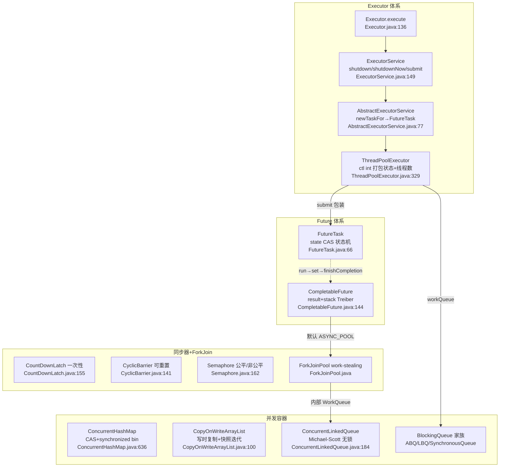
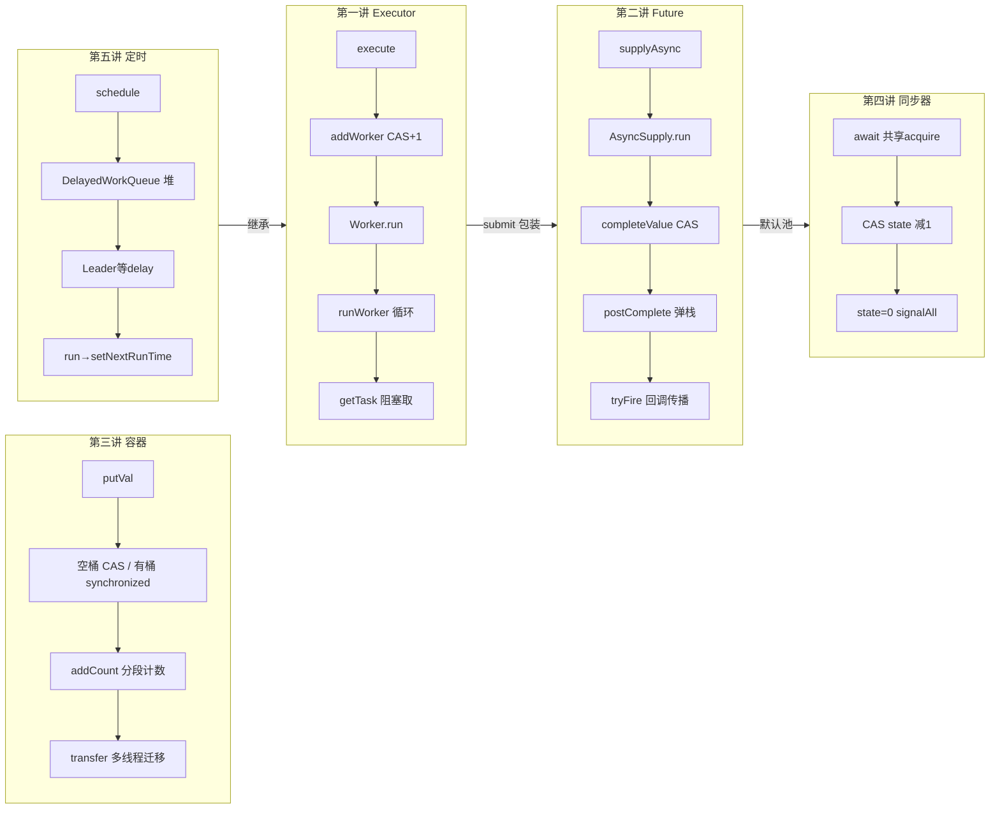
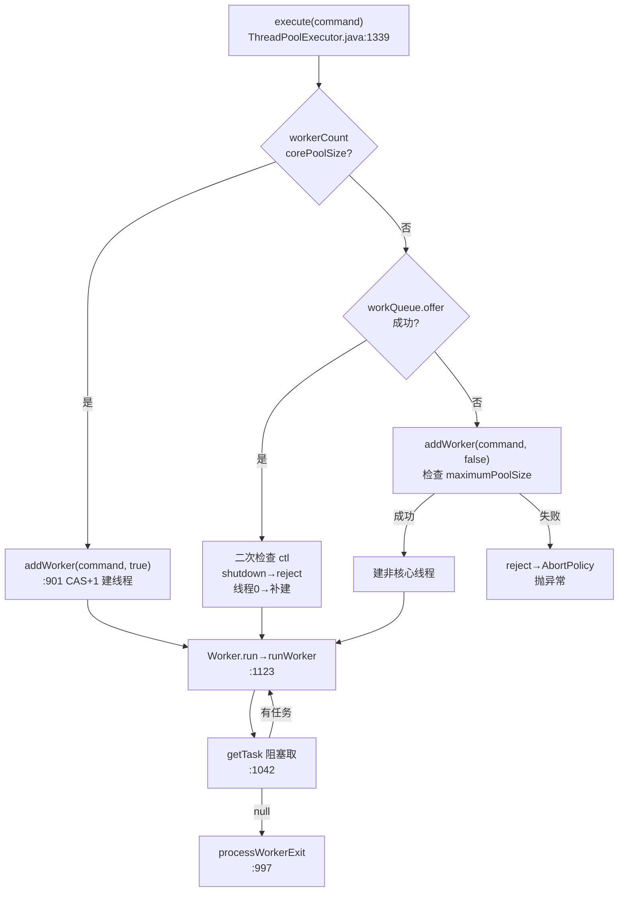
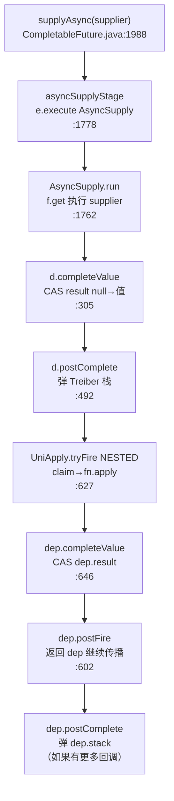
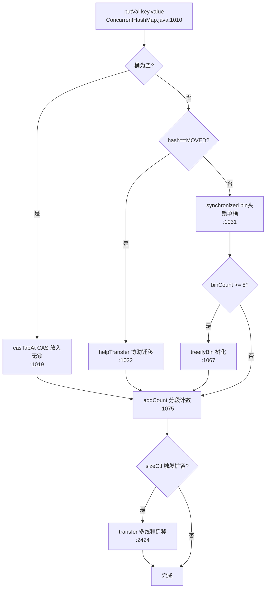
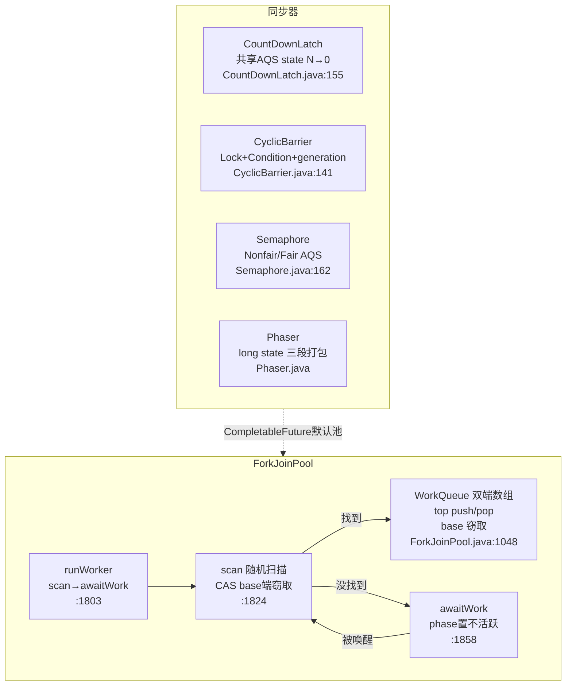
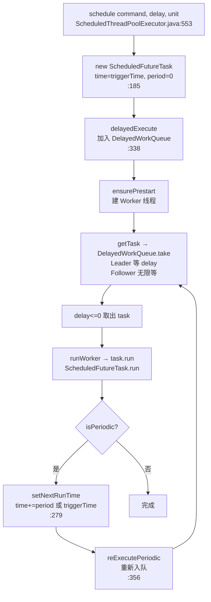

> 基于对 `src/java.base/share/classes/java/util/concurrent/` 目录下 Java 源码（`Executor.java`、`ThreadPoolExecutor.java`、`FutureTask.java`、`CompletableFuture.java`、`ConcurrentHashMap.java`、`CopyOnWriteArrayList.java`、`ConcurrentLinkedQueue.java`、`BlockingQueue` 家族、`CountDownLatch.java`、`CyclicBarrier.java`、`Semaphore.java`、`Exchanger.java`、`Phaser.java`、`ForkJoinPool.java`、`TimeUnit.java`、`ThreadLocalRandom.java`、`DelayQueue.java`、`ScheduledThreadPoolExecutor.java` 等）的逐文件精读整理而成。
>
> 阅读顺序即学习顺序：Executor 与线程池 → Future 与 CompletableFuture → 并发容器 → 同步器与 ForkJoin → 时间工具与并发杂项。
>
> 所有结论均标注了源文件位置（格式 `src/java.base/share/classes/java/util/concurrent/xxx.java:行号`），建议对照代码阅读。
>
> **AQS 内部机制**（CLH 队列、state 变量、独占/共享模式、Condition 等待队列）详见同目录 `java-lock.md` 文档，本讲只概览 AQS 的使用方式，不深挖其内部实现。
>
> **版本基线**：OpenJDK **21（jdk-21-ga）**。
> **精确 commit**：`890adb6410dab4606a4f26a942aed02fb2f55387`，commit 时间 `2023-08-09 20:19:41 +0000`。

---

## 〇、全景地图

JDK 21 的 `java.util.concurrent`（JUC）包可以压缩成五大板块：**Executor 体系**（任务提交与线程池）、**Future 体系**（异步结果与回调链）、**并发容器**（无锁/低锁数据结构）、**同步器**（AQS 的各种外壳）、**ForkJoin**（工作窃取）。三条主线把它们串起来：任务提交流（`execute` → `addWorker` → `runWorker` → `getTask`）、异步回调流（`supplyAsync` → `AsyncSupply.run` → `completeValue` → `postComplete` → `tryFire`）、同步等待流（`await` → AQS 共享 acquire → `tryReleaseShared` CAS state → `signalAll`）。

```
┌─────────────────── Executor 体系 (ThreadPoolExecutor.java:329) ───────────────────┐
│ Executor(interface:136) → ExecutorService(interface:149, shutdown/shutdownNow/submit)│
│   └─ AbstractExecutorService(abs:77, newTaskFor→FutureTask, submit/invokeAll/invokeAny)│
│        └─ ThreadPoolExecutor(core/max/queue/keepAlive/handler 四参数半 + ctl int)   │
│ ctl(387): 高3位=runState(RUNNING/SHUTDOWN/STOP/TIDYING/TERMINATED), 低29位=workerCount │
│ Worker(608): extends AQS 不可重入锁, run()→runWorker(1123), tryAcquire(654)/tryRelease(662)│
│ execute(1339)→addWorker(901)→runWorker(1123)→getTask(1042)→processWorkerExit(997)      │
│ shutdown(1390)/shutdownNow(1421)/tryTerminate(715)                                   │
└────────────────────────────┬────────────────────────────────────────────────────────┘
                             ▼
┌─────────────────── Future 体系 (CompletableFuture.java:144) ──────────────────────┐
│ Future(interface) → RunnableFuture → FutureTask(state:92 NEW→COMPLETING→NORMAL/...)  │
│   FutureTask: run(307)→set(281)/setException(299)→finishCompletion(414) unpark 等待者 │
│ CompletableFuture: result(265) + stack(266 Treiber 栈) + Completion(467 extends FJT)   │
│   supplyAsync(1988)→asyncSupplyStage(1778)→AsyncSupply.run(1762)→completeValue(305)    │
│   →postComplete(492) 弹栈→tryFire(NESTED)→UniApply.tryFire(627)→postFire(602)         │
│   thenApply(2198)→uniApplyStage(657) 同步 / thenApplyAsync→指定 Executor                │
│   allOf(2450)→andTree(1508) 二叉树 BiRelay / anyOf(2469)→AnyOf 竞速                    │
└────────────────────────────┬────────────────────────────────────────────────────────┘
                             ▼
┌──────────────── 并发容器 (ConcurrentHashMap.java:636 / COW / CLQ / BlockingQueue) ─┐
│ ConcurrentHashMap: Node[]+CAS+synchronized(625), sizeCtl(800), transfer(2424) 多线程迁移│
│   putVal(1010): 空桶CAS / MOVED→helpTransfer / synchronized(bin)链表或TreeBin           │
│   computeIfAbsent(1691): ReservationNode 占位保证原子性 / CounterCell(2565) 分段计数    │
│ CopyOnWriteArrayList: lock+synchronized(107), volatile array(110), 写时复制, COW快照迭代 │
│ ConcurrentLinkedQueue: Michael-Scott 无锁队列, Node(184) CAS offer(354)/poll(383)       │
│ ArrayBlockingQueue: 有界数组+单ReentrantLock+notEmpty/notFull(121~129)                   │
│ LinkedBlockingQueue: 两把锁takeLock/putLock(156,163), 容量默认Integer.MAX_VALUE(138) 坑   │
│ SynchronousQueue: Transferer(200) 双栈/双队列, REQUEST/DATA/FULFILLING(221~225) 直接交接│
└────────────────────────────┬────────────────────────────────────────────────────────┘
                             ▼
┌──────── 同步器 (AQS 外壳) + ForkJoin (work-stealing) ─────────────────────────────┐
│ CountDownLatch: Sync共享AQS, tryReleaseShared(175) CAS减到0才signal, 一次性            │
│ CyclicBarrier: ReentrantLock+Condition(159,161)+generation(153), 可重置                 │
│ Semaphore: NonfairSync(227) barging / FairSync(242) hasQueuedPredecessors               │
│ Exchanger: arena(329)+slot(334) 多槽消除竞争, Node(305) @Contended                       │
│ Phaser: state(297) long打包 phase/parties/unarrived, evenQ/oddQ(351,352) 双栈交替       │
│ ForkJoinPool: ctl(1521 long)+WorkQueue[](1511), runWorker(1803)→scan(1824)窃取→awaitWork │
│   common(1490) 静态初始化(3815), parallelism(1523), asyncMode config位                   │
└────────────────────────────────────────────────────────────────────────────────────────┘
```

渲染友好版（GitHub/GitLab 直接出图，信息同上图）：



**三条主线**：

1. **任务提交流**：`execute(command)`（`ThreadPoolExecutor.java:1339`）→ 读 `ctl` 判断 workerCount 是否 < corePoolSize → 是则 `addWorker(command, true)`（:901）CAS+1 线程数、new Worker、`container.start(t)` → Worker 线程跑 `run()`（:641）→ `runWorker`（:1123）→ `getTask`（:1042）从 `workQueue.poll/take` 阻塞取任务 → `task.run()` → 循环直到 `getTask` 返回 null → `processWorkerExit`（:997）。

2. **异步回调流**：`CompletableFuture.supplyAsync(supplier)`（:1988）→ `asyncSupplyStage`（:1778）`e.execute(new AsyncSupply(d, f))` → AsyncSupply.run（:1762）`f.get()` → `d.completeValue`（:305）CAS result → `d.postComplete`（:492）弹 Treiber 栈 → 每个 `Completion.tryFire(NESTED)`（如 `UniApply.tryFire:627`）执行 `f.apply(t)` → `d.completeValue` → 递归 `postFire`（:602）传播。

3. **同步等待流**：`FutureTask.get()`（:187）→ `awaitDone`（:446）入 Treiber 栈 `LockSupport.park` → run 线程 `set` → `finishCompletion`（:414）`LockSupport.unpark` 唤醒 → get 线程读 state 返回。CompletableFuture 的 `get()/join()` 则用 Signaller Completion（`CompletableFuture.java:1824` 区域）实现 ManagedBlocker，在 ForkJoinPool 中会补偿扩容避免死锁。

---

## 速览：各讲做了什么（先看这个再进细节）

| 讲次 | 核心文件 | 一句话白话 | 关键机制 | 最大坑点 |
| --- | --- | --- | --- | --- |
| 第一讲 | `ThreadPoolExecutor.java` | 一个 int 把"线程数+运行状态"塞进 32 位，Worker 借 AQS 做"运行中不许打断"的锁 | ctl 位运算（:387）、addWorker CAS+mainLock（:901）、getTask 阻塞轮询（:1042） | `newFixedThreadPool` 用无界 `LinkedBlockingQueue`，maximumPoolSize 永远不生效（`Executors.java:93`） |
| 第二讲 | `CompletableFuture.java` | 一个 `volatile result` + 一条 Treiber 栈搞定"完成即触发回调" | result CAS（:305）、postComplete 弹栈传播（:492）、claim 防重入（:566） | 默认线程池是 `ForkJoinPool.commonPool`，单核机器退化成 `ThreadPerTaskExecutor`（:437） |
| 第三讲 | `ConcurrentHashMap.java` | 空桶 CAS、有桶 synchronized bin 头、扩容多线程分迁移段 | spread 扰动（:696）、tabAt CAS 原子访问（:759）、transfer stride 分段（:2424）、CounterCell 分段计数（:2565） | `LinkedBlockingQueue` 默认容量 `Integer.MAX_VALUE`，OOM 症状隐蔽（:138） |
| 第四讲 | `ForkJoinPool.java` | 每 Worker 一个双端队列，自己 push/pop 一端，别人从另一端偷 | WorkQueue 双端数组（:1048）、scan 随机起点窃取（:1824）、ctl long 打包活跃/空闲/目标（:1521） | commonPool 并行度 = CPU 核数-1，`parallelism` 可动态调整但受 bounds 约束 |
| 第五讲 | `ScheduledThreadPoolExecutor.java` | 在 ThreadPoolExecutor 上换了一个"按延迟排序的堆队列" | ScheduledFutureTask time/period（:192,200）、DelayedWorkQueue 最小堆（:899）、Leader-Follower 减少空等（`DelayQueue.java:122`） | `scheduleAtFixedRate` 某次执行超时不会并发，会"追赶"或跳过（取决于 `setNextRunTime` :279） |



---

## 面试速通：JUC 并发库高频问题一页纸

> **先报结论，被追问再展开**：这一页把五讲压成 16 个高频问题的一句话答案，
> 按"线程池 → Future → 容器 → 同步器 → 杂项"排列，每行"深入"列指向该回哪一讲细讲；
> 所有结论均摘自各讲小结"三个最值得记住的点"，不引入文档之外的新知识点。
>
> AQS 内部机制（CLH 队列、state、独占/共享模式、Condition 等待队列）与 ReentrantLock/StampedLock 等锁实现不在本页范围——
> 被问到就明确说"深入见同目录 java-lock.md"，再按主线现场推演，比硬背更得分。

### 高频 Q&A（先结论）

按讲次排列；"深入"列是被追问时该回讲的章节，每条结论都能在该讲小结里找到原文。

| # | 面试问题 | 一句话结论 | 深入 |
| --- | --- | --- | --- |
| 1 | 线程池七个参数？`execute` 的执行流程？ | core 未满直接建核心线程；否则入队并二次检查（入队后池子关了或线程没了）；队满才建非核心线程，到 max 就拒绝 | 第一讲 |
| 2 | 线程池怎么复用线程？核心线程为什么"不死"？ | Worker 在 `runWorker` 循环 `getTask` 从队列取任务，干完不退出；核心线程 `take()` 永久等，非核心 `poll(keepAliveTime)` 超时退出 | 第一讲 |
| 3 | Worker 为什么继承 AQS 而不是 ReentrantLock？ | 要的是不可重入"运行盾牌"：`runWorker` 每次 `w.lock()` 标记在跑任务，`interruptIdleWorkers` 靠 `tryLock` 只打断空闲线程；可重入会让 `setCorePoolSize` 重入破语义 | 第一讲「拆开讲：为什么可重入会坏事」 |
| 4 | `shutdown()` 与 `shutdownNow()` 区别？ | shutdown 不接新活、干完旧活，只 interrupt 空闲线程；shutdownNow 不接新活、清空队列并打断所有 Worker | 第一讲 |
| 5 | `submit` 与 `execute` 的区别？ | submit 用 `newTaskFor` 把任务包成 `FutureTask` 再走 execute，底层还是 execute，但多了可取消、可取结果的 Future | 第一/二讲 |
| 6 | `ctl` 为什么用一个 int 打包状态和线程数？ | 高 3 位 runState + 低 29 位 workerCount，一次 CAS 同时改两个量，消除两个 volatile 字段间的 TOCTOU 窗口；上限 2^29-1 | 第一讲 |
| 7 | `FutureTask` 的状态机和等待机制？ | 7 个状态 CAS 转换，保证只有一个线程能完成 Future；等待者进 Treiber 栈 `park`，完成后 `finishCompletion` 逐个 `unpark`；已弃用 AQS | 第二讲 |
| 8 | `CompletableFuture` 链式回调怎么实现？ | `result` CAS null→值即"完成"，Completion Treiber 栈存回调；`postComplete` 弹栈 `tryFire(NESTED)` 逐层传播，`f` 变量接住 dependent 避免无限递归 | 第二讲 |
| 9 | `Completion` 为什么继承 `ForkJoinTask`？ | 零成本复用其 tag 字段做 `claim()`（CAS 0→1）防重入，异步回调只被执行一次；既能提交给任意 Executor，又能在 ForkJoinPool 高效调度 | 第二讲 |
| 10 | `thenApply` 与 `thenApplyAsync` 的区别？ | 无后缀 `executor=null`，回调在完成线程（源已完成时是调用者线程）同步执行；Async 后缀提交到 ASYNC_POOL 或指定 Executor，回调重时不阻塞完成线程 | 第二讲 |
| 11 | `CompletableFuture` 的默认线程池是什么？ | ASYNC_POOL：多核是 `ForkJoinPool.commonPool()`（并行度=CPU 核数-1），单核退化成 `ThreadPerTaskExecutor` 每任务新建线程 | 第二讲 |
| 12 | `ConcurrentHashMap` 为什么快？ | 空桶 CAS 无锁插入，有桶只 `synchronized` 锁桶头节点——粒度从"锁整表"细化到"锁单桶"，不同桶的并发写互不影响 | 第三讲 |
| 13 | CHM 的 `sizeCtl` 怎么读？扩容为什么快？ | sizeCtl：0=未初始化、正数=阈值/初始容量、-1=初始化中、-(N+1)=N 个线程在扩容；`transfer` 多线程 CAS `transferIndex` 抢 stride 段，putVal 遇 MOVED 会 `helpTransfer` 协助 | 第三讲 |
| 14 | `CountDownLatch`/`CyclicBarrier`/`Semaphore`/`Phaser` 怎么选？ | 等 N 个一次性事件用 CDL；循环复用/带栅栏动作用 CB；限流用 Semaphore（公平版排队、非公平版 barging）；多阶段+动态注册用 Phaser | 第四讲 |
| 15 | `ForkJoinPool` 的 work-stealing 原理？ | 每 Worker 一个双端队列：拥有者 top 端 push/pop（LIFO、缓存友好），窃取者 base 端 CAS poll；`scan` 随机起点遍历，避免空闲线程挤窃同一队列 | 第四讲 |
| 16 | `ThreadLocalRandom` 为什么快？ | seed/probe 存在 Thread 对象字段里用 Unsafe 直读写，无竞争、不查 ThreadLocal 哈希表；`getProbe()` 还被 CHM 的 CounterCell 选槽复用 | 第五讲 |

### 易错点与面试坑

以下每一条都在对应讲次被明确强调过，按翻车概率排序。

- **坑 1：`newFixedThreadPool` 的 `maximumPoolSize` 永远不生效**
  现象：流量上来后线程数不涨，队列无限堆积，最后 OOM。
  原因：默认无界 `LinkedBlockingQueue`（容量 `Integer.MAX_VALUE`）让 `offer` 永远成功，`execute` 第三步"建非核心线程"永远走不到。
  对策：直接 `new ThreadPoolExecutor` 并指定有界队列——阿里规约禁用 `Executors` 工厂正因如此；`newCachedThreadPool` 是另一个极端（max=`Integer.MAX_VALUE` + 无容量 `SynchronousQueue`）。
- **坑 2：`submit` 的异常不 `get()` 就看不见**
  现象：任务抛了异常，控制台什么都不打，线上静默失败。
  原因：`execute` 的异常会从 `runWorker` 重新抛出；`submit` 的异常被 `FutureTask.setException` 捕获存进 outcome，只有 `get()` 才抛 `ExecutionException`。
  对策：submit 之后必须消费 Future，或在任务内部 try-catch，别让异常静默消失。
- **坑 3：`*Async` 方法默认全挤在静态 `commonPool` 里**
  现象：没传线程池的异步任务互相拖慢，CPU 核数-1 个线程就是全部家当。
  原因：不显式指定 Executor 时，异步回调默认提交到静态共享的 `ForkJoinPool.commonPool()`，所有业务共用同一个池。
  对策：重计算/阻塞任务必须显式传自己的线程池；好在 CF 的 `get()/join()` 实现了 ManagedBlocker，在 ForkJoinPool 中会补偿扩容，不会把自己锁死。
- **坑 4：`CountDownLatch` 是一次性的**
  现象：想拿同一个 Latch 等下一轮，countDown 不再有效。
  原因：state 减到 0 后 `tryReleaseShared` 返回 false，不能继续 countDown，也不能重置。
  对策：需要循环等待同一批线程，选 `CyclicBarrier`（`nextGeneration` 重置 count 与 generation）。
- **坑 5：`Semaphore.tryAcquire()` 不遵守公平设置**
  现象：以为用了公平信号量就不会插队，结果 `tryAcquire` 照抢。
  原因：只有 `acquire()` 系列才走公平/非公平策略；无参 `tryAcquire()` 是即时尝试，直接 barging。
  对策：面试别说反——要公平就 `acquire()`，要立即返回才 `tryAcquire()`。
- **坑 6：`CopyOnWriteArrayList` 不是通用 List**
  现象：写操作慢到怀疑人生，迭代还看不到刚写入的数据。
  原因：每次写都复制整个数组（O(n)）；迭代器是创建时的快照，且 `remove()/set()` 抛 `UnsupportedOperationException`。
  对策：只用于"读多写极少"的场景（如监听器列表）；写频繁或要求实时一致性都会踩坑。
- **坑 7：`scheduleAtFixedRate` 超时会"追赶"或跳过，不会并发**
  现象：某次任务执行超时后，下一次不会等它，而是立刻追跑或跳过。
  原因：`setNextRunTime` 基于上次计划时间 `time += period`，下次触发时间可能已经过去。
  对策：要恒定间隔用 `scheduleWithFixedDelay`（基于上次实际结束时间）；周期任务内部别做长时间阻塞。
- **坑 8：CHM 的 `size()` 不是精确值**
  现象：并发写入时 `size()` 忽大忽小，和实际元素数对不上。
  原因：计数用 `baseCount + CounterCell[]` 分段累加（`@Contended` 防伪共享），`sumCount` 是弱一致性快照。
  对策：并发场景别把 `size()` 当准确计数用，需要精确值就自己维护 `AtomicLong`。

### 关键数值速记

面试问"默认值/上限/阈值"时直接查表；出处列指向该回哪一讲展开。

| 数值 | 含义 | 出处 |
| --- | --- | --- |
| `2^29-1`（约 5 亿） | workerCount 上限：`ctl` 低 29 位装线程数、高 3 位装 runState | 第一讲 |
| `-1<<29` / `0` / `1<<29` / `2<<29` / `3<<29` | runState 五态编码：RUNNING（负数）/ SHUTDOWN / STOP / TIDYING / TERMINATED，数值递增便于直接比较 | 第一讲 |
| `-1` | Worker 构造时 `setState(-1)` 抑制初始中断，`runWorker` 里 `unlock()` 才恢复为 0 | 第一讲 |
| `0` | `newCachedThreadPool` 的 corePoolSize=0，任务全靠 SynchronousQueue 直接交接 | 第一讲 |
| `60s` | `newCachedThreadPool` 的 keepAliveTime，空闲非核心线程超时退出 | 第一讲 |
| `Integer.MAX_VALUE` | `LinkedBlockingQueue` 默认容量（无界 OOM 根源）；也是 `newCachedThreadPool` 的 maximumPoolSize | 第一讲 |
| `CPU 核数 - 1` | `commonPool` 默认并行度（至少 1），CompletableFuture 的 ASYNC_POOL 就是它 | 第二讲 |
| `CPU 核数` | `newWorkStealingPool` 的 parallelism，且 asyncMode=true 走 FIFO | 第四讲 |
| `64` | ForkJoinPool 的 `ctl` 是 64 位 long，打包活跃/空闲/目标，比 ThreadPoolExecutor 的 32 位 ctl 更复杂 | 第四讲 |
| `32 / 16 / 16` | Phaser 的 state 打包：phase 占高 32 位、parties 中 16 位、unarrived 低 16 位 | 第四讲 |
| `8` | CHM 链表树化阈值：`binCount >= 8` 才 `treeifyBin` | 第三讲 |
| `(n>>>3)/NCPU` | CHM 扩容 stride：每个线程最少迁移的桶数，下限 `MIN_TRANSFER_STRIDE` | 第三讲 |
| `-1` / `-2` / `-3` | CHM 特殊 hash：MOVED（迁移中）/ TREEBIN（树化）/ RESERVED（computeIfAbsent 占位） | 第三讲 |
| `2` | LinkedBlockingQueue 用两把锁（takeLock/putLock）分离生产消费；ArrayBlockingQueue 一把锁 + notEmpty/notFull 两个 Condition | 第三讲 |
| `7` | TimeUnit 的 scale 常量个数（NANO_SCALE=1L、MICRO_SCALE=1000L…），构造时预计算 ratio 与饱和阈值 | 第五讲 |
| `threadId<<1` | ThreadLocalRandom 的 nextSeed 增量：per-thread 不同的奇数，保证各线程序列不重叠且周期最大 | 第五讲 |

---

## 第一讲：Executor 与线程池

### 先说人话：本讲每个阶段在干什么

把线程池想象成一个"外包施工队"：你（任务提交者）把活儿丢给前台（`execute`），前台看当前在岗人数够不够——不够就招人（`addWorker` CAS+1），够就把活儿扔进待工篮子（`workQueue`）；工人干完手头活就去篮子拿下一份（`getTask`），篮子空了就等（`take`/`poll`）；你说"收工"（`shutdown`），前台不再接新活但让篮子里的干完，"立刻停"（`shutdownNow`）则连篮子里的也倒掉。整个施工队的"在岗人数 + 是否还在营业"被压进一个 32 位 int（`ctl`），用 CAS 操作保证并发安全。

| 阶段 | 干了什么 | 为什么 |
| --- | --- | --- |
| 接口定义 | `Executor` 只有一个 `execute`（:136），`ExecutorService` 加了 `shutdown/shutdownNow/submit/invokeAll`（:149） | 从"能跑任务"到"能管理生命周期"，渐进式接口 |
| AbstractExecutorService | `submit` = `newTaskFor` 包成 FutureTask + `execute`（:120） | 把 `execute` 的 Runnable 升级成可追踪的 Future |
| ctl 位运算 | 高 3 位 runState、低 29 位 workerCount，一个 CAS 同时改两个量（:387~401） | 避免两个 volatile 字段间的 TOCTOU 竞态 |
| Worker 锁 | Worker extends AQS 不可重入锁，`setState(-1)` 抑制初始中断（:635） | 防止 `interruptIdleWorkers` 打断正在运行的任务而非等任务的线程 |
| execute 三步 | 核心未满→addWorker / 入队→二次检查 / 队满→addWorker(max) 或 reject（:1339） | 在"多建线程"和"排队"间做策略选择 |
| getTask 阻塞 | `timed ? poll(keepAliveTime) : take()`（:1068） | 核心线程永久等、非核心线程超时等后退出 |

**本讲主线**：`execute` → `ctl` 判断 → `addWorker` CAS+建线程 → Worker 线程跑 `runWorker` → `getTask` 阻塞取 → 干完 `processWorkerExit`。

### 逐文件精读

#### 1）`Executor.java` —— 只有一个方法的接口

```java
public interface Executor {
    void execute(Runnable command);  // Executor.java:136
}
```

这个接口的 Javadoc（:38~123）本身就是一个微型教学文档：它给了三个实现范例——`DirectExecutor`（调用者线程直接 `r.run()`）、`ThreadPerTaskExecutor`（每任务新建线程 `new Thread(r).start()`）、`SerialExecutor`（用队列串行化任务）。这说明 `Executor` 的核心思想是**解耦"提交"与"执行"**——同一个 `execute` 调用，背后可以是同步、异步、串行、池化，由实现决定。

内存可见性保证写在 :116~119：提交 Runnable 前的动作 happen-before 其执行开始。

#### 2）`ExecutorService.java` —— 加了生命周期管理

`ExecutorService` 继承 `Executor` 和 `AutoCloseable`（:149），新增了：

- `shutdown()`（:168）：有序关闭，已提交的任务继续跑完，但不接新任务。
- `shutdownNow()`（:193）：尝试停止所有正在执行的任务，返回等待中的任务列表。通过 `Thread.interrupt()` 中断（:181 注释说明），不响应中断的任务可能永远不终止。
- `submit(Callable/Runnable)`（:248/:263/:276）：提交并返回 `Future`。
- `invokeAll`（:299）：批量提交，等全部完成。
- `invokeAny`（:353）：批量提交，等任意一个成功完成，取消其余。
- `awaitTermination`（:222）：阻塞等待终止。
- `close()`（:410，JDK 19+ 默认方法）：`shutdown` + 循环 `awaitTermination(1L, DAYS)`，被中断则 `shutdownNow`。这就是 try-with-resources 关闭线程池的标准做法。

关键点：`shutdown` 和 `shutdownNow` 的语义区别——前者"不接新活、干完旧活"，后者"不接新活、丢掉旧活、打断正在干的活"。

#### 3）`AbstractExecutorService.java` —— submit/invokeAll 的默认实现

这个抽象类（:77）用 `newTaskFor` 把 `Runnable/Callable` 包装成 `RunnableFuture`（默认实现是 `FutureTask`，:97/:112），然后委托给 `execute`：

```java
public Future<?> submit(Runnable task) {  // :120
    RunnableFuture<Void> ftask = newTaskFor(task, null);
    execute(ftask);  // 关键：submit 的底层还是 execute
    return ftask;
}
```

`invokeAny` 的实现在 `doInvokeAny`（:152），用 `ExecutorCompletionService` 逐个提交、轮询 `poll()` 拿第一个完成的，把异常收集起来，最后如果没有一个成功就抛最后一个 `ExecutionException`。这里有个优化：在并行度有限的池中，先提交一个、再增量提交，而不是一次性全提交。

`invokeAll`（:238）则是一次性全提交、然后逐个 `f.get()` 等待完成，catch 掉 `CancellationException` 和 `ExecutionException`（:253）。超时版本（:263）先逐个 `execute` 再逐个限时 `get`，超时的取消剩余。

#### 4）`ThreadPoolExecutor.java` —— 重头戏

这是 JUC 中最复杂的单文件之一（2145 行），核心是一个 `AtomicInteger ctl`。

**ctl 位运算体系**（:331~401）：

```java
private final AtomicInteger ctl = new AtomicInteger(ctlOf(RUNNING, 0));  // :387
private static final int COUNT_BITS = Integer.SIZE - 3;  // 29
private static final int COUNT_MASK = (1 << COUNT_BITS) - 1;  // :389
// runState 存高 3 位
private static final int RUNNING    = -1 << COUNT_BITS;  // :392 负数
private static final int SHUTDOWN   =  0 << COUNT_BITS;  // :393 = 0
private static final int STOP       =  1 << COUNT_BITS;  // :394
private static final int TIDYING    =  2 << COUNT_BITS;  // :395
private static final int TERMINATED =  3 << COUNT_BITS;  // :396
```

为什么用 `int` 不用 `long`？注释 :337~341 解释：限制 workerCount 到 2^29-1（约 5 亿）而非 2^31-1，"如果将来成为问题，可以改成 AtomicLong"——但 5 亿线程在可预见未来足够了，int 的 CAS 更快更简单。

状态转换（:362~375）：`RUNNING → SHUTDOWN`（`shutdown()`）、`(RUNNING|SHUTDOWN) → STOP`（`shutdownNow()`）、`SHUTDOWN → TIDYING`（队列和池都空时）、`STOP → TIDYING`（池空时）、`TIDYING → TERMINATED`（`terminated()` 钩子完成）。数值递增设计让 `runStateLessThan(c, s)` 用简单大小比较判断状态。

**Worker 类**（:608~682）：

```java
private final class Worker extends AbstractQueuedSynchronizer implements Runnable {
    final Thread thread;       // :620
    Runnable firstTask;        // :623
    volatile long completedTasks;  // :625

    Worker(Runnable firstTask) {
        setState(-1);  // :635 抑制中断直到 runWorker
        this.firstTask = firstTask;
        this.thread = getThreadFactory().newThread(this);
    }
    public void run() { runWorker(this); }  // :642

    protected boolean tryAcquire(int unused) {  // :654 不可重入
        if (compareAndSetState(0, 1)) {
            setExclusiveOwnerThread(Thread.currentThread());
            return true;
        }
        return false;
    }
    protected boolean tryRelease(int unused) {  // :662
        setExclusiveOwnerThread(null);
        setState(0);
        return true;
    }
}
```

注释 :593~606 解释了为什么 Worker extends AQS 而不是 ReentrantLock：**不可重入**。如果 Worker 用可重入锁，任务代码里调用 `setCorePoolSize` 这类池控制方法时会重新获取锁——而 `interruptIdleWorkers` 正是用 `tryLock()` 判断"这个线程是否在跑任务"，可重入就破了这个语义。`setState(-1)` 初始化为负值，让 `interruptIfStarted`（:673）中的 `getState() >= 0` 检查在 Worker 真正开始跑任务前为 false，防止在 `runWorker` 的 `unlock()` 调用前被中断。

**execute 方法**（:1339~1377）—— 三步走：

```java
public void execute(Runnable command) {
    int c = ctl.get();
    // 第1步：workerCount < corePoolSize → 直接建线程
    if (workerCountOf(c) < corePoolSize) {
        if (addWorker(command, true)) return;
        c = ctl.get();  // CAS 失败重读
    }
    // 第2步：入队 + 二次检查
    if (isRunning(c) && workQueue.offer(command)) {
        int recheck = ctl.get();
        if (!isRunning(recheck) && remove(command))  // 入队后池子关了
            reject(command);
        else if (workerCountOf(recheck) == 0)  // 入队后线程全死了
            addWorker(null, false);  // 建个空手线程去取
    }
    // 第3步：队列满了 → 尝试建非核心线程，失败则 reject
    else if (!addWorker(command, false))
        reject(command);
}
```

第 2 步的二次检查是经典 TOCTOU 防护：`workQueue.offer` 成功后，池子可能在 offer 期间被 `shutdown` 或线程全退了。如果 `shutdown` 了就 `remove` 回来再 `reject`；如果线程数为 0（但队列非空，比如线程刚 processWorkerExit 退了）就补建一个空手 Worker 去消费队列——否则队列里的任务永远没人取。

**addWorker 方法**（:901~962）—— 两段式 retry：

```java
private boolean addWorker(Runnable firstTask, boolean core) {
    retry:
    for (int c = ctl.get();;) {
        // 状态检查：SHUTDOWN 且 (STOP以下 或 firstTask!=null 或 队列空) → 拒绝
        if (runStateAtLeast(c, SHUTDOWN)
            && (runStateAtLeast(c, STOP) || firstTask != null || workQueue.isEmpty()))
            return false;  // :909
        for (;;) {
            if (workerCountOf(c) >= ((core ? corePoolSize : maximumPoolSize) & COUNT_MASK))
                return false;  // :914 超过上限
            if (compareAndIncrementWorkerCount(c))  // CAS+1
                break retry;
            c = ctl.get();  // CAS 失败重读
            if (runStateAtLeast(c, SHUTDOWN)) continue retry;  // 状态变了重头来
        }
    }
    // --- CAS 成功，下面建线程 ---
    Worker w = new Worker(firstTask);
    final Thread t = w.thread;
    if (t != null) {
        mainLock.lock();  // :932 保护 workers HashSet
        try {
            int c = ctl.get();
            if (isRunning(c) || (runStateLessThan(c, STOP) && firstTask == null)) {
                if (t.getState() != Thread.State.NEW)  // :941 ThreadFactory 没返回新线程
                    throw new IllegalThreadStateException();
                workers.add(w);
                if (workers.size() > largestPoolSize) largestPoolSize = workers.size();
            }
        } finally { mainLock.unlock(); }
        if (workerAdded) {
            container.start(t);  // :953 JDK 21 用 SharedThreadContainer
            workerStarted = true;
        }
    }
    if (!workerStarted) addWorkerFailed(w);  // 回滚
    return workerStarted;
}
```

:909 的状态检查条件很精妙：SHUTDOWN 状态下，只有"firstTask==null 且队列非空"时才允许建 Worker（这是来消费队列的替补线程）。带 firstTask 的新任务在 SHUTDOWN 后一律拒绝。

**runWorker 方法**（:1123~1160）—— Worker 线程的主循环：

```java
final void runWorker(Worker w) {
    Thread wt = Thread.currentThread();
    Runnable task = w.firstTask;
    w.firstTask = null;
    w.unlock();  // :1127 把 setState(-1) 恢复为 0，允许中断
    boolean completedAbruptly = true;
    try {
        while (task != null || (task = getTask()) != null) {
            w.lock();  // :1131 标记"正在执行任务"
            // 如果池在 STOP，确保线程被中断；否则确保不被中断
            if ((runStateAtLeast(ctl.get(), STOP) ||
                 (Thread.interrupted() && runStateAtLeast(ctl.get(), STOP)))
                && !wt.isInterrupted())
                wt.interrupt();  // :1140
            try {
                beforeExecute(wt, task);  // 钩子
                try {
                    task.run();  // :1144 真正执行
                    afterExecute(task, null);
                } catch (Throwable ex) {
                    afterExecute(task, ex);
                    throw ex;
                }
            } finally {
                task = null;
                w.completedTasks++;
                w.unlock();
            }
        }
        completedAbruptly = false;
    } finally {
        processWorkerExit(w, completedAbruptly);
    }
}
```

:1127 的 `w.unlock()` 是把构造时 `setState(-1)` 恢复为 0，从此 `interruptIdleWorkers` 的 `tryLock` 能成功。:1131 的 `w.lock()` 标记"我在干活"——此时 `interruptIdleWorkers` 的 `tryLock()` 会失败，不会打断正在运行的任务。

#### 拆开讲：为什么"可重入"会坏事（这一步最容易卡住）

**先搞清这把锁的身份**：它不保护任何数据，只回答一个问题——**"你现在在跑任务吗？"**。`state == 0`（没在跑）/`state == 1`（正在跑），仅此而已。

```java
// :654-660  Worker 自己的 tryAcquire：只认 state，不认人
protected boolean tryAcquire(int unused) {
    if (compareAndSetState(0, 1)) {          // state 已经是 1 时必然失败
        setExclusiveOwnerThread(Thread.currentThread());
        return true;
    }
    return false;
}
```

**持锁窗口 = `task.run()` 那段时间**：`runWorker` 的循环是 `getTask()`（不持锁，可能阻塞在 `workQueue.take()`）→ `w.lock()`（:1131）→ `task.run()` → `w.unlock()`（:1153）。所以：

- `tryLock()` 抢到 ⟺ 该线程此刻**不在跑任务**，正卡在 `getTask` 等活儿 ⟺ 可以安全 `interrupt()`，让它醒来重新检查池状态（corePoolSize 变小了该退出了）；
- `tryLock()` 抢不到 ⟺ 它在跑任务 ⟺ 跳过，别打断用户代码。

**坑在哪**：`interruptIdleWorkers`（:799~819）遍历的是**所有** worker，包括**正在执行这段代码的那个线程自己**。任务里调池控制方法是很常见的写法（动态调整池大小、提交子任务等），一旦发生：

```
T1 跑任务（已 w.lock()，state=1）
  └─ 任务代码 pool.setCorePoolSize(1)              // :1559
       └─ interruptIdleWorkers()                   // :1565
            └─ 遍历到 T1 自己 → w.tryLock()
                 ├─ 不可重入：CAS(0→1) 失败 → 判定"在跑任务" → 跳过  ✔ 正确
                 └─ 可重入：  同一线程重入成功 → 判定"空闲" → t.interrupt()  ✘ 自打断
```

换成 `ReentrantLock` 后，`tryLock()` 对**已持有锁的同一线程**返回 `true`（hold 计数变 2），于是线程池"以为自己空闲"，**把自己的中断标志置上了**。后果链条：

1. 任务里若在 `sleep` / `wait` / `BlockingQueue.take` / 抢锁 → 立刻抛 `InterruptedException`，好端端的任务被腰斩；
2. 即使任务不阻塞，中断标志会**残留**——下一轮 `getTask()` 里刚进 `workQueue.take()` 就抛异常，worker 误以为"池子要关了"走 `processWorkerExit` 退出，线程数莫名其妙少一个；
3. 更糟的是这个"自打断"还会传染：被污染的标志会影响后续所有依赖中断判断的逻辑。

JDK 在 `:599~606` 的注释里就是这么写的——*"protects against interrupts that are intended to wake up a worker thread waiting for a task from instead interrupting a task being run… we do not want worker tasks to be able to reacquire the lock when they invoke pool control methods like setCorePoolSize"*。**不可重入 = 让这个探针对自己人也诚实**。

> **一句话记忆钩子**：这把锁是"运行盾牌"不是"互斥锁"；`tryLock()` 是**跨线程的状态探针**；不可重入是为了防止**正在跑任务的线程自己骗过探针去打断自己**。

**用 shutdown 家族反证**（看不看这把锁，就是两种关闭语义的分界）：

| 方法 | 走哪个中断 | 看不看 Worker 锁 | 结果 |
|------|-----------|----------------|------|
| `shutdown()`（:1390） | `interruptIdleWorkers()`（:799~819，`tryLock` 把关） | 看 | 只叫醒**空闲**线程，正在跑的任务跑完 |
| `shutdownNow()`（:1421） | `interruptWorkers()`（:774~778）→ `interruptIfStarted()`（:673，只查 `getState() >= 0`） | 不看 | **连正在跑的任务一起打断**，并 `drainQueue` 丢弃队列任务 |
| `tryTerminate()`（:723） | `interruptIdleWorkers(ONLY_ONE)` | 看 | 只唤醒一个空闲线程去传播关闭信号 |

**getTask 方法**（:1042~1078）—— 阻塞获取任务：

```java
private Runnable getTask() {
    boolean timedOut = false;
    for (;;) {
        int c = ctl.get();
        // SHUTDOWN 且 (STOP 或 队列空) → 返回 null 退出
        if (runStateAtLeast(c, SHUTDOWN)
            && (runStateAtLeast(c, STOP) || workQueue.isEmpty())) {
            decrementWorkerCount();
            return null;
        }
        int wc = workerCountOf(c);
        boolean timed = allowCoreThreadTimeOut || wc > corePoolSize;  // :1058
        // 超过最大线程数 或 (该超时退出 且 (线程数>1 或 队列空)) → CAS-1 退出
        if ((wc > maximumPoolSize || (timed && timedOut))
            && (wc > 1 || workQueue.isEmpty())) {
            if (compareAndDecrementWorkerCount(c))
                return null;
            continue;
        }
        try {
            Runnable r = timed
                ? workQueue.poll(keepAliveTime, TimeUnit.NANOSECONDS)  // :1069
                : workQueue.take();  // :1070 核心线程永久等
            if (r != null) return r;
            timedOut = true;
        } catch (InterruptedException retry) {
            timedOut = false;  // 被中断不算超时，继续
        }
    }
}
```

:1058 的 `timed` 判断：默认 `allowCoreThreadTimeOut=false`，只有 `wc > corePoolSize` 时才用 `poll` 超时等待；核心线程用 `take()` 永久等待。这就是"核心线程不死"的实现。调 `allowCoreThreadTimeOut(true)`（:1662）后核心线程也会 `poll` 超时退出。

**shutdown / shutdownNow / tryTerminate**（:1390~1435, :715~745）：

`shutdown`（:1390）：`advanceRunState(SHUTDOWN)` → `interruptIdleWorkers()`（打断正在 `getTask` 等待的线程，用 `tryLock` 判断不在跑任务）→ `onShutdown()`（ScheduledThreadPoolExecutor 的钩子）→ `tryTerminate()`。

`shutdownNow`（:1421）：`advanceRunState(STOP)` → `interruptWorkers()`（打断所有已启动的 Worker，不管在不在跑任务）→ `drainQueue()`（把队列排空返回）→ `tryTerminate()`。

`tryTerminate`（:715）：只有"不 RUNNING 且 不在 TIDYING 以上 且 (STOP 或 SHUTDOWN+队列空)"才推进。如果还有 worker 就 `interruptIdleWorkers(ONLY_ONE)`（:723）唤醒一个让它自己去死；worker 归零后 CAS 到 TIDYING → 跑 `terminated()` 钩子 → 设 TERMINATED → `termination.signalAll()` 唤醒 `awaitTermination` 的等待者。

**setCorePoolSize 动态调整**（:1559~1577）：

```java
public void setCorePoolSize(int corePoolSize) {
    int delta = corePoolSize - this.corePoolSize;
    this.corePoolSize = corePoolSize;  // volatile 写
    if (workerCountOf(ctl.get()) > corePoolSize)
        interruptIdleWorkers();  // 缩容：打断空闲线程让它们 getTask 返回 null
    else if (delta > 0) {
        // 扩容：预启动新线程（最多 delta 个，队列空了就停）
        int k = Math.min(delta, workQueue.size());
        while (k-- > 0 && addWorker(null, true)) { ... }
    }
}
```

#### 5）`Executors.java` —— 工厂方法与它们的坑

| 工厂方法 | 位置 | 实际配置 | 坑 |
| --- | --- | --- | --- |
| `newFixedThreadPool(n)` | :93 | core=max=n, keepAlive=0, **无界** LinkedBlockingQueue | 无界队列 → OOM；maximumPoolSize 永远不生效 |
| `newCachedThreadPool()` | :216 | core=0, max=Integer.MAX_VALUE, keepAlive=60s, SynchronousQueue | 无界线程数 → OOM；SynchronousQueue 无容量 |
| `newSingleThreadExecutor()` | :176 | core=max=1, 无界 LinkedBlockingQueue, 包了 AutoShutdownDelegatedExecutorService | 不可 reconfigure（:193 包装） |
| `newWorkStealingPool()` | :130 | ForkJoinPool(parallelism=CPU核数, asyncMode=true) | 不保证执行顺序 |
| `newVirtualThreadPerTaskExecutor()` | :268 | JDK 21 新增，每任务一个虚拟线程 | 虚拟线程不适用所有场景 |

`newFixedThreadPool` 的核心问题：`LinkedBlockingQueue` 默认容量 `Integer.MAX_VALUE`（`LinkedBlockingQueue.java:138`），任务堆积导致 OOM。`newCachedThreadPool` 的 `maximumPoolSize=Integer.MAX_VALUE` 同理。阿里规约禁用 `Executors` 工厂方法、要求直接 `new ThreadPoolExecutor` 就是因为这些坑。

### 端到端演算①：一次 `executor.execute(task)` 的完整链路

假设 `ThreadPoolExecutor(corePoolSize=2, maximumPoolSize=4, LinkedBlockingQueue(10))`，初始状态 ctl = `ctlOf(RUNNING, 0)`。

```
1. execute(task)  [ThreadPoolExecutor.java:1339]
   c = ctl.get()  →  workerCountOf(c)=0 < corePoolSize=2

2. addWorker(task, true)  [:901]
   retry外层: c=RUNNING|0, 状态检查通过
   内层: workerCountOf(c)=0 < (2 & COUNT_MASK), compareAndIncrementWorkerCount → CAS ctl 0→1 成功
   break retry
   new Worker(task)  → setState(-1), thread=ThreadFactory.newThread(this)
   mainLock.lock()
   workers.add(w), largestPoolSize=1
   mainLock.unlock()
   container.start(t)  →  t.start()  →  Worker.run()  →  runWorker(w)

3. runWorker(w)  [:1123]
   task = w.firstTask (=task), w.firstTask=null
   w.unlock()  → setState(-1)→0  // 允许中断
   while(task != null):
     w.lock()  // 标记在干活
     beforeExecute(wt, task)
     task.run()  // 用户代码
     afterExecute(task, null)
     task = null; w.completedTasks++; w.unlock()
   // task 变 null, 进 getTask()

4. getTask()  [:1042]
   c = ctl.get()  →  workerCountOf=1, RUNNING
   timed = false  (1 不 > corePoolSize=2, allowCoreThreadTimeOut=false)
   workQueue.take()  // 阻塞等待  ←  线程在此挂起

5. 下一个 execute(task2):
   workerCountOf=1 < 2 → addWorker(task2, true) → ctl 1→2 → 第2个线程
   第2个线程也跑到 getTask() → workQueue.take() 阻塞

6. execute(task3):
   workerCountOf=2 不 < 2  →  跳过第1步
   isRunning(c) && workQueue.offer(task3)  →  入队成功
   recheck: workerCountOf=2 ≠ 0  →  不补线程
   // 两个核心线程都在 take()，谁先醒谁取 task3

7. 如果队列满(10个)后 execute(task14):
   workQueue.offer 失败  →  addWorker(task14, false)  // core=false, 检查 maximumPoolSize=4
   workerCountOf=2 < 4 → CAS+1 → 建3号线程跑 task14
   ...最多到4号线程, 再来就 reject(command) → AbortPolicy 抛 RejectedExecutionException
```

### 第一讲小结：ctl 是"一把钥匙开两把锁"，Worker 锁是"运行盾牌"

**一句话定位**：`ThreadPoolExecutor` 把"线程数 + 运行状态"压进一个 `AtomicInteger ctl`（:387），用一个 CAS 同时改两个字段避免竞态；Worker 借 AQS 的不可重入锁区分"在跑任务"和"在等任务"，让 `interruptIdleWorkers` 只打断后者。



**关键机制的输入/输出**：

| 机制 | 输入 | 输出 | 源码位置 |
| --- | --- | --- | --- |
| ctl 打包 | runState + workerCount | `ctlOf(rs, wc) = rs \| wc` | `:387~401` |
| Worker 不可重入锁 | `tryLock()` 成功=空闲 | `interruptIdleWorkers` 只打断空闲线程 | `:654~662` / `:799~819` |
| execute 三步 | Runnable command | 新线程 / 入队 / reject | `:1339~1377` |
| getTask 阻塞 | `allowCoreThreadTimeOut` / `wc > core` | `take()` 永久 / `poll(keepAliveTime)` 超时 | `:1058~1070` |
| shutdown vs shutdownNow | 无参 | 前者 `interruptIdleWorkers`+不取队列 / 后者 `interruptWorkers`+`drainQueue` | `:1390` / `:1421` |
| 动态扩缩容 | 新 corePoolSize | `interruptIdleWorkers` 缩 / `addWorker(null,true)` 扩 | `:1559~1577` |

**三个最值得记住的点**：

1. **`ctl` 一个 int 搞定两个量**。高 3 位状态、低 29 位线程数，`addWorker` 的 CAS+1 在一步内原子地"加线程"——如果分开两个 volatile 字段，在"读 state→判断→写 count"窗口内状态可能变了。5 亿线程的上限（2^29-1）足够到"改成 long 永远不会成为问题"（:337~341）。

2. **Worker 用 AQS 不可重入锁做"运行盾牌"**。`runWorker` 每次 `w.lock()`（:1131），`interruptIdleWorkers` 用 `w.tryLock()` 判断——能 lock 成功说明线程不在跑任务（在 getTask 阻塞），可以安全 interrupt。如果用 ReentrantLock，任务代码调用 `setCorePoolSize` 会重入获取锁，`interruptIdleWorkers` 就分不清"在跑任务"还是"在等任务"了（:599~606）。

3. **`newFixedThreadPool` 的无界队列让 maximumPoolSize 形同虚设**。`LinkedBlockingQueue` 默认容量 `Integer.MAX_VALUE`（`LinkedBlockingQueue.java:138`），`workQueue.offer` 永远成功，execute 的第 3 步（:1375 addWorker(command, false)）永远走不到，线程数永远停在 corePoolSize。这就是为什么阿里规约要求直接 `new ThreadPoolExecutor` 而非用 `Executors` 工厂方法。

---

## 第二讲：Future 与 CompletableFuture

### 先说人话：本讲每个阶段在干什么

把 Future 想象成"取件凭证"：你提交任务拿到一张凭证（`Future`），任务在后台跑，你随时可以 `get()` 取结果——但 `get()` 会阻塞你直到任务完成。`FutureTask` 就是用一个 `volatile int state` 记录"新建→完成中→正常/异常/取消"，配一个 Treiber 等待栈。到了 JDK 8，`CompletableFuture` 把这个模型升级成"完成即触发回调链"——你不用 `get` 阻塞等着了，而是 `thenApply(fn)` 说"完成了帮我跑这个函数"，内部用一条 Treiber 栈把回调串起来，`result` CAS 成功后弹栈逐个触发。

| 阶段 | 干了什么 | 为什么 |
| --- | --- | --- |
| FutureTask 状态机 | state NEW→COMPLETING→NORMAL/EXCEPTIONAL/CANCELLED（:92~99） | 用 CAS 保证"只有一个线程能完成这个 Future" |
| FutureTask 等待 | Treiber 栈 WaitNode + `LockSupport.park`（:446） | 多线程 `get()` 时各自入栈挂起，完成时统一 `unpark` |
| CompletableFuture 核心 | `volatile result` + `volatile Completion stack`（:265~266） | result!=null 表示完成；stack 存"完成时要跑的回调" |
| Completion 链 | Completion extends ForkJoinTask，每种子类（UniApply 等）有 tryFire（:467） | 复用 FJT 的 tag 做 claim 防重入，统一异步调度 |
| postComplete 传播 | 完成后弹栈，tryFire(NESTED) 递归传播（:492） | 回调本身又完成一个 dependent，需要链式触发 |
| async 后缀 | 无后缀=同步(调用者或完成线程跑) / 有后缀=提交到 Executor（:2198 vs :2203） | 控制回调在哪个线程执行 |

**本讲主线**：`supplyAsync` → `AsyncSupply.run` → `completeValue` CAS → `postComplete` 弹栈 → `tryFire` 执行回调 → `postFire` 链式传播。

### 逐文件精读

#### 1）`FutureTask.java` —— 经典 Future 实现

**状态机**（:92~99）：

```java
private volatile int state;
private static final int NEW          = 0;   // :93 新建
private static final int COMPLETING   = 1;   // :94 正在设结果（瞬态）
private static final int NORMAL       = 2;   // :95 正常完成（终态）
private static final int EXCEPTIONAL  = 3;   // :96 异常完成（终态）
private static final int CANCELLED    = 4;   // :97 取消（终态）
private static final int INTERRUPTING = 5;   // :98 正在中断 runner（瞬态）
private static final int INTERRUPTED  = 6;   // :99 已中断（终态）
```

注释 :86~90 画出了转换图：`NEW → COMPLETING → NORMAL` / `NEW → COMPLETING → EXCEPTIONAL` / `NEW → CANCELLED` / `NEW → INTERRUPTING → INTERRUPTED`。`COMPLETING` 和 `INTERRUPTING` 是瞬态中间值——用 CAS 从 NEW 切到它们、设完 outcome 后用 `setRelease`（更便宜的有序写）切到终态。

:67~74 的 Revision notes 很重要：这个版本**不再用 AQS**，而是用 CAS state + Treiber 等待栈。原因是为了"避免取消竞态时保留中断状态的意外行为"。

**run 方法**（:307~337）：

```java
public void run() {
    if (state != NEW || !RUNNER.compareAndSet(this, null, Thread.currentThread()))
        return;  // 已跑过或被取消
    try {
        Callable<V> c = callable;
        if (c != null && state == NEW) {
            V result;
            boolean ran;
            try {
                result = c.call();
                ran = true;
            } catch (Throwable ex) {
                result = null; ran = false;
                setException(ex);  // :322
            }
            if (ran) set(result);  // :325
        }
    } finally {
        runner = null;  // :330 必须在 state settled 后才能 null
        int s = state;
        if (s >= INTERRUPTING)  // :334 cancel(true) 正在打断
            handlePossibleCancellationInterrupt(s);
    }
}
```

:309 的 `RUNNER.compareAndSet(this, null, Thread.currentThread())` 保证只有一个线程能成为 runner——防止 `execute` 把同一个 FutureTask 提交两次导致两个线程同时跑。

**set / setException**（:281~305）：

```java
protected void set(V v) {
    if (STATE.compareAndSet(this, NEW, COMPLETING)) {  // CAS NEW→COMPLETING
        outcome = v;
        STATE.setRelease(this, NORMAL);  // 有序写 COMPLETING→NORMAL
        finishCompletion();  // 唤醒等待者
    }
}
```

CAS NEW→COMPLETING 是关键：只有一个线程能成功，保证了结果的唯一性。

**finishCompletion**（:414~437）：遍历 Treiber 等待栈，逐个 `LockSupport.unpark(t)` 唤醒，然后调 `done()` 钩子（默认空），最后 `callable = null` 减少内存占用。

**awaitDone**（:446~502）：`get()` 的阻塞实现。逻辑是：先查 state > COMPLETING 直接返回；== COMPLETING 就 `yield`（马上就好）；否则建 WaitNode 入 Treiber 栈、`LockSupport.park`。超时版本用 `parkNanos`。注释 :448~454 说明了"很微妙"的设计目标：每个 `park` 只调一次 `nanoTime`、`nanos<=0` 不分配不计时等。

#### 2）`CompletableFuture.java` —— 回调链式编排

这个文件 3027 行，但核心机制集中在 Overview 注释（:146~263）和前几百行代码中。

**核心字段**（:265~266）：

```java
volatile Object result;       // null=未完成; 非null=完成(值或AltResult包装异常)
volatile Completion stack;    // Treiber 栈顶，存等待此 future 完成的回调
```

result 的编码（:155~166）：null 用 `NIL` 单例包装；异常用 `AltResult` 包装（如果是 `CompletionException` 就直接用，否则包一层）。非 null result 用 CAS 从 null 设为值（`internalComplete` :268 / `completeValue` :305）。

**ASYNC_POOL**（:430~438）：

```java
private static final boolean USE_COMMON_POOL =
    (ForkJoinPool.getCommonPoolParallelism() > 1);
private static final Executor ASYNC_POOL = USE_COMMON_POOL ?
    ForkJoinPool.commonPool() : new ThreadPerTaskExecutor();
```

单核机器 `commonPoolParallelism <= 1`，退化成每任务新建线程的 `ThreadPerTaskExecutor`（:441）。`screenExecutor`（:452）把用户传的 `ForkJoinPool.commonPool()` 也在这种情况下翻译成 `ASYNC_POOL`。

**Completion 抽象基类**（:467~486）：

```java
abstract static class Completion extends ForkJoinTask<Void>
    implements Runnable, AsynchronousCompletionTask {
    volatile Completion next;  // Treiber 栈链
    abstract CompletableFuture<?> tryFire(int mode);  // SYNC=0/ASYNC=1/NESTED=-1
    abstract boolean isLive();
    public final void run() { tryFire(ASYNC); }  // 提交给 Executor 时走 ASYNC
}
```

继承 `ForkJoinTask` 是为了复用其 `tag` 字段做 `claim()`（:566）——用 CAS tag 0→1 保证异步回调只被一个线程执行。声明 `Runnable` 让它可以提交给任意 `Executor`。

**UniCompletion 与 claim**（:550~578）：

```java
abstract static class UniCompletion<T,V> extends Completion {
    Executor executor;    // null=同步 / 非null=异步
    CompletableFuture<V> dep;  // 依赖此回调的 future
    CompletableFuture<T> src;  // 源 future

    final boolean claim() {
        Executor e = executor;
        if (compareAndSetForkJoinTaskTag((short)0, (short)1)) {  // CAS tag 防重入
            if (e == null) return true;  // 同步执行
            executor = null;
            e.execute(this);  // 异步提交
        }
        return false;  // 已被别的线程 claim 或已提交
    }
}
```

**UniApply.tryFire**（:620~655）—— thenApply 的回调执行核心：

```java
final CompletableFuture<V> tryFire(int mode) {
    CompletableFuture<V> d; CompletableFuture<T> a;
    Object r; Function<? super T,? extends V> f;
    if ((a = src) == null || (r = a.result) == null  // 源未完成
        || (d = dep) == null || (f = fn) == null)
        return null;
    tryComplete: if (d.result == null) {
        if (r instanceof AltResult) {  // 源异常 → 直接传播
            if ((x = ((AltResult)r).ex) != null) {
                d.completeThrowable(x, r); break tryComplete;
            }
            r = null;  // NIL(包装null)
        }
        try {
            if (mode <= 0 && !claim())  // SYNC/NESTED 需 claim
                return null;
            T t = (T) r;
            d.completeValue(f.apply(t));  // 执行用户函数
        } catch (Throwable ex) {
            d.completeThrowable(ex);
        }
    }
    src = null; dep = null; fn = null;  // 清理防止 GC 洋
    return d.postFire(a, mode);  // 后处理
}
```

:642 的 `mode <= 0 && !claim()`：只有 SYNC（0）和 NESTED（-1）模式需要 claim（因为可能被多个线程同时触发）；ASYNC 模式已经由 Executor 序列化了。claim 失败返回 null 表示"别人在处理"。

**postComplete**（:492~513）—— 完成后的弹栈传播：

```java
final void postComplete() {
    CompletableFuture<?> f = this; Completion h;
    while ((h = f.stack) != null ||
           (f != this && (h = (f = this).stack) != null)) {
        CompletableFuture<?> d; Completion t;
        if (STACK.compareAndSet(f, h, t = h.next)) {  // CAS 弹栈顶
            if (t != null) {
                if (f != this) { pushStack(h); continue; }  // 推到 this 栈
                NEXT.compareAndSet(h, t, null);
            }
            f = (d = h.tryFire(NESTED)) == null ? this : d;  // 触发回调
        }
    }
}
```

:233~240 的注释解释了为什么用 NESTED 模式和 `f` 变量：`tryFire(NESTED)` 返回的 dependent 可能又完成了，于是 `f` 跳到那个 dependent 继续弹它的栈——形成链式传播。但只沿一条路径走，避免无限递归。

**uniApplyStage**（:657~666）—— thenApply 的入口：

```java
private <V> CompletableFuture<V> uniApplyStage(Executor e, Function<? super T,? extends V> f) {
    if (f == null) throw new NullPointerException();
    Object r;
    if ((r = result) != null)  // 源已完成
        return uniApplyNow(r, e, f);  // 直接执行或提交
    CompletableFuture<V> d = newIncompleteFuture();
    unipush(new UniApply<T,V>(e, d, this, f));  // 推到栈上
    return d;
}
```

:661 如果源已完成，走 `uniApplyNow`（:668）——同步版本直接在当前线程 `f.apply(t)`，异步版本 `e.execute(new UniApply(...))`。这是 CompletableFuture 的"快乐路径"优化：已完成的不入栈。

**AsyncSupply**（:1751~1776）—— supplyAsync 的执行体：

```java
static final class AsyncSupply<T> extends ForkJoinTask<Void>
    implements Runnable, AsynchronousCompletionTask {
    CompletableFuture<T> dep; Supplier<? extends T> fn;

    public void run() {
        CompletableFuture<T> d; Supplier<? extends T> f;
        if ((d = dep) != null && (f = fn) != null) {
            dep = null; fn = null;
            if (d.result == null) {
                try {
                    d.completeValue(f.get());  // 执行 supplier
                } catch (Throwable ex) {
                    d.completeThrowable(ex);
                }
            }
            d.postComplete();  // 触发回调链
        }
    }
}
```

**asyncSupplyStage**（:1778~1784）：

```java
static <U> CompletableFuture<U> asyncSupplyStage(Executor e, Supplier<U> f) {
    CompletableFuture<U> d = new CompletableFuture<U>();
    e.execute(new AsyncSupply<U>(d, f));  // 提交到 ASYNC_POOL 或用户 Executor
    return d;
}
```

**thenApply vs thenApplyAsync**（:2198~2211）：

```java
public <U> CompletableFuture<U> thenApply(Function<? super T,? extends U> fn) {
    return uniApplyStage(null, fn);  // executor=null → 同步
}
public <U> CompletableFuture<U> thenApplyAsync(Function<? super T,? extends U> fn) {
    return uniApplyStage(defaultExecutor(), fn);  // ASYNC_POOL
}
```

无 `Async` 后缀 = `executor=null`：如果源未完成就入栈，完成时由完成线程同步执行回调；如果源已完成就由调用者线程同步执行。有 `Async` 后缀 = 指定 Executor：回调提交到线程池异步执行。

**allOf / anyOf**（:2450~2490）：

`allOf` 调 `andTree`（:1508），递归二叉树地把 cfs 配对，每对用 `BiRelay`（两个源都完成才触发），叶子已完成就直接设 result。这样 N 个 future 的等待变成 O(log N) 深度的树。

`anyOf`（:2469）先检查是否有已完成的，有就直接返回；否则给每个源 push 一个 `AnyOf` completion，任一完成就设 d.result，然后 `cleanStack` 清理其他源上残留的 completion。

### 端到端演算②：`CompletableFuture.supplyAsync(supplier).thenApply(fn)` 的完成-传播

```
1. supplyAsync(supplier)  [CompletableFuture.java:1988]
   → asyncSupplyStage(ASYNC_POOL, supplier)  [:1778]
   → d = new CompletableFuture()
   → ASYNC_POOL.execute(new AsyncSupply(d, supplier))
   → 返回 d (此时 d.result=null)

2. d.thenApply(fn)  [:2198]
   → uniApplyStage(null, fn)  [:657]
   → d.result==null（还没完成）
   → dep = newIncompleteFuture()  // 新的 dependent future
   → unipush(new UniApply(null, dep, d, fn))  [:584]
     → tryPushStack 把 UniApply 推到 d.stack
   → 返回 dep (此时 dep.result=null)

3. ASYNC_POOL 线程跑 AsyncSupply.run()  [:1762]
   → f.get() = supplier.get()  // 执行用户 supplier
   → d.completeValue(result)  [:305]
     → RESULT.compareAndSet(d, null, result)  // CAS result null→value
   → d.postComplete()  [:492]
     → 弹 d.stack → h = UniApply
     → h.tryFire(NESTED)  [:627]
       → a=d, r=d.result(非null), dep=dep, fn=fn
       → mode=-1 <= 0 && claim() → compareAndSetForkJoinTaskTag(0,1)
         → executor==null → return true  // 同步执行
       → d.completeValue(fn.apply(r))  // 执行 thenApply 的 fn
       → src=null; dep=null; fn=null
       → return dep.postFire(d, NESTED)  [:602]
         → d.stack==null → 跳过 cleanStack
         → mode=-1 < 0 → return dep  // 返回给 postComplete 的 f
     → f = dep, dep.stack 可能为空 → 循环结束

4. 调用者 dep.get() / dep.join()
   → dep.result 非 null → 直接返回 reportGet(r)
```

### 第二讲小结：result CAS 是"完成令牌"，stack 是"回调清单"

**一句话定位**：`CompletableFuture` 用一个 `volatile result`（:265）的 CAS null→值 表示"完成"，一条 `volatile Completion stack`（:266）Treiber 栈记录"完成时要触发的回调"；`postComplete`（:492）弹栈逐个 `tryFire`，回调本身又完成一个 dependent 形成链式传播。



**关键机制的输入/输出**：

| 机制 | 输入 | 输出 | 源码位置 |
| --- | --- | --- | --- |
| 完成检测 | `result != null` | isDone=true | `:2054~2055` |
| 同步执行 | `thenApply(fn)` executor=null | 完成线程或调用者线程跑 fn | `:2198` / `:657` |
| 异步执行 | `thenApplyAsync(fn)` executor=ASYNC_POOL | `claim()` 提交 e.execute | `:2203` / `:566` |
| claim 防重入 | ForkJoinTaskTag CAS 0→1 | 只有第一个触发者执行 | `:568` |
| 链式传播 | tryFire 返回 dependent | postComplete 继续弹 dep.stack | `:510` / `:492` |
| 异常传播 | AltResult 包装异常 | completeThrowable 传播 | `:319~321` / `:636` |

**三个最值得记住的点**：

1. **`Completion extends ForkJoinTask` 是神来之笔**。继承 FJT 不增加空间开销（复用 tag 字段做 claim），但让 Completion 既能作为 `Runnable` 提交给任意 Executor，又能作为 FJT 在 ForkJoinPool 中高效调度（:177~180）。`claim()`（:566）用 `compareAndSetForkJoinTaskTag(0,1)` 保证异步回调只被一个线程执行——即使被多个源同时触发。

2. **`postComplete` 的 NESTED 模式避免无限递归**。tryFire(NESTED) 返回的 dependent 会被 postComplete 的 `f` 变量接住，继续弹它的栈（:510），而不是递归调用 postComplete——这把潜在的深递归变成循环。注释 :233~240 说"每次只沿一条路径扩展，其他推回栈避免无界递归"。

3. **async 后缀不是"异步提交回调"，而是"回调在 Executor 里跑"**。`thenApply(fn)`（无后缀）如果源已完成，`fn` 在**调用者线程**同步执行（`uniApplyNow` :668）；如果源未完成，`fn` 在**完成线程**同步执行（tryFire NESTED）。`thenApplyAsync(fn)` 的 `fn` 永远在 `ASYNC_POOL` 或指定 Executor 里异步执行。这个区别在"回调很重不想阻塞完成线程"时很关键。

---

## 第三讲：并发容器

### 先说人话：本讲每个阶段在干什么

并发容器的核心问题是"多线程同时读写怎么不乱套"。三种路线：**CHM 走 CAS+synchronized bin 头**——空桶直接 CAS（无锁），有桶就锁住桶头节点（粒度细到单个桶）；**COW 走写时复制**——写操作锁住、复制数组、改完 volatile 替换，读永远无锁看快照；**CLQ 走 Michael-Scott 无锁**——用 CAS 操作链表节点，允许 head/tail 滞后。BlockingQueue 家族则更朴实：有界的用一把锁+两个 Condition，无界的用两把锁（takeLock/putLock 分离减少争用）。

| 阶段 | 干了什么 | 为什么 |
| --- | --- | --- |
| CHM putVal | 空桶 CAS / 有桶 synchronized(f) / 正在迁移 helpTransfer（:1010） | 粒度从"锁整表"细化到"锁单桶" |
| CHM 扩容 | transfer 分 stride 段多线程协助迁移（:2424） | 单线程扩容太慢，多线程 CAS transferIndex 抢任务 |
| CHM 计数 | baseCount + CounterCell[] 分段累加（:2565） | 单一 CAS 在高并发下竞争激烈 |
| COW 写 | synchronized(lock) + 复制数组 + volatile setArray（:461） | 读永远无锁，写串行化保证一致性 |
| CLQ 入队 | CAS tail.next 追加，tail 滞后两跳更新（:354） | 无锁队列允许 tail 不精确减少 CAS 次数 |
| ABQ | 单 ReentrantLock + notEmpty/notFull 两 Condition（:121~129） | 数组环形缓冲，一把锁足够 |
| LBQ | takeLock/putLock 分离 + AtomicInteger count（:156,163,141） | 生产消费分离，减少锁争用 |

**本讲主线**：CHM 的 `putVal` CAS/synchronized 分治 → `addCount` 分段计数 → `transfer` 多线程协助迁移 → COW 写时复制 → CLQ 无锁 CAS → BlockingQueue 锁与 Condition。

### 逐文件精读

#### 1）`ConcurrentHashMap.java` —— JDK 8+ 的 Node 数组+CAS+synchronized

**Node 与特殊 hash 值**（:625, :591~594）：

```java
static class Node<K,V> implements Map.Entry<K,V> {
    final int hash;     // :626
    final K key;        // :627
    volatile V val;     // :628 可变，用 volatile 保证可见性
    volatile Node<K,V> next;  // :629
}
static final int MOVED     = -1;  // :591 ForwardingNode，表示桶正在迁移
static final int TREEBIN   = -2;  // :592 TreeBin，表示桶已树化
static final int RESERVED  = -3;  // :593 ReservationNode，computeIfAbsent 占位
static final int HASH_BITS = 0x7fffffff;  // :594 强制正数，留给特殊 hash
```

**spread 扰散**（:696）：`(h ^ (h >>> 16)) & HASH_BITS`——XOR 高低位再清最高位，减少连续 hash 的系统性碰撞（:684~694 解释 Float 键的例子）。

**原子访问**（:759~763）：

```java
static final <K,V> Node<K,V> tabAt(Node<K,V>[] tab, int i) {
    return (Node<K,V>)U.getReferenceAcquire(tab, ((long)i << ASHIFT) + ABASE);
}
static final <K,V> boolean casTabAt(Node<K,V>[] tab, int i, Node<K,V> c, Node<K,V> v) {
    return U.compareAndSetReference(tab, ((long)i << ASHIFT) + ABASE, c, v);
}
```

用 Unsafe 的 `getReferenceAcquire`（acquire 语义）和 `compareAndSetReference` 直接操作数组元素——比 volatile 数组更灵活。

**sizeCtl**（:800）：`private transient volatile int sizeCtl`。0=未初始化；正数=扩容阈值或初始容量；负数=-1=正在初始化，-(N+1)=有 N 个线程正在扩容（用 `resizeStamp` 编码在高位）。

**putVal 方法**（:1010~1077）—— 核心插入逻辑：

```java
final V putVal(K key, V value, boolean onlyIfAbsent) {
    int hash = spread(key.hashCode());
    for (Node<K,V>[] tab = table;;) {
        Node<K,V> f; int n, i, fh;
        if (tab == null || (n = tab.length) == 0)
            tab = initTable();  // 惰性初始化
        else if ((f = tabAt(tab, i = (n - 1) & hash)) == null) {
            // 空桶：CAS 直接放入，无锁
            if (casTabAt(tab, i, null, new Node<K,V>(hash, key, value)))
                break;
        }
        else if ((fh = f.hash) == MOVED)
            tab = helpTransfer(tab, f);  // 正在迁移，协助
        else {
            // 有桶：synchronized 锁桶头
            synchronized (f) {
                if (tabAt(tab, i) == f) {  // 二次检查桶头没变
                    if (fh >= 0) {  // 链表
                        // 遍历链表找 key 或追加
                    }
                    else if (f instanceof TreeBin) {  // 树
                        // putTreeVal
                    }
                }
            }
            if (binCount >= TREEIFY_THRESHOLD)  // >= 8 链表树化
                treeifyBin(tab, i);
        }
    }
    addCount(1L, binCount);  // 分段计数
    return null;
}
```

:1019 空桶 CAS 是"无锁快乐路径"——大部分桶在低冲突时不需要 synchronized。:1031 `synchronized(f)` 锁的是桶头节点，粒度极细，不同桶的写操作互不影响。

**transfer 方法**（:2424~2568）—— 多线程协助迁移：

```java
private final void transfer(Node<K,V>[] tab, Node<K,V>[] nextTab) {
    int n = tab.length, stride;
    if ((stride = (NCPU > 1) ? (n >>> 3) / NCPU : n) < MIN_TRANSFER_STRIDE)
        stride = MIN_TRANSFER_STRIDE;  // 每个线程最少迁移 stride 个桶
    if (nextTab == null) {  // 发起方建新表（2 倍）
        nextTab = new Node<?,?>[n << 1];
        nextTable = nextTab;
        transferIndex = n;  // 从末尾开始迁移
    }
    ForwardingNode<K,V> fwd = new ForwardingNode<K,V>(nextTab);
    for (int i = 0, bound = 0;;) {
        // CAS transferIndex 抢一段 [bound, i]
        while (advance) {
            if (--i >= bound || finishing) advance = false;
            else if ((nextIndex = transferIndex) <= 0) { i = -1; advance = false; }
            else if (U.compareAndSetInt(this, TRANSFERINDEX, nextIndex,
                      nextBound = (nextIndex > stride ? nextIndex - stride : 0))) {
                bound = nextBound; i = nextIndex - 1; advance = false;
            }
        }
        // 迁移桶 i：空桶放 fwd / 链表分裂高低位 / 树迁移
        if ((f = tabAt(tab, i)) == null)
            setTabAt(tab, i, fwd);  // 空桶直接放 ForwardingNode
        else if ((fh = f.hash) == MOVED)
            advance = true;  // 已被别人迁移
        else {
            synchronized (f) {  // 锁桶头迁移
                // 链表：按 hash & n 分成低位链和高位链
                // 树：拆分成两棵树或链表
            }
            setTabAt(tab, i, fwd);  // 标记已迁移
        }
    }
    // 最后一个完成的线程：table=nextTab, sizeCtl=新阈值
}
```

:2426 的 `stride = (n >>> 3) / NCPU`：每个线程最少迁移 `n/8/CPU` 个桶，最少 `MIN_TRANSFER_STRIDE`。:2454 的 CAS `transferIndex` 是"抢任务"机制——线程从 transferIndex 往前抢一段，迁移完再抢下一段。迁移完的桶放 `ForwardingNode`（hash=MOVED），putVal 遇到 MOVED 就 `helpTransfer` 协助迁移。

**CounterCell 分段计数**（:2565~2578）：

```java
@jdk.internal.vm.annotation.Contended static final class CounterCell {
    volatile long value;
}
final long sumCount() {
    CounterCell[] cs = counterCells;
    long sum = baseCount;
    if (cs != null)
        for (CounterCell c : cs)
            if (c != null) sum += c.value;
    return sum;
}
```

`addCount`（:2324）先 CAS `baseCount`，竞争失败就 hash 到 `counterCells` 的某个槽 CAS。`@Contended` 填充避免伪共享。`size()` = `sumCount()`，是弱一致性快照。

**computeIfAbsent 原子性**（:1691~1773）：

```java
public V computeIfAbsent(K key, Function<? super K, ? extends V> mappingFunction) {
    // ...
    else if ((f = tabAt(tab, i = (n - 1) & h)) == null) {
        Node<K,V> r = new ReservationNode<K,V>();  // 占位
        synchronized (r) {
            if (casTabAt(tab, i, null, r)) {
                // 持有占位锁，执行 mappingFunction
                if ((val = mappingFunction.apply(key)) != null)
                    node = new Node<K,V>(h, key, val);
                setTabAt(tab, i, node);  // 替换占位为真实节点
            }
        }
    }
}
```

:1702 的 `ReservationNode`（hash=RESERVED）是"占位锁"——先 CAS 放占位节点，再在 `synchronized(r)` 保护下执行 `mappingFunction.apply`，防止同一个 key 被两个线程同时计算。:1062 和 :1763 检测到 ReservationNode 抛 `IllegalStateException("Recursive update")` 防止递归。

#### 2）`CopyOnWriteArrayList.java` —— 写时复制

JDK 21 的 COW 用 `synchronized(lock)` + `volatile Object[] array`（:107, :110），而非早期版本的 ReentrantLock。注释 :104~106 说"当两者都能用时，偏向用内置 monitor"。

**add 方法**（:461~470）：

```java
public boolean add(E e) {
    synchronized (lock) {
        Object[] es = getArray();
        int len = es.length;
        es = Arrays.copyOf(es, len + 1);  // 复制新数组
        es[len] = e;
        setArray(es);  // volatile 写，让其他线程看到
        return true;
    }
}
```

每次写操作都复制整个数组——写性能 O(n)，但读永远无锁：

```java
public E get(int index) {  // 无 synchronized
    return elementAt(getArray(), index);  // volatile 读 + 数组访问
}
```

**COWIterator 快照迭代器**（:1161~1209）：

```java
static final class COWIterator<E> implements ListIterator<E> {
    private final Object[] snapshot;  // 创建迭代器时的数组快照
    private int cursor;
    COWIterator(Object[] es, int initialCursor) {
        cursor = initialCursor;
        snapshot = es;  // 不复制，引用当前的 array
    }
}
```

迭代器看到的是创建时的快照，不受后续写操作影响——"弱一致性"。`remove()/set()` 抛 `UnsupportedOperationException`（:1207/:1216）。

#### 3）`ConcurrentLinkedQueue.java` —— Michael-Scott 无锁队列

**Node**（:184~211）：`volatile E item` + `volatile Node<E> next`，CAS 操作 `casItem`（:205）和 `NEXT.compareAndSet`（:199 的 appendRelaxed）。

**offer**（:354~381）：

```java
public boolean offer(E e) {
    final Node<E> newNode = new Node<E>(Objects.requireNonNull(e));
    for (Node<E> t = tail, p = t;;) {
        Node<E> q = p.next;
        if (q == null) {  // p 是最后一个节点
            if (NEXT.compareAndSet(p, null, newNode)) {  // CAS 追加
                if (p != t)  // tail 滞后，尝试更新（失败也无所谓）
                    TAIL.weakCompareAndSet(this, t, newNode);
                return true;
            }
            // CAS 失败，重试
        }
        else if (p == q)  // 脱离链表，跳到 head
            p = (t != (t = tail)) ? t : head;
        else  // tail 可能更新了，跳两跳
            p = (p != t && t != (t = tail)) ? t : q;
    }
}
```

:365 的 `p != t` 跳两跳：offer 成功后如果 p 不是 tail 就尝试 CAS 更新 tail，但允许失败（tail 滞后）。这是 Michael-Scott 算法的核心优化——不是每次 offer 都更新 tail，减少 CAS 竞争。

**poll**（:383~402）：从 head 开始找第一个 item!=null 的节点，CAS item→null（标记删除），然后 `updateHead` 推进 head。

#### 4）`BlockingQueue` 家族

**ArrayBlockingQueue**（:104~129）：

```java
final Object[] items;    // :104 环形数组
int takeIndex;           // :107 取位置
int putIndex;            // :110 放位置
final ReentrantLock lock;       // :121 单锁
private final Condition notEmpty;  // :125
private final Condition notFull;   // :129
```

一把锁管读写，`put` 在 `notFull.await()` 阻塞、`take` 在 `notEmpty.await()` 阻塞。`put` 成功后 `notEmpty.signal()`，`take` 成功后 `notFull.signal()`。有界，构造时必须指定容量。

**LinkedBlockingQueue**（:123~167）：

```java
private final int capacity;  // :138 默认 Integer.MAX_VALUE
private final AtomicInteger count = new AtomicInteger();  // :141
private final ReentrantLock takeLock = new ReentrantLock();  // :156
private final Condition notEmpty = takeLock.newCondition();  // :160
private final ReentrantLock putLock = new ReentrantLock();   // :163
private final Condition notFull = putLock.newCondition();    // :167
```

**两把锁分离**是 LBQ 的核心设计——take 操作只锁 takeLock、put 操作只锁 putLock，生产和消费可以并行。但 `count` 用 AtomicInteger 做容量检查，put 时 `count.get() == capacity` 就 `notFull.await()`。`put` 成功后要 `signalNotEmpty()`（需要先 `takeLock.lock()` 再 signal），这就是 :172 注释说的"put 方法会额外锁 takeLock 来 signal"。

**坑**：`new LinkedBlockingQueue()` 默认容量 `Integer.MAX_VALUE`（:138），`newFixedThreadPool`（`Executors.java:96`）用的就是它——队列永远不满，maximumPoolSize 永远不生效，任务无限堆积导致 OOM。

**SynchronousQueue**（:100~225）：

没有容量，put 必须等 take 来"交接"。核心是 `Transferer.transfer`（:200），两个实现：`TransferStack`（非公平 LIFO，:210）和 `TransferQueue`（公平 FIFO，:494）。

```java
static final int REQUEST    = 0;  // :221 消费者等待
static final int DATA       = 1;  // :223 生产者等待
static final int FULFILLING = 2;  // :225 正在配对
```

SynchronousQueue 是 Scherer-Scott 双重数据结构（dual data structure）：队列在任意时刻要么持有 DATA（put 的数据），要么持有 REQUEST（take 的请求），要么空。一个 put 来了发现队列里有 REQUEST，就配对取走；否则自己入队等。

### 第三讲小结：CHM 锁桶头，COW 锁整个数组，CLQ 不锁

**一句话定位**：`ConcurrentHashMap` 的锁粒度从"锁整表"细化到"锁单个桶头节点"（:1031），空桶用 CAS 无锁（:1019），扩容用多线程 CAS transferIndex 抢任务（:2454）；COW 的读永远无锁，写复制整个数组；CLQ 用 Michael-Scott CAS 无锁算法，允许 head/tail 滞后。



**关键机制的输入/输出**：

| 机制 | 输入 | 输出 | 源码位置 |
| --- | --- | --- | --- |
| 空桶插入 | null 桶位 | CAS casTabAt 成功 | `:1019` |
| 桶头锁 | 非空桶位 f | `synchronized(f)` 保护链表/树操作 | `:1031` |
| 扩容协助 | ForwardingNode(MOVED) | helpTransfer 加入迁移 | `:1022` |
| 分段计数 | addCount(1L, binCount) | baseCount CAS / CounterCell CAS | `:2324` / `:2565` |
| computeIfAbsent 原子 | ReservationNode 占位 | synchronized(r) 保护 mappingFunction | `:1702~1713` |
| COW 快照迭代 | 创建迭代器 | 引用当前 array 快照 | `COW:1163` |

**三个最值得记住的点**：

1. **CHM 的 `synchronized(f)` 锁的是桶头节点，不是整个表**。JDK 7 的 Segment 锁粒度是段（默认 16 段），JDK 8+ 细化到单个桶——一个 ConcurrentHashMap 有 N 个桶就能 N 个线程同时写不同桶。空桶甚至不锁，直接 CAS（:1019）。这是"从粗粒度锁到细粒度锁到无锁"的渐进退化。

2. **扩容是多线程协助的，不是单线程跑的**。`transfer`（:2424）用 `stride = (n>>>3)/NCPU` 算每个线程最少迁移多少桶，线程 CAS `transferIndex` 抢一段任务。迁移完的桶放 ForwardingNode，putVal 遇到就 `helpTransfer` 加入迁移。这样扩容时吞吐不降反升——多线程帮忙搬家。

3. **`LinkedBlockingQueue` 的两把锁是"读写分离"的精髓**。takeLock 管消费、putLock 管生产，两者通过 AtomicInteger count 协调容量。但默认容量 `Integer.MAX_VALUE`（:138）让 count 检查形同虚设——`newFixedThreadPool` 的 OOM 根源就在这里。生产环境必须 `new LinkedBlockingQueue(capacity)` 指定有界容量。

---

## 第四讲：同步器与 ForkJoin

### 先说人话：本讲每个阶段在干什么

同步器都是"给 AQS 穿不同马甲"：CountDownLatch 用共享 AQS，state 从 N 减到 0 才放行；CyclicBarrier 用 ReentrantLock+Condition 手搓，靠 generation 标记"第几轮"；Semaphore 就是把 permits 存进 AQS state，acquire 减 release 加。ForkJoinPool 则是另一条路线——不靠队列排队，而是每个 Worker 自带双端队列，自己 push/pop，别人从另一端偷，减少竞争。

| 阶段 | 干了什么 | 为什么 |
| --- | --- | --- |
| CountDownLatch | 共享 AQS，tryReleaseShared CAS state-1，到 0 返回 true 触发 signal（:175） | 一次性"等 N 个线程就绪" |
| CyclicBarrier | ReentrantLock+Condition+generation，--count 到 0 跑 barrierCommand+nextGeneration（:201） | 可重置、可带 barrier action |
| Semaphore | NonfairSync barging / FairSync hasQueuedPredecessors（:234/:249） | 公平版防插队，非公平版吞吐高 |
| Exchanger | arena 多槽+slot，@Contended Node 消除竞争（:329/:305） | 单 slot 在高并发下 CAS 竞争激烈 |
| Phaser | long state 打包 phase+parties+unarrived，evenQ/oddQ 双栈交替（:297/:351） | 多阶段、可分层、可动态注册 |
| ForkJoinPool | WorkQueue 双端数组，scan 随机起点窃取（:1048/:1824） | work-stealing 负载均衡 |

**本讲主线**：CountDownLatch 共享 AQS 一次性 → CyclicBarrier 锁+条件+generation 可重置 → Semaphore 公平/非公平 → ForkJoinPool 双端队列窃取。

### 逐文件精读

#### 1）`CountDownLatch.java` —— 一次性共享锁

```java
private static final class Sync extends AbstractQueuedSynchronizer {  // :160
    Sync(int count) { setState(count); }

    protected int tryAcquireShared(int acquires) {
        return (getState() == 0) ? 1 : -1;  // :172 state=0 才放行
    }

    protected boolean tryReleaseShared(int releases) {  // :175
        for (;;) {
            int c = getState();
            if (c == 0) return false;  // 已到 0 不再减
            int nextc = c - 1;
            if (compareAndSetState(c, nextc))  // CAS-1
                return nextc == 0;  // 减到 0 返回 true 触发 AQS signal
        }
    }
}
```

`await`（:229）= `acquireSharedInterruptibly(1)` → `tryAcquireShared` 返回 -1 就入 AQS 共享队列阻塞。`countDown` = `releaseShared(1)` → `tryReleaseShared` CAS state-1，返回 true（减到 0）时 AQS 做 `doReleaseShared` 唤醒所有共享等待者。

"一次性"体现在 :179 的 `c == 0 return false`——state 到 0 后不再能 countDown 也不能重置。要可重置用 `CyclicBarrier`。

#### 2）`CyclicBarrier.java` —— 可重置的栅栏

```java
private static class Generation {
    boolean broken;  // :155 初始 false
}
private final ReentrantLock lock = new ReentrantLock();  // :159
private final Condition trip = lock.newCondition();      // :161
private final int parties;        // :163 总数
private final Runnable barrierCommand;  // :165 栅栏动作
private Generation generation = new Generation();  // :167
private int count;  // :174 剩余等待数，每轮重置为 parties
```

**dowait 方法**（:201~250）：

```java
private int dowait(boolean timed, long nanos) {
    lock.lock();
    try {
        final Generation g = generation;
        if (g.broken) throw new BrokenBarrierException();
        if (Thread.interrupted()) { breakBarrier(); throw new InterruptedException(); }

        int index = --count;  // :217
        if (index == 0) {  // 最后一个到达
            Runnable command = barrierCommand;
            if (command != null) command.run();  // 执行 barrier action
            nextGeneration();  // signalAll + 重置
            return 0;
        }
        // 非最后：等待
        if (!timed) trip.await();
        else if (!trip.awaitNanos(nanos) > 0) breakBarrier();
    } finally { lock.unlock(); }
}
```

**nextGeneration**（:180~186）：`trip.signalAll()`（唤醒所有等待者）→ `count = parties`（重置）→ `generation = new Generation()`（新的一轮）。这就是"可重置"的实现——新 generation 的 count 重新等于 parties。

**breakBarrier**（:192~196）：`generation.broken = true` → `count = parties` → `trip.signalAll()`。broken 后所有 `dowait` 入口 :209 抛 `BrokenBarrierException`。

#### 3）`Semaphore.java` —— 许可证

```java
abstract static class Sync extends AbstractQueuedSynchronizer {  // :172
    Sync(int permits) { setState(permits); }  // permits 存在 AQS state

    final int nonfairTryAcquireShared(int acquires) {  // :183
        for (;;) {
            int available = getState();
            int remaining = available - acquires;
            if (remaining < 0 || compareAndSetState(available, remaining))
                return remaining;  // <0 表示不够，进 AQS 队列
        }
    }
    protected final boolean tryReleaseShared(int releases) {  // :193
        for (;;) {
            int current = getState();
            int next = current + releases;
            if (compareAndSetState(current, next)) return true;
        }
    }
}
```

**NonfairSync**（:227）：直接调 `nonfairTryAcquireShared`——不管队列里有没有人等，有许可就抢（barging）。

**FairSync**（:242）：

```java
protected int tryAcquireShared(int acquires) {  // :249
    for (;;) {
        if (hasQueuedPredecessors())  // 队列里有前驱 → 排队
            return -1;
        int available = getState();
        int remaining = available - acquires;
        if (remaining < 0 || compareAndSetState(available, remaining))
            return remaining;
    }
}
```

`hasQueuedPredecessors()` 是 AQS 的方法，检查是否有线程在等——公平版不许插队。

#### 4）`Exchanger.java` —— 双向交换

```java
@jdk.internal.vm.annotation.Contended static final class Node {  // :305
    int index;              // arena 槽位
    int bound;              // 最后记录的 bound
    int collides;           // CAS 失败计数
    int hash;               // 伪随机 spin
    Object item;            // 自己的数据
    volatile Object match;  // 对方给的数据
    volatile Thread parked; // 挂起时存自己
}
private volatile Node[] arena;  // :329 多槽消除竞争
private volatile Node slot;     // :334 单槽（无竞争时用）
```

单线程时用 `slot`（一个 volatile 引用），两个线程 CAS 同一个 slot 竞争激烈。`arena` 是多槽数组——检测到竞争后启用，每个线程根据 `index` 选不同槽位 CAS，减少碰撞。`@Contended` 填充缓存行避免伪共享。

`exchange`（:561）先试 `slotExchange`（单槽），竞争频繁了升级到 `arenaExchange`（:353）。

#### 5）`Phaser.java` —— 多阶段同步器

```java
private volatile long state;  // :297 打包：高32位=phase, 低32位=parties|unarrived
private static final int PARTIES_SHIFT = 16;
private static final int PHASE_SHIFT   = 32;
private static final long TERMINATION_BIT = 1L << 63;
```

state 的 64 位被打包成三段：最高 1 位是终止标志，中 32 位是 phase 号（0 到 Integer.MAX_VALUE 循环），低 32 位再分两部分——高 16 位是 parties（注册总数），低 16 位是 unarrived（未到达数）。

```java
private final Phaser parent;   // :338 父 phaser
private final Phaser root;      // :343 根 phaser
private final AtomicReference<QNode> evenQ;  // :351 偶数 phase 等待栈
private final AtomicReference<QNode> oddQ;    // :352 奇数 phase 等待栈
```

**双栈交替**（:348~352）：等待线程根据 phase 奇偶性入不同的栈。当 phase 推进时（unarrived 减到 0），只需要唤醒一个栈的线程，不影响另一个栈正在入栈的线程——减少唤醒时的竞争。

`arriveAndAwaitAdvance`（:671）：CAS state unarrived-1，如果减到 0 就推进 phase（state CAS +1<<32），唤醒对应奇偶栈；否则入栈等待。

Phaser 相比 CyclicBarrier 的优势：支持分层（子 phaser 的 phase 可以滞后父 phaser，到访问时 reconcile）、动态注册（`register`/`bulkRegister`）、任意阶段终止（`forceTermination`）。

#### 6）`ForkJoinPool.java` —— 工作窃取

**核心字段**（:1505~1523）：

```java
volatile long stealCount;     // :1505 总窃取数
volatile long threadIds;      // :1506 线程命名
final long keepAlive;         // :1507 空闲超时
final long bounds;            // :1508 min/max 线程数打包
volatile int runState;        // :1510 SHUTDOWN/STOP/TERMINATED 位
WorkQueue[] queues;           // :1511 Worker 注册表
volatile long ctl;            // :1521 主控 long
int parallelism;              // :1523 目标并行度
```

`ctl` 是 64 位，打包了多个字段：活跃线程数、空闲线程栈、目标并行度等。比 ThreadPoolExecutor 的 32 位 ctl 复杂得多，因为要同时管理"活跃/空闲/目标"三个量。

**WorkQueue**（:1048~1101）：

```java
static final class WorkQueue {
    int base;    // :1051 poll 端（窃取者从这里取）
    ForkJoinTask<?>[] array;  // :1052 双端数组队列
    final ForkJoinWorkerThread owner;  // :1053 拥有者线程
    int top;    // :1057 push 端（拥有者从这里 push/pop）
    volatile int phase;  // :1061 负数=不活跃
    volatile int source;  // :1063 正在执行的任务来自哪个队列
}
```

双端队列：拥有者线程在 `top` 端 push/pop（LIFO），窃取者在 `base` 端 poll（FIFO）。这种设计减少了竞争——拥有者和窃取者操作数组不同端。

**runWorker**（:1803~1812）—— Worker 主循环：

```java
final void runWorker(WorkQueue w) {
    int r = w.stackPred, src = 0;
    do {
        r ^= r << 13; r ^= r >>> 17; r ^= r << 5; // xorshift 伪随机
    } while ((src = scan(w, src, r)) >= 0 ||  // 扫描窃取
             (src = awaitWork(w)) == 0);  // 无任务则等待
    w.access = STOP;
}
```

**scan**（:1824~1851）—— 窃取核心：

```java
private int scan(WorkQueue w, int prevSrc, int r) {
    WorkQueue[] qs = queues;
    int n = (w == null || qs == null) ? 0 : qs.length;
    for (int step = (r >>> 16) | 1, i = n; i > 0; --i, r += step) {
        int j, cap; WorkQueue q; ForkJoinTask<?>[] a;
        if ((q = qs[j = r & (n - 1)]) != null &&  // 随机起点
            (a = q.array) != null && (cap = a.length) > 0) {
            int src = j | SRC, b = q.base;
            int k = (cap - 1) & b;
            ForkJoinTask<?> t = a[k];
            if (q.base != b) return prevSrc;  // 不一致
            else if (t != null && WorkQueue.casSlotToNull(a, k, t)) {  // CAS 窃取
                q.base = b + 1;
                w.source = src;
                w.topLevelExec(t, q);  // 执行窃取来的任务
                return src + (prevSrc << SWIDTH);
            }
        }
    }
    return -1;  // 没找到可窃取的
}
```

:1827 的 `step = (r >>> 16) | 1`：随机步长（奇数保证遍历所有槽），`r & (n-1)` 随机起点——避免所有线程都从同一个队列开始窃取造成热点。

**commonPool 静态初始化**（:3815~3819）：

```java
ForkJoinPool p = common = (System.getSecurityManager() == null) ?
    new ForkJoinPool((byte)0) :  // 私有构造，parallelism 由默认值决定
    AccessController.doPrivileged(...);
```

`new ForkJoinPool((byte)0)` 用私有构造，`parallelism` 默认 = `Runtime.getRuntime().availableProcessors() - 1`（至少 1）。`CompletableFuture` 的 `ASYNC_POOL` 就是这个 commonPool（:437）。

**asyncMode**：`ForkJoinPool` 构造时有 `asyncMode` 参数（:2612 的构造参数）。`asyncMode=true` 时 WorkQueue 用 FIFO（`config & FIFO` 非 0），适合异步任务流水线；`false` 用 LIFO，适合递归分治。`newWorkStealingPool`（`Executors.java:114`）用 `asyncMode=true`。

### 第四讲小结：同步器是"AQS 的不同外壳"，ForkJoin 是"偷活儿"

**一句话定位**：CountDownLatch/CyclicBarrier/Semaphore/Phaser 都是把不同的同步语义映射到 AQS 的 state 或 ReentrantLock+Condition 上；ForkJoinPool 则用双端队列+随机扫描窃取实现负载均衡，每个 Worker 既是生产者（push 自己的子任务）又是消费者（窃取别人的任务）。



**关键机制的输入/输出**：

| 机制 | 输入 | 输出 | 源码位置 |
| --- | --- | --- | --- |
| CountDownLatch countDown | state CAS-1 | state==0 → AQS signal 共享 | `:175~184` |
| CyclicBarrier await | --count | ==0 → nextGeneration signalAll | `:217~228` / `:180` |
| Semaphore 非公平 | available | CAS state-acquires | `:183~191` |
| Semaphore 公平 | hasQueuedPredecessors | 有前驱 → 返回 -1 | `:251` |
| ForkJoin 窃取 | 随机 r | CAS base 端 task → topLevelExec | `:1829~1843` |
| Phaser 推进 | CAS unarrived-1 | ==0 → phase+1, signal 奇偶栈 | `:671` / `:351~352` |

**三个最值得记住的点**：

1. **CountDownLatch 一次性 vs CyclicBarrier 可重置**。CountDownLatch 的 state 到 0 后 `tryReleaseShared` 返回 false（:179），不能 countDown 也不能重置；CyclicBarrier 在 `nextGeneration`（:180）时 `count = parties` + `generation = new Generation()`，天然支持循环使用。选哪个看"是否需要复用"。

2. **Semaphore 公平版多一步 `hasQueuedPredecessors`**。非公平版（:227）直接 CAS 抢许可（barging），吞吐高但可能饥饿；公平版（:242）先查 AQS 队列有没有前驱，有就返回 -1 去排队。但注意 `tryAcquire()`（无参即时尝试）不遵守公平设置（:133~135 注释）——只有 `acquire()` 系列才遵守。

3. **ForkJoinPool 的双端队列让窃取者和拥有者操作不同端**。拥有者在 `top` 端 push/pop（LIFO，缓存友好），窃取者在 `base` 端 poll（FIFO）。两者只在 CAS `base` 端有竞争，`top` 端的 push/pop 只需要内存屏障不需要 CAS——因为只有拥有者线程操作。`scan` 的随机起点（:1827）避免所有空闲线程同时窃取同一个队列。

---

## 第五讲：时间工具与并发杂项

### 先说人话：本讲每个阶段在干什么

这一讲收拾"不在前四讲主线上的杂项"：`TimeUnit` 是时间单位转换枚举；`ThreadLocalRandom` 是线程本地随机数（每个线程一个 seed，无竞争）；`DelayQueue` 是"按延迟排序的阻塞队列"（用 PriorityQueue 最小堆 + Leader-Follower 减少空等）；`ScheduledThreadPoolExecutor` 是在 ThreadPoolExecutor 上换了个 DelayedWorkQueue 堆队列，任务按 `time`（nanoTime 触发时刻）排序。

| 阶段 | 干了什么 | 为什么 |
| --- | --- | --- |
| TimeUnit 转换 | 预计算 ratio，饱和截断防溢出（:132~160） | 避免运行时除法 |
| ThreadLocalRandom | seed 存 Thread 字段，getProbe 做探针（:171~225） | 无竞争，比 AtomicRandom 快 |
| DelayQueue take | Leader 等 delay，Follower 无限等（:235~267） | 只有一个线程做定时等待，减少 park/unpark |
| ScheduledFutureTask | time+period+sequenceNumber（:192,200,189） | time 排序，period 正=fixedRate/负=fixedDelay |
| DelayedWorkQueue | 最小堆+leader（:899） | 和 DelayQueue 一样的 Leader-Follower 模式 |

**本讲主线**：TimeUnit 转换 → ThreadLocalRandom 线程本地种子 → DelayQueue Leader-Follower → ScheduledThreadPoolExecutor 延时任务周期执行。

### 逐文件精读

#### 1）`TimeUnit.java` —— 枚举式时间转换

```java
public enum TimeUnit {  // :75
    NANOSECONDS(NANO_SCALE), MICROSECONDS(MICRO_SCALE), ...
    DAYS(DAY_SCALE);
}
// 7 个 scale 常量
private static final long NANO_SCALE   = 1L;    // :109
private static final long MICRO_SCALE  = 1000L; // :110
private static final long MILLI_SCALE  = 1000L * MICRO_SCALE;  // :111
// ...
```

构造时预计算 ratio 和 maxNanos 等饱和阈值（:132~144），`toNanos`（:251）等方法用预计算值做乘除+饱和截断：

```java
public long toNanos(long duration) {
    long d = duration * scale;  // scale 是预计算的比例
    return (d < 0 || d > maxNanos) ? Long.MAX_VALUE : d;
}
```

:153~161 的 `cvt` 通用转换：src < dst 用除法（`d / (dst/src)`），src > dst 用乘法+溢出检查。

`timedWait`（:403）= `obj.wait(millis, nanos)`，`timedJoin`（:423）= `thread.join(millis, nanos)`，`sleep`（:442）= `Thread.sleep(millis, nanos)`。它们把 TimeUnit 的语义翻译成 JVM 原生方法调用。

#### 2）`ThreadLocalRandom.java` —— 线程本地随机数

```java
boolean initialized;  // :157 构造时设 true，防 setSeed

static final void localInit() {  // :171
    int p = probeGenerator.addAndGet(PROBE_INCREMENT);  // :172 探针递增
    int probe = (p == 0) ? 1 : p;
    long seed = RandomSupport.mixMurmur64(seeder.getAndAdd(SEEDER_INCREMENT));  // :174
    Thread t = Thread.currentThread();
    U.putLong(t, SEED, seed);     // :176 写 Thread.seed 字段
    U.putInt(t, PROBE, probe);    // :177 写 Thread.probe 字段
}
```

seed 和 probe 存在 Thread 对象的字段里（不是 ThreadLocal），用 Unsafe 直接读写——无竞争，每个线程操作自己的 Thread 对象。

`current`（:187）：如果 probe==0 就 `localInit`，然后返回单例 instance。

`nextSeed`（:220~225）：

```java
final long nextSeed() {
    Thread t; long r;
    U.putLong(t = Thread.currentThread(), SEED,
              r = U.getLong(t, SEED) + (t.threadId() << 1) + GOLDEN_GAMMA);
    return r;
}
```

seed 每次加 `(threadId << 1) + GOLDEN_GAMMA`——这个增量是 per-thread 不同的奇数（:208~210 注释），保证不同线程的序列不重叠且周期最大。

`getProbe`（:264）返回 Thread.probe 字段，用于 ConcurrentHashMap 的 CounterCell 分段选槽（:2584 `ThreadLocalRandom.getProbe()`）。

#### 3）`DelayQueue.java` —— 延迟队列

```java
private final transient ReentrantLock lock = new ReentrantLock();  // :103
private final PriorityQueue<E> q = new PriorityQueue<E>();  // :104 最小堆
private Thread leader;  // :122 Leader-Follower 模式
private final Condition available = lock.newCondition();  // :129
```

**take 方法**（:235~267）—— Leader-Follower 核心：

```java
public E take() throws InterruptedException {
    lock.lockInterruptibly();
    try {
        for (;;) {
            E first = q.peek();
            if (first == null)
                available.await();  // 空队列，无限等
            else {
                long delay = first.getDelay(NANOSECONDS);
                if (delay <= 0L) return q.poll();  // 已过期
                first = null;  // 释放引用
                if (leader != null)
                    available.await();  // 已有 Leader，Follower 无限等
                else {
                    Thread thisThread = Thread.currentThread();
                    leader = thisThread;  // 我当 Leader
                    try {
                        available.awaitNanos(delay);  // 只等 delay 时间
                    } finally {
                        if (leader == thisThread) leader = null;
                    }
                }
            }
        }
    } finally {
        if (leader == null && q.peek() != null)
            available.signal();  // 叫醒一个 Follower 当新 Leader
        lock.unlock();
    }
}
```

Leader-Follower 的精髓：只有一个线程（Leader）做定时等待 `awaitNanos(delay)`，其他线程（Follower）无限等。Leader 醒来取走元素后，:264 的 `available.signal()` 指定一个 Follower 接任。这样避免了所有线程都 `awaitNanos` 的 "惊群效应"——只有一个线程的定时器在跑。

#### 4）`ScheduledThreadPoolExecutor.java` —— 定时线程池

继承 `ThreadPoolExecutor`，核心是自定义的 `ScheduledFutureTask` 和 `DelayedWorkQueue`。

**ScheduledFutureTask**（:185~285）：

```java
private class ScheduledFutureTask<V> extends FutureTask<V> {
    private final long sequenceNumber;  // :189 同 time 时的 FIFO tie-breaker
    private volatile long time;         // :192 nanoTime 触发时刻
    private final long period;          // :200 正=fixedRate / 负=fixedDelay / 0=一次性
    RunnableScheduledFuture<V> outerTask = this;  // :203 重新入队的引用
    int heapIndex;                      // :208 堆中位置，加速取消

    public long getDelay(TimeUnit unit) {  // :244
        return unit.convert(time - System.nanoTime(), NANOSECONDS);
    }

    public int compareTo(Delayed other) {  // :248
        long diff = time - x.time;
        if (diff != 0) return (diff < 0) ? -1 : 1;
        return sequenceNumber < x.sequenceNumber ? -1 : 1;  // 同 time 先来先服务
    }

    public boolean isPeriodic() { return period != 0; }  // :272

    private void setNextRunTime() {  // :279
        long p = period;
        if (p > 0) time += p;           // fixedRate: 加固定周期
        else time = triggerTime(-p);    // fixedDelay: 从现在起加固定延迟
    }
}
```

**scheduleAtFixedRate vs scheduleWithFixedDelay**：

- `scheduleAtFixedRate`（:616）：`period > 0`，`setNextRunTime` 的 `time += p`——下次执行时间 = 上次**计划**时间 + period。如果执行超时，会"追赶"（连续执行多次）或跳过。
- `scheduleWithFixedDelay`（:664）：`period < 0`，`setNextRunTime` 的 `time = triggerTime(-p)`——下次执行时间 = 上次**实际**结束时间 + delay。无论执行多久，间隔固定。

**delayedExecute**（:338~348）：

```java
private void delayedExecute(RunnableScheduledFuture<?> task) {
    if (isShutdown()) reject(task);
    else {
        super.getQueue().add(task);  // 加入 DelayedWorkQueue
        if (!canRunInCurrentRunState(task) && remove(task))
            task.cancel(false);
        else
            ensurePrestart();  // 确保至少一个线程在跑
    }
}
```

**canRunInCurrentRunState**（:316~325）：shutdown 后是否继续跑，由 `continueExistingPeriodicTasksAfterShutdown` 和 `executeExistingDelayedTasksAfterShutdown` 两个策略控制。默认 shutdown 后延迟任务还跑、周期任务不跑。

**DelayedWorkQueue**（:899）：最小堆实现，`offer` 按 `time` 上浮，`poll/take` 取堆顶（最早到期的）。`leader` 字段实现和 DelayQueue 一样的 Leader-Follower 模式。

**onShutdown 钩子**（:371~393）：`ThreadPoolExecutor.shutdown` 会调 `onShutdown`，这里遍历队列取消不该继续跑的任务（按 shutdown 策略）。

#### 5）`locks` 包概览（指向 java-lock.md）

```
src/java.base/share/classes/java/util/concurrent/locks/
├── AbstractQueuedSynchronizer.java   # AQS 核心：CLH 队列 + state
├── AbstractQueuedLongSynchronizer.java # AQLS：state 用 long
├── AbstractOwnableSynchronizer.java   # 独占线程归属
├── Lock.java                          # Lock 接口
├── Condition.java                     # Condition 接口
├── LockSupport.java                   # park/unpark 基础
├── ReentrantLock.java                 # 可重入独占锁
├── ReentrantReadWriteLock.java       # 读写锁
├── StampedLock.java                   # 乐观读锁（JDK 8+）
└── ReadWriteLock.java                 # 读写锁接口
```

AQS 的 CLH 队列、state 变量、独占/共享模式、Condition 等待队列的内部实现详见同目录 `java-lock.md`。本讲涉及的 AQS 用法回顾：
- `FutureTask` 曾用 AQS（:67 Revision notes 说改了），现在用 CAS state+Treiber。
- `CountDownLatch.Sync` extends AQS 共享模式（:160）。
- `Semaphore.Sync` extends AQS 共享模式（:172）。
- `ThreadPoolExecutor.Worker` extends AQS 独占不可重入模式（:608）。
- `ReentrantLock` 的公平/非公平实现也是 AQS 独占模式。

### 第五讲小结：TimeUnit 是枚举查表，DelayQueue 是 Leader-Follower 堆

**一句话定位**：`TimeUnit` 预计算 ratio 做饱和截断转换；`ThreadLocalRandom` 把 seed/probe 存进 Thread 字段实现无竞争随机数；`DelayQueue` 用 PriorityQueue 最小堆 + Leader-Follower 模式减少定时等待的惊群；`ScheduledThreadPoolExecutor` 在 ThreadPoolExecutor 上换堆队列，用 `time/period/sequenceNumber` 三元组排序和区分周期类型。



**关键机制的输入/输出**：

| 机制 | 输入 | 输出 | 源码位置 |
| --- | --- | --- | --- |
| TimeUnit 转换 | duration + scale | 饱和截断后的纳秒 | `TimeUnit.java:251` |
| ThreadLocalRandom seed | Thread.seed 字段 | `+ (threadId<<1) + GOLDEN_GAMMA` | `ThreadLocalRandom.java:222` |
| DelayQueue Leader-Follower | leader 线程 | Leader `awaitNanos(delay)` / Follower `await()` | `DelayQueue.java:235~267` |
| fixedRate 下次执行 | period > 0 | `time += period` | `ScheduledThreadPoolExecutor.java:281` |
| fixedDelay 下次执行 | period < 0 | `time = triggerTime(-period)` | `ScheduledThreadPoolExecutor.java:283` |
| 堆中加速取消 | heapIndex | `q.remove(task)` O(log n) | `ScheduledThreadPoolExecutor.java:208` |

**三个最值得记住的点**：

1. **DelayQueue 的 Leader-Follower 不是为了公平，是为了减少定时器**。只有一个线程（Leader）做 `awaitNanos(delay)`，其他线程无限 `await()`。Leader 取走元素后 signal 一个 Follower 接任。这样 N 个消费者只有一个定时器在跑，而不是 N 个——减少 OS 级定时器开销和 park/unpark 抖动（`DelayQueue.java:107~121` 注释）。

2. **`scheduleAtFixedRate` 的 period 正、`scheduleWithFixedDelay` 的 period 负**。`setNextRunTime`（:279）用 `if (p > 0) time += p`（基于计划时间）vs `else time = triggerTime(-p)`（基于当前时间）区分。fixedRate 会"追赶"（如果一次执行超时，下次 time 可能已过去，立即执行），fixedDelay 永远从上次实际结束起算固定间隔。

3. **ThreadLocalRandom 的 seed 在 Thread 字段不在 ThreadLocal**。用 Unsafe 直接 `putLong(Thread, SEED_OFFSET, r)`（:222），比 ThreadLocal 快——ThreadLocal 要查 hash 表。`getProbe()`（:264）返回的 probe 值还被 ConcurrentHashMap 的 CounterCell 分段计数复用（`ConcurrentHashMap.java:2584`），同一个探针既用于随机数又用于计数槽选择，一物两用。

---

## 附：学习路线与复习卡汇总

### 建议阅读顺序

```
第 1 周  线程池：    Executor.java → ExecutorService.java → AbstractExecutorService.java
                     → ThreadPoolExecutor.java(ctl/addWorker/runWorker/getTask/shutdown)
                     → Executors.java(工厂方法与坑)
第 2 周  Future：    Future.java → FutureTask.java(state/run/set/finishCompletion)
                     → CompletableFuture.java(result/stack/Completion/postComplete/tryFire)
第 3 周  容器：      ConcurrentHashMap.java(Node/putVal/transfer/CounterCell)
                     → CopyOnWriteArrayList.java → ConcurrentLinkedQueue.java
                     → ArrayBlockingQueue/LinkedBlockingQueue/SynchronousQueue
第 4 周  同步器：    CountDownLatch.java → CyclicBarrier.java → Semaphore.java
                     → Exchanger.java → Phaser.java
                     → ForkJoinPool.java(WorkQueue/scan/runWorker)
第 5 周  杂项：      TimeUnit.java → ThreadLocalRandom.java
                     → DelayQueue.java → ScheduledThreadPoolExecutor.java
                     → locks/ 包(指向 java-lock.md)
```

### 复习卡（按讲次编号，便于回查）

**Executor 与线程池：**
1\. `ctl` 一个 AtomicInteger 打包 runState(高3位) + workerCount(低29位)（ThreadPoolExecutor.java:387）。
2\. Worker extends AQS 不可重入锁，`setState(-1)` 抑制初始中断，`runWorker` 的 `unlock()` 恢复为 0（:635/:1127）。
3\. `execute` 三步：core 未满 addWorker / 入队+二次检查 / 队满 addWorker(max) 或 reject（:1339~1377）。
4\. `getTask` 的 `timed = allowCoreThreadTimeOut || wc > corePoolSize`，核心线程 `take()` 永久等（:1058/:1070）。
5\. `shutdown` 调 `interruptIdleWorkers`（tryLock 判断空闲），`shutdownNow` 调 `interruptWorkers`（全打断）+`drainQueue`（:1390/:1421）。
6\. `tryTerminate` 只有"非 RUNNING 且 (STOP 或 SHUTDOWN+队列空) 且 worker=0"才推进到 TIDYING→TERMINATED（:715~745）。
7\. `newFixedThreadPool` 用无界 LinkedBlockingQueue，maximumPoolSize 永远不生效（Executors.java:93 / LinkedBlockingQueue.java:138）。
8\. `newCachedThreadPool` 的 maximumPoolSize=Integer.MAX_VALUE，SynchronousQueue 无容量（Executors.java:216）。
9\. JDK 21 新增 `newVirtualThreadPerTaskExecutor`，每任务一虚拟线程（Executors.java:268）。
10\. `setCorePoolSize` 动态调整：缩容 `interruptIdleWorkers`、扩容预启动 min(delta, queue.size) 个（:1559~1577）。

**Future 与 CompletableFuture：**
11\. FutureTask 的 7 个状态：NEW→COMPLETING→NORMAL/EXCEPTIONAL，NEW→CANCELLED，NEW→INTERRUPTING→INTERRUPTED（FutureTask.java:92~99）。
12\. FutureTask 不再用 AQS，改用 CAS state + Treiber 等待栈（FutureTask.java:67~74）。
13\. CompletableFuture 的 `result` CAS null→值 表示完成，`stack` Treiber 栈存回调（CompletableFuture.java:265~266）。
14\. `Completion extends ForkJoinTask`，用 FJT tag 做 claim 防重入（:467/:566）。
15\. `postComplete` 弹栈 tryFire(NESTED)，`f` 变量接住 dependent 继续传播，避免无限递归（:492~513）。
16\. `thenApply` = `uniApplyStage(null, fn)` 同步；`thenApplyAsync` = `uniApplyStage(ASYNC_POOL, fn)` 异步（:2198/:2203）。
17\. 源已完成的回调走"快乐路径"：`uniApplyNow` 直接执行不入栈（:661/:668）。
18\. `allOf` 用 `andTree` 递归二叉树 BiRelay，O(log N) 深度（:1508）；`anyOf` 用 AnyOf 竞速+cleanStack（:2469）。
19\. ASYNC_POOL = commonPoolParallelism > 1 ? ForkJoinPool.commonPool() : ThreadPerTaskExecutor（:430~438）。

**并发容器：**
20\. CHM 的 MOVED/TREEBIN/RESERVED 是 Node.hash 的特殊值，-1/-2/-3（ConcurrentHashMap.java:591~593）。
21\. 空桶 CAS 无锁，有桶 `synchronized(f)` 锁桶头（:1019/:1031）。
22\. 扩容用 `transfer` 多线程 CAS transferIndex 抢 stride 段，迁移完放 ForwardingNode（:2424/:2454）。
23\. 计数用 baseCount + CounterCell[] 分段，`@Contended` 避免伪共享（:2565）。
24\. `computeIfAbsent` 用 ReservationNode 占位+`synchronized(r)` 保证原子计算（:1702~1713）。
25\. COWArrayList JDK 21 用 `synchronized(lock)` 而非 ReentrantLock（CopyOnWriteArrayList.java:107）。
26\. COWIterator 引用 array 快照，`remove()/set()` 抛 UnsupportedOperationException（:1163/:1207）。
27\. ConcurrentLinkedQueue 是 Michael-Scott 无锁队列，offer CAS tail.next，tail 滞后两跳（:354/:365）。
28\. LinkedBlockingQueue 两把锁 takeLock/putLock 分离，默认容量 Integer.MAX_VALUE 是 OOM 根源（:138/:156/:163）。
29\. SynchronousQueue 是 Scherer-Scott 双重结构，REQUEST/DATA/FULFILLING 三态（:221~225）。
30\. ArrayBlockingQueue 一把锁+notEmpty/notFull，环形数组（:104~129）。

**同步器与 ForkJoin：**
31\. CountDownLatch 共享 AQS，tryReleaseShared CAS state-1，到 0 返回 true 触发 signal（CountDownLatch.java:175）。
32\. CyclicBarrier 用 ReentrantLock+Condition+generation，nextGeneration 重置 count+signalAll（CyclicBarrier.java:180）。
33\. Semaphore NonfairSync barging / FairSync hasQueuedPredecessors（Semaphore.java:227/:242）。
34\. Exchanger arena 多槽+slot 单槽，@Contended Node 消除伪共享（Exchanger.java:305/:329）。
35\. Phaser 的 state long 打包 phase(高32位)+parties(中16位)+unarrived(低16位)，evenQ/oddQ 双栈交替（Phaser.java:297/:351）。
36\. ForkJoinPool 的 WorkQueue 是双端数组，拥有者 top 端 push/pop，窃取者 base 端 CAS（ForkJoinPool.java:1048）。
37\. `scan` 随机起点 `(r>>>16)|1` 步长避免窃取热点（:1827）。
38\. commonPool 静态初始化 parallelism=CPU-1，CompletableFuture 默认用它（:3815 / CompletableFuture.java:437）。
39\. asyncMode=true 用 FIFO 适合异步流水线，false 用 LIFO 适合递归分治（:2612 构造参数）。

**时间工具与杂项：**
40\. TimeUnit 枚举预计算 ratio+maxNanos 饱和截断（TimeUnit.java:109~144）。
41\. ThreadLocalRandom 的 seed/probe 存 Thread 字段，Unsafe 直读写（ThreadLocalRandom.java:176~177/:222）。
42\. `nextSeed` 每次加 `(threadId<<1)+GOLDEN_GAMMA`，per-thread 不同奇数保证周期（:220~225）。
43\. DelayQueue 的 Leader-Follower：Leader `awaitNanos(delay)`，Follower `await()`，减少定时器（DelayQueue.java:235~267）。
44\. ScheduledFutureTask 的 period 正=fixedRate（time+=p），负=fixedDelay（time=triggerTime(-p)），0=一次性（ScheduledThreadPoolExecutor.java:200/:279）。
45\. DelayedWorkQueue 是最小堆，heapIndex 加速取消（:899/:208）。
46\. AQS 的 CLH 队列/state/独占共享/Condition 详见 java-lock.md。

### 无法核对 / 需注意的说明

- 本笔记全部行号基于 commit `890adb6410dab4606a4f26a942aed02fb2f55387`（OpenJDK 21 jdk-21-ga）逐文件核对。
- AQS（AbstractQueuedSynchronizer）的 CLH 队列内部机制、ReentrantLock 的公平/非公平实现、StampedLock 的乐观读等详见同目录 `java-lock.md`，本讲只涉及 AQS 的使用层面（Worker/CountDownLatch/Semaphore 等）。
- `ForkJoinPool` 的 `ctl` 64 位打包格式（活跃线程数/空闲栈/目标并行度的具体位布局）在源码 :1521 注释中有详细说明，但本讲未展开逐位分析——因为它比 ThreadPoolExecutor 的 32 位 ctl 复杂得多（涉及多个子字段的协同 CAS），适合在专门分析 ForkJoin 的文档中展开。
- `ForkJoinTask` 的 fork/join/invoke/doExec 等方法（`ForkJoinTask.java` 1619 行）本讲未逐文件精读，只引用了 `exec()` 被 ForkJoinPool 调用的关系。
- `StructuredTaskScope`（JDK 21 预览特性，`StructuredTaskScope.java`）和 `ThreadPerTaskExecutor`（`ThreadPerTaskExecutor.java`，JDK 21 新增）属于结构化并发范畴，本讲未深入，仅在 Executors 工厂方法表中提及 `newVirtualThreadPerTaskExecutor`。
- `ConcurrentSkipListMap` / `ConcurrentSkipListSet`（跳表实现）未在本讲精读，它们用 CAS 无锁跳表实现有序并发 Map。
- `LinkedTransferQueue`（无界无锁 TransferQueue）未在本讲精读。

---

## 涉及文件索引

| 主题 | 文件 |
| --- | --- |
| Executor 接口 | `src/java.base/share/classes/java/util/concurrent/Executor.java` |
| ExecutorService 接口 | `src/java.base/share/classes/java/util/concurrent/ExecutorService.java` |
| AbstractExecutorService | `src/java.base/share/classes/java/util/concurrent/AbstractExecutorService.java` |
| 线程池核心 | `src/java.base/share/classes/java/util/concurrent/ThreadPoolExecutor.java` |
| 工厂方法 | `src/java.base/share/classes/java/util/concurrent/Executors.java` |
| FutureTask | `src/java.base/share/classes/java/util/concurrent/FutureTask.java` |
| CompletableFuture | `src/java.base/share/classes/java/util/concurrent/CompletableFuture.java` |
| ConcurrentHashMap | `src/java.base/share/classes/java/util/concurrent/ConcurrentHashMap.java` |
| CopyOnWriteArrayList | `src/java.base/share/classes/java/util/concurrent/CopyOnWriteArrayList.java` |
| ConcurrentLinkedQueue | `src/java.base/share/classes/java/util/concurrent/ConcurrentLinkedQueue.java` |
| ArrayBlockingQueue | `src/java.base/share/classes/java/util/concurrent/ArrayBlockingQueue.java` |
| LinkedBlockingQueue | `src/java.base/share/classes/java/util/concurrent/LinkedBlockingQueue.java` |
| SynchronousQueue | `src/java.base/share/classes/java/util/concurrent/SynchronousQueue.java` |
| CountDownLatch | `src/java.base/share/classes/java/util/concurrent/CountDownLatch.java` |
| CyclicBarrier | `src/java.base/share/classes/java/util/concurrent/CyclicBarrier.java` |
| Semaphore | `src/java.base/share/classes/java/util/concurrent/Semaphore.java` |
| Exchanger | `src/java.base/share/classes/java/util/concurrent/Exchanger.java` |
| Phaser | `src/java.base/share/classes/java/util/concurrent/Phaser.java` |
| ForkJoinPool | `src/java.base/share/classes/java/util/concurrent/ForkJoinPool.java` |
| ForkJoinTask | `src/java.base/share/classes/java/util/concurrent/ForkJoinTask.java` |
| ForkJoinWorkerThread | `src/java.base/share/classes/java/util/concurrent/ForkJoinWorkerThread.java` |
| TimeUnit | `src/java.base/share/classes/java/util/concurrent/TimeUnit.java` |
| ThreadLocalRandom | `src/java.base/share/classes/java/util/concurrent/ThreadLocalRandom.java` |
| DelayQueue | `src/java.base/share/classes/java/util/concurrent/DelayQueue.java` |
| ScheduledThreadPoolExecutor | `src/java.base/share/classes/java/util/concurrent/ScheduledThreadPoolExecutor.java` |
| locks 包 | `src/java.base/share/classes/java/util/concurrent/locks/`（AQS/ReentrantLock/LockSupport 等，详见 java-lock.md） |
