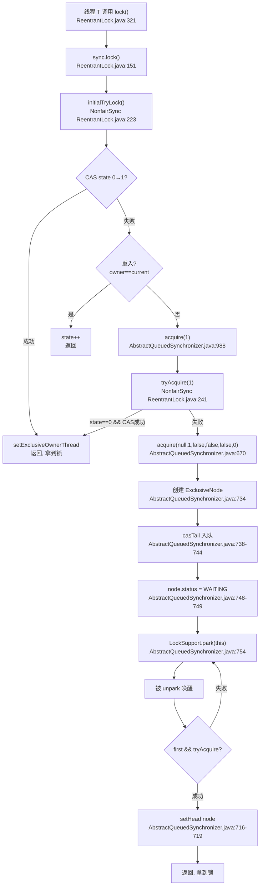
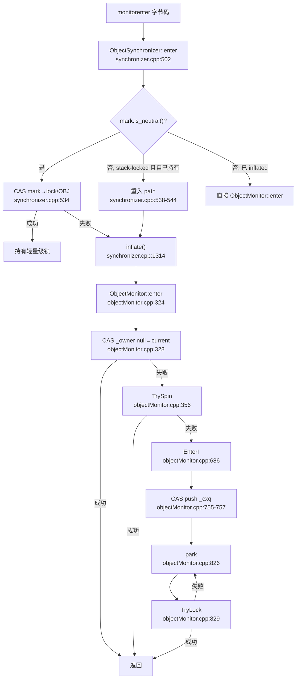
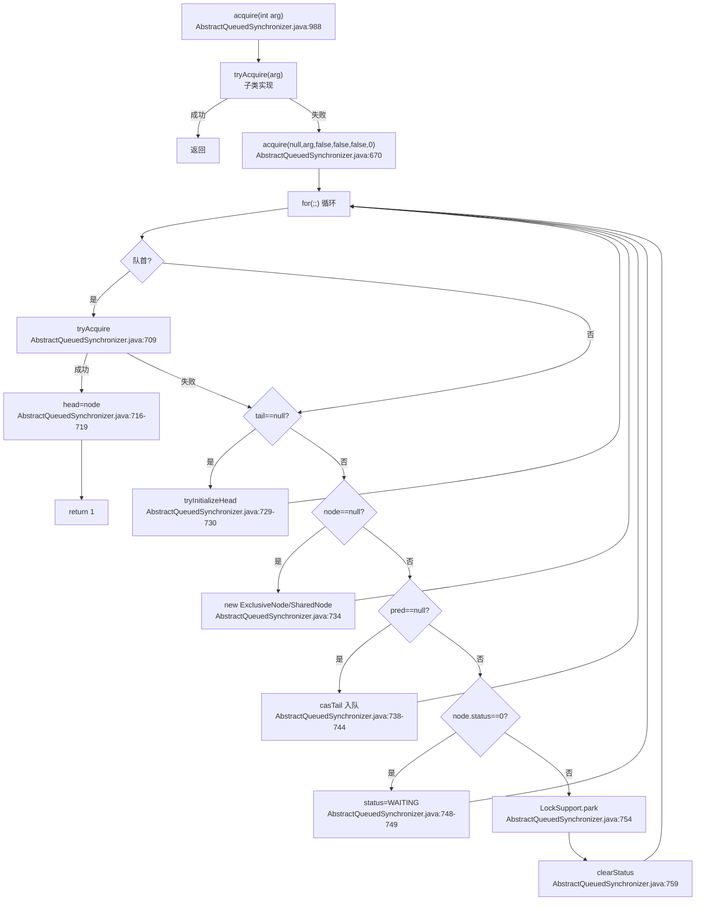
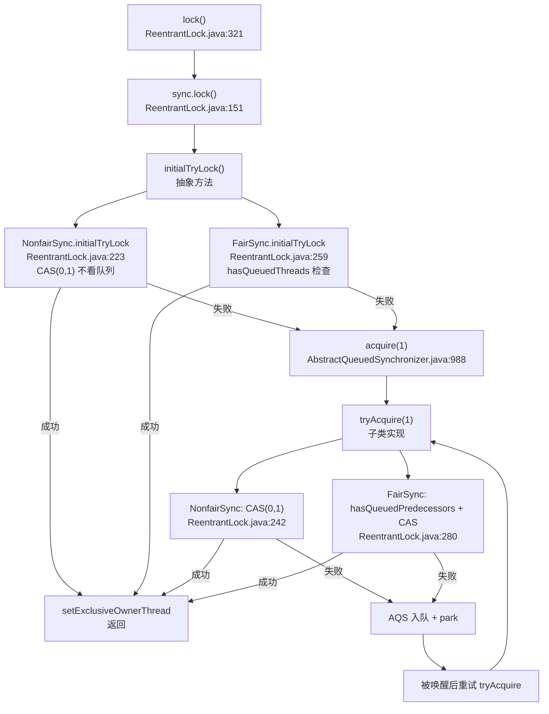
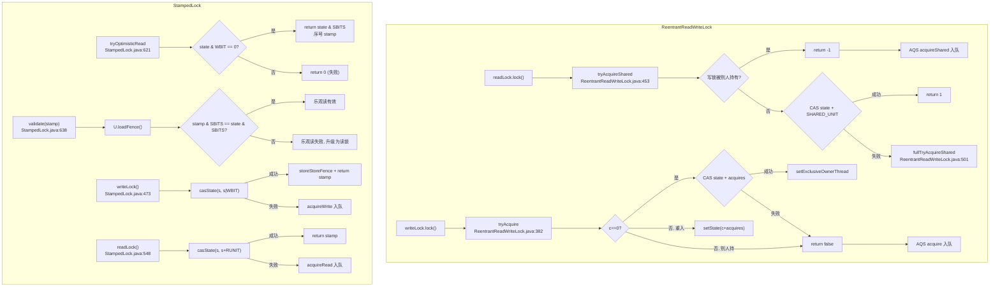
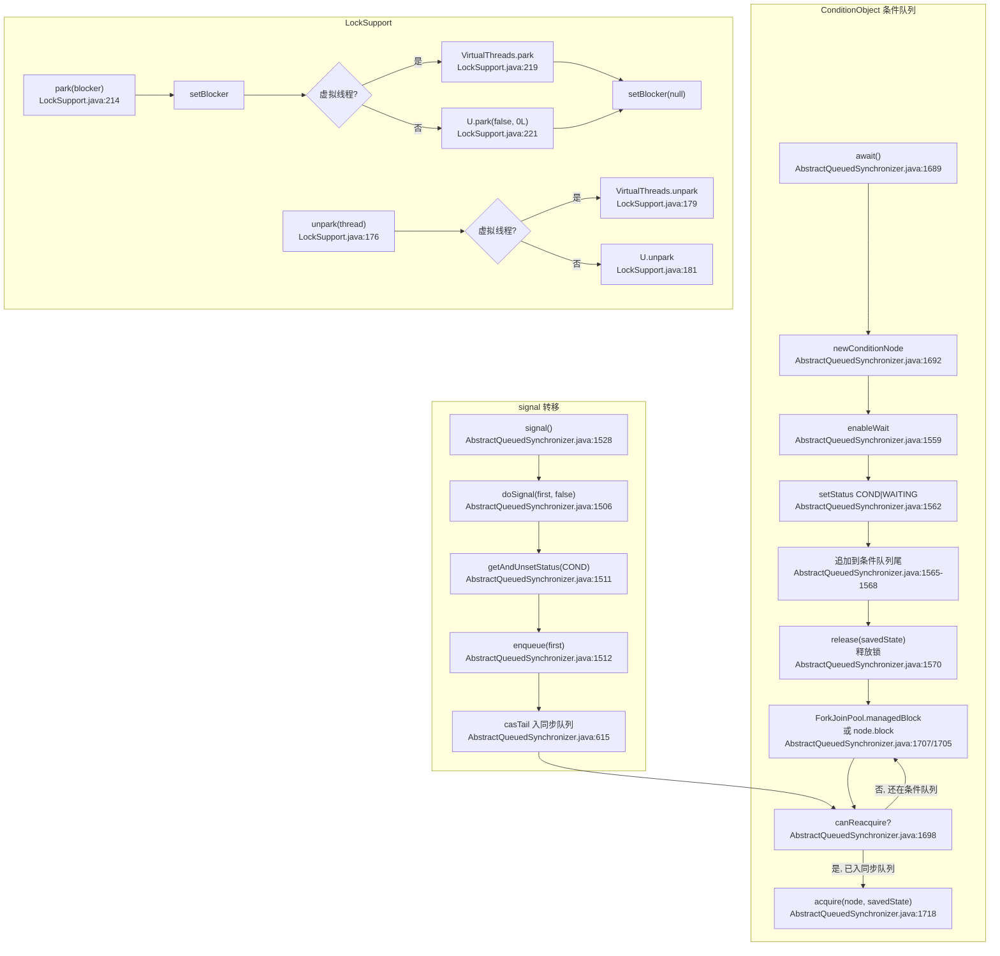

> 基于对 OpenJDK **21**（jdk-21-ga）锁相关源码的逐文件精读整理而成。
>
> 源码位于 `src/java.base/share/classes/java/util/concurrent/locks/`（AQS、ReentrantLock、ReentrantReadWriteLock、StampedLock、Condition、LockSupport、AbstractOwnableSynchronizer）与 `src/hotspot/share/runtime/`（ObjectMonitor、ObjectSynchronizer、BasicLock、LockStack、globals）。
>
> 阅读顺序即学习顺序：synchronized 内置锁（JVM 层）→ AQS 框架 → ReentrantLock → 读写锁 → Condition 与 LockSupport。
>
> 所有结论均标注了源文件位置（格式 `相对路径:行号`），行号均经 Read/Grep 实际核对。
>
> **版本基线**：OpenJDK **21**（`src/hotspot/share/runtime/globals.hpp:1973` `LockingMode` 默认 `LM_LEGACY`）。
> **精确 commit**：`890adb6410dab4606a4f26a942aed02fb2f55387`，commit 时间 `2023-08-09 20:19:41 +0000`。
>
> **重要说明**：JDK 15 起偏向锁（Biased Locking）已移除，JDK 21 源码树中无任何 `Biased` 关键字引用，锁升级路径为"无锁 → 轻量级锁（栈锁/快速锁）→ 重量级锁（ObjectMonitor）"三段式，无偏向锁阶段。

---

## 〇、全景地图

Java 21 的锁体系可以压缩成两大家族、三层骨架：

- **家族一：synchronized 内置锁**（JVM 层实现）——`monitorenter`/`monitorexit` 字节码 → `ObjectSynchronizer::enter/exit` → 轻量级快速路径 → `ObjectMonitor` 重量级慢路径。`Object.wait/notify` 直接操作 `ObjectMonitor` 的 `_WaitSet` 和 `_cxq/_EntryList`。
- **家族二：JUC 显式锁**（Java 层实现）——`AbstractQueuedSynchronizer`（AQS）提供 CLH 变种队列 + `state int` + `Node{prev,next,waiter,status}`，`ReentrantLock`/`ReentrantReadWriteLock` 继承 AQS，`StampedLock` 用独立的 CLH 变种（非 AQS 子类）。唤醒原语统一走 `LockSupport.park/unpark`。

```
┌─────────────────── JVM 内置锁 (src/hotspot/share/runtime/) ───────────────────┐
│                                                                                │
│  字节码 monitorenter/monitorexit                                                │
│    │                                                                           │
│    ▼                                                                           │
│  ObjectSynchronizer::enter (synchronizer.cpp:502)                              │
│    ├── LM_LIGHTWEIGHT: LockStack.push + CAS mark (synchronizer.cpp:510-526)    │
│    ├── LM_LEGACY:     BasicLock displaced header + CAS mark (src/hotspot/share/runtime/synchronizer.cpp:528-551) │
│    └── 失败 → inflate() → ObjectMonitor::enter() (objectMonitor.cpp:324)       │
│                                                                                  │
│  ObjectMonitor 重量级 (objectMonitor.hpp:129)                                   │
│    _owner, _recursions, _cxq, _EntryList, _WaitSet, _succ, _Responsible        │
│    enter: CAS _owner → TrySpin → EnterI (cxq CAS 入队 + park)                   │
│    exit:  release_clear_owner → drain cxq→EntryList → ExitEpilog(unpark)        │
│    wait:  AddWaiter(_WaitSet 循环双链) → exit() → park → ReenterI               │
│    notify: DequeueWaiter → prepend to _cxq (INotify)                            │
│                                                                                  │
│  mark word 布局 (LM_LEGACY):                                                     │
│    [hash/age/0 → neutral] [ptr to BasicLock/0 → stack-locked]                   │
│    [0 → INFLATING] [ptr to ObjectMonitor/10b → inflated]                         │
│  LM_LIGHTWEIGHT: [hash/age/0 → neutral] [0/1b → fast-locked]                    │
│                                                                                  │
└──────────────────────────────────────────────────────────────────────────────────┘

┌─────────────────── JUC 显式锁 (src/java.base/.../locks/) ──────────────────────┐
│                                                                                  │
│  AbstractOwnableSynchronizer (AbstractOwnableSynchronizer.java:50)               │
│    exclusiveOwnerThread (独占锁持有者记录)                                        │
│                                                                                  │
│  AbstractQueuedSynchronizer (AbstractQueuedSynchronizer.java)                    │
│    state (volatile int), head/tail (CLH 变种队列)                                │
│    Node{prev, next, waiter, status} (AbstractQueuedSynchronizer.java:467)                               │
│      ExclusiveNode / SharedNode / ConditionNode (AbstractQueuedSynchronizer.java:502-522)               │
│    acquire(node,arg,shared,interruptible,timed,time) (AbstractQueuedSynchronizer.java:670)             │
│      → tryAcquire/tryAcquireShared → casTail 入队 → park → signalNext           │
│    release(arg) → tryRelease → signalNext(head) (AbstractQueuedSynchronizer.java:1058)                 │
│    ConditionObject: firstWaiter/lastWaiter 单链表 (AbstractQueuedSynchronizer.java:1483)                │
│      await → enableWait(release) → park → acquire(savedState)                    │
│      signal → doSignal → enqueue to sync queue (AbstractQueuedSynchronizer.java:1506)                  │
│                                                                                  │
│  ReentrantLock (ReentrantLock.java:108)                                           │
│    Sync extends AQS → NonfairSync / FairSync                                     │
│    state = 重入计数; exclusiveOwnerThread = 持有者                                │
│    公平差别: FairSync.tryAcquire 调 hasQueuedPredecessors (ReentrantLock.java:280)          │
│                                                                                  │
│  ReentrantReadWriteLock (ReentrantReadWriteLock.java:216)                       │
│    state 高 16 位 = 共享读计数, 低 16 位 = 独占写计数                             │
│    Sync → NonfairSync(readerShouldBlock=apparentlyFirstQueuedIsExclusive)        │
│        → FairSync(both hasQueuedPredecessors)                                    │
│                                                                                  │
│  StampedLock (StampedLock.java:242) — 不继承 AQS, 自建 CLH 队列                  │
│    state (volatile long): bit7=写锁, 低 7 位=读计数, 高位=序号                   │
│    tryOptimisticRead → validate(loadFence) 乐观读                                │
│    writeLock/readLock 返回 stamp, 不可重入                                       │
│                                                                                  │
│  LockSupport (LockSupport.java:140) — 底层阻塞原语                               │
│    park(blocker) / unpark(thread) — permit 语义, 不累积                           │
│    虚拟线程: VirtualThreads.park/unpark (LockSupport.java:218-222/178-183)      │
│                                                                                  │
└──────────────────────────────────────────────────────────────────────────────────┘
```

渲染友好版：

```mermaid
flowchart TD
    subgraph JVM_LOCKS["JVM 内置锁 synchronized"]
        BC["字节码 monitorenter"] --> SE["ObjectSynchronizer::enter<br/>synchronizer.cpp:502"]
        SE --> LF1{"LockingMode?"}
        LF1 -->|"LM_LIGHTWEIGHT"| LWS["LockStack.push + CAS mark<br/>synchronizer.cpp:510-526"]
        LF1 -->|"LM_LEGACY"| BL["BasicLock displaced header<br/>synchronizer.cpp:528-551"]
        LWS --> FAIL1["失败"]
        BL --> FAIL1
        FAIL1 --> INF["inflate()<br/>synchronizer.cpp:1314"]
        INF --> OM_ENTER["ObjectMonitor::enter<br/>objectMonitor.cpp:324"]
        OM_ENTER --> CAS_OW["CAS _owner null→current<br/>objectMonitor.cpp:328"]
        CAS_OW -->|"成功"| RET["返回"]
        CAS_OW -->|"失败竞争"| SPIN["TrySpin<br/>objectMonitor.cpp:356"]
        SPIN -->|"成功"| RET
        SPIN -->|"失败"| EI["EnterI: CAS push _cxq<br/>+ park<br/>objectMonitor.cpp:686"]
        EI --> RET
        SE_EXIT["ObjectSynchronizer::exit<br/>synchronizer.cpp:567"] --> OM_EXIT["ObjectMonitor::exit<br/>objectMonitor.cpp:1141"]
        OM_EXIT --> DROP["release_clear_owner<br/>objectMonitor.cpp:1196"]
        DROP --> DRAIN["drain cxq→EntryList<br/>objectMonitor.cpp:1268-1301"]
        DRAIN --> EE["ExitEpilog: unpark<br/>objectMonitor.cpp:1320-1347"]
        WAIT["Object.wait"] --> OM_WAIT["ObjectMonitor::wait<br/>objectMonitor.cpp:1440"]
        OM_WAIT --> AW["AddWaiter _WaitSet<br/>objectMonitor.cpp:2078"]
        AW --> EX["exit() 释放锁<br/>objectMonitor.cpp:1500"]
        EX --> PK["park<br/>objectMonitor.cpp:1529"]
        PK --> RE["ReenterI / enter<br/>objectMonitor.cpp:1613-1616"]
        NOTIFY["Object.notify"] --> IN["INotify<br/>objectMonitor.cpp:1662"]
        IN --> PRE["prepend to _cxq<br/>objectMonitor.cpp:1686-1699"]
    end

    subgraph JUC_LOCKS["JUC 显式锁"]
        AQS["AbstractQueuedSynchronizer<br/>AbstractQueuedSynchronizer.java"]
        AQS --> ACQ["acquire<br/>AbstractQueuedSynchronizer.java:670"]
        ACQ --> TA["tryAcquire/tryAcquireShared"]
        TA -->|"失败"| ENQ["casTail 入队<br/>AbstractQueuedSynchronizer.java:738-744"]
        ENQ --> PARK["LockSupport.park<br/>AbstractQueuedSynchronizer.java:754"]
        PARK --> ACQ
        AQS --> REL["release<br/>AbstractQueuedSynchronizer.java:1058"]
        REL --> TR["tryRelease"]
        TR --> SN["signalNext(head)<br/>AbstractQueuedSynchronizer.java:641-647"]
        SN --> UNPARK["LockSupport.unpark"]
        AQS --> RL["ReentrantLock"]
        AQS --> RWL["ReentrantReadWriteLock"]
        AQS --> COND["ConditionObject<br/>AbstractQueuedSynchronizer.java:1483"]
        STAMPED["StampedLock<br/>StampedLock.java:242"]
        STAMPED -.->|"非AQS子类 自建CLH"| CLH["独立 CLH 队列"]
        LS["LockSupport<br/>LockSupport.java:140"]
        LS --> PARK
        LS --> UNPARK
    end
```



三条主线：
1. **加锁流**：线程请求锁 → 快速路径 CAS（栈锁/BasicLock/LockStack）→ 失败则 inflate 到 ObjectMonitor（JVM 锁）或入 CLH 队列 park（JUC 锁）。
2. **唤醒流**：持锁线程释放 → exit/release → 从队列取后继 → unpark/LockSupport.unpark → 后继线程被唤醒后重新竞争。
3. **锁升级流**（仅 synchronized）：无锁（neutral mark）→ 轻量级锁（stack-locked 或 fast-locked）→ 重量级锁（inflated, ObjectMonitor）。无偏向锁阶段。

---

## 速览：各讲做了什么（先看这个再进细节）

| 讲次 | 主题 | 核心文件 | 一句话白话 |
| --- | --- | --- | --- |
| 第一讲 | synchronized 与锁升级 | `objectMonitor.hpp/cpp`、`synchronizer.cpp`、`basicLock.hpp`、`lockStack.hpp` | JVM 层的锁是一台"自动升降档"的变速箱：无竞争时用 mark word 里一个 bit 搞定，竞争一来自动膨胀成 ObjectMonitor（有 cxq 队列、有 park、有自旋）。JDK 21 把偏向锁砍了，只剩三档。 |
| 第二讲 | AQS 核心 | `AbstractQueuedSynchronizer.java` | AQS 是 JUC 锁的"底盘"：一个 volatile int state + 一条 CLH 变种双向链表 + acquire 里的一个大 for 循环。tryAcquire 交给子类写，入队/park/唤醒全在框架里包好。 |
| 第三讲 | ReentrantLock | `ReentrantLock.java` | ReentrantLock 就是 AQS 穿了一件"可重入独占"的外套：state 当计数器、exclusiveOwnerThread 当持有者。公平和非公平只差一行——hasQueuedPredecessors。 |
| 第四讲 | 读写锁 | `ReentrantReadWriteLock.java`、`StampedLock.java` | 把 state 劈成两半：高 16 位读、低 16 位写。StampedLock 更激进——用序号乐观读，读不加计数不 CAS，性能碾压但有"不可重入"的代价。 |
| 第五讲 | Condition 与 LockSupport | `ConditionObject`（AQS 内部）、`LockSupport.java`、`AbstractOwnableSynchronizer.java` | Condition 是"第二条等待队列"——await 时释放锁进 condition 队列，signal 时把节点搬到同步队列。LockSupport 的 permit 语义保证 unpark 先于 park 也有效。 |

全流程图（一次 `ReentrantLock.lock()` 非公平模式从进队到拿到锁）：



---

## 面试速通：Java 锁高频问题一页纸

> **用法**：被问到 Java 锁，先答下面表格里的一句话结论；面试官继续追问，再按"深入"列回对应讲次展开——第一讲 synchronized 与锁升级，第二讲 AQS，第三讲 ReentrantLock，第四讲读写锁，第五讲 Condition 与 LockSupport。
>
> **前置依赖**：线程基础（线程状态、创建与 interrupt）见 java-thread.md；JUC 容器（ConcurrentHashMap、BlockingQueue 等）见 java-concurrent.md，本文只覆盖"锁"本身。

### 高频 Q&A（先结论）

先答"一句话结论"列；被追问实现细节，按"深入"列回讲次。以下 16 题覆盖 Java 锁面试最高频问题，结论均提炼自各讲小结与源码分析。

| # | 面试问题 | 一句话结论 | 深入 |
| --- | --- | --- | --- |
| 1 | synchronized 与 ReentrantLock 的区别？ | synchronized 是 JVM 层内置锁（monitorenter 字节码 → ObjectSynchronizer → ObjectMonitor），无竞争走 mark word 快速路径、竞争自动膨胀；ReentrantLock 是 Java 层 AQS 显式锁（volatile state + CLH 变种双向链表），需手动 lock/unlock，可选公平/非公平 | 第一、三讲 |
| 2 | synchronized 锁升级过程？ | 无锁 → 轻量级锁（LM_LEGACY 栈锁 / LM_LIGHTWEIGHT 快速锁）→ 重量级锁（inflate 成 ObjectMonitor）；竞争、wait、hash 都会触发膨胀 | 第一讲 |
| 3 | JDK 21 还有偏向锁吗？ | 没有。JDK 15 起偏向锁已移除，JDK 21 源码树 `Biased` 关键字零引用；答"无锁→偏向→轻量→重量"四段式已过时 | 第一讲 |
| 4 | ObjectMonitor 有哪些队列？ | 三条：_cxq（LIFO，CAS push 头部减少竞争）、_EntryList（FIFO 双向链表，exit 时从 cxq drain 而来）、_WaitSet（循环双链，wait/notify 专用） | 第一讲 |
| 5 | AQS 原理？ | 一个 volatile int state + 一条 CLH 变种双向链表 + acquire 大循环：tryAcquire 交给子类，入队/park/唤醒全在框架里；release 后 signalNext 只唤醒一个后继 | 第二讲 |
| 6 | 公平锁与非公平锁的区别？ | 只差一行：FairSync.tryAcquire 多一个 !hasQueuedPredecessors()；非公平可插队吞吐高，公平饿死低但上下文切换多。注意 tryLock() 始终非公平 | 第三讲 |
| 7 | ReentrantLock 可重入原理？ | state 当重入计数、exclusiveOwnerThread 当持有者：owner==current 就 setState(c+1)，释放到 0 才清 owner | 第三讲 |
| 8 | lock() 与 lockInterruptibly() 的区别？ | lockInterruptibly 先查 Thread.interrupted()，再走 AQS 可中断版 acquireInterruptibly，等待期间可响应中断；lock() 入队 park 后不可中断 | 第三讲 |
| 9 | 读写锁的 state 如何拆分？ | int 劈两半：高 16 位读计数（CAS +SHARED_UNIT=65536）、低 16 位写计数；每线程读重入用 ThreadLocal<HoldCounter>，有 firstReader/cachedHoldCounter 两层优化 | 第四讲 |
| 10 | 写锁降级为何可行、读锁升级为何不可行？ | 降级：先拿写锁再拿读锁再释放写锁；升级不行——tryAcquire 在 c!=0 && w==0（有读无写）时直接返回 false | 第四讲 |
| 11 | StampedLock 乐观读怎么工作？ | tryOptimisticRead 只读 state 序号，不加锁不 CAS；用完后 validate（loadFence + 序号比较）验证期间无写锁，失败或要写就升级为 readLock | 第四讲 |
| 12 | StampedLock 为什么不可重入？ | 它不记录持有者，同线程重复 writeLock() 会 park 自己等待自己释放，直接死锁 | 第四讲 |
| 13 | Condition 与 wait/notify 的区别？ | Condition 是挂在锁上的独立条件队列（firstWaiter/lastWaiter 单链表，可 new 多个）；wait/notify 只能用对象 monitor 的那条 _WaitSet | 第五讲 |
| 14 | Condition.await 会释放锁吗？ | 会。await 调 enableWait 先 release(savedState) 释放全部重入计数，被 signal 唤醒后从条件队列迁到同步队列，再用保存的 state 重新竞争 | 第五讲 |
| 15 | LockSupport 的 permit 语义？ | permit 不累积、至多一个；unpark 先于 park 也有效（permit 预存）；park 可能 spurious wakeup，必须 while 循环重检 | 第五讲 |
| 16 | synchronized 的 wait/notify 为什么必须在同步块内？ | 底层 ObjectMonitor::wait/notify 第一步都是 CHECK_OWNER，要求线程是该 monitor 的持有者；没进同步块就没有操作 _WaitSet 的身份 | 第一讲 |

**追问时的展开路线**（按讲次）：

- 第一讲：mark word 状态机与 LockingMode 三选项（LM_MONITOR 纯重量级 / LM_LEGACY 默认 / LM_LIGHTWEIGHT 实验性）→
  inflate 按 mark 状态分情况处理（inflated / INFLATING / fast-locked / stack-locked / neutral）→
  enter：CAS _owner → 重入检查 → TrySpin → EnterI（CAS push _cxq + park）；
  exit：drain _cxq→_EntryList → ExitEpilog unpark；wait：AddWaiter → exit → park → ReenterI；notify：DequeueWaiter → 移入 _cxq/_EntryList。
- 第二讲：Node 的三个 status 常量（WAITING=1 / CANCELLED=0x80000000 / COND=2）与 ExclusiveNode/SharedNode 子类，ConditionNode 还实现 ManagedBlocker →
  acquire 是六参数方法（node, arg, shared, interruptible, timed, time），内部八步循环：检查队首 → tryAcquire → 初始化队列 → 创建节点 → casTail 入队 → 自旋 → 设 WAITING → park →
  release → signalNext 只唤醒 head.next（共享模式用 signalNextIfShared）；
  hasQueuedPredecessors 是公平锁基石，apparentlyFirstQueuedIsExclusive 用于非公平读写锁防写者饥饿。
- 第三讲：Sync extends AQS，state 当重入计数、exclusiveOwnerThread 当持有者 →
  lock() 先 initialTryLock 快速路径再 acquire(1)；tryAcquire 的公平差异只有 !hasQueuedPredecessors() 一行 →
  tryRelease 用 setState(c) 普通 volatile 写不用 CAS（只有持锁线程能调，无竞争）；
  exclusiveOwnerThread 非 volatile，靠 state 的 volatile 读写保证 happens-before。
- 第四讲：SHARED_SHIFT=16 把 state 劈成两半，读锁 CAS 加 SHARED_UNIT=65536（进位到高位），写锁 CAS 加 1 →
  写锁走 tryAcquire（c==0 才 CAS），读锁走 tryAcquireShared（返回 int，>=0 成功，失败 -1 转 fullTryAcquireShared）→
  每线程读重入用 ThreadLocal<HoldCounter>，配 firstReader/cachedHoldCounter 两层优化；写锁降级可行、读锁升级不可行 →
  StampedLock 不继承 AQS，用 64 位 state（bit7 写锁 / 低 7 位读计数 / 高位序号）做乐观读，三种模式按 stamp 区分。
- 第五讲：await 五步全流程（创建 ConditionNode → enableWait 释放锁并入条件队列 → park → canReacquire 为真 → acquire(savedState) 恢复重入计数）→
  signal → doSignal → enqueue 把节点迁到同步队列（只移一个，signalAll 全移）→
  permit 三特性（不累积 / unpark 可先行 / spurious wakeup 要循环）；
  虚拟线程走 VirtualThreads.park/unpark，不阻塞载体线程。

### 易错点与面试坑

- **坑 1：版本差异（最高频翻车点）**。JDK 15 起偏向锁已移除，JDK 21 源码树 `Biased` 关键字零引用，升级路径只剩"无锁 → 轻量级 → 重量级"三段；背诵四段式属于过期答案。
  - 追问就补：LockingMode 默认 LM_LEGACY（BasicLock displaced header），另有 LM_MONITOR 纯重量级与实验性 LM_LIGHTWEIGHT（LockStack 快速锁）。
  - 加分项：INFLATING 中间态只有 LM_LEGACY 有；LM_LIGHTWEIGHT 的轻量级只有 fast-locked 一档。
- **坑 2：tryLock() 永远非公平**。Sync.tryLock 不检查队列直接 CAS，即使在 FairSync 模式下也不排队——公平性只在 lock() 路径上成立。
  - 追问就补：lock() 入口先试 initialTryLock；FairSync 的实现会先查 hasQueuedThreads，NonfairSync 的直接 CAS。
  - 加分项：public tryLock() 转调的就是 Sync.tryLock，所以"公平锁的 tryLock"这个组合不存在。
- **坑 3：lock() 不能响应中断**。等待期间要响应中断必须用 lockInterruptibly()（走 AQS 可中断路径）；lock() 一旦入队 park 就发现不了中断。
  - 追问就补：lockInterruptibly 进 AQS 前先查 Thread.interrupted()，再走可中断版 acquireInterruptibly。
  - 加分项：tryLock(timeout, unit) 走 tryLockNanos，既可中断又有超时，同样先试 initialTryLock。
- **坑 4：Condition.await 是"先放锁再等"**。await 会 release(savedState) 释放全部重入计数；醒来后不是继续持锁，而是带保存的 state 重新竞争锁。
  - 追问就补：enableWait 把节点挂上条件队列后才 release；返回路径用保存的 savedState 恢复重入计数。
  - 加分项：signal 只把头节点从条件队列 enqueue 到同步队列，要全喊必须 signalAll。
- **坑 5：两条队列结构不同，别搞混**。同步队列是 head/tail 双向链表（Node 有 prev/next），Condition 条件队列是 firstWaiter/lastWaiter 单链表；节点被 signal 后才"迁移"进同步队列。
  - 追问就补：JDK 21 的 Node 用 status（WAITING / CANCELLED / COND 三个常量）加 ExclusiveNode/SharedNode 子类区分模式，不再有 SIGNAL/PROPAGATE。
  - 加分项：canReacquire 通过 node.prev 是否为 null 判断节点是否已被搬进同步队列。
- **坑 6：乐观读 validate 通过 ≠ 万事大吉**。validate 只证明"读的瞬间序号没变"；之后要做写操作必须升级成 readLock，否则数据可能已经坏了。
  - 追问就补：validate 用 loadFence 保证读操作不被重排到验证之前，再比较序号是否变化。
  - 加分项：StampedLock 不可重入——不记录持有者，同线程重复 writeLock() 会 park 自己等自己释放，直接死锁。
- **坑 7：读锁不能升级写锁，写锁可以降级**。c!=0 && w==0 时 tryAcquire 直接返回 false；正确姿势是"先拿写锁 → 再拿读锁 → 释放写锁"完成降级。
  - 追问就补：降级顺序不能反——文档给出的标准姿势是先 readLock().lock()（写锁持有者可以获取读锁），再 writeLock().unlock()。
  - 加分项：非公平读锁靠 apparentlyFirstQueuedIsExclusive 只在队首是写者时阻塞新读者，是概率性防写者饥饿，不保证写者不饿死。
- **坑 8：park 可能无理由返回（spurious wakeup）**。park 必须包在 while (!canProceed) { park(); } 循环里重检条件；unpark 先于 park 也有效（permit 预存），但 permit 不累积、至多一个。
  - 追问就补：permit 语义下多次 unpark 等于一次，这是 LockSupport 与 Semaphore 计数许可的区别。
  - 加分项：虚拟线程的 park/unpark 走 VirtualThreads，不阻塞载体线程；ConditionNode 实现 ForkJoinPool.ManagedBlocker，在 ForkJoinPool 里 await 不占线程。

### 关键概念对照表

| 概念对 | 一方 | 另一方 | 一句话辨别 |
| --- | --- | --- | --- |
| synchronized vs ReentrantLock | JVM 层内置锁：字节码 → ObjectSynchronizer → ObjectMonitor，mark word 自动三段升级 | Java 层 AQS：volatile state + CLH 变种队列，手动 lock/unlock，公平/非公平可选 | 实现层不同：一个自动升降档，一个显式管理 |
| 公平锁 vs 非公平锁 | FairSync.tryAcquire 多 !hasQueuedPredecessors()，严格 FIFO | NonfairSync 直接 CAS，新线程可插队 | 吞吐选非公平，饿死敏感选公平；tryLock() 一律非公平 |
| 读锁 vs 写锁 | 读锁共享：state 高 16 位 CAS +65536 | 写锁独占：state 低 16 位 CAS +1 | 一个 int 的高低 16 位各管一种锁 |
| 悲观锁 vs 乐观锁 | 先抢后干：CAS mark word / CAS 加读计数 | 先干后验：tryOptimisticRead 只读序号 + validate | 乐观读零开销，但验证失败要升级 readLock |
| LockSupport vs Object.wait | park/unpark：permit 语义，不累积、可预存 | wait/notify：依附对象 monitor 的 _WaitSet，须 CHECK_OWNER | 前者面向线程，后者面向对象锁 |
| AQS 同步队列 vs Condition 条件队列 | head/tail 双向链表，Node 有 prev/next | firstWaiter/lastWaiter 单链表 | signal 时节点从条件队列迁移进同步队列 |
| _cxq vs _EntryList | _cxq：LIFO，CAS push 头部减少竞争 | _EntryList：FIFO 双向链表，exit 时 drain 而来 | LIFO 入队 + FIFO 出队的混合策略 |
| LM_LEGACY vs LM_LIGHTWEIGHT | BasicLock displaced header + CAS mark | LockStack.push + CAS mark | 默认前者；INFLATING 中间态仅前者有 |
| ReentrantLock state vs StampedLock stamp | state：可重入计数，进一次 +1 出一次 -1 | stamp：一次性版本号，不记录持有者 | 前者可重入，后者不可重入 |
| 平台线程 vs 虚拟线程（park） | U.park 阻塞操作系统线程 | VirtualThreads.park 不阻塞载体线程 | LockSupport 内部按 isVirtual 分流 |

以上每条结论都能在对应讲次找到源码级论证；系统复习用文末「附：学习路线与复习卡汇总」的 26 张复习卡，按讲次编号回查。

---

## 第一讲：synchronized 与锁升级 —— ObjectMonitor 与 ObjectSynchronizer

### 先说人话：本讲每个阶段在干什么

类比：synchronized 就像一栋办公楼的门禁系统。一个人进来（加锁），门禁先看有没有门禁卡（mark word 的 CAS 快速路径），有的话直接放行，不费吹灰之力。如果两个人同时刷卡（竞争），门禁系统就要升级——请出保安（ObjectMonitor），发号牌（入队），在门口等（park）。等前面的人出来（exit），保安呼叫下一个号（unpark），下一个人进门。

| 阶段 | 干了什么 | 为什么 |
| --- | --- | --- |
| 快速路径（fast path） | CAS 操作 mark word，成功直接返回 | 99% 的锁无竞争，不值得进入重量级队列 |
| 膨胀（inflate） | 创建 ObjectMonitor，CAS 安装到 mark word | 轻量级搞不定了（竞争/wait/hash），需要完整的队列和 park 机制 |
| 重量级 enter | CAS _owner、TrySpin、EnterI（入 cxq + park） | 让竞争失败的线程有序排队、不忙等浪费 CPU |
| 重量级 exit | 释放 _owner、drain cxq→EntryList、ExitEpilog(unpark) | 让等待的后继线程被唤醒 |
| wait/notify | AddWaiter 进 _WaitSet、exit 释放锁、park；notify 从 _WaitSet 移到 _cxq | 实现 Object.wait/notify 语义，需要第二条等待队列 |

**本讲主线**：mark word 的状态机 + ObjectMonitor 的 cxq/EntryList/WaitSet 三条队列 + enter/exit/wait/notify 四个操作如何操纵这些队列。

---

### 1.1 mark word 与锁状态

JDK 21 的 mark word 定义在 `oops/markWord.hpp`（本源码树 `oops/` 目录缺失，但可通过 `objectMonitor.hpp:30` 的 `#include "oops/markWord.hpp"` 和 `synchronizer.cpp` 的使用推断其布局）。

**LM_LEGACY 模式**（默认，`globals.hpp:1973`）的 mark word 布局（64 位）：

```
| unused:1 | lock-bias:2 | hashcode:31 | age:4 | 0 →  无锁 (neutral)
| pointer_to_BasicLock:62             | 00 →  栈锁 (stack-locked/has_locker)
| 0:64                                  →  INFLATING (膨胀中, 仅 LM_LEGACY)
| pointer_to_ObjectMonitor:62         | 10 →  重量级锁 (inflated/has_monitor)
```

**LM_LIGHTWEIGHT 模式**（实验性，`globals.hpp:1977`）：

```
| hashcode:31 | age:4 | 0 →  无锁 (neutral, is_neutral)
| 0:62                         | 1 →  快速锁 (fast-locked, is_fast_locked)
| pointer_to_ObjectMonitor:62 | 10 →  重量级锁 (inflated/has_monitor)
```

关键判断方法（从 `synchronizer.cpp` 使用处推断）：
- `mark.is_neutral()` — 无锁状态
- `mark.has_locker()` — 栈锁（LM_LEGACY），mark 指向 BasicLock
- `mark.is_fast_locked()` — 快速锁（LM_LIGHTWEIGHT）
- `mark.has_monitor()` — 重量级锁，mark 指向 ObjectMonitor
- `mark == markWord::INFLATING()` — 膨胀中间态（仅 LM_LEGACY）

---

### 1.2 LockingMode 与快速路径选择

`globals.hpp:1973-1978` 定义了三种锁模式：

```cpp
product(int, LockingMode, LM_LEGACY, EXPERIMENTAL,
        "Select locking mode: "
        "0: monitors only (LM_MONITOR), "
        "1: monitors & legacy stack-locking (LM_LEGACY, default), "
        "2: monitors & new lightweight locking (LM_LIGHTWEIGHT)")
        range(0, 2)
```

**JDK 21 关键变化**：偏向锁（Biased Locking）已在 JDK 15（JEP 374）移除。在 `runtime/` 目录下全局搜索 `Biased` 关键字，零结果——确认 JDK 21 源码中偏向锁代码已彻底清除。

#### LM_LEGACY 快速路径（`synchronizer.cpp:528-551`）

```cpp
// ObjectSynchronizer::enter (synchronizer.cpp:502)
markWord mark = obj->mark();
if (mark.is_neutral()) {
    lock->set_displaced_header(mark);           // 533: 把 mark 存入 BasicLock
    if (mark == obj()->cas_set_mark(markWord::from_pointer(lock), mark)) {
        return;                                  // 535: CAS 成功, 轻量级锁获取
    }
    // Fall through to inflate() ...
} else if (mark.has_locker() &&
           current->is_lock_owned((address) mark.locker())) {
    // 538-544: 重入, 已持有该栈锁
    lock->set_displaced_header(markWord::from_pointer(nullptr));
    return;
}
```

原理：把对象原始 mark word 备份到栈帧上的 `BasicLock._displaced_header`（`basicLock.hpp:37`），然后 CAS 把 mark word 指向 BasicLock 地址。解锁时反向 CAS 恢复。

#### LM_LIGHTWEIGHT 快速路径（`synchronizer.cpp:510-526`）

```cpp
// ObjectSynchronizer::enter (synchronizer.cpp:510)
LockStack& lock_stack = current->lock_stack();
if (lock_stack.can_push()) {
    markWord mark = obj()->mark_acquire();
    if (mark.is_neutral()) {
        markWord locked_mark = mark.set_fast_locked();
        markWord old_mark = obj()->cas_set_mark(locked_mark, mark);
        if (old_mark == mark) {
            lock_stack.push(obj());  // 522: 成功, 压入 LockStack
            return;
        }
    }
}
```

LM_LIGHTWEIGHT 不使用 BasicLock 的 displaced header，而是用线程私有的 `LockStack`（`lockStack.hpp:36`，`CAPACITY = 8`，`_base[8]` 数组）记录持有的锁对象。mark word 只翻转一个 bit 到 fast-locked 状态，开销更小。

---

### 1.3 inflate：从轻量级到重量级

`ObjectSynchronizer::inflate`（`synchronizer.cpp:1314`）处理四种 mark 状态：

| mark 状态 | 处理 | 源码位置 |
| --- | --- | --- |
| inflated (has_monitor) | 直接返回已有 ObjectMonitor | `synchronizer.cpp:1335-1344` |
| INFLATING (仅 LM_LEGACY) | 自旋等待膨胀完成 | `synchronizer.cpp:1354-1357` |
| fast-locked (LM_LIGHTWEIGHT) | 新建 ObjectMonitor，CAS 替换 mark | `synchronizer.cpp:1371-1410` |
| stack-locked (LM_LEGACY) | 新建 ObjectMonitor，INFLATING 中间态，再 CAS 替换 | `synchronizer.cpp:1423-1505` |
| neutral (无锁) | 新建 ObjectMonitor，CAS 直接安装 | `synchronizer.cpp:1518-1530` |

**fast-locked 膨胀**（`synchronizer.cpp:1371-1410`）：

```cpp
ObjectMonitor* monitor = new ObjectMonitor(object);    // 1372
monitor->set_header(mark.set_unlocked());               // 1373
bool own = is_lock_owned(current, object);
if (own) monitor->set_owner_from(nullptr, current);    // 1377: 自己持有
else     monitor->set_owner_anonymous();                // 1380: 别人持有
markWord monitor_mark = markWord::encode(monitor);
markWord old_mark = object->cas_set_mark(monitor_mark, mark);
if (old_mark == mark) {
    if (own) JavaThread::cast(current)->lock_stack().remove(object); // 1387
    _in_use_list.add(monitor);                           // 1391
    return monitor;                                      // 1405
} else {
    delete monitor;                                      // 1407: CAS 失败, 重试
    continue;
}
```

**neutral 膨胀**（`synchronizer.cpp:1518-1530`）——最简单的路径：

```cpp
ObjectMonitor* m = new ObjectMonitor(object);    // 1519
m->set_header(mark);                              // 1521: 保存原始 mark
if (object->cas_set_mark(markWord::encode(m), mark) != mark) {
    delete m;                                      // 1524: 失败重试
    continue;
}
_in_use_list.add(m);                              // 1534
return m;                                         // 1548
```

---

### 1.4 ObjectMonitor 数据结构

`objectMonitor.hpp:129-192` 定义了重量级锁的完整数据结构：

```
volatile markWord _header;          // 139: 原始 mark word (displaced)
WeakHandle _object;                 // 140: 反向指向被锁对象
DEFINE_PAD_MINUS_SIZE(...)          // 145: 缓存行填充, 避免伪共享
void* volatile _owner;             // 163: 持有者线程或 BasicLock
volatile uint64_t _previous_owner_tid; // 164
ObjectMonitor* _next_om;           // 171: 监视器链表
volatile intx _recursions;         // 172: 重入计数
ObjectWaiter* volatile _EntryList; // 173: 重入入口队列
ObjectWaiter* volatile _cxq;       // 177: 最近到达竞争者队列 (LIFO)
JavaThread* volatile _succ;        // 178: "假定继承人", 减少 futile wakeup
JavaThread* volatile _Responsible;  // 179: 责任线程 (定时 park 防搁浅)
volatile int _Spinner;             // 181
volatile int _SpinDuration;         // 182
int _contentions;                   // 184: 竞争计数
ObjectWaiter* volatile _WaitSet;   // 189: wait() 等待队列 (循环双链表)
volatile int _waiters;             // 190: 等待线程数
volatile int _WaitSetLock;         // 192: 保护 _WaitSet 的自旋锁
```

**ObjectWaiter**（`objectMonitor.hpp:43-59`）：

```
ObjectWaiter* volatile _next;     // 46
ObjectWaiter* volatile _prev;     // 47
JavaThread*   _thread;             // 48
ParkEvent*    _event;             // 50: park/unpark 事件
volatile int  _notified;         // 51
volatile TStates TState;          // 52: TS_WAIT/TS_ENTER/TS_CXQ/TS_READY/TS_RUN
```

三条队列的关系：
- **_cxq**：竞争者入口队列，LIFO（后进先出），CAS 入队。新来的竞争者先入 cxq。
- **_EntryList**：重入入口队列，双向链表。exit 时把 cxq 排空到 EntryList，再从头部取后继。
- **_WaitSet**：wait() 等待队列，循环双向链表。notify 从头部取一个移到 cxq/EntryList。

---

### 1.5 ObjectMonitor::enter —— 重量级加锁

`objectMonitor.cpp:324` 的 `enter()` 按"最快路径优先"排列：

```
enter() (objectMonitor.cpp:324)
  ├── CAS _owner null→current (328)        成功 → return true
  ├── _owner == current (334)              重入 → _recursions++; return true
  ├── _owner 指向自己的 BasicLock (340)    LM_LEGACY 重入 → _recursions=1; 转换 owner
  ├── TrySpin(current) (356)              自旋 → 成功 return true
  └── EnterI(current) (686)                入队 + park 循环
```

**EnterI**（`objectMonitor.cpp:686`）核心逻辑：

```cpp
// 先 TryLock (690) 和取消 deflation (697)
ObjectWaiter node(current);                    // 745
node.TState = ObjectWaiter::TS_CXQ;            // 748
// CAS push 到 _cxq 头部
for (;;) {
    node._next = nxt = _cxq;                  // 756
    if (Atomic::cmpxchg(&_cxq, nxt, &node) == nxt) break;  // 757
    if (TryLock(current) > 0) return;          // 761: CAS 失败顺便试锁
}
// 成为 Responsible 线程 (792-796)
if (nxt == nullptr && _EntryList == nullptr)
    Atomic::replace_if_null(&_Responsible, current);
// park 循环 (812-827)
for (;;) {
    if (TryLock(current) > 0) break;
    if (_Responsible == current)
        current->_ParkEvent->park(recheckInterval);  // 819: 定时 park
    else
        current->_ParkEvent->park();                 // 826: 无限 park
    if (TryLock(current) > 0) break;
}
```

关键设计：
1. **cxq LIFO**：新来线程 CAS 到 cxq 头部（`objectMonitor.cpp:756-757`），减少 CAS 竞争。
2. **Responsible 线程**：至多一个线程用定时 park（`objectMonitor.cpp:818-827`），防止"搁浅"（stranding）——所有线程 park 了但锁是空闲的。
3. **TrySpin 先行**：入队前先自旋（`objectMonitor.cpp:356, 724`），如果锁持有时间极短可避免入队开销。

---

### 1.6 ObjectMonitor::exit —— 重量级解锁

`objectMonitor.cpp:1141` 的 `exit()` 核心流程：

```
exit() (objectMonitor.cpp:1141)
  ├── 检查 owner (1142-1168)
  ├── _recursions != 0 → _recursions-- return (1170-1172)
  ├── _Responsible = null (1177)
  └── for(;;) (1187)
      ├── release_clear_owner(current) (1196)     释放锁
      ├── storeload fence (1197)
      ├── cxq|EntryList 空 && _succ!=null → return (1199-1201)  无需唤醒
      ├── try_set_owner(null→current) 失败 → return (1240)  被别人抢了
      ├── _EntryList 非空 → ExitEpilog(w) (1262)   唤醒 EntryList 头
      └── _cxq 非空 → drain cxq→EntryList (1268-1301)
          → ExitEpilog(w) (1314)                   唤醒新的 EntryList 头
```

**drain cxq → EntryList**（`objectMonitor.cpp:1268-1301`）——把 LIFO 的 cxq 反转为 FIFO 的 EntryList：

```cpp
// CAS 把 _cxq 置 null, 取出链头 w
for (;;) {
    ObjectWaiter* u = Atomic::cmpxchg(&_cxq, w, (ObjectWaiter*)nullptr);
    if (u == w) break;
    w = u;                                    // 1278: 重试
}
_EntryList = w;                               // 1293: w 作为 EntryList 头
ObjectWaiter* q = nullptr;
for (p = w; p != nullptr; p = p->_next) {
    p->TState = ObjectWaiter::TS_ENTER;       // 1298: 状态转换
    p->_prev = q;                              // 1299: 建立反向链接
    q = p;
}
```

**ExitEpilog**（`objectMonitor.cpp:1320-1347`）——实际的唤醒：

```cpp
void ObjectMonitor::ExitEpilog(JavaThread* current, ObjectWaiter* Wakee) {
    _succ = Wakee->_thread;                    // 1329: 标记继承人
    ParkEvent* Trigger = Wakee->_event;          // 1330
    Wakee = nullptr;                            // 1335: 安全, 防止 use-after-free
    release_clear_owner(current);                // 1339: 释放锁
    OrderAccess::fence();                       // 1340: fence 分隔 store 和 unpark
    Trigger->unpark();                          // 1343: 唤醒后继
}
```

---

### 1.7 Object.wait() / notify() 的实现

#### wait()（`objectMonitor.cpp:1440`）

```
wait() (objectMonitor.cpp:1440)
  ├── CHECK_OWNER (1445)                        检查是否持锁
  ├── 创建 ObjectWaiter node, TState=TS_WAIT (1479-1480)
  ├── AddWaiter(&node) (1491-1493)              加入 _WaitSet 循环双链表
  ├── 保存 _recursions, _waiters++ (1497-1498)
  ├── exit(current) (1500)                      释放锁!
  ├── park() (1529) 或 park(millis) (1531)       阻塞
  ├── 醒后: 若仍 TS_WAIT → DequeueSpecificWaiter (1551-1558)
  └── ReenterI 或 enter (1612-1616)             重新获取锁
```

**AddWaiter**（`objectMonitor.cpp:2078-2096`）——循环双向链表尾部插入：

```cpp
inline void ObjectMonitor::AddWaiter(ObjectWaiter* node) {
    if (_WaitSet == nullptr) {
        _WaitSet = node;                        // 2084: 唯一节点
        node->_prev = node;                     // 2085: 自指, 构成循环
        node->_next = node;                     // 2086
    } else {
        ObjectWaiter* head = _WaitSet;
        ObjectWaiter* tail = head->_prev;       // 2089: tail = head.prev
        tail->_next = node;                     // 2091
        head->_prev = node;                     // 2092
        node->_next = head;                     // 2093
        node->_prev = tail;                     // 2094
    }
}
```

#### notify() 与 INotify()（`objectMonitor.cpp:1724, 1662`）

```
notify() (objectMonitor.cpp:1724)
  ├── CHECK_OWNER (1726)
  ├── _WaitSet == null → return (1727)         没人等, 直接返回
  └── INotify(current) (1731)
      └── DequeueWaiter → 从 _WaitSet 取头节点
          ├── 若 _EntryList 空 → 直接入 _EntryList (1687-1689)
          └── 否则 prepend 到 _cxq (1691-1698)   CAS push 到 cxq 头部
```

INotify 的转移策略（`objectMonitor.cpp:1686-1699`）：

```cpp
if (list == nullptr) {
    // _EntryList 为空, 直接作为唯一节点
    iterator->_next = iterator->_prev = nullptr;
    _EntryList = iterator;                     // 1689
} else {
    // 否则 prepend 到 _cxq 头部
    iterator->TState = ObjectWaiter::TS_CXQ;
    for (;;) {
        ObjectWaiter* front = _cxq;
        iterator->_next = front;
        if (Atomic::cmpxchg(&_cxq, front, iterator) == front) break;
    }
}
```

**wait→notify→reenter 全链路**：线程在 _WaitSet 上 park → notify 把它移到 _cxq/EntryList → 当前线程 exit 时 unpark 它 → 它从 park 中醒来 → ReenterI（`objectMonitor.cpp:946`）重新竞争锁。

---

### 1.8 端到端演演算：synchronized 从无锁到重量级锁的升级

> 🎬 配套动画：[synchronized 锁升级](/animations/sync-upgrade/) —— 11 步单步播放，mark word 与 `_cxq`/`_EntryList` 同步变化，可拖进度条。

假设线程 T1、T2 依次对对象 obj 执行 `synchronized(obj) { ... }`（LM_LEGACY 模式）：

| 步骤 | 线程 | mark word 状态 | 动作 | 源码位置 |
| --- | --- | --- | --- | --- |
| 1 | T1 | neutral (hash/age/0) | T1 CAS mark→from_pointer(lock1)，成功 | `synchronizer.cpp:534` |
| 2 | T1 | stack-locked (ptr→lock1/00) | T1 持有锁，执行临界区 | — |
| 3 | T2 | stack-locked | T2 CAS 失败，mark.has_locker() 但非自己持有 | `synchronizer.cpp:538-539` |
| 4 | T2 | INFLATING (0) | T2 调 inflate()，CAS mark→INFLATING，成功 | `synchronizer.cpp:1430` |
| 5 | T2 | inflated (ptr→ObjectMonitor/10) | T2 新建 ObjectMonitor，CAS mark→encode(m) | `synchronizer.cpp:1486` |
| 6 | T2 | inflated | T2 调 ObjectMonitor::enter()，CAS _owner 失败 | `objectMonitor.cpp:328` |
| 7 | T2 | inflated | T2 TrySpin 失败，EnterI 入 _cxq + park | `objectMonitor.cpp:686, 745-757` |
| 8 | T1 | inflated | T1 执行 monitorexit，exit() 发现 mark 已变 inflated | `synchronizer.cpp:623-627` |
| 9 | T1 | inflated | T1 调 ObjectMonitor::exit()，释放 _owner | `objectMonitor.cpp:1141` |
| 10 | T1 | inflated | exit drain _cxq→EntryList，ExitEpilog unpark(T2) | `objectMonitor.cpp:1268-1314` |
| 11 | T2 | inflated | T2 被 unpark 唤醒，TryLock 成功，return true | `objectMonitor.cpp:829` |

如果 T1 在持有锁期间调用了 `obj.wait()`：
- T1 创建 ObjectWaiter 入 _WaitSet（`objectMonitor.cpp:1491-1493`），调 exit() 释放锁（`objectMonitor.cpp:1500`），park（`objectMonitor.cpp:1529`）
- T2 拿到锁后调 `obj.notify()`，INotify 从 _WaitSet 取 T1，prepend 到 _cxq（`objectMonitor.cpp:1691-1698`）
- T2 exit 时 unpark T1，T1 从 ReenterI 重新竞争锁（`objectMonitor.cpp:1613-1616`）

---

### 1.9 第一讲小结：synchronized 是"自动升降变速箱"，ObjectMonitor 是"重载档"

**一句话定位**：`ObjectSynchronizer::enter`（`synchronizer.cpp:502`）先走轻量级快速路径（BasicLock displaced header 或 LockStack + CAS mark），失败后调 `inflate`（`synchronizer.cpp:1314`）膨胀到 `ObjectMonitor`（`objectMonitor.hpp:129`），后者用 `_cxq`（LIFO CAS 入队）+ `_EntryList`（FIFO 双向链表）+ `_WaitSet`（循环双链表）三条队列管理竞争者和等待者，唤醒走 `ExitEpilog` 的 `unpark`（`objectMonitor.cpp:1343`）。



**关键机制的输入/输出**：

| 机制 | 输入 | 输出 | 源码位置 |
| --- | --- | --- | --- |
| LM_LEGACY 快速加锁 | neutral mark + BasicLock | mark→ptr(BasicLock) | `synchronizer.cpp:528-536` |
| LM_LIGHTWEIGHT 快速加锁 | neutral mark + LockStack | mark→fast_locked | `synchronizer.cpp:510-523` |
| 膨胀 (neutral) | neutral mark | mark→encode(ObjectMonitor) | `synchronizer.cpp:1519-1530` |
| 膨胀 (stack-locked) | stack-locked mark | INFLATING→encode(ObjectMonitor) | `synchronizer.cpp:1423-1505` |
| 膨胀 (fast-locked) | fast-locked mark | encode(ObjectMonitor) | `synchronizer.cpp:1371-1410` |
| 重量级 enter | ObjectMonitor + current | _owner=current 或入 cxq+park | `objectMonitor.cpp:324-483` |
| 重量级 exit | ObjectMonitor + owner | _owner=null + unpark 后继 | `objectMonitor.cpp:1141-1317` |
| wait | ObjectMonitor + owner | node 入 _WaitSet + exit + park | `objectMonitor.cpp:1440-1654` |
| notify | ObjectMonitor + owner | node 从 _WaitSet 移到 _cxq/EntryList | `objectMonitor.cpp:1662-1712` |

**三个最值得记住的点**：

1. **JDK 21 已无偏向锁**。`runtime/` 目录下搜索 `Biased` 关键字零结果。`globals.hpp:1973` 的 `LockingMode` 默认 `LM_LEGACY`（1），可选 `LM_MONITOR`（0，纯重量级）和 `LM_LIGHTWEIGHT`（2，实验性新轻量级）。锁升级路径为：无锁 → 轻量级锁 → 重量级锁，三段式。
2. **_cxq LIFO + _EntryList FIFO 的设计**。新来线程 CAS push 到 _cxq 头部（`objectMonitor.cpp:755-757`），减少 CAS 竞争；exit 时把 cxq drain 到 EntryList 并转为双向链表（`objectMonitor.cpp:1268-1301`），实现 FIFO 唤醒。这是 LIFO 入队 + FIFO 出队的混合策略。
3. **_succ 和 _Responsible 是防搁浅双保险**。`_succ`（`objectMonitor.hpp:178`）标记"假定继承人"，让 exit 线程可以跳过 unpark（`objectMonitor.cpp:1199`）；`_Responsible`（`objectMonitor.hpp:179`）至多一个线程用定时 park（`objectMonitor.cpp:818-827`），防止所有线程 park 了但锁空闲的死锁。

---

## 第二讲：AQS 核心 —— AbstractQueuedSynchronizer

### 先说人话：本讲每个阶段在干什么

类比：AQS 是一个"取号排队机"。线程来取号（tryAcquire），如果成功直接走人；如果失败，拿到一个号牌（Node），排进队伍（CLH 队列），然后坐下来等（park）。前面的人办完事（release），按一下叫号器（signalNext → unpark），下一个人站起来再去试（被唤醒后重新 tryAcquire）。

| 阶段 | 干了什么 | 为什么 |
| --- | --- | --- |
| tryAcquire | 子类实现 CAS state 判断能不能拿锁 | 不同锁（公平/非公平/共享/独占）策略不同，框架只管排队 |
| 入队（casTail） | CAS 把 Node 挂到 tail 后面 | 无锁入队，避免链表操作的锁竞争 |
| park | LockSupport.park 阻塞线程 | 不 park 就 CPU 100% 空转，不值得 |
| signalNext | 后继节点的 WAITING 位清除 + unpark | release 时唤醒一个后继，让队列推进 |
| cancelAcquire | 标记 CANCELLED + cleanQueue 清理 | 中断/超时退出时要安全离开队列 |

**本讲主线**：`acquire` 的一个 for(;;) 循环如何完成"试锁→入队→park→被唤醒→再试锁→拿到锁"的全过程。

---

### 2.1 Node 结构与队列布局

JDK 21 的 AQS Node（`AbstractQueuedSynchronizer.java:467-499`）与旧版有显著变化：

```java
abstract static class Node {
    volatile Node prev;       // 468: 前驱, CAS 挂接
    volatile Node next;       // 469: 后继, 可见时表示可被唤醒
    Thread waiter;            // 470: 线程引用
    volatile int status;      // 471: 状态位, 原子位操作
    // 方法: casPrev, casNext, getAndUnsetStatus, setPrevRelaxed, ...
}
```

**状态常量**（`AbstractQueuedSynchronizer.java:462-464`）：

```java
static final int WAITING   = 1;          // 462: 等待中, 必须 >= 1
static final int CANCELLED = 0x80000000; // 463: 已取消, 必须为负
static final int COND      = 2;          // 464: 在 Condition 队列中
```

**与旧版 AQS 的关键差异**：
- 旧版用 `waitStatus` 字段 + `SIGNAL=-1, CANCELLED=1, CONDITION=-2, PROPAGATE=-3` 四个常量
- JDK 21 改为 `status` 字段 + `WAITING=1, CANCELLED=0x80000000, COND=2`，用位操作（`getAndBitwiseAnd`）管理
- 旧版有 `Node.EXCLUSIVE` 和 `Node.SHARED` 常量，JDK 21 改为子类 `ExclusiveNode`（`AbstractQueuedSynchronizer.java:502`）和 `SharedNode`（`AbstractQueuedSynchronizer.java:503`）区分模式
- `ConditionNode`（`AbstractQueuedSynchronizer.java:505`）实现了 `ForkJoinPool.ManagedBlocker`，支持在 ForkJoinPool 中不阻塞线程池

队列布局（CLH 变种，与原始 CLH 不同——原始 CLH 是单向链表靠自旋，AQS 是双向链表靠 park/unpark）：

```
head ←→ Node1 ←→ Node2 ←→ Node3 ←→ tail
(dummy)  (first)                     (last)
```

- `head`：哨兵节点，初始化为 `new ExclusiveNode()`（`AbstractQueuedSynchronizer.java:591`）
- `tail`：尾部指针，仅通过 `casTail` 修改（`AbstractQueuedSynchronizer.java:574`）
- 新节点 CAS 到 tail 后面（`AbstractQueuedSynchronizer.java:738-744`）

---

### 2.2 state 与 CAS

```java
private volatile int state;                          // 537

protected final int getState() { return state; }      // 544
protected final void setState(int newState) { state = newState; } // 553
protected final boolean compareAndSetState(int expect, int update) {
    return U.compareAndSetInt(this, STATE, expect, update);       // 569
}
```

`state` 是一个 `volatile int`，语义由子类定义：
- ReentrantLock：0 = 未锁，>0 = 重入计数
- ReentrantReadWriteLock：高 16 位 = 读计数，低 16 位 = 写计数
- Semaphore：剩余许可数
- CountDownLatch：剩余计数

---

### 2.3 acquire —— 核心加锁方法

`AbstractQueuedSynchronizer.java:988` 的公共入口：

```java
public final void acquire(int arg) {
    if (!tryAcquire(arg))                              // 989: 子类实现
        acquire(null, arg, false, false, false, 0L);  // 990: 6 参数内部方法
}
```

**6 参数 `acquire`**（`AbstractQueuedSynchronizer.java:670-765`）——JDK 21 重构后的核心方法，合并了独占/共享/可中断/超时四种模式：

```java
final int acquire(Node node, int arg, boolean shared,
                  boolean interruptible, boolean timed, long time) {
    Thread current = Thread.currentThread();
    byte spins = 0, postSpins = 0;
    boolean interrupted = false, first = false;
    Node pred = null;

    for (;;) {
        // 1. 检查是否队首 (693-701)
        if (!first && (pred = (node == null) ? null : node.prev) != null &&
            !(first = (head == pred))) {
            if (pred.status < 0) {           // 695: 前驱已取消
                cleanQueue();                 // 696: 清理
                continue;
            } else if (pred.prev == null) {
                Thread.onSpinWait();          // 699: 确保序列化
                continue;
            }
        }
        // 2. 队首尝试获取 (703-727)
        if (first || pred == null) {
            boolean acquired;
            try {
                if (shared)
                    acquired = (tryAcquireShared(arg) >= 0);  // 707
                else
                    acquired = tryAcquire(arg);                // 709
            } catch (Throwable ex) {
                cancelAcquire(node, interrupted, false);      // 711
                throw ex;
            }
            if (acquired) {
                if (first) {                   // 715-724: 设 head
                    node.prev = null;
                    head = node;
                    pred.next = null;
                    node.waiter = null;
                    if (shared)
                        signalNextIfShared(node);             // 721
                    if (interrupted)
                        current.interrupt();
                }
                return 1;                       // 725
            }
        }
        // 3. 初始化队列 (729-731)
        if ((t = tail) == null) {
            if (tryInitializeHead() == null)
                return acquireOnOOME(shared, arg);
        // 4. 创建节点 (732-737)
        } else if (node == null) {
            node = (shared) ? new SharedNode() : new ExclusiveNode();
        // 5. 入队 (738-744)
        } else if (pred == null) {
            node.waiter = current;
            node.setPrevRelaxed(t);
            if (!casTail(t, node))
                node.setPrevRelaxed(null);     // 742: CAS 失败回退
            else
                t.next = node;                // 744: 成功, 建立前驱→后继
        // 6. 队首自旋 (745-747)
        } else if (first && spins != 0) {
            --spins;
            Thread.onSpinWait();
        // 7. 设置 WAITING (748-749)
        } else if (node.status == 0) {
            node.status = WAITING;             // 749: 启用 signal
        // 8. park (750-762)
        } else {
            spins = postSpins = (byte)((postSpins << 1) | 1);
            if (!timed)
                LockSupport.park(this);        // 754: 无限 park
            else if ((nanos = time - System.nanoTime()) > 0L)
                LockSupport.parkNanos(this, nanos);  // 756
            else
                break;                         // 758: 超时
            node.clearStatus();                // 759: 清除 WAITING
            if ((interrupted |= Thread.interrupted()) && interruptible)
                break;                          // 760-761: 可中断模式
        }
    }
    return cancelAcquire(node, interrupted, interruptible);  // 764
}
```

**8 步循环的含义**：
1. 检查队首位置（不是队首就等前驱稳定）
2. 队首时 tryAcquire/tryAcquireShared（拿到锁就设 head 并返回）
3. 队列为空时初始化 head（`tryInitializeHead`，`AbstractQueuedSynchronizer.java:582`）
4. 第一次进循环时创建 Node（SharedNode 或 ExclusiveNode）
5. CAS 入队（`casTail`，`AbstractQueuedSynchronizer.java:738-744`）
6. 队首且有剩余 spins 时自旋（减少不公平性）
7. 设 WAITING 状态（让 release 方能唤醒自己）
8. park（被 unpark 唤醒后清除 WAITING 再循环）

---

### 2.4 release —— 核心解锁方法

```java
public final boolean release(int arg) {          // 1058
    if (tryRelease(arg)) {                         // 1059: 子类实现
        signalNext(head);                          // 1060: 唤醒 head 的后继
        return true;
    }
    return false;
}
```

**signalNext**（`AbstractQueuedSynchronizer.java:641-647`）：

```java
private static void signalNext(Node h) {
    Node s;
    if (h != null && (s = h.next) != null && s.status != 0) {
        s.getAndUnsetStatus(WAITING);    // 644: 清除 WAITING 位
        LockSupport.unpark(s.waiter);    // 645: 唤醒后继线程
    }
}
```

共享模式有专属的 `signalNextIfShared`（`AbstractQueuedSynchronizer.java:650-657`），只唤醒 SharedNode 后继。

---

### 2.5 共享模式

```java
public final void acquireShared(int arg) {       // 1077
    if (tryAcquireShared(arg) < 0)                 // 1078: 子类返回负数=失败
        acquire(null, arg, true, false, false, 0L); // 1079: shared=true
}

public final boolean releaseShared(int arg) {    // 1145
    if (tryReleaseShared(arg)) {
        signalNext(head);                          // 1147
        return true;
    }
    return false;
}
```

共享模式的核心区别：`tryAcquireShared` 返回 `int`（>=0 表示成功），而非 `boolean`。这样子类可以传递"传播"信号——例如读锁释放后如果有等待的写锁就不传播，但如果还有等待的读锁就继续唤醒（`AbstractQueuedSynchronizer.java:721` 的 `signalNextIfShared`）。

---

### 2.6 队列维护：cleanQueue 与 cancelAcquire

**cancelAcquire**（`AbstractQueuedSynchronizer.java:822-837`）：

```java
private int cancelAcquire(Node node, boolean interrupted,
                          boolean interruptible) {
    if (node != null) {
        node.waiter = null;          // 825: 先断线程引用
        node.status = CANCELLED;     // 826: 设 CANCELLED (负值)
        if (node.prev != null)
            cleanQueue();            // 828: 触发队列清理
    }
    if (interrupted) {
        if (interruptible)
            return CANCELLED;        // 832: 可中断模式返回取消
        else
            Thread.currentThread().interrupt(); // 834
    }
    return 0;
}
```

**cleanQueue**（`AbstractQueuedSynchronizer.java:785-813`）——从 tail 向前遍历，清除 CANCELLED 节点并修复链接：

```java
private void cleanQueue() {
    for (;;) {
        for (Node q = tail, s = null, p, n;;) {
            if (q == null || (p = q.prev) == null)
                return;                         // 788-789: 链表结束
            if (q.status < 0) {                 // 792: CANCELLED
                if ((s == null ? casTail(q, p) : s.casPrev(q, p)) &&
                    q.prev == p) {
                    p.casNext(q, s);            // 795: 跳过 q
                    if (p.prev == null)
                        signalNext(p);          // 797: 如果 p 是 head, 唤醒后继
                }
                break;
            }
            // ... help finish
        }
    }
}
```

---

### 2.7 hasQueuedPredecessors —— 公平性判断

```java
public final boolean hasQueuedPredecessors() {  // 1284
    Thread first = null; Node h, s;
    if ((h = head) != null && ((s = h.next) == null ||
                               (first = s.waiter) == null ||
                               s.prev == null))
        first = getFirstQueuedThread();          // 1289: 回退到遍历
    return first != null && first != Thread.currentThread();
}
```

这是公平锁的基石——如果队列中有排在自己前面的线程，就不抢锁。返回 `true` 表示有前驱，应该等待。

---

### 2.8 端到端演算：ReentrantLock.lock() 非公平模式

> 🎬 配套动画：[AQS 独占锁取号排队](/animations/aqs-lock/) —— 20 步单步播放，CLH 队列与 state/owner 同步变化。

假设 T1 持有锁，T2 调用 `lock()`：

| 步骤 | 线程 | 动作 | 源码位置 |
| --- | --- | --- | --- |
| 1 | T2 | `lock()` → `sync.lock()` → `initialTryLock()` | `ReentrantLock.java:321, 151, 223` |
| 2 | T2 | `compareAndSetState(0, 1)` 失败（T1 持有） | `ReentrantLock.java:225` |
| 3 | T2 | `getExclusiveOwnerThread() != current`，返回 false | `ReentrantLock.java:228` |
| 4 | T2 | `acquire(1)` → `tryAcquire(1)` | `AbstractQueuedSynchronizer.java:988-990, ReentrantLock.java:241` |
| 5 | T2 | `getState() != 0`，返回 false | `ReentrantLock.java:242` |
| 6 | T2 | 进入 `acquire(null, 1, false, false, false, 0L)` | `AbstractQueuedSynchronizer.java:990` |
| 7 | T2 | `tail == null`，`tryInitializeHead()` 创建 dummy head | `AbstractQueuedSynchronizer.java:729-730, 582-600` |
| 8 | T2 | `node == null`，创建 `new ExclusiveNode()` | `AbstractQueuedSynchronizer.java:732-734` |
| 9 | T2 | `node.waiter = current`，`node.setPrevRelaxed(t)` | `AbstractQueuedSynchronizer.java:739-740` |
| 10 | T2 | `casTail(t, node)` 成功，`t.next = node` | `AbstractQueuedSynchronizer.java:741-744` |
| 11 | T2 | `node.status = WAITING` | `AbstractQueuedSynchronizer.java:748-749` |
| 12 | T2 | `LockSupport.park(this)` 阻塞 | `AbstractQueuedSynchronizer.java:754` |
| — | T1 | `unlock()` → `release(1)` → `tryRelease(1)` | `ReentrantLock.java:493, AbstractQueuedSynchronizer.java:1058` |
| — | T1 | `getState()-1 == 0`，`setExclusiveOwnerThread(null)`，`setState(0)`，返回 true | `ReentrantLock.java:172-181` |
| — | T1 | `signalNext(head)` → 清 WAITING + `unpark(T2)` | `AbstractQueuedSynchronizer.java:1060, 641-647` |
| 13 | T2 | 被 unpark 唤醒，`node.clearStatus()` | `AbstractQueuedSynchronizer.java:759` |
| 14 | T2 | 循环回到顶部，`first = (head == pred)` = true | `AbstractQueuedSynchronizer.java:693-694` |
| 15 | T2 | `tryAcquire(1)` → `getState()==0 && CAS(0,1)` 成功 | `ReentrantLock.java:242` |
| 16 | T2 | `setExclusiveOwnerThread(current)`，返回 true | `ReentrantLock.java:243` |
| 17 | T2 | `node.prev = null; head = node; pred.next = null` | `AbstractQueuedSynchronizer.java:716-718` |
| 18 | T2 | `return 1`，拿到锁 | `AbstractQueuedSynchronizer.java:725` |

---

### 2.9 第二讲小结：AQS 是"取号排队机"，acquire 是一个大 for 循环

**一句话定位**：`acquire`（`AbstractQueuedSynchronizer.java:670`）用一个 `for(;;)` 循环完成"试锁→初始化队列→创建节点→CAS 入队→设 WAITING→park→被唤醒→清除 WAITING→回到试锁"的全过程，`tryAcquire` 交给子类，入队/park/唤醒全在框架里。



**关键机制的输入/输出**：

| 机制 | 输入 | 输出 | 源码位置 |
| --- | --- | --- | --- |
| tryAcquire | int arg | boolean 能否拿锁 | 子类实现 |
| 入队 | Node + tail | casTail 成功 + t.next=node | `AbstractQueuedSynchronizer.java:738-744` |
| park | Node.status=WAITING | 线程阻塞 | `AbstractQueuedSynchronizer.java:748-754` |
| signalNext | head 节点 | 清 WAITING + unpark 后继 | `AbstractQueuedSynchronizer.java:641-647` |
| cancelAcquire | Node | status=CANCELLED + cleanQueue | `AbstractQueuedSynchronizer.java:822-837` |
| cleanQueue | 队列 | 清除 CANCELLED 节点 | `AbstractQueuedSynchronizer.java:785-813` |
| hasQueuedPredecessors | 队列状态 | boolean 有无前驱 | `AbstractQueuedSynchronizer.java:1284-1291` |

**三个最值得记住的点**：

1. **JDK 21 的 Node 大改**。`status` 字段替代了旧的 `waitStatus`，状态只有 `WAITING=1`、`CANCELLED=0x80000000`、`COND=2` 三个常量（`AbstractQueuedSynchronizer.java:462-464`），不再有 `SIGNAL`/`PROPAGATE`。模式区分从常量改为子类（`ExclusiveNode`/`SharedNode`，`AbstractQueuedSynchronizer.java:502-503`）。`ConditionNode` 实现了 `ForkJoinPool.ManagedBlocker`（`AbstractQueuedSynchronizer.java:505-522`），在 ForkJoinPool 中不阻塞线程池。
2. **acquire 合并了四种模式**。一个 6 参数方法 `acquire(node, arg, shared, interruptible, timed, time)`（`AbstractQueuedSynchronizer.java:670`）覆盖了独占/共享/可中断/超时，取代了旧版分散的 `acquireQueued`/`doAcquireSharedNanos` 等多个方法。
3. **signalNext 只唤醒一个后继**。`release`（`AbstractQueuedSynchronizer.java:1058-1064`）调 `signalNext(head)`（`AbstractQueuedSynchronizer.java:641`），只清 `head.next` 的 WAITING 位并 unpark。共享模式有 `signalNextIfShared`（`AbstractQueuedSynchronizer.java:650`）只唤醒 SharedNode 后继，实现级联唤醒。

---

## 第三讲：ReentrantLock —— 公平与非公平的差别

### 先说人话：本讲每个阶段在干什么

类比：ReentrantLock 是 AQS 穿了一件"可重入独占"的外套。state 当计数器（进一次 +1，出一次 -1），exclusiveOwnerThread 当持有者身份证。非公平锁像一个不排队的莽汉——来了就 CAS 抢；公平锁像一个讲规矩的老实人——先看看队伍里有没有人等着，有人在前面就让。

| 阶段 | 干了什么 | 为什么 |
| --- | --- | --- |
| initialTryLock | CAS(0,1) 或重入 state++ | 快速路径，在进入 AQS 队列前先试一把 |
| tryAcquire | state==0 && CAS(0,acquires) | AQS acquire 循环中每轮再试 |
| tryRelease | state -= releases，减到 0 清 owner | 可重入计数管理 |
| 公平/非公平 | hasQueuedPredecessors / 不检查 | 公平避免饿死，非公平吞吐高 |

**本讲主线**：`Sync` 继承 AQS 后如何把 state 变成重入计数，以及公平锁的一行 `hasQueuedPredecessors` 如何改变行为。

---

### 3.1 类层次结构

```
ReentrantLock (ReentrantLock.java:108)
  └── sync: Sync (ReentrantLock.java:111)
        Sync extends AbstractQueuedSynchronizer (ReentrantLock.java:118)
          ├── NonfairSync extends Sync (ReentrantLock.java:220)
          └── FairSync extends Sync (ReentrantLock.java:253)
```

构造函数（`ReentrantLock.java:293-305`）：

```java
public ReentrantLock() {
    sync = new NonfairSync();          // 294: 默认非公平
}
public ReentrantLock(boolean fair) {
    sync = fair ? new FairSync() : new NonfairSync();  // 304
}
```

---

### 3.2 Sync 基类

`ReentrantLock.java:118-215` 定义了 Sync 的核心方法：

#### lock 与 initialTryLock

```java
final void lock() {                         // 151
    if (!initialTryLock())                    // 152: 先走快速路径
        acquire(1);                           // 153: 失败进 AQS 队列
}
```

`initialTryLock` 是抽象方法，由 NonfairSync/FairSync 各自实现（`ReentrantLock.java:148`）。

#### tryLock（非公平快速试锁）

```java
final boolean tryLock() {                    // 125
    Thread current = Thread.currentThread();
    int c = getState();
    if (c == 0) {
        if (compareAndSetState(0, 1)) {      // 129: CAS 抢锁
            setExclusiveOwnerThread(current);
            return true;
        }
    } else if (getExclusiveOwnerThread() == current) {  // 133: 重入
        if (++c < 0) throw new Error("Maximum lock count exceeded");
        setState(c);                          // 136
        return true;
    }
    return false;                             // 139
}
```

注意：`tryLock()` 始终是非公平的——不检查队列，即使有等待线程也直接 CAS 抢。这与 `lock()` 的公平模式行为不同（`ReentrantLock.java:401` 的 public `tryLock()` 调的就是这个）。

#### tryRelease

```java
protected final boolean tryRelease(int releases) {  // 172
    int c = getState() - releases;                    // 173
    if (getExclusiveOwnerThread() != Thread.currentThread())
        throw new IllegalMonitorStateException();      // 174-175: 非持有者解锁
    boolean free = (c == 0);                          // 176
    if (free)
        setExclusiveOwnerThread(null);                // 178: 完全释放
    setState(c);                                      // 179
    return free;                                      // 180
}
```

关键：`setState(c)` 没有 CAS——因为只有持有锁的线程才能调 `tryRelease`，无竞争。`setState` 是 volatile 写，保证可见性。

---

### 3.3 NonfairSync —— 非公平锁

```java
static final class NonfairSync extends Sync {     // 220
    final boolean initialTryLock() {                 // 223
        Thread current = Thread.currentThread();
        if (compareAndSetState(0, 1)) {              // 225: 不检查队列直接 CAS
            setExclusiveOwnerThread(current);
            return true;
        } else if (getExclusiveOwnerThread() == current) {  // 228: 重入
            int c = getState() + 1;
            if (c < 0) throw new Error("Maximum lock count exceeded");
            setState(c);
            return true;
        } else
            return false;                           // 234: 别人持有
    }

    protected final boolean tryAcquire(int acquires) {  // 241
        if (getState() == 0 && compareAndSetState(0, acquires)) {  // 242
            setExclusiveOwnerThread(Thread.currentThread());
            return true;
        }
        return false;                               // 246
    }
}
```

非公平的核心：`initialTryLock` 和 `tryAcquire` 都不检查队列——`compareAndSetState(0, 1)` 直接 CAS，允许"插队"（barging）。

---

### 3.4 FairSync —— 公平锁

```java
static final class FairSync extends Sync {          // 253
    final boolean initialTryLock() {                 // 259
        Thread current = Thread.currentThread();
        int c = getState();
        if (c == 0) {
            if (!hasQueuedThreads() && compareAndSetState(0, 1)) {  // 263
                setExclusiveOwnerThread(current);
                return true;
            }
        } else if (getExclusiveOwnerThread() == current) {  // 267: 重入
            if (++c < 0) throw new Error("Maximum lock count exceeded");
            setState(c);
            return true;
        }
        return false;                               // 273
    }

    protected final boolean tryAcquire(int acquires) {  // 279
        if (getState() == 0 && !hasQueuedPredecessors() &&  // 280
            compareAndSetState(0, acquires)) {
            setExclusiveOwnerThread(Thread.currentThread());
            return true;
        }
        return false;                               // 285
    }
}
```

**公平与非公平的差别就在一行**：
- 非公平 `tryAcquire`（`ReentrantLock.java:242`）：`getState() == 0 && compareAndSetState(0, acquires)`
- 公平 `tryAcquire`（`ReentrantLock.java:280`）：`getState() == 0 && !hasQueuedPredecessors() && compareAndSetState(0, acquires)`

公平锁多了 `!hasQueuedPredecessors()`（`AbstractQueuedSynchronizer.java:1284`）——如果队列中有排在前面的线程，就不抢。这保证了 FIFO 公平性，但牺牲了吞吐量（新来的线程不能立即插队）。

---

### 3.5 公共方法

```java
public void lock() { sync.lock(); }                          // 321-323
public void lockInterruptibly() throws InterruptedException { // 371
    sync.lockInterruptibly();                                 // ReentrantLock.java:157-162
}
public boolean tryLock() { return sync.tryLock(); }           // 401
public boolean tryLock(long timeout, TimeUnit unit)          // 477
    throws InterruptedException {
    return sync.tryLockNanos(unit.toNanos(timeout));          // ReentrantLock.java:165-169
}
public void unlock() { sync.release(1); }                    // 493-495
public Condition newCondition() { return sync.newCondition(); } // 536-538
```

`lockInterruptibly`（`ReentrantLock.java:157-162`）：

```java
final void lockInterruptibly() throws InterruptedException {
    if (Thread.interrupted())
        throw new InterruptedException();         // 158-159
    if (!initialTryLock())
        acquireInterruptibly(1);                 // 160-161: AQS 的可中断版
}
```

`tryLockNanos`（`ReentrantLock.java:165-169`）：

```java
final boolean tryLockNanos(long nanos) throws InterruptedException {
    if (Thread.interrupted())
        throw new InterruptedException();
    return initialTryLock() || tryAcquireNanos(1, nanos);  // 168: 先试快速路径
}
```

---

### 3.6 第三讲小结：公平与非公平只差一行 hasQueuedPredecessors

**一句话定位**：`ReentrantLock`（`ReentrantLock.java:108`）通过 `Sync extends AQS`（`ReentrantLock.java:118`）把 `state` 当重入计数、`exclusiveOwnerThread` 当持有者，`NonfairSync`（`ReentrantLock.java:220`）的 `tryAcquire`（`ReentrantLock.java:241`）直接 CAS 不检查队列，`FairSync`（`ReentrantLock.java:253`）的 `tryAcquire`（`ReentrantLock.java:279`）多了 `!hasQueuedPredecessors()`（`AbstractQueuedSynchronizer.java:1284`）。



**关键机制的输入/输出**：

| 机制 | 输入 | 输出 | 源码位置 |
| --- | --- | --- | --- |
| 非公平快速加锁 | state=0 | CAS(0,1) + setOwner | `ReentrantLock.java:225` |
| 公平快速加锁 | state=0 + 无排队线程 | CAS(0,1) + setOwner | `ReentrantLock.java:263` |
| 重入 | owner==current | state++ | `ReentrantLock.java:228-233` |
| 非公平 tryAcquire | state=0 | CAS(0,acquires) | `ReentrantLock.java:242` |
| 公平 tryAcquire | state=0 + 无前驱 | CAS(0,acquires) | `ReentrantLock.java:280` |
| 解锁 | state-releases | state==0 时清 owner | `ReentrantLock.java:172-181` |

**三个最值得记住的点**：

1. **公平与非公平的差别只有一行**。`FairSync.tryAcquire`（`ReentrantLock.java:280`）比 `NonfairSync.tryAcquire`（`ReentrantLock.java:242`）多了 `!hasQueuedPredecessors()`。非公平吞吐高（新线程可插队），公平饿死低但上下文切换多。
2. **tryLock() 始终非公平**。`Sync.tryLock()`（`ReentrantLock.java:125-140`）不检查队列直接 CAS，即使在 FairSync 模式下 `tryLock()` 也是非公平的。public `tryLock()`（`ReentrantLock.java:401`）调的就是它。
3. **tryRelease 不用 CAS**。`setState(c)`（`ReentrantLock.java:179`）是普通 volatile 写而非 CAS——因为只有持有锁的线程才调 `tryRelease`，无竞争。`exclusiveOwnerThread` 也是非 volatile 字段（`AbstractOwnableSynchronizer.java:64`），靠 happens-before 保证可见性。

---

## 第四讲：读写锁 —— ReentrantReadWriteLock 与 StampedLock

### 先说人话：本讲每个阶段在干什么

类比：读写锁把一个 state 劈成两半——高 16 位记读者数、低 16 位记写者数。多个读者可以同时进入（共享），但写者必须独占。写锁降级是"先拿写锁再拿读锁再放写锁"，反过来不行。StampedLock 更激进——乐观读连 CAS 都不做，只看序号变没变，性能碾压但不支持重入。

| 阶段 | 干了什么 | 为什么 |
| --- | --- | --- |
| state 分割 | 高 16 读 / 低 16 写 | 一个 int 同时表达两种计数 |
| tryAcquire (写) | 检查 c==0 且 CAS | 写锁独占 |
| tryAcquireShared (读) | 检查写锁空闲且 CAS 高位 | 读锁共享 |
| HoldCounter | ThreadLocal 记每线程读次数 | 读锁是共享的，需要单独记每线程重入 |
| StampedLock 乐观读 | tryOptimisticRead + validate | 不加锁不 CAS，但可能失败要重试 |

**本讲主线**：state 的位运算如何表达读写双计数，以及 StampedLock 的序号乐观读如何做到"零开销验证"。

---

### 4.1 ReentrantReadWriteLock 的 state 布局

`ReentrantReadWriteLock.java:263-271`：

```java
static final int SHARED_SHIFT   = 16;              // 263
static final int SHARED_UNIT    = (1 << SHARED_SHIFT);  // 264: = 65536
static final int MAX_COUNT      = (1 << SHARED_SHIFT) - 1;  // 265: = 65535
static final int EXCLUSIVE_MASK = (1 << SHARED_SHIFT) - 1;   // 266: = 65535

static int sharedCount(int c)    { return c >>> SHARED_SHIFT; }   // 269
static int exclusiveCount(int c) { return c & EXCLUSIVE_MASK; }    // 271
```

state 的 32 位布局：

```
| 高 16 位: 共享读计数 (shared) | 低 16 位: 独占写计数 (exclusive) |
```

- `sharedCount(c)` = `c >>> 16` — 取高 16 位
- `exclusiveCount(c)` = `c & 0xFFFF` — 取低 16 位
- `SHARED_UNIT = 65536` — 读锁每次 CAS 加 65536（进位到高 16 位）

最大 65535 个递归锁（`ReentrantReadWriteLock.java:209-211`）。

---

### 4.2 每线程读计数：HoldCounter 与 ThreadLocal

读锁是共享的，多个线程可同时持有，所以 state 的高 16 位只记总数。但每个线程的重入次数需要单独记录，用 `ThreadLocal<HoldCounter>`（`ReentrantReadWriteLock.java:299`）。

```java
static final class HoldCounter {              // 277
    int count;                                 // 278
    final long tid = LockSupport.getThreadId(Thread.currentThread());  // 280
}
```

优化：`cachedHoldCounter`（`ReentrantReadWriteLock.java:315`）缓存最后一个成功获取读锁的线程的 HoldCounter，避免 ThreadLocal 查找。`firstReader`（`ReentrantReadWriteLock.java:335`）是第一个获取读锁的线程（从 0→1 的那一刻），省掉 ThreadLocal 分配。

---

### 4.3 写锁：tryAcquire 与 tryRelease

**tryAcquire**（`ReentrantReadWriteLock.java:382-412`）：

```java
protected final boolean tryAcquire(int acquires) {
    Thread current = Thread.currentThread();
    int c = getState();
    int w = exclusiveCount(c);                 // 396: 写计数
    if (c != 0) {
        if (w == 0 || current != getExclusiveOwnerThread())  // 399
            return false;                       // 有读锁或别人持有写锁
        if (w + exclusiveCount(acquires) > MAX_COUNT)
            throw new Error("Maximum lock count exceeded");
        setState(c + acquires);                 // 404: 重入, 无需 CAS
        return true;
    }
    if (writerShouldBlock() ||                  // 407: 公平/非公平策略
        !compareAndSetState(c, c + acquires))   // 408: CAS
        return false;
    setExclusiveOwnerThread(current);           // 410
    return true;
}
```

**tryRelease**（`ReentrantReadWriteLock.java:370-379`）：

```java
protected final boolean tryRelease(int releases) {
    if (!isHeldExclusively())
        throw new IllegalMonitorStateException();
    int nextc = getState() - releases;
    boolean free = exclusiveCount(nextc) == 0;  // 374: 写计数归零
    if (free)
        setExclusiveOwnerThread(null);          // 376
    setState(nextc);
    return free;
}
```

---

### 4.4 读锁：tryAcquireShared 与 tryReleaseShared

**tryAcquireShared**（`ReentrantReadWriteLock.java:453-495`）：

```java
protected final int tryAcquireShared(int unused) {
    Thread current = Thread.currentThread();
    int c = getState();
    if (exclusiveCount(c) != 0 &&                // 471: 有写锁
        getExclusiveOwnerThread() != current)
        return -1;                               // 473: 别人持有写锁, 失败
    int r = sharedCount(c);                      // 474: 读计数
    if (!readerShouldBlock() &&                 // 475: 公平/非公平策略
        r < MAX_COUNT &&
        compareAndSetState(c, c + SHARED_UNIT)) { // 477: CAS 高位 +1
        // 478-491: 更新 firstReader / cachedHoldCounter / readHolds
        return 1;                               // 492
    }
    return fullTryAcquireShared(current);        // 494: 完整重试版
}
```

**tryReleaseShared**（`ReentrantReadWriteLock.java:415-445`）：

```java
protected final boolean tryReleaseShared(int unused) {
    Thread current = Thread.currentThread();
    if (firstReader == current) {               // 417: 第一个读者
        if (firstReaderHoldCount == 1)
            firstReader = null;                 // 420
        else
            firstReaderHoldCount--;
    } else {
        HoldCounter rh = cachedHoldCounter;    // 424
        if (rh == null || rh.tid != LockSupport.getThreadId(current))
            rh = readHolds.get();               // 427: 回退到 ThreadLocal
        int count = rh.count;
        if (count <= 1) {
            readHolds.remove();                 // 430: 归零, 移除
            if (count <= 0)
                throw unmatchedUnlockException();
        }
        --rh.count;
    }
    for (;;) {
        int c = getState();
        int nextc = c - SHARED_UNIT;            // 438: 高位 -1
        if (compareAndSetState(c, nextc))       // 439: CAS
            return nextc == 0;                  // 443: 完全释放才返回 true
    }
}
```

---

### 4.5 公平与非公平

`ReentrantReadWriteLock.java:680-708`：

```java
// NonfairSync (680)
final boolean writerShouldBlock() { return false; }           // 683: 写不阻塞
final boolean readerShouldBlock() {
    return apparentlyFirstQueuedIsExclusive();               // 693: 只在队首是写者时阻塞
}

// FairSync (700)
final boolean writerShouldBlock() { return hasQueuedPredecessors(); }  // 703
final boolean readerShouldBlock() { return hasQueuedPredecessors(); }  // 706
```

非公平锁的 `readerShouldBlock` 调 `apparentlyFirstQueuedIsExclusive`（`AbstractQueuedSynchronizer.java:1235-1239`）——只有当队首等待者是写者时才阻塞新读者，这是防止写者饥饿的启发式策略。

---

### 4.6 写锁降级

写锁降级（`ReentrantReadWriteLock.java:100-104` 文档说明）：

```java
// 持有写锁
rwl.readLock().lock();    // 先获取读锁（写锁持有者可以获取读锁）
rwl.writeLock().unlock(); // 再释放写锁 → 降级为只持有读锁
```

反向（读锁升级到写锁）不支持——`tryAcquire` 在 `c != 0 && w == 0`（有读锁无写锁）时直接返回 false（`ReentrantReadWriteLock.java:399`）。

---

### 4.7 StampedLock —— 乐观读锁

`StampedLock`（`StampedLock.java:242`）不继承 AQS，自建 CLH 队列，核心是一个 `volatile long state`。

#### state 布局

```java
private static final int LG_READERS = 7;         // 313: 7 位读计数
private static final long RUNIT = 1L;            // 316: 读计数单位
private static final long WBIT  = 1L << LG_READERS;  // 317: = 128, 写锁位
private static final long RBITS = WBIT - 1L;     // 318: = 127, 读计数掩码
private static final long RFULL = RBITS - 1L;   // 319: = 126, 最大非溢出读
private static final long ABITS = RBITS | WBIT;  // 320: = 255, 读写掩码
private static final long SBITS = ~RBITS;        // 321: 序号位 (高位, 排除读计数)
private static final long ORIGIN = WBIT << 1;    // 339: = 256, 初始值
```

state 布局（64 位）：

```
| 高位: 序号 (stamp) | bit7: 写锁 | bit0-6: 读计数 |
```

- 序号：写锁释放时 `state = (stamp += WBIT)`（序号 +128），保证每次写锁释放后序号变化
- 写锁：`state & WBIT != 0`（bit7=1）
- 读计数：`state & RBITS`（低 7 位）
- 乐观读 stamp：`state & SBITS`（序号部分，不含读计数）

#### tryOptimisticRead

```java
public long tryOptimisticRead() {               // 621
    long s;
    return (((s = state) & WBIT) == 0L) ? (s & SBITS) : 0L;  // 623
}
```

如果没有写锁（`WBIT == 0`），返回序号部分（`SBITS`），否则返回 0（失败）。

#### validate

```java
public boolean validate(long stamp) {           // 638
    U.loadFence();                              // 639: 读屏障, 禁止重排序
    return (stamp & SBITS) == (state & SBITS);  // 640: 序号没变 = 乐观读有效
}
```

关键：`U.loadFence()` 确保读操作在 validate 之后执行。如果 stamp 没变（没有写锁释放），乐观读期间的数据是一致的。

#### writeLock

```java
public long writeLock() {                       // 473
    long s = U.getLongOpaque(this, STATE) & ~ABITS, nextState;
    if (casState(s, nextState = s | WBIT)) {    // 476: CAS 设写锁位
        U.storeStoreFence();                     // 477: 禁止后续写重排到 CAS 前
        return nextState;                        // 478: 返回 stamp
    }
    return acquireWrite(false, false, 0L);      // 480: 失败进队列
}
```

#### readLock

```java
public long readLock() {                        // 548
    long s = U.getLongOpaque(this, STATE) & RSAFE, nextState;
    if (casState(s, nextState = s + RUNIT))      // 551: CAS 读计数 +1
        return nextState;
    else
        return acquireRead(false, false, 0L);    // 554: 失败进队列
}
```

#### 三种模式

| 模式 | 方法 | stamp 特征 | 阻塞 |
| --- | --- | --- | --- |
| 写锁 | `writeLock()` | `(stamp & WBIT) != 0` | 是 |
| 读锁 | `readLock()` | `(stamp & RBITS) > 0 && <= RFULL` | 是 |
| 乐观读 | `tryOptimisticRead()` | `(stamp & ABITS) == 0` | 否 |

**不可重入**：StampedLock 不记录持有者，同线程重复 `writeLock()` 会死锁（`acquireWrite` 会 park 自己等待自己释放）。

---

### 4.8 第四讲小结：读写锁是"一分为二的 state"，StampedLock 是"序号乐观读"

**一句话定位**：`ReentrantReadWriteLock`（`ReentrantReadWriteLock.java:216`）把 `state` 高 16 位当读计数、低 16 位当写计数（`ReentrantReadWriteLock.java:263-271`），写锁独占走 `tryAcquire`（`ReentrantReadWriteLock.java:382`）、读锁共享走 `tryAcquireShared`（`ReentrantReadWriteLock.java:453`），每线程读重入用 `ThreadLocal<HoldCounter>`（`ReentrantReadWriteLock.java:299`）；`StampedLock`（`StampedLock.java:242`）用 64 位 `state` 的序号位做乐观读验证（`StampedLock.java:621-641`），不加锁不 CAS。



**关键机制的输入/输出**：

| 机制 | 输入 | 输出 | 源码位置 |
| --- | --- | --- | --- |
| 读写计数提取 | state int | sharedCount/exclusiveCount | `ReentrantReadWriteLock.java:269-271` |
| 写锁获取 | state=0 | CAS(0, acquires) + setOwner | `ReentrantReadWriteLock.java:382-412` |
| 读锁获取 | 无写锁 | CAS state+SHARED_UNIT | `ReentrantReadWriteLock.java:477` |
| 读锁释放 | 每线程计数 | CAS state-SHARED_UNIT | `ReentrantReadWriteLock.java:436-443` |
| 非公平读阻塞 | 队首是写者 | apparentlyFirstQueuedIsExclusive | `ReentrantReadWriteLock.java:693` |
| 公平读写阻塞 | 有前驱 | hasQueuedPredecessors | `ReentrantReadWriteLock.java:703-706` |
| 乐观读 | state 无写锁 | stamp = state & SBITS | `StampedLock.java:621-624` |
| 乐观读验证 | stamp | loadFence + 序号比较 | `StampedLock.java:638-641` |
| StampedLock 写锁 | state 无锁 | casState + WBIT | `StampedLock.java:427-434, 473-481` |
| StampedLock 读锁 | state 无溢出 | casState + RUNIT | `StampedLock.java:548-555` |

**三个最值得记住的点**：

1. **state 高低 16 位双计数**。`SHARED_SHIFT=16`（`ReentrantReadWriteLock.java:263`）把 int 劈成两半，读锁 CAS 加 `SHARED_UNIT=65536`（进位到高位），写锁 CAS 加 1（低位）。每线程读重入用 `ThreadLocal<HoldCounter>`（`ReentrantReadWriteLock.java:299`）单独记，有 `firstReader` 和 `cachedHoldCounter` 两层优化避免 ThreadLocal 查找。
2. **StampedLock 乐观读零开销但不安全**。`tryOptimisticRead`（`StampedLock.java:621`）只读 `state` 不 CAS，`validate`（`StampedLock.java:638`）用 `loadFence` + 序号比较验证。如果验证后要用读锁保护写操作，需要升级为 `readLock`。StampedLock **不可重入**——同线程重复 `writeLock()` 会死锁。
3. **非公平读锁的防写者饥饿**。`NonfairSync.readerShouldBlock`（`ReentrantReadWriteLock.java:693`）调 `apparentlyFirstQueuedIsExclusive`（`AbstractQueuedSynchronizer.java:1235`）——只当队首是写者时阻塞新读者。这是"概率性"策略，不保证写者不饿死但降低概率。

---

## 第五讲：Condition 与 LockSupport —— 等待与唤醒的底层

### 先说人话：本讲每个阶段在干什么

类比：Condition 是锁旁边的"第二条队伍"。正常排队（同步队列）的人在等锁；Condition 队列的人在等一个信号。`await` = 释放锁 → 进第二条队伍 → park → 被 signal 唤醒 → 搬回第一条队伍 → 重新排队拿锁。LockSupport 是最底层的"门铃"——unpark 按一下门铃，下次 park 立刻开门，先按后等也有效。

| 阶段 | 干了什么 | 为什么 |
| --- | --- | --- |
| enableWait | 释放锁 + 加 ConditionNode 到条件队列 | await 的第一步：先放锁再等 |
| park | 在条件队列阻塞 | 等待 signal |
| doSignal | 从条件队列取头节点 + enqueue 到同步队列 | signal 把等待者搬到同步队列 |
| canReacquire | 检查节点是否已在同步队列 | 被 signal 后判断是否可以重新获取锁 |
| acquire | 重新竞争锁 | 回到同步队列后走正常 acquire 流程 |

**本讲主线**：ConditionObject 的单链表条件队列 + await/signal 的状态流转 + LockSupport 的 permit 语义。

---

### 5.1 ConditionObject 数据结构

`AbstractQueuedSynchronizer.java:1483-1488`：

```java
public class ConditionObject implements Condition, java.io.Serializable {
    private transient ConditionNode firstWaiter;    // 1486: 条件队列头
    private transient ConditionNode lastWaiter;     // 1488: 条件队列尾
}
```

`ConditionNode`（`AbstractQueuedSynchronizer.java:505-522`）继承 `Node`，多了 `nextWaiter` 链接：

```java
static final class ConditionNode extends Node
    implements ForkJoinPool.ManagedBlocker {
    ConditionNode nextWaiter;            // 507: 指向下一个等待节点
    // ...
}
```

条件队列是**单向链表**（firstWaiter → ... → lastWaiter），与同步队列的双向链表不同。一个 `ConditionObject` 管理一条独立的条件队列。

---

### 5.2 await —— 等待

`AbstractQueuedSynchronizer.java:1689-1726`：

```java
public final void await() throws InterruptedException {
    if (Thread.interrupted())
        throw new InterruptedException();         // 1690-1691
    ConditionNode node = newConditionNode();      // 1692: 创建节点
    if (node == null) return;
    int savedState = enableWait(node);            // 1695: 释放锁 + 入条件队列
    LockSupport.setCurrentBlocker(this);          // 1696: 设 blocker 用于诊断
    boolean interrupted = false, cancelled = false, rejected = false;
    while (!canReacquire(node)) {                 // 1698: 还在条件队列就继续等
        if (interrupted |= Thread.interrupted()) {
            if (cancelled = (node.getAndUnsetStatus(COND) & COND) != 0)
                break;                             // 1700-1701: 被中断且 COND 还在 → 取消
        } else if ((node.status & COND) != 0) {   // 1702: 仍在条件队列
            try {
                if (rejected)
                    node.block();                 // 1705: 直接 block
                else
                    ForkJoinPool.managedBlock(node);  // 1707: ForkJoinPool 兼容
            } catch (RejectedExecutionException ex) {
                rejected = true;                   // 1708
            } catch (InterruptedException ie) {
                interrupted = true;                 // 1710
            }
        } else
            Thread.onSpinWait();                  // 1714: 刚被 enqueue, 自旋等
    }
    LockSupport.setCurrentBlocker(null);          // 1716: 清 blocker
    node.clearStatus();                            // 1717: 清状态
    acquire(node, savedState, false, false, false, 0L);  // 1718: 重新获取锁
    if (interrupted) {
        if (cancelled) {
            unlinkCancelledWaiters(node);         // 1721
            throw new InterruptedException();      // 1722
        }
        Thread.currentThread().interrupt();       // 1724
    }
}
```

**enableWait**（`AbstractQueuedSynchronizer.java:1559-1575`）——入条件队列 + 释放锁：

```java
private int enableWait(ConditionNode node) {
    if (isHeldExclusively()) {
        node.waiter = Thread.currentThread();
        node.setStatusRelaxed(COND | WAITING);    // 1562: 设 COND+WAITING
        ConditionNode last = lastWaiter;
        if (last == null)
            firstWaiter = node;                   // 1565: 第一个
        else
            last.nextWaiter = node;               // 1567: 追加到尾部
        lastWaiter = node;
        int savedState = getState();
        if (release(savedState))                  // 1570: 释放锁! 返回保存的 state
            return savedState;
    }
    node.status = CANCELLED;
    throw new IllegalMonitorStateException();      // 1574: 没持锁
}
```

**canReacquire**（`AbstractQueuedSynchronizer.java:1583-1588`）——判断节点是否已被转移到同步队列：

```java
private boolean canReacquire(ConditionNode node) {
    Node p;
    return node != null && (p = node.prev) != null &&  // 586: 有 prev = 已在同步队列
        (p.next == node || isEnqueued(node));
}
```

**await 全流程**：
1. 创建 ConditionNode
2. `enableWait`：设 COND|WAITING → 加到条件队列尾部 → `release(savedState)` 释放锁
3. `while (!canReacquire)`：在条件队列时 `ForkJoinPool.managedBlock` 或 `node.block()` park
4. 被 signal 唤醒后 `canReacquire` 返回 true（节点已入同步队列）
5. `acquire(node, savedState, ...)`：重新竞争锁（用保存的 state 恢复重入计数）

---

### 5.3 signal —— 唤醒

`AbstractQueuedSynchronizer.java:1528-1534`：

```java
public final void signal() {
    ConditionNode first = firstWaiter;
    if (!isHeldExclusively())
        throw new IllegalMonitorStateException();  // 1531: 必须持锁
    else if (first != null)
        doSignal(first, false);                    // 1533
}
```

**doSignal**（`AbstractQueuedSynchronizer.java:1506-1518`）：

```java
private void doSignal(ConditionNode first, boolean all) {
    while (first != null) {
        ConditionNode next = first.nextWaiter;
        if ((firstWaiter = next) == null)
            lastWaiter = null;                      // 1510: 队列空了
        if ((first.getAndUnsetStatus(COND) & COND) != 0) {
            enqueue(first);                        // 1512: 转移到同步队列!
            if (!all)
                break;                              // 1513: signal 只转移一个
        }
        first = next;
    }
}
```

`enqueue`（`AbstractQueuedSynchronizer.java:606-625`）——把 ConditionNode CAS 到同步队列 tail：

```java
final void enqueue(ConditionNode node) {
    if (node != null) {
        boolean unpark = false;
        for (Node t;;) {
            if ((t = tail) == null && (t = tryInitializeHead()) == null) {
                unpark = true;                     // 611: OOME, 唤醒自旋
                break;
            }
            node.setPrevRelaxed(t);
            if (casTail(t, node)) {                // 615: CAS 入同步队列
                t.next = node;
                if (t.status < 0)                  // 617: 前驱 CANCELLED
                    unpark = true;                 // 唤醒清理
                break;
            }
        }
        if (unpark)
            LockSupport.unpark(node.waiter);       // 623
    }
}
```

**signal 全流程**：
1. 检查 `isHeldExclusively`（必须持锁）
2. `doSignal`：从条件队列取头节点
3. `getAndUnsetStatus(COND)`：清除 COND 位（标记"已转移"）
4. `enqueue`：CAS 到同步队列 tail
5. 被转移的节点在同步队列里走正常 `acquire` 流程

---

### 5.4 LockSupport —— 底层阻塞原语

`LockSupport.java:140` 定义了 park/unpark 原语：

#### permit 语义

`LockSupport.java:45-51` 的 Javadoc：

> This class associates, with each thread that uses it, a **permit** (in the sense of the Semaphore class). A call to `park` will return immediately if the permit is available, consuming it in the process; otherwise it may block. A call to `unpark` makes the permit available, if it was not already available. (Unlike with Semaphores though, **permits do not accumulate**. There is at most one.)

关键特性：
1. permit 不累积——至多一个
2. `unpark` 先于 `park` 也有效——permit 被记录
3. `park` 可能"无理由"返回（spurious wakeup），必须在循环中重检条件

#### park

```java
public static void park(Object blocker) {     // 214
    Thread t = Thread.currentThread();
    setBlocker(t, blocker);                     // 216: 设 parkBlocker 用于诊断
    try {
        if (t.isVirtual()) {
            VirtualThreads.park();              // 219: 虚拟线程
        } else {
            U.park(false, 0L);                  // 221: 平台线程
        }
    } finally {
        setBlocker(t, null);                    // 224: 清除 blocker
    }
}
```

#### unpark

```java
public static void unpark(Thread thread) {     // 176
    if (thread != null) {
        if (thread.isVirtual()) {
            VirtualThreads.unpark(thread);      // 179: 虚拟线程
        } else {
            U.unpark(thread);                   // 181: 平台线程
        }
    }
}
```

#### parkBlocker

```java
private static void setBlocker(Thread t, Object arg) {  // 143
    U.putReferenceOpaque(t, PARKBLOCKER, arg);
}

public static void setCurrentBlocker(Object blocker) {  // 161
    U.putReferenceOpaque(Thread.currentThread(), PARKBLOCKER, blocker);
}

private static final long PARKBLOCKER                       // 462
    = U.objectFieldOffset(Thread.class, "parkBlocker");
```

`parkBlocker` 是 `Thread` 类的一个字段，记录线程被谁阻塞（用于 `jstack` 诊断）。`park(Object blocker)` 会在 park 前 set、park 后 clear。`setCurrentBlocker` 是 JDK 14+ 的静态方法，供无 blocker 参数的 `park()` 使用（如 `ConditionObject.await` 在 `AbstractQueuedSynchronizer.java:1696` 调用）。

#### 虚拟线程支持

JDK 21 的 `LockSupport` 对虚拟线程有专门处理（`LockSupport.java:178-183, 218-222`）：
- `park`：虚拟线程调 `VirtualThreads.park()`（不阻塞载体线程）
- `unpark`：虚拟线程调 `VirtualThreads.unpark(thread)`

这保证了 AQS 的 `park`/`unpark` 对虚拟线程透明。

---

### 5.5 AbstractOwnableSynchronizer —— 独占锁持有者记录

`AbstractOwnableSynchronizer.java:50-86`：

```java
public abstract class AbstractOwnableSynchronizer
    implements java.io.Serializable {
    private transient Thread exclusiveOwnerThread;  // 64

    protected final void setExclusiveOwnerThread(Thread thread) {  // 73
        exclusiveOwnerThread = thread;
    }

    protected final Thread getExclusiveOwnerThread() {  // 83
        return exclusiveOwnerThread;
    }
}
```

这是一个极简的基类——只有一个 `exclusiveOwnerThread` 字段和两个 getter/setter。AQS 继承它，`ReentrantLock` 和 `ReentrantReadWriteLock` 的 Sync 通过它记录写锁持有者。

注意：`exclusiveOwnerThread` **不是 volatile**——因为写它的线程也写 `state`（volatile），happens-before 保证可见性。读它的线程也先读 `state`（`ReentrantLock.java:133` 的 `getExclusiveOwnerThread()` 在 `getState()` 之后）。

---

### 5.6 第五讲小结：Condition 是"第二条队伍"，LockSupport 是"permit 门铃"

**一句话定位**：`ConditionObject`（`AbstractQueuedSynchronizer.java:1483`）用 `firstWaiter/lastWaiter` 单链表管理条件队列（`AbstractQueuedSynchronizer.java:1486-1488`），`await`（`AbstractQueuedSynchronizer.java:1689`）调 `enableWait`（`AbstractQueuedSynchronizer.java:1559`）释放锁入条件队列，`signal`（`AbstractQueuedSynchronizer.java:1528`）调 `doSignal`（`AbstractQueuedSynchronizer.java:1506`）把节点 `enqueue`（`AbstractQueuedSynchronizer.java:606`）到同步队列；`LockSupport`（`LockSupport.java:140`）的 permit 语义保证 unpark 先于 park 也有效。



**关键机制的输入/输出**：

| 机制 | 输入 | 输出 | 源码位置 |
| --- | --- | --- | --- |
| enableWait | ConditionNode + 锁 | 释放锁 + 入条件队列 | `AbstractQueuedSynchronizer.java:1559-1575` |
| canReacquire | ConditionNode | node.prev != null | `AbstractQueuedSynchronizer.java:1583-1588` |
| await | 锁持有 | 释放锁 → park → 重新 acquire | `AbstractQueuedSynchronizer.java:1689-1726` |
| signal | firstWaiter | enqueue 到同步队列 | `AbstractQueuedSynchronizer.java:1528-1534` |
| doSignal | first + all | 转移一个/全部 | `AbstractQueuedSynchronizer.java:1506-1518` |
| enqueue | ConditionNode | casTail 到同步队列 | `AbstractQueuedSynchronizer.java:606-625` |
| park | blocker | 阻塞线程 | `LockSupport.java:214-226` |
| unpark | Thread | 设 permit 可用 | `LockSupport.java:176-184` |
| setExclusiveOwnerThread | Thread | exclusiveOwnerThread = thread | `AbstractOwnableSynchronizer.java:73-75` |

**三个最值得记住的点**：

1. **Condition 队列是单向链表，同步队列是双向链表**。`ConditionObject` 用 `firstWaiter/lastWaiter`（`AbstractQueuedSynchronizer.java:1486-1488`）管理单向链表，`signal` 时 `enqueue`（`AbstractQueuedSynchronizer.java:606`）把它 CAS 到同步队列 tail，变成双向链表的一部分。`await` 保存 `savedState`（`AbstractQueuedSynchronizer.java:1695`）用于恢复重入计数。
2. **LockSupport permit 不累积**。`unpark` 只是让 permit 可用，多次 `unpark` 等于一次。`park` 先于 `unpark` 也能返回——permit 被"预存"。但 `park` 可能 spurious wakeup（无理由返回），所以必须在 `while (!canProceed) { park() }` 循环中使用。
3. **虚拟线程的 park/unpark 透明**。`LockSupport` 在 `park`（`LockSupport.java:218-222`）和 `unpark`（`LockSupport.java:178-183`）中检查 `thread.isVirtual()`，虚拟线程走 `VirtualThreads.park/unpark`，不阻塞载体线程。AQS 的 `ConditionNode` 还实现 `ForkJoinPool.ManagedBlocker`（`AbstractQueuedSynchronizer.java:505-522`），在 ForkJoinPool 中 `await` 不会阻塞线程池。

---

## 附：学习路线与复习卡汇总

### 建议阅读顺序

```
第 1 周  JVM 内置锁:  globals.hpp(LockingMode) → basicLock.hpp → synchronizer.hpp → synchronizer.cpp(enter/exit/inflate) → objectMonitor.hpp(数据结构) → objectMonitor.cpp(enter/EnterI/exit/ExitEpilog/wait/notify/INotify/AddWaiter/DequeueWaiter)
第 2 周  AQS 核心:    AbstractQueuedSynchronizer.java(Node/status常量 → acquire 6参数循环 → release/signalNext → cleanQueue/cancelAcquire → hasQueuedPredecessors)
第 3 周  ReentrantLock: ReentrantLock.java(Sync → NonfairSync/FairSync → initialTryLock/tryAcquire/tryRelease → 公平差别)
第 4 周  读写锁:      ReentrantReadWriteLock.java(SHARED_SHIFT → tryAcquire/tryAcquireShared → HoldCounter/ThreadLocal → Fair/Nonfair) → StampedLock.java(state 布局 → tryOptimisticRead/validate → writeLock/readLock)
第 5 周  底层原语:    LockSupport.java(park/unpark/permit/parkBlocker/virtual thread) → AbstractOwnableSynchronizer.java → AQS ConditionObject(await/signal/doSignal/enqueue/canReacquire)
```

### 复习卡（按讲次编号，便于回查）

**synchronized 与锁升级：**
1\. JDK 21 已彻底移除偏向锁，`runtime/` 目录下 `Biased` 关键字零引用（`globals.hpp` 无 BiasedLocking 产品标志）。锁升级路径：无锁 → 轻量级锁（stack-locked 或 fast-locked）→ 重量级锁（inflated/ObjectMonitor），三段式。
2\. `LockingMode` 默认 `LM_LEGACY`（1），可选 `LM_MONITOR`（0，纯重量级）和 `LM_LIGHTWEIGHT`（2，实验性新轻量级，用 LockStack 替代 BasicLock displaced header）（`globals.hpp:1973-1978`）。
3\. `ObjectMonitor` 有三条队列：`_cxq`（LIFO CAS 入队）、`_EntryList`（FIFO 双向链表，exit 时从 cxq drain 过来）、`_WaitSet`（循环双向链表，wait/notify 用）（`objectMonitor.hpp:173,177,189`）。
4\. `ObjectMonitor::enter`（`objectMonitor.cpp:324`）顺序：CAS _owner → 重入检查 → TrySpin → EnterI（CAS push _cxq + park）。`_succ`（`objectMonitor.hpp:178`）和 `_Responsible`（`objectMonitor.hpp:179`）是防搁浅双保险。
5\. `ObjectMonitor::exit`（`objectMonitor.cpp:1141`）：release_clear_owner → storeload → drain _cxq→EntryList → ExitEpilog（unpark 后继）。`_cxq` 到 `EntryList` 的 drain 是 LIFO→FIFO 转换（`objectMonitor.cpp:1268-1301`）。
6\. `Object.wait` 调 `ObjectMonitor::wait`（`objectMonitor.cpp:1440`）：AddWaiter 入 _WaitSet → exit 释放锁 → park → 醒后 DequeueSpecificWaiter → ReenterI 或 enter 重新竞争。`notify` 调 INotify（`objectMonitor.cpp:1662`），从 _WaitSet 取头节点 prepend 到 _cxq 或直接入 _EntryList。
7\. `inflate`（`synchronizer.cpp:1314`）处理四种 mark 状态：inflated（直接返回）、INFLATING（仅 LM_LEGACY，自旋等待）、fast-locked（LM_LIGHTWEIGHT，新建 OM + CAS）、stack-locked（LM_LEGACY，INFLATING 中间态 + CAS）、neutral（新建 OM + CAS）。

**AQS 核心：**
8\. JDK 21 的 Node（`AbstractQueuedSynchronizer.java:467-499`）大改：`status` 替代 `waitStatus`，只有 `WAITING=1`、`CANCELLED=0x80000000`、`COND=2` 三个常量（`AbstractQueuedSynchronizer.java:462-464`），不再有 SIGNAL/PROPAGATE。模式从常量改为子类 `ExclusiveNode`/`SharedNode`（`AbstractQueuedSynchronizer.java:502-503`）。
9\. `acquire(node, arg, shared, interruptible, timed, time)`（`AbstractQueuedSynchronizer.java:670`）是合并了独占/共享/可中断/超时的 6 参数方法，取代了旧版分散的 `acquireQueued`/`doAcquireSharedNanos` 等。8 步循环：检查队首 → tryAcquire → 初始化队列 → 创建节点 → casTail 入队 → 自旋 → 设 WAITING → park。
10\. `signalNext`（`AbstractQueuedSynchronizer.java:641-647`）只唤醒 head.next 一个后继，清 WAITING 位 + unpark。共享模式有 `signalNextIfShared`（`AbstractQueuedSynchronizer.java:650-657`）只唤醒 SharedNode。
11\. `hasQueuedPredecessors`（`AbstractQueuedSynchronizer.java:1284-1291`）是公平锁的基石——返回 true 表示有前驱应等待。`apparentlyFirstQueuedIsExclusive`（`AbstractQueuedSynchronizer.java:1235-1239`）检查队首是否是写者，用于非公平读写锁的防写者饥饿。
12\. `ConditionNode`（`AbstractQueuedSynchronizer.java:505-522`）实现了 `ForkJoinPool.ManagedBlocker`，在 ForkJoinPool 中 `await` 不会阻塞线程池。

**ReentrantLock：**
13\. 公平与非公平的差别只有一行：`FairSync.tryAcquire`（`ReentrantLock.java:280`）比 `NonfairSync.tryAcquire`（`ReentrantLock.java:242`）多了 `!hasQueuedPredecessors()`。
14\. `tryLock()`（`ReentrantLock.java:125-140`）始终非公平——不检查队列直接 CAS，即使在 FairSync 模式下。public `tryLock()`（`ReentrantLock.java:401`）调的就是它。
15\. `tryRelease`（`ReentrantLock.java:172-181`）不用 CAS——只有持有锁的线程才调 tryRelease，无竞争。`exclusiveOwnerThread` 非 volatile（`AbstractOwnableSynchronizer.java:64`），靠 `state` 的 volatile 读写保证 happens-before。
16\. `initialTryLock`（`ReentrantLock.java:148`）是抽象方法，在 `lock()` 进入 AQS 队列前先试快速路径。`NonfairSync` 直接 CAS（`ReentrantLock.java:225`），`FairSync` 先检查 `hasQueuedThreads`（`ReentrantLock.java:263`）。

**读写锁：**
17\. `ReentrantReadWriteLock` 的 state 高 16 位是读计数、低 16 位是写计数（`ReentrantReadWriteLock.java:263-271`）。`SHARED_UNIT=65536`（`ReentrantReadWriteLock.java:264`）用于 CAS 高位 +1。
18\. 每线程读重入用 `ThreadLocal<HoldCounter>`（`ReentrantReadWriteLock.java:299`），有 `firstReader`（`ReentrantReadWriteLock.java:335`）和 `cachedHoldCounter`（`ReentrantReadWriteLock.java:315`）两层优化。
19\. 写锁降级可行（先写锁再读锁再释放写锁），读锁升级到写锁不可行（`tryAcquire` 在 `c!=0 && w==0` 时返回 false，`ReentrantReadWriteLock.java:399`）。
20\. `NonfairSync.readerShouldBlock` 调 `apparentlyFirstQueuedIsExclusive`（`ReentrantReadWriteLock.java:693`）——只在队首是写者时阻塞新读者，防写者饥饿的启发式策略。`FairSync` 的读写都调 `hasQueuedPredecessors`（`ReentrantReadWriteLock.java:703-706`）。
21\. `StampedLock`（`StampedLock.java:242`）不继承 AQS，用 64 位 `state`：bit7=写锁、bit0-6=读计数、高位=序号。`tryOptimisticRead`（`StampedLock.java:621`）只读 state 不 CAS，`validate`（`StampedLock.java:638`）用 `loadFence` + 序号比较。StampedLock 不可重入。

**Condition 与 LockSupport：**
22\. `ConditionObject`（`AbstractQueuedSynchronizer.java:1483`）用 `firstWaiter/lastWaiter` 单链表管理条件队列，与同步队列的双向链表不同。`await`（`AbstractQueuedSynchronizer.java:1689`）调 `enableWait`（`AbstractQueuedSynchronizer.java:1559`）释放锁入条件队列。
23\. `signal`（`AbstractQueuedSynchronizer.java:1528`）调 `doSignal`（`AbstractQueuedSynchronizer.java:1506`）把节点 `enqueue`（`AbstractQueuedSynchronizer.java:606`）到同步队列 tail，从条件队列转移到同步队列。
24\. `LockSupport` permit 不累积，至多一个。`unpark` 先于 `park` 也有效。`park` 可能 spurious wakeup，必须在循环中使用。
25\. `LockSupport` 对虚拟线程透明：`park` 检查 `isVirtual` 走 `VirtualThreads.park`（`LockSupport.java:218-222`），`unpark` 走 `VirtualThreads.unpark`（`LockSupport.java:178-183`）。
26\. `AbstractOwnableSynchronizer`（`AbstractOwnableSynchronizer.java:50`）只有一个 `exclusiveOwnerThread` 字段（`AbstractOwnableSynchronizer.java:64`），非 volatile，靠 `state` 的 volatile 保证 happens-before。

---

## 涉及文件索引

### JVM 内置锁（HotSpot C++）

| 文件 | 相对路径 | 行数 | 关键内容 |
| --- | --- | --- | --- |
| ObjectMonitor 头文件 | `src/hotspot/share/runtime/objectMonitor.hpp` | 370 | ObjectWaiter, ObjectMonitor 数据结构, enter/exit/wait/notify 声明 |
| ObjectMonitor 实现 | `src/hotspot/share/runtime/objectMonitor.cpp` | 2256 | enter(324), EnterI(686), exit(1141), ExitEpilog(1320), wait(1440), notify(1724), INotify(1662), AddWaiter(2078), DequeueWaiter(2098) |
| ObjectSynchronizer 头文件 | `src/hotspot/share/runtime/synchronizer.hpp` | 256 | InflateCause 枚举, enter/exit/wait/notify/inflate 声明 |
| ObjectSynchronizer 实现 | `src/hotspot/share/runtime/synchronizer.cpp` | 2037 | enter(502), exit(567), inflate(1314), FastHashCode(917) |
| BasicLock | `src/hotspot/share/runtime/basicLock.hpp` | 89 | BasicLock._displaced_header, BasicObjectLock |
| LockStack | `src/hotspot/share/runtime/lockStack.hpp` | 97 | LockStack(CAPACITY=8), push/pop/remove/contains |
| 全局标志 | `src/hotspot/share/runtime/globals.hpp` | — | LockingMode(1973), LM_MONITOR/LM_LEGACY/LM_LIGHTWEIGHT |

### JUC 显式锁（Java）

| 文件 | 相对路径 | 行数 | 关键内容 |
| --- | --- | --- | --- |
| AQS | `src/java.base/share/classes/java/util/concurrent/locks/AbstractQueuedSynchronizer.java` | 1945 | Node(467), acquire(670), release(1058), hasQueuedPredecessors(1284), ConditionObject(1483), await(1689), signal(1528), doSignal(1506), enqueue(606) |
| ReentrantLock | `src/java.base/share/classes/java/util/concurrent/locks/ReentrantLock.java` | 798 | Sync(118), NonfairSync(220), FairSync(253), lock(151), tryLock(125), tryRelease(172), tryAcquire(241/279) |
| ReentrantReadWriteLock | `src/java.base/share/classes/java/util/concurrent/locks/ReentrantReadWriteLock.java` | 1502 | Sync(253), SHARED_SHIFT(263), tryAcquire(382), tryAcquireShared(453), tryReleaseShared(415), NonfairSync(680), FairSync(700) |
| StampedLock | `src/java.base/share/classes/java/util/concurrent/locks/StampedLock.java` | 1498 | state(409), tryOptimisticRead(621), validate(638), writeLock(473), readLock(548), unlockWrite(652), unlockRead(667) |
| LockSupport | `src/java.base/share/classes/java/util/concurrent/locks/LockSupport.java` | 465 | park(214), unpark(176), setCurrentBlocker(161), PARKBLOCKER(462), 虚拟线程支持 |
| Condition 接口 | `src/java.base/share/classes/java/util/concurrent/locks/Condition.java` | 490 | await/signal/signalAll/awaitNanos 接口定义 |
| AbstractOwnableSynchronizer | `src/java.base/share/classes/java/util/concurrent/locks/AbstractOwnableSynchronizer.java` | 86 | exclusiveOwnerThread(64), setExclusiveOwnerThread(73), getExclusiveOwnerThread(83) |

---

> **无法核对项说明**：
>
> 1. `oops/markWord.hpp` 不在本源码树中（`src/hotspot/share/oops/` 目录缺失），mark word 布局基于 `objectMonitor.hpp:30` 的 `#include "oops/markWord.hpp"` 和 `synchronizer.cpp`/`objectMonitor.cpp` 中的使用方式推断。`is_neutral()`、`has_locker()`、`has_monitor()`、`is_fast_locked()`、`INFLATING()` 等方法的具体位布局未直接核对源码，但使用位置和语义已通过 `synchronizer.cpp:502-565` 和 `synchronizer.cpp:1314-1549` 的注释确认。
> 2. `ObjectSynchronizer::wait/notify/notifyall`（`synchronizer.cpp:712-769`）调 `inflate` 后委托给 `ObjectMonitor::wait/notify/notifyAll`，中间有一层 Handle 转换，具体委托细节未逐行精读但整体流程已确认。
> 3. `objectMonitor.cpp` 的 `TrySpin`（`objectMonitor.cpp:1827`）自旋策略（Knob_SpinLimit 等）未逐行精读，仅确认其在 enter（356）和 EnterI（724）中被调用。
