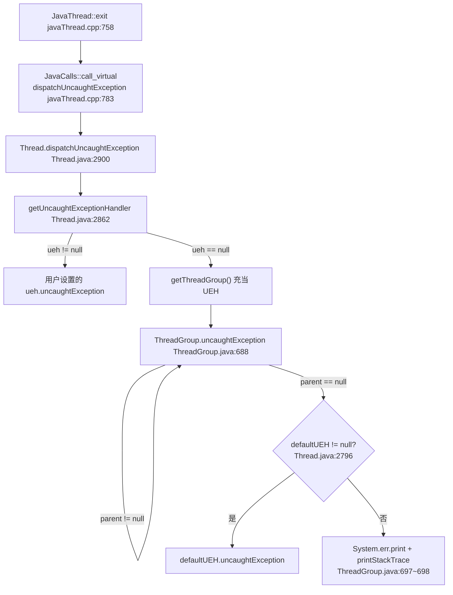
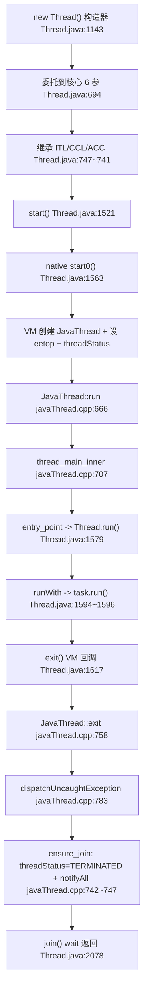
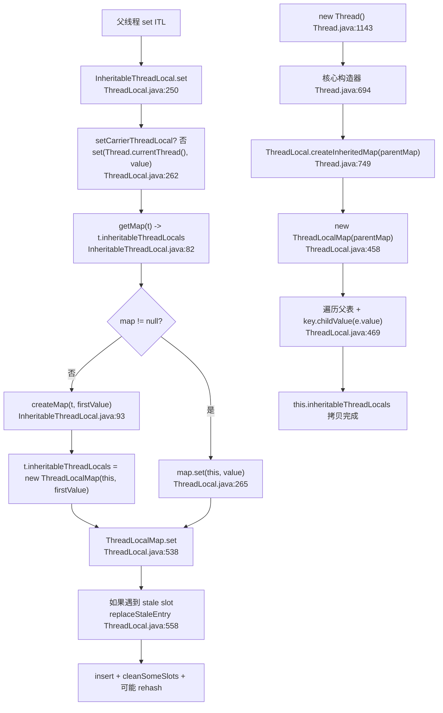
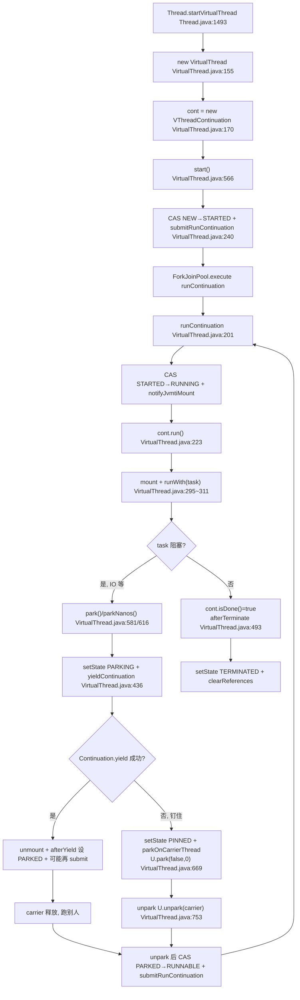
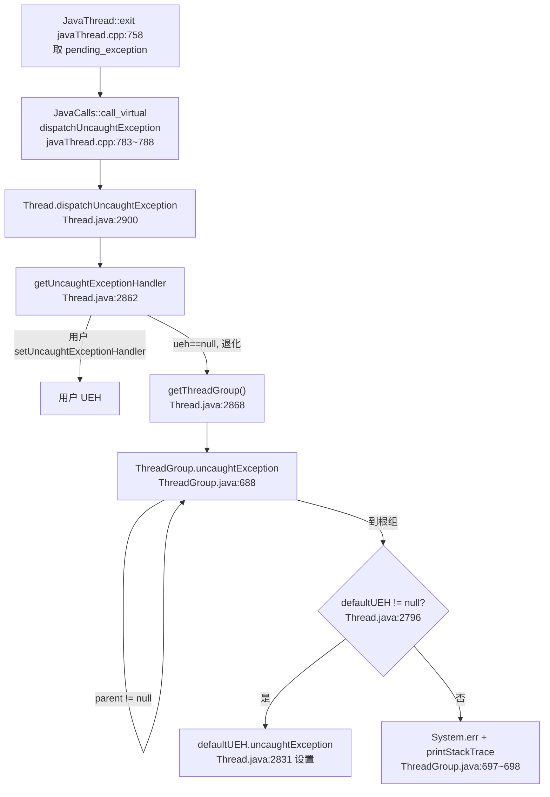
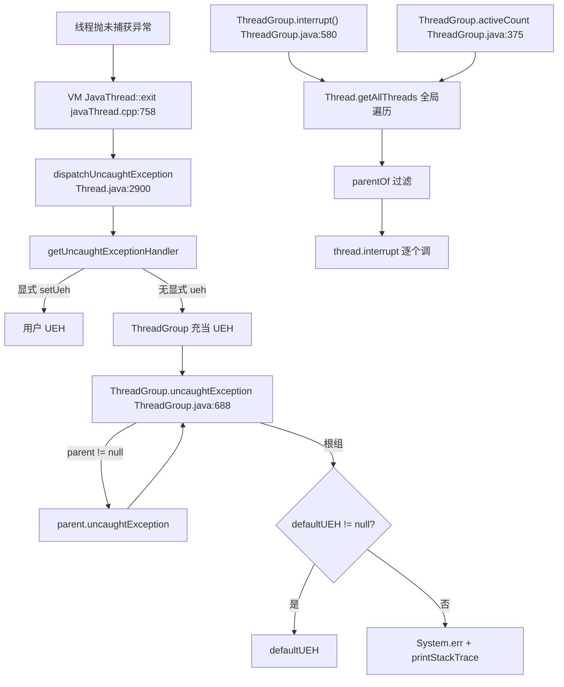
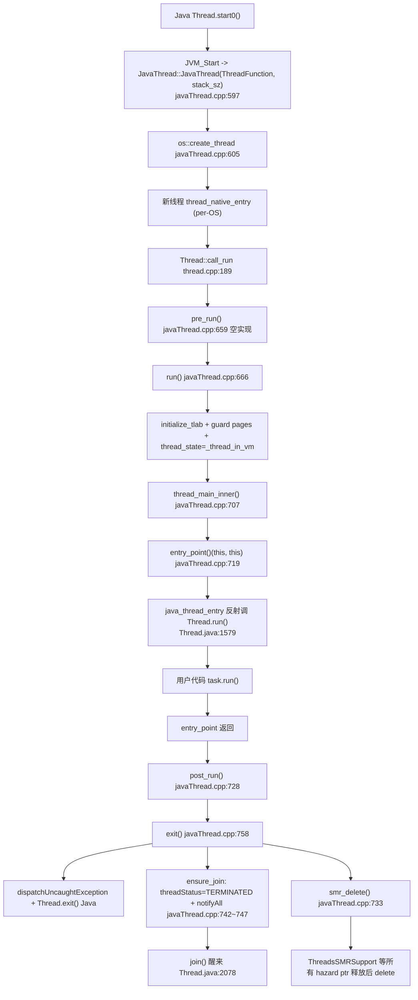

> 基于对 `src/java.base/share/classes/java/lang/` 下 `Thread.java`、`ThreadGroup.java`、`ThreadLocal.java`、`VirtualThread.java`、`InheritableThreadLocal.java`、`Runnable.java`，以及 `src/hotspot/share/runtime/` 下 `thread.{hpp,cpp}`、`javaThread.{hpp,cpp}`、`osThread.hpp`、`safepoint.{hpp,cpp}` 的逐文件精读整理而成。
>
> 阅读顺序即学习顺序：Thread 基础与生命周期 → ThreadLocal 与继承 → 虚拟线程 VirtualThread → ThreadGroup 与未捕获异常 → HotSpot 线程实现概览 → 端到端演算。
>
> 所有结论均标注了源文件位置（格式 `相对路径:行号`），建议对照代码阅读。行号均经 `Read`/`Grep` 实际核对。
>
> **版本基线**：OpenJDK **21 GA**（`jdk-21-ga` 标签）。
> **精确 commit**：`890adb6410dab4606a4f26a942aed02fb2f55387`，commit 时间 `2023-08-09 20:19:41 +0000`。
>
> **关于本仓库 HotSpot 部分的说明**：本仓库 `src/hotspot/share/` 仅保留 `classfile/`、`gc/`、`memory/`、`prims/`、`runtime/` 五个子目录，`utilities/globalDefinitions.hpp` 等"工具头文件"未包含。`JavaThreadState` 枚举（含 `_thread_new`、`_thread_in_vm`、`_thread_in_Java`、`_thread_blocked`、`_thread_in_native`）的实际定义位于 `utilities/globalDefinitions.hpp`，本文中所有相关行号均以 `javaThread.hpp:244` 的字段声明和 `javaThread.cpp` 的使用点为准，未直接引用缺失的枚举文件。

---

## 目录

- [〇、全景地图](#〇全景地图)
- [速览：各讲做了什么（先看这个再进细节）](#速览各讲做了什么先看这个再进细节)
- [面试速通：Java 线程高频问题一页纸](#面试速通java-线程高频问题一页纸)
- [第一讲：Thread 基础与生命周期 —— Thread.java](#第一讲thread-基础与生命周期--threadjava)
- [第二讲：ThreadLocal 与继承 —— ThreadLocal / InheritableThreadLocal](#第二讲threadlocal-与继承--threadlocal--inheritablethreadlocal)
- [第三讲：虚拟线程 VirtualThread —— VirtualThread.java](#第三讲虚拟线程-virtualthread--virtualthreadjava)
- [第四讲：ThreadGroup 与未捕获异常 —— ThreadGroup.java](#第四讲threadgroup-与未捕获异常--threadgroupjava)
- [第五讲：HotSpot 线程实现概览 —— thread.{hpp,cpp} / javaThread.{hpp,cpp} / osThread.hpp](#第五讲hotspot-线程实现概览--threadhppcpp--javathreadhppcpp--osthreadhpp)
- [端到端演算](#端到端演算)
- [附：学习路线与复习卡汇总](#附学习路线与复习卡汇总)
- [涉及文件索引](#涉及文件索引)

---

## 〇、全景地图

JDK 21 的线程体系可以压缩成两层：**Java 层**（`java.lang.Thread`、`VirtualThread`、`ThreadLocal`、`ThreadGroup`）和 **HotSpot 层**（`Thread` C++ 基类、`JavaThread`、`OSThread`、`SafepointSynchronize`、`ThreadsSMRSupport`）。两层之间靠 `native` 方法（`start0`、`interrupt0`、`yield0`、`sleep0`、`setPriority0` 等）和 `eetop` 字段（`Thread.java:234`，JVM 内部 `JavaThread*` 地址）打通。

最大的形态变化是 JDK 21 把"平台线程"和"虚拟线程"统一在 `Thread` 类下：`Thread.isVirtual()`（`Thread.java:1508`）通过 `this instanceof BaseVirtualThread` 判断，平台线程的"重型字段"（group、stackSize、priority、daemon、threadStatus）被收进 `Thread.FieldHolder`（`Thread.java:254`），虚拟线程则在 `VirtualThread` 内部用 `state`/`parkPermit`/`carrierThread`/`continuation` 四个字段管理状态。

```
┌──────────────── Java 层 (src/java.base/share/classes/java/lang) ────────────────┐
│                                                                                  │
│  Thread (Thread.java:219, implements Runnable)                                   │
│   ├── 平台线程分支: FieldHolder 持 group/task/stackSize/priority/daemon/status    │
│   │      (Thread.java:254~275)                                                   │
│   │      eetop (Thread.java:234) = JVM JavaThread* 地址，!=0 即 isAlive          │
│   │      构造器家族 (Thread.java:1143~1480) → 全部委托给 (Thread.java:694)       │
│   │      start() (Thread.java:1521) 检查 threadStatus==0 后 native start0()       │
│   │      run()  (Thread.java:1579) 取 holder.task.run()                          │
│   │                                                                              │
│   └── 虚拟线程分支: BaseVirtualThread → VirtualThread (VirtualThread.java:70)    │
│          scheduler (ForkJoinPool) + cont (Continuation) + state (volatile int)   │
│          park()/parkNanos()/unpark()/tryYield() 全部走 yieldContinuation()       │
│          Thread.startVirtualThread() (Thread.java:1493) 一键创建并 start()        │
│                                                                                  │
│  ThreadLocal<T> (ThreadLocal.java:81)                                            │
│   ├── threadLocalHashCode: 0x61c88647 黄金增量 (ThreadLocal.java:108)             │
│   ├── ThreadLocalMap (ThreadLocal.java:371): 线性探测 + 2/3 负载因子              │
│   │   └── Entry extends WeakReference<ThreadLocal<?>> (ThreadLocal.java:381)     │
│   │       value 字段是强引用 → 内存泄漏的根源                                    │
│   ├── get/set/remove (ThreadLocal.java:171/250/282) → 操作 Thread.threadLocals  │
│   └── InheritableThreadLocal (InheritableThreadLocal.java:54)                    │
│       重写 getMap/createMap/childValue，写入 Thread.inheritableThreadLocals     │
│                                                                                  │
│  ThreadGroup (ThreadGroup.java:77, implements UncaughtExceptionHandler)          │
│   ├── 树形父子结构 (ThreadGroup.java:84~95): parent/strong groups/weak weaks     │
│   ├── JDK 21 已大幅简化: activeCount/enumerate/interrupt 全走 Thread.getAllThreads│
│   └── uncaughtException (ThreadGroup.java:688) 链: parent → defaultUEH → stderr │
└────────────────────────────────────────────────────────────────────────────────────┘
                                       │
                                       │ native start0()/interrupt0()/yield0()/sleep0()
                                       ▼
┌──────────────── HotSpot 层 (src/hotspot/share/runtime) ──────────────────────────┐
│  Thread (thread.hpp:107, abstract)                                               │
│   ├── _osthread (thread.hpp:515) → OSThread (osThread.hpp:65)                   │
│   ├── Thread::call_run() (thread.cpp:189): pre_run → run → post_run 统一入口     │
│   ├── SMR 字段 (thread.hpp:171~172): _threads_hazard_ptr, _threads_list_ptr     │
│   │   配合 ThreadsListHandle 实现"无锁读 JavaThread 列表 + 安全回收"             │
│   └── Thread::start(Thread*) (thread.hpp:356) 通知 OS 唤醒新线程                 │
│                                                                                  │
│  JavaThread (javaThread.hpp:78, extends Thread)                                  │
│   ├── _thread_state (javaThread.hpp:244, JavaThreadState): _thread_new/_in_vm/   │
│   │   _in_Java/_blocked/_in_native，由 VM toThreadState 映射回 java.lang.Thread.State│
│   ├── JavaThread(ThreadFunction, size_t) (javaThread.cpp:597): 调                 │
│   │   os::create_thread(this, thr_type, stack_sz) (javaThread.cpp:605)           │
│   ├── run() (javaThread.cpp:666): initialize_tlab + guard pages + thread_main_inner│
│   ├── thread_main_inner() (javaThread.cpp:707): 调 entry_point()(this, this)     │
│   ├── exit() (javaThread.cpp:758): dispatchUncaughtException + Thread.exit() +    │
│   │   ensure_join (javaThread.cpp:736): set_thread_status(TERMINATED)+notify_all   │
│   └── start_internal_daemon (javaThread.cpp:2119): Threads::add + Thread::start  │
│                                                                                  │
│  OSThread (osThread.hpp:65)                                                       │
│   └── _state (osThread.hpp:69, ThreadState enum): ALLOCATED/INITIALIZED/RUNNABLE │
│       /MONITOR_WAIT/CONDVAR_WAIT/OBJECT_WAIT/SLEEPING/ZOMBIE (osThread.hpp:51~61)│
│                                                                                  │
│  SafepointSynchronize (safepoint.hpp:96) + ThreadSafepointState (safepoint.hpp:196)│
│   └── 全局 safepoint 状态机 + 每线程 safepoint 状态（polling page + _wait_barrier）│
└────────────────────────────────────────────────────────────────────────────────────┘
```

渲染友好版（GitHub/GitLab 直接出图，信息同上图）：

```mermaid
flowchart TD
    subgraph JAVA["Java 层 java.lang"]
        T["Thread.java:219<br/>eetop/FieldHolder/native start0"]
        VT["VirtualThread.java:70<br/>scheduler/cont/state/parkPermit"]
        TL["ThreadLocal.java:81<br/>ThreadLocalMap+WeakRef Entry"]
        ITL["InheritableThreadLocal.java:54<br/>childValue+getMap"]
        TG["ThreadGroup.java:77<br/>树形+uncaughtException 链"]
        T --> VT
        T --> TG
        TL --> ITL
    end
    subgraph NATIVE["native 桥"]
        N1["start0 Thread.java:1563"]
        N2["interrupt0 Thread.java:1728"]
        N3["yield0/sleep0 Thread.java:449/516"]
    subgraph HOTSPOT["HotSpot 层 src/hotspot/share/runtime"]
        HTH["Thread (abstract) thread.hpp:107<br/>call_run thread.cpp:189 + SMR"]
        HJT["JavaThread javaThread.hpp:78<br/>_thread_state + entry_point"]
        HOS["OSThread osThread.hpp:65<br/>_state: ThreadState enum"]
        HSFP["SafepointSynchronize safepoint.hpp:96<br/>+ ThreadSafepointState"]
        HTH --> HJT
        HJT --> HOS
        HJT --> HSFP
    end
    T --> N1 --> HJT
    T --> N2 --> HJT
    VT -->|"submitRunContinuation<br/>VirtualThread.java:240"| FJP["ForkJoinPool DEFAULT_SCHEDULER<br/>VirtualThread.java:73"]
    FJP --> HJT
```

三条主线：

- **创建流**：`new Thread()` → `Thread(...)`（`Thread.java:694`，继承 ITL/CCL）→ `start()`（`Thread.java:1521`）→ `start0()`（`Thread.java:1563`）→ `JVM_Start` → `JavaThread(ThreadFunction, stack_sz)`（`javaThread.cpp:597`）→ `os::create_thread`（`javaThread.cpp:605`）→ OS 线程起来跑 `thread_main_inner`（`javaThread.cpp:707`）。
- **调度流**：平台线程靠 OS 调度（`OSThread._state` 只是状态提示，`osThread.hpp:69`），虚拟线程靠 `ForkJoinPool` 工作窃取（`VirtualThread.DEFAULT_SCHEDULER`，`VirtualThread.java:73`），parking 时 `Continuation.yield` 把栈帧拷出来，carrier 线程立刻接别的虚拟线程。
- **销毁流**：`entry_point` 返回 → `JavaThread::exit`（`javaThread.cpp:758`）调 `dispatchUncaughtException` + `Thread.exit()` Java 方法 → `ensure_join`（`javaThread.cpp:736`）把 `java.lang.Thread.threadStatus` 置 `TERMINATED` 并 `notify_all`（让 `Thread.join()` 的 `wait(0)` 醒来）→ `post_run`（`javaThread.cpp:728`）→ `smr_delete()` 安全释放。

---

## 速览：各讲做了什么（先看这个再进细节）

| 讲次 | 一句话定位 | 关键文件 | 最该记住的 1 件事 |
| --- | --- | --- | --- |
| 第一讲 | `Thread` 是个"一次性启动 + 协作式中断 + 6 态状态机"的 Java 类 | `Thread.java` | `start()` 只能调一次（`Thread.java:1524`），`run()` 是普通 Java 方法，`stop/suspend/resume` 全部 `throw UnsupportedOperationException`（`Thread.java:1667`/`1826`/`1843`） |
| 第二讲 | `ThreadLocal` 是"挂在 `Thread` 上的、用 `ThreadLocal` 自身当 key 的、线性探测哈希表" | `ThreadLocal.java`、`InheritableThreadLocal.java` | `Entry` 的 key 是 `WeakReference` 但 value 是强引用，key 被回收后 value 仍可能泄漏（`ThreadLocal.java:381`）；`ThreadLocalMap` 不用 `ReferenceQueue`，靠 `set`/`getEntryAfterMiss`/`cleanSomeSlots` 被动清理（`ThreadLocal.java:516`/`729`） |
| 第三讲 | `VirtualThread` 是"用户态线程 + continuation + ForkJoinPool carrier" | `VirtualThread.java` | park 时调 `yieldContinuation()`（`VirtualThread.java:436`）→ `Continuation.yield(VTHREAD_SCOPE)` 把栈拷出去；如果当时持有 `synchronized` 监视器或处于 native/IO 钉住点，yield 失败退化为 `PINNED` 状态（`VirtualThread.java:118`），carrier 不释放 |
| 第四讲 | `ThreadGroup` 在 JDK 21 已被大幅简化成"逻辑分组 + 未捕获异常链" | `ThreadGroup.java` | `activeCount`/`enumerate`/`interrupt` 全部不再走子表递归，而是 `Thread.getAllThreads()` 全局遍历后用 `parentOf` 过滤（`ThreadGroup.java:375`/`442`/`580`）；`destroy` 已变空方法（`ThreadGroup.java:622`） |
| 第五讲 | HotSpot 用 `Thread` 抽象基类 + `JavaThread`/`NonJavaThread` 二分，靠 SMR 安全回收 | `thread.hpp`/`thread.cpp`、`javaThread.hpp`/`javaThread.cpp`、`osThread.hpp` | 新线程入口统一是 `Thread::call_run()`（`thread.cpp:189`），它依次调 `pre_run()`→`run()`→`post_run()`；`JavaThread::run()`（`javaThread.cpp:666`）专门多一层 `thread_main_inner()` 是为了"算栈底位置"，栈帧布局保平安 |

```mermaid
flowchart LR
    subgraph CREATE["创建流"]
        C1["new Thread() Thread.java:1143"] --> C2["FieldHolder 填字段 Thread.java:254"]
        C2 --> C3["继承 ITL 父表 Thread.java:747"]
        C3 --> C4["start() Thread.java:1521"]
        C4 --> C5["start0 native Thread.java:1563"]
    end
    subgraph SCHED["调度流"]
        S1["平台: OS 调度<br/>OSThread._state osThread.hpp:69"] --> S2["JavaThread::run javaThread.cpp:666"]
        S2 --> S3["thread_main_inner javaThread.cpp:707"]
        S3 --> S4["entry_point() javaThread.cpp:719"]
        V1["虚拟: ForkJoinPool VirtualThread.java:73"] --> V2["runContinuation VirtualThread.java:201"]
        V2 --> V3["cont.run VirtualThread.java:223"]
        V3 --> V4["park 时 yieldContinuation VirtualThread.java:436"]
        V4 --> V5["carrier 接别人 VirtualThread.java:240"]
    end
    subgraph DESTROY["销毁流"]
        D1["entry_point 返回"] --> D2["JavaThread::exit javaThread.cpp:758"]
        D2 --> D3["dispatchUncaughtException javaThread.cpp:783"]
        D3 --> D4["ensure_join javaThread.cpp:736 set TERMINATED+notify_all"]
        D4 --> D5["post_run javaThread.cpp:728"]
        D5 --> D6["smr_delete 安全回收 thread.cpp:270"]
    end
    C5 --> S1
    C5 --> V1
    S4 --> D1
    V3 --> D1
```



---

## 面试速通：Java 线程高频问题一页纸

> **用法**：先扫一遍下表的一句话结论，被面试官追问再按"深入"列回对应讲次深挖。本章结论全部提炼自各讲小结的"三个最值得记住的点"与文末复习卡，未引入文档之外的知识点；回答时先报结论，再按"深入"列展开机制。
>
> 锁（`synchronized` monitor、`ReentrantLock`/AQS）与 JUC 并发工具（线程池参数、并发容器）不在本笔记范围，见 `java-lock.md` / `java-concurrent.md`。

### 高频 Q&A（先结论）

| # | 面试问题 | 一句话结论 | 深入 |
| --- | --- | --- | --- |
| 1 | `Thread` 有哪几种状态？怎么流转？ | JVM 只暴露 6 态：`NEW`/`RUNNABLE`/`BLOCKED`/`WAITING`/`TIMED_WAITING`/`TERMINATED`。`getState()` 是把 VM 写入的 int `threadStatus` 经 `VM.toThreadState` 解码出来的；`RUNNABLE` 含"等 CPU"，是 VM 状态而非 OS 线程状态 | 第一讲、复习卡 1 |
| 2 | `sleep()` 和 `wait()` 的区别？ | `sleep` 是 `Thread` 静态方法，睡够自己醒，且**不释放 monitor 所有权**；`wait` 是对象锁上的等待（无参进 `WAITING`、带参进 `TIMED_WAITING`），必须被 `notify`/`notifyAll`/`interrupt` 唤醒 | 第一讲、复习卡 1 |
| 3 | `start()` 和 `run()` 的区别？直接调 `run()` 行不行？ | `run()` 是普通 Java 方法，VM 在 `thread_main_inner` 里经 `entry_point` 反射调它；直接 `t.run()` 只是同步调用、不启动新线程。`start()` 一次性，重复调抛 `IllegalThreadStateException` | 第一讲 |
| 4 | 为什么 `stop()` 被废弃？怎么安全停线程？ | `stop` 强制解锁所有 monitor，会让受保护对象进入不一致状态；JDK 21 连兼容路径都删了，`stop`/`suspend`/`resume`/`countStackFrames` 直接抛 `UnsupportedOperationException`。唯一安全方式：`interrupt` + 线程代码协作式退出 | 第一讲 |
| 5 | `interrupt()` 是强制中断吗？ | 不是。协作式：只设 `interrupted=true` 标志 + native `interrupt0()` 通知 VM；只有线程处于 `wait`/`sleep`/`join`/`park` 等可中断点时才会抛 `InterruptedException` 并清标志。静态 `interrupted()` 清标志、实例 `isInterrupted()` 不清 | 第一讲 |
| 6 | `join()` 的实现原理？ | 平台线程 = `synchronized(this){ while(isAlive()) wait(0); }`，靠目标线程退出路径 `ensure_join` 的 `notify_all` 唤醒；虚拟线程不用锁，走 `CountDownLatch.await`。`isAlive()` 的物理含义是 `eetop != 0` | 第一讲、第三讲、第五讲 |
| 7 | 守护线程（daemon）是什么？ | `daemon` 标志在 `Thread` 构造时从父线程继承（核心构造器流程之一）；`ThreadGroup` 自带的 `daemon` 字段在 JDK 21 已废弃（`forRemoval=true`），不是答题重点 | 第一讲、第四讲 |
| 8 | `ThreadLocal` 的实现原理？ | 每个 `Thread` 挂一个 `ThreadLocalMap`，以 `ThreadLocal` 实例自身当 key（`0x61c88647` 黄金增量散列），线性探测 + 2/3 负载因子的轻量哈希表 | 第二讲 |
| 9 | `ThreadLocal` 为什么会内存泄漏？ | `Entry` 是弱 key + 强 value 的不对称设计：key 被回收后 value 仍强引用着对象；且不用 `ReferenceQueue`，只能靠 `get`/`set` 的 `expungeStaleEntry`/`cleanSomeSlots` 被动清理。线程池 worker 不退出是高发地；唯一预防是 `try-finally` 里 `remove()` | 第二讲、复习卡 2 |
| 10 | `InheritableThreadLocal` 什么时候失效？ | 只在 `new Thread()` 构造器里拷贝父表；线程池 worker 预先创建、提交 `Runnable` 不走构造器，所以默认不传值——需 `TransmittableThreadLocal` 或 `ScopedValue` | 第二讲 |
| 11 | 虚拟线程和平台线程的区别？ | 平台线程与 OS 线程一对一、靠 OS 调度；虚拟线程是 `Continuation` 包装的用户态执行流，由 ForkJoinPool carrier 工作窃取调度，阻塞时 `Continuation.yield` 把栈帧拷出、carrier 立刻接别的虚拟线程；虚拟线程对象极轻（`holder=null`，可到百万级） | 第三讲 |
| 12 | 虚拟线程为什么怕 `synchronized`？ | park 时 `Continuation.yield` 遇到 `synchronized` 监视器、native 帧或 JNI 临界区会失败，退化为 `PINNED`：carrier 原地 `U.park` 不释放，吞吐退化到平台线程水平。规避：`ReentrantLock` 替代 `synchronized`、`Selector` 非阻塞 IO | 第三讲 |
| 13 | 虚拟线程能像平台线程一样池化复用吗？ | 不能。`start()` 一次性是平台/虚拟共享契约（虚拟线程用 CAS `NEW→STARTED` 做同样检查），`TERMINATED` 是终态；正确用法是每任务新建一个 | 第一讲、第三讲 |
| 14 | `getState()` 对虚拟线程暴露什么？ | 虚拟线程内部 9 态全部映射回 6 态，`PARKED`/`PINNED` 都只显示 `WAITING`，钉住看不出来；要靠 JFR `VirtualThreadPinnedEvent` 或 `-Djdk.tracePinnedThreads` 才能观测 | 第三讲 |
| 15 | JDK 21 的 `ThreadGroup` 还有什么用？未捕获异常怎么派发？ | 已退化为"逻辑分组 + 未捕获异常派发链"：不再持有 `Thread[]`，`activeCount`/`enumerate`/`interrupt` 全走 `Thread.getAllThreads()` 全局快照 + `parentOf` 过滤，`destroy()` 是空方法靠 GC；异常沿"用户 UEH → `ThreadGroup.uncaughtException` 递归到根组 → `defaultUEH` → `System.err`"派发 | 第四讲、复习卡 4 |
| 16 | 线程池核心参数怎么设？ | 不在本笔记范围（见 `java-concurrent.md`）。本笔记只覆盖两个关联点：worker 永不退出是 `ThreadLocal` 泄漏高发地；`InheritableThreadLocal` 在线程池默认不生效 | java-concurrent.md、第二讲 |

### 易错点与面试坑

- **`interrupt` 只是设标志位**：`interrupt()` 本身不停任何线程，只置 `interrupted=true` 并通知 VM；停不停、何时停由目标线程自己在可中断点决定。连"线程已终结"的场景 JDK 也会记录请求，后续 `isInterrupted()` 仍可能返回 true。
- **`sleep` 不释放锁，`wait` 让出锁**：`sleep` 不释放 monitor 所有权（`Thread` 源码注释原话）；`wait` 进入对象等待队列让出锁，被唤醒后还要重新竞争锁。这对区别最容易被答反。
- **`ThreadLocal` 的 key/value 回收不对称**：key 是弱引用、value 是强引用，key 被 GC 后 value 仍挂在活着的 `Thread` 上；`ThreadLocalMap` 不用 `ReferenceQueue`、没有后台线程清理。两个极端都别走：不是"必泄漏"（线程退出时 `Thread.exit()` 会整体清零），也不是"高枕无忧"（线程池 worker 永不退出才是高发地）。
- **`InheritableThreadLocal` 不是万能的**：只在 `new Thread()` 构造时拷贝；线程池里 worker 早就建好，`execute` 不再触发构造器，值传不进去。
- **虚拟线程不能池化**：`start()` 只能调一次（CAS `NEW→STARTED`），`TERMINATED` 后不能重跑，没有"用完还回去"的余地；每个任务新建一个才是设计意图。
- **`Thread.State` 对虚拟线程只暴露 `WAITING`**：`PARKED` 和 `PINNED` 都映射为 `WAITING`，`getState()` 看不出 carrier 被钉住；"上了 `synchronized` 好像没事"可能是假象，要开 JFR `VirtualThreadPinnedEvent` 或 `-Djdk.tracePinnedThreads` 才能看到。
- **`synchronized` 钉住 carrier 是吞吐杀手**：yield 失败时 carrier 原地 `U.park`，一个 carrier 被钉住就少一个工位；面试中说"用 `ReentrantLock`/`Selector` 规避"时，要能讲出 `PINNED` 这条退化路径。
- **别按老八股答 `ThreadGroup`**：JDK 21 起它不维护 `Thread[]`、`destroy()` 是空方法、批量中断靠全局快照 + `parentOf` 过滤；剩余价值只有优先级约束和未捕获异常派发链。

### 关键概念对照表

**① 等待 / 让出 CPU 的各种方式**：

| 方式 | 进入的状态 | 与锁的关系 | 如何结束 |
| --- | --- | --- | --- |
| `sleep(ms)` | `TIMED_WAITING` | 不释放 monitor 所有权 | 睡满自动醒；`interrupt` 抛 `InterruptedException`；虚拟线程内部转为 `parkNanos` |
| `wait()` / `wait(long)` | `WAITING` / `TIMED_WAITING` | 对象 monitor 等待队列，让出锁 | `notify`/`notifyAll`/`interrupt` 唤醒，醒来后重新竞争锁 |
| `join()` / `join(ms)` | `WAITING` / `TIMED_WAITING` | 平台线程：`synchronized(this)` 上 `wait(0)`；虚拟线程：`CountDownLatch.await` | 目标线程 exit 时 `notify_all` / `countDown` |
| `park` / `parkNanos` / `parkUntil` | `WAITING` / `TIMED_WAITING` | 不涉及 monitor | `unpark` 或 `interrupt`；虚拟线程的 park 有 `parkPermit` 快路径 |
| `yield()` | 不变（仍 `RUNNABLE`） | 不动锁 | 只是提示，调度器可忽略；虚拟线程走 `tryYield()` |

**② 平台线程 vs 虚拟线程**：

| 维度 | 平台线程 | 虚拟线程 |
| --- | --- | --- |
| 调度者 | OS 内核调度 | ForkJoinPool carrier 工作窃取（`DEFAULT_SCHEDULER`） |
| 阻塞时 | OS 线程本身阻塞 | `Continuation.yield` 把栈帧拷出 continuation，carrier 立刻接别人 |
| 阻塞失败时 | —— | yield 失败退化为 `PINNED`，carrier 原地 `U.park` 不释放 |
| 对外状态 | `Thread.State` 6 态 | 内部 9 态；`PARKED`/`PINNED` 对外只显示 `WAITING` |
| 对象重量 | `FieldHolder` 持 group/task/stackSize/priority/daemon/threadStatus | `holder=null`，极轻量，可到百万级 |
| `join` 实现 | `synchronized(this)` + `wait(0)` + `notify_all` | `CountDownLatch.await` + `countDown` |
| 启动契约 | `start()` 一次性 | 同样一次性（CAS `NEW→STARTED`），不可池化复用 |

**③ interrupt 家族语义**：

| API | 语义 |
| --- | --- |
| `interrupt()` | 协作式：置 `interrupted=true` + native `interrupt0()` 通知 VM，不强制停线程 |
| `isInterrupted()` | 实例方法，读标志，**不清除** |
| `interrupted()` | 静态方法，读标志**并清除** |
| 在 `wait`/`sleep`/`join`/`park` 中 | 被唤醒并抛 `InterruptedException`，同时清除标志 |
| NIO 场景 | `nioBlocker != null` 时经 `Interruptible` 关闭 channel，抛 `ClosedByInterruptException` |

**④ `Thread` 关键字段速记**（答"线程对象本身存了什么"用）：

| 字段 | 一句话 |
| --- | --- |
| `eetop` | JVM 专属，存底层 `JavaThread*` 地址；非 0 即 `isAlive()`，VM 在启动时写入、退出时清零 |
| `holder`（`FieldHolder`） | 平台线程独有，收着 group/task/stackSize/priority/daemon/threadStatus；虚拟线程为 `null` |
| `threadStatus` | int 编码的 6 态，由 VM 写入，`VM.toThreadState` 解码成 `Thread.State` |
| `interrupted` | 中断标志，`interrupt`/`isInterrupted`/`interrupted` 都围绕它 |
| `threadLocals` | `ThreadLocalMap`，由 `ThreadLocal` 维护；线程退出时整体清零 |
| `inheritableThreadLocals` | ITL 专表，只在 `new Thread()` 构造时从父表拷贝 |

**⑤ 一条线程的一生经过哪几道门**（HotSpot 侧，答"启动/终止底层流程"用）：

1. `start0()`（native）→ `JVM_Start` 创建 `JavaThread` 并调 `os::create_thread` —— 新 OS 线程先**挂起**，等 `Thread::start` 才唤醒。
2. 唤醒后统一入口是 `Thread::call_run()` 的 `pre_run → run → post_run` 三段式，`JavaThread` 多一层 `thread_main_inner` 是为了算栈底位置（保护页边界判断）。
3. `run` 经 `entry_point` 反射调回 Java 层 `Thread.run()`，用户 task 开始执行。
4. 收尾走 `exit`：派发未捕获异常 → `ensure_join` 置 `TERMINATED` 并 `notify_all`（唤醒 `join`）→ `smr_delete` 等 hazard pointer 释放后安全回收。

---

## 第一讲：Thread 基础与生命周期 —— Thread.java

### 先说人话：本讲每个阶段在干什么

把 `Thread.java` 想象成"一个工厂招聘工人"的全流程：先填入职表（构造器）→ 拿号牌开工（`start` 一次性的）→ 干活节奏由 `run` 定义 → 工人困了睡、饿了让（`sleep`/`yield`）→ 老板喊停就停（`interrupt` 协作式）→ 工人下班（`exit`/`TERMINATED`）→ 别人等他收工（`join`）。

| 阶段 | 干了什么 | 为什么 |
| --- | --- | --- |
| 构造 | 8 个 public 构造器 + 1 个包级"5 参" + 1 个虚拟线程构造器，全部委托给 `Thread(ThreadGroup, String, int, Runnable, long, AccessControlContext)`（`Thread.java:694`） | 统一入口便于维护，平台/虚拟分支差异在内部按 `attached`/`bound` 判定 |
| 字段布局 | 平台线程的重字段塞进 `FieldHolder`（`Thread.java:254`），虚拟线程 `holder=null` | 把"用不到的字段"从 `Thread` 主对象剥离，节省内存（百万虚拟线程才有可能） |
| 启动 | `start()` 检查 `holder.threadStatus==0` 后调 `native start0()`（`Thread.java:1521`/`1563`） | JVM 通过 `start0` 拿到 Java 层的 `Thread` 对象、创建 `JavaThread` 并 publish 到 `eetop` |
| 运行 | `run()`（`Thread.java:1579`）只是 Java 层入口，平台线程调 `holder.task.run()`，虚拟线程此方法是空（`VirtualThread.java:571`） | 子类可重写 `run()`；真正调用 `run()` 的地方在 HotSpot `JavaThread::thread_main_inner`（`javaThread.cpp:707`）通过 `entry_point` 反射调过来 |
| 状态机 | `State` 枚举 6 个值（`Thread.java:2664`） | 把 OS 的多状态压缩成 6 类供监控用；实际由 `holder.threadStatus` 经 `VM.toThreadState` 转换 |
| 中断 | `interrupt()` 设 `interrupted=true` 后调 `interrupt0()`（`Thread.java:1727`~`1728`） | 协作式：不强制停线程，只是设标志；`wait/sleep/join/park` 收到后会抛 `InterruptedException` 或返回 |
| 等待 | `join(long)` 平台线程走 `synchronized(this){ while(isAlive()) wait(0); }`（`Thread.java:2066`~`2080`） | 依赖 `exit` 路径里的 `notifyAll`（`javaThread.cpp:747`）；虚拟线程走 `CountDownLatch.await`（`VirtualThread.java:834`） |
| 终止 | `exit()`（`Thread.java:1617`）由 VM 调，清理 threadLocals/ITL/ACC/handler；`clearReferences()`（`Thread.java:1603`）置 null | 防止 ClassLoader 泄漏；`stop()` 已废弃并抛 `UnsupportedOperationException`（`Thread.java:1665`~`1668`） |

**本讲主线**：`Thread` 是一个"用 `eetop` 钉住底层 `JavaThread*`、用 `holder.threadStatus` 表达 6 态、用 `interrupted` 表达中断信号、用 `synchronized(this)+wait/notifyAll` 实现 `join`"的轻量 Java 对象，真正的线程逻辑在 HotSpot 那一侧。

### 逐文件精读

#### 1）类声明与字段布局 —— `Thread.java:219`~`Thread.java:399`

`public class Thread implements Runnable`（`Thread.java:219`）。`implements Runnable` 是历史包袱，但解释了为什么 `Thread` 自己有 `run()` 方法。

关键字段（按重要性排）：

| 字段 | 类型 | 位置 | 作用 |
| --- | --- | --- | --- |
| `eetop` | `volatile long` | `Thread.java:234` | JVM 专属字段，持有底层 `JavaThread*` 地址；非 0 即 `isAlive()`。VM 在 `start0` 时设置、在 `exit` 时清零 |
| `tid` | `final long` | `Thread.java:237` | 线程 ID，由 `ThreadIdentifiers.next()` 分配（`Thread.java:734`），用 `Unsafe.getAndAddLong` 原子自增（`Thread.java:662`） |
| `name` | `volatile String` | `Thread.java:240` | 线程名；平台线程默认 `Thread-N`（`Thread.java:1117`~`1118`），虚拟线程默认 `""`（`VirtualThread.java` 构造器） |
| `interrupted` | `volatile boolean` | `Thread.java:243` | 中断标志，VM 也读写；`interrupt()`/`isInterrupted()`/`interrupted()` 都围绕它 |
| `holder` | `final FieldHolder` | `Thread.java:275` | 平台线程独有，虚拟线程为 `null`（`VirtualThread.java:799`） |
| `threadLocals` | `ThreadLocal.ThreadLocalMap` | `Thread.java:281` | 普通线程局部变量表，由 `ThreadLocal` 维护 |
| `inheritableThreadLocals` | `ThreadLocal.ThreadLocalMap` | `Thread.java:287` | 可继承线程局部变量表，子线程构造时从此拷贝 |
| `scopedValueBindings` | `Object` | `Thread.java:292` | Scoped value 绑定（JDK 21 新增，用于替代 ITL 的高性能场景） |
| `cont` | `Continuation` | `Thread.java:378` | 当前最内层 continuation，虚拟线程用 |
| `parkBlocker` | `volatile Object` | `Thread.java:342` | `LockSupport.park` 的 blocker 参数，供监控用 |
| `nioBlocker` | `volatile Interruptible` | `Thread.java:348` | NIO 的可中断 IO 操作注册的 blocker |
| `uncaughtExceptionHandler` | `volatile UncaughtExceptionHandler` | `Thread.java:2793` | 实例级处理器，`null` 时退化为 `ThreadGroup` |
| `defaultUncaughtExceptionHandler` | `static volatile UEH` | `Thread.java:2796` | 全局默认处理器，`null` 时 `ThreadGroup.uncaughtException` 打 `System.err` |

`FieldHolder`（`Thread.java:254`~`274`）持有的字段全部是平台线程才有的：`group`、`task`、`stackSize`、`priority`、`daemon`、`threadStatus`。把它从 `Thread` 主类剥离的目的，是让虚拟线程对象可以非常轻量（百万级），同时 VM 仍能通过 `Thread.java` 的固定字段偏移访问 `eetop` 等关键状态。

#### 2）构造器家族 —— `Thread.java:1143`~`Thread.java:1480`

8 个 public 构造器 + 1 个包级（`Thread(Runnable, AccessControlContext)`，`Thread.java:1173`）+ 1 个"5 参带继承开关"（`Thread.java:1475`）全部委托到 `Thread(ThreadGroup g, String name, int characteristics, Runnable task, long stackSize, AccessControlContext acc)`（`Thread.java:694`）这个核心构造器。

委托关系表：

| public 构造器 | 位置 | 委托调用 |
| --- | --- | --- |
| `Thread()` | `Thread.java:1143` | `this(null, null, 0, null, 0, null)` |
| `Thread(Runnable)` | `Thread.java:1164` | `this(null, null, 0, task, 0, null)` |
| `Thread(ThreadGroup, Runnable)` | `Thread.java:1206` | `this(group, null, 0, task, 0, null)` |
| `Thread(String)` | `Thread.java:1223` | `this(null, name, 0, null, 0, null)` |
| `Thread(ThreadGroup, String)` | `Thread.java:1252` | `this(group, name, 0, null, 0, null)` |
| `Thread(Runnable, String)` | `Thread.java:1274` | `this(null, name, 0, task, 0, null)` |
| `Thread(ThreadGroup, Runnable, String)` | `Thread.java:1328` | `this(group, name, 0, task, 0, null)` |
| `Thread(ThreadGroup, Runnable, String, long)` | `Thread.java:1410` | `this(group, name, 0, task, stackSize, null)` |
| `Thread(ThreadGroup, Runnable, String, long, boolean)` | `Thread.java:1475` | 通过 `checkName` + `NO_INHERIT_THREAD_LOCALS` 位标记 |

核心构造器（`Thread.java:694`~`763`）做的事：

1. **拿父线程**：`Thread parent = currentThread();`（`Thread.java:697`），注意 `attached` 是 `parent == this` 的特殊情况（JNI attach 或 main 线程，`Thread.java:698`）。
2. **解析 ThreadGroup**：如果 `g==null` 且有 `SecurityManager`，先问 SM（`Thread.java:710`）；再退化为父线程的 group（`Thread.java:715`）。
3. **权限检查**：SM 不为空时 `sm.checkAccess(g)`，并若子类重写了 `getContextClassLoader`/`setContextClassLoader` 则要 `SUBCLASS_IMPLEMENTATION_PERMISSION`（`Thread.java:720`~`724`）。
4. **优先级裁剪**：`Math.min(parent.getPriority(), g.getMaxPriority())`（`Thread.java:727`）。
5. **daemon 继承**：`parent.isDaemon()`（`Thread.java:728`）。
6. **分配 tid**：`ThreadIdentifiers.next()`（`Thread.java:734`），主线程特例 `tid=1`（`Thread.java:732`）。
7. **继承 ITL**：除非 `characteristics & NO_INHERIT_THREAD_LOCALS`，否则 `ThreadLocal.createInheritedMap(parentMap)`（`Thread.java:749`）。
8. **CCL 继承**：`contextClassLoader(parent)`（`Thread.java:752`），默认直接读父字段；若子类重写 CCL 则调 `getContextClassLoader`（`Thread.java:670`~`678`）。
9. **ACC 捕获**：`AccessController.getContext()`（`Thread.java:741`），把"创建者上下文"作为新线程的 `inheritedAccessControlContext`，限制新线程的权限。

虚拟线程构造器 `Thread(String name, int characteristics, boolean bound)`（`Thread.java:772`）走另一条路：ACC 设为 `Constants.NO_PERMISSIONS_ACC`（`Thread.java:775`），即虚拟线程**不继承权限上下文**（注释见 `Thread.java:182`）；`bound=true` 时才建 `FieldHolder`，绑到 `Constants.VTHREAD_GROUP`（`Thread.java:795`）。`bound=false` 是默认路径，`holder=null`，更轻。

#### 3）`start()` / `start0()` —— 一次性启动 —— `Thread.java:1521`~`Thread.java:1563`

```java
public void start() {
    synchronized (this) {
        // zero status corresponds to state "NEW".
        if (holder.threadStatus != 0)
            throw new IllegalThreadStateException();
        start0();
    }
}
private native void start0();
```

关键点：

- 一次性保证：`synchronized(this)` + 检查 `threadStatus != 0`（`Thread.java:1524`）。一旦 `start0()` 成功，VM 把 `threadStatus` 改为非 0，再调就抛 `IllegalThreadStateException`。
- `start0()` 是 native（`Thread.java:1563`），对应 `JVM_Start`（HotSpot 实现），里面会：分配 `JavaThread` C++ 对象、调 `os::create_thread` 创建 OS 线程、把 `JavaThread*` 写到 `Thread.eetop`、把 threadStatus 改为 RUNNABLE。
- 包级重载 `start(ThreadContainer container)`（`Thread.java:1535`）用于 `StructuredTaskScope` 等容器场景：先 `setThreadContainer(container)`，再 `container.onStart(this)`，最后 `start0()`，失败要回滚 `container.onExit(this)`。

#### 4）`run()` —— 入口方法 —— `Thread.java:1579`~`Thread.java:1585`

```java
@Override
public void run() {
    Runnable task = holder.task;
    if (task != null) {
        Object bindings = scopedValueBindings();
        runWith(bindings, task);
    }
}
```

注意：`run()` 是**普通 Java 方法**，VM 在 `JavaThread::thread_main_inner`（`javaThread.cpp:707`）里通过 `entry_point`（默认是 `java_thread_entry`，反射调 `Thread.run`）来到这里。如果用户继承 `Thread` 重写了 `run()`，就在这里执行用户代码；如果用户传了 `Runnable task`，就调 `task.run()`。

`runWith`（`Thread.java:1594`）被 `@Hidden`+`@ForceInline` 标注，确保 scoped value 的绑定信息在栈上"物化"，便于栈遍历正确识别。`VirtualThread.run()`（`VirtualThread.java:571`）是空方法 —— 因为虚拟线程的 `run` 路径走的是 `VThreadContinuation`，不走 `Thread.run()`。

#### 5）`State` 枚举 —— 6 态状态机 —— `Thread.java:2664`~`Thread.java:2727`

```
NEW          未启动
RUNNABLE     在 JVM 中执行（含 OS 调度等待 CPU）
BLOCKED      等待 monitor 锁（进入 synchronized 块）
WAITING      无限等待（Object.wait 无参、Thread.join 无参、LockSupport.park）
TIMED_WAITING 限时等待（sleep、wait(long)、join(long)、parkNanos、parkUntil）
TERMINATED   已退出
```

注意：

- `getState()`（`Thread.java:2737`）调 `threadState()`（`Thread.java:2746`），后者 `return jdk.internal.misc.VM.toThreadState(holder.threadStatus);` —— **`holder.threadStatus` 是 int 编码**，由 VM 写入，`VM.toThreadState` 解码到枚举。这就是为什么 `Thread.State` 注释里写"These states are virtual machine states which do not reflect any operating system thread states."（`Thread.java:2658`）。
- 虚拟线程重写了 `threadState()`（`VirtualThread.java:887`）：`PARKED`/`PINNED` → `WAITING`，`RUNNING`（已挂载）→ 取 carrier 的状态。

#### 6）`yield` / `sleep` —— 让出 CPU —— `Thread.java:441`~`Thread.java:516`

```java
public static void yield() {
    if (currentThread() instanceof VirtualThread vthread) {
        vthread.tryYield();
    } else {
        yield0();
    }
}
private static native void yield0();
```

- `yield()` 是提示而非保证（`Thread.java:428`），调度器可忽略。
- `sleep(long)`（`Thread.java:498`）的细节：
  1. 负数抛 `IllegalArgumentException`（`Thread.java:500`）。
  2. 转 nanos（`Thread.java:503`），触发 `ThreadSleepEvent`（JFR 事件，`Thread.java:454`）。
  3. 虚拟线程走 `vthread.sleepNanos(nanos)`（`Thread.java:507`，实际内部 `parkNanos`），平台线程走 `native sleep0(nanos)`（`Thread.java:516`）。
  4. `finally` 里 `afterSleep(event)` 提交 JFR 事件（`Thread.java:471`）。
- `sleep` 不释放 monitor 所有权（`Thread.java:485` 注释明确说明）。

#### 7）`interrupt` / `interrupted` / `isInterrupted` —— 协作式中断 —— `Thread.java:1712`~`Thread.java:1787`

```java
public void interrupt() {
    if (this != Thread.currentThread()) {
        checkAccess();
        synchronized (interruptLock) {
            Interruptible b = nioBlocker;
            if (b != null) {
                interrupted = true;
                interrupt0();
                b.interrupt(this);
                return;
            }
        }
    }
    interrupted = true;
    interrupt0();
}
```

三个关键设计：

1. **协作式**：`interrupt()` 只设标志（`Thread.java:1727`）+ 调 `native interrupt0()` 通知 VM；VM 如果发现线程在 `wait`/`sleep`/`park` 等可中断点，会唤醒它并清除标志、抛 `InterruptedException`。注释明确："Interrupting a thread that is not alive need not have any effect."（`Thread.java:1701`）—— 但 JDK 实现仍会记录中断请求，`interrupted()`/`isInterrupted()` 后续会返回 true（`Thread.java:1704`~`1705` implNote）。
2. **NIO 钩子**：若线程正在 NIO 可中断 IO 操作（`nioBlocker != null`），通过 `Interruptible.interrupt(this)`（`Thread.java:1722`）触发 channel 关闭 + `ClosedByInterruptException`。
3. **静态 `interrupted()` 会清标志**（`Thread.java:1744`~`1746`）：`return currentThread().getAndClearInterrupt();`（`Thread.java:1745`）。实例方法 `isInterrupted()` 不清（`Thread.java:1757`~`1759`）。

#### 8）`join` —— 等线程终止 —— `Thread.java:2054`~`Thread.java:2155`

平台线程 `join(long millis)`（`Thread.java:2054`）的实现：

```java
synchronized (this) {
    if (millis > 0) {
        if (isAlive()) {
            final long startTime = System.nanoTime();
            long delay = millis;
            do {
                wait(delay);
            } while (isAlive() && (delay = millis -
                     NANOSECONDS.toMillis(System.nanoTime() - startTime)) > 0);
        }
    } else {
        while (isAlive()) {
            wait(0);
        }
    }
}
```

依赖关系：

- `isAlive()`（`Thread.java:1796`）调 `alive()`（`Thread.java:1804`）→ `eetop != 0`。`eetop` 由 VM 在 `start0` 时设非零、在 `JavaThread::exit`→`ensure_join`（`javaThread.cpp:746`）时清零。
- `notifyAll` 来自 `ensure_join`（`javaThread.cpp:747`）的 `lock.notify_all(thread)`，锁对象就是 `Thread` 实例本身。
- 注释（`Thread.java:2039`~`2041`）警告："It is recommended that applications not use wait, notify, or notifyAll on Thread instances." —— 因为 `Thread` 的 `join` 自己就在用，用户介入容易打乱。
- 虚拟线程走 `vthread.joinNanos(nanos)`（`Thread.java:2061`），用 `CountDownLatch`（`VirtualThread.java:828`）。

#### 9）`stop`/`suspend`/`resume`/`countStackFrames` —— 全废弃 —— `Thread.java:1665`~`Thread.java:2028`

四个 deprecated 方法在 JDK 21 全部直接抛异常：

| 方法 | 位置 | 行为 | 废弃原因（注释） |
| --- | --- | --- | --- |
| `stop()` | `Thread.java:1665`~`1668` | `throw new UnsupportedOperationException()` | 强制解锁所有 monitor，可能让受保护对象进入不一致状态（`Thread.java:1648`~`1652`） |
| `suspend()` | `Thread.java:1824`~`1827` | `throw new UnsupportedOperationException()` | 易死锁：被挂起线程若持有系统关键资源锁，恢复线程又拿不到锁（`Thread.java:1816`~`1819`） |
| `resume()` | `Thread.java:1841`~`1844` | `throw new UnsupportedOperationException()` | 因 `suspend` 废弃而连带废弃 |
| `countStackFrames()` | `Thread.java:2025`~`2028` | `throw new UnsupportedOperationException()` | 依赖 `suspend`，且结果从未良好定义（`Thread.java:2019`~`2022`） |

替代方案：用 `interrupt` + 用户代码主动检查，或用 `Thread.interrupted()` 配合状态变量。

#### 10）未捕获异常处理器 —— `Thread.java:2779`~`Thread.java:2902`

```java
@FunctionalInterface
public interface UncaughtExceptionHandler {
    void uncaughtException(Thread t, Throwable e);
}
```

派发入口：`Thread.dispatchUncaughtException(Throwable e)`（`Thread.java:2900`）由 VM 在 `JavaThread::exit`（`javaThread.cpp:781`~`788`）通过 `JavaCalls::call_virtual` 反射调用。链路：



注意：`Thread.java:2862`~`2870` 的 `getUncaughtExceptionHandler` 在 `isTerminated()` 时返回 `null`（避免线程结束后还能拿到已置空的 handler）；正常情况下，没显式 set ueh 就退化为 `getThreadGroup()`，所以 `ThreadGroup` 默认就是所有平台线程的 UEH。

---

## 第一讲小结：`Thread` 是"轻量 Java 对象 + 重型 VM 钉子"

**一句话定位**：`Thread.java` 用一个轻量 Java 对象（`eetop` + `tid` + `name` + `interrupted` + `holder`/`threadLocals`/`inheritableThreadLocals`）代表一个执行流，平台线程的真正实现在 HotSpot `JavaThread`，虚拟线程的真正实现在 `VirtualThread` + `Continuation`，`Thread` 本身只负责"声明契约 + 协议字段"。



**关键机制的输入/输出**：

| 机制 | 输入 | 输出 | 源码位置 |
| --- | --- | --- | --- |
| 一次性启动 | `holder.threadStatus==0` | `start0()` 唤起 VM | `Thread.java:1521`~`1527` |
| 6 态映射 | `holder.threadStatus` (int) | `Thread.State` (enum) | `Thread.java:2746`~`2748` |
| 协作式中断 | `interrupt()` 调用 | `interrupted=true` + `interrupt0()` 唤醒可中断点 | `Thread.java:1712`~`1729` |
| 静态 vs 实例 | `interrupted()` vs `isInterrupted()` | 前者清标志，后者不清 | `Thread.java:1744`~`1759` |
| join 实现 | `synchronized(this){while(isAlive())wait(0);}` | `exit` 时 `notify_all` 唤醒 | `Thread.java:2066`~`2080` + `javaThread.cpp:747` |
| isAlive | `eetop != 0` | `true` 表示已启动且未终止 | `Thread.java:1804`~`1806` |
| 异常派发 | VM 在 `JavaThread::exit` 反射调 | `dispatchUncaughtException` → UEH/ThreadGroup/default/stderr | `Thread.java:2900` + `javaThread.cpp:783` |

**三个最值得记住的点**：

1. **`start()` 只能调一次**。`Thread.java:1524` 检查 `holder.threadStatus != 0` 后抛 `IllegalThreadStateException`，这是平台线程和虚拟线程共享的契约（虚拟线程在 `VirtualThread.java:536` 也用 CAS `NEW→STARTED` 做同样检查）。重写 `run()` 是允许的，但 `start()` 永远只能调一次。
2. **`Thread.run()` 是普通 Java 方法**。它不是 native，也不是 VM 直调；VM 调用的是 `entry_point()`（`javaThread.cpp:719`），`entry_point` 默认反射调 `Thread.run()`。所以直接 `t.run()` 不启动新线程，只是同步调用。`VirtualThread.run()`（`VirtualThread.java:571`）干脆是空方法 —— 虚拟线程的入口在 `VThreadContinuation` 内部 `wrap` 出来的 Runnable（`VirtualThread.java:188`~`195`）。
3. **`stop`/`suspend`/`resume` 全部直接抛异常**。JDK 21 连"内部仍可用"的兼容路径都删了（`Thread.java:1667`/`1826`/`1843`），唯一安全的"让线程停下"的方式是 `interrupt` + 线程代码主动检查 `Thread.interrupted()` 或捕获 `InterruptedException` 后妥善退出。

---

## 第二讲：ThreadLocal 与继承 —— ThreadLocal / InheritableThreadLocal

### 先说人话：本讲每个阶段在干什么

把 `ThreadLocal` 想象成"每家每户的私人储物柜"：储物柜楼（`ThreadLocalMap`）盖在每户人家（`Thread`）自家后院里，柜号（`ThreadLocal` 实例）是钥匙；`InheritableThreadLocal` 是"父亲柜子里的东西，儿子建新家时按规则复印一份带过去"。

| 阶段 | 干了什么 | 为什么 |
| --- | --- | --- |
| 哈希码 | `threadLocalHashCode` 用 `0x61c88647` 黄金增量累加（`ThreadLocal.java:108`） | 让连续 new 出来的 `ThreadLocal` 在 2 的幂表里天然分散，几乎不冲突 |
| Map 数据结构 | `ThreadLocalMap` 是开放寻址（线性探测）的 hash 表（`ThreadLocal.java:371`），2/3 负载因子（`ThreadLocal.java:416`） | 不用链表是为了省内存；2/3 是历史经验值 |
| Entry 弱 key 强 value | `Entry extends WeakReference<ThreadLocal<?>>`，`value` 字段强引用（`ThreadLocal.java:381`~`388`） | key 弱引用让 `ThreadLocal` 对象本身能被 GC；value 强引用是为了避免用户 `get` 时遇到 key 没了 value 也没了 |
| 不用 ReferenceQueue | 没有 `ReferenceQueue`，stale entry 靠 `set`/`getEntryAfterMiss`/`cleanSomeSlots` 被动清理（`ThreadLocal.java:538`/`516`/`729`） | 简化实现 + 不让后台线程压力变大；代价是 value 可能短期泄漏 |
| 继承 | `InheritableThreadLocal` 重写 `getMap`/`createMap`/`childValue`（`InheritableThreadLocal.java:81`/`92`/`72`） | 让 ITL 走 `Thread.inheritableThreadLocals` 字段；`Thread` 构造时调 `ThreadLocal.createInheritedMap(parentMap)` 拷贝（`Thread.java:749`） |

**本讲主线**：`ThreadLocal` 是一个"哈希码靠黄金增量、数据结构靠线性探测 + 2/3 负载因子、key 弱引用 value 强引用、清理靠被动触发"的轻量哈希表，挂在 `Thread` 上；`InheritableThreadLocal` 通过覆盖 `getMap`/`createMap`/`childValue` 三个钩子实现了"子线程继承 + 子值可变换"的语义。

### 逐文件精读

#### 1）类声明与哈希码 —— `ThreadLocal.java:81`~`ThreadLocal.java:115`

```java
public class ThreadLocal<T> {
    private static final boolean TRACE_VTHREAD_LOCALS = traceVirtualThreadLocals();
    private final int threadLocalHashCode = nextHashCode();

    private static AtomicInteger nextHashCode = new AtomicInteger();
    private static final int HASH_INCREMENT = 0x61c88647;

    private static int nextHashCode() {
        return nextHashCode.getAndAdd(HASH_INCREMENT);
    }
}
```

`0x61c88647` 是 Knuth 推荐的乘法散列常数 `2^32 / φ` 的近似（`ThreadLocal.java:108` 注释："turns implicit sequential thread-local IDs into near-optimally spread multiplicative hash values for power-of-two-sized tables"）。每个 `ThreadLocal` 实例构造时拿到一个递增的 `threadLocalHashCode`，作为 `ThreadLocalMap` 里的桶号。

`TRACE_VTHREAD_LOCALS`（`ThreadLocal.java:82`）由 `-Djdk.traceVirtualThreadLocals` 触发（`ThreadLocal.java:807`），虚拟线程上写 thread local 会打栈，便于排查"为什么虚拟线程用了 thread local 后 carrier 被钉住"。

#### 2）`withInitial` / `initialValue` —— 初始值 —— `ThreadLocal.java:138`~`ThreadLocal.java:154`

`initialValue`（`ThreadLocal.java:138`）默认返回 `null`，被 `setInitialValue` 调用（`ThreadLocal.java:224`~`239`）。`withInitial(Supplier)`（`ThreadLocal.java:152`）返回一个 `SuppliedThreadLocal` 子类（`ThreadLocal.java:347`），其 `initialValue` 调用 `supplier.get()`（`ThreadLocal.java:357`）。

注意：`initialValue` 在两种情况下被触发：① `get` 第一次访问时发现没值（`ThreadLocal.java:194`）；② `remove` 后再次 `get`（注释 `ThreadLocal.java:124`~`125`）。`set` 不触发 `initialValue`。

#### 3）`get` / `set` / `remove` —— 三个核心 API —— `ThreadLocal.java:171`~`ThreadLocal.java:296`

```java
public T get() {
    return get(Thread.currentThread());       // ThreadLocal.java:172
}
private T get(Thread t) {
    ThreadLocalMap map = getMap(t);           // ThreadLocal.java:185
    if (map != null) {
        ThreadLocalMap.Entry e = map.getEntry(this);  // ThreadLocal.java:187
        if (e != null) return (T) e.value;
    }
    return setInitialValue(t);                // ThreadLocal.java:194
}
```

`get` 的快路径：直接 `threadLocalHashCode & (table.length - 1)`（`ThreadLocal.java:499`），命中返回；miss 走 `getEntryAfterMiss`（`ThreadLocal.java:516`），探测过程中若遇到 `refersTo(null)` 的 stale entry 就调 `expungeStaleEntry` 顺手清理（`ThreadLocal.java:524`）。

`set`（`ThreadLocal.java:250`~`255`）：不做快路径，因为"新建 entry"和"替换已有 value"概率相当（注释 `ThreadLocal.java:540`~`543`）。遇到 stale entry 调 `replaceStaleEntry`（`ThreadLocal.java:558`），插入后调 `cleanSomeSlots` 探测 O(log n) 个桶清理（`ThreadLocal.java:565`），都不脏且 size 超阈值才 `rehash`（`ThreadLocal.java:566`）。

`remove`（`ThreadLocal.java:282`~`284`）：先 `Entry.clear()` 清弱引用，再 `expungeStaleEntry` 清当前 run（`ThreadLocal.java:581`）。

#### 4）`ThreadLocalMap` 内部 —— `ThreadLocal.java:371`~`ThreadLocal.java:800`

| 方法 | 位置 | 作用 |
| --- | --- | --- |
| `Entry` | `ThreadLocal.java:381` | `extends WeakReference<ThreadLocal<?>>`，`Object value` 强引用 |
| `INITIAL_CAPACITY = 16` | `ThreadLocal.java:394` | 初始容量，必须是 2 的幂 |
| `setThreshold(len)` | `ThreadLocal.java:415` | `len * 2 / 3`，2/3 负载因子 |
| `nextIndex(i, len)` | `ThreadLocal.java:422` | `(i+1 < len) ? i+1 : 0`，线性探测回绕 |
| `prevIndex(i, len)` | `ThreadLocal.java:429` | `(i-1 >= 0) ? i-1 : len-1`，反向回绕（用于 `replaceStaleEntry` 找前向 stale） |
| `ThreadLocalMap(ThreadLocalMap parentMap)` | `ThreadLocal.java:458` | 继承构造器，遍历父表后调 `key.childValue(e.value)`（`ThreadLocal.java:469`）拷贝 |
| `getEntry` | `ThreadLocal.java:498` | 快路径命中；miss 转 `getEntryAfterMiss` |
| `getEntryAfterMiss` | `ThreadLocal.java:516` | 探测直到 null slot，中途清理 stale |
| `set` | `ThreadLocal.java:538` | 查找或新建 entry，遇 stale 走 `replaceStaleEntry` |
| `replaceStaleEntry` | `ThreadLocal.java:602` | 把 stale slot 替换为新 entry，并清理整个 run |
| `expungeStaleEntry` | `ThreadLocal.java:669` | 把 stale slot 清空，并把 run 内的 entry 重哈希（`ThreadLocal.java:689`~`700`） |
| `cleanSomeSlots` | `ThreadLocal.java:729` | 启发式扫描 `log2(n)` 个桶找 stale |
| `rehash` | `ThreadLocal.java:750` | 先 `expungeStaleEntries`（全表），再若 `size >= threshold - threshold/4`（即 1/2 容量）才 `resize` |
| `resize` | `ThreadLocal.java:761` | 翻倍容量，重哈希所有 entry |

为什么 `rehash` 阈值是 `threshold - threshold/4` 而不是 `threshold`？注释 `ThreadLocal.java:753`："Use lower threshold for doubling to avoid hysteresis" —— 避免震荡：先全表清理后若仍接近 2/3，就直接翻倍以减少再次触发的概率。

#### 5）内存泄漏的根因 —— value 强引用

经典的 `ThreadLocal` 内存泄漏图：

```
Thread ──(强)──> ThreadLocalMap ──(强)──> Entry ──(强)──> value (大对象)
                                            │
                                            └──(弱)──> ThreadLocal<?> key
```

如果 `ThreadLocal` 实例本身被回收（key 为 null），但 `Thread` 仍然活着（比如线程池里的 worker 永不退出），`Entry.value` 仍然强引用着大对象，无法回收，直到下次 `get`/`set`/`remove` 触发 `expungeStaleEntry`。

防护手段：

- 用户代码 `try { ... } finally { tl.remove(); }` 是最有效的预防。
- JDK 自身靠被动清理：`getEntryAfterMiss`（`ThreadLocal.java:524`）+ `set`（`ThreadLocal.java:558`）+ `cleanSomeSlots`（`ThreadLocal.java:729`）。
- `Thread.exit()`（`Thread.java:1617`）会调 `clearReferences()`（`Thread.java:1603`）把 `threadLocals = null; inheritableThreadLocals = null;`，所以**线程退出时所有 thread local 一定会被回收**。线程池场景才是泄漏高发地。

#### 6）`InheritableThreadLocal` —— 子线程继承 —— `InheritableThreadLocal.java:54`~`96`

```java
public class InheritableThreadLocal<T> extends ThreadLocal<T> {
    protected T childValue(T parentValue) {
        return parentValue;          // 默认直接返回父值
    }
    @Override
    ThreadLocalMap getMap(Thread t) {
        return t.inheritableThreadLocals;     // InheritableThreadLocal.java:83
    }
    @Override
    void createMap(Thread t, T firstValue) {
        t.inheritableThreadLocals = new ThreadLocalMap(this, firstValue);
    }
}
```

继承触发点在 `Thread` 核心构造器（`Thread.java:747`~`750`）：

```java
ThreadLocal.ThreadLocalMap parentMap = parent.inheritableThreadLocals;
if (parentMap != null && parentMap.size() > 0) {
    this.inheritableThreadLocals = ThreadLocal.createInheritedMap(parentMap);
}
```

`createInheritedMap`（`ThreadLocal.java:327`）调 `new ThreadLocalMap(parentMap)`（`ThreadLocal.java:458`），后者遍历父表，对每个非空 entry 调 `key.childValue(e.value)`（`ThreadLocal.java:469`）—— 这就是 `InheritableThreadLocal.childValue` 的钩子点，子类可以重写它来对父值做变换（如深拷贝）。

注意：

- "5 参构造器" `Thread(ThreadGroup, Runnable, String, long, boolean inheritInheritableThreadLocals)`（`Thread.java:1475`）通过 `NO_INHERIT_THREAD_LOCALS` 位标记（`Thread.java:1478`）可关闭继承，这是 `Thread.Builder.inheritInheritableThreadLocals(false)` 的底层支持。
- `ThreadLocal.childValue`（`ThreadLocal.java:339`~`341`）默认抛 `UnsupportedOperationException`，因为它只在 `InheritableThreadLocal` 路径被调用；调用点在 `ThreadLocalMap` 复制构造器（`ThreadLocal.java:469`），那里 `key` 必然是 `InheritableThreadLocal` 子类（因为只有它写到 `inheritableThreadLocals` 表里）。

#### 7）关于 `TransmittableThreadLocal`（阿里 TTL，不在 JDK 中）

阿里开源的 [TransmittableThreadLocal](https://github.com/alibaba/transmittable-thread-local) 解决的是"线程池场景下 ITL 失效"的问题：`InheritableThreadLocal` 只在 `new Thread()` 时复制，但线程池里的 worker 是预先创建的，`Runnable` 提交时不会再触发 `Thread` 构造器，所以 ITL 值传递不到 worker 线程。TTL 的做法是：

- 重写 `TransmittableThreadLocal.get`/`set`，在 `set` 时同时把值记到一个 `holder`（也是 `ThreadLocal<WeakHashMap<TransmittableThreadLocal, Object>>`）里。
- 装饰 `Executor`/`ThreadFactory`，在 `submit(runnable)` 时把当前线程的 TTL 快照打包到 `runnable` 里，worker 执行前回放、执行后清理。

JDK 21 引入的 `ScopedValue`（JEP 446，预览特性）是更现代的替代：不可变、绑定作用域、不用 `ThreadLocalMap`，在虚拟线程场景下不会钉住 carrier。`Thread.java:292` 的 `scopedValueBindings` 字段就是为它准备的。`ThreadLocal` 在虚拟线程上仍可用，但每次 `set` 都会让虚拟线程在 carrier 上"钉住"一段时间（因为 `ThreadLocalMap` 是 carrier 共享的栈上数据），`ThreadLocal.java:82` 的 `TRACE_VTHREAD_LOCALS` 就是用来排查这个问题的。

---

## 第二讲小结：`ThreadLocal` 是"挂在 Thread 上的弱 key 强 value 哈希表"

**一句话定位**：`ThreadLocal` 把"每线程一份"的语义用"每 Thread 一个 `ThreadLocalMap`、`ThreadLocal` 实例当 key"的方式实现；`ThreadLocalMap` 是个用线性探测、2/3 负载因子、`WeakReference` key + 强 value 的轻量哈希表；`InheritableThreadLocal` 通过三个钩子方法把数据流引到 `Thread.inheritableThreadLocals` 字段并在子线程构造时拷贝。



**关键机制的输入/输出**：

| 机制 | 输入 | 输出 | 源码位置 |
| --- | --- | --- | --- |
| 哈希码生成 | `nextHashCode.getAndAdd(0x61c88647)` | `threadLocalHashCode` 分散到 2 的幂表 | `ThreadLocal.java:113`~`115` |
| 快路径 get | `this` (ThreadLocal) | `table[hash & len-1]` 命中 | `ThreadLocal.java:498`~`505` |
| 慢路径 + 清理 | miss 后探测 | 顺手 `expungeStaleEntry` | `ThreadLocal.java:516`~`530` |
| set 时清理 | stale slot | `replaceStaleEntry` + `cleanSomeSlots` | `ThreadLocal.java:558`/`565` |
| 扩容 | size ≥ 2/3 len | 先全表清理，仍 ≥ 1/2 才翻倍 | `ThreadLocal.java:750`~`756` |
| 继承 | 父线程 `inheritableThreadLocals` | 子线程构造时 `createInheritedMap` 拷贝 | `Thread.java:747`~`750` |
| 子值变换 | `key.childValue(parentValue)` | 用户重写后的子值 | `ThreadLocal.java:469` + `InheritableThreadLocal.java:72` |

**三个最值得记住的点**：

1. **`Entry` 是弱 key + 强 value 的不对称设计**（`ThreadLocal.java:381`~`388`）。key 被回收后 entry 变 stale，但 value 仍强引用着对象。线程池场景下 worker 永不退出，stale value 必须靠 `getEntryAfterMiss`（`ThreadLocal.java:524`）或 `set`（`ThreadLocal.java:558`）或用户主动 `remove` 才能被清理。**预防手段只有一个：`try { ... } finally { tl.remove(); }`**。
2. **`ThreadLocalMap` 不用 `ReferenceQueue`**。注释 `ThreadLocal.java:367`~`369` 明说："since reference queues are not used, stale entries are guaranteed to be removed only when the table starts running out of space." —— 这是性能与泄漏风险的折中：不引入后台线程，但接受短期泄漏。
3. **`InheritableThreadLocal` 只在 `new Thread()` 时继承**。`Thread.java:747`~`750` 的拷贝逻辑在 `Thread` 构造器里，线程池场景下 worker 在 `execute` 时已经构造完毕，提交 `Runnable` 不会再走构造器，所以 ITL 在线程池场景下**默认不生效**，必须用阿里的 `TransmittableThreadLocal` 或迁到 `ScopedValue`（JDK 21 预览）。

---

## 第三讲：虚拟线程 VirtualThread —— VirtualThread.java

### 先说人话：本讲每个阶段在干什么

把虚拟线程想象成"一个能在 carrier 工位之间换工位的合同工"：调度中心（`ForkJoinPool`）派工，合同工（虚拟线程）开工时占一个工位（carrier 线程 + 栈），干到要等 IO 时把当前栈打包存档（`Continuation.yield`），工位立刻空出来给下一个合同工；等 IO 好了再领新工位、把存档解包继续干。如果工位上的合同工正在用 `synchronized` 或在 native 代码里走不开，就只能原地等（`PINNED`）。

| 阶段 | 干了什么 | 为什么 |
| --- | --- | --- |
| 状态机 | 9 个内部状态（NEW/STARTED/RUNNABLE/RUNNING/PARKING/PARKED/PINNED/YIELDING/TERMINATED，`VirtualThread.java:112`~`120`） | 比平台线程的 6 态更细，区分"已挂载"和"未挂载" |
| continuation 模型 | `cont = new VThreadContinuation(this, task)`（`VirtualThread.java:170`），`runContinuation` 是 method reference（`VirtualThread.java:171`） | 把 `Runnable task` 包装进 continuation，yield/unmount 时拷出栈帧，重新调度时恢复 |
| 调度 | `submitRunContinuation()`（`VirtualThread.java:240`）提交给 `scheduler.execute(runContinuation)` | 默认 scheduler 是 `ForkJoinPool`（`VirtualThread.java:73`），asyncMode=true 即 FIFO |
| mount/unmount | `mount()`（`VirtualThread.java:351`）把 `Thread.currentThread()` 切到虚拟线程；`unmount()`（`VirtualThread.java:378`）切回 carrier | 通过 `carrier.setCurrentThread(this)` 改 TLS（`VirtualThread.java:369`） |
| park/unpark | `park()`（`VirtualThread.java:581`）先 CAS 设 PARKING，再 `yieldContinuation()`；`unpark()`（`VirtualThread.java:733`）CAS PARKED→RUNNABLE 后重新提交 | yield 成功 = carrier 释放；失败（pinned）= 退化为 `parkOnCarrierThread`（`VirtualThread.java:658`） |
| synchronized 限制 | `synchronized` 块内 `park` 会 yield 失败 → `PINNED` → carrier 原地 `U.park` | continuation 不能在持有 monitor 时拷出栈（会丢失锁所有权语义）；JDK 21 已部分修复，但 `native`/`synchronized` 仍是钉住点 |

**本讲主线**：`VirtualThread` 是一个"continuation + ForkJoinPool carrier + 9 态状态机"的用户态线程，`Continuation.yield` 是核心魔法：它把当前 Java 栈帧从 carrier 上拷出来存进 continuation 对象，carrier 立刻能跑别的虚拟线程；后续被重新 `submitRunContinuation` 时再拷回去继续执行。被钉住（`PINNED`）时退化为 carrier 上 `U.park`，性能回到平台线程水平。

### 逐文件精读

#### 1）类声明与核心字段 —— `VirtualThread.java:70`~`VirtualThread.java:135`

```java
final class VirtualThread extends BaseVirtualThread {
    private static final Unsafe U = Unsafe.getUnsafe();
    private static final ContinuationScope VTHREAD_SCOPE = new ContinuationScope("VirtualThreads");
    private static final ForkJoinPool DEFAULT_SCHEDULER = createDefaultScheduler();
    private static final ScheduledExecutorService UNPARKER = createDelayedTaskScheduler();

    private static final long STATE = U.objectFieldOffset(VirtualThread.class, "state");
    private static final long PARK_PERMIT = U.objectFieldOffset(VirtualThread.class, "parkPermit");
    private static final long CARRIER_THREAD = U.objectFieldOffset(VirtualThread.class, "carrierThread");
    private static final long TERMINATION = U.objectFieldOffset(VirtualThread.class, "termination");

    private final Executor scheduler;             // 通常是 DEFAULT_SCHEDULER
    private final Continuation cont;               // 持有可被 yield 的栈
    private final Runnable runContinuation;       // = this::runContinuation

    private volatile int state;
    private volatile boolean parkPermit;
    private volatile Thread carrierThread;         // 挂载时的 carrier
    private volatile CountDownLatch termination;   // join 用
}
```

字段分四组：

- **静态常量**：`VTHREAD_SCOPE` 是 continuation scope 名字（`VirtualThread.java:72`）；`DEFAULT_SCHEDULER` 是默认 `ForkJoinPool`（`VirtualThread.java:73`），由 `createDefaultScheduler()`（`VirtualThread.java:1113`）创建，`asyncMode=true`（FIFO）；`UNPARKER` 是定时唤醒用的 `ScheduledThreadPoolExecutor`（`VirtualThread.java:74`，由 `createDelayedTaskScheduler` 创建于 `VirtualThread.java:1150`）。
- **Unsafe 偏移**：`STATE`/`PARK_PERMIT`/`CARRIER_THREAD`/`TERMINATION` 用于 CAS（`VirtualThread.java:77`~`80`）。
- **实例 final**：`scheduler`、`cont`、`runContinuation` 三件套。如果创建时 `scheduler==null` 且父是虚拟线程，则继承父的 scheduler（`VirtualThread.java:162`~`166`）。
- **可变状态**：`state`、`parkPermit`、`carrierThread`、`termination`。

#### 2）状态机 —— `VirtualThread.java:90`~`VirtualThread.java:125`

源码注释里的状态转换图（`VirtualThread.java:90`~`111`）：

```
     NEW -> STARTED         // Thread.start
 STARTED -> TERMINATED      // failed to start
 STARTED -> RUNNING         // first run

 RUNNING -> PARKING         // Thread attempts to park
 PARKING -> PARKED          // cont.yield successful, thread is parked
 PARKING -> PINNED          // cont.yield failed, thread is pinned

  PARKED -> RUNNABLE        // unpark or interrupted
  PINNED -> RUNNABLE        // unpark or interrupted

RUNNABLE -> RUNNING         // continue execution

 RUNNING -> YIELDING        // Thread.yield
YIELDING -> RUNNABLE        // yield successful
YIELDING -> RUNNING         // yield failed

 RUNNING -> TERMINATED      // done
```

外加 `SUSPENDED = 1 << 8`（`VirtualThread.java:123`）作为位标记附加在 `RUNNABLE`/`PARKED` 上，用于 JVMTI 挂起场景。

注意 `RUNNABLE` 在虚拟线程里特指"未挂载的可运行"（`VirtualThread.java:114` 注释："runnable-unmounted"），而 `RUNNING` 是"已挂载到 carrier 上正在跑"（`VirtualThread.java:115`）。

#### 3）构造器 + `VThreadContinuation` —— `VirtualThread.java:155`~`VirtualThread.java:196`

```java
VirtualThread(Executor scheduler, String name, int characteristics, Runnable task) {
    super(name, characteristics, /*bound*/ false);     // VirtualThread.java:156
    Objects.requireNonNull(task);
    if (scheduler == null) {
        Thread parent = Thread.currentThread();
        if (parent instanceof VirtualThread vparent) {
            scheduler = vparent.scheduler;
        } else {
            scheduler = DEFAULT_SCHEDULER;
        }
    }
    this.scheduler = scheduler;
    this.cont = new VThreadContinuation(this, task);
    this.runContinuation = this::runContinuation;
}
```

`VThreadContinuation`（`VirtualThread.java:177`）继承 `Continuation`，构造时 `wrap(vthread, task)` 把 `task` 包装一层（`VirtualThread.java:188`~`195`）：包装 Runnable 的 `run()` 调 `vthread.run(task)`（`VirtualThread.java:192`）—— 这才是虚拟线程真正执行用户代码的入口，**不是 `Thread.run()`**。`wrap` 的 Runnable 被 `@Hidden` 标注（`VirtualThread.java:190`），让栈遍历和异常栈忽略这一层。

`onPinned`（`VirtualThread.java:182`）在 continuation 检测到 yield 失败时调用，配合 `-Djdk.tracePinnedThreads=[short|full]`（`VirtualThread.java:1171`）打印钉住栈，方便定位 synchronized 块。

#### 4）`runContinuation()` —— 接续入口 —— `VirtualThread.java:201`~`VirtualThread.java:231`

```java
private void runContinuation() {
    if (Thread.currentThread().isVirtual()) {
        throw new WrongThreadException();              // VirtualThread.java:204
    }
    int initialState = state();
    if (initialState == STARTED && compareAndSetState(STARTED, RUNNING)) {
        // first run
    } else if (initialState == RUNNABLE && compareAndSetState(RUNNABLE, RUNNING)) {
        setParkPermit(false);                            // consume parking permit
    } else {
        return;                                          // not runnable
    }
    notifyJvmtiMount(/*hide*/true);
    try {
        cont.run();                                      // VirtualThread.java:223
    } finally {
        if (cont.isDone()) {
            afterTerminate();
        } else {
            afterYield();
        }
    }
}
```

关键点：

- **必须由平台线程执行**：`Thread.currentThread().isVirtual()` 时抛 `WrongThreadException`（`VirtualThread.java:203`~`205`）—— carrier 必须是平台线程。
- **入口 CAS**：`STARTED→RUNNING` 是首次运行；`RUNNABLE→RUNNING` 是后续接续。其余状态直接 return（防重入）。
- **`cont.run()` 是核心**（`VirtualThread.java:223`）：第一次调用会从 continuation 顶部开始跑 `wrap(task)`，即调到 `vthread.run(task)`；后续 `cont.run()` 会从上次 yield 的位置恢复栈帧继续执行。
- **`cont.isDone()` 判完成**：done 走 `afterTerminate`，否则 `afterYield`（`VirtualThread.java:225`~`229`）。

#### 5）`run(task)` —— 用户代码执行 —— `VirtualThread.java:295`~`VirtualThread.java:335`

```java
@ChangesCurrentThread
private void run(Runnable task) {
    assert state == RUNNING;
    mount();                          // VirtualThread.java:299
    notifyJvmtiStart();
    // emit JFR VirtualThreadStartEvent
    Object bindings = scopedValueBindings();
    try {
        runWith(bindings, task);      // VirtualThread.java:311 -> task.run()
    } catch (Throwable exc) {
        dispatchUncaughtException(exc);   // VirtualThread.java:313
    } finally {
        try {
            StackableScope.popAll();
            // emit JFR VirtualThreadEndEvent
        } finally {
            notifyJvmtiEnd();
            unmount();                // VirtualThread.java:329
            setState(TERMINATED);     // VirtualThread.java:332
        }
    }
}
```

`mount()`（`VirtualThread.java:351`~`370`）做三件事：

1. **设 carrier**：`setCarrierThread(Thread.currentCarrierThread())`（`VirtualThread.java:354`）。
2. **同步中断标志**：如果虚拟线程 `interrupted=true`，把 carrier 也 `setInterrupt`（`VirtualThread.java:357`~`358`）；反之若 carrier 有中断标志但虚拟线程没要求，清掉（`VirtualThread.java:359`~`366`）—— 防止上一次虚拟线程的中断信号串到这次。
3. **切 TLS**：`carrier.setCurrentThread(this)`（`VirtualThread.java:369`）—— 让 `Thread.currentThread()` 返回虚拟线程。

`unmount()`（`VirtualThread.java:378`~`388`）对称地切回 carrier，并清中断标志。

#### 6）`yieldContinuation()` —— 魔法核心 —— `VirtualThread.java:436`~`VirtualThread.java:447`

```java
@Hidden
@ChangesCurrentThread
private boolean yieldContinuation() {
    notifyJvmtiUnmount(/*hide*/true);
    unmount();                                  // 切回 carrier
    try {
        return Continuation.yield(VTHREAD_SCOPE);  // VirtualThread.java:441
    } finally {
        mount();                                // 重新挂载
        notifyJvmtiMount(/*hide*/false);
    }
}
```

`Continuation.yield(VTHREAD_SCOPE)` 是 native + JVM 内联实现：它把当前栈帧从 carrier 的执行栈上"摘下来"存到 `cont` 对象里，**返回 `true` 表示成功 yield**（carrier 上的栈帧被回收，carrier 可以去跑别人）；**返回 `false` 表示失败**（栈上有 native 帧、`synchronized` 监视器、JNI 临界区等无法迁移的东西），此时 carrier 不能放人，调用方要退化为 `parkOnCarrierThread`（`VirtualThread.java:658`）。

`@Hidden` 让栈遍历忽略这一层；`@ChangesCurrentThread` 告诉编译器这个方法会改 `Thread.currentThread()`，避免优化假设出错。

#### 7）`park` / `parkNanos` / `unpark` —— 让出/恢复 —— `VirtualThread.java:581`~`VirtualThread.java:758`

`park()`（`VirtualThread.java:581`）流程：

1. **快路径**：`getAndSetParkPermit(false)` 或 `interrupted` 为真就直接返回（`VirtualThread.java:585`）—— 不 yield。
2. **设 PARKING**：`setState(PARKING)`（`VirtualThread.java:590`）。
3. **try yield**：`yielded = yieldContinuation()`（`VirtualThread.java:592`）。
4. **yield 成功**：`afterYield` 里设 `PARKED`（`VirtualThread.java:459`），如果期间被 `unpark` 了（`parkPermit=true`）CAS 回 `RUNNABLE` 并重新 `submitRunContinuation`（`VirtualThread.java:465`~`471`）。
5. **yield 失败（pinned）**：`setState(RUNNING)` 后调 `parkOnCarrierThread(false, 0)`（`VirtualThread.java:602`~`604`）—— carrier 原地 `U.park(false, 0)`，发 `VirtualThreadPinnedEvent`（`VirtualThread.java:661`~`691`）。

`parkNanos(nanos)`（`VirtualThread.java:616`）多了 `scheduleUnpark`（`VirtualThread.java:628`）—— 切到 carrier 线程上提交一个延时任务到 `UNPARKER`，然后才 `yieldContinuation`；`finally` 里 `cancel(unparker)`（`VirtualThread.java:638`）取消未触发的唤醒。

`unpark()`（`VirtualThread.java:733`）：

```java
void unpark() {
    Thread currentThread = Thread.currentThread();
    if (!getAndSetParkPermit(true) && currentThread != this) {
        int s = state();
        if (s == PARKED && compareAndSetState(PARKED, RUNNABLE)) {
            // 重新提交到 scheduler
            if (currentThread instanceof VirtualThread vthread) {
                vthread.switchToCarrierThread();
                try { submitRunContinuation(); }
                finally { switchToVirtualThread(vthread); }
            } else {
                submitRunContinuation();
            }
        } else if (s == PINNED) {
            // carrier 原地唤醒
            synchronized (carrierThreadAccessLock()) {
                Thread carrier = carrierThread;
                if (carrier != null && state() == PINNED) {
                    U.unpark(carrier);
                }
            }
        }
    }
}
```

注意：

- `getAndSetParkPermit(true)` 设"permit"语义：如果之前没有 permit，就设上并尝试唤醒；如果已有，就什么都不做（permit 不会累积，只表示"下次 park 立即返回"）。
- `PARKED` 状态：CAS 到 `RUNNABLE` 后重新提交 —— carrier 可能换人。
- `PINNED` 状态：直接 `U.unpark(carrier)` 唤醒 carrier 原地继续 —— carrier 不变。
- 当前线程是虚拟线程时，要 `switchToCarrierThread` 切到 carrier 才能调 `submitRunContinuation`（避免递归 park）。

#### 8）`threadState()` —— 映射回 `Thread.State` —— `VirtualThread.java:887`~`VirtualThread.java:925`

虚拟线程重写了 `threadState()`（覆盖 `Thread.threadState` `Thread.java:2746`）：

| 内部 state | 返回 `Thread.State` |
| --- | --- |
| `NEW` | `NEW` |
| `STARTED`（容器未绑定时） | `NEW` |
| `STARTED`（容器已绑定时） | `RUNNABLE` |
| `RUNNABLE` / `RUNNABLE_SUSPENDED` | `RUNNABLE`（未挂载可运行） |
| `RUNNING` | 取 carrier 的 `threadState()`（mounted 时跟 carrier 一致） |
| `PARKING` / `YIELDING` | `RUNNABLE`（正在过渡中） |
| `PARKED` / `PARKED_SUSPENDED` / `PINNED` | `WAITING` |
| `TERMINATED` | `TERMINATED` |

注意：**虚拟线程永远不会处于 `BLOCKED` 或 `TIMED_WAITING`** —— 没有对应的内部状态。这是设计上的取舍：虚拟线程不持有 monitor（应该用 `ReentrantLock`），所以不需要 `BLOCKED`；定时等待通过 `UNPARKER` 调度 + `PARKED` 实现，对外只表现为 `WAITING`。

#### 9）`interrupt` —— 中断与 carrier 协作 —— `VirtualThread.java:848`~`VirtualThread.java:884`

```java
public void interrupt() {
    if (Thread.currentThread() != this) {
        checkAccess();
        synchronized (interruptLock) {
            interrupted = true;
            Interruptible b = nioBlocker;
            if (b != null) b.interrupt(this);
            Thread carrier = carrierThread;
            if (carrier != null) carrier.setInterrupt();   // VirtualThread.java:860
        }
    } else {
        interrupted = true;
        carrierThread.setInterrupt();
    }
    unpark();   // VirtualThread.java:866
}
```

如果虚拟线程已挂载（`carrierThread != null`），要把中断信号同时送到 carrier（`VirtualThread.java:860`），这样 carrier 上正在 `parkOnCarrierThread` 的代码能醒过来。最后调 `unpark()` 唤醒可能处于 `PARKED`/`PINNED` 的虚拟线程。

#### 10）`createDefaultScheduler()` —— 默认调度器 —— `VirtualThread.java:1113`~`VirtualThread.java:1145`

```java
private static ForkJoinPool createDefaultScheduler() {
    ForkJoinWorkerThreadFactory factory = pool -> {
        PrivilegedAction<ForkJoinWorkerThread> pa = () -> new CarrierThread(pool);
        return AccessController.doPrivileged(pa);
    };
    PrivilegedAction<ForkJoinPool> pa = () -> {
        int parallelism, maxPoolSize, minRunnable;
        // 读 jdk.virtualThreadScheduler.parallelism/maxPoolSize/minRunnable
        // 默认 parallelism = availableProcessors()
        // 默认 maxPoolSize = max(parallelism, 256)
        // 默认 minRunnable = max(parallelism/2, 1)
        boolean asyncMode = true; // FIFO
        return new ForkJoinPool(parallelism, factory, handler, asyncMode,
                     0, maxPoolSize, minRunnable, pool -> true, 30, SECONDS);
    };
    return AccessController.doPrivileged(pa);
}
```

关键参数：

- **carrier 线程类型**：`CarrierThread extends ForkJoinWorkerThread`（`VirtualThread.java:1115`），是平台线程的子类，通过 `Thread.currentCarrierThread()`（`Thread.java:399`）能拿到。
- **`asyncMode=true`**：FIFO 队列，而不是默认的 LIFO 工作窃取 —— 这对"接续型"任务更友好（yield 后重新提交的任务希望尽快执行而不是被压栈底）。
- **`maxPoolSize` 默认 256**：防止 carrier 数量爆炸；可调 `-Djdk.virtualThreadScheduler.maxPoolSize`。
- **`minRunnable = max(parallelism/2, 1)`**：保证至少一半的并行度有可运行 carrier，避免死锁。

carrier 线程的 `UncaughtExceptionHandler` 是空 lambda `(t, e) -> { }`（`VirtualThread.java:1139`），因为虚拟线程的异常由 `dispatchUncaughtException`（`VirtualThread.java:313`）在虚拟线程自己身上处理，carrier 不该接手。

---

## 第三讲小结：虚拟线程是"continuation + ForkJoinPool + 9 态状态机"

**一句话定位**：`VirtualThread` 用一个 `Continuation` 把用户 `Runnable` 包装成"可被 yield 暂停、可被重新接续"的执行流，由 `ForkJoinPool` 的 carrier 线程承载；park 时 `Continuation.yield(VTHREAD_SCOPE)` 把栈帧从 carrier 拷回 continuation，carrier 立刻接别人；yield 失败（synchronized/native/IO 钉住）退化为 `PINNED`，carrier 原地 `U.park`。



**关键机制的输入/输出**：

| 机制 | 输入 | 输出 | 源码位置 |
| --- | --- | --- | --- |
| 状态机 | 9 个内部 state | 通过 `threadState()` 映射回 6 个 `Thread.State` | `VirtualThread.java:887`~`925` |
| 接续提交 | `scheduler.execute(runContinuation)` | carrier 取任务跑 `runContinuation` | `VirtualThread.java:240`~`247` |
| 挂载/卸载 | `mount()`/`unmount()` | 切 `Thread.currentThread()` TLS | `VirtualThread.java:351`/`378` |
| yield | `Continuation.yield(VTHREAD_SCOPE)` | `true`=栈已拷出 carrier 释放；`false`=钉住 | `VirtualThread.java:441` |
| park 快路径 | `parkPermit==true` 或 `interrupted` | 立即返回不 yield | `VirtualThread.java:585` |
| park 失败兜底 | yield 返回 false | 退化为 `parkOnCarrierThread` | `VirtualThread.java:602`/`658` |
| unpark | `getAndSetParkPermit(true)` + CAS state | PARKED→RUNNABLE 重新提交；PINNED 则 `U.unpark(carrier)` | `VirtualThread.java:733`~`757` |
| join | `CountDownLatch.await` | `afterTerminate` 里 `countDown` | `VirtualThread.java:823`/`515` |
| 中断传播 | `interrupt()` | 虚拟线程 `interrupted=true` + carrier `setInterrupt` + `unpark` | `VirtualThread.java:848`~`867` |

**三个最值得记住的点**：

1. **`Continuation.yield` 是虚拟线程的灵魂**（`VirtualThread.java:441`）。它返回 `boolean`：成功时 carrier 立刻能跑别人（高吞吐），失败时 carrier 被钉住原地等（性能退化到平台线程水平）。失败的根本原因是栈上有"不能迁移"的东西：`synchronized` 监视器、JNI 临界区、native 栈帧。JDK 21 推荐用 `ReentrantLock` 替代 `synchronized`、用 `Selector`/`SocketChannel` 非阻塞 API 替代阻塞 IO 来减少钉住。
2. **carrier 和虚拟线程通过 `Thread.currentThread()` 切换**。`mount()`（`VirtualThread.java:369`）调 `carrier.setCurrentThread(this)`，让用户代码 `Thread.currentThread()` 返回虚拟线程而不是 carrier；`unmount()` 切回去。`@ChangesCurrentThread` 注解（`VirtualThread.java:294`/`349`/`376` 等）告诉 JIT 这方法会改 TLS，避免错误优化。`Thread.currentCarrierThread()`（`Thread.java:399`）是 native 方法，永远返回底层 carrier。
3. **`Thread.State` 在虚拟线程上不暴露 `PINNED`**。`VirtualThread.java:916`~`919` 把 `PARKED`/`PINNED` 都映射为 `WAITING`，对外看不出来是钉住还是真挂载。要看钉住得靠 JFR 的 `VirtualThreadPinnedEvent`（`VirtualThread.java:660`~`691`，发在 `parkOnCarrierThread` 里）或 `-Djdk.tracePinnedThreads=short`（`VirtualThread.java:1171`~`1179`，由 `VThreadContinuation.onPinned` 触发，`VirtualThread.java:182`~`187`）。这就是为什么"虚拟线程上用 synchronized 看起来好像没事，实际吞吐可能没提升"—— 监控数据要主动开 JFR 才能看到。

---

## 第四讲：ThreadGroup 与未捕获异常 —— ThreadGroup.java

### 先说人话：本讲每个阶段在干什么

把 `ThreadGroup` 想象成"公司里的部门"：原来想用来管一群线程的"组织架构 + 工时统计 + 批量操作"，JDK 21 之后大幅瘦身，变成"逻辑分组 + 未捕获异常派发链"。`destroy()` 不再做事，`activeCount`/`enumerate`/`interrupt` 不再走子表递归，而是直接 `Thread.getAllThreads()` 全局遍历再用 `parentOf` 过滤。

| 阶段 | 干了什么 | 为什么 |
| --- | --- | --- |
| 树形结构 | `parent` final + `groups`（强引用子组）+ `weaks`（弱引用子组，`ThreadGroup.java:84`~`95`） | 启动早期（VM 未 boot）用强引用避免 GC；boot 后用弱引用让不再被引用的子组能被 GC |
| 构造 | `ThreadGroup(String)`（`ThreadGroup.java:148`）和 `ThreadGroup(ThreadGroup, String)`（`ThreadGroup.java:165`），后者先 `checkParentAccess` | 子组构造时父组权限检查；顶层 `system` 由 VM 早期创建（`ThreadGroup.java:102`），`main` 是它的子组 |
| 优先级 | `setMaxPriority`（`ThreadGroup.java:300`）：`Math.min(pri, parent.maxPriority)` 然后递归子组 | 部门不会高于总公司；虚拟线程组（`VTHREAD_GROUP`）的优先级固定不可改（`ThreadGroup.java:306`） |
| 计数/枚举 | `activeCount`（`ThreadGroup.java:375`）、`enumerate`（`ThreadGroup.java:442`）走 `Thread.getAllThreads()` 全局遍历 + `parentOf(g)` 过滤 | JDK 21 不再靠子组递归 + 内部 thread 表，统一走 VM 全局线程列表；虚拟线程不计入 |
| 批量中断 | `interrupt()`（`ThreadGroup.java:580`）：全局遍历 + `parentOf` 后 `thread.interrupt()` | 简化实现，避免组内状态与 VM 线程列表不一致 |
| 销毁 | `destroy()`（`ThreadGroup.java:622`）：空方法 | JDK 16 起明确废弃，线程组只靠 GC 回收 |
| 异常派发 | `uncaughtException(Thread, Throwable)`（`ThreadGroup.java:688`）：parent→defaultUEH→stderr | `ThreadGroup implements UncaughtExceptionHandler`，是所有未设置 UEH 线程的默认 UEH |

**本讲主线**：JDK 21 的 `ThreadGroup` 已经从"线程管理器"退化为"逻辑分组 + 未捕获异常链入口"，大量方法变成了"全局遍历 + `parentOf` 过滤"的封装；真正还在用的是 `uncaughtException` 派发链和 `setMaxPriority` 的优先级约束。

### 逐文件精读

#### 1）类声明与字段 —— `ThreadGroup.java:77`~`ThreadGroup.java:96`

```java
public class ThreadGroup implements Thread.UncaughtExceptionHandler {
    private final ThreadGroup parent;
    private final String name;
    private volatile int maxPriority;
    private volatile boolean daemon;

    private int ngroups;
    private ThreadGroup[] groups;          // 强引用子组

    private int nweaks;
    private WeakReference<ThreadGroup>[] weaks;   // 弱引用子组
}
```

注意：`ThreadGroup` **不持有 `Thread[]`**！JDK 21 不再有 "组内的线程列表" 字段。所有线程查找都通过 `Thread.getAllThreads()`（`Thread.java:2594`，调用 native `getThreads`）从 VM 拿全局快照。这就解释了为什么 `activeCount`/`enumerate`/`interrupt` 都是"快照遍历 + `parentOf` 过滤"的实现。

`daemon` 字段（`ThreadGroup.java:87`）已废弃（`ThreadGroup.java:264`~`268`），`isDaemon`/`setDaemon`/`isDestroyed`/`destroy` 全部 `@Deprecated(since="16", forRemoval=true)`。

#### 2）三个构造器 —— `ThreadGroup.java:102`~`ThreadGroup.java:129`

- `private ThreadGroup()`（`ThreadGroup.java:102`）：只用于创建 `system` 顶级组，`parent=null, name="system", maxPriority=MAX_PRIORITY`。由 VM 早期启动调用。
- `ThreadGroup(ThreadGroup parent, String name, int maxPriority, boolean daemon)`（`ThreadGroup.java:111`）：包级构造器，用于创建 `main`、`VirtualThreads` 等系统级组；boot 后用 `synchronizedAddWeak` 加入父组（`ThreadGroup.java:118`），未 boot 时用 `synchronizedAddStrong`（`ThreadGroup.java:123`）—— 注释解释是为了"reference handler thread 启动前不用弱引用"。
- public 两个构造器 `ThreadGroup(String)` / `ThreadGroup(ThreadGroup, String)`（`ThreadGroup.java:148`/`165`）：都间接调用 `ThreadGroup(Void, ThreadGroup, String)`，继承父的 `maxPriority` 和 `daemon`（`ThreadGroup.java:127`~`129`）。

#### 3）`setMaxPriority` —— 优先级约束 —— `ThreadGroup.java:300`~`ThreadGroup.java:312`

```java
public final void setMaxPriority(int pri) {
    checkAccess();
    if (pri >= Thread.MIN_PRIORITY && pri <= Thread.MAX_PRIORITY) {
        synchronized (this) {
            if (parent == null) {
                maxPriority = pri;
            } else if (this != Thread.virtualThreadGroup()) {
                maxPriority = Math.min(pri, parent.maxPriority);
            }
            subgroups().forEach(g -> g.setMaxPriority(pri));
        }
    }
}
```

要点：

- 自己的 `maxPriority` 不能高于父（`ThreadGroup.java:307`）。
- `VTHREAD_GROUP` 例外：固定 `MAX_PRIORITY`，调用被忽略（`ThreadGroup.java:306`）。
- 递归调用所有子组的 `setMaxPriority`（`ThreadGroup.java:309`）—— 子组也被夹下来。
- 不影响**已存在**的线程的优先级（注释 `ThreadGroup.java:274`~`275`）；只影响新建线程的优先级上限（通过 `Thread.priority()` 在 `Thread.java:1879` 裁剪）。

#### 4）`activeCount` / `enumerate` —— 全局快照遍历 —— `ThreadGroup.java:375`~`ThreadGroup.java:459`

```java
public int activeCount() {
    int n = 0;
    for (Thread thread : Thread.getAllThreads()) {   // ThreadGroup.java:377
        ThreadGroup g = thread.getThreadGroup();
        if (parentOf(g)) {
            n++;
        }
    }
    return n;
}
```

`enumerate(Thread[] list, boolean recurse)`（`ThreadGroup.java:442`）同样的模式：遍历 `Thread.getAllThreads()`，对每个 `thread` 检查 `g == this || (recurse && parentOf(g))`，塞进 `list`，满则 break（`ThreadGroup.java:451`~`454`）。

注意：

- 返回值只是个**估算值**（注释 `ThreadGroup.java:369`~`373` 明说："only an estimate because the number of threads may change dynamically"）。
- 虚拟线程**不被计入**（注释 `ThreadGroup.java:361`~`362`、`ThreadGroup.java:388`~`389`、`ThreadGroup.java:65`~`67`）—— 因为虚拟线程的 `getThreadGroup()` 返回 `VTHREAD_GROUP`，但 VM 的 `Thread.getAllThreads()` 是否返回虚拟线程取决于实现；JDK 21 中 `Thread.getAllThreads()` 只返回平台线程。
- `Thread.enumerate(Thread[])`（`Thread.java:2010`）就是对当前线程的 group 调用 `enumerate`，是静态便捷方法。

#### 5）`interrupt` —— 批量中断 —— `ThreadGroup.java:580`~`ThreadGroup.java:588`

```java
public final void interrupt() {
    checkAccess();
    for (Thread thread : Thread.getAllThreads()) {
        ThreadGroup g = thread.getThreadGroup();
        if (parentOf(g)) {
            thread.interrupt();
        }
    }
}
```

简化后就是"全局遍历 + `parentOf` 过滤 + 逐个 `interrupt`"。注意虚拟线程不会被批量中断，因为它们不在 `Thread.getAllThreads()` 列表里。

#### 6）`destroy` —— 空方法 —— `ThreadGroup.java:622`~`ThreadGroup.java:623`

```java
@Deprecated(since="16", forRemoval=true)
public final void destroy() {
}
```

JDK 16 起 `destroy` 已变空方法（注释 `ThreadGroup.java:613`~`620`）："The ability to explicitly destroy a thread group no longer exists. A thread group is eligible to be GC'ed when there are no live threads in the group and it is otherwise unreachable." —— 子组弱引用设计（`weaks` 字段）就是配合这个：失去强引用的子组自动被 GC。

#### 7）`uncaughtException` —— 异常派发链 —— `ThreadGroup.java:688`~`ThreadGroup.java:701`

```java
public void uncaughtException(Thread t, Throwable e) {
    if (parent != null) {
        parent.uncaughtException(t, e);                    // ThreadGroup.java:690
    } else {
        Thread.UncaughtExceptionHandler ueh =
            Thread.getDefaultUncaughtExceptionHandler();  // ThreadGroup.java:692~693
        if (ueh != null) {
            ueh.uncaughtException(t, e);                   // ThreadGroup.java:695
        } else {
            System.err.print("Exception in thread \"" + t.getName() + "\" ");
            e.printStackTrace(System.err);                 // ThreadGroup.java:697~698
        }
    }
}
```

派发链完整流程：



注意：

- `ThreadGroup` 是 `Thread.UncaughtExceptionHandler` 的实现（`ThreadGroup.java:77`），但**只有当线程没有显式设置 UEH 时**才被取（`Thread.java:2862`~`2869` 的 `getUncaughtExceptionHandler` 在 `ueh == null` 时返回 `getThreadGroup()`）。
- 异常在 `uncaughtException` 内抛新异常会被 JVM **静默忽略**（注释 `Thread.java:2785`），不要在这里再抛。
- `defaultUEH` 不应该再委托给 `ThreadGroup`（注释 `Thread.java:2817`~`2818` 警告："should not usually defer to the thread's ThreadGroup object, as that could cause infinite recursion"），因为它就是从 `ThreadGroup.uncaughtException` 里被调到的。

#### 8）子组管理 —— `ThreadGroup.java:718`~`ThreadGroup.java:805`

- `synchronizedAddStrong(group)`（`ThreadGroup.java:718`）：往 `groups` 数组追加；初始 4 长，满则 `Arrays.copyOf(+4)`（`ThreadGroup.java:721`~`723`）。
- `synchronizedAddWeak(group)`（`ThreadGroup.java:732`）：往 `weaks` 数组追加；先顺手 expunge 已被 GC 的弱引用（`ThreadGroup.java:740`~`747`），再扩容（`ThreadGroup.java:749`~`751`）。
- `removeWeak(index)`（`ThreadGroup.java:760`）：把要删的元素用最后一个覆盖，再置 null 末尾。
- `subgroups()`（`ThreadGroup.java:789`）：合并 `groups` + 仍活的 `weaks`，返回快照 List。

这个"强 + 弱"双轨设计是 `ThreadGroup` 在 JDK 21 里最值得学习的细节：早期 VM 启动阶段 reference handler 还没起来，弱引用回收会出问题；boot 之后才能安全用弱引用。

---

## 第四讲小结：`ThreadGroup` 在 JDK 21 已退化为"逻辑分组 + 异常派发链"

**一句话定位**：`ThreadGroup.java` 在 JDK 21 中剥离了"线程管理"职责（`destroy` 空方法、`activeCount`/`enumerate`/`interrupt` 全走 `Thread.getAllThreads()` 全局遍历 + `parentOf` 过滤），主要价值剩下两个：① 通过 `setMaxPriority` 递归约束子组优先级；② 通过 `implements Thread.UncaughtExceptionHandler` 充当未设置 UEH 线程的默认异常派发入口，最终链到 `defaultUEH` 或 `System.err`。



**关键机制的输入/输出**：

| 机制 | 输入 | 输出 | 源码位置 |
| --- | --- | --- | --- |
| 树形构造 | `ThreadGroup(parent, name)` | 子组加入父组 strong/weak 列表 | `ThreadGroup.java:165`/`118`/`123` |
| 优先级约束 | `setMaxPriority(pri)` | 递归限制子组上限 | `ThreadGroup.java:300`~`312` |
| 计数 | `Thread.getAllThreads()` 快照 | 平台线程数（估算，不含虚拟线程） | `ThreadGroup.java:375`~`384` |
| 枚举 | `Thread[]` 数组 | 填入数组的平台线程 | `ThreadGroup.java:442`~`459` |
| 批量中断 | `Thread.getAllThreads()` 遍历 | 逐个 `thread.interrupt()` | `ThreadGroup.java:580`~`588` |
| destroy | 无 | 空方法，靠 GC | `ThreadGroup.java:622` |
| 异常派发 | 未捕获 Throwable | 链式 `uncaughtException` → `defaultUEH`/stderr | `ThreadGroup.java:688`~`701` |

**三个最值得记住的点**：

1. **`ThreadGroup` 不持有 `Thread[]`**（`ThreadGroup.java:84`~`95`）。所有线程查询都走 `Thread.getAllThreads()`（`Thread.java:2594`，native），它是 VM 全局列表的快照。这是 JDK 21 与早期版本最大的差异：以前 `ThreadGroup` 维护自己的 thread 列表，并发维护成本高且容易和 VM 列表不一致；现在统一从 VM 拿，`ThreadGroup` 只剩"逻辑分组"语义。
2. **`destroy()` 已经是空方法**（`ThreadGroup.java:622`）。JDK 16 起官方说法是"A thread group is eligible to be GC'ed when there are no live threads in the group and it is otherwise unreachable" —— 子组弱引用（`weaks` 字段，`ThreadGroup.java:95`）的设计就是配合这个：失去强引用就自动 GC，无需显式 destroy。
3. **`uncaughtException` 链的兜底是 `System.err` + `printStackTrace`**（`ThreadGroup.java:697`~`698`）。如果既没显式 UEH 也没默认 UEH，最终就是简单打印到 stderr。这就是为什么"主线程抛未捕获异常会在控制台看到 `Exception in thread "main"` 前缀" —— 这串字面量在 `ThreadGroup.java:697`。

---

## 第五讲：HotSpot 线程实现概览 —— thread.{hpp,cpp} / javaThread.{hpp,cpp} / osThread.hpp

### 先说人话：本讲每个阶段在干什么

把 HotSpot 线程体系想象成"工厂底层硬件 + 流水线工人"。`Thread` 是所有线程的抽象基类（合同工模板），`JavaThread` 是会跑 Java 字节码的工人，`NonJavaThread` 是 GC/VM/Compiler 等内部工种；`OSThread` 是每个工人胸前的工牌（OS 线程 id、平台信号 mask、状态提示）；`SafepointSynchronize` 是"全厂暂停点"，`ThreadsSMRSupport` 是"安全离厂/进厂登记处"。

| 阶段 | 干了什么 | 为什么 |
| --- | --- | --- |
| 类层次 | `Thread`（`thread.hpp:107`）抽象基类，分 `JavaThread`/`NonJavaThread` 两条线 | 统一生命周期 `pre_run/run/post_run`，区分"会跑 Java 代码"和"不跑 Java 代码"两类 |
| 统一入口 | `Thread::call_run()`（`thread.cpp:189`）依次调 `pre_run/run/post_run` | 让所有子类共享初始化/清理逻辑，避免每个子类自己实现 |
| JavaThread | `JavaThread::run()`（`javaThread.cpp:666`）→ `thread_main_inner()`（`javaThread.cpp:707`）→ `entry_point()`（`javaThread.cpp:719`） | 多一层 `thread_main_inner` 是为了"算栈底位置"，栈帧布局保平安 |
| OSThread | `osThread.hpp:65`，含 `volatile ThreadState _state`（`osThread.hpp:69`） | 平台层提示状态；注释明说"legacy code and is not correctly implemented"（`osThread.hpp:48`~`49`），仅作监控用 |
| Safepoint | `SafepointSynchronize`（`safepoint.hpp:96`）+ `ThreadSafepointState`（`safepoint.hpp:196`） | 全局 safepoint 状态机 + 每线程状态；用 polling page + `_wait_barrier` 实现"全部到达安全点" |
| SMR | `ThreadsSMRSupport`（声明在 `thread.hpp:57`）+ `ThreadsListHandle` + hazard ptr | 安全回收 `JavaThread` C++ 对象，避免"枚举线程时被回收"的悬空指针 |

**本讲主线**：HotSpot 用 `Thread` 抽象基类统一所有线程的生命周期入口 `call_run`，`JavaThread` 是会跑 Java 代码的子类，其 `entry_point` 字段决定跑什么（用户线程的 `entry_point` 是 `java_thread_entry`，反射调 `Thread.run`）；`OSThread` 只是平台层薄壳；`SafepointSynchronize` 是全局"暂停点"，靠每线程 polling page 实现；`ThreadsSMRSupport` 用 hazard pointer + `ThreadsList` 引用计数实现安全回收。

### 逐文件精读

#### 1）`Thread` 抽象基类 —— `thread.hpp:107`~`thread.hpp:684`、`thread.cpp`

类声明（`thread.hpp:107`）：

```cpp
class Thread: public ThreadShadow {
    // ...
    static THREAD_LOCAL Thread* _thr_current;   // thread.hpp:116, TLS 当前线程
    OSThread* _osthread;                         // thread.hpp:515
    // ...
    virtual void run() = 0;                       // thread.hpp:291
    virtual void pre_run() = 0;                   // thread.hpp:292
    virtual void post_run() = 0;                  // thread.hpp:293
    void call_run();                              // thread.hpp:310
    static void start(Thread* thread);            // thread.hpp:356
    ThreadsList* volatile _threads_hazard_ptr;    // thread.hpp:171
    SafeThreadsListPtr*   _threads_list_ptr;      // thread.hpp:172
    uint _nested_threads_hazard_ptr_cnt;         // thread.hpp:186
};
```

`Thread::call_run()`（`thread.cpp:189`~`236`）是所有子类线程入口的统一模板：

```cpp
void Thread::call_run() {
    DEBUG_ONLY(_run_state = CALL_RUN;)
    assert(Thread::current_or_null() == this, "current thread is wrong");
    MACOS_AARCH64_ONLY(this->init_wx());
    register_thread_stack_with_NMT();              // thread.cpp:202
    JFR_ONLY(Jfr::on_thread_start(this);)         // thread.cpp:204
    log_debug(os, thread)("... stack dimensions ...");
    DEBUG_ONLY(_run_state = PRE_RUN;)
    this->pre_run();                              // thread.cpp:213
    DEBUG_ONLY(_run_state = RUN;)
    this->run();                                  // thread.cpp:217
    // tear-down
    DEBUG_ONLY(_run_state = POST_RUN;)
    this->post_run();                             // thread.cpp:227
    // 此后 'this' 可能已被子类自己 delete
    assert(Thread::current_or_null() == nullptr, "current thread still present");
}
```

注释里给的执行顺序（`thread.hpp:86`~`106`）：

```
All threads:
  - thread_native_entry  // per-OS native entry point
    - stack initialization
    - other OS-level initialization
    - handshake with creating thread
    - this->call_run()  // common shared entry point
      - shared common initialization
      - this->pre_run()  // virtual per-thread-type initialization
      - this->run()      // virtual per-thread-type "main" logic
      - shared common tear-down
      - this->post_run()  // virtual per-thread-type tear-down
    - OS-level tear-down

For JavaThread:
  - this->run()  // virtual but not normally overridden
    - this->thread_main_inner()  // extra call level to ensure correct stack calculations
      - this->entry_point()  // set differently for each kind of JavaThread
```

要点：

- 真正的 OS 入口是 `thread_native_entry`（每个 OS 平台实现在 `src/hotspot/os/{linux,windows,bsd,aix}/os.cpp`，本仓库未包含）。它做栈初始化、信号 mask、与创建线程握手，然后调 `call_run`。
- `call_run` 是模板方法，`pre_run`/`run`/`post_run` 都是虚函数，子类必须实现。
- `JavaThread` 特意多包一层 `thread_main_inner`（注释 `thread.hpp:104`~`105`）是为了让"栈底地址算准" —— 让栈溢出保护页能正确判断边界。

#### 2）`JavaThread` —— 跑 Java 代码的子类 —— `javaThread.hpp:78`、`javaThread.cpp:401`~`javaThread.cpp:725`

```cpp
class JavaThread: public Thread {
    volatile JavaThreadState _thread_state;   // javaThread.hpp:244
    SafepointMechanism::ThreadData _poll_data;
    ThreadSafepointState* _safepoint_state;
    // ...
    void thread_main_inner();                  // javaThread.hpp:1001
};
```

`JavaThreadState` 是一个枚举类型，注释里见到的值有 `_thread_new`（创建后未启动，`javaThread.cpp:427`）、`_thread_in_vm`（在 VM 代码里，`javaThread.cpp:677`）、`_thread_in_Java`（在解释/JIT 编译的 Java 代码里）、`_thread_in_native`（在 JNI native 代码里）、`_thread_blocked`（在 `synchronized` 等阻塞点）。本仓库 `utilities/globalDefinitions.hpp` 缺失，无法列全枚举值；字段在 `javaThread.hpp:244`。`VM.toThreadState` 把这些映射回 `java.lang.Thread.State`。

关键构造器 `JavaThread(ThreadFunction entry_point, size_t stack_sz)`（`javaThread.cpp:597`）：

```cpp
JavaThread::JavaThread(ThreadFunction entry_point, size_t stack_sz) : JavaThread() {
    _jni_attach_state = _not_attaching_via_jni;
    set_entry_point(entry_point);
    os::ThreadType thr_type = os::java_thread;
    thr_type = (entry_point == &CompilerThread::thread_entry) ? os::compiler_thread
                                                              : os::java_thread;
    os::create_thread(this, thr_type, stack_sz);   // javaThread.cpp:605
    // 注释解释：此时 _osthread 可能为 null（OOM），调用者必须处理
}
```

`os::create_thread` 是平台相关实现，干这些事：分配 `OSThread` 对象、调 `pthread_create`（Linux）/`CreateThread`（Windows）等、新线程入口是 `thread_native_entry`、新线程**初始处于挂起状态**，等 `Thread::start` 才唤醒（注释 `javaThread.cpp:612`~`615`）。

`JavaThread::run()`（`javaThread.cpp:666`~`705`）：

```cpp
void JavaThread::run() {
    initialize_tlab();                          // javaThread.cpp:668
    _stack_overflow_state.create_stack_guard_pages();  // 670
    cache_global_variables();
    assert(this->thread_state() == _thread_new, "wrong thread state");
    set_thread_state(_thread_in_vm);            // javaThread.cpp:677
    OrderAccess::cross_modify_fence();         // 682
    assert(JavaThread::current() == this, "sanity check");
    set_active_handles(JNIHandleBlock::allocate_block());
    if (JvmtiExport::should_post_thread_life()) {
        JvmtiExport::post_thread_start(this);
    }
    if (AlwaysPreTouchStacks) pretouch_stack();
    thread_main_inner();                       // javaThread.cpp:704
}
```

`thread_main_inner()`（`javaThread.cpp:707`~`725`）：

```cpp
void JavaThread::thread_main_inner() {
    assert(JavaThread::current() == this, "sanity check");
    assert(_threadObj.peek() != nullptr, "just checking");
    if (!this->has_pending_exception()) {
        {
            ResourceMark rm(this);
            this->set_native_thread_name(this->name());   // javaThread.cpp:716
        }
        HandleMark hm(this);
        this->entry_point()(this, this);                  // javaThread.cpp:719
    }
    DTRACE_THREAD_PROBE(stop, this);
    // Cleanup is handled in post_run()
}
```

`entry_point` 是个函数指针 `typedef void (*ThreadFunction)(JavaThread*, TRAPS);`（`javaThread.hpp:76`）。普通用户线程的 `entry_point` 是 `java_thread_entry`（位于 `prims/jni.cpp` 或类似，本仓库未包含），它反射调用 `Thread.run()`（即 `Thread.java:1579`）。

`JavaThread::post_run()`（`javaThread.cpp:728`~`734`）：

```cpp
void JavaThread::post_run() {
    this->exit(false, ...);   // javaThread.cpp:729 -> exit 做清理
    this->unregister_thread_stack_with_NMT();
    this->smr_delete();       // javaThread.cpp:733 -> 安全释放自己
}
```

`exit()`（`javaThread.cpp:758`）做四件事：

1. 取 `pending_exception` 调 `dispatchUncaughtException`（`javaThread.cpp:781`~`788`）。
2. 调 Java 层 `Thread.exit()`（`Thread.java:1617`）—— 即 VM 反射调 `exit` 方法名（`javaThread.cpp:810`~`814`），让 Java 层做 thread local 清理。
3. JVMTI 通知 thread end（`javaThread.cpp:819`）。
4. `ensure_join`（`javaThread.cpp:736`~`750`）：把 `java.lang.Thread.threadStatus` 置 `TERMINATED`、清 `eetop`、`notify_all` —— 这就是 `Thread.join()` 能醒来的根因。

`JavaThread::start_internal_daemon`（`javaThread.cpp:2119`~`2145`）展示了从 Java `Thread.start0()` 到 HotSpot 的桥接：

```cpp
void JavaThread::start_internal_daemon(JavaThread* current, JavaThread* target,
                                       Handle thread_oop, ThreadPriority prio) {
    MutexLocker mu(current, Threads_lock);
    if (prio != NoPriority) java_lang_Thread::set_priority(thread_oop(), prio);
    java_lang_Thread::set_daemon(thread_oop());
    target->set_threadOopHandles(thread_oop());
    Threads::add(target);                                  // javaThread.cpp:2138
    java_lang_Thread::release_set_thread(thread_oop(), target); // 2143, eetop 非0
    Thread::start(target);                                // javaThread.cpp:2144
}
```

注意顺序：①先把 `JavaThread` 加进 `ThreadsList` 让 safepoint/handshake 能看到；②把 `JavaThread*` 写到 `Thread.eetop`（`isAlive` 变 true）；③最后调 `Thread::start` 唤醒 OS 线程。这个顺序保证 `isAlive()` 一变 true 时线程已可见，避免"join 立刻返回 true 但 safepoint 还看不见"的状态。

#### 3）`OSThread` —— 平台层薄壳 —— `osThread.hpp:65`~`osThread.hpp:97`

```cpp
enum ThreadState {                  // osThread.hpp:51~61
    ALLOCATED, INITIALIZED, RUNNABLE,
    MONITOR_WAIT, CONDVAR_WAIT, OBJECT_WAIT,
    BREAKPOINTED, SLEEPING, ZOMBIE
};

class OSThread: public CHeapObj<mtThread> {
    volatile ThreadState _state;    // osThread.hpp:69
    thread_id_t _thread_id;         // osThread.hpp:96, 内核线程 id（Linux LWP id）
    // 平台相关字段通过 #include OS_HEADER(osThread) 注入 osThread.hpp:84
};
```

注释（`osThread.hpp:44`~`49`）明说："the ThreadState is legacy code and is not correctly implemented. Uses of ThreadState need to be replaced by the state in the JavaThread." —— `OSThread._state` 只是给监控/jvmti 看的提示，不参与调度决策；真正的状态在 `JavaThread._thread_state`（`javaThread.hpp:244`）。

`OSThreadWaitState`（`osThread.hpp:101`~`117`）和 `OSThreadContendState`（`osThread.hpp:121`~`133`）是 RAII 工具：进入 `wait`/monitor 竞争时把 `_state` 改对应值，作用域结束自动恢复，省去手动写 try/finally。

#### 4）`SafepointSynchronize` + `ThreadSafepointState` —— 全局 safepoint —— `safepoint.hpp:96`~`safepoint.hpp:288`

```cpp
class SafepointSynchronize: AllStatic {
    static volatile SynchronizeState _state;     // _not_synchronized/_synchronizing/_synchronized
    static volatile uint64_t _safepoint_counter;
    static WaitBarrier* _wait_barrier;            // safepoint.hpp:108, 阻塞到达线程
public:
    static void begin();                          // safepoint.hpp:141, 触发 safepoint
    static void end();                            // safepoint.hpp:142, 结束 safepoint
    static bool is_at_safepoint() { return _state == _synchronized; }  // safepoint.hpp:148
    static bool try_stable_load_state(JavaThreadState *state, JavaThread *thread,
                                      uint64_t safepoint_count);   // safepoint.hpp:123
    static void block(JavaThread *thread);        // safepoint.hpp:128, 线程自愿阻塞
    static bool handshake_safe(JavaThread *thread);  // safepoint.hpp:132
};

class ThreadSafepointState: public CHeapObj<mtThread> {    // safepoint.hpp:196
    volatile bool _at_poll_safepoint;
    // ...
};
```

safepoint 的运作：

- 触发：`SafepointSynchronize::begin` 由 `VMThread` 调用（GC、deoptimization、stack walking 等场景），把 `_state` 设为 `_synchronizing`，`arm_safepoint`（`safepoint.hpp:115`）让 polling page 变成不可访问，所有 Java 线程下次检查 polling page 时触发页错误，进入 `SafepointSynchronize::block`。
- 等待：到达 safepoint 的线程在 `_wait_barrier` 上等，由 `synchronize_threads`（`safepoint.hpp:116`）统计是否全部到达。
- 离开：`SafepointSynchronize::end` 把 `_state` 设回 `_not_synchronized`，`disarm_safepoint` 恢复 polling page，`_wait_barrier` 唤醒所有等待线程。
- 安全读：`try_stable_load_state`（`safepoint.hpp:123`）用 stable load + safepoint counter 验证读到的 `JavaThreadState` 是稳定的，避免读到正在变化的线程状态。

#### 5）Thread-SMR —— 安全内存回收 —— `thread.hpp:162`~`thread.hpp:196`、`thread.cpp:283`~`thread.cpp:340`

字段：

```cpp
class Thread {
    ThreadsList* volatile _threads_hazard_ptr;    // thread.hpp:171
    SafeThreadsListPtr*   _threads_list_ptr;      // thread.hpp:172
    uint _nested_threads_hazard_ptr_cnt;          // thread.hpp:186
    // tag/untag 用最低位区分 hazard 与 nested
    static bool is_hazard_ptr_tagged(ThreadsList* list) { return (intptr_t(list) & 1) == 1; }  // thread.hpp:176
    static ThreadsList* tag_hazard_ptr(ThreadsList* list);   // thread.hpp:179
    static ThreadsList* untag_hazard_ptr(ThreadsList* list); // thread.hpp:182
public:
    static bool is_JavaThread_protected(const JavaThread* target);  // thread.hpp:201
    static bool is_JavaThread_protected_by_TLH(const JavaThread* target);  // thread.hpp:204
};
```

机制概述：

- `ThreadsList` 是 `JavaThread*` 的不可变快照数组，新建一份就把所有现有 `JavaThread` 拷进去，老 list 用引用计数管，归零才能 free。
- "枚举线程"的代码用 `ThreadsListHandle`（RAII），它会在当前 `Thread` 上挂一个 hazard pointer 指向当前 `ThreadsList`，并增加该 list 的引用计数。
- "删除 JavaThread"（`smr_delete`，`javaThread.cpp:733` 调用）要先扫描所有线程的 hazard pointer 看有没有人在用旧 list，有人在用就要等。
- `is_JavaThread_protected`（`thread.cpp:298`~`340`）判断"目标 JavaThread 当前是否被某线程保护"：safepoint 中（线程不能退出，所以受保护）、自己、持 `Threads_lock`、或被某 TLH 保护都算。

`-XX:+EnableThreadSMRStatistics`（注释 `thread.hpp:185`）打开统计，看 hazard ptr 命中、删除等待时长等，是排查"线程删除慢"的工具。

---

## 第五讲小结：HotSpot 线程是"抽象基类统一生命周期 + JavaThread 反射调 Java + OSThread 薄壳 + SMR 安全回收"

**一句话定位**：HotSpot 用 `Thread`（`thread.hpp:107`）抽象基类把所有线程的生命周期统一在 `call_run`（`thread.cpp:189`）下，`JavaThread`（`javaThread.hpp:78`）通过 `entry_point` 字段反射调到 Java 层 `Thread.run()`；`OSThread`（`osThread.hpp:65`）只是平台层薄壳，注释明说"legacy"，真正的状态在 `JavaThread._thread_state`（`javaThread.hpp:244`）；`SafepointSynchronize`（`safepoint.hpp:96`）用 polling page + `WaitBarrier` 实现全局 safepoint；`ThreadsSMRSupport` 用 hazard pointer + `ThreadsList` 引用计数实现 `JavaThread` C++ 对象的安全回收。



**关键机制的输入/输出**：

| 机制 | 输入 | 输出 | 源码位置 |
| --- | --- | --- | --- |
| 统一入口 | OS 入口 `thread_native_entry` | `call_run` → `pre_run`/`run`/`post_run` | `thread.cpp:189` + `thread.hpp:86`~`106` |
| JavaThread 创建 | `Thread.start0()` native | `JavaThread(ThreadFunction, stack_sz)` + `os::create_thread` | `javaThread.cpp:597`~`605` |
| 状态切换 | `_thread_new` → `_thread_in_vm` → `_thread_in_Java`/`_thread_in_native`/`_thread_blocked` | 通过 `VM.toThreadState` 映射回 `java.lang.Thread.State` | `javaThread.cpp:676`~`677` + `javaThread.hpp:244` |
| entry_point 派发 | `ThreadFunction` 函数指针 | `java_thread_entry` 反射调 `Thread.run()` | `javaThread.cpp:719` |
| 终止清理 | `pending_exception` + `Thread.exit()` Java 方法 | `dispatchUncaughtException` + thread local 清零 + `notify_all` | `javaThread.cpp:758`~`798` |
| 安全回收 | `smr_delete` 调用 | 扫描 hazard ptr，等待无引用后 delete | `javaThread.cpp:733` + `thread.hpp:171`~`196` |
| safepoint | `VMThread` 调 `SafepointSynchronize::begin` | `_state=_synchronizing` → arm polling page → `_wait_barrier` 阻塞到达线程 | `safepoint.hpp:96`~`167` |

**三个最值得记住的点**：

1. **`Thread::call_run` 是所有线程的统一入口**（`thread.cpp:189`）。不论 `JavaThread`、`VMThread`、`CompilerThread`、`ServiceThread`、`WatcherThread`，都走 `pre_run` → `run` → `post_run` 三段式。`JavaThread` 多一层 `thread_main_inner`（`javaThread.cpp:707`）是为了"算栈底位置"（注释 `thread.hpp:104`）—— 让栈溢出保护页能正确判断边界。
2. **`JavaThread.eetop` ↔ `java.lang.Thread.eetop`**。`Thread.java:234` 的 `eetop` 字段被注释（`Thread.java:226`~`234`）说明为"JVM 专属，存底层 `JavaThread*` 地址"。VM 在 `start_internal_daemon` 时调 `java_lang_Thread::release_set_thread(thread_oop(), target)`（`javaThread.cpp:2143`）把它写入；在 `ensure_join`（`javaThread.cpp:746`）清零。这就是 `Thread.isAlive()` 判 `eetop != 0`（`Thread.java:1804`~`1806`）的物理含义。
3. **`OSThread._state` 是"legacy code"**（`osThread.hpp:48`~`49` 注释原话）。`JavaThreadState`（`javaThread.hpp:244`）才是真实状态，VM `toThreadState` 把它映射回 `java.lang.Thread.State` 的 6 个值。`OSThread` 的 `ALLOCATED/INITIALIZED/RUNNABLE/MONITOR_WAIT/CONDVAR_WAIT/OBJECT_WAIT/BREAKPOINTED/SLEEPING/ZOMBIE`（`osThread.hpp:51`~`61`）只是给 jvmti 和监控用的提示，不参与调度决策。`OSThreadWaitState`/`OSThreadContendState`（`osThread.hpp:101`/`121`）是 RAII 工具，进出 `wait`/monitor 自动改 `_state`，作用域结束自动恢复。

---

## 端到端演算

### 演算 1：一次 `new Thread().start()` 从 Java 到 OS 线程跑起来

假设：`Thread t = new Thread(() -> System.out.println("hi")); t.start();`

| 阶段 | 操作 | 源码位置 | 关键状态变化 |
| --- | --- | --- | --- |
| 1 | `new Thread(Runnable task)` 调 `Thread(Runnable)`（`Thread.java:1164`） | `Thread.java:1164` → `Thread.java:694` 核心构造器 | `holder` 创建并填充 group/task/stackSize=0/priority=NORM_PRIORITY/daemon=父/`threadStatus=0`；`tid` 分配；`inheritableThreadLocals` 从父表拷贝；ACC 捕获 |
| 2 | `t.start()`（`Thread.java:1521`） | `Thread.java:1521`~`1527` | 检查 `holder.threadStatus != 0`（NEW 是 0），通过后调 native `start0()`（`Thread.java:1563`） |
| 3 | `JVM_Start` 在 HotSpot 中创建 `JavaThread` 对象 | `javaThread.cpp:597` | 调 `os::create_thread(this, os::java_thread, stack_sz)`（`javaThread.cpp:605`）—— 此时新 OS 线程被创建但**挂起**，等 `Thread::start` 才唤醒（注释 `javaThread.cpp:612`~`615`） |
| 4 | `Threads::add(target)` 把 `JavaThread*` 加进 `ThreadsList` | `javaThread.cpp:2138` | safepoint/handshake 现在能看到这个线程 |
| 5 | `java_lang_Thread::release_set_thread(thread_oop(), target)`（`javaThread.cpp:2143`） | `javaThread.cpp:2143` | 把 `JavaThread*` 写入 Java 层 `Thread.eetop`（`Thread.java:234`）—— `Thread.isAlive()` 变 `true` |
| 6 | `Thread::start(target)`（`javaThread.cpp:2144`） | `javaThread.cpp:2144` | 唤醒挂起的 OS 线程，它从 `thread_native_entry` 继续 |
| 7 | 新线程在 `thread_native_entry` 完成栈/信号 mask 初始化后调 `Thread::call_run`（`thread.cpp:189`） | `thread.cpp:189` | `_run_state` 从 `PRE_CALL_RUN` → `CALL_RUN` |
| 8 | `call_run` 调 `pre_run()`（`thread.cpp:213`）—— `JavaThread::pre_run` 是空实现（`javaThread.cpp:659`~`661`） | `thread.cpp:213` + `javaThread.cpp:659` | `_run_state=PRE_RUN` |
| 9 | `call_run` 调 `run()`（`thread.cpp:217`）—— `JavaThread::run`（`javaThread.cpp:666`） | `javaThread.cpp:666` | `_run_state=RUN`；初始化 TLAB、创建栈保护页、`set_thread_state(_thread_in_vm)`（`javaThread.cpp:677`） |
| 10 | `run()` 调 `thread_main_inner()`（`javaThread.cpp:704`） | `javaThread.cpp:707` | 设 native thread name（`javaThread.cpp:716`），调 `entry_point()(this, this)`（`javaThread.cpp:719`） |
| 11 | `entry_point` 默认是 `java_thread_entry`，反射调 `Thread.run()` | `Thread.java:1579` | `holder.task != null`，调 `runWith(bindings, task)`（`Thread.java:1583`）→ `task.run()`（`Thread.java:1596`）|
| 12 | 用户 Runnable 执行 `System.out.println("hi")` | 用户代码 | 控制台打印 "hi" |
| 13 | `task.run()` 返回，`Thread.run()` 返回，`java_thread_entry` 返回，`thread_main_inner` 返回 | `javaThread.cpp:722` | `DTRACE_THREAD_PROBE(stop, this)` |
| 14 | `run()` 返回，`call_run` 调 `post_run()`（`thread.cpp:227`）—— `JavaThread::post_run`（`javaThread.cpp:728`~`734`） | `javaThread.cpp:728` | `_run_state=POST_RUN` |
| 15 | `post_run` 调 `exit(false, ...)`（`javaThread.cpp:729`→`758`） | `javaThread.cpp:758`~`798` | 取 pending_exception 调 `dispatchUncaughtException`（无异常就跳过）；调 Java 层 `Thread.exit()`（`Thread.java:1617`）清 `threadLocals`/`inheritableThreadLocals`/ACC/handler |
| 16 | `exit` 调 `ensure_join`（`javaThread.cpp:736`~`750`） | `javaThread.cpp:742`~`747` | `java_lang_Thread::set_thread_status(threadObj(), TERMINATED)`；`release_set_thread(threadObj(), nullptr)` 清 `eetop`；`lock.notify_all(thread)` 唤醒所有 `t.join()` 的等待者 |
| 17 | `post_run` 调 `smr_delete()`（`javaThread.cpp:733`） | `javaThread.cpp:733` | 扫描所有 hazard ptr，确认没人引用后 delete `JavaThread` C++ 对象 |
| 18 | `call_run` 返回，`thread_native_entry` 做 OS 层清理、最后退出 | `thread.cpp:235` | `assert(Thread::current_or_null() == nullptr)`；线程 ID 被回收 |

外部观察到的 `Thread.State` 变化：

```
NEW (holder.threadStatus=0)           ← 阶段 1~2
  → RUNNABLE (start0 后 VM 写 threadStatus)  ← 阶段 6~12
  → TERMINATED (exit 里 set_thread_status)  ← 阶段 16
```

`Thread.join()`（`Thread.java:2066`~`2080`）在主线程的 `synchronized(t){ while(t.isAlive()) t.wait(0); }` 循环里：阶段 5 之后 `isAlive()` 返回 true 进入 wait；阶段 16 的 `notify_all` 唤醒它；阶段 16 也清了 `eetop`，`isAlive()` 返回 false，循环退出。

### 演算 2：一次 `Thread.startVirtualThread(task)` 在 IO 阻塞时 yield 出 carrier

假设：`Thread.startVirtualThread(() -> { var data = socket.getInputStream().readNBytes(10); ... });`

| 阶段 | 操作 | 源码位置 | 关键状态变化 |
| --- | --- | --- | --- |
| 1 | `Thread.startVirtualThread(task)`（`Thread.java:1493`~`1497`） | `Thread.java:1493` | `ThreadBuilders.newVirtualThread(...)` 创建 `VirtualThread`，`thread.start()` |
| 2 | `VirtualThread.start()`（`VirtualThread.java:566`）调 `start(ThreadContainers.root())` | `VirtualThread.java:535` | CAS `NEW→STARTED`；`setThreadContainer(root)`；`submitRunContinuation()`（`VirtualThread.java:555`） |
| 3 | `submitRunContinuation`（`VirtualThread.java:240`）调 `scheduler.execute(runContinuation)` | `VirtualThread.java:242` | `runContinuation` 任务进入 `ForkJoinPool` 队列，**虚拟线程此时未占用 carrier** |
| 4 | 某 carrier 线程（`CarrierThread`，`VirtualThread.java:1115`）取出任务，调 `runContinuation`（`VirtualThread.java:201`） | `VirtualThread.java:209` | CAS `STARTED→RUNNING`；`notifyJvmtiMount`；调 `cont.run()`（`VirtualThread.java:223`） |
| 5 | `cont.run` 第一次执行时从 continuation 顶部跑 `wrap(task)`（`VirtualThread.java:188`~`195`），最终调 `vthread.run(task)`（`VirtualThread.java:295`） | `VirtualThread.java:295` | `mount()`（`VirtualThread.java:299`）设 `carrierThread=carrier`、`carrier.setCurrentThread(this)`（`VirtualThread.java:369`）—— 此后 `Thread.currentThread()` 返回虚拟线程 |
| 6 | 用户代码执行 `socket.getInputStream().readNBytes(10)`，底层 NIO `read` 发现没数据可读 | NIO 实现（不在本仓库） | NIO 调 `LockSupport.park` 或类似，最终走到虚拟线程的 `parkNanos`（`VirtualThread.java:616`） |
| 7 | `parkNanos`（`VirtualThread.java:616`）：先 `getAndSetParkPermit(false) || interrupted`，都不为真继续；`scheduleUnpark(this::unpark, nanos)`（`VirtualThread.java:628`） | `VirtualThread.java:620`~`628` | 切到 carrier 线程提交延时唤醒任务到 `UNPARKER`（`VirtualThread.java:74`），再切回虚拟线程 |
| 8 | `setState(PARKING)`（`VirtualThread.java:629`）；`yielded = yieldContinuation()`（`VirtualThread.java:631`） | `VirtualThread.java:436`~`447` | `unmount()`（`VirtualThread.java:439`）切 `Thread.currentThread()` 回 carrier；调 `Continuation.yield(VTHREAD_SCOPE)`（`VirtualThread.java:441`） |
| 9 | **关键点 A：yield 成功**（栈上没有 synchronized monitor、没有 native 帧） | JVM continuation 实现 | 栈帧从 carrier 栈拷到 `cont` 对象；`Continuation.yield` 返回 `true`；carrier 的 `cont.run()` 返回；走到 `finally` 里 `afterYield`（`VirtualThread.java:454`） |
| 10 | `afterYield`（`VirtualThread.java:454`）：state 是 `PARKING`，设 `PARKED`（`VirtualThread.java:459`）；`notifyJvmtiUnmount`；检查 `parkPermit`（仍 false，因为数据没来） | `VirtualThread.java:459`~`473` | **carrier 线程从 `runContinuation` 返回，立刻接 ForkJoinPool 队列里的下一个任务（可能是另一个虚拟线程的 runContinuation）** |
| 11 | （数据来了）`UNPARKER` 的延时任务触发，调 `VirtualThread.unpark()`（`VirtualThread.java:733`） | `VirtualThread.java:735` | `getAndSetParkPermit(true)` 设 permit；state 是 `PARKED`，CAS `PARKED→RUNNABLE`（`VirtualThread.java:737`）；`submitRunContinuation`（`VirtualThread.java:741` 或 `746`） |
| 12 | `submitRunContinuation` 把 `runContinuation` 提交回 `ForkJoinPool`（`VirtualThread.java:242`） | `VirtualThread.java:242` | 任务进队列；可能立刻被**另一个 carrier** 取（也可能还是原 carrier） |
| 13 | 某 carrier（未必是原来那个）取出任务，调 `runContinuation`（`VirtualThread.java:201`） | `VirtualThread.java:211` | state 是 `RUNNABLE`，CAS `RUNNABLE→RUNNING`；`setParkPermit(false)`（消耗 permit）；`notifyJvmtiMount`；调 `cont.run()`（`VirtualThread.java:223`） |
| 14 | **关键点 B：continuation 接续** | JVM continuation 实现 | `cont.run` 不是从顶部跑，而是从上次 yield 的位置恢复栈帧，**继续执行 `parkNanos` 调用之后的代码**；`yieldContinuation` 的 `Continuation.yield` 调用"返回"了，进入 `finally` 里 `mount()`（`VirtualThread.java:444`）重新挂载到新 carrier |
| 15 | `parkNanos` 的 `finally`（`VirtualThread.java:632`~`639`）执行：`yielded=true` 不进 if；`cancel(unparker)` 取消未触发的延时任务 | `VirtualThread.java:638` | `parkNanos` 返回 |
| 16 | 用户代码的 `readNBytes` 拿到数据返回，继续执行后续逻辑 | 用户代码 | ... |
| 17 | 用户 `Runnable` 完成，`vthread.run(task)` 的 `try` 块结束（`VirtualThread.java:310`~`311`） | `VirtualThread.java:314`~`334` | `StackableScope.popAll`、JFR end event、`unmount()`（`VirtualThread.java:329`）、`setState(TERMINATED)`（`VirtualThread.java:332`） |
| 18 | `cont.isDone()` 为 true（`VirtualThread.java:225`），走 `afterTerminate`（`VirtualThread.java:493`） | `VirtualThread.java:504`~`525` | `termination.countDown()`（`VirtualThread.java:515`）唤醒 `Thread.join()` 的等待者；`threadContainer().onExit(this)`；`clearReferences` |
| 19 | carrier 线程从 `runContinuation` 返回，接下一个虚拟线程任务 | `VirtualThread.java:230` 之后 | carrier 复用，整个过程中 carrier 池规模不膨胀 |

对比：如果在阶段 8 失败（`Continuation.yield` 返回 false，比如用户在 `synchronized` 块里调 `readNBytes`）：

- 阶段 9 改为：`yieldContinuation` 的 `finally` 里 `mount()` 重新挂载到原 carrier（`VirtualThread.java:444`），返回 false。
- `parkNanos` 的 `finally`（`VirtualThread.java:634`~`637`）：`yielded=false`，`setState(RUNNING)`。
- 阶段 "9b"：`parkNanos` 进 `if (!yielded)` 分支（`VirtualThread.java:642`），调 `parkOnCarrierThread(true, deadline - System.nanoTime())`（`VirtualThread.java:646`）。
- `parkOnCarrierThread`（`VirtualThread.java:658`~`692`）：发 `VirtualThreadPinnedEvent`（`VirtualThread.java:660`~`691`）；`setState(PINNED)`；`U.park(false, nanos)`（`VirtualThread.java:675`）—— **carrier 原地 park，不能接别人**。
- 数据来了，`unpark`（`VirtualThread.java:733`）发现 state 是 `PINNED`（`VirtualThread.java:748`），`U.unpark(carrier)`（`VirtualThread.java:753`）唤醒原 carrier。
- carrier 醒来后从 `U.park` 返回，继续执行 `readNBytes` 后续代码。

这就是"虚拟线程上 synchronized 会钉住 carrier"的完整链路。性能差异：成功 yield 时 carrier 高复用、吞吐高；pinned 时 carrier 原地等、吞吐降到平台线程水平。监控靠 JFR `VirtualThreadPinnedEvent`（`VirtualThread.java:660`）或 `-Djdk.tracePinnedThreads=short`（`VirtualThread.java:1171`）。

---

## 附：学习路线与复习卡汇总

### 学习路线（按推荐顺序）

1. **入门 1 天**：先把 `Thread.java` 通读一遍，重点是字段（`Thread.java:234`~`298`）、State 枚举（`Thread.java:2664`）、`start/run/interrupt/join` 四个核心方法。配套读 `Runnable.java`（只有 44 行，最简单的接口）。
2. **第 2~3 天**：读 `ThreadLocal.java`，重点理解 `ThreadLocalMap` 的开放寻址 + 弱 key 强 value 设计，以及为什么不用 `ReferenceQueue`。配套读 `InheritableThreadLocal.java`（96 行，三个钩子方法）。
3. **第 4~5 天**：读 `VirtualThread.java`，重点理解 9 态状态机（`VirtualThread.java:90`~`120`）、`mount/unmount` 的 TLS 切换（`VirtualThread.java:351`/`378`）、`yieldContinuation` 的 yield 魔法（`VirtualThread.java:436`）、`park/unpark` 的快路径和 pinned 兜底（`VirtualThread.java:581`/`733`）。
4. **第 6 天**：读 `ThreadGroup.java`，重点理解"为什么 JDK 21 把它简化成全局遍历 + `parentOf` 过滤"，以及 `uncaughtException` 链（`ThreadGroup.java:688`）。
5. **第 7 天**：读 HotSpot 的 `thread.hpp`/`thread.cpp` 和 `javaThread.hpp`/`javaThread.cpp`，重点理解 `call_run` 模板方法、`JavaThread::run`→`thread_main_inner`→`entry_point` 三层调用、`ensure_join` 让 `Thread.join()` 醒来的机制。
6. **进阶**：`safepoint.hpp`/`safepoint.cpp`、`osThread.hpp`、Thread-SMR 相关字段（`thread.hpp:171`~`196`），理解全局 safepoint 和安全回收。

### 复习卡汇总

#### 复习卡 1：`Thread` 的 6 态状态机

| State | 进入条件 | 退出条件 | 备注 |
| --- | --- | --- | --- |
| NEW | `new Thread()` 后未 `start` | `start()` | `holder.threadStatus=0` |
| RUNNABLE | `start()` 成功 | 用户代码、`yield`、`wait` | 含 OS 调度等待 CPU |
| BLOCKED | 等待 monitor 锁（进 synchronized） | 拿到锁 | 不释放已持有的其他锁 |
| WAITING | `wait()`/`join()`/`LockSupport.park()` 无 timeout | `notify`/`notifyAll`/`interrupt`/`unpark` | 不耗 CPU |
| TIMED_WAITING | `sleep`/`wait(long)`/`join(long)`/`parkNanos`/`parkUntil` | 超时或同上 | |
| TERMINATED | `run` 返回 + `exit` 完成 | （终态） | `eetop=0` |

#### 复习卡 2：`ThreadLocal` 内存泄漏全景

```
Thread (强) → ThreadLocalMap (强) → Entry (强) → value (强, 大对象)
                                  ↓
                                WeakReference → ThreadLocal<?> key (弱)
```

- **泄漏条件**：① `ThreadLocal` 实例被回收（key 为 null）；② `Thread` 仍活着（线程池）；③ 没有 `get`/`set`/`remove` 触发 `expungeStaleEntry`。
- **预防**：`try { tl.set(...); } finally { tl.remove(); }`，用 `try-with-resources` 包装更佳。
- **JDK 自愈**：线程退出时 `Thread.exit()`→`clearReferences()`（`Thread.java:1603`~`1611`）把 `threadLocals=null`。

#### 复习卡 3：虚拟线程的 9 态

```
NEW ──start()──> STARTED ──首次 run──> RUNNING
                                         │
                                  ┌──────┴──────┐
                              park()          yield()
                                  │             │
                              PARKING        YIELDING
                                  │             │
                       ┌──────────┴──────────┐  (yield 成功?) 是 ─> RUNNABLE ──接续──> RUNNING
                       │                     │  否 ──────────────> RUNNING
                    PARKED                PINNED
                  (yield 成功)           (yield 失败)
                       │                     │
                       └──unpark─────────────┘
                                  → RUNNABLE → RUNNING → TERMINATED
```

- 成功 yield：carrier 释放跑别人，吞吐高。
- 失败 yield（pinned）：carrier 原地 `U.park`，吞吐降到平台线程水平。
- 钉住根因：`synchronized`、JNI 临界区、native 帧。规避：用 `ReentrantLock`、`Selector` 非阻塞 IO。

#### 复习卡 4：未捕获异常派发链

```
Thread 抛未捕获异常
    → VM JavaThread::exit(javaThread.cpp:758) → dispatchUncaughtException(Thread.java:2900)
        → getUncaughtExceptionHandler(Thread.java:2862)
            ├─ 用户 setUncaughtExceptionHandler → 用户 UEH
            └─ 否则退化为 getThreadGroup() → ThreadGroup.uncaughtException(ThreadGroup.java:688)
                  ├─ parent != null → parent.uncaughtException (递归到根)
                  └─ 根组 → defaultUncaughtExceptionHandler(Thread.java:2796)?
                              ├─ 有 → defaultUEH.uncaughtException
                              └─ 无 → System.err + printStackTrace(ThreadGroup.java:697~698)
```

#### 复习卡 5：HotSpot `JavaThread` 生命周期三段式

```
JavaThread::JavaThread(ThreadFunction, stack_sz)  javaThread.cpp:597
    → os::create_thread (新线程挂起)
    → Thread::start 唤醒
        → thread_native_entry (OS)
            → Thread::call_run thread.cpp:189
                → pre_run  (JavaThread::pre_run 是空)
                → run      (JavaThread::run → thread_main_inner → entry_point() → java_thread_entry → Thread.run() → task.run())
                → post_run (JavaThread::post_run → exit(false) → ensure_join → smr_delete)
```

---

## 涉及文件索引

### Java 层（`src/java.base/share/classes/java/lang/`）

| 文件 | 行数 | 核心内容 |
| --- | --- | --- |
| `Thread.java` | 2984 | `Thread` 类、`State` 枚举、`UncaughtExceptionHandler` 接口、`Builder` 接口、构造器家族、`start/run/interrupt/join/yield/sleep`、平台线程的 `FieldHolder` |
| `ThreadGroup.java` | 806 | 树形父子结构、`activeCount`/`enumerate`/`interrupt` 全局遍历、`uncaughtException` 链 |
| `ThreadLocal.java` | 840 | `ThreadLocal`、`ThreadLocalMap`、`Entry` 弱 key 强 value、`expungeStaleEntry`/`cleanSomeSlots` 被动清理 |
| `VirtualThread.java` | 1181 | 虚拟线程 9 态状态机、`Continuation` 调度、`mount/unmount` TLS 切换、`yieldContinuation` 魔法、`park/unpark`、`createDefaultScheduler` |
| `InheritableThreadLocal.java` | 96 | 三个钩子 `getMap`/`createMap`/`childValue`，ITL 走 `inheritableThreadLocals` 字段 |
| `Runnable.java` | 44 | 函数式接口，唯一方法 `run()` |

### HotSpot 层（`src/hotspot/share/runtime/`）

| 文件 | 行数 | 核心内容 |
| --- | --- | --- |
| `thread.hpp` | 684 | `Thread` 抽象基类、SMR 字段、`call_run` 声明、`OSThread* _osthread` |
| `thread.cpp` | 597 | `Thread::call_run` 实现、`Thread::~Thread` 析构、`is_JavaThread_protected` |
| `javaThread.hpp` | 1225 | `JavaThread` 类、`volatile JavaThreadState _thread_state`、`thread_main_inner` 声明 |
| `javaThread.cpp` | 2230 | `JavaThread::JavaThread(ThreadFunction, stack_sz)` 调 `os::create_thread`；`run`→`thread_main_inner`→`entry_point`；`exit`→`ensure_join`；`start_internal_daemon` |
| `javaThread.inline.hpp` | (未精读) | `set_thread_state`/`thread_state` 内联实现 |
| `osThread.hpp` | 135 | `OSThread` 类、`ThreadState` 枚举（ALLOCATED~ZOMBIE）、`OSThreadWaitState`/`OSThreadContendState` RAII |
| `safepoint.hpp` | 288 | `SafepointSynchronize` 全局状态机、`ThreadSafepointState` 每线程状态、`try_stable_load_state` |
| `safepoint.cpp` | 1166 | `begin`/`end`/`arm_safepoint`/`disarm_safepoint` 实现（未精读，仅目录参考） |
| `interfaceSupport.inline.hpp` | (未精读) | `ThreadStateTransition` 各状态转换的接口层包装 |
| 缺失文件 `utilities/globalDefinitions.hpp` | - | `JavaThreadState` 枚举（`_thread_new`/`_thread_in_vm`/`_thread_in_Java`/`_thread_blocked`/`_thread_in_native`）的真实定义；本仓库未包含，相关行号以使用点 `javaThread.cpp:676`/`javaThread.hpp:244` 为准 |

### 相关未精读但被引用的文件

| 文件 | 位置 | 引用点 |
| --- | --- | --- |
| `Continuation.java` / `ContinuationScope` | `src/java.base/share/classes/jdk/internal/vm/` | `VirtualThread.java:51`~`52` import，`VirtualThread.java:72`/`170`/`441` 使用 |
| `CarrierThread.java` | `src/java.base/share/classes/jdk/internal/misc/` | `VirtualThread.java:48` import，`VirtualThread.java:1115` 工厂方法 |
| `ForkJoinPool.java` | `src/java.base/share/classes/java/util/concurrent/` | `VirtualThread.java:36` import，`VirtualThread.java:73`/`1141` 默认调度器 |
| `LockSupport.java` | `src/java.base/share/classes/java/util/concurrent/locks/` | `Thread.java:41` import，parkBlocker 字段 |
| `Unsafe.java` | `src/jdk.unsupported/share/classes/jdk/internal/misc/` | CAS 操作 |
| `VM.java` | `src/java.base/share/classes/jdk/internal/misc/` | `Thread.java:2747` `toThreadState` 转换 |
