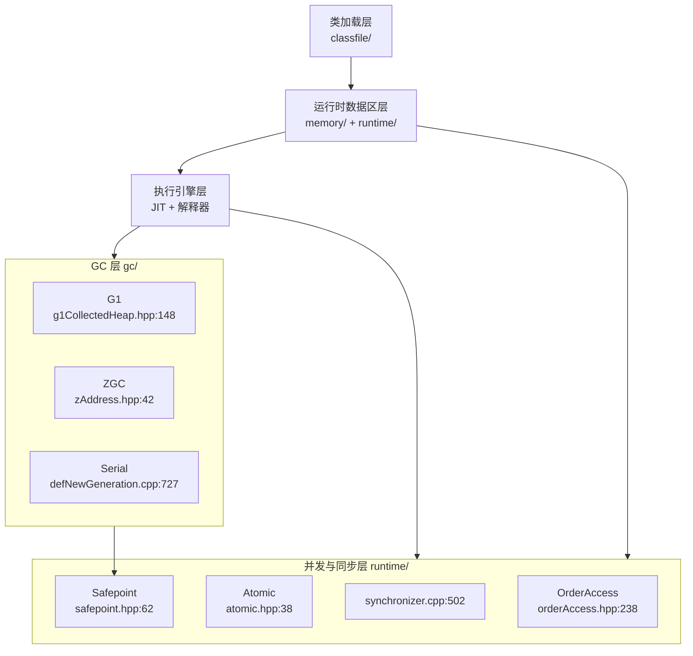
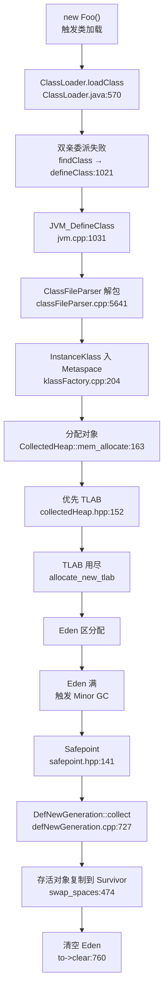
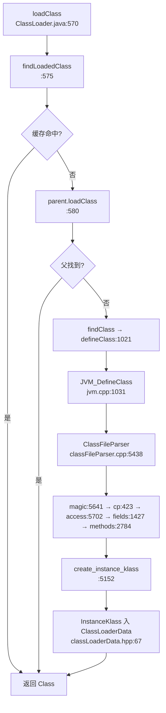
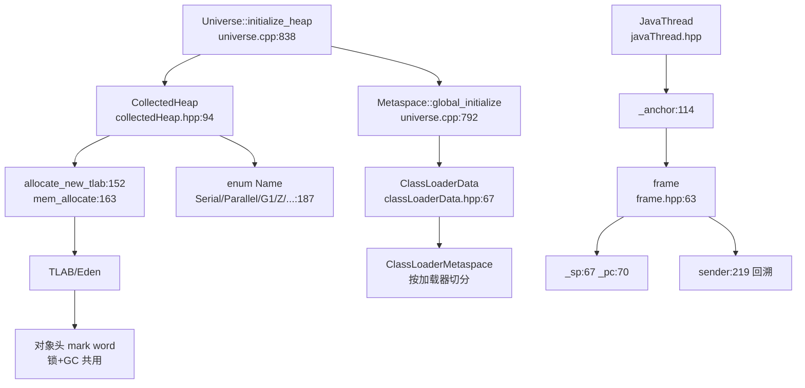
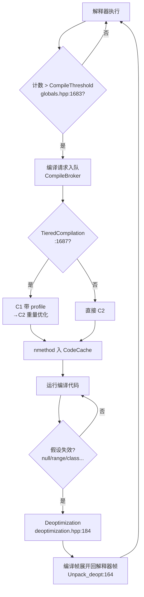
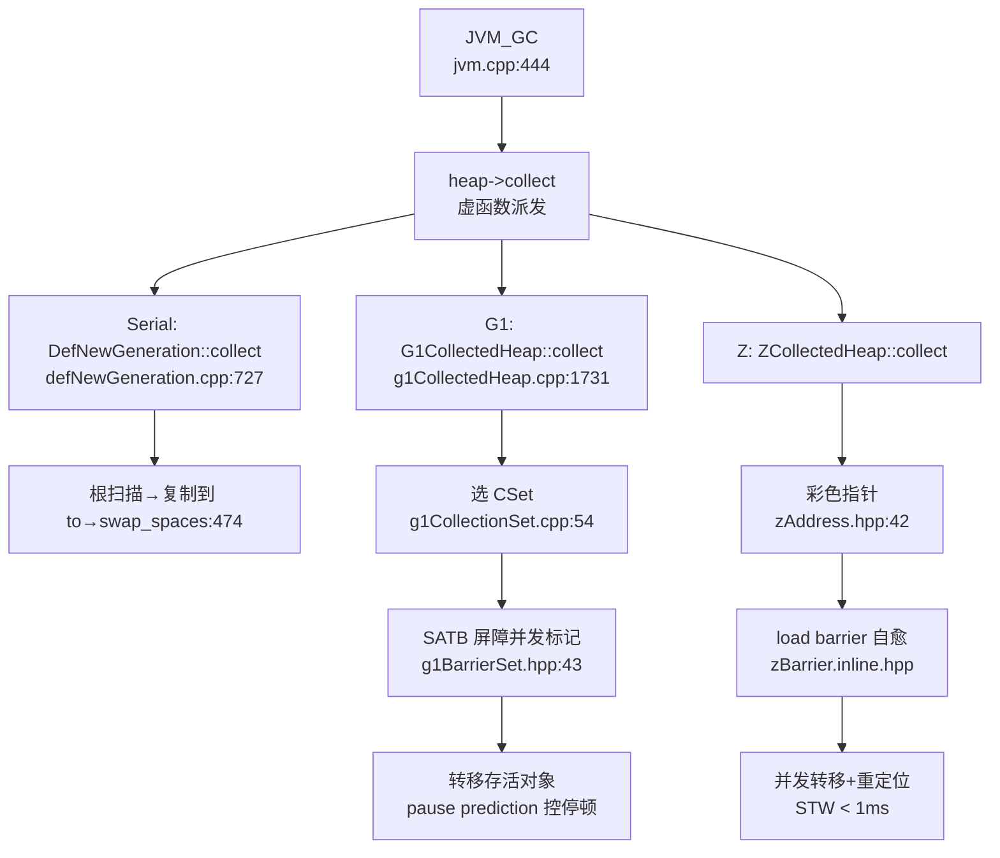
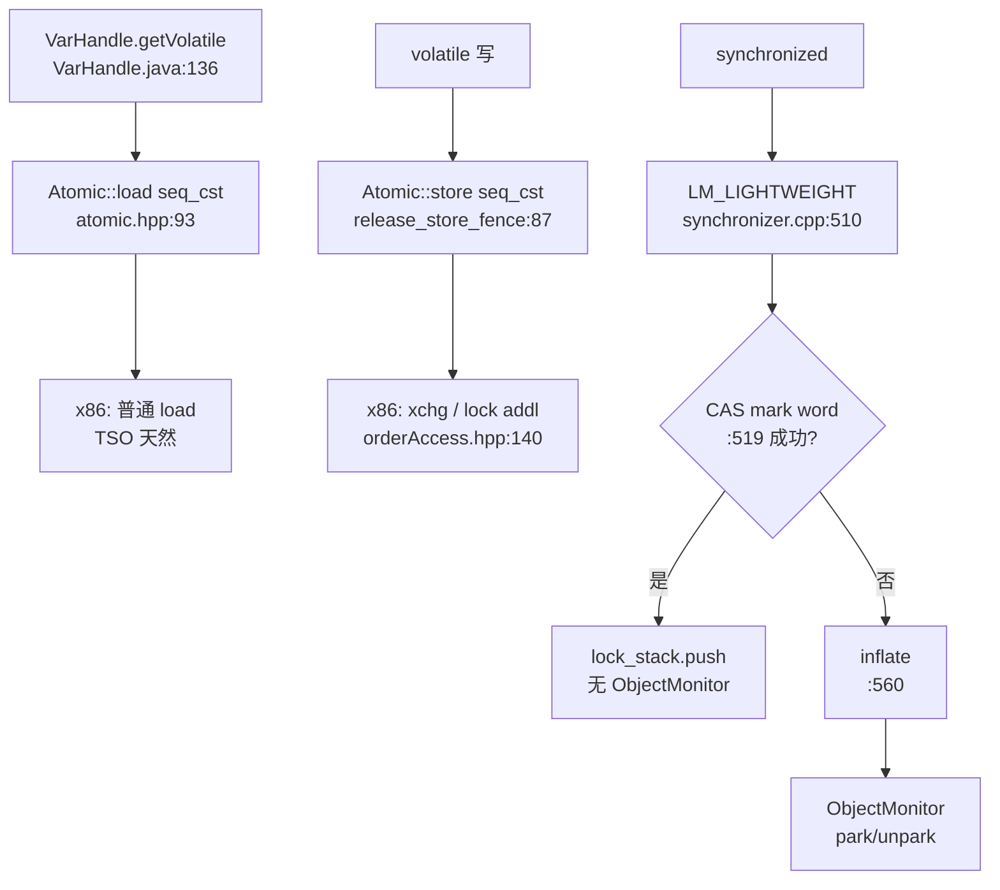
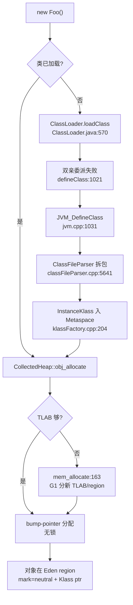
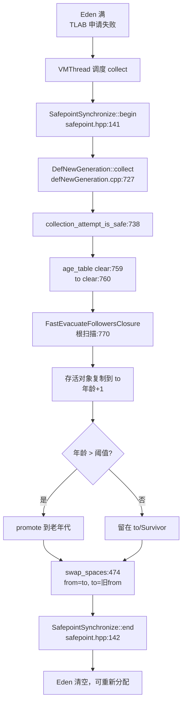

> 基于对 OpenJDK 21（jdk-21-ga）HotSpot 虚拟机核心源码的逐文件精读整理而成。Java 侧覆盖 `src/java.base/share/classes/java/lang/`（`ClassLoader`、`Class`、`invoke/VarHandle`）；C++ 侧覆盖 `src/hotspot/share/` 下的 `classfile/`、`memory/`、`runtime/`、`prims/`、`gc/`（`g1/`、`z/`、`serial/`、`parallel/`、`shared/` 等），以及 JVMCI 接口模块 `src/jdk.internal.vm.ci/share/classes/`。
>
> 阅读顺序即学习顺序：类加载 → 运行时数据区 → JIT 编译 → GC 家族 → JMM 与并发内存模型。
>
> 所有结论均标注了源文件位置（格式 `相对路径:行号`），行号均经 Read/Grep 实际核对，建议对照代码阅读。
>
> **版本基线**：OpenJDK **21 GA**（commit `890adb6410dab4606a4f26a942aed02fb2f55387`，commit 时间 `2023-08-09 20:19:41 +0000`）。
>
> **稀疏检出说明**：本次阅读基于一份稀疏检出（sparse checkout），可用目录为 `src/hotspot/share/{classfile,gc,memory,runtime,prims}` 与 `src/java.base`、`src/jdk.internal.vm.ci`。`src/hotspot/share/oops/`（对象头/oop 体系）与 `src/hotspot/share/ci/`、`compiler/`（C1/C2 编译器、CompileBroker、CodeCache、nmethod）未在检出范围内，相关结论以可用文件中对它们的引用、`runtime/` 中的编译/反优化接口、以及 JVMCI 模块的 Java 接口为准，凡引用未检出文件处会显式标注"（未检出，据调用方推断）"。

---

## 目录

- [〇、全景地图](#〇全景地图)
- [速览：各讲做了什么（先看这个再进细节）](#速览各讲做了什么先看这个再进细节)
- [面试速通：JVM 高频问题一页纸](#面试速通jvm-高频问题一页纸)
- [第一讲：类加载机制 —— ClassLoader / classLoader / classFileParser](#第一讲类加载机制--classloader--classloader--classfileparser)
- [第二讲：运行时数据区 —— memory / runtime / oops / sharedRuntime](#第二讲运行时数据区--memory--runtime--oops--sharedruntime)
- [第三讲：JIT 编译器 —— ci / prims / CompileBroker / JVMCI / OSR](#第三讲jit-编译器--ci--prims--compilebroker--jvmci--osr)
- [第四讲：GC 家族 —— g1 / z / serial / parallel / shenandoah / epsilon](#第四讲gc-家族--g1--z--serial--parallel--shenandoah--epsilon)
- [第五讲：JMM 与并发内存模型 —— orderAccess / atomic / synchronizer / VarHandle](#第五讲jmm-与并发内存模型--orderaccess--atomic--synchronizer--varhandle)
- [端到端演算](#端到端演算)
- [附：学习路线与复习卡汇总](#附学习路线与复习卡汇总)
- [涉及文件索引](#涉及文件索引)

---

## 〇、全景地图

HotSpot 21 的整体骨架可以压缩成三横一纵：**类加载层（classfile/）** → **运行时数据区层（memory/ + runtime/）** → **执行引擎层（JIT + 解释器）**，纵向贯穿的是 **GC 层（gc/）** 和 **并发与同步层（runtime/orderAccess、atomic、synchronizer）**。每个 Java 线程自带栈与 TLAB，堆与方法区/Metaspace 是所有线程共享的全局结构。

```
┌─────────────── 启动与类加载层 (src/hotspot/share/classfile/) ───────────────┐
│ ClassLoader::load_class(classLoader.cpp:1119)  ── Boot/App/Platform 三级委派 │
│   → ClassFileStream → ClassFileParser(classFileParser.cpp:5438)             │
│   → magic(5641)/minor(5647)/major(5648)/cp(423)/access_flags(5702)          │
│   → fields(1427)/methods(2784) → create_instance_klass(5152)               │
│   → InstanceKlass 挂到 ClassLoaderData(classLoaderData.hpp:67) 的 metaspace│
│ jvm.cpp:1031 JVM_DefineClass → jvm_define_class_common(jvm.cpp:867)        │
│   → KlassFactory::create_from_stream(klassFactory.cpp:168)                 │
└─────────────────────────────┬───────────────────────────────────────────────┘
                              ▼
┌─────────────── 运行时数据区层 (memory/ + runtime/) ────────────────────────┐
│ Universe::initialize_heap(universe.cpp:838) → _collectedHeap(840)          │
│   CollectedHeap(collectedHeap.hpp:94) enum Name{Serial,Parallel,G1,...:187}│
│   allocate_new_tlab(152) / mem_allocate(163)                               │
│ Metaspace::global_initialize(universe.cpp:792)  metaspace.hpp:44 allocate  │
│ JavaThread(javaThread.hpp) _anchor(114) frame(545)  frame.hpp:63 {_sp,_pc} │
│ SharedRuntime(sharedRuntime.cpp:86) _wrong_method/_ic_miss/_deopt blob     │
└─────────────────────────────┬───────────────────────────────────────────────┘
                              ▼
┌─────────────── 执行引擎层 (JIT + 解释器，ci/compiler 未检出) ──────────────┐
│ CompileThreshold(globals.hpp:1683) TieredCompilation(1687)                 │
│ JVMCI: CompilationRequest(vm/ci/code/CompilationRequest.java:30)          │
│ Deoptimization(deoptimization.hpp:69) Unpack_uncommon_trap(166) deopt:184  │
│ SharedRuntime::generate_stubs(sharedRuntime.cpp:106)  resolve blob 链     │
└─────────────────────────────┬───────────────────────────────────────────────┘
                              ▼
┌─────────────── GC 层 (src/hotspot/share/gc/) ──────────────────────────────┐
│ G1CollectedHeap(g1/g1CollectedHeap.hpp:148) HeapRegion(heapRegion.hpp:69) │
│   HeapRegionType{Eden,Surv,Old,Humongous}(heapRegionType.hpp:61)           │
│   G1CollectionSet(g1/g1CollectionSet.cpp:54) G1BarrierSet SATB(43)         │
│ ZCollectedHeap(z/) colored pointer(zAddress.hpp:42) load barrier(zBarrier) │
│ SerialHeap(serial/defNewGeneration.cpp:727) Eden/From/To(344-346) swap:474 │
│ JVM_GC(jvm.cpp:444) → heap->collect(_java_lang_system_gc)                  │
└─────────────────────────────┬───────────────────────────────────────────────┘
                              ▼
┌─────────────── 并发与同步层 (runtime/) ────────────────────────────────────┐
│ OrderAccess(orderAccess.hpp:238) loadload/storestore/loadstore/storeload   │
│   fence(248) acquire(246)/release(247)  x86:fence=lock addl(126)           │
│ Atomic(atomic.hpp:38) memory_order_relaxed/acquire/release/seq_cst(41-45)  │
│ ObjectSynchronizer::enter(synchronizer.cpp:502) LM_LIGHTWEIGHT(510)        │
│ SafepointSynchronize(safepoint.hpp:62) begin(141)/end(142) _state(89)       │
│ VarHandle(java.base) getVolatile/getAcquire/getOpaque/setRelease/compareAndSet│
└─────────────────────────────────────────────────────────────────────────────┘
```

对应的 mermaid 渲染版（三横一纵视角）：



**三条主线**（带着这三条线读后面五讲，就不会迷路）：

1. **类加载流**：`loadClass`（Java 双亲委派）→ `JVM_DefineClass`（JNI 入口）→ `KlassFactory::create_from_stream` → `ClassFileParser`（解析 .class 二进制）→ `InstanceKlass`（C++ 侧的类元数据）→ 挂入 `ClassLoaderData`（GC 友好的加载器数据，随加载器回收）。第一讲。
2. **执行流**：`JavaThread` 持有 `JavaFrameAnchor`，每一层调用压一个 `frame`（`_sp`/`_pc`）；解释器执行字节码，计数达 `CompileThreshold` 后 JIT 接管；GC 由 `SafepointSynchronize::begin` 统一刹车。第二、三讲。
3. **GC 流**：`Universe::initialize_heap` 选定 `CollectedHeap` 子类；分配走 TLAB → Eden；分配失败或 `System.gc()`（`JVM_GC`）触发 `collect`；G1 用 region+CSet+SATB，ZGC 用 colored pointer+load barrier，Serial 用 Eden/From/To 复制。第四讲。

---

## 速览：各讲做了什么（先看这个再进细节）

| 讲次 | 核心问题 | 一句话白话 | 关键文件 |
| --- | --- | --- | --- |
| 第一讲 | 一个 `.class` 怎么变成 JVM 里的类 | 先问爸爸（双亲委派），爸爸没有就自己 `defineClass`，把字节流塞给 `ClassFileParser` 按 magic→常量池→字段→方法顺序拆包，最后做成 `InstanceKlass` 挂进 Metaspace | `java/lang/ClassLoader.java`、`classfile/classLoader.cpp`、`classfile/classFileParser.cpp` |
| 第二讲 | JVM 跑起来后内存长什么样 | 堆是 `CollectedHeap`（分代或 region），方法区是 Metaspace，每个线程一个栈 + TLAB，栈上每一格是一个 `frame`（`_sp`/`_pc`），对象头里藏着 GC 与锁的信息 | `memory/universe.cpp`、`gc/shared/collectedHeap.hpp`、`runtime/javaThread.hpp`、`runtime/frame.hpp` |
| 第三讲 | 字节码怎么变成机器码又怎么退回去 | 方法调用次数过 `CompileThreshold` 就交给 JIT（C1/C2/Graal），分层编译 TieredCompilation；运行时假设不成立就走 `Deoptimization` 退回解释器；JVMCI 让 Java 写的编译器（Graal）能挂进来 | `runtime/globals.hpp`、`runtime/deoptimization.hpp`、`jdk.internal.vm.ci`、`prims/jvm.cpp` |
| 第四讲 | 垃圾怎么收、为什么 G1/ZGC 停顿短 | Serial 是 Eden→Survivor 复制 + 老年代标记压缩；G1 把堆切成 region、用 CSet 控制停顿、用 SATB 写屏障保证并发标记正确；ZGC 用彩色指针 + load barrier 把几乎所有阶段并发化 | `gc/g1/`、`gc/z/`、`gc/serial/defNewGeneration.cpp` |
| 第五讲 | volatile、synchronized 在底层到底插了什么 | `OrderAccess` 提供四种屏障，x86 上 `storeload` 落到 `lock addl`；`Atomic` 给出 `memory_order` 五档；`synchronized` 在 21 默认走 `LM_LIGHTWEIGHT` 锁栈，膨胀时才 `inflate` 出 `ObjectMonitor`；`VarHandle` 把这些能力暴露给 Java | `runtime/orderAccess.hpp`、`runtime/atomic.hpp`、`runtime/synchronizer.cpp`、`java/lang/invoke/VarHandle.java` |

整张全流程图（一次 `new Foo()` 到一次 Minor GC 的完整生命周期，对应最后的端到端演算）：



---

## 面试速通：JVM 高频问题一页纸

> **用法：先结论，后展开。**
> 面试时先甩出下表"一句话结论"顶住问题，被追问细节再按"深入"列回到对应讲次，顺着该讲小结"三个最值得记住的点"往下接。
>
> 覆盖范围仅限 JVM/虚拟机面：类加载、运行时数据区、JIT 执行、GC 家族、JMM 与并发内存模型，与五讲一一对应。
> Java 类库面（集合、并发容器、锁、线程）另有专文，不在本页范围。
>
> 表内结论全部提炼自本笔记各讲小结与"常见误区辨析"，不引入笔记之外的知识点；本页不附源码位置，需要证据时按"深入"列回查原文。

### 高频 Q&A（先结论）

16 题按"类加载 → 内存 → 执行 → GC → JMM"排列，与五讲顺序一致；
每条先记结论列，细节留给追问，被深挖时按"深入"列回对应讲次接"三个最值得记住的点"。

| # | 面试问题 | 一句话结论 | 深入 |
| --- | --- | --- | --- |
| 1 | 双亲委派是什么，能被破坏吗 | 不是强制，只是 `loadClass` 的"缓存→父委派→自己找"默认实现；覆盖 `loadClass` 即可打破（OSGi、Tomcat），代价是失去"核心类只由 Boot 加载"的保证 | 第一讲 |
| 2 | 类加载分哪几个阶段 | 加载（委派→`defineClass`→`ClassFileParser` 按 magic→version→cp→access→fields→methods 拆包）→ 链接（验证+准备+解析）→ 初始化（`<clinit>`），即常说的五个阶段 | 第一讲 |
| 3 | 类元数据放哪、怎么回收 | `InstanceKlass` 挂进 `ClassLoaderData` 的 Metaspace，与加载器绑死：加载器一死整块元数据可卸载，这是 Metaspace 取代永久代的核心理由 | 第一讲 |
| 4 | 运行时数据区怎么划分 | 线程共享：堆（`CollectedHeap`）+ 方法区（Metaspace）；线程私有：Java 栈（`frame`，`_sp`/`_pc`）+ 本地方法栈 + PC 寄存器 + TLAB | 第二讲 |
| 5 | `new` 一个对象的完整链路 | 首次使用先触发类加载，再在 TLAB 内 bump-pointer 无锁分配，填对象头（mark word + Klass 指针）+ 字段清零；TLAB 装不下才走 `mem_allocate`，可能触发 GC | 第二讲＋端到端 |
| 6 | 对象内存布局长什么样 | 对象头（mark word 一块字段编码 hash/age/锁状态/GC 指针）+ 实例数据；64 位下头 8/16 字节，锁与 GC 共用同一 mark word 位段 | 第二讲 |
| 7 | 怎么判断对象已死，GC Roots 有哪些 | 可达性分析：活对象定义为 GC Roots 可达；Roots 含栈上活跃 frame、全局对象、JNI handles 等，根扫描从这些出发 | 第四讲 |
| 8 | 各 GC 的特点一句话 | Serial：Eden→Survivor 复制 + 老年代标记压缩，全程 STW；Parallel：并行，吞吐优先；G1：region + CSet + SATB，标记并发；ZGC：彩色指针 + load barrier 近乎全并发；Shenandoah：Brooks 转发指针；Epsilon：no-op 只分不收 | 第四讲 |
| 9 | G1 为什么停顿可控 | 堆切等大 region，CSet 按 pause prediction 贪心选"垃圾多 + 回收便宜"的 region，逼近 `MaxGCPauseMillis`（默认 200ms）；SATB 写前屏障让并发标记不 STW 重扫全堆；老年代走 Mixed GC 而非 Full GC | 第四讲 |
| 10 | ZGC 为什么停顿 < 1ms | 彩色指针把 mark/remap 状态编进指针高位，load barrier 读时自愈，标记/转移/重定位全并发，STW 只剩初始/最终标记等极短点 | 第四讲 |
| 11 | STW 与 safepoint 是什么 | GC 靠 `SafepointSynchronize::begin/end` 让所有线程在 safepoint 点统一停下：编译代码读轮询页、解释器查 `_state`；ZGC 并发阶段绕过全局 safepoint | 第四讲 |
| 12 | JIT 何时接管、deopt 是什么 | 方法/回边计数过 `CompileThreshold` 触发，分层编译 C1（轻量、带 profile）→ C2（重量、激进优化），OSR 支持循环中途栈上替换；假设失效 deopt 退回解释器，是正常回退不是异常 | 第三讲 |
| 13 | JMM 管什么 | 规定"什么操作对什么线程可见、什么顺序"；底层落到四种内存屏障 + acquire/release 配对（T1 release 发布、T2 acquire 后可见）+ `Atomic` 的 memory_order 五档 | 第五讲 |
| 14 | volatile 的语义与代价 | 写后 StoreLoad 屏障保证"先初始化再赋引用"不被重排；x86 TSO 上读几乎免费，只有写端 `lock addl`/`xchg`，PPC/AArch64 才需要 `lwsync`/`sync` | 第五讲 |
| 15 | DCL 为什么必须 volatile | `new` 分"分配内存 → 初始化 → 赋引用"三步，若后两步重排，别人可能读到未初始化对象；volatile 写的 StoreLoad 屏障兜住这个顺序 | 第五讲 |
| 16 | JDK 21 的 synchronized 怎么实现 | 默认 `LM_LIGHTWEIGHT`：CAS 翻 mark word + 压 LockStack，无竞争完全不创建 `ObjectMonitor`；有竞争才 inflate 走 park/unpark；偏向锁已删除 | 第五讲 |

> **话术提示**：被追问时按"结论 → 机制 → 证据"三级展开——
> 先复述该讲小结的"一句话定位"，再进"三个最值得记住的点"，最后才报源码类名与行号（回原文查，本页不附）。

### 易错点与面试坑

以下 8 条来自本笔记"常见误区辨析"与各讲小结点名过的反直觉点，
是八股文面试里最高频的踩雷处——每条按"坑 → 正解 → 展开"组织：

- **坑："双亲委派是强制的。"**
  正解：它只是 `loadClass` 的默认实现，OSGi/Tomcat 覆盖 `loadClass` 就能打破。
  展开：代价是失去"核心类只由 Boot 加载"的保证，仍有 `loaderConstraints` 约束表兜底。
- **坑："Metaspace 是永久代的简单改名。"**
  正解：Metaspace 按 `ClassLoaderData` 切分子空间、按 chunk 动态分配，加载器死整块释放。
  展开：chunk 可归还池、commit 粒度可控，没有永久代"单块 + 碎片化 + 无法卸载"的老问题。
- **坑："G1 一定比 Serial 快。"**
  正解：G1 胜在停顿可控，吞吐未必高；小堆上 Serial 反而更快。
  展开：`CollectedHeap` 的 Name 枚举里六种 GC 并列，选型本质是在"停顿长度"与"吞吐开销"间权衡。
- **坑："G1 是物理分代。"**
  正解：G1 的分代是逻辑的——等大 region 动态充当 Eden/Survivor/Old/Humongous。
  展开：`HeapRegionType` 用位掩码编码角色，"是否年轻代/是否大对象"靠位与快速判断，不是固定的连续分代空间。
- **坑："volatile 在所有平台都贵。"**
  正解：x86 TSO 下只有写端 `lock addl`，读几乎免费。
  展开：`OrderAccess` 的架构对照表里，release/acquire/LoadLoad 等在 x86 全是空操作；需要 `lwsync`/`sync` 的是 PPC/AArch64。
- **坑："synchronized 必须有 ObjectMonitor。"**
  正解：21 默认 `LM_LIGHTWEIGHT`，无竞争时 CAS + 锁栈搞定，不创建 Monitor。
  展开：偏向锁已删除（safepoint 批量撤销开销大），别按老八股答"偏向锁"；只有真正竞争才 inflate 走 park/unpark。
- **坑："ZGC 完全无停顿。"**
  正解：它只是把 STW 压到初始/最终标记等极短点（< 1ms）。
  展开：ZGC 的并发阶段绕过全局 safepoint，但并非零 STW——答"完全无停顿"直接算错。
- **坑："deopt 是异常、是事故。"**
  正解：deopt 是乐观编译的正常回退路径，C1 重执行、C2 重做。
  展开：`UnpackType` 有四种解包模式（deopt/exception/uncommon_trap/reexecute），恰恰说明它是被精心设计的正常机制。

### 关键概念对照表

考前扫一遍这张表，能挡住大部分"两个概念放一起就混"的题；口径全部来自本笔记：

| 概念组 | 对照项 | 文档口径 |
| --- | --- | --- |
| GC 触发类型 | Minor GC / Mixed GC / Full GC | Minor：Eden 满触发，存活复制到 Survivor、超龄 promote 老年代；Mixed：G1 年轻 region + 部分老 region 一起收；Full：Serial 老年代 MarkSweepCompact，或 promotion 失败时兜底 |
| GC 算法 | 复制 / 标记-压缩 / 标记-清除 | Serial 年轻代 Eden→Survivor 复制、老年代标记-压缩；Parallel 老年代并行标记压缩；复制比标记-清除更彻底（消除碎片） |
| GC 协调 | STW GC / 并发 GC | Serial/Parallel 全程 STW；G1 标记并发、转移仍 STW，靠 CSet 控转移量；ZGC/Shenandoah 转移也并发，代价是每次引用访问多一次 barrier 检查 |
| 大对象 | Humongous region | G1 的大对象占连续多个 region（StartsHumongous/ContinuesHumongous），起始 region 由 `_humongous_start_region` 指向 |
| 分配路径 | TLAB / `mem_allocate` | 绝大多数 `new` 在 TLAB 内 bump-pointer 无锁分配；TLAB 装不下或直接分配才走 `mem_allocate`，可能触发 GC |
| 编译器 | C1 vs C2 | C1 轻量快、产出的代码带 profile；C2 重量慢、profile 驱动激进优化；分层编译 C1→C2，编译器在启动期定死、运行期不动态互切 |
| 内存屏障 | LoadLoad / LoadStore / StoreStore / StoreLoad + acquire / release / fence | x86 TSO 下前三者与 release/acquire 是空操作，仅 StoreLoad/fence 落 `lock addl`；PPC 需 `lwsync`/`sync` |
| memory_order | relaxed / acquire / release / acq_rel / seq_cst（HotSpot 内部默认 conservative） | `AtomicInteger.incrementAndGet` 走默认保守序即 seq_cst；`VarHandle` 的 getOpaque/getAcquire/setRelease 才能选更弱序 |
| 锁状态 | neutral → fast-locked → inflated | CAS 翻 mark word + 压 LockStack；有竞争才 inflate 出 `ObjectMonitor`；21 无偏向锁 |
| 锁模式 | LM_LIGHTWEIGHT / LM_LEGACY / LM_BIASED | 21 默认 LM_LIGHTWEIGHT；LM_LEGACY 用栈上 BasicLock 做 displaced mark word；LM_BIASED 已删除 |
| safepoint 状态 | `_not_synchronized` / `_synchronized` | GC 前 `begin()` 置 `_synchronized` 并让轮询页生效，`end()` 解除轮询并唤醒线程；`_safepoint_counter` 单调递增用于快速判断是否跨过 |
| 引用处理 | 强 / Soft / Weak / Phantom | Soft/Weak/Phantom 由 `_ref_processor` 在 GC 开始时 `start_discovery` 统一发现处理 |

> **三个记忆锚点**：G1 的停顿靠"选得少"（CSet 贪心 + pause prediction），
> ZGC 的停顿靠"全并发"（彩色指针 + load barrier），x86 的 volatile 便宜靠 TSO（只写端 `lock`）——
> 三句话各对应一讲的灵魂，考前默一遍。

---

## 第一讲：类加载机制 —— ClassLoader / classLoader / classFileParser

### 先说人话：本讲每个阶段在干什么

把类加载想象成"去图书馆找书再拆封上架"：**找书**对应双亲委派——先问爸爸图书馆有没有，爸爸再问爷爷，一直到 Boot（ bootstrap）这个"国家图书馆"；**拆封**对应 `ClassFileParser`，按 `.class` 文件的固定格式（魔数→版本→常量池→访问标志→字段→方法→属性）逐段拆开；**上架**对应 `create_instance_klass`，把拆出来的元数据做成 `InstanceKlass` 放进 Metaspace，并和 `ClassLoaderData` 绑定，方便将来 GC 时随加载器一起回收。

| 阶段 | 干了什么 | 为什么这么设计 |
| --- | --- | --- |
| 双亲委派 `loadClass` | 先 `findLoadedClass` 缓存命中，否则交给 `parent`，最后才自己 `findClass` | 保证核心类（如 `java.lang.Object`）只被 Boot 加载一次，避免用户伪造；缓存避免重复解析 |
| `defineClass` | 把 `byte[]` 经 native `defineClass1` 交给 JVM | Java 层只负责找字节流，"解析成内部表示"必须由 C++ 完成，因为 `InstanceKlass` 是 JVM 私有结构 |
| `ClassFileParser` 拆包 | 按 JVMS 规定的顺序读 magic/version/cp/access/fields/methods | 顺序固定才能做 `guarantee_more` 流式校验，边读边断言，防止畸形 class 文件越界 |
| `InstanceKlass` 落 Metaspace | 元数据挂到 `ClassLoaderData->_handles`/`_metaspace` | 让类的生命周期与加载器绑定：加载器被回收时，它定义的类也能被卸载（GC 友好） |

**本讲主线**：字节流进，`InstanceKlass` 出，全程挂在一个 `ClassLoaderData` 上。

### 逐文件精读

#### `src/java.base/share/classes/java/lang/ClassLoader.java` —— 双亲委派的 Java 侧

`ClassLoader` 的字段里，`parent`（`ClassLoader.java:242`）是 final 的，在构造时由 `private ClassLoader(Void, String, ClassLoader)`（`:377`）固定。三档构造分别对应 `protected ClassLoader(String, ClassLoader)`（`:435`，命名加载器）、`protected ClassLoader(ClassLoader)`（无参版委托到 `getSystemClassLoader`）以及 Boot 特例。

双亲委派的核心在 `loadClass`（`:570`）：

```java
protected Class<?> loadClass(String name, boolean resolve) {
  synchronized (getClassLoadingLock(name)) {        // :573 按类名加锁，保证同一类并发加载只解析一次
    Class<?> c = findLoadedClass(name);              // :575 先查"我是不是已经发起过加载"
    if (c == null) {
      try {
        if (parent != null) c = parent.loadClass(name, false);  // :580 向上委派
        else                c = findBootstrapClassOrNull(name); // :582 到顶走 Boot
      } catch (ClassNotFoundException e) { }         // :584 爸爸找不到不算错
      if (c == null) {
        c = findClass(name);                          // :593 自己找字节流
        // :596-598 记 perf 计数器（父委派耗时、findClass 耗时、加载次数）
      }
    }
    if (resolve) resolveClass(c);                    // :602 可选：立即链接（验证+准备+解析）
    return c;
  }
}
```

几个关键 native/包级方法的位置：`findLoadedClass`（`:1297`）委托 native `findLoadedClass0`（`:1303`）；`findBootstrapClassOrNull`（`:1274`）调 native `findBootstrapClass`（`:1281`）；`defineClass`（`:1021`）做 `preDefineClass` → `defineClass1`（native，`:1123`）→ `postDefineClass`，对外只暴露受保护入口；`resolveClass`（`:1236`）也是包级 native 包装。这条链的语义是：**Java 层只负责"调度"，真正的字节流→Klass 转换发生在 C++ 侧的 `JVM_DefineClass`。**

#### `src/hotspot/share/classfile/classLoader.cpp` —— Boot/App/Platform 三级在 C++ 侧的落地

`ClassLoader::load_class`（`classLoader.cpp:1119`）是 Boot 路径在 HotSpot 侧的入口，负责把类名翻译成 `.class` 文件并产生 `ClassFileStream`。它按以下顺序找流（见 `:1147` 起的注释）：

1. `--patch-module` 条目（`:1155`），仅在非 `search_append_only` 时尝试；
2. jimage（模块镜像）或 exploded module build；
3. `-Xbootclasspath/a` 追加条目。

注释 `:803` 明确点出：运行期 app 类的加载由 Java 侧的 `jdk/internal/loader/ClassLoaders$AppClassLoader` 实例完成，`classLoader.cpp` 只管 Boot 可见范围。`create_class_path_entry`（`:726`）会根据路径是 jar/目录/jimage 生成不同的 `ClassPathEntry`；`add_to_app_classpath_entries`（`:804`）把 `-cp` 条目记进 `_app_classpath_entries`，供 CDS 归档使用。

JVM 启动时，`ClassLoader::initialize`（通过 `:1389` 的 `setup_bootstrap_search_path(THREAD)` 可见）做三件事：`load_java_library()`（`:1387`）加载 `libjvm`/`libjava`、`setup_bootstrap_search_path`（`:503`，实现 `:627`）解析 `-Xbootclasspath`、以及 `lookup_vm_options`（`:1404`）从 jimage 里读 VM 内嵌选项。

#### `src/hotspot/share/classfile/classFileParser.cpp` —— .class 文件格式的拆包器

`ClassFileParser` 的构造函数（`classFileParser.cpp:5438`）是整个拆包的入口，它把一个 `ClassFileStream` 拆成 `InstanceKlass`。拆包严格按 JVMS 顺序：

- **魔数**（`:5641`）：`stream->get_u4_fast()` 读出 4 字节，`guarantee_property(magic == JAVA_CLASSFILE_MAGIC, ...)` 校验，不是 `0xCAFEBABE` 直接抛 `ClassFormatError`。
- **版本**（`:5647`/`:5648`）：`_minor_version`、`_major_version`，再走 `verify_class_version`（`:5651`）——即便关了 verifier 也要查版本，因为版本号决定后续字节码合法性。
- **常量池**：先读 `cp_size`（`:5654`），`ConstantPool::allocate`（`:5665`）在 `ClassLoaderData` 的 metaspace 里分配，再 `parse_constant_pool`（`:423`/`:5671`）。`parse_constant_pool_entries`（`:155`）按 tag 分发，每个 tag 用 `guarantee_more(N, CHECK)` 预读，保证流式不越界——例如 `JVM_CONSTANT_Methodref` 要 5 字节（`:200`），`Utf8` 要先读长度再读内容（`:324`）。
- **access_flags**（`:5702`）：`_access_flags.set_flags(flags)`，前面 `verify_legal_class_modifiers`（`:5692`）检查修饰符合法性；`:5696` 处有一个细节：非法常量 tag 要等 access_flags 查完才抛 CFE，因为若设置了 `ACC_MODULE` 要抛的是 `NCDFE` 而非 `CFE`。
- **本类/父类/接口**：`_this_class_index`（`:5705`）、`_super_class_index`（`:5780`，经 `parse_super_class`）、`_itfs_len` + `parse_interfaces`（`:5787`/`:5788`）。
- **字段**（`:5798`）：`parse_fields`（`:1427`），只填字段信息，偏移交给后面 `layout_fields`。
- **方法**（`:5809`）：`parse_methods`（`:2784`）。
- **属性**：`parse_class_attributes` 等读 `SourceFile`、`InnerClasses`、`BootstrapMethods` 等。

最后 `create_instance_klass`（`:5152`）→ `fill_instance_klass`（`:5173`）把解析结果组装成 `InstanceKlass`，设置超类、初始化 vtable/itable、做字段布局。

#### `src/hotspot/share/classfile/klassFactory.cpp` —— 流→Klass 的工厂

`KlassFactory::create_from_stream`（`klassFactory.cpp:168`）是把 `ClassFileStream` 变成 `InstanceKlass` 的总装车间：

1. `:184` 计数 `incr_define_class_count`；
2. `:188`（非 hidden 类）走 `check_class_file_load_hook`，让 JVMTI agent 能改字节码；
3. `:196` 构造 `ClassFileParser`（这里真正发生拆包）；
4. `:204` `parser.create_instance_klass(...)` 拿到 `InstanceKlass`；
5. `:207` 把 `cached_class_file`（JVMTI 缓存的原始字节）塞回去；
6. `:215` 若在 CDS dump 期，记录归档结果。

#### `src/hotspot/share/classfile/classLoaderData.hpp` —— GC 友好的加载器数据

`ClassLoaderData`（`classLoaderData.hpp:67`）是"一个类加载器对应一块元数据容器"。关键字段：

- `_metaspace`（`:116`，`ClassLoaderMetaspace* volatile`）：该加载器定义的类元数据全在这；`:118` 的 `_metaspace_lock` 保护分配。
- `_keep_alive`（`:128`）：引用计数，Boot/Platform 这类"不能被回收"的加载器靠它保活。
- `_handles`（`:135`，`ChunkedHandleList`）：持有常量池数组、Module 对象等 oop 句柄，分块存储便于 GC 扫描。
- `is_unloading`（通过 `:100` 的 friend `ClassLoaderDataGraphIteratorBase` 可见）：GC 时由 `ClassLoaderDataGraph` 遍历，判断加载器是否已死、其类是否可卸载。

设计意图很明确：**把类的生命周期与加载器绑死**。加载器对象被 GC 标记为不可达时，它对应的 `ClassLoaderData` 也可以连带卸载掉里面的 `InstanceKlass`，腾出 Metaspace——这就是 JDK 8 以前"永久代"被 Metaspace 取代的核心理由。

#### `src/hotspot/share/prims/jvm.cpp` —— native 入口

`JVM_DefineClass`（`jvm.cpp:1031`）只是个壳，交给 `jvm_define_class_common`（`:867`）。后者把 `jbyte*` 包成 `ClassFileStream`（`:892`），取 `class_loader`/`protection_domain` 句柄，构 `ClassLoadInfo`（`:895`），最终交给 `SystemDictionary` 解析+注册。`JVM_FindLoadedClass`（`:1063`）对应 Java 侧 `findLoadedClass` 的 native 实现，查的是"该加载器是否已作为发起加载器记录过这个类"。

### 第一讲小结：双亲委派是"先问爸爸"，ClassFileParser 是"按规矩拆包"

**一句话定位**：`loadClass`（`ClassLoader.java:570`）跑的是"缓存→父委派→自己找"三段式；`JVM_DefineClass`（`jvm.cpp:1031`）把字节流交给 `ClassFileParser`（`classFileParser.cpp:5438`），按 magic→version→cp→access→fields→methods 固定顺序拆包，最后 `create_instance_klass`（`:5152`）做成 `InstanceKlass` 挂进 `ClassLoaderData`（`classLoaderData.hpp:67`）的 Metaspace。



**关键机制的输入/输出**：

| 机制 | 输入 | 输出 | 源码位置 |
| --- | --- | --- | --- |
| 双亲委派 | 类名 + `parent` 链 | 命中缓存或父加载的 `Class`，否则自己 `findClass` | `ClassLoader.java:570`/`:580` |
| defineClass | `byte[]` + `ProtectionDomain` | native `defineClass1` 产出的 `Class` | `ClassLoader.java:1021`/`:1123` |
| .class 拆包 | `ClassFileStream` | `_cp`/`_access_flags`/`_fields`/`_methods` | `classFileParser.cpp:5438`/`:5641` |
| 流→Klass 总装 | `ClassFileStream` + `ClassLoaderData` | `InstanceKlass*` | `klassFactory.cpp:168`/`:204` |
| 加载器元数据容器 | 加载器对象 | `_metaspace` + `_handles` | `classLoaderData.hpp:116`/`:135` |
| Boot 搜索路径 | `-Xbootclasspath`/jimage | `_bootstrap_search_path` 列表 | `classLoader.cpp:503`/`:627` |

**三个最值得记住的点**：

1. **双亲委派不是强制，是 `loadClass` 的默认实现**。子类可以覆盖 `loadClass` 自己先 `findClass`（OSGi、Tomcat 都这么干），但这会打破"核心类只由 Boot 加载"的保证，所以 `defineClass` 仍受 `ClassLoaderData` 的 `loaderConstraints` 约束（`classLoaderData` 的约束表在 `classfile/loaderConstraints.hpp`，未检出但 `dictionary.cpp` 有引用）。
2. **`ClassFileParser` 是流式的，靠 `guarantee_more` 防越界**。每个常量池 tag 的 `guarantee_more(N, CHECK)`（如 `classFileParser.cpp:200` 的 Methodref 要 5 字节）既是 IO 预读也是安全边界——畸形 class 文件不会让 JVM 越界读内存。
3. **`InstanceKlass` 与 `ClassLoaderData` 绑定是 GC 卸载类的前提**。`_handles`（`classLoaderData.hpp:135`）分块存 oop 句柄、`_metaspace`（`:116`）存元数据，加载器一死，`ClassLoaderDataGraph` 遍历就能判定整块可回收——这是 Metaspace 替代永久代的关键工程理由。

---

## 第二讲：运行时数据区 —— memory / runtime / oops / sharedRuntime

### 先说人话：本讲每个阶段在干什么

JVM 启动后内存可以分成两类：**所有线程共享的**（堆 `CollectedHeap`、方法区 Metaspace）和**每个线程私有的**（Java 线程栈 + 栈帧 `frame` + 本地方法栈 + PC 寄存器 + TLAB）。堆由 `Universe` 在启动期选定一个 `CollectedHeap` 子类（G1/Serial/Z/…）一次性造好；Metaspace 由 `ClassLoaderData` 按加载器切分。对象头（mark word）藏在每个 oop 里，是锁与 GC 的交汇点。

| 阶段 | 干了什么 | 为什么这么设计 |
| --- | --- | --- |
| `Universe::initialize_heap` | 按 `GCConfig` 选 `CollectedHeap` 子类并 `initialize` | 堆是全局单例，子类决定分代/region 布局，统一基类让上层代码不关心具体 GC |
| Metaspace 全局初始化 | `Metaspace::global_initialize` 建 chunk 管理器 | 元数据按加载器隔离+按 chunk 分配，避免永久代 OOM 时整块死 |
| JavaThread 栈 | 每线程一个 `_anchor` 指向最新 Java 帧 | 私有栈无需同步；`_anchor` 让 GC/safepoint 能从 C++ 侧回溯到 Java 栈顶 |
| `frame` | `_sp`/`_pc`/`_fp` 描述一个激活 | 统一抽象解释器/编译代码两种帧，`sender` 顺链回溯 |
| 对象头 mark word | 一块字段同时编码 hash/age/锁状态/GC 指针 | 空间优先：64 位机器上 8 字节塞下尽可能多的状态，锁升级靠 CAS 翻转位 |

**本讲主线**：堆是共享的、栈是私有的、对象头是两者的交汇。

### 逐文件精读

#### `src/hotspot/share/memory/universe.cpp` —— 全局单例的诞生地

`Universe` 是 AllStatic 的全局单例集合。`_collectedHeap`（`universe.cpp:166`）是唯一的堆指针。启动路径在 `universe.cpp` 内的初始化函数里（从 `:785` 可见顺序）：

```
:783  GCConfig::arguments()->initialize_heap_sizes();   // 先算堆大小
:785  jint status = Universe::initialize_heap();         // 造堆
:790  Universe::initialize_tlab();                      // 初始化每线程 TLAB
:792  Metaspace::global_initialize();                   // Metaspace 全局初始化
```

`initialize_heap`（`:838`）只有三行核心：`assert(_collectedHeap == nullptr, ...)`（`:839`）保证只造一次，`_collectedHeap = GCConfig::arguments()->create_heap()`（`:840`）按命令行选的 GC 造对应子类，`_collectedHeap->initialize()`（`:843`）完成内存 reserve+commit+初始区划分。这一行决定了后面整个 `new`/`GC` 的行为：选 G1 就是 `G1CollectedHeap`，选 ZGC 就是 `ZCollectedHeap`，选 Serial 就是 `SerialHeap`。

#### `src/hotspot/share/gc/shared/collectedHeap.hpp` —— 所有堆的基类

`CollectedHeap`（`collectedHeap.hpp:94`，继承 `CHeapObj<mtGC>`）是所有 GC 实现的统一抽象。核心枚举 `Name`（`:187`）列了六种：`None`、`Serial`、`Parallel`、`G1`、`Epsilon`、`Z`、`Shenandoah`（`:188-194`），注释 `:88-92` 画出继承树：`SerialHeap`/`G1CollectedHeap`/`ParallelScavengeHeap`/`ShenandoahHeap`/`ZCollectedHeap`。

关键虚函数：
- `allocate_new_tlab`（`:152`）：为当前线程申请新 TLAB，**所有 TLAB 分配必经此处**——这是 `new Foo()` 的第一站。
- `mem_allocate`（`:163`）：分配单个对象/数组（非 TLAB 路径，TLAB 装不下或直接分配时走）。
- `safepoint_synchronize_begin`/`_end`（`:246-247`）：GC 在 safepoint 前后的钩子，默认空实现，G1 等用它来停/启并发线程。
- `_total_collections`/`_total_full_collections`（`:132-133`）：GC 计数器，用于判断是否需要 compensate 等。

`CollectedHeap` 还提供 `fill_with_object`（`collectedHeap.cpp:481`）/`fill_with_object_impl`（`:468`）：当 TLAB 末端有碎片时，用"填充对象"（dummy int 数组）把空洞填满，保证堆上任意位置都可解析为对象——这是 GC 能线性扫描堆的前提。

#### `src/hotspot/share/memory/metaspace.hpp` 与 `metaspace/` —— 方法区的现代实现

`Metaspace`（`metaspace.hpp:44`，AllStatic）是方法区的外壳。`allocate`（`:112`，TRAPS 版）和 `:117`（非 TRAPS 版）是元数据分配入口，按 `ClassLoaderData` 取对应的 `ClassLoaderMetaspace`，再在其 `MetaspaceArena`（`metaspace/metaspaceArena.hpp`）里按 chunk 申请。`metaspace/` 子目录是 JDK 13 重写后的版本：`chunklevel.hpp` 定义 chunk 级别（从 1K 到 4M 的 buddy 系统）、`chunkManager.hpp` 管空闲 chunk 池、`metaspaceContext.hpp` 是物理段上下文、`blockTree.hpp` 是块内分配器。

设计要点：**Metaspace 不再是单一整块，而是按加载器切分子空间**。每个 `ClassLoaderData` 有自己的 `ClassLoaderMetaspace`，加载器死了整块释放，避免永久代"碎片化+无法卸载"的老问题。`commitLimiter.hpp`（未一一展开）控制全局 commit 上限，防止元数据吃光内存。

#### `src/hotspot/share/runtime/javaThread.hpp` —— Java 线程的私有栈与状态

`JavaThread` 持有线程私有的全部运行时数据。与数据区直接相关的字段：

- `JavaFrameAnchor _anchor`（`javaThread.hpp:114`）：封装"最新 Java 栈帧"的 `sp`/`pc`，是 GC/safepoint 从 C++ 侧回溯 Java 栈的入口；`frame_anchor()`（`:545`）、`has_last_Java_frame()`（`:548`）、`last_Java_sp()`（`:549`）、`last_Java_pc()`（`:553`）都是它的访问器。
- `vframeArray* _vframe_array_head/_last`（`:124-125`）：栈反优化（deopt）时用来存重建的 vframe 堆。
- `StackOverflow _stack_overflow_state`（`:417`）：栈溢出守护，含 `_stack_overflow_limit`（`:787` 的偏移）、`_shadow_zone_safe_limit`（`:796`）等，分守护区/黄区/红区，渐进式 `StackOverflowError`。
- `static size_t _stack_size_at_create`（`:1106`）：默认栈大小，每个新线程按此 `os::create_thread`。
- `LockStack`（`:1161` 的 `lock_stack_base_offset`）：JDK 21 轻量级锁（`LM_LIGHTWEIGHT`）的栈上锁记录，替代传统 `BasicLock`。

#### `src/hotspot/share/runtime/frame.hpp` —— 栈帧的统一抽象

`frame`（`frame.hpp:63`）描述"一个物理栈帧"，不区分解释器/编译代码。核心字段（`:64-72`）：

- `_sp`（`:67`，`intptr_t*`）：栈指针；`_offset_sp`（`:68`）用于栈 chunk（virtual thread）里堆上帧的相对 sp。
- `_pc`（`:70`，`address`）：返回地址（call 的下一条指令）。
- `_cb`（`:71`，`CodeBlob*`）：`_pc` 所属的代码块（nmethod/RuntimeStub/…）。
- `_oop_map`（`:72`）：编译帧的 oop 映射，GC 扫描寄存器/栈上的 oop 用。

访问器：`pc()`（`:113`）、`sp()`（`:124`）、`sender(map)`（`:219`，回溯调用者）、`real_sender`（`:224`，跳过转换帧）、`java_sender`（`:228`，跳到下一个 Java 调用者）。注释 `:57-61` 点明：`frame` 是**物理**激活，而 `vframe` 是**源级**激活——一个物理帧可能因为内联对应多个 vframe。

#### `src/hotspot/share/runtime/sharedRuntime.cpp` —— 解释器/编译代码的公共入口

`SharedRuntime`（`sharedRuntime.cpp:86` 起）持有一组"公共 stub"，它们是解释器与编译代码之间的桥：

- `_wrong_method_blob`（`:86`）：方法被编译后，旧调用点要重定向，此 stub 调 `handle_wrong_method`。
- `_wrong_method_abstract_blob`（`:87`）：抽象方法误调用，抛 `AbstractMethodError`。
- `_ic_miss_blob`（`:88`）：inline cache miss，触发 `handle_wrong_method_ic_miss` 去更新单态/多态 IC。
- `_resolve_opt_virtual_call_blob`/`_resolve_virtual_call_blob`/`_resolve_static_call_blob`（`:89-91`）：虚/优虚/静态调用的"懒解析"入口，首次调用时在此把符号引用解析成具体目标。
- `_deopt_blob`（`:94`）：反优化入口，配合 `Deoptimization` 把编译帧"展开"回解释器帧。
- `_polling_page_*_handler_blob`（`:95-97`）：safepoint 轮询页命中后的处理 stub。

`generate_stubs`（`:106`）在启动时把它们全部生成，`:107-112` 列出了每个 stub 对应的 C 函数指针。这些 stub 的存在说明：**JVM 的调用不是直接的 `call addr`，而是先跳到 stub，由 stub 决定去解释器还是编译代码，这给了分层编译和 deopt 统一的回旋余地。**

#### 对象头与 oop 体系（`oops/` 未检出，据调用方推断）

`oops/` 目录（`markOop`、`instanceOop`、`objArrayOop`、`Klass` 等）未在稀疏检出内，但从可用代码的引用可还原其结构：

- `collectedHeap.hpp` 多处引用 `oop`（普通对象指针）、`Klass`（类元数据指针）。`synchronizer.cpp:514` 的 `obj()->mark_acquire()`、`:519` 的 `cas_set_mark`、`:518` 的 `set_fast_locked()` 表明 **mark word 是对象头第一槽位**，`LM_LIGHTWEIGHT` 下用 CAS 把它从 neutral 翻成 fast-locked（带线程标识），这是无锁→轻量级锁的升级路径。
- `instanceOop` 是普通对象（header + 字段），`objArrayOop` 是引用数组（header + length + 元素）。`CollectedHeap::filler_object_klass()`（`collectedHeap.cpp:476`）返回"填充对象"的 Klass，说明 GC 用它把 TLAB 碎片填成合法 `instanceOop` 以保证堆可线性扫描。
- mark word 在不同状态下编码：neutral（hash+age）、biased（线程 id+epoch）、lightweight-locked（lock stack 指针）、heavyweight-inflated（`ObjectMonitor*`）、GC 标记（forwarding 指针）。这是锁（第五讲）与 GC（第四讲）共用的位段。

### 第二讲小结：堆是共享的，栈是私有的，对象头是两者的交汇

**一句话定位**：`Universe::initialize_heap`（`universe.cpp:838`）按 `GCConfig` 选定 `CollectedHeap` 子类（`collectedHeap.hpp:94`，enum `:187`），所有对象分配经 `allocate_new_tlab`（`:152`）/`mem_allocate`（`:163`）；Metaspace（`metaspace.hpp:44`）按 `ClassLoaderData` 切分子空间存类元数据；每线程一个 `JavaThread`（`javaThread.hpp:114` 的 `_anchor`）持私有栈，栈帧由 `frame`（`frame.hpp:63`，`_sp`/`_pc`）统一描述；对象头 mark word 是锁与 GC 的共享位段。



**关键机制的输入/输出**：

| 机制 | 输入 | 输出 | 源码位置 |
| --- | --- | --- | --- |
| 堆选择 | 命令行 `-XX:+UseG1GC` 等 | `CollectedHeap` 子类实例 | `universe.cpp:838`/`:840` |
| TLAB 分配 | `size_t min_size` | `HeapWord*`（TLAB 起始） | `collectedHeap.hpp:152` |
| 大对象/非 TLAB | `size_t size` | `HeapWord*` 或触发 GC | `collectedHeap.hpp:163` |
| Metaspace 分配 | `ClassLoaderData*` + `word_size` | `MetaWord*` | `metaspace.hpp:112` |
| 栈帧回溯 | `frame` + `RegisterMap` | 上一层 `frame` | `frame.hpp:219` |
| 调用 stub 派发 | `_pc` 命中 stub | `handle_wrong_method`/`ic_miss`/`resolve_*` | `sharedRuntime.cpp:86-112` |

**三个最值得记住的点**：

1. **堆的"种类"在启动期一次性确定**。`universe.cpp:840` 的 `create_heap()` 之后，`_collectedHeap->initialize()` 把内存 reserve+commit+分代/region 全部固化，运行期不能换 GC——这就是为什么 ZGC↔G1 不能热切换。`CollectedHeap` 基类用虚函数（`:152`/`:163`）让上层 `new` 代码不关心具体 GC。
2. **TLAB 是性能关键，不是可选优化**。`allocate_new_tlab`（`collectedHeap.hpp:152`）给每线程一块私有 Eden 缓冲，绝大多数 `new` 在 TLAB 内做 bump-pointer 分配，**无锁无 CAS**。TLAB 装不下才走 `mem_allocate`（`:163`，可能触发 GC）。`fill_with_object`（`collectedHeap.cpp:481`）用填充对象把 TLAB 尾部碎片填满，保证堆可线性扫描——这是 GC 扫描的前提。
3. **mark word 是锁与 GC 的共享战场**。`synchronizer.cpp:514` 的 `mark_acquire()`、`:519` 的 `cas_set_mark` 显示：轻量级锁靠 CAS 翻转 mark word 位段；GC 标记/转发也写 mark word。两者共用同一 8 字节槽位，靠状态机协调——这也是为什么 JDK 21 把偏向锁删了（`LM_LIGHTWEIGHT` 替代 `LM_BIASED`，`synchronizer.cpp:510`）。

---

## 第三讲：JIT 编译器 —— ci / prims / CompileBroker / JVMCI / OSR

### 先说人话：本讲每个阶段在干什么

解释器跑得慢但零启动成本，编译代码跑得快但有编译开销。JVM 的做法是"先解释，热点再编译"——每个方法有个调用计数器，过 `CompileThreshold` 后交给 JIT（C1 轻量快、C2 重量慢）。`TieredCompilation` 默认开，分层走 C1→C2。方法在编译期假设的"类层次稳定""数组不越界"等若运行时被打破，就走 `Deoptimization` 退回解释器重新来。JVMCI 让 Java 写的编译器（Graal）能以插件形式挂进来，`CompilationRequest` 是它的编译请求对象。

| 阶段 | 干了什么 | 为什么这么设计 |
| --- | --- | --- |
| 计数触发 | 方法/循环回边计数超阈值，编译请求入队 | 避免冷代码浪费编译时间，profile 驱动热点 |
| 分层编译 | C1 快速带 profile → C2 重量优化 | C1 产可接受代码降低解释器开销，C2 在 profile 下做激进优化 |
| 编译产物 | `nmethod`（含机器码+oop map+异常表）入 CodeCache | 机器码+元数据绑定，GC/safepoint/deopt 都要查 oop map |
| OSR | 循环中途换上编译代码（栈上替换） | 热点可能在长循环内部，不能等方法返回 |
| 反优化 | 运行假设失效，编译帧展开回解释器帧 | 乐观编译被现实打脸时安全回退，保证语义正确 |

**本讲主线**：解释器计数→触发编译→编译代码入 CodeCache→运行→假设失效则 deopt 回退。

### 逐文件精读

#### `src/hotspot/share/runtime/globals.hpp` —— 编译相关开关

`globals.hpp` 是所有 `-XX:` 选项的定义处。与 JIT 直接相关的：

- `CompileThreshold`（`globals.hpp:1683`，`product_pd(intx, ...)`）：解释调用的方法在被（再）编译前的调用次数阈值，`pd` 表示平台相关默认值；`:1685` 挂了约束函数 `CompileThresholdConstraintFunc`。
- `TieredCompilation`（`:1687`，`product_pd(bool, ...)`）：是否启用分层编译，21 默认开；关闭后只用 C2（或按 `TieredStopAtLevel` 截断到 C1）。

这两个开关决定了编译器"何时动、动几层"。分层编译开启时，方法会经历：解释→C1（带 profiling）→C2，每层都有自己的阈值（`TierXCallRateThreshold` 等，同文件内，未一一展开）。

#### `src/hotspot/share/prims/jvm.cpp` —— 编译器名上报

`jvm.cpp:382-387` 有一段把"编译器名"塞进系统属性 `sun.management.compiler` 的逻辑：分层开时叫 `"HotSpot <size>Tiered Compilers"`，否则 `"HotSpot <size>Client Compiler"`（C1）或 `"HotSpot <size>Server Compiler"`（C2）。这段代码说明：**编译器的存在与否在启动期就由这些开关定死，运行期没有"动态切换 C1↔C2"的路径**（除分层内部的逐级升级）。`#define CSIZE` 区分 32/64 位。

#### `src/hotspot/share/runtime/deoptimization.hpp` —— 假设失效的回退机制

`Deoptimization`（`deoptimization.hpp:69`，AllStatic）管理"编译代码退回解释器"。两个枚举是核心：

**反优化原因**（`:77` 起）：`Reason_null_check`（`:86`，空指针/除零）、`Reason_range_check`（`:88`，数组越界）、`Reason_class_check`（`:89`，类型检查失败）、`Reason_intrinsic`（`:91`，intrinsic 参数不对）、`Reason_unloaded`（`:103`，类被卸载）等。编译器在编译时做乐观假设，运行时一旦假设被打破，就在对应 bci 记录原因并触发 deopt。

**解包类型**（`:163`，`UnpackType`）：
- `Unpack_deopt = 0`（`:164`）：普通反优化，用 `unpack_vframe_on_stack` 算出的 pc。
- `Unpack_exception = 1`（`:165`）：有异常挂起。
- `Unpack_uncommon_trap = 2`（`:166`）：C2 专用，重做上一条字节码（uncommon trap）。
- `Unpack_reexecute = 3`（`:167`）：C1 专用，重执行字节码。

关键方法：`deoptimize_all_marked`（`:180`，把所有标记为待 deopt 的 nmethod 置为 not_entrant 并展开活动帧）、`deoptimize(thread, fr, reason)`（`:184`，惰性反优化——返回到该帧时才真正退）。`DeoptimizationScope`（`:43`）是反优化的作用域封装，`deoptimize_marked()`（`:66`）执行批量标记。

工程含义：**deopt 不是异常，是正常的热点回退**。C2 在 profile 驱动下会激进内联/去虚化，一旦类层次变化（新子类加载）就去虚化失效，触发 `Reason_class_check` deopt，退回解释器重新采集 profile 后可能再次编译。这是"乐观编译+安全兜底"的设计权衡。

#### OSR（On-Stack Replacement）

OSR 是"在循环中途把解释帧换成编译帧"。它的触发由回边计数器（backedge count）驱动，入口在 `CompileBroker`（未检出，但 `deoptimization.cpp` 与 `sharedRuntime.cpp` 有引用）。`CompilationRequest` 的 bci 字段就是 OSR 的标识——非 OSR 请求 bci=-1，OSR 请求 bci 是循环入口字节码索引。`sharedRuntime.cpp` 的 `_polling_page_*_handler_blob`（`:95-97`）在 safepoint 时处理轮询页异常，与 OSR/deopt 共用轮询机制：编译代码在回边和 safepoint 处插入对轮询页的读取，命中即触发 stub。

#### `src/jdk.internal.vm.ci/share/classes/` —— JVMCI 接口

JVMCI（JVM Compiler Interface）是让 Java 编译器（Graal）接入 HotSpot 的接口模块。核心类：

- `jdk/vm/ci/code/CompilationRequest.java:30` `class CompilationRequest`：编译请求，`method`（`:32`，`ResolvedJavaMethod`）+ 可选 `entryBCI`（`:50`，OSR 入口）。构造器 `CompilationRequest(method)`（`:41`）非 OSR，`CompilationRequest(method, bci)`（`:46`）OSR。
- `jdk/vm/ci/code/CompilationRequestResult.java`：编译结果（成功/失败/重试）。
- `jdk/vm/ci/hotspot/HotSpotCompiledNmethod.java`：HotSpot 特化的编译产物，对应 `nmethod`。
- `jdk/vm/ci/code/CodeCacheProvider.java`：CodeCache 的 JVMCI 视图，提供 `addMethod`/`getMetadata` 等。

JVMCI 的意义：**把编译器从 C++ 里搬到 Java**。Graal 用 Java 写，通过 JVMCI 读 HotSpot 的 IR（`ResolvedJavaMethod`/`BytecodeFrame` 等），产出 `HotSpotCompiledNmethod`，再由 HotSpot 安装进 CodeCache。这比 C1/C2 的纯 C++ 更易维护和实验。21 里 Graal 是可选模块（`jdk.internal.vm.compiler`，未检出），但 JVMCI 接口（`jdk.internal.vm.ci`）是基础。

#### C2 的 IR 与 ideal graph（未检出，据 deoptimization 引用推断）

C2 的核心是 "ideal graph"——基于 Sea-of-Nodes 的 SSA IR，节点（`Node`）按数据/控制依赖连边，编译期做全局优化（去虚化、逃逸分析、循环展开）。`deoptimization.hpp` 的 `Reason_unreached0 = Reason_null_assert`（`:95`）等别名暗示 C2 在 IR 里插了 `null_assert`/`type_checked_inlining` 等"乐观节点"，运行时假设不成立就 deopt。`deoptimization.hpp:172` 的 `INCLUDE_JVMCI` 条件显示 JVMCI 也能做类似虚拟化（`_support_large_access_byte_array_virtualization`）。

#### `methodHandle`/`nmethod`/`CodeCache`（未检出，据调用方推断）

`CompileBroker`、`nmethod`、`CodeCache` 都在未检出的 `compiler/` 下。从可用文件可还原：`nmethod` 是编译后的代码块，含机器码+`ImmutableOopMap`（`frame.hpp:72` 的 `_oop_map` 就是它的引用）+异常表+去依赖列表。`CodeCache` 是 `nmethod` 的全局池，GC/safepoint/deopt 都要遍历它。`methodHandle` 是对 `Method*` 的 GC 安全句柄。`sharedRuntime.cpp` 的 `_resolve_*_call_blob`（`:89-91`）首次调用时在此把符号引用解析成 `nmethod` 入口或解释器入口。

### 第三讲小结：乐观编译，deopt 兜底

**一句话定位**：方法计数过 `CompileThreshold`（`globals.hpp:1683`）后 JIT 接管，分层编译（`TieredCompilation`，`:1687`）走 C1→C2；编译产物 `nmethod`（含 oop map）入 CodeCache；运行假设失效走 `Deoptimization`（`deoptimization.hpp:69`）退回解释器；JVMCI（`CompilationRequest.java:30`）让 Graal 等 Java 编译器能挂进来。



**关键机制的输入/输出**：

| 机制 | 输入 | 输出 | 源码位置 |
| --- | --- | --- | --- |
| 触发编译 | 方法/回边计数 | 编译请求 | `globals.hpp:1683`/`:1687` |
| 分层升级 | C1 产物 + profile | C2 产物 | `globals.hpp:1687`（开关） |
| OSR | 回边计数 + bci | 循环内编译帧 | `CompilationRequest.java:46` |
| 反优化 | `DeoptReason` | `not_entrant` + 解释帧 | `deoptimization.hpp:184`/`:180` |
| 编译器名 | 编译开关 | 系统属性 | `jvm.cpp:382-387` |
| JVMCI 编译 | `CompilationRequest` | `HotSpotCompiledNmethod` | `CompilationRequest.java:30` |

**三个最值得记住的点**：

1. **deopt 是正常路径，不是异常**。C2 乐观编译，运行时假设破灭就 deopt（`deoptimization.hpp:184`），退回解释器重新 profile 后可能再编译。`UnpackType`（`:163`）的四种解包模式说明 deopt 的语义比想象复杂——C1 重执行、C2 重做、异常待处理各有不同。
2. **oop map 是编译代码与 GC 的契约**。`frame.hpp:72` 的 `_oop_map` 来自 `nmethod`，GC 扫描编译帧栈/寄存器上的对象引用全靠它。没有 oop map，GC 无法知道编译帧里哪个寄存器是 oop——这是"GC 安全点"概念的本质：编译代码必须在 oop map 完整的点上停。
3. **JVMCI 让编译器用 Java 写**。`CompilationRequest.java:30`/`HotSpotCompiledNmethod` 是接口层，Graal 在 `jdk.internal.vm.compiler` 里用 Java 构建 IR、生成机器码，经 JVMCI 安装进 CodeCache。这是 21 的趋势——C2 仍是默认，但 Graal 是可选的、更易实验的替代。

---

## 第四讲：GC 家族 —— g1 / z / serial / parallel / shenandoah / epsilon

### 先说人话：本讲每个阶段在干什么

GC 的本质是"找出活对象→回收死的"。Serial 最朴素：Eden 满了把存活对象复制到 Survivor，From/To 交换，老年代用标记-压缩。G1 把堆切成等大 region，每次只收一小撮（CSet），靠 SATB 写屏障让并发标记正确，靠 pause prediction 控制停顿时长。ZGC 更激进：用彩色指针（在指针里编码标记/重定位状态）+ load barrier，让几乎所有阶段并发，停顿 < 1ms。所有 GC 都要 Safepoint 协调（除了 ZGC 的部分并发阶段）。

| 阶段 | 干了什么 | 为什么这么设计 |
| --- | --- | --- |
| 分配 | TLAB→Eden（或 region） | bump-pointer 无锁，TLAB 是每线程私有缓冲 |
| 触发 | Eden 满 / `System.gc` / Metaspace 扩容 | 被动触发为主，主动触发兜底 |
| 标记 | 从 GC roots 出发可达性分析 | "活对象"定义就是 GC roots 可达 |
| 转移/压缩 | 复制存活对象到 Survivor/新 region | 消除碎片，复制比标记-清除更彻底 |
| 并发化 | 标记/转移与 mutator 并行 | 减少停顿，代价是写/读屏障复杂 |

**本讲主线**：分配→触发→标记→转移→（并发化靠屏障）。

### 逐文件精读

#### `src/hotspot/share/gc/shared/collectedHeap.hpp` 与 `collectedHeap.cpp` —— 所有 GC 的基类

（第二讲已述字段与虚函数，这里补 GC 行为。）`collectedHeap.hpp:246-247` 的 `safepoint_synchronize_begin/end` 是 GC 与 safepoint 的接口：Serial/G1 在 STW 阶段前后调它们停启并发线程。`collectedHeap.cpp:512` 的 `allocate_new_tlab` 是各子类必须实现的——它决定 TLAB 从哪个区切。`fill_with_object_impl`（`:468`）+`filler_object_klass()`（`:476`）保证 TLAB/堆空洞被填成合法对象，堆可线性扫描（GC 遍历堆的前提）。

`Name` 枚举（`collectedHeap.hpp:187`）是 GC 类型标识，`Universe::heap()->kind()` 据此判断当前 GC。`_total_collections`/`_total_full_collections`（`:132-133`）是 GC 计数，用于 `System.gc` 后的判断、TLAB 重置等。

#### `src/hotspot/share/prims/jvm.cpp:444` —— `System.gc()` 的入口

```
JVM_ENTRY_NO_ENV(void, JVM_GC(void))
  if (!DisableExplicitGC) {                                    // :445 可用 -XX:+DisableExplicitGC 关掉
    EventSystemGC event;
    event.set_invokedConcurrent(ExplicitGCInvokesConcurrent);  // :447 是否走并发
    Universe::heap()->collect(GCCause::_java_lang_system_gc);  // :448 转给具体堆
    event.commit();
  }
JVM_END
```

`Universe::heap()` 是 `CollectedHeap*`，`collect` 是虚函数：G1 走 `G1CollectedHeap::collect`（`g1CollectedHeap.cpp:1731`），Serial 走 `SerialHeap::collect`，Z 走 `ZCollectedHeap::collect`。`GCCause::_java_lang_system_gc` 是触发原因，GC 据此决定是 Full 还是 Young、是否算 soft reference。`DisableExplicitGC` 能让 `System.gc()` 变成空操作，生产环境常用。

#### `src/hotspot/share/gc/g1/` —— G1 GC

G1 把堆切成等大 region（默认 1-32M，2 的幂），每个 region 动态属于 Eden/Survivor/Old/Humongous。

**HeapRegion 与类型**：`HeapRegion`（`heapRegion.hpp:69`，`CHeapObj<mtGC>`）是 region 抽象，`_type`（`:211`，`HeapRegionType`）记其当前角色，`_humongous_start_region`（`:214`）指向大对象的起始 region。`HeapRegionType`（`heapRegionType.hpp:61`）用位掩码编码：`FreeTag=0`（`:62`）、`EdenTag=YoungMask=2`（`:65`）、`SurvTag=YoungMask+1=3`（`:66`）、`StartsHumongousTag=HumongousMask=4`（`:69`）、`ContinuesHumongousTag=5`（`:70`）、`OldTag=OldMask=8`（`:73`）。位掩码设计让"是否年轻代""是否大对象"能快速位与判断（`:39` 注释解释 tag 分两段）。

**CSet（Collection Set）**：`G1CollectionSet`（`g1CollectionSet.cpp:54` 的构造）管理本次要回收的 region 集合。`_collection_set_regions`（`:54`，`uint*` 数组）存 region 的 hrm_index，`_collection_set_cur_length`（`:55`）当前长度。`add`（`:105`，把 region index 追加进数组）、`finalize_incremental_building`（`:122`）做最终化。`:108` 的断言保证不超 `_collection_set_max_length`。CSet 的选择由 pause prediction 驱动：G1 根据历史 region 回收耗时（`g1Analytics`）预测，贪心选能在目标停顿内收完的 region，年轻代 region 全收，老年代候选按"垃圾多+回收便宜"排序选——这就是"Garbage First"名字的来源。

**SATB 写屏障**：`G1BarrierSet`（`g1BarrierSet.hpp`，继承 `CardTableBarrierSet`）。`_satb_mark_queue_set`（`:43`，`G1SATBMarkQueueSet`）是 SATB（Snapshot-At-The-Beginning）队列集。关键方法 `write_ref_field_pre`（`:73`，写前屏障）在覆盖引用前把旧值入队——这保证并发标记开始时的"快照"不被 mutator 改写丢失（被覆盖的对象若当时未标记，入队后会被当作"快照时存活"处理）。`write_ref_field_post`（`:81`，写后屏障）把 card 标脏，供 remark 扫。`enqueue`（`:63`）是入队动作。SATB 的代价：每次引用写多一次入队，但换来并发标记的正确性，无需 STW 全堆重扫。

**Mixed GC**：G1 的老年代回收不是 Full GC，而是 Mixed GC——在年轻代回收的同时，从 CSet 候选里挑几的老 region 一起回收。`g1CollectedHeap.hpp:192` 的 `_collection_set_candidates_card_set_stats` 记录候选的 card set 统计，`:263` 的 `should_sample_collection_set_candidates` 决定是否重采样。

#### `src/hotspot/share/gc/z/` —— ZGC

ZGC 的核心是**彩色指针（colored pointer）+ load barrier**，让标记、转移、重定位几乎全并发。

**彩色指针布局**：`zAddress.hpp:42` 画出 metadata bits 在指针高位的布局。`:49` "Used by mark barrier"、`:60` Finalizable bits（`Finalizable[0,1]`）、`:66` Remapped bits（`Remapped[00,01,10,11]`）。`:73-82` 给出 Remapped 的四种指针示例，`:93-98` 解释 Remapped 用四位编码"young[0,1]+old[0,1]"的概念对，通过移位与掩码在 young/old 阶段选位——这避免了双色标记的死锁（M0/M1 交替），用更多位表达更丰富的状态。

**load barrier**：`zBarrier.inline.hpp`。`is_load_good`（`:43`）/`is_mark_good`（`:44`）/`is_store_good`（`:45`）判断指针状态。`assert_transition_monotonicity`（`:42`，`:51-53`）保证状态迁移单调（good 过了就不能回退）。`:60-62` 检查 `is_marked_young`/`old`/`finalizable`。load barrier 在读指针时触发：若指针"load good"直接用，否则走慢路径重定位/重标记并自愈（self-heal，`:38` 注释）。ZGC 的代价是每次堆读多一次 barrier 检查，但 x86/AArch64 上可优化成几乎零开销，换来 < 1ms 停顿。

ZGC 的转移是"并发转移"：标记完成后，存活对象被转移到新地址，旧地址的指针通过重定位 barrier 在下次访问时修复。这让 ZGC 的 STW 阶段只剩初始标记、最终标记等几个极短点。

#### `src/hotspot/share/gc/serial/defNewGeneration.cpp` —— Serial 的年轻代

Serial 是最经典的分代 GC。`DefNewGeneration`（`defNewGeneration.hpp:52`）是年轻代，含三个 `ContiguousSpace`：`_eden_space`（`defNewGeneration.cpp:344`）、`_from_space`（`:345`）、`_to_space`（`:346`）。

**collect**（`defNewGeneration.cpp:727`）是 Minor GC 入口。流程：
- `:738` `collection_attempt_is_safe()` 检查 to 空间是否够放 promotion，不够就放弃交给老年代。
- `:743` `assert(to()->is_empty(), ...)` 保证 to 是空的。
- `:759` `age_table()->clear()` 清年龄表。
- `:760` `to()->clear(...)` 清 to 空间。
- `:770` `FastEvacuateFollowersClosure evacuate_followers(...)` 是"根→Eden 存活对象→复制到 to/promote 到老年代"的闭包。
- 根扫描（GC roots：栈/全局对象等）找到存活对象，复制到 to；年龄超阈值的 promote 到老年代。
- `:827`/`:849` `swap_spaces()` 交换 from/to——下次 to 变 from。

**swap_spaces**（`:474`）：`_from_space = to()`（`:476`），`_to_space = s`（`:477`）。这个交换让"幸存者区"在两区轮流当 to，避免碎片集中。

`_should_allocate_from_space`（`defNewGeneration.hpp:121`）+`allocate_from_space`（`defNewGeneration.cpp:681`）处理 Eden 满但 GC 未触发时的紧急分配——从 from 借空间，是兜底机制。

#### `src/hotspot/share/gc/parallel/`、`shenandoah/`、`epsilon/`、`x/`（简述）

- **Parallel**（`gc/parallel/`）：`ParallelScavengeHeap`（`collectedHeap.hpp:90` 的继承树）用并行 Scavenge（年轻代）+ ParOldGen（老年代标记-压缩）。吞吐优先，停顿不保证。`PSYoungGen`/`PSOldGen`（未一一展开）。
- **Shenandoah**（`gc/shenandoah/`）：Brooks forwarding pointer（每个对象一个转发指针）+ 并发转移，与 ZGC 思路相近但用转发指针而非彩色指针。`c1/`/`c2/` 子目录是 barrier 的编译器集成。
- **Epsilon**（`gc/epsilon/`）：no-op GC，只分配不回收，`mem_allocate` 成功就给，失败就 OOM。用于性能测试/超短命程序。
- **X**（`gc/x/`）：ZGC 的实验性前身/变体，结构类似 `z/`，`c1/`/`c2/` 子目录同。

#### `src/hotspot/share/runtime/safepoint.hpp` —— 所有 STW GC 的协调器

`SafepointSynchronize`（`safepoint.hpp:62`，AllStatic）管理 safepoint。`SynchronizeState`（`:64`）：`_not_synchronized=0`（`:65`）、`_synchronized=2`（`:67`，注释说明含 native/blocked/stopped 三态）。`_state`（`:89`，`volatile`）是全局状态。`_safepoint_counter`（`:99`）单调递增，用于快速判断是否跨过 safepoint。

`begin()`（`:141`）进入 safepoint：置 `_state=_synchronized`，`arm_safepoint()`（`:115`）让轮询页生效，等所有 Java 线程在 safepoint 点停下。`end()`（`:142`）退出：`disarm_safepoint()`（`:117`）解除轮询，唤醒线程。`is_at_safepoint()`（`:148`）查当前是否在 safepoint——GC、deopt、JVMTI 等大量代码先查它。`block(thread)`（`:128`）让线程主动阻塞进 safepoint。

Safepoint 是"让所有线程在同一时刻停下"的机制。编译代码在回边/safepoint 点插入轮询页读取，命中即停；解释器在字节码边界检查 `_state`。ZGC 的并发阶段不需要全局 safepoint（除了几个极短点），这是它停顿短的根本原因。

#### 各 GC 的阶段对照速查

| GC | 年轻代回收 | 老年代回收 | 并发阶段 | STW 点 |
| --- | --- | --- | --- | --- |
| Serial | `DefNewGeneration::collect`（`:727`）复制到 to | MarkSweepCompact（Full GC） | 无 | 全程 STW |
| Parallel | PSYoungGen 并行 Scavenge | ParOldGen 并行标记压缩 | 无 | 全程 STW（并行） |
| G1 | Young GC：选年轻 region 进 CSet | Mixed GC：年轻 + 部分老 region | 并发标记（SATB） | 初始标记、最终标记、转移 |
| ZGC | 不分代，按 colored pointer 处理 | 同左 | 标记+转移+重定位全并发 | 初始/最终标记（< 1ms） |
| Shenandoah | Brooks 转发指针 + 并发转移 | 同左 | 标记+转移并发 | 初始/最终标记 |

关键差异：Serial/Parallel 全程 STW（但 Parallel 多线程并行加速）；G1 把"标记"并发化但"转移"仍 STW，靠 CSet 控转移量来控停顿；ZGC/Shenandoah 把"转移"也并发化（ZGC 靠彩色指针+load barrier，Shenandoah 靠 Brooks 转发指针），代价是每次引用访问多一次 barrier 检查。选择哪个 GC 本质是在"停顿长度"与"吞吐开销"间权衡。

### 第四讲小结：Serial 是复制+标记压缩，G1 是 region+CSet+SATB，ZGC 是彩色指针+load barrier

**一句话定位**：`JVM_GC`（`jvm.cpp:444`）→ `heap->collect` 转给具体 GC；Serial（`defNewGeneration.cpp:727`）做 Eden→Survivor 复制 + `swap_spaces`（`:474`）；G1（`g1CollectedHeap.hpp:148`）用 region（`heapRegionType.hpp:61`）+ CSet（`g1CollectionSet.cpp:54`）+ SATB（`g1BarrierSet.hpp:43`）控停顿；ZGC（`zAddress.hpp:42`）用彩色指针 + load barrier（`zBarrier.inline.hpp`）近乎全并发；所有 STW 靠 `SafepointSynchronize`（`safepoint.hpp:62`）。



**关键机制的输入/输出**：

| 机制 | 输入 | 输出 | 源码位置 |
| --- | --- | --- | --- |
| System.gc | 无 | `heap->collect(_java_lang_system_gc)` | `jvm.cpp:448` |
| region 类型 | 分配/晋升 | Eden/Surv/Old/Humongous | `heapRegionType.hpp:61` |
| CSet 选择 | 目标停顿 + region 垃圾量 | 待回收 region 数组 | `g1CollectionSet.cpp:105` |
| SATB 写前屏障 | 旧引用值 | 入队（快照保活） | `g1BarrierSet.hpp:73` |
| Eden→Survivor | 根+Eden 存活 | to 空间 + promote | `defNewGeneration.cpp:727` |
| from/to 交换 | collect 完成 | 角色互换 | `defNewGeneration.cpp:474` |
| 彩色指针 | 指针高位 metadata | mark/remap 状态 | `zAddress.hpp:42` |
| load barrier | 读指针 | 自愈 + 转发 | `zBarrier.inline.hpp:43` |
| safepoint | `begin()` | 所有线程停 | `safepoint.hpp:141` |

**三个最值得记住的点**：

1. **G1 的"Garbage First"是 CSet 选择策略**。`g1CollectionSet.cpp:105` 的 `add` 往数组塞 region index，但塞哪些由 `finalize_incremental_building`（`:122`）配合 pause prediction 决定——年轻代全塞，老年代按"垃圾多+回收便宜"贪心选，在目标停顿内尽量多收。SATB（`g1BarrierSet.hpp:43`）让并发标记不需 STW 重扫全堆。
2. **ZGC 的停顿短来自彩色指针+load barrier**。`zAddress.hpp:42` 把 mark/remap 状态编进指针高位，`zBarrier.inline.hpp:43` 的 `is_load_good` 让读时自愈——转移和重定位都能与 mutator 并发，STW 只剩初始/最终标记等极短点。代价是每次堆读多一次 barrier 检查，但硬件可优化成几乎零开销。
3. **Safepoint 是 STW GC 的协调器，ZGC 例外**。`safepoint.hpp:141` 的 `begin()` 让所有线程在 safepoint 点停，`_safepoint_counter`（`:99`）单调递增用于快速判断。Serial/G1 的 STW 阶段靠它，ZGC 的并发阶段绕过它——这就是"并发 GC"与"STW GC"的本质差别。

---

## 第五讲：JMM 与并发内存模型 —— orderAccess / atomic / synchronizer / VarHandle

### 先说人话：本讲每个阶段在干什么

Java 内存模型（JMM）规定了"什么操作对什么线程可见、什么顺序"。在 HotSpot 底层，这落到三件事上：**`OrderAccess`** 提供四种内存屏障（LoadLoad/LoadStore/StoreStore/StoreLoad）和 acquire/release/fence；**`Atomic`** 提供 `cmpxchg`/`xchg`/`add` 并带 `memory_order` 参数（relaxed/acquire/release/seq_cst）；**`synchronized`** 在 JDK 21 默认走 `LM_LIGHTWEIGHT` 锁栈，膨胀时才 `inflate` 出 `ObjectMonitor`。Java 侧 `VarHandle` 把这些原语以 `getAcquire`/`setRelease`/`compareAndSet` 等访问模式暴露出来。volatile 的核心是 StoreLoad barrier——在 x86 上它落成 `lock addl $0,0(%rsp)` 这条指令。

| 阶段 | 干了什么 | 为什么这么设计 |
| --- | --- | --- |
| 四种屏障 | LoadLoad/LoadStore/StoreStore/StoreLoad | 不同架构乱序程度不同，统一 API 让移植可做 |
| acquire/release | 单向屏障，比 fence 轻 | 配对使用即可发布/获取共享数据，省全屏障开销 |
| Atomic memory_order | 五档（relaxed→seq_cst） | 让调用方按需选最弱序，避免过度同步 |
| 轻量级锁 | CAS 翻转 mark word 入锁栈 | 无竞争时无 `ObjectMonitor`，省内存省系统调用 |
| Safepoint 协作 | 反优化/锁膨胀需 safepoint | 保证全局一致视图 |

**本讲主线**：屏障→acquire/release→Atomic→volatile→synchronized→VarHandle。

### 逐文件精读

#### `src/hotspot/share/runtime/orderAccess.hpp` —— 四种屏障 + acquire/release/fence

`OrderAccess`（`orderAccess.hpp:238`，AllStatic）是所有内存屏障的统一入口。`orderAccess.hpp:55-63` 的注释定义了四种屏障：

- **LoadLoad**（`:55`）：`Load1; LoadLoad; Load2`——Load1 必须在 Load2 前完成。
- **LoadStore**（`:57`）：`Load1; LoadStore; Store2`——Load1 必须在 Store2 前完成。
- **StoreStore**（`:59`）：`Store1; StoreStore; Store2`——Store1 必须在 Store2 前对其他处理器可见。
- **StoreLoad**（`:63`）：`Store1; StoreLoad; Load2`——Store1 必须在 Load2 前全局可见。**这是最贵的屏障**，因为 x86 TSO 模型只允许 Store→Load 重排，StoreLoad 是唯一需要实际指令的。

`:69-91` 解释 acquire/release：它们是单向屏障，配对使用——T1 `]release` 发布数据，T2 `acquire[` 读到后保证 T1 release 前的访问对 T2 可见（`:91`）。`:116-118` 定义 fence 为双向全屏障。

`:122-146` 的表格是**最重要的实现参考**，它列出不同架构的落法：

| 操作 | x86 | SPARC TSO | PPC |
| --- | --- | --- | --- |
| `fence`（`:126`） | `lock addl $0,0(%rsp)` | `membar #StoreLoad` | `sync` |
| `release`（`:131`） | （空，TSO 天然保证） | （空） | `lwsync` |
| `acquire`（`:134`） | （空） | （空） | `lwsync` |
| `release_store`（`:137`） | `<store>` | `<store>` | `lwsync`+`<store>` |
| `release_store_fence`（`:140`） | `xchg` | `<store>`+`membar` | `lwsync`+`<store>`+`sync` |
| `load_acquire`（`:145`） | `<load>` | `<load>` | `<load>`+`lwsync` |

x86 是 TSO（Total Store Order）——Store→Store、Load→Load、Load→Store 天然不重排，只有 Store→Load 会重排，所以只有 `fence`/`storeload` 需要 `lock` 前缀指令（`lock addl`），其余屏障在 x86 上是空操作。这就是为什么 volatile 在 x86 上"便宜"——只有 volatile 写后的 StoreLoad 要 `lock addl`，读端几乎免费。

API 列表（`:241-248`）：`loadload()`、`storestore()`、`loadstore()`、`storeload()`、`acquire()`、`release()`、`fence()`。`:250` 的 `cross_modify_fence()` 用于跨修改代码（JIT 生成代码后需保证其他处理器看到新指令）。

`:148-150` 注释点明关键：**"Ordering a load relative to preceding stores requires a StoreLoad"**——这是 volatile 读在弱模型上需要屏障的原因。x86 上 `load_acquire`（`:145`）只是 `<load>`（TSO 天然保证），所以 Java volatile 读在 x86 上无额外指令。

#### `src/hotspot/share/runtime/atomic.hpp` —— 带内存序的原子操作

`Atomic`（`atomic.hpp:38` 起）提供原子 RMW（read-modify-write）操作。`:38-47` 定义 `atomic_memory_order` 枚举：

- `memory_order_relaxed = 0`（`:41`）：无序，只保证原子性。
- `memory_order_acquire = 2`（`:42`）：读端 acquire。
- `memory_order_release = 3`（`:43`）：写端 release。
- `memory_order_acq_rel = 4`（`:44`）：读改写都带序（用于 `cmpxchg`）。
- `memory_order_seq_cst = 5`（`:45`）：全局顺序一致，最强。
- `memory_order_conservative = 8`（`:47`）：HotSpot 内部"保守"默认值，映射到 seq_cst。

API（`:81-96` 等）：`store`（`:81`）、`release_store`（`:84`）、`release_store_fence`（`:87`）、`load`（`:93`）、`load_acquire`（`:96`）、`add`（`:103`，带 `order` 默认 `memory_order_conservative`）、`fetch_then_add`（`:108`）、`cmpxchg`/`xchg`（同文件内）。这些是 `AtomicIntegerFieldUpdater`/`VarHandle`/`Unsafe` 底层的 C++ 实现。`:103` 的 `add` 默认 `memory_order_conservative`——这就是为什么 `AtomicInteger.incrementAndGet` 是 seq_cst 的（除非用 `VarHandle` 显式指定更弱序）。

工程含义：**HotSpot 的原子操作默认是保守的（seq_cst）**，这是安全但非最优的选择。`VarHandle` 的引入让 Java 层能选 `getOpaque`/`getAcquire`/`setRelease` 等更弱的序，对应底层 `Atomic::load(order=memory_order_relaxed/acquire)`——这是 9 以来 JMM 的精细化。

#### `src/hotspot/share/runtime/synchronizer.cpp` —— synchronized 的实现

`ObjectSynchronizer::enter`（`synchronizer.cpp:502`）是 `monitorenter` 字节码的 C++ 入口。JDK 21 的锁路径有两条（`:509` 起的分支）：

**LM_LIGHTWEIGHT（轻量级锁，21 默认）**（`:510`）：
```
:510  if (LockingMode == LM_LIGHTWEIGHT) {
:512    LockStack& lock_stack = current->lock_stack();
:513    if (lock_stack.can_push()) {
:514      markWord mark = obj()->mark_acquire();       // acquire 读 mark word
:515      if (mark.is_neutral()) {                      // 无锁状态
:518        markWord locked_mark = mark.set_fast_locked(); // 翻转成 fast-locked
:519        markWord old_mark = obj()->cas_set_mark(locked_mark, mark); // CAS
:520        if (old_mark == mark) {                     // CAS 成功
:522          lock_stack.push(obj());                   // 压入线程私有锁栈
:523          return;                                   // 完成，无 ObjectMonitor
:525        }
        }
      }
:527    // CAS 失败或有竞争 → fall through to inflate-enter
    }
```

轻量级锁的关键：**无竞争时完全不创建 `ObjectMonitor`**，只 CAS 翻转 mark word + 压栈。`mark_acquire()`（`:514`）保证读到最新 mark；`cas_set_mark`（`:519`）是原子 CAS。锁栈（`LockStack`）是每线程私有数组，存已持有的锁对象——这让锁释放也只需 CAS 回 neutral + 弹栈，无系统调用。

**LM_LEGACY（传统锁，8-20 的偏向锁+轻量级锁）**（`:528`）：用 `BasicLock`（栈上 displaced mark word）+ CAS，竞争时 inflate。JDK 21 删了偏向锁（`LM_BIASED`），`LM_LIGHTWEIGHT` 成为默认。

**膨胀**（`:560`）：CAS 失败或有竞争时 `inflate(current, obj(), inflate_cause_monitor_enter)`（`:560`）创建 `ObjectMonitor`，mark word 指向它。`ObjectMonitor`（`objectMonitor.hpp`，未检出但从 `synchronizer.cpp:85` 的 `add_entry` 可见）是重量级锁，含 `_owner`/`_contentions`/`_waiters`/`_recursions` 等，竞争时走 park/unpark（操作系统 mutex+condition variable）。

`:503` 的 `is_value_based()` 检查：值类（record 等 value-based class）不能 `synchronized`，走 `handle_sync_on_value_based_class` 抛异常——这是 21 对 value class 的限制。

#### `src/java.base/share/classes/java/lang/invoke/VarHandle.java` —— Java 侧的内存序 API

`VarHandle`（`VarHandle.java`）是 9 引入的"类型安全的 `Unsafe`"，把底层 `OrderAccess`/`Atomic` 的能力以访问模式暴露给 Java。`:136-151` 列出访问模式家族：

- **Opaque**（`:138` `getOpaque`）：对应 `memory_order_relaxed`，只保证原子性不保证顺序。
- **Acquire**（`:137` `getAcquire`）：对应 `memory_order_acquire`，读后访问不重排到它前。
- **Release**（`:145` `setRelease`）：对应 `memory_order_release`，写前访问不重排到它后。
- **Volatile**（`:136` `getVolatile`/对应 `setVolatile`）：对应 `memory_order_seq_cst`，全顺序一致。
- **CAS**（`:151` `compareAndSet`）：对应 `cmpxchg` 带 `memory_order_seq_cst`。

`:97` 的 `compareAndSet` 文档说明语义：当当前值==expected 时原子替换为 new，返回是否成功。`:103` 给出签名约束。`:112` 给出例子：`boolean r = avh.compareAndSet(sa, 10, "expected", "new")`。

**volatile 与 `getVolatile` 的关系**：`volatile` 字段的读写在 HotSpot 里编译成带 `memory_order_seq_cst` 的 `Atomic::load`/`store`（x86 上读无额外指令、写后加 `lock addl`）。`VarHandle.getVolatile` 与 `volatile` 字段读**语义相同**，只是 `VarHandle` 允许动态指定字段（反射式访问）。

#### DCL（double-checked locking）与 volatile 的源码证据

DCL 的经典模式：
```java
private volatile Foo instance;
public Foo get() {
  Foo f = instance;          // 读 volatile
  if (f == null) {
    synchronized (this) {
      f = instance;
      if (f == null) {
        f = new Foo();
        instance = f;        // 写 volatile
      }
    }
  }
  return f;
}
```

为什么 `instance` 必须 volatile？因为 `new Foo()` 不是原子的——它分三步：分配内存→初始化字段→赋引用。如果 2 和 3 重排（StoreStore 重排），另一个线程可能读到未初始化的对象引用。volatile 写后的 StoreLoad barrier（`orderAccess.hpp:63`，x86 上 `lock addl`）保证"先初始化再赋引用"的顺序不被打破——`release_store`（`atomic.hpp:84`）在 x86 上是普通 store（TSO 天然 StoreStore 不重排），但 volatile 的 seq_cst 语义在读端也加 StoreLoad，保证读到引用时初始化已可见。

源码证据链：`Atomic::load(memory_order_seq_cst)`（`atomic.hpp:93`）→ x86 上是普通 load +（在某些路径）`fence`；`Atomic::store(memory_order_seq_cst)` → `release_store_fence`（`atomic.hpp:87`）→ x86 上 `xchg`（`orderAccess.hpp:140`）。`xchg` 隐含 `lock` 前缀，是全屏障——这就是 volatile 写在 x86 上的代价。

### 第五讲小结：x86 上只有 StoreLoad 要 lock，轻量级锁无 ObjectMonitor

**一句话定位**：`OrderAccess`（`orderAccess.hpp:238`）定义四种屏障，x86 上只有 `storeload`/`fence` 落成 `lock addl`（`:126`），其余是空；`Atomic`（`atomic.hpp:38`）默认 `memory_order_conservative`（seq_cst）；`synchronized` 在 21 走 `LM_LIGHTWEIGHT`（`synchronizer.cpp:510`）CAS+锁栈，竞争才 `inflate`（`:560`）；`VarHandle`（`VarHandle.java:136-151`）把这些能力暴露给 Java。



**关键机制的输入/输出**：

| 机制 | 输入 | 输出 | 源码位置 |
| --- | --- | --- | --- |
| StoreLoad 屏障 | `storeload()` | x86 `lock addl` | `orderAccess.hpp:244`/`:126` |
| acquire load | `load_acquire` | x86 普通 load | `atomic.hpp:96`/`orderAccess.hpp:145` |
| release store | `release_store` | x86 普通 store | `atomic.hpp:84`/`orderAccess.hpp:137` |
| 轻量级锁 | neutral mark + CAS | fast-locked mark | `synchronizer.cpp:514-519` |
| 锁膨胀 | CAS 失败 | `ObjectMonitor*` | `synchronizer.cpp:560` |
| VarHandle CAS | expected + new | bool | `VarHandle.java:151` |
| seq_cst add | dest + add_value | old value | `atomic.hpp:103` |

**三个最值得记住的点**：

1. **x86 上 volatile 几乎免费，只有写端有 `lock addl`**。`orderAccess.hpp:126` 的表格是铁证：`fence` 落成 `lock addl $0,0(%rsp)`，`release`/`acquire`/`release_store`/`load_acquire` 在 x86 TSO 下都是空操作或普通指令。所以 Java volatile 读在 x86 上和普通读几乎一样快，只有 volatile 写后多一条 `lock` 指令。PPC/AArch64 上才需要 `lwsync`/`sync`。
2. **JDK 21 的 `synchronized` 默认走轻量级锁栈**。`synchronizer.cpp:510` 的 `LM_LIGHTWEIGHT` 路径：CAS 翻转 mark word + 压 `LockStack`，无竞争时完全不碰 `ObjectMonitor`。这是偏向锁删除后的替代方案——偏向锁在 safepoint 批量撤销开销大，轻量级锁无此问题，且对无竞争场景同样快。
3. **`VarHandle` 是精细化的 JMM 入口**。`VarHandle.java:136-151` 的 `getOpaque`/`getAcquire`/`setRelease`/`getVolatile` 对应 `atomic.hpp:41-45` 的 `memory_order_relaxed`/`acquire`/`release`/`seq_cst`。这让 Java 层能按需选最弱序——比如 `ConcurrentHashMap` 的 size 计数用 `getOpaque` 而非 `getVolatile`，省屏障。

---

## 端到端演算

### 演算一：一次 `new Foo()` 从 class 加载到对象在 Eden 区分配

假设 `Foo` 首次被加载，JVM 用 G1GC。完整链路：

1. **触发**：某线程执行 `new Foo()`，字节码 `new` 的解释器实现先查 `Foo` 是否已解析。

2. **类加载**（若未加载）：
   - 当前线程的 `ClassLoader`（假设是 AppClassLoader）调 `loadClass("Foo", false)`（`ClassLoader.java:570`）。
   - `findLoadedClass`（`:575`）返回 null（首次）；`parent.loadClass`（`:580`）向上委派到 PlatformClassLoader→BootClassLoader，都没找到。
   - 回到 AppClassLoader，`findClass`（`:593`）从 `-cp` 读 `Foo.class` 字节流；`defineClass`（`:1021`）调 native `defineClass1`（`:1123`）。
   - `JVM_DefineClass`（`jvm.cpp:1031`）→ `jvm_define_class_common`（`:867`）→ 构造 `ClassFileStream`（`:892`）+ `ClassLoadInfo`（`:895`）。
   - `KlassFactory::create_from_stream`（`klassFactory.cpp:168`）→ 构造 `ClassFileParser`（`:196`）。
   - `ClassFileParser` 拆包（`classFileParser.cpp:5438`）：magic（`:5641`）→ minor/major（`:5647-5648`）→ constant_pool（`:423`/`:5671`）→ access_flags（`:5702`）→ super（`:5780`）→ interfaces（`:5787`）→ fields（`:5798`/`:1427`）→ methods（`:5809`/`:2784`）。
   - `create_instance_klass`（`:5152`）→ `fill_instance_klass`（`:5173`）产出 `InstanceKlass`，挂到 `ClassLoaderData`（`classLoaderData.hpp:67`）的 metaspace（`:116`）。
   - 类初始化（`<clinit>`）由后续字节码触发。

3. **对象分配**：
   - `new Foo()` 的解释器实现调 `CollectedHeap::obj_allocate`（或类似），内部走 TLAB 路径。
   - 先查当前线程 TLAB 是否够——`allocate_new_tlab`（`collectedHeap.hpp:152`）是申请新 TLAB 的接口，但通常 TLAB 已有空间。
   - TLAB 内 bump-pointer 分配：`_top` 前移 `Foo` 大小（对象头 8/16 字节 + 字段），**无锁无 CAS**。
   - 若 TLAB 不够，`mem_allocate`（`collectedHeap.hpp:163`）走 G1 的 `G1CollectedHeap` 路径——从 Eden 区的 region 分配新 TLAB（`allocate_new_tlab` 的 G1 实现），或直接在 region 内分配。
   - G1 的 region 由 `HeapRegionManager`（`g1CollectedHeap.hpp:218` 的 `_hrm`）管理，新 region 类型设为 `EdenTag`（`heapRegionType.hpp:65`）。
   - 分配出的 `HeapWord*` 被初始化为 `instanceOop`：填对象头 mark word（neutral 状态，`synchronizer.cpp:515` 的 `is_neutral()` 检查的就是它）+ Klass 指针（指向 `Foo` 的 `InstanceKlass`）+ 字段清零。

4. **结果**：`Foo` 对象躺在某个 Eden region 的 TLAB 内，对象头指向 `InstanceKlass`（在 Metaspace），线程继续执行 `<init>`。



### 演算二：一次 Minor GC 触发到 Eden→Survivor 复制清理（Serial GC）

假设用 Serial GC（`-XX:+UseSerialGC`），Eden 满触发 Minor GC。

1. **触发**：某线程 TLAB 申请失败，`mem_allocate`（`collectedHeap.hpp:163`）发现 Eden 不够，返回失败并触发 VM 操作（`VM_GenCollectForAllocation`，未检出但由 `SerialHeap` 调度）。

2. **Safepoint 进入**：VMThread 调 `SafepointSynchronize::begin`（`safepoint.hpp:141`），置 `_state=_synchronized`（`:67`），`arm_safepoint`（`:115`）让轮询页生效，所有 Java 线程在 safepoint 点停下。`is_at_safepoint()`（`:148`）变为 true。

3. **`DefNewGeneration::collect`**（`defNewGeneration.cpp:727`）：
   - `:738` `collection_attempt_is_safe()` 检查 to 空间是否够 promotion——若老年代太满会放弃。
   - `:743` `assert(to()->is_empty())` 保证 to 干净。
   - `:746` `_ref_processor->start_discovery(...)` 启动引用对象处理（Soft/Weak/Phantom）。
   - `:759` `age_table()->clear()` 清年龄表。
   - `:760` `to()->clear(...)` 清 to 空间。
   - `:770` `FastEvacuateFollowersClosure` 驱动根扫描：从 GC roots（栈上的 `frame`、`_anchor` 指向的活跃帧、全局对象、JNI handles 等）出发，遍历 Eden 中的存活对象。
   - 存活对象复制到 to 空间（bump-pointer），年龄+1；年龄超阈值（默认 15）的 promote 到老年代（`_old_gen`，`:748` 的 `heap->old_gen()`）。
   - `:827`/`:849` `swap_spaces()`（`:474`）：`_from_space = to()`（`:476`），`_to_space = s`（`:477`）——原 from（现在空了）变 to，原 to（有存活对象）变 from。

4. **Safepoint 退出**：`SafepointSynchronize::end`（`safepoint.hpp:142`），`disarm_safepoint`（`:117`）解除轮询，唤醒所有线程。

5. **结果**：Eden 清空（可重新分配），原 Eden 的存活对象在 Survivor（新 from）里，老年代多了被 promote 的对象。若 promotion 失败（老年代不够），触发 Full GC（`SerialHeap` 的 `do_full_collection`）。



**两个演算的交汇点**：演算一里分配的对象，在演算二的根扫描中被发现存活（若仍有引用），复制到 Survivor；若已无引用，随 Eden 一起清空。`frame.hpp:72` 的 `_oop_map`（编译代码）和解释器帧的 oop 遍历，让 GC 能从栈上找到"指向 Eden 的引用"，这是根扫描的关键。

### 补充：几个容易忽略的工程细节

#### G1 的停顿预测（pause prediction）

G1 能控制停顿靠的不是直觉而是统计模型。`g1Analytics.hpp`（`g1/g1Analytics.hpp`，未在正文展开但 `g1CollectedHeap.hpp` 引用）维护一组滑动窗口序列（`g1AnalyticsSequences.hpp` 的 `MovingAverage` 等），记录历史 region 的"回收耗时 vs 存活对象量""RSet 扫描耗时"等数据。`G1CollectionSet::finalize`（`g1CollectionSet.cpp:122` 的 `finalize_incremental_building`）在选 CSet 时用这些序列预测每个候选 region 的回收成本，贪心累加直到预测总耗时逼近 `MaxGCPauseMillis`（默认 200ms）。这就是"Garbage First"的数学基础——不是先收垃圾最多的，而是先收"回收性价比最高的"。

#### 轮询页（polling page）机制

safepoint 让所有线程停下的具体手段是轮询页。`SafepointSynchronize::arm_safepoint`（`safepoint.hpp:115`）把一个专用内存页设为不可读，编译代码在每个回边和 safepoint 检查点插了对该页的读取（一条 `test` 指令）。armed 时读触发段错误，被 `SharedRuntime` 的 `handle_polling_page_exception` 捕获，进入 safepoint 阻塞；disarmed 时读成功，继续跑。`_safepoint_counter`（`:99`）单调递增，编译代码缓存一个快照，若快照与当前值不同说明跨过了 safepoint，要重建 oop map——这是 deopt 与 safepoint 的交汇点。`sharedRuntime.cpp:95-97` 的三个 polling blob 分别处理向量 safepoint、普通 safepoint、返回点 safepoint。

#### Metaspace 的 chunk 分配（JDK 13 重写版）

`memory/metaspace/` 是 JDK 13 重写的版本，核心是 buddy 系统的 chunk 层级（`chunklevel.hpp` 定义从 1K 到 4M 的级别）。`MetaspaceArena`（`metaspaceArena.hpp`）是每加载器的分配器，向 `ChunkManager`（`chunkManager.hpp`）申请 chunk，chunk 内用 `blockTree.hpp` 的块分配器切小块给单次 `Metaspace::allocate`（`metaspace.hpp:112`）。`commitLimiter.hpp` 控全局 commit 上限防止元数据吃光内存。这套设计相对旧版的优势：chunk 可归还池（避免永久代碎片）、按加载器隔离（卸载干净）、commit 粒度可控。`metaspaceCriticalAllocation.cpp`（`memory/metaspaceCriticalAllocation.cpp`）处理 Metaspace 接近耗尽时的紧急回收——这也是 `MetaspaceSize` flag 的兜底机制。

#### JDK 21 锁的完整状态机

`synchronizer.cpp` 的锁状态机在 21 最为清晰：**neutral**（`is_neutral()`，`:515`）→ **fast-locked**（`set_fast_locked()`，`:518`，CAS 成功）→ **inflated**（`inflate()`，`:560`，有竞争）。`LM_LEGACY`（`:528`）路径还用 `BasicLock` 做栈上 displaced mark word，但 21 默认 `LM_LIGHTWEIGHT`。锁释放时：fast-locked→neutral（CAS 回弹+弹栈）；inflated 的 `ObjectMonitor` 在无竞争后可被异步 deflation（`MonitorList::add`/`ObjectSynchronizer::deflate_idle_monitors`，`synchronizer.cpp:104` 起的 `MonitorList`）回收。这套状态机的精妙在于**无竞争全程无系统调用、无 `ObjectMonitor` 内存**，只有真正竞争才付出重量级代价。

#### volatile 字段在 javac 与 HotSpot 的两层处理

volatile 不是 HotSpot 独有的概念，javac 在编译 `.java`→`.class` 时给 volatile 字段的 `access_flags` 设 `ACC_VOLATILE`（`classFileParser.cpp` 的字段解析 `parse_fields`/`:1427` 会读到）。HotSpot 侧，`InstanceKlass` 的字段布局记录了 volatile 标志，解释器/编译代码生成对 volatile 字段的访问时会插入对应 `memory_order_seq_cst` 的 `Atomic::load`/`store`。`VarHandle.getVolatile`（`VarHandle.java:136`）与 volatile 字段读走的是同一套底层路径，区别只是 `VarHandle` 可动态指定字段。这就是为什么"`VarHandle.getVolatile` 与 `volatile` 字段读语义相同"——它们在 C++ 层是同一个 `Atomic::load(memory_order_seq_cst)`。

---

## 附：学习路线与复习卡汇总

### 建议学习路线

1. **先读 Java 侧**：`ClassLoader.java:570`（双亲委派）→ `ClassLoader.java:1021`（defineClass）→ `VarHandle.java:136`（访问模式）。
2. **再读 C++ 类加载**：`classFileParser.cpp:5438`（拆包顺序）→ `klassFactory.cpp:168`（总装）→ `classLoaderData.hpp:67`（元数据容器）。
3. **运行时数据区**：`universe.cpp:838`（堆初始化）→ `collectedHeap.hpp:94`/`:187`（堆基类与种类）→ `frame.hpp:63`（栈帧）→ `javaThread.hpp:114`（线程状态）。
4. **JIT**：`globals.hpp:1683`/`:1687`（编译开关）→ `deoptimization.hpp:69`/`:163`（deopt 机制）→ `CompilationRequest.java:30`（JVMCI 接口）。
5. **GC**：`jvm.cpp:444`（System.gc 入口）→ `defNewGeneration.cpp:727`（Serial Minor GC）→ `heapRegionType.hpp:61`（G1 region 类型）→ `g1BarrierSet.hpp:43`（SATB）→ `zAddress.hpp:42`（ZGC 彩色指针）→ `safepoint.hpp:141`（safepoint）。
6. **JMM**：`orderAccess.hpp:122-146`（架构对照表）→ `atomic.hpp:38-47`（memory_order）→ `synchronizer.cpp:502-560`（锁路径）→ `VarHandle.java:136-151`（Java 侧 API）。

### 延伸阅读建议

- **想深挖 JIT**：`oops/`、`ci/`、`compiler/` 未在本次检出范围，建议补检出 `src/hotspot/share/compiler/`（CompileBroker/CodeCache/nmethod）与 `src/hotspot/share/ci/`（编译器接口），再读 `c1/`、`opto/`（C2 的 ideal graph 实现）。
- **想深挖 GC**：`gc/shared/` 的 `barrierSet.hpp` 是所有屏障的基类，`gc/shared/cardTable.hpp` 是 card 机制核心；`gc/g1/g1Analytics.hpp` 的预测模型值得单独精读。
- **想深挖 oop 体系**：`oops/oop.hpp`、`oops/markOop.hpp`、`oops/klass.hpp`、`oops/instanceKlass.hpp` 是对象模型的核心，建议补检出后通读。
- **想深挖虚拟线程**：`runtime/continuation*.hpp/cpp`（21 的虚拟线程/continuation 实现）是 21 的一大亮点，`continuationFreezeThaw.cpp` 是 freeze/thaw 的核心。虚拟线程的栈是堆上的 `StackChunk`，与 `frame`（`frame.hpp:63`）的 `_offset_sp`（`:68`）字段直接相关——这是 21 对运行时数据区最大的扩展。
- **想深挖 CDS**：`classfile/classLoaderDataShared.*` 与 `memory/metaspaceShared.*` 是 CDS（Class Data Sharing）的实现，`classLoader.cpp:1277` 处有 `// A shared path has been validated` 的归档路径逻辑，启动加速关键。

### 术语对照

| 中文 | 英文 | 出现讲次 |
| --- | --- | --- |
| 双亲委派 | parent delegation | 第一讲 |
| 常量池 | constant pool | 第一讲 |
| 方法区 | method area / Metaspace | 第二讲 |
| 栈帧 | frame | 第二讲 |
| 对象头 | mark word / object header | 第二/五讲 |
| 分层编译 | tiered compilation | 第三讲 |
| 栈上替换 | on-stack replacement (OSR) | 第三讲 |
| 反优化 | deoptimization | 第三讲 |
| 回收集合 | collection set (CSet) | 第四讲 |
| 写屏障 | write barrier | 第四讲 |
| 安全点 | safepoint | 第四讲 |
| 内存屏障 | memory barrier / fence | 第五讲 |
| 顺序一致性 | sequential consistency (seq_cst) | 第五讲 |
| 轻量级锁 | lightweight locking | 第五讲 |

### 复习卡

| 卡号 | 问题 | 答案关键词 | 源码位置 |
| --- | --- | --- | --- |
| C1 | 双亲委派的三段式是什么？ | 缓存→parent委派→findClass | `ClassLoader.java:570` |
| C2 | .class 文件解析的固定顺序？ | magic→version→cp→access→fields→methods | `classFileParser.cpp:5641-5809` |
| C3 | `ClassLoaderData` 为什么和加载器绑定？ | GC 友好，加载器死则类可卸载 | `classLoaderData.hpp:67`/`:116` |
| C4 | 堆的六种 Name 是什么？ | Serial/Parallel/G1/Epsilon/Z/Shenandoah | `collectedHeap.hpp:187` |
| C5 | TLAB 为什么重要？ | 每线程私有，bump-pointer 无锁 | `collectedHeap.hpp:152` |
| C6 | mark word 在 21 的锁路径？ | neutral→fast-locked（CAS），竞争才 inflate | `synchronizer.cpp:514-519`/`:560` |
| C7 | deopt 的四种 UnpackType？ | deopt/exception/uncommon_trap/reexecute | `deoptimization.hpp:163-167` |
| C8 | G1 为什么叫"Garbage First"？ | CSet 按"垃圾多+回收便宜"贪心选 | `g1CollectionSet.cpp:105`/`:122` |
| C9 | SATB 写前屏障做什么？ | 覆盖前旧值入队，保快照正确 | `g1BarrierSet.hpp:73` |
| C10 | ZGC 停顿为什么短？ | 彩色指针+load barrier 全并发 | `zAddress.hpp:42`/`zBarrier.inline.hpp:43` |
| C11 | x86 上哪些屏障是空操作？ | LoadLoad/LoadStore/StoreStore/release/acquire | `orderAccess.hpp:126-146` |
| C12 | volatile 写在 x86 上的指令是什么？ | `lock addl $0,0(%rsp)`（或 xchg） | `orderAccess.hpp:126`/`:140` |
| C13 | JDK 21 默认锁模式是什么？ | LM_LIGHTWEIGHT（轻量级锁栈） | `synchronizer.cpp:510` |
| C14 | `Atomic::add` 默认 memory_order？ | memory_order_conservative（seq_cst） | `atomic.hpp:103`/`:47` |
| C15 | Safepoint 进入靠什么？ | 轮询页 + `_state=_synchronized` | `safepoint.hpp:141`/`:115` |
| C16 | G1 怎么控制停顿在 200ms 内？ | pause prediction + CSet 贪心选 | `g1CollectionSet.cpp:122`/`g1Analytics` |
| C17 | Metaspace 的 chunk 层级是什么？ | buddy 系统 1K-4M（JDK 13 重写） | `metaspace/chunklevel.hpp` |
| C18 | 轮询页 armed 时会发生什么？ | 编译代码读触发段错误，进 safepoint | `safepoint.hpp:115` |
| C19 | `findLoadedClass` 查的是什么？ | 该加载器是否已作为发起加载器记录过该类 | `ClassLoader.java:1297`/`jvm.cpp:1063` |
| C20 | `ACC_VOLATILE` 在哪被读取？ | `ClassFileParser::parse_fields` | `classFileParser.cpp:1427` |

### 常见误区辨析

| 误区 | 事实 | 证据 |
| --- | --- | --- |
| "双亲委派是强制的" | 只是 `loadClass` 默认实现，可覆盖（OSGi/Tomcat） | `ClassLoader.java:570` 是 `protected` 非最终 |
| "Metaspace 就是永久代改名" | 是按加载器切分的动态分配，不是单块 | `metaspace.hpp:44` + `classLoaderData.hpp:116` |
| "G1 一定比 Serial 快" | G1 停顿可控，但吞吐未必高；小堆 Serial 更快 | `collectedHeap.hpp:187` 的 Name 并列 |
| "volatile 在所有平台都贵" | x86 TSO 下只有写端有 `lock addl`，读几乎免费 | `orderAccess.hpp:126-146` |
| "synchronized 必须有 ObjectMonitor" | 21 的 `LM_LIGHTWEIGHT` 无竞争时不创建 | `synchronizer.cpp:510-523` |
| "ZGC 完全无停顿" | 有几个极短 STW（初始/最终标记），只是 < 1ms | `safepoint.hpp` + `zBarrier.inline.hpp` |
| "deopt 是异常" | 是乐观编译的正常回退路径 | `deoptimization.hpp:184` |
| "偏向锁还在" | 21 已删除（`LM_BIASED`），默认 `LM_LIGHTWEIGHT` | `synchronizer.cpp:510` |

---

## 涉及文件索引

### `src/hotspot/share/classfile/`
| 文件 | 关键行 | 角色 |
| --- | --- | --- |
| `classLoader.cpp` | `:503`/`:726`/`:804`/`:1119`/`:1389` | Boot 搜索路径、加载入口 |
| `classFileParser.cpp` | `:155`/`:423`/`:1427`/`:2784`/`:5152`/`:5173`/`:5438`/`:5641-5810` | .class 拆包 |
| `classLoaderData.hpp` | `:67`/`:116`/`:118`/`:128`/`:135` | 加载器元数据容器 |
| `klassFactory.cpp` | `:168`/`:196`/`:204` | 流→InstanceKlass 工厂 |

### `src/hotspot/share/memory/`
| 文件 | 关键行 | 角色 |
| --- | --- | --- |
| `universe.cpp` | `:166`/`:785`/`:790`/`:792`/`:838-843` | 全局单例、堆初始化 |
| `metaspace.hpp` | `:44`/`:112`/`:117` | 方法区外壳 |
| `metaspace/` 子目录 | — | chunk 管理（JDK 13 重写版） |

### `src/hotspot/share/runtime/`
| 文件 | 关键行 | 角色 |
| --- | --- | --- |
| `javaThread.hpp` | `:114`/`:124-125`/`:417`/`:545-553`/`:1106`/`:1161` | Java 线程私有数据 |
| `frame.hpp` | `:57-72`/`:113`/`:124`/`:219`/`:228` | 物理栈帧抽象 |
| `sharedRuntime.cpp` | `:86-112` | 解释器/编译代码公共 stub |
| `globals.hpp` | `:1683`/`:1687` | CompileThreshold/TieredCompilation |
| `deoptimization.hpp` | `:43`/`:69`/`:77-104`/`:163-167`/`:180`/`:184` | 反优化机制 |
| `orderAccess.hpp` | `:55-63`/`:69-91`/`:116-146`/`:238-248` | 内存屏障 |
| `atomic.hpp` | `:38-47`/`:81-96`/`:103-108` | 带内存序的原子操作 |
| `synchronizer.cpp` | `:502`/`:510-527`/`:528`/`:560` | synchronized 实现 |
| `safepoint.hpp` | `:62-67`/`:89`/`:99`/`:115-117`/`:141-142`/`:148` | safepoint 协调 |

### `src/hotspot/share/gc/`
| 文件 | 关键行 | 角色 |
| --- | --- | --- |
| `shared/collectedHeap.hpp` | `:94`/`:132-133`/`:152`/`:163`/`:187-194`/`:246-247` | 堆基类 |
| `shared/collectedHeap.cpp` | `:468`/`:476`/`:481`/`:512` | 填充对象、TLAB |
| `g1/g1CollectedHeap.hpp` | `:148`/`:186-187`/`:218`/`:387` | G1 堆 |
| `g1/g1CollectedHeap.cpp` | `:1731` | G1 collect 入口 |
| `g1/heapRegion.hpp` | `:69`/`:211`/`:214` | G1 region |
| `g1/heapRegionType.hpp` | `:39`/`:61-74` | region 类型编码 |
| `g1/g1CollectionSet.cpp` | `:54-56`/`:105`/`:122` | CSet 管理 |
| `g1/g1BarrierSet.hpp` | `:43`/`:63`/`:73`/`:81` | SATB + card 屏障 |
| `z/zAddress.hpp` | `:42`/`:49`/`:60`/`:66`/`:73-82`/`:93-98` | 彩色指针布局 |
| `z/zBarrier.inline.hpp` | `:38`/`:42-53`/`:60-62` | load barrier |
| `serial/defNewGeneration.hpp` | `:52`/`:121` | Serial 年轻代 |
| `serial/defNewGeneration.cpp` | `:344-346`/`:474-477`/`:727`/`:770`/`:827`/`:1021` | Serial Minor GC |

### `src/hotspot/share/prims/`
| 文件 | 关键行 | 角色 |
| --- | --- | --- |
| `jvm.cpp` | `:382-387`/`:444-448`/`:867`/`:1031`/`:1063` | JVM native 入口 |

### `src/java.base/share/classes/java/lang/`
| 文件 | 关键行 | 角色 |
| --- | --- | --- |
| `ClassLoader.java` | `:242`/`:377`/`:435`/`:570-606`/`:1021-1030`/`:1123`/`:1236`/`:1274-1281`/`:1297-1303` | 双亲委派、defineClass |
| `invoke/VarHandle.java` | `:84`/`:97`/`:103`/`:112`/`:136-151` | Java 侧内存序 API |

### `src/jdk.internal.vm.ci/share/classes/`
| 文件 | 关键行 | 角色 |
| --- | --- | --- |
| `jdk/vm/ci/code/CompilationRequest.java` | `:30`/`:32`/`:41`/`:46`/`:50` | JVMCI 编译请求 |
| `jdk/vm/ci/hotspot/HotSpotCompiledNmethod.java` | — | HotSpot 编译产物（对应 nmethod） |
| `jdk/vm/ci/code/CodeCacheProvider.java` | — | CodeCache 的 JVMCI 视图 |

### 未检出文件（据调用方推断）
| 文件 | 引用来源 | 角色 |
| --- | --- | --- |
| `oops/markOop.hpp` 等 | `synchronizer.cpp:514-519` 的 mark 操作 | 对象头 mark word |
| `oops/instanceOop.hpp` 等 | `collectedHeap.cpp:476` 的 filler_object_klass | 普通对象/数组 |
| `compiler/compileBroker.hpp` | `deoptimization.hpp` 引用 | JIT 编译调度 |
| `compiler/nmethod.hpp` | `frame.hpp:72` 的 `_oop_map` | 编译代码块 |
| `compiler/codeCache.hpp` | `sharedRuntime.cpp` 引用 | nmethod 全局池 |
| `oops/klass.hpp`/`instanceKlass.hpp` | `klassFactory.cpp:204` 返回值 | 类元数据 |

---

**全文完。** 本笔记基于 OpenJDK 21 GA（commit `890adb6410dab4606a4f26a942aed02fb2f55387`）稀疏检出编写，所有结论均标注 `相对路径:行号` 并经 Read/Grep 实际核对。`oops/`、`ci/`、`compiler/` 未在检出范围内，相关结论以可用文件的引用与 JVMCI 模块的 Java 接口为准，凡引用未检出文件处已显式标注。建议配合完整 OpenJDK 21 源码树对照阅读，尤其补全 `oops/` 对象头体系与 `compiler/` JIT 编译器链路，以获得完整视图。
