> 基于对 Apache Kafka 4.3.1（纯 KRaft 模式，无 ZooKeeper）源码的逐文件精读整理而成。
> 源码仓库：`D:/work/2026/deep-dive/sources/kafka`，版本 tag `4.3.1`，commit `26b251a451ce941d3d7a55e6487bcb7f16b5ad48`，提交时间 `2026-06-17 14:29:04 -0400`。
> 阅读顺序即学习顺序：网络层与请求处理 → KRaft 元数据与 Controller → 存储引擎 → Producer → Consumer → Group Coordinator 与事务协调。
> 所有结论均标注了源文件位置（`相对仓库根目录:行号`），建议对照代码阅读；本版本 Kafka 已完成模块化拆分，路径与 3.x 有较大差异。

---

## 〇、全景地图

```
┌──────────────────────────── 客户端 ────────────────────────────┐
│ Producer: KafkaProducer → RecordAccumulator(批+内存池) → Sender │
│ Consumer: KafkaConsumer  → Fetcher(位置管理)  → Coordinator     │
└──────────────┬─────────────────────────────────────┬───────────┘
               │ Produce/Fetch/OffsetCommit          │ Join/Sync/Heartbeat
               ▼                                     ▼
┌──────────────────────── SocketServer (network 层) ────────────────────────┐
│ Acceptor(每 listener 1 线程) → Processor(N 线程, 各有 Selector)            │
│   read → RequestChannel.requestQueue → KafkaRequestHandler(M 线程)        │
│   write ← Processor.responseQueue ← KafkaApis.handle(分发 80+ API)        │
│ 旁路: Purgatory(delayedProduce/delayedFetch 等待) + ClientQuotaManager    │
└───────┬───────────────────────┬───────────────────────────┬───────────────┘
        ▼                       ▼                           ▼
┌ 存储引擎 ┐          ┌ 协调器(coordinator-*) ┐      ┌ KRaft 控制面 ──────┐
│ UnifiedLog│          │ GroupCoordinator      │      │ KafkaRaftServer   │
│  append   │          │ TransactionCoordinator│      │  ControllerServer │
│  read     │          │ ShareCoordinator      │      │  BrokerServer     │
│  clean    │          │  __consumer_offsets   │      │  SharedServer     │
│           │          │  __transaction_state  │      │  共享 raftManager │
└─────┬─────┘          └───────────┬───────────┘      └────────┬──────────┘
      │ LogSegment(.log/.index/.timeindex/.txnindex/.snapshot)  │
      ▼                                                         ▼
┌ 磁盘: 数据 log dirs ─────────────┐          ┌ metadata log dir ─────────────┐
│ topic-partition/000000.log       │          │ __cluster_metadata-0/        │
│ LogCleaner 压缩, LogManager 恢复  │          │ raft 日志 + snapshot + quorum│
└──────────────────────────────────┘          └──────────────────────────────┘
```

渲染友好版（GitHub/GitLab 直接出图，信息同上图）：

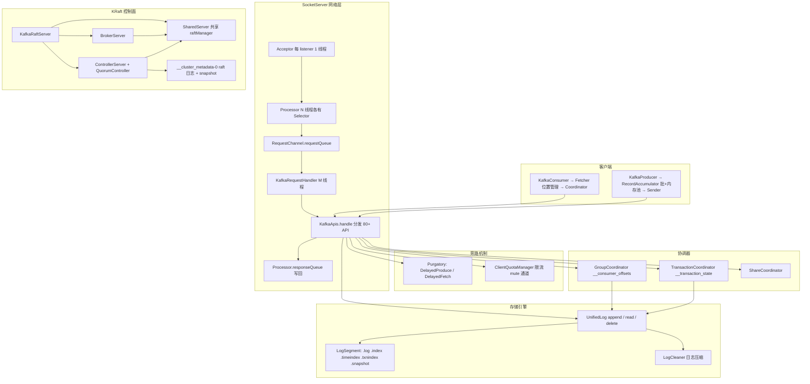

**三条主线**：
1. **数据流**：record 序列化 → 进 RecordAccumulator 批次 → ProduceRequest 过网络 → KafkaApis.handleProduceRequest → ReplicaManager.appendRecords → UnifiedLog.append → LogSegment 落盘 → 等 ISR ack → ProduceResponse 回客户端
2. **控制流**：字节流 → Processor 解析 RequestHeader → requestQueue → KafkaRequestHandler → KafkaApis 按 ApiKeys 分发 → 同步/异步（Purgatory/CompletableFuture）→ Response 回 responseQueue → Processor 写 socket
3. **恢复流**：broker 崩溃 → 重启后 LogManager.loadLogs 按 recovery-point 截断恢复分区 → 未提交事务标记清理；controller 崩溃 → raft 重新选主 → 新 leader 重放 __cluster_metadata 日志/snapshot 重建内存镜像 → broker 通过 BrokerRegistration/BrokerHeartbeat 重新注册

---

## 面试速通：Kafka 高频问题一页纸

> 这是一张"先给结论、被追问再按讲次展开"的速查卡：以下所有一句话结论均提炼自各讲小结的"三个最值得记住的点"与端到端演算，
> 追求 30 秒能答、答完能指路；本页是索引不是正文——任何结论被追问细节，必须回到对应讲次精读，
> 尤其是该讲的"端到端演算"，它把结论串成了可复述的故事。

### 高频 Q&A（先结论）

| # | 面试问题 | 一句话结论 | 深入 |
|---|---|---|---|
| 1 | ISR 与 HW/LEO 是什么关系？ | ISR 是与 leader 保持同步的副本集合，follower 追平后 leader 才推进 HW；消费上界按隔离级别分别取 LEO/HW/LSO | 第一讲、第三讲 |
| 2 | acks=all 的语义？ | 等 ISR 中足够多副本追平 requiredOffset 才返回（框架统一走 DelayedProduce 逐分区检查）；acks=0 时 broker 回 NoOpResponse，出错只能靠断连让 producer 感知 | 第一讲 |
| 3 | 幂等 Producer 怎么去重？ | pid+epoch+sequence 三元组；sequence 只在首次 drain 时分配、重试带原序号重发，broker 侧 ProducerStateManager 发现序号已见即判重短路，返回已落盘 offset | 第四讲、第三讲 |
| 4 | 事务 Producer 的两阶段？ | EndTxn → PREPARE_* 先落 `__transaction_state` 日志 → 向所有参与分区广播 TransactionMarker → COMPLETE_*；PREPARE 状态是崩溃恢复的锚点，重启后必须补发未写完的 marker | 第六讲 |
| 5 | Consumer Group rebalance 流程？ | classic 协议：JoinGroup 上报订阅、SyncGroup 由 leader 算好分配分发全员、Heartbeat 保活；new 协议（KIP-848）：单个 ConsumerGroupHeartbeat 由 broker 指派目标、客户端增量执行并心跳 ack | 第五讲 |
| 6 | Kafka 为什么快？ | 五层叠加，缺一层都会掉一个量级：①**顺序追加**，数据只往 `.log` 尾部写，顺序写是磁盘最快模式；②**攒批**，producer 侧 `RecordAccumulator`（`RecordAccumulator.java:68`）分区别队+内存池+sticky 分区（`:275`/`:302`/`:333`），`Sender` 按节点 drain（`:852-937`）把随机写并成批量顺序请求；③**分区即并行单元**，多分区可并行 append，partition 数就是写入并行度；④**读侧零拷贝**，`LogSegment.read`（`LogSegment.java:431`）slice 出共享同一 FileChannel 的视图（不拷字节），`FileRecords.writeTo`（`FileRecords.java:302`）走 `transferFrom`，明文路径直落 `fileChannel.transferTo(position, count, socketChannel)`（`PlaintextTransportLayer.java:213`）——sendfile 全程不过用户态；TLS 加密时这条快路径失效，退化成先解密再写（`SslTransportLayer.java:1003`，`TransferableChannel.java:39` 注释明说 fast path 只对 JDK 内部类生效）；⑤**读路径轻**，`.index` 每 4KB 一条稀疏记录，查找先二分再小范围顺序扫；压缩批 broker 侧只做 CRC/压缩类型初检（`UnifiedLog.java:1128`），不逐条解压。另外全程读写优先命中 OS page cache，刷盘交给内核 | 第三讲、第四讲 |
| 7 | KRaft 模式解决了什么？ | 4.3.1 已纯 KRaft（无 ZooKeeper）：控制面完全由 `__cluster_metadata-0` 这一条 raft 日志驱动，controller 是唯一写者、单线程事件队列保证"先应用后响应"的顺序一致 | 第二讲 |
| 8 | 分区副本同步与 leader 选举？ | offset 只在 leader 分配且必须持锁，follower 只校验 offset 衔接（不衔接抛 UnexpectedAppendOffsetException）；leader 变更后按 leader epoch cache 截断恢复，新 leader 由 controller replay 记录时选出 | 第二讲、第三讲 |
| 9 | log 在磁盘上的结构？ | 一个分区一个目录，每个 segment 四件套 `.log`/`.index`/`.timeindex`/`.txnindex`，外加 producer 状态 `.snapshot`；索引是稀疏的，不是每条消息都有 | 第三讲 |
| 10 | 日志压缩（compact）怎么做？ | 按 key 保留最新值：buildOffsetMap 用 SkimpyOffsetMap 记每个 key 最后一次 offset → 按大小分组 → cleanSegments 写 `.cleaned` 新段再原子替换，checkpoint 保证不重复压缩 | 第三讲 |
| 11 | rebalance 有什么坑？ | eager 协议停整个世界：全组两轮 join、一次性撤销全部分区再重新分配；cooperative-sticky 只撤销待移动分区，2-3 轮心跳收敛，其余分区全程不停顿 | 第五讲 |
| 12 | 为什么消费会重复？ | position 随 fetch 读取前进，而不是随 commit 前进；commit 只是把当前位置"存档"供重启/再均衡后恢复，两者之间的窗口就是重复消费窗口 | 第五讲 |
| 13 | READ_COMMITTED 为什么消费不到最新数据？ | 读上界是 LSO 而非 LEO，未完结事务（Begin 后无 End）会卡住 lastStableOffset 不前进；aborted 事务靠 `.txnindex` 在读取时过滤——存储引擎不删数据，只是"不让你看" | 第三讲、第六讲 |
| 14 | 如何防僵尸 producer？ | pid fence 靠 epoch 单调递增：InitProducerId 对同一 transactionalId 总是提升 epoch，旧 producer（哪怕是僵尸）的任何请求都被拒收 PRODUCER_FENCED | 第六讲 |
| 15 | Kafka 如何实现顺序消费？ | 保序的两级保证：producer 侧同一分区单 in-flight（`max.in.flight.requests.per.connection ≤ 5` + 幂等靠 sequence 重排序，乱序也能纠正）；consumer 侧**单线程单分区**——分区是顺序的最小单元，一个分区同时只被一个消费者消费，多线程消费同一分区就破序。要全局顺序只能单分区，要吞吐就按 key 哈希分区保"相关消息"有序 | 第四讲、第五讲 |
| 16 | Kafka 如何保证消息不丢失？ | 三段各设防线：producer `acks=all` + `retries` 拉满 + 发送失败回调兜底；broker `min.insync.replicas ≥ 2`（ISR 至少两个副本 ack 才认）、`unclean.leader.election.enable=false`（不许落后副本当选）；consumer 关自动提交、业务处理成功后**手动提交 offset**（先处理后提交，重复好过丢失）。全链闭合才叫不丢 | 第一讲、第五讲 |
| 17 | Kafka 消息的发送过程简单介绍一下？ | producer `send()` 只是把 record 塞进 `RecordAccumulator`：序列化 → 按分区器选分区 → 挂到分区别队或新建批次（`RecordAccumulator.java:275`）→ 后台 `Sender` 线程按 broker 节点 drain 批次（`:852-937`）凑成 `ProduceRequest` → 过网络到 broker → `KafkaApis.handleProduceRequest` → `ReplicaManager.appendRecords` → `UnifiedLog.append` 落盘 → 等 ISR ack 到 requiredOffset → `ProduceResponse` 回客户端（`acks=all` 时 DelayedProduce 会挂起等满足条件） | 第四讲 |

**使用方式**：先答"一句话结论"，面试官点头即过；一旦追问，按右列"深入"跳到对应讲次，
优先看该讲的端到端演算——它是把结论串成故事的最佳素材。四个最高频的追问方向：

- **ISR/HW/acks 被追问** → 第一讲"一条 acks=1 的 produce 请求"十步演算，看 DelayedProduce 如何等 requiredOffset、
  HW 如何被 follower 追赶推进，以及响应如何经三级队列回到 socket；
- **幂等/重试被追问** → 第四讲"幂等 producer 重试一次网络超时"五步演算，看 sequence 为什么不重新分配、
  broker 侧如何对已见序号判重短路并返回已落盘 offset；
- **rebalance 被追问** → 第五讲"3 消费者组的一次 cooperative-sticky 扩容"六步演算，看为什么只有分区 2、3 经历撤销-移交、
  其余四个分区的消费从未停顿；
- **事务被追问** → 第六讲"consume-transform-produce 事务"八步演算，看 PREPARE 状态如何在崩溃重启后兜底补发 marker、
  位移如何以挂起态落定。

### 易错点与面试坑

- **HW 不前进 ≠ 没数据**：acks=all 下 follower 掉队会卡住 DelayedProduce 的 requiredOffset，produce 侧表现为超时重试而非立即报错；
  排查先看 ISR 进度与副本追赶，而不是反复重发或怀疑丢数据。
- **READ_COMMITTED 的上界是 LSO 不是 LEO**：未完结事务（Begin 后无 End）会卡住 lastStableOffset，消费者看到"生产成功但消费不到"；
  此时查 fetch 配置毫无意义，要等事务落定，或去 `.txnindex` 看有没有 aborted 批次。
- **timeindex 同样是稀疏的**：与 offset 索引一样每 4KB 才记一条 timestamp→offset，按时间戳查 offset 只能二分定位后小范围扫描；
  指望按时间戳精确命中某条消息是不现实的。
- **重试批次不重新分配 sequence**：幂等的全部秘密就在"序号只在首次 drain 分配"这六个字；
  没有幂等时，同样的重试就是真实的重复消息——这正是 KIP-98 引入 pid+sequence 的动机。
- **offset 只在 leader 分配且必须持锁**：follower 只校验衔接，不衔接直接抛 UnexpectedAppendOffsetException；
  同一 offset 在全集群只有一个"正统"写入者，这也是 leader 变更后必须截断恢复的原因。
- **事务 ≠ 端到端恰好一次**：事务保证的是"位移提交与数据写入原子"，消费侧崩溃重拉仍可能重复处理；
  面试时把 Kafka 事务说成"实现 exactly-once"是常见扣分点。
- **删除绝不碰高水位之上**：deleteOldSegments 的谓词再激进也不会删 HW 之上的段，log start offset 只随删段单调前进；
  "数据还在磁盘上"和"你能读到"是两回事，别把 retention 到期和可读性混为一谈。
- **手动 assign 没有组概念**：`hasAutoAssignedPartitions` 是两套协议的分水岭，手动 assign 完全不进协调器世界；
  "用了 KafkaConsumer 就会 rebalance"是想当然，被问到时先确认对方的订阅方式。

### 关键数值与默认值速记

| 配置/常量 | 值 | 出现场景 |
|---|---|---|
| `queuedMaxRequests` | 500 | requestQueue 容量（第一讲） |
| Purgatory watcher shards | 512 | 按 key 哈希分片降锁竞争（第一讲） |
| `ConnectionQueueSize` | 20 | Processor 每轮最多注册的新连接数（第一讲） |
| Processor `poll` 超时 | 300ms | 无事件时阻塞等待（第一讲） |
| Acceptor select 超时 | 500ms | 主循环阻塞等待（第一讲） |
| `Request` 时间戳字段 | 8 个 volatile | 五段耗时解剖的载体（第一讲） |
| `brokerHeartbeatIntervalMs` | 2s | broker 向 controller 心跳续约（第二讲） |
| 元数据记录 schema | 25 种 | `__cluster_metadata-0` 的记录类型（第二讲） |
| `segment.bytes` | 1GB | 段滚动的大小判据（第三讲） |
| `indexIntervalBytes` | 4KB | 稀疏索引条目间隔（第三讲） |
| flushInterval | Long.MAX | 不主动刷盘，靠后台定时任务（第三讲） |
| `max.in.flight.requests.per.connection` | 5 | 单连接未确认请求数，>1 需配幂等保序（第四讲） |
| `retries` | Integer.MAX | 配合 `delivery.timeout.ms` 界定总重试窗口（第四讲） |
| `heartbeat.interval.ms`（new 协议） | 5s | ConsumerGroupHeartbeat 发送间隔（第五讲） |
| `offsets.topic.num.partitions` | 50 | `__consumer_offsets` 分区数，决定组分片（第六讲） |
| `offsets.retention.minutes` | 7 天 | 空组位移过期删除（第六讲） |
| `min.insync.replicas` | 1（第一讲演算设定值） | acks=all 的 ISR 门槛（第一讲） |

> 收录纪律：本表只收本文档正文明确出现过的默认值/常量；文档未给默认值的配置（linger.ms、batch.size、session.timeout.ms 等）一律不凭记忆补录，
> 面试前如需准确默认值请以官方配置文档为准，避免把"记得大概"说成确定结论。

---

## 第一讲：网络层与请求处理全链路

### 定位

`core/src/main/scala/kafka/network/` + `core/src/main/scala/kafka/server/` 是 broker 的"大门"：所有客户端请求在这里完成 收字节 → 解析 → 排队 → 分发 → 响应 的全过程。4.3.1 把网络层明确划分为 data-plane（客户端/副本间流量）与 controller listener（控制器流量），二者复用同一套线程模型，但由不同进程角色持有。

### 目录结构

```
core/src/main/scala/kafka/network/
├── SocketServer.scala          # Acceptor + Processor 线程模型、Selector 管理
├── RequestChannel.scala        # requestQueue / responseQueue / callbackQueue
└── package.html

core/src/main/scala/kafka/server/
├── KafkaRequestHandler.scala   # 请求处理线程池 + 异步回调调度
├── KafkaApis.scala             # 80+ API 的分发与处理（4288 行，本讲核心）
├── RequestHandlerHelper.scala  # 限流 throttle / 错误响应封装
├── DelayedFetch.scala          # Fetch 请求的 Purgatory 等待
├── ReplicaManager.scala        # 副本管理：append/fetch 的真正执行者
└── ...

server/src/main/java/org/apache/kafka/server/
├── purgatory/DelayedProduce.java          # Produce 请求的 Purgatory 等待
├── purgatory/DelayedOperationPurgatory.java # 通用的"完成等待"机制
└── quota/ClientQuotaManager.java          # 带宽/请求配额与节流
```

### 逐文件精读

#### 1. SocketServer.scala —— Acceptor/Processor 线程模型

`SocketServer` 类（`core/src/main/scala/kafka/network/SocketServer.scala:71`）在注释里定义了线程模型（`:60-70`）：**每个 listener 1 个 Acceptor 线程**接受新连接，**N 个 Processor 线程**各持有一个 Selector 读请求，**M 个 Handler 线程**（在 KafkaRequestHandler 中）处理请求并产出响应。

关键字段与行为：

| 组件 | 位置 | 职责 |
|---|---|---|
| `dataPlaneAcceptors` | `SocketServer.scala:99` | 每 endpoint 一个 `DataPlaneAcceptor` |
| `dataPlaneRequestChannel` | `SocketServer.scala:100` | data-plane 共享的请求队列 |
| `memoryPool` | `SocketServer.scala:97` | `queuedMaxBytes` 控制的请求缓冲区池 |
| `createDataPlaneAcceptorAndProcessors` | `SocketServer.scala:213` | 构造 Acceptor 并按其创建 Processor |
| `enableRequestProcessing` | `SocketServer.scala:173` | 等 Authorizer 就绪后再启动 Acceptor |

**Acceptor**（`SocketServer.scala:458`）：主循环 `run()`（`:572`）只做两件事——`acceptNewConnections()`（`:623`）与 `closeThrottledConnections()`（`:700`）。接受连接后按 **round-robin** 分给 Processor（`:635-649`），分配逻辑在 `assignNewConnection`（`:709`）。若某 IP 连接数超限，`accept(key)`（`:663`）抛 `TooManyConnectionsException` 直接拒绝；若触发连接限速则进 `throttledSockets` 延迟关闭队列（`:502`、`:676-681`）。线程名为 `data-plane-kafka-socket-acceptor-...`（`:506-508`）。

**Processor**（`SocketServer.scala:797`）：真正的 I/O 引擎，每个 Processor 一个 NIO Selector（`:849`，通过 `ChannelBuilders.serverChannelBuilder` 构建，支持 SSL/SASL）。其主循环 `run()`（`:889-916`）每轮依次执行：

1. `configureNewConnections()`（`:894`）——把 Acceptor 投递的 SocketChannel 注册进 Selector，每轮最多处理 `ConnectionQueueSize = 20` 个（`:773`、`:1170`）；
2. `processNewResponses()`（`:896`）——把 Handler 产出的响应注册写事件（实现见 `:933`）；
3. `poll()`（`:897`）——`selector.poll(300)`，无新连接时阻塞 300ms（`:991-992`）；
4. `processCompletedReceives()`（`:898`）——收包、解析头部、构造 `RequestChannel.Request`、`requestChannel.sendRequest(req)` 后立即 `selector.mute(connectionId)`（`:1002-1043`）；
5. `processCompletedSends()`（`:899`）——响应写完，回调 `onComplete` 并尝试 unmute（`:1062-1085`）；
6. `processDisconnected()`（`:900`）+ `closeExcessConnections()`（`:901`）——断连清理与超额连接裁剪。

两个易被忽视的细节：
- **请求头解析在 Processor 线程完成**：`parseRequestHeader`（`:775`）会校验 API 是否启用，未启用/版本不支持直接抛异常断连；
- **mute 机制**：收到请求后 mute 通道停止读，直到响应写完才 unmute（`tryUnmuteChannel`），这是 Kafka 防单连接打满的流控手段。

#### 2. RequestChannel.scala —— 三级队列

`RequestChannel` 类（`core/src/main/scala/kafka/network/RequestChannel.scala:343`）持有三个队列（`:353-355`）：

| 队列 | 容量 | 生产者 | 消费者 |
|---|---|---|---|
| `requestQueue` | `queuedMaxRequests`（默认 500） | Processor 线程 `sendRequest`（`:379`） | Handler 线程 `receiveRequest`（`:464`） |
| `callbackQueue` | 同左 | 任意线程 `sendCallbackRequest`（`:499`） | Handler 线程，**优先于 requestQueue**（`:465-467`） |
| 各 Processor 私有 `responseQueue` | 无界 | Handler 线程 `sendResponse`（`:457`） | Processor 线程 `dequeueResponse`（`:1213`） |

`Request` 对象（`RequestChannel.scala:64`）上带了 **8 个 volatile 时间戳**（`:73-82`），把一次请求切成 requestQueue/apiLocal/apiRemote/responseQueue/responseSend 五段，`updateRequestMetrics`（`:200-272`）据此产出细粒度指标。请求体在构造时即 `context.parseRequest(buffer)`（`:86`），解析完对不含 BYTES 字段的请求立即释放缓冲区（`:103-105`）——ProduceRequest 例外，它的 records 要留着进 Purgatory。

Response 有五种（`:310-340`）：`SendResponse`（正常回包）、`NoOpResponse`（acks=0 无需响应）、`CloseConnectionResponse`（出错断连）、`StartThrottlingResponse`/`EndThrottlingResponse`（限流 mute/unmute 信号）。

`callbackQueue` 的存在是为了让**异步完成的请求**（如 Purgatory 里被唤醒的 fetch）能跳回 Handler 线程执行收尾逻辑，相关机制见下一节 `wrapAsyncCallback`。

#### 3. KafkaRequestHandler.scala —— 处理线程池与异步回调

`KafkaRequestHandlerPool`（`core/src/main/scala/kafka/server/KafkaRequestHandler.scala:223`）创建 M 个 daemon 线程（`createHandler`，`:257`，线程名 `data-plane-kafka-request-handler-N`，`:271`），且支持运行中动态扩缩容（`resizeThreadPool`，`:279`）。

单个 Handler 的主循环 `run()`（`:105`）：

```scala
val req = requestChannel.receiveRequest(300)   // :114 带超时的阻塞取请求
...
case request: RequestChannel.Request =>
  request.requestDequeueTimeNanos = endTime
  apis.handle(request, requestLocal)           // :163 进入 KafkaApis
  request.releaseBuffer()                      // :171 finally 里释放
```

`wrapAsyncCallback`（`KafkaRequestHandler.scala:62`）是理解 Kafka 异步模型的关键：若异步回调执行时仍在**同一个 Handler 线程**，直接执行；否则通过 `requestChannel.sendCallbackRequest` 把回调包装成 `CallbackRequest` 投进 callbackQueue，由任一 Handler 线程执行（`:78`）。这保证了"响应只能在 Handler 线程构造并投递"的线程安全约定。

#### 4. KafkaApis.scala —— API 分发总机

`KafkaApis.handle`（`core/src/main/scala/kafka/server/KafkaApis.scala:152`）是一个巨型 match（`:169-250`），把 `ApiKeys` 映射到处理方法。三类去向：

- **本地处理**：PRODUCE → `handleProduceRequest`（`:396`）、FETCH → `handleFetchRequest`（`:563`）、OFFSET_COMMIT → `handleOffsetCommitRequest`（`:273`）等；
- **转发 Controller**：CREATE_TOPICS、ALTER_CONFIGS、ELECT_LEADERS 等写元数据类请求 `forwardToController`（`:131`），经 ForwardingManager 封装成 EnvelopeRequest 发往控制器；
- **异步组合**：JOIN_GROUP、HEARTBEAT 等返回 `CompletableFuture`，用 `.exceptionally(handleError)` 收尾（`:174`）。

`handle` 的 finally 块（`:254-263`）固定调用 `replicaManager.tryCompleteActions()`——这是驱动 Purgatory 完成检查的入口之一。

**Produce 路径**（`handleProduceRequest`，`:396`）：
1. 鉴权 + 按 topic 分组（`:414-450`），无法解析/未授权/不存在分别进不同的错误 Map；
2. `replicaManager.handleProduceAppend(...)`（`:543`）落盘，`sendResponseCallback`（`:457`）作为完成回调；
3. 回调里计算配额：`quotas.produce.maybeRecordAndGetThrottleTimeMs` 与 `quotas.request...` 取较大值（`:490-496`），超限则 `requestHelper.throttle` mute 通道；
4. acks=0 时若全部成功发 `NoOpResponse`，有错误则直接断连（`:507-528`）——因为 producer 不期待响应，只能靠断连让它感知。

**Fetch 路径**（`handleFetchRequest`，`:563`）：鉴权后把分区分为 `erroneous`/`interesting`（`:584-620`），`interesting` 交给 `replicaManager.fetchMessages`（`:769`），参数 `FetchParams`（`:758-766`）携带 `maxWaitMs`、`fetchMinBytes`、`fetchMaxBytes` 与隔离级别（`FetchIsolation`：LOG_END/HIGH_WATERMARK/TXN_COMMITTED）。若凑不够 `minBytes`，请求进入 Purgatory 等待（见下节）。

#### 5. Purgatory —— 请求完成等待机制

`DelayedOperationPurgatory`（`server-common/src/main/java/org/apache/kafka/server/purgatory/DelayedOperationPurgatory.java`）是一个通用"待完成操作"容器：

- watcher 列表按 key 哈希分 **512 个 shard** 降低锁竞争（`:41`、`:93-96`）；
- `tryCompleteElseWatch(operation, watchKeys)`（`:122`）：先试 `tryComplete()`，不能完成则挂到所有 watch key 上，同时进超时定时器；
- `checkAndComplete(key)`（`:184`）：当某 key 对应的事件发生（如追赶到位），唤醒并重试该 key 上所有操作。

两个最常用的具体化：

- **DelayedProduce**（`server/src/main/java/org/apache/kafka/server/purgatory/DelayedProduce.java:40`）：等待 ISR 中足够多副本追平 `requiredOffset`。构造时把所有分区预置为 `REQUEST_TIMED_OUT`（`:110-120`），`tryComplete()`（`:139`）逐个分区委托 `PartitionStatusValidator`（由 ReplicaManager 提供）检查副本进度，全部满足才真正完成。
- **DelayedFetch**（`core/src/main/scala/kafka/server/DelayedFetch.scala:41`）：`tryComplete()`（`:68-144`）枚举了 Case A–H——不再是 leader、副本没了、epoch 被 fence、fetch offset 落在旧段、**累计字节达到 minBytes**（Case G，`:139-141`）等。`maxWaitMs` 到期则由 `ExpiredOperationReaper` 强制完成，返回已有数据。

两处 `tryCompleteElseWatch` 的调用点在 `ReplicaManager.scala:910`（produce）与 `ReplicaManager.scala:1744`（fetch）；事件驱动的 `checkAndComplete` 在 `ReplicaManager.scala:305-309`（append/fetch 推进时按 TopicPartitionOperationKey 唤醒）。

#### 6. ClientQuotaManager —— 配额与限流

`ClientQuotaManager`（`server/src/main/java/org/apache/kafka/server/quota/ClientQuotaManager.java:51`）按 user/client-id 维度维护 Sensor：

- `recordAndGetThrottleTimeMs`（`:334`）：记录用量，超配额则算出需要等待的毫秒数；
- `throttle`（`:393`）：把 `ThrottledChannel` 加进 `delayQueue`，到点后回调 `ThrottleCallback.startThrottling/endThrottling`，最终转化为 `RequestChannel` 的 `StartThrottlingResponse`/`EndThrottlingResponse`，由 Processor mute/unmute 通道（`RequestHandlerHelper.scala:34-44`）；
- `unrecordQuotaSensor`（`:368`）：fetch 被限流返回空响应时"反记录"已记录的值——Sensor 无法先查后记，这是权宜之计；
- `maxValueInQuotaWindow`（`:378`）：返回本次最多能取多少字节而不被限流，KafkaApis 用它裁掉过大的 `fetchMaxBytes`（`KafkaApis.scala:738-743`）。

### 关键流程图

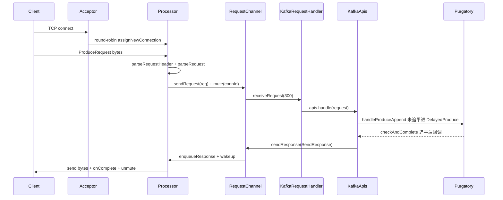

### 输入/输出表

| 阶段 | 输入 | 输出 | 关键行号 |
|---|---|---|---|
| Acceptor 接受连接 | `SelectionKey.OP_ACCEPT` | SocketChannel 分派给 Processor | `SocketServer.scala:633-649` |
| Processor 收包 | socket 字节流 | `RequestChannel.Request`（含 RequestContext） | `SocketServer.scala:1022-1040` |
| Handler 分发 | `RequestChannel.Request` | 各 API 处理（本地或转发） | `KafkaApis.scala:169-250` |
| Produce 处理 | ProduceRequest | DelayedProduce → PartitionResponse Map | `KafkaApis.scala:396-557` |
| Fetch 处理 | FetchRequest | DelayedFetch → FetchPartitionData | `KafkaApis.scala:563-776` |
| 配额检查 | session + clientId + bytes | throttleTimeMs（0 或等待时长） | `ClientQuotaManager.java:334-346` |
| 响应回写 | `RequestChannel.Response` | socket 字节 + metrics 更新 | `SocketServer.scala:974-989` |

### 端到端演算：一条 acks=1 的 produce 请求

> 🎬 配套动画：[Kafka 一条 produce 的旅程](/animations/kafka-produce/) —— 10 步单步播放，LEO/HW/Purgatory 同步变化。

设 topic `orders` 3 分区，分区 1 的 leader 是 broker 1，ISR = {1,2}，`min.insync.replicas=1`，客户端 `acks=1`。

1. **发送**：producer 把 record 写进 `RecordAccumulator` 的 `orders-1` 批次（详见第四讲），Sender 凑成 `ProduceRequest(acks=1)` 发往 broker 1:9092；
2. **接收**：broker 1 的 Acceptor 早已把该连接 round-robin 给 Processor 3；Processor 3 `poll()` 得到可读事件，`processCompletedReceives` 解析出 `RequestHeader(apiKey=PRODUCE, apiVersion=11)`，构造 `RequestChannel.Request` 投进 `requestQueue`，并 mute 该连接（`SocketServer.scala:1040-1041`）；
3. **分发**：Handler-7 `receiveRequest` 取到请求，`KafkaApis.handle` → `handleProduceRequest`（`KafkaApis.scala:170`、`:396`）；
4. **落盘**：`replicaManager.handleProduceAppend` 先做事务校验（非事务请求直接过），`appendRecords` 调 `UnifiedLog.appendAsLeader`（第三讲）写入 `orders-1` 的活动 segment，返回 offset 100（假设 LEO=100）；
5. **等待 ack**：acks=1 且本地已写，但框架统一走 `DelayedProduce`：构造时把分区状态置为 `REQUEST_TIMED_OUT`（`DelayedProduce.java:110-120`），`tryCompleteElseWatch` 挂到 key `orders-1` 上；
6. **副本追赶**：follower broker 2 的 ReplicaFetcherThread 拉到 offset 100，leader 推进 HW=101，触发 `delayedProducePurgatory.checkAndComplete(new TopicPartitionOperationKey("orders-1"))`（`ReplicaManager.scala:862`）；
7. **完成回调**：`tryComplete` 发现本地 offset 100 ≥ requiredOffset 100 且 ISR 满足，从 Purgatory 移除，`responseCallback`（即 `sendResponseCallback`）在 Handler 线程被调用，带上 `PartitionResponse(baseOffset=100, error=NONE)`；
8. **配额与响应**：`sendResponseCallback` 记录带宽配额（`KafkaApis.scala:492`），未超限直接 `requestChannel.sendResponse(request, new ProduceResponse(...))`（`:527`）；
9. **回写**：`RequestChannel.sendResponse` 找到 Processor 3 的 `responseQueue`，`enqueueResponse` + `wakeup`（`RequestChannel.scala:456-457`）；Processor 3 下一轮 `processNewResponses` → `sendResponse` 注册写事件，socket 可写后 `processCompletedSends` 触发 `onComplete` 与 `unmute`（`SocketServer.scala:1077-1078`）；
10. **客户端收尾**：producer 的 `Sender.handleProduceResponse` 把 offset 100 填进 `RecordMetadata`，唤醒等待的 future。

### 第N讲小结：线程模型 + 三级队列 + Purgatory 三分天下

**一句话定位**：broker 的网络层是"1 Acceptor + N Processor + M Handler"的三段流水线，中间用 `RequestChannel` 的三级队列解耦，凑不齐条件的请求挂进 Purgatory 等事件唤醒，超额的客户端被 ClientQuotaManager mute 通道——整个设计用一个" mute/unmute + 时间戳打点"的轻量机制同时解决了背压、流控与可观测性。

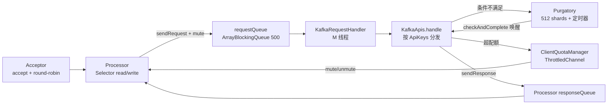

**网络链路的输入/输出与关键常量**：

| 组件 | 输入 | 输出 | 关键常量/行号 |
|---|---|---|---|
| Acceptor | 新 TCP 连接 | 分派给 Processor 的 SocketChannel | select 超时 500ms（`SocketServer.scala:624`） |
| Processor | socket 字节 | Request / Response | ConnectionQueueSize=20（`:773`），poll 300ms（`:992`） |
| requestQueue | Request | 被 Handler 取走 | queuedMaxRequests 默认 500 |
| callbackQueue | CallbackRequest | 被 Handler 优先执行 | 优先于 requestQueue（`RequestChannel.scala:465`） |
| Purgatory | DelayedOperation + keys | 完成或超时的操作 | 512 shards（`DelayedOperationPurgatory.java:41`） |
| ClientQuotaManager | 用量值 | throttleTimeMs | 超限即 mute 通道 |

**三个最值得记住的点**：

1. **mute/unmute 是全局流控轴**：收到请求 mute 停止读、响应写完 unmute；限流则提前 mute 到 throttle 时间点——Processor 不需要理解业务语义就能实现背压；
2. **五段式时间戳**：requestQueue/apiLocal/apiRemote/responseQueue/responseSend，靠 `Request` 上的 volatile 字段（`RequestChannel.scala:73-82`）在四个线程间传递，一次请求的耗时解剖全在这里；
3. **回调必须回 Handler 线程**：`wrapAsyncCallback`（`KafkaRequestHandler.scala:62`）用 ThreadLocal 检测当前线程，跨线程就重新入 callbackQueue——这是 Kafka 异步正确性的基石。

---

## 第二讲：KRaft 元数据与 Controller

### 定位

KRaft（KIP-500/631）把元数据从 ZooKeeper 迁到 Kafka 自己的 raft 日志。4.3.1 中控制面完全由 `__cluster_metadata-0` 这一个内部分区的 raft 日志驱动，controller 是唯一能向该日志写入 `ApiMessageAndVersion` 记录的组件，broker 通过注册/心跳/拉取元数据快照与 controller 交互。本讲回答三个问题：controller 怎么产生、元数据怎么流转、broker 怎么跟上。

### 目录结构

```
core/src/main/scala/kafka/
├── server/
│   ├── KafkaRaftServer.scala       # 进程入口：按 process.roles 组装 broker/controller
│   ├── SharedServer.scala          # broker 与 controller 共享的底座（含 raftManager）
│   ├── ControllerServer.scala      # 控制器组装（QuorumController + ControllerApis）
│   ├── BrokerServer.scala          # broker 组装（BrokerLifecycleManager + KafkaApis）
│   ├── ControllerApis.scala        # controller 侧的 API 处理
│   └── ControllerRegistrationManager.scala  # KIP-919 控制器注册
├── raft/KafkaRaftManager.scala     # raft 客户端装配（log + netChannel + driver）
└── coordinator/group/CoordinatorPartitionWriter.scala  # 协调器分区写入 raft 的桥

raft/src/main/java/org/apache/kafka/raft/
├── KafkaRaftClient.java            # raft 状态机核心
├── KafkaRaftClientDriver.java      # 单线程驱动 raft 状态迁移
├── ControlRecord.java              # raft 控制记录（Vote/BeginEpoch/EndEpoch）
└── internals/KRaftControlRecordStateMachine.java

metadata/src/main/java/org/apache/kafka/
├── controller/QuorumController.java        # 控制器大脑（事件队列 + 各 ControlManager）
├── controller/OffsetControlManager.java    # 元数据日志的事务与快照偏移管理
├── controller/ClusterControlManager.java   # broker 注册/心跳/fence
├── controller/ReplicationControlManager.java
├── controller/ConfigurationControlManager.java
└── metadata/KRaftMetadataCache.java        # broker 侧元数据缓存

metadata/src/main/resources/common/metadata/*.json   # 元数据记录 schema（25 种）
server/src/main/java/org/apache/kafka/server/BrokerLifecycleManager.java
```

### 逐文件精读

#### 1. KafkaRaftServer.scala —— 三种进程角色

`KafkaRaftServer`（`core/src/main/scala/kafka/server/KafkaRaftServer.scala:47`）根据 `process.roles` 决定组装什么：

```scala
private val sharedServer = new SharedServer(config, metaPropsEnsemble, time, metrics, ...)  // :63
private val broker: Option[BrokerServer] = if (config.processRoles.contains(ProcessRole.BrokerRole)) ...  // :74
private val controller: Option[ControllerServer] = if (config.processRoles.contains(ProcessRole.ControllerRole)) ...  // :80
```

启动顺序有讲究：`startup()` 中 **controller 先于 broker**（`:90-98`），因为 controller 的 endpoint 要先注册进 raft manager；关闭顺序相反，broker 先关（`:100-107`），毕竟受控关闭需要 controller 配合。三个元数据常量（`:116-118`）：`MetadataTopic = "__cluster_metadata"`、`MetadataPartition = 0`、`MetadataTopicId = METADATA_TOPIC_ID`（定义于 `clients/src/main/java/org/apache/kafka/common/internals/Topic.java:30`）。`initializeLogDirs`（`:129`）还会校验 `__cluster_metadata-0` 没有出现在非 metadata log dir 中（`:142-152`）。

#### 2. SharedServer.scala —— 共享底座

`SharedServer`（`core/src/main/scala/kafka/server/SharedServer.scala:95`）是 combined 模式（broker+controller 同进程）的关键：

- `startForBroker()`（`:142`）/ `startForController(listenerInfo)`（`:152`）：谁先用谁初始化，引用计数式使用（`usedByBroker`/`usedByController`，`:135`）；
- 核心是**唯一一个 `KafkaRaftManager`**（`:291-308`），broker 与 controller 共享同一个 raft client 实例（`raftManager` 字段在 `:121`）；
- `requestHandlerPoolFactory`（`:118`）也被两者共享，但 broker 与 controller 各自创建独立的 handler 池（池名分别为 `BrokerRequestHandlerAvgIdlePercent`/`ControllerRequestHandlerAvgIdlePercent`，见 `KafkaRequestHandler.scala:239-245`）；
- `_raftManager.client.register(loader)`（`:356`）：把 `MetadataLoader` 注册为 raft client 的 listener，元数据日志/snapshot 的变化由此驱动镜像更新。

#### 3. KafkaRaftManager.scala 与 raft 客户端

`KafkaRaftManager`（`core/src/main/scala/kafka/raft/KafkaRaftManager.scala:84`）把三样东西装配到一起（`:126-131`）：`raftLog`（`KafkaRaftLog`，即 metadata log dir 里的 `__cluster_metadata-0` 日志，`buildMetadataLog` 在 `:193`）、`netChannel`（`KafkaNetworkChannel`，`:183`）、`client`（`KafkaRaftClient`，`:163`），外加单线程的 `clientDriver`（`:131`）。`startup()`（`:133`）依次 `client.initialize`（载入 voters 与 `FileQuorumStateStore`）、启动网络通道与驱动线程。

raft 日志里混着两种记录：
- **元数据记录**（`ApiMessageAndVersion`）：25 种 schema 定义在 `metadata/src/main/resources/common/metadata/*.json`（如 `RegisterBrokerRecord.json` apiKey=0、`TopicRecord.json`、`PartitionChangeRecord.json`）；
- **控制记录**（`raft/src/main/java/org/apache/kafka/raft/ControlRecord.java:32`）：VOTE/BEGIN_QUORUM_EPOCH/END_QUORUM_EPOCH，由 raft 协议自身产生，`KRaftControlRecordStateMachine`（`raft/src/main/java/org/apache/kafka/raft/internals/KRaftControlRecordStateMachine.java:51`）负责在日志与快照间对齐时跳过它们。

#### 4. ControllerServer.scala —— 控制器组装

`ControllerServer.startup()`（`core/src/main/scala/kafka/server/ControllerServer.scala:129`）的主线：

1. 启动 SocketServer（controller listener）并 `sharedServer.startForController(listenerInfo)`（`:199`）；
2. 用 Builder 构造 `QuorumController`（`:235-265`），注入 `setRaftClient(raftManager.client)`、`setSessionTimeoutNs(config.brokerSessionTimeoutMs...)` 等参数；
3. 构造 `ControllerApis`（`:281`）并创建独立的 controller handler 池（`:292-299`，线程名含 "controller"）；
4. 注册三类 publisher（`:302-308`）：`KRaftMetadataCachePublisher`（更新 broker 视图缓存）、`FeaturesPublisher`、`ControllerRegistrationManager`（KIP-919，周期性向元数据日志写 `RegisterControllerRecord`）；
5. `sharedServer.loader.installPublishers(metadataPublishers, ...)`（`:395`）把 publishers 挂到 `MetadataLoader` 上。

#### 5. QuorumController.java —— 事件队列驱动的状态机

`QuorumController`（`metadata/src/main/java/org/apache/kafka/controller/QuorumController.java:175`）是控制器的大脑，核心机制有三：

**(a) 单线程事件队列**。所有写操作经 `appendWriteEvent`（`:960`）进入队列，实际执行在 `ControllerWriteEvent` 上；raft 提交回调 `QuorumMetaLogListener.handleCommit`（`:975`）同样入队——**先应用后响应**，保证顺序一致。

**(b) 记录应用 `replay`**。`replay(ApiMessage, Optional<OffsetAndEpoch>, long)`（`:1213-1309`）是一个按 `MetadataRecordType` 分发的 switch，把每种记录喂给对应 ControlManager：`RegisterBrokerRecord → clusterControl`、`TopicRecord/PartitionChangeRecord → replicationControl`、`ConfigRecord → configurationControl`、`BeginTransactionRecord → offsetControl` 等。启动/追赶时先 `handleLoadSnapshot`（`:1032`）重放快照，再重放其后的日志。

**(c) 元数据日志事务 + 快照**。`appendRecords`（`:897`）区分原子/非原子写入；`OffsetControlManager`（`metadata/src/main/java/org/apache/kafka/controller/OffsetControlManager.java:47`）管理"最后提交偏移/最后稳定偏移"：controller 当选时 `activate` 会在最后稳定偏移处**创建内存快照**（`:252`），每次 `handleScheduleAppend` 后也 `idempotentCreateSnapshot`（`:305`），`maybeAdvanceLastStableOffset` 时清理更旧的快照（`:328`）。这些内存快照正是落盘 `snapshot` 文件（`__cluster_metadata-0/<offset>-<epoch>-checksum.checkpoint`）的数据源，供 follower 与重启后快速加载。未提交事务（Begin 后无 End）会卡住 lastStableOffset 不前进，对应 `TransactionState` 的 PREPARE 语义（第六讲）。

#### 6. ControllerApis.scala 与 broker 注册/心跳

controller 侧的 API 集合（`core/src/main/scala/kafka/server/ControllerApis.scala:94-126`）与 broker 侧形成有趣对照：它处理 **raft 协议 API**（VOTE `:103`、BEGIN_QUORUM_EPOCH `:104`、END_QUORUM_EPOCH `:105`、DESCRIBE_QUORUM `:106`、FETCH `:97` 元数据拉取、FETCH_SNAPSHOT `:98`）、**broker 生命周期 API**（BROKER_REGISTRATION `:108`、BROKER_HEARTBEAT `:109`、UNREGISTER_BROKER `:110`）、以及 **转发来的管理 API**（ENVELOPE `:119`，即 broker 转发的 CreateTopics 等）。`handleBrokerHeartBeatRequest`（`:611`）直接调 `controller.processBrokerHeartbeat`。

broker 侧的注册/心跳由 `BrokerLifecycleManager`（`server/src/main/java/org/apache/kafka/server/BrokerLifecycleManager.java:75`）驱动：`BrokerServer.startup()` 创建专用于心跳的 `NodeToControllerChannelManagerImpl`（`BrokerServer.scala:410-418`，间隔 `brokerHeartbeatIntervalMs`，默认 2s），随后 `lifecycleManager.start(...)`（`:419-426`）发出首次注册（携带 `listenerInfo.toBrokerRegistrationRequest` 与干净关闭时读到的 broker epoch）。controller 收到注册后回复 `brokerEpoch`，此后 broker 每次心跳带上 epoch——epoch 不匹配即被 fence，这是 KRaft 防脑裂的核心手段。

#### 7. 元数据如何到达 broker

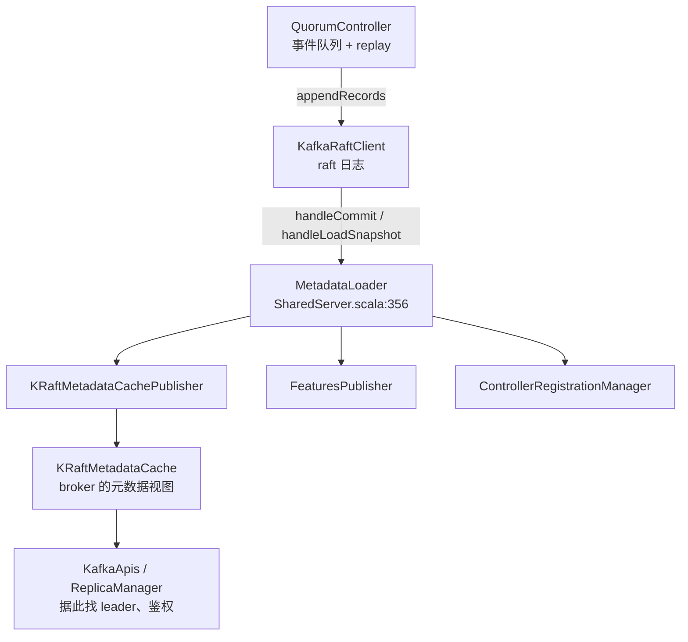

broker 侧 `KRaftMetadataCache`（`metadata/src/main/java/org/apache/kafka/metadata/KRaftMetadataCache.java`）持有 topic/partition/leader 视图，`KafkaApis.handleProduceRequest` 里 `metadataCache.getTopicId/getLeaderAndIsr` 等调用全部来自它。注意 **broker 不直接读 raft 日志**——是 controller 把每条提交的记录经由 publisher 推送过来，这就是"元数据 raft 日志驱动一切"的含义。

### 输入/输出表

| 组件 | 输入 | 输出 | 关键行号 |
|---|---|---|---|
| KafkaRaftServer | KafkaConfig（process.roles） | BrokerServer/ControllerServer/SharedServer | `KafkaRaftServer.scala:74-88` |
| KafkaRaftManager | metadata log dir + voters | KafkaRaftClient 就绪 | `KafkaRaftManager.scala:126-131` |
| QuorumController.appendWriteEvent | ControllerWriteOperation | 记录进 raft 日志 + future | `QuorumController.java:960-973` |
| QuorumController.replay | ApiMessageAndVersion | 各 ControlManager 内存状态更新 | `QuorumController.java:1213-1309` |
| OffsetControlManager.activate | 最后稳定偏移 | 内存快照（落盘 snapshot 的源头） | `OffsetControlManager.java:241-255` |
| ControllerApis.handleBrokerHeartBeat | BrokerHeartbeatRequest | BrokerHeartbeatReply（含 fence 错误） | `ControllerApis.scala:611-616` |
| BrokerLifecycleManager.start | BrokerRegistrationRequest | 注册事件 + brokerEpoch | `BrokerServer.scala:419-426` |
| MetadataLoader → publishers | 提交的记录 | KRaftMetadataCache 增量更新 | `SharedServer.scala:356` |

### 端到端演算：新建 topic `payments`（4 分区）时控制面发生了什么

1. 客户端发 `CreateTopicsRequest` 到 broker 3；`KafkaApis.handle` 匹配到 `forwardToController`（`KafkaApis.scala:185`），ForwardingManager 把它包成 `EnvelopeRequest` 发往当前 controller；
2. controller 的 `ControllerApis.handleEnvelopeRequest` 解包，调 `quorumController.createTopics`，进入 `appendWriteEvent` 队列（`QuorumController.java:960`）；
3. 事件执行：`ReplicationControlManager` 计算放置（默认策略打散到存活 broker），产出 1 条 `TopicRecord` + 4 条 `PartitionChangeRecord`，经 `appendRecords`（`:897`）交给 `KafkaRaftClient.scheduleAtomicAppend`，拿到临时 next offset；
4. raft 完成多数派复制后 `handleCommit` 回调（`:975`）入队，随后 `replay` 逐条应用（`:1213`）：topic 注册进 `ReplicationControlManager`，分区状态置为 ONLINE，leader 选举为放置中的第一个副本；
5. 同时 `handleScheduleAppend` 在 next offset 处创建内存快照（`OffsetControlManager.java:302-305`）；若达到 `metadataSnapshotMaxNewRecordBytes` 或 `metadataSnapshotMaxIntervalMs`（`SharedServer.scala:343-344`），快照落盘成 checkpoint 文件；
6. `KRaftMetadataCachePublisher` 把 TopicRecord/PartitionChangeRecord 的变化推给**所有 broker** 的 `KRaftMetadataCache`，各 broker 的 `ReplicaManager` 发现新分区归自己管，创建 `UnifiedLog` 并开始接受 produce；
7. controller 给 CreateTopics 的 future 完成，EnvelopeResponse 回到 broker 3，最终 `ProduceResponse` 式的 CreateTopicsResponse 回到客户端。此后任何 leader 变更、分区重分配，都重复"记录进 raft 日志 →  replay → publisher 推送"这一条主链路。

### 第二讲小结：一条 raft 日志驱动整个集群

**一句话定位**：KRaft 把"谁管哪些分区"变成 `__cluster_metadata-0` 里的一条条 `ApiMessageAndVersion` 记录，controller 是唯一写者、单线程事件队列保证顺序、replay 把记录翻译成内存镜像再经 publisher 广播给所有 broker——元数据的一切状态迁移都是"追加记录 + 确定性重放"。

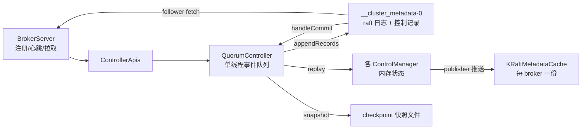

**KRaft 控制面的输入/输出与关键机制**：

| 机制 | 输入 | 输出 | 关键行号 |
|---|---|---|---|
| 写事件 | ControllerWriteOperation | raft 日志记录 + 完成 future | `QuorumController.java:960-973` |
| 提交回调 | BatchReader of records | replay 到 ControlManager | `QuorumController.java:975-990` |
| 快照 | 最后稳定偏移 | 内存/磁盘 snapshot | `OffsetControlManager.java:302-305` |
| 元数据日志事务 | Begin/End/Abort TransactionRecord | lastStableOffset 卡点 | `OffsetControlManager.java:319-325` |
| broker 注册 | BrokerRegistrationRequest | brokerEpoch + 初始元数据 | `ControllerApis.scala:108-109` |
| broker 心跳 | epoch | 存活判定 / fence 错误 | `BrokerServer.scala:410-418` |
| 控制器注册（KIP-919） | RegisterControllerRecord | controller 列表 | `ControllerRegistrationManager.scala` |

**三个最值得记住的点**：

1. **单写者 + 单线程队列**：只有 active controller 能写元数据日志，事件队列串行化所有写与提交回调，从根上消除锁竞争与顺序问题；
2. **brokerEpoch 是 raft 世界的 lease**：注册分配 epoch、心跳续约、不匹配即 fence，替代了 ZK 的 ephemeral 节点语义；
3. **内存快照与 lastStableOffset**：每个批次后都在新偏移建内存快照（`OffsetControlManager.java:305`），既服务落盘 checkpoint，也保证 controller 掉换时能回滚到未提交事务之前——这是"元数据原子性"的保险丝。

---

## 第三讲：存储引擎

### 定位

`storage/src/main/java/org/apache/kafka/storage/internals/log/` 是 Kafka 的"硬盘管家"：`UnifiedLog` 把一个 topic-partition 的所有磁盘文件组织成一个逻辑日志，对外提供 append/read/delete 三个原子语义，对内管理 segment 滚动、索引维护、事务索引、producer 状态与日志压缩。4.3.1 的这一层已完全 Java 化，并与 broker 的磁盘目录（log dir）一一对应。

### 目录结构

```
storage/src/main/java/org/apache/kafka/storage/internals/log/
├── UnifiedLog.java           # 分区逻辑日志：append/fetch/delete/roll 的门面
├── LocalLog.java             # 本地日志：segment 集合 + 实际读写落点
├── LogSegment.java           # 单个 segment：.log + 三个索引文件
├── LogSegments.java          # segment 集合（按 baseOffset 排序的 ConcurrentMap）
├── LogValidator.java         # 记录校验：CRC/时间戳/压缩/事务序列号
├── LogConfig.java            # topic 级配置（retention/segment/compact 等）
├── LogCleaner.java           # 日志压缩调度线程（CleanerThread）
├── Cleaner.java              # 压缩算法本体：offset map + 分组重写
├── LogCleanerManager.java    # 脏日志挑选与 checkpoint 维护
├── LogManager.java           # 接口（Java 侧），实现在 core 的 Scala LogManager
├── ProducerStateManager.java # 幂等/事务 producer 状态（pid → 序号/事务）
├── TransactionIndex.java     # aborted txn 索引（.txnindex）
├── OffsetIndex.java / TimeIndex.java / AbstractIndex.java
└── LogFileUtils.java         # 文件命名与后缀常量

core/src/main/scala/kafka/log/
└── LogManager.scala          # 磁盘目录级：loadLogs 加载恢复、checkpoint、清理任务
```

### 逐文件精读

#### 1. UnifiedLog.java —— append 全流程

`UnifiedLog`（`storage/src/main/java/org/apache/kafka/storage/internals/log/UnifiedLog.java:105`）持有一个 `LocalLog localLog`（`:128`）与配置 `LogConfig`。核心写入入口 `appendAsLeader`（`:1049`）委托私有 `append`（`:1115`），后者是整个存储引擎最严密的方法，按序完成：

1. `maybeFlushMetadataFile()`（`:1126`）——先确保 `partition.metadata` 落盘，保证崩溃后能恢复 topic-id；
2. `analyzeAndValidateRecords`（`:1128`）——CRC、magic、压缩类型初检；全部无效直接返回；
3. 持 `lock` 进入临界区（`:1137`）：
   - leader 路径：`LogValidator.validateMessagesAndAssignOffsets`（方法体在 `LogValidator.java:123`，调用点 `:1163`）**分配 offset**、必要时重压缩、按 `messageTimestampType` 决定时间戳；follower 路径（`appendAsFollower`，`UnifiedLog.java:1080`）则校验来件 offset 必须衔接，否则抛 `UnexpectedAppendOffsetException`（`:1203`）；
   - 更新 leader epoch cache（`assignEpochStartOffset`，`:1213-1215`）——这是 leader 变更后 truncation 的依据；
   - `maybeRoll`（`:1234`）——segment 满则滚动（判据在 `LogSegment.shouldRoll`，`LogSegment.java:167`：字节超限、到达 `segment.ms`、索引满、offset 无法转相对偏移）；
   - `analyzeAndValidateProducerState`（`:1243`）——按 producer id 检查序号连续性，**重复批次直接短路**（`:1247-1254`），返回旧批次的元数据；
   - `localLog.append(...)`（`:1262`）真正写盘，随即 `updateHighWatermarkWithLogEndOffset()`（`:1263`）；
   - 更新 producer 状态（`:1266`）、事务索引 `segment.updateTxnIndex`（`:1272`）、首不稳定偏移 `maybeIncrementFirstUnstableOffset`（`:1281`）；
   - `unflushedMessages >= flushInterval` 时刷盘（`:1286`），另外有后台定时刷盘任务。

读路径 `read`（`:1649-1660`）只做一件事：按隔离级别选上界（LOG_END/HIGH_WATERMARK/TXN_COMMITTED 分别取 LEO/HW/LSO），转交 `LocalLog.read`（`:462`）。后者按 `floorSegment(startOffset)` 定位段（`LocalLog.java:476`），循环读直到攒够 `maxLength`（`:489-513`），TXN_COMMITTED 模式下还要附带 aborted txn 列表（`addAbortedTransactions`，`:531`）。

删除路径 `deleteOldSegments`（`:1839`）：从最旧段开始扫描，`deletableSegments`（`:1879`）用谓词（retention.ms/bytes、compaction 检查点）筛出可删段，且**绝不删高水位之上的段**（`:1894`）；真正删除 `deleteSegments`（`:1928`）会同步把 log start offset 推进到新段的 baseOffset（`maybeIncrementLogStartOffset`，`:1950`）。

#### 2. LogSegment.java 与磁盘文件布局

单个分区在磁盘上是一个目录（如 `orders-1/`），里面每套 segment 四个文件，后缀常量集中在 `LogFileUtils.java`：

| 文件 | 后缀常量 | 内容 |
|---|---|---|
| `00000000000000000100.log` | `LOG_FILE_SUFFIX`（`LogFileUtils.java:37`） | 消息数据（v2 record batch） |
| `.index` | `INDEX_FILE_SUFFIX`（`:42`） | offset → 物理位置（稀疏索引） |
| `.timeindex` | `TIME_INDEX_FILE_SUFFIX`（`:47`） | 时间戳 → offset |
| `.txnindex` | `TXN_INDEX_FILE_SUFFIX`（`:52`） | aborted transaction 列表 |
| `.snapshot` | `PRODUCER_SNAPSHOT_FILE_SUFFIX`（`:27`） | producer id 状态快照 |

`LogSegment.append`（`LogSegment.java:250`）写 `.log` 的同时维护索引：每攒够 `indexIntervalBytes`（默认 4KB）才往 `.index` 追加一条 offset→position、往 `.timeindex` 追加一条 timestamp→offset（`:270-274`）——索引是**稀疏**的，查找时先二分定位再小范围扫描。`.txnindex` 只在事务标记写入时更新（由 `UnifiedLog` 调 `updateTxnIndex`）。

#### 3. LogCleaner.java / Cleaner.java —— 日志压缩

压缩面向 `cleanup.policy=compact` 的 topic，思路是**按 key 保留最新值**。`LogCleaner`（`LogCleaner.java:98`）的 `CleanerThread`（`:467`）主循环：`grabFilthiestCompactedLog`（`:555`）挑"最脏"的日志 → `cleanLog`（`:592`）→ 完成后 `doneCleaning` 更新 checkpoint。

`Cleaner.doClean`（`Cleaner.java:138`）三步：
1. **buildOffsetMap**（`:156`，实现 `:635`）：遍历 clean 段到 dirty 段之间的所有记录，用 `SkimpyOffsetMap`（内存紧凑的哈希表）记录每个 key 最后一次出现的 offset；
2. **groupSegmentsBySize**（`:172`，实现 `:566`）：把待清段按目标大小分组，每组将合并成一个新段；
3. **cleanSegments**（`:205`）：创建 `.cleaned` 后缀新段，逐条重放组内记录，**offset 等于 offsetMap 中该 key 最新值的才保留**，其余丢弃；事务标记与 aborted txn 索引同步重建（`:231-232`）。删除墓碑（value=null）只在超过 `deleteRetentionMs` 后移除（`:234`）。

`LogCleaner.updateCheckpoints`（`LogCleaner.java:319`）把每个分区已清理到的偏移写入 `cleaner-offset-checkpoint` 文件，崩溃后从此处继续，不重复劳动。

#### 4. LogManager.scala（core）—— 加载与恢复

Java 侧 `LogManager.java`（storage 模块，75 行）只是接口；实现在 `core/src/main/scala/kafka/log/LogManager.scala:62`。启动时 `loadLogs`（`:424`）：

- 读 `recovery-point-checkpoint`（`:140`、`:459-460`）得到每个分区的恢复点——**恢复点之前的段视为已 flush**，无需重放校验；
- 读 `log-start-offset-checkpoint`（`:142`、`:469`）恢复 log start offset；
- 逐分区 `loadLog`（`:504`）时若发现崩溃（无 `.clean_shutdown` 标记），会对恢复点之后的段做索引重建与截断；
- 周期性 `checkpointInDir`（`:847`、`:870`）把 recovery point / log start offset 写回文件，`cleanupLogs`（`:1410`）执行后台删除。

这解释了一个经典现象：Kafka 重启快，是因为正常关闭时写了 `.clean_shutdown` + checkpoint，重启只做目录扫描；崩溃恢复才需要逐段校验。

### 关键流程图

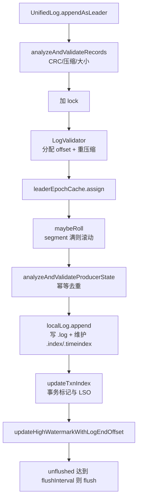

### 输入/输出表

| 操作 | 输入 | 输出 | 关键行号 |
|---|---|---|---|
| append（leader） | MemoryRecords + leaderEpoch | LogAppendInfo（first/last offset、LSO 提示） | `UnifiedLog.java:1049-1292` |
| append（follower） | 带 offset 的 records | 同上，重复 offset 抛异常 | `UnifiedLog.java:1080-1090` |
| read | startOffset + maxLength + isolation | FetchDataInfo（records + 上界元数据） | `UnifiedLog.java:1649-1660` |
| deleteOldSegments | retention 谓词 | 删除段数 + 推进 log start offset | `UnifiedLog.java:1839-1950` |
| roll | （隐式）append 触发或显式 | 新 LogSegment | `UnifiedLog.java:2190-2216` |
| compact | 脏分区 | 新 .cleaned 段 + 原子替换 | `Cleaner.java:138-189` |
| loadLogs | log dirs + checkpoints | 内存中的 UnifiedLog 集合 | `LogManager.scala:424-504` |

### 端到端演算：一次带事务标记的 append

设 `orders-1` 活动段 `00000000000000000100.log`，LEO=500，事务 producer pid=77 刚写了 COMMIT 标记（offset 500）。

1. `appendAsLeader(records, leaderEpoch=3)` 进入，先 `maybeFlushMetadataFile`；
2. `analyzeAndValidateRecords` 通过（CRC 正确、magic v2）；
3. 加锁后 `LogValidator` 给记录分配 offset 500、501、502，`appendInfo.lastOffset=502`；
4. epoch cache 记 `(epoch=3, startOffset=500)`；
5. `maybeRoll`：当前段 200MB 未超 `segment.bytes`（默认 1GB），不滚动；
6. `analyzeAndValidateProducerState` 发现 pid=77 的 nextSequence=101 与批次首序号一致，且这是 COMMIT 控制批次 → 返回 `CompletedTxn`；
7. `localLog.append` 把 3 条记录追加到 `.log` 末尾（物理 position 从 1048576 开始），`updateLogEndOffset(503)`；因为跨过了 4KB 索引间隔，往 `.index` 追加 `(502, 1048576)`、`.timeindex` 追加 `(ts, 502)`；
8. `updateHighWatermarkWithLogEndOffset` 把 HW 推到 503（单分区无 follower 时）；
9. `segment.updateTxnIndex(completedTxn, lastStableOffset=503)`：往 `.txnindex` 写入一条 aborted/committed txn 元数据，`producerStateManager.completeTxn` 后 LSO=503——READ_COMMITTED 消费者此刻才能读到这 3 条；
10. `updateMapEndOffset(503)` 更新 producer snapshot 映射偏移，为可能的 `.snapshot` 落盘做准备；
11. `unflushedMessages(约 4KB) < flushInterval(默认 Long.MAX)` 不主动刷盘，等后台刷盘任务或 `log.flush.interval.messages` 触发。

### 第三讲小结：稀疏索引 + 幂等去重 + 分段压缩三位一体

**一句话定位**：UnifiedLog 把"顺序追加 + 按 offset 读"压缩到极致——数据只进 `.log`，索引按字节间隔稀疏记录，事务与 producer 状态各自有专门索引；删除是段级的（log start offset 单调前进），压缩是分组重写 + offset map 判活，两者都绝不触碰高水位之上的数据。

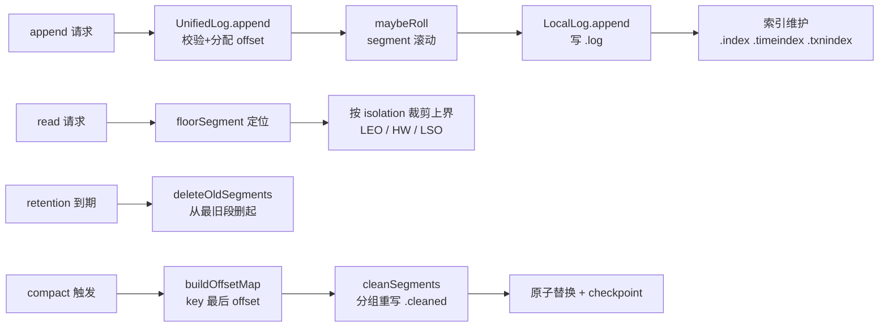

**存储引擎的输入/输出与关键常量**：

| 机制 | 输入 | 输出 | 关键常量/行号 |
|---|---|---|---|
| 稀疏 offset 索引 | batch 的 lastOffset + 物理位置 | .index 条目 | 每 4KB 一条（`LogSegment.java:270`） |
| 段滚动判据 | 大小/时间/索引容量 | 新段 | `LogSegment.java:167-173` |
| 幂等去重 | pid + sequence | 重复批次短路 | `UnifiedLog.java:1247-1254` |
| 事务可见性 | COMMIT/ABORT 标记 | LSO 推进 | `UnifiedLog.java:1270-1274` |
| 删除保护 | highWatermark | 可删段列表 | 绝不删 HW 之上（`UnifiedLog.java:1894`） |
| 压缩判活 | offsetMap(key→最后 offset) | 保留记录集合 | `Cleaner.java:635-697` |
| 崩溃恢复 | recovery-point-checkpoint | 恢复点之后的段需重放 | `LogManager.scala:459-460` |

**三个最值得记住的点**：

1. **offset 分配只发生在 leader 且必须持锁**：follower 只校验衔接（`UnifiedLog.java:1190`），这保证了同一 offset 在全集群只有一个"正统"写入者；
2. **LSO 与 txnindex 是 READ_COMMITTED 的全部机关**：消费者读到的上界不是 LEO 而是 LSO，aborted txn 靠 `.txnindex` 在读取时过滤——存储引擎不删数据，只是"不让你看"；
3. **压缩是分组重写而非原地改写**：`.cleaned` 新段写完后原子替换旧段组，中途崩溃不影响一致性，checkpoint 保证不重复压缩。

---

## 第四讲：Producer

### 定位

`clients/src/main/java/org/apache/kafka/clients/producer/` 是写入端的全部智慧所在：`send()` 只是把 record 塞进 `RecordAccumulator` 的批次，真正干活的是后台 `Sender` 线程——它按节点 drain 批次、维护 in-flight 窗口、处理重试与乱序，并在开启幂等/事务时与 `TransactionManager` 协作完成 pid 分配、序号管理与两阶段提交。

### 目录结构

```
clients/src/main/java/org/apache/kafka/clients/producer/
├── KafkaProducer.java            # 门面：send/flush/事务 API
├── Partitioner.java              # 分区器接口（默认实现在 internals/BuiltInPartitioner）
├── RecordMetadata.java           # 异步结果：topic-partition/offset/timestamp
├── ProducerConfig.java           # acks/retries/batch.size/linger.ms 等
├── CooperativeStickyAssignor... （consumer 侧，见第五讲）
└── internals/
    ├── RecordAccumulator.java   # 分区双端队列 + 内存池 + sticky 分区
    ├── ProducerBatch.java        # 一个分区的待发送批次（MemoryRecordsBuilder）
    ├── Sender.java               # 后台 IO 线程：drain/in-flight/重试/回调
    ├── TransactionManager.java   # 事务状态机（10 态）
    ├── BuiltInPartitioner.java   # 默认 sticky 分区器（KIP-848 前的 DefaultPartitioner）
    ├── ProducerMetadata.java     # topic 元数据缓存与刷新
    ├── FutureRecordMetadata.java # 每个 record 的 future
    └── BufferPool.java           # 批次内存池
```

### 逐文件精读

#### 1. KafkaProducer.doSend —— 从 API 到累加器

`KafkaProducer`（`KafkaProducer.java:539`）的 `send(record, callback)`（`:840`/`:959`）转私有的 `doSend`（`:975`），步骤：

1. `waitOnMetadata`（`:988`，实现 `:1093`）阻塞直到拿到该 topic 的元数据（或超 `max.block.ms`）；
2. `keySerializer.serialize` / `valueSerializer.serialize`（`:999`、`:1007`）——序列化失败包成 `SerializationException` 进 future，不抛线程；
3. `partition(record, ...)`（`:1017`）——调用 `Partitioner`；返回 `UNKNOWN_PARTITION` 时由累加器的内置分区器按 broker 负载挑选；
4. `accumulator.append(...)`（`:1029`）——**核心**，返回 `RecordAppendResult`（含 future）；
5. 事务中：`transactionManager.maybeAddPartition(tp)`（`:1038`）把新分区加入事务（Sender 在分区入事务前不会 drain 它）；
6. 批次满或新建时 `sender.wakeup()`（`:1043`）唤醒后台线程。

#### 2. RecordAccumulator —— 批次、内存池与 sticky 分区

`RecordAccumulator`（`internals/RecordAccumulator.java:68`）为每个 topic-partition 维护一个 `ArrayDeque<ProducerBatch>`。`append`（`:275`）的逻辑：

- 无指定分区时问 `BuiltInPartitioner.peekCurrentPartitionInfo`（`:302`）要一个"粘性"分区——同一个批次容量内尽量都写同一个分区，减少小请求；
- 先 `tryAppend` 往队尾未满批次追加（`:319`）；失败则 `free.allocate(size, maxTimeToBlock)`（`:333`）从**内存池**申请 buffer（池满则阻塞到 `max.block.ms`，这是 producer 端背压），`appendNewBatch`（`:345`、`:375`）新建 `ProducerBatch` 入队；
- `RecordAppendResult` 带回 `batchIsFull`/`newBatchCreated`，供上面决定是否 wakeup Sender。

`drain`（`:959`）由 Sender 调用，`drainBatchesForOneNode`（`:852`）逐节点收集可发送批次：
- **每个分区同一时刻只有一个 in-flight 批次**（`:868` `isMuted(tp)` 跳过），这是保序的关键；
- 单节点累计不超过 `maxRequestSize`（`:889`）；
- 幂等/事务 producer 在此分配 pid+epoch+sequence：`batch.setProducerState(...)`（`:918`）与 `transactionManager.incrementSequenceNumber`（`:919`）；
- drain 完在锁外 `batch.close()`（`:930`）——关闭压缩器、写 batch 头，这一步较贵故刻意放在锁外。

#### 3. Sender —— 发送循环与 in-flight 窗口

`Sender`（`internals/Sender.java:79`）持 `inFlightBatches: Map<TopicPartition, List<ProducerBatch>>`（`:126`）。主循环 `run`（`:241`）→ `runOnce`（`:310`）：

1. 事务相关前置处理（`maybeResolveSequences`、`bumpIdempotentEpochAndResetIdIfNeeded` 等，`:311-341`）；
2. `sendProducerData(now)`（`:344`，实现 `:380`）：`accumulator.ready()` 找就绪节点 → 过滤掉连接未就绪的节点 → `accumulator.drain(...)`（`:418`）→ `addToInflightBatches`（`:419`）→ 按节点组装 `ProduceRequest` 发出（`sendProduceRequest`，`:896`）；
3. `client.poll(pollTimeout, now)`（`:345`）驱动网络收发，响应回调 `completeBatch`（`:671`）把结果填进 `RecordMetadata` 并唤醒 future；失败批次按 `retries`/退避重新入队或彻底失败（`failBatch`）。

**acks/retries 语义**的落点：`max.in.flight.requests.per.connection`（默认 5）决定单连接允许多少个未确认请求，>1 时配合幂等的 sequence 可实现重试不乱序；`acks=0` 不等响应（broker 侧对应 `KafkaApis.scala:507` 的 NoOp/断连分支）；`retries`（默认 Integer.MAX）配合 `delivery.timeout.ms` 界定总重试窗口。**没有幂等时，重试可能重复**——这正是 KIP-98 引入 pid+sequence 的动机。

#### 4. TransactionManager —— 事务状态机

`TransactionManager`（`internals/TransactionManager.java:94`）的状态机（`:151-160`）：`UNINITIALIZED → INITIALIZING → READY → IN_TRANSACTION → (PREPARED_TRANSACTION) → COMMITTING_TRANSACTION / ABORTING_TRANSACTION`，外加 `ABORTABLE_ERROR` 与 `FATAL_ERROR` 两个错误态；合法性校验在 `isTransitionValid`（`:162-188`）。

用户 API 与内部动作的对应（`KafkaProducer.java`）：

| 用户调用 | 行号 | 内部动作 |
|---|---|---|
| `initTransactions()` | `:660` | FindCoordinator + InitProducerId，拿到 pid 与 epoch |
| `beginTransaction()` | `:686` | 状态 → IN_TRANSACTION |
| `send(record)` | `:975` | 批次入 accumulator，`maybeAddPartition` 记分区 |
| `sendOffsetsToTransaction(offsets, ...)` | `:743` | 把消费位移包装成 txn offset commit，随事务提交 |
| `commitTransaction()` | `:790` | EndTxn(COMMIT) → 写 TxnMarker → 状态 COMPLETE_COMMIT |
| `abortTransaction()` | `:824` | EndTxn(ABORT) → 写 ABORT Marker |

`maybeAddPartition`（`:455`）对新分区发 `AddPartitionsToTxnRequest`；bump epoch（`bumpIdempotentEpochAndResetIdIfNeeded`，`:681`）在检测到序号无法解析时提升 epoch 以 fence 掉旧请求。事务的 broker 侧执行见第六讲。

### 关键流程图

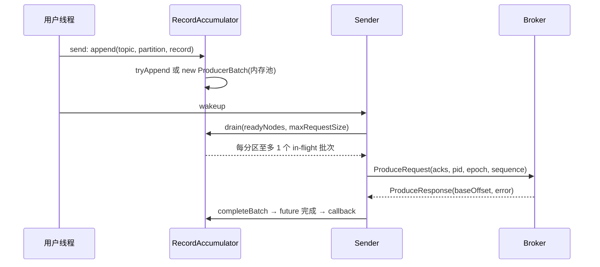

### 输入/输出表

| 阶段 | 输入 | 输出 | 关键行号 |
|---|---|---|---|
| doSend | ProducerRecord + Callback | RecordAppendResult + future | `KafkaProducer.java:975-1075` |
| accumulator.append | 序列化后的 key/value/headers | 挂到分区别队或新建批次 | `RecordAccumulator.java:275-359` |
| 内存池 | allocate(size, maxBlockMs) | ByteBuffer（满则阻塞） | `RecordAccumulator.java:333` |
| drain | 就绪节点集合 | 按节点分组的批次 Map | `RecordAccumulator.java:852-937` |
| 幂等分配 | pid/epoch/sequence | batch.producerState | `RecordAccumulator.java:918-919` |
| completeBatch | ProduceResponse.PartitionResponse | RecordMetadata / 重试 / 失败 | `Sender.java:671-756` |
| initTransactions | transactionalId | pid + epoch | `KafkaProducer.java:660` |

### 端到端演算：幂等 producer 重试一次网络超时

设 `enable.idempotence=true`、`acks=all`、`max.in.flight=5`，pid=42、epoch=0，分区 `orders-1` 当前 nextSequence=101。

1. `send()` 把 record 追加进 `orders-1` 的 ProducerBatch（序号 101），返回 future；
2. Sender drain 该批次，`setProducerState((42,0), 101)`，nextSequence→102，组成 ProduceRequest 发往 leader，登记进 `inFlightBatches["orders-1"]`；
3. 请求发出但响应丢失，`delivery.timeout.ms` 未到 → Sender 重试：批次重新入队，再次 drain 时 `hasSequence` 为 true，**不重新分配 sequence**（`RecordAccumulator.java:903` 的判断），仍带 (42,0,101) 发出；
4. broker 侧 `UnifiedLog.analyzeAndValidateProducerState` 发现 pid=42 的已见序号恰为 100，来件 101 正常衔接 → 正常落盘；假设 broker 其实收到过第一次请求，则第二次到达时发现 sequence 101 已存在 → 判为重复，返回已落盘的 offset 而不重复写入（`UnifiedLog.java:1247-1254`）；
5. 客户端收到响应（无论哪一次），`completeBatch` 用 offset 填 `RecordMetadata`，future 完成，回调执行。**用户侧永远看到恰好一次逻辑写入**，即使物理上可能有重复请求。

### 第四讲小结：累加器攒批、Sender 管窗口、TransactionManager 管状态

**一句话定位**：producer 的并发全在用户线程与 Sender 之间——`RecordAccumulator` 用"分区别队 + 内存池 + sticky 分区"把随机写变成批量顺序请求，`Sender` 用"每分区单 in-flight 批次"的窗口在保序与吞吐间取平衡，幂等靠 pid+epoch+sequence 在 broker 侧去重，事务则是一个把发送动作串行挂到特定请求序列上的状态机。

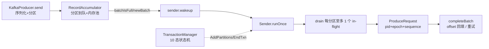

**Producer 关键机制表**：

| 机制 | 输入 | 输出 | 关键行号 |
|---|---|---|---|
| sticky 分区 | cluster 状态 | 当前优先分区 | `RecordAccumulator.java:302` |
| 内存池背压 | allocate(size) | buffer 或阻塞 | `RecordAccumulator.java:333` |
| 保序窗口 | 分区别队 | 每分区 1 个 in-flight 批次 | `RecordAccumulator.java:868` |
| 幂等三元组 | pid/epoch/sequence | batch.producerState | `RecordAccumulator.java:918-919` |
| 重试 | 超时/可重试错误 | 重入队或 failBatch | `Sender.java:671-756` |
| 事务两阶段 | IN_TRANSACTION | EndTxn + TxnMarker | `KafkaProducer.java:790` |

**三个最值得记住的点**：

1. **`send()` 永不阻塞发送，只可能阻塞等内存**：`max.block.ms` 卡在 `free.allocate` 上，这是 producer 唯一的背压点；
2. **每分区同时只有一个 in-flight 批次**（`isMuted(tp)`，`RecordAccumulator.java:868`）：保序靠的不是锁而是这个简单不变式，乱序只会在不同分区间发生；
3. **sequence 只在首次 drain 时分配**：重试批次带着原 sequence 重发（`:903` 的 `hasSequence` 判断），配合 broker 侧 `ProducerStateManager` 实现端到端恰好一次——幂等的全部秘密就在"序号不重新分配"这六个字。

---

## 第五讲：Consumer

### 定位

`clients/src/main/java/org/apache/kafka/clients/consumer/` 是读取端的镜像世界：用户线程只调 `poll()`，背后有 Fetcher 管拉取、ConsumerCoordinator/ConsumerMembershipManager 管组内关系、心跳线程管存活。4.3.1 的最大变化是**两套再均衡协议并存**：classic 协议（JoinGroup/SyncGroup/Heartbeat，组状态在 broker 的 GroupCoordinator）与 new consumer 协议（KIP-848，ConsumerGroupHeartbeat，组状态同样在 broker 但由服务端分配）。

### 目录结构

```
clients/src/main/java/org/apache/kafka/clients/consumer/
├── KafkaConsumer.java                # 门面：poll/subscribe/commit/seek，委托给 delegate
├── Consumer.java                     # 接口
├── RangeAssignor.java                # classic 协议：按 topic 均分（range）
├── RoundRobinAssignor.java           # classic 协议：全局轮询
├── StickyAssignor.java               # classic 协议：粘性（eager 两阶段）
├── CooperativeStickyAssignor.java    # classic 协议：协作式粘性（增量两阶段）
├── GroupProtocol.java                # CONSUMER / CLASSIC 枚举
└── internals/
    ├── ClassicKafkaConsumer.java     # classic 协议的 delegate 实现
    ├── ConsumerNetworkThread.java    # new 协议的 delegate 实现
    ├── Fetcher.java                  # 拉取：prepareFetchRequests + collectFetch
    ├── FetchCollector.java           # 把 completed fetch 变成 ConsumerRecords
    ├── SubscriptionState.java        # 订阅/分配/位置（position）三态存储
    ├── ConsumerNetworkClient.java    # 带 unsent/pending 队列的 NetworkClient 封装
    ├── ConsumerCoordinator.java      # classic 协议协调器（Join/Sync/Heartbeat/OffsetCommit）
    ├── ConsumerMembershipManager.java# new 协议成员状态机
    ├── ConsumerHeartbeatRequestManager.java
    ├── MemberState.java              # new 协议成员状态枚举
    ├── AbstractCoordinator.java      # FindCoordinator 等公共逻辑
    ├── CommitRequestManager.java     # new 协议的 offset commit 管理
    └── BaseHeartbeatThread.java      # 心跳线程基类
```

### 逐文件精读

#### 1. poll 主循环 —— ClassicKafkaConsumer

`KafkaConsumer.poll`（`KafkaConsumer.java:904`）只是转 `delegate.poll(timeout)`。classic delegate 的实现 `ClassicKafkaConsumer.poll`（`internals/ClassicKafkaConsumer.java:640`）是一个 do-while 循环（`:656-681`）：

```
do {
  updateAssignmentMetadataIfNeeded(timer, false)   // :660 保证 assignment 与 fetch 位置就绪
  fetch = pollForFetches(timer)                     // :662 拉数据
  if (!fetch.isEmpty()) {
    sendFetches()                                   // :670 提前发下一轮，流水线化
    return interceptors.onConsume(new ConsumerRecords<>(...))
  }
} while (timer.notExpired())
```

三个关键点：
- **updateAssignmentMetadataIfNeeded**（`:695`）= `coordinator.poll(timer, ...)`（处理加入组/再均衡/自动提交）+ `updateFetchPositions(timer)`（给没有位置的分区初始化 offset：已提交位移 → 否则按 `auto.offset.reset`）；
- **pollForFetches**（`:706`）：先 `collectFetch()` 看缓冲有没有现成数据，没有就 `sendFetches()` 发请求，然后 `client.poll(pollTimer, ...)` 阻塞等待——poll 的超时实际花在网络等待上；
- **提前发送下一轮**（`:670-672`）：用户处理数据时后台已在拉下一批，这是消费吞吐的关键技巧。

#### 2. Fetcher —— 位置管理与分页拉取

`Fetcher`（`internals/Fetcher.java:59`，继承 `AbstractFetch`）只做两件事：
- `sendFetches()`（`:105`）：`prepareFetchRequests()` 按节点聚合分区（受 `max.poll.records`、`fetch.max.bytes`、`fetch.min.bytes` 约束），带上**增量 fetch session**（KIP-227，会话内只传变化的 partition，大幅降低大集群开销），发出请求；
- `collectFetch()`（`:145`）：把 `FetchBuffer` 里已 complete 的 fetch 交给 `FetchCollector` 反序列化、更新 position（消费位置随读取前进，而非随 commit）、按 `max.poll.records` 截断。

位置（position）不变量由 `SubscriptionState`（`internals/SubscriptionState.java:74`）维护：每个分区有 `TopicPartitionState`（`:1013` 起），内含 `FetchPosition` 与 `FetchState`（INITIALIZING/FETCHING/AWAIT_RESET/AWAIT_VALIDATION 等，`:1033`）。订阅模式由 `assignFromSubscribed`（`:315`，再均衡后服务端分配）与 `assignFromUser`（手动 assign）两条路写入；`hasAutoAssignedPartitions`（`:512`）区分两种模式——这决定了后面走不走再均衡。

#### 3. ConsumerCoordinator —— classic 协议

`ConsumerCoordinator`（`internals/ConsumerCoordinator.java:103`）的 `poll`（`:511-577`）是每次用户 poll 的固定动作：`maybeUpdateSubscriptionMetadata`（刷新订阅）→ 若为自动分配则 `ensureActiveGroup`（`:552`，内部完成 FindCoordinator → JoinGroup → SyncGroup）→ `maybeAutoCommitOffsetsAsync`（`:575`，`enable.auto.commit` 的定时提交）。

classic 协议的四个请求都在 broker 的 GroupCoordinator 上完成（第六讲）：JoinGroup 上报订阅与元数据、SyncGroup 由 leader 把 `assignor.assign(...)` 的结果分发给全员、Heartbeat 保活、OffsetCommit/OffsetFetch 落位移。心跳线程（`BaseHeartbeatThread` 子类）与用户线程并行：用户线程负责重均衡与拉取，心跳线程只发 Heartbeat 并检测 `REBALANCE_IN_PROGRESS`——检测到就唤醒用户线程重新 join。

#### 4. new 协议（KIP-848）—— ConsumerMembershipManager

新协议不再有 JoinGroup/SyncGroup 两阶段，而是**单个 ConsumerGroupHeartbeatRequest 包打天下**：

- `ConsumerHeartbeatRequestManager`（`internals/ConsumerHeartbeatRequestManager.java:50`）按 `heartbeat.interval.ms`（默认 5s）发送心跳，请求里带订阅 topic、已分配分区、ack 状态；
- `ConsumerMembershipManager`（`internals/ConsumerMembershipManager.java:108`）维护成员状态机 `MemberState`（`internals/MemberState.java:27`）：`UNSUBSCRIBED → JOINING → RECONCILING → ACKNOWLEDGING → STABLE`（`:35-71`，合法迁移表在 `:120-122`）；
- `onHeartbeatSuccess`（`:216`）处理 broker 返回的 target assignment：有新目标 → RECONCILING，本地调 `onPartitionsRevoked/Assigned` 回调 → 下一次心跳 ACKNOWLEDGING → broker 确认后 STABLE。再均衡从"停整个世界"变成"服务端指派 + 客户端增量执行"。

#### 5. 再均衡协议对比：eager vs cooperative

| 维度 | eager（range/roundrobin/sticky） | cooperative-sticky |
|---|---|---|
| 触发 | JoinGroup 全组成员停下 | Heartbeat 增量协商 |
| 撤销 | 一次性撤销**全部**已分配分区 | 只撤销需要移动的分区 |
| 停顿窗口 | 长（两轮全组 join） | 短（多轮心跳收敛） |
| 实现 | `RangeAssignor.java:97`、`StickyAssignor.java:178` | `CooperativeStickyAssignor.java:52` |

`RangeAssignor.assignPartitions`（`RangeAssignor.java:123`）的算法朴素：按 topic 分组消费者，`numPartitionsPerConsumer = partitions / consumers`，余数分给排序靠前的消费者（`:244-245`），逐个 `assign`（`:211`）。它的经典特性是**同 topic 内尽量连续分片**，代价是跨 topic 可能倾斜（2 消费者 2 topic×3 分区时，C0 拿 4 个、C1 拿 2 个）。

`CooperativeStickyAssignor` 则每次只把"应从 A 移到 B"的分区标记撤销，A 在心跳里确认已停后 B 才领取——一次再均衡可能需要 2-3 轮心跳，但任何时刻大多数分区都在正常消费。

### 关键流程图

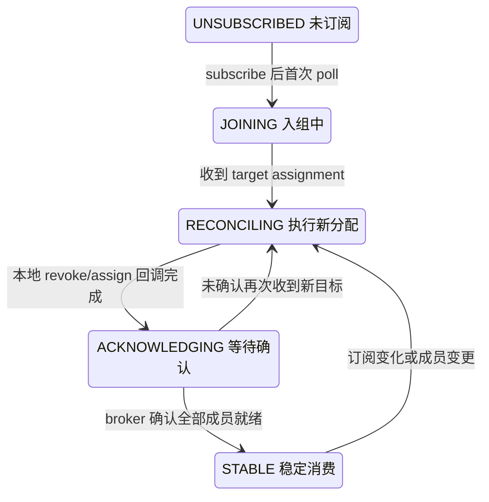

### 输入/输出表

| 阶段 | 输入 | 输出 | 关键行号 |
|---|---|---|---|
| poll 主循环 | Duration timeout | ConsumerRecords | `ClassicKafkaConsumer.java:647-688` |
| updateAssignmentMetadataIfNeeded | timer | assignment 与 position 就绪 | `ClassicKafkaConsumer.java:695-701` |
| sendFetches | position 集合 | FetchRequest（含 fetch session） | `Fetcher.java:105-120` |
| collectFetch | FetchBuffer | 反序列化记录 + position 前进 | `Fetcher.java:145-147` |
| coordinator.poll | timer | 组状态推进 + 自动提交 | `ConsumerCoordinator.java:511-577` |
| 新协议心跳 | 订阅 + 分配 + ack | target assignment | `ConsumerHeartbeatRequestManager.java:50` |
| range 分配 | partitionsPerTopic | member → partitions | `RangeAssignor.java:123-144` |

### 端到端演算：3 消费者组的一次 cooperative-sticky 扩容

设组 `g1` 用 `cooperative-sticky`，topic `t` 6 分区，成员 C1、C2 在线（各 3 个分区），C3 启动加入。

1. C3 `subscribe(["t"])` 后首次 poll，`ConsumerMembershipManager` 状态 UNSUBSCRIBED → JOINING，发送带订阅的 ConsumerGroupHeartbeat；
2. broker 的 GroupCoordinator（new 协议路径）发现成员数 2→3，计算新 target：C1→{0,1}、C2→{2,3}、C3→{4,5}，在**所有成员的下一次心跳响应**里返回各自 target；
3. C1 收到 target：当前持有 {0,1,2}，需撤销 {2} → 状态 RECONCILING，触发用户 `onPartitionsRevoked([t-2])` 回调，用户处理后 C1 把分区 {2} 从本地移除、position 清理，状态 → ACKNOWLEDGING，下一次心跳带上"已收敛到 {0,1} 且已消费完移交点"；
4. C2 同理撤销 {3}；C3 拿到 {4,5}（新分区无已提交位移，按 `auto.offset.reset=earliest` 或最新提交位移初始化 position）；
5. broker 收到三方 ACKNOWLEDGING 且与 target 一致 → 组状态 STABLE，各成员心跳响应恢复"无变化"；
6. 全程只有分区 2、3 经历"撤销-移交"，分区 0、1、4、5 的消费**从未停顿**——这正是 cooperative 相对 eager 的核心价值（eager 下三个成员会同时撤销全部 6 个分区再重新分配）。

### 第五讲小结：poll 是唯一入口，两套协议共用同一个 Fetcher

**一句话定位**：consumer 把"组内关系"与"数据拉取"彻底解耦——`poll()` 驱动 assignment 就绪与 fetch 两条线，classic 协议用 Join/Sync 两阶段由 leader 算分配，new 协议用单心跳让 broker 指派、客户端增量执行；两者最终都落到同一个 `SubscriptionState` 的位置管理与同一个 `Fetcher` 的拉取循环。

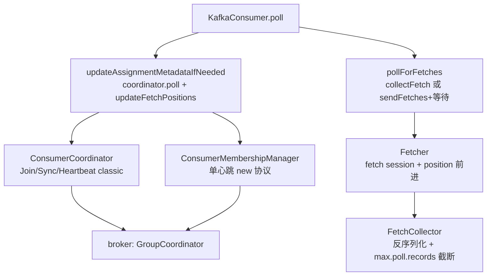

**Consumer 关键机制表**：

| 机制 | 输入 | 输出 | 关键行号 |
|---|---|---|---|
| poll 流水线 | 已 fetch 数据 | 提前发下一轮请求 | `ClassicKafkaConsumer.java:670-672` |
| 位置初始化 | 已提交位移/重置策略 | FetchPosition | `SubscriptionState.java:1013-1058` |
| fetch session | 上次会话的分区集合 | 增量 FetchRequest | `Fetcher.java:105-120` |
| classic 再均衡 | 订阅元数据 | leader 计算的 assignment | `ConsumerCoordinator.java:511-577` |
| new 协议再均衡 | 心跳携带的订阅/ack | target assignment | `ConsumerMembershipManager.java:216` |
| range 分配 | 分区数/消费者数 | 连续分片 + 余数前置 | `RangeAssignor.java:244-245` |

**三个最值得记住的点**：

1. **position 前进发生在 fetch 时，不是 commit 时**：commit 只是把当前位置"存档"供重启/再均衡后恢复，重复消费窗口由此产生；
2. **两套协议的分水岭是 `hasAutoAssignedPartitions`**（`SubscriptionState.java:512`）：手动 assign 完全没有组概念，自动订阅才进入协调器世界；
3. **cooperative 的本质是"只动该动的分区"**：目标分配由 broker 算好（`ConsumerMembershipManager`），客户端在本地执行撤销/领取并在心跳里 ack——停顿窗口从"全组两轮 join"缩短为"2-3 轮心跳"。

---

## 第六讲：Group Coordinator 与事务协调

### 定位

consumer group 的位移与成员关系、事务的 pid 与状态，都由 broker 上的两个专用协调器管理，它们的状态同样以"记录进内部分区日志"的方式持久化：group 元数据进 `__consumer_offsets`（`clients/src/main/java/org/apache/kafka/common/internals/Topic.java:27`），事务元数据进 `__transaction_state`（同文件 `:28`）。4.3.1 两者都采用了分片（shard）架构：每个分区一个 shard，单线程处理，经 `CoordinatorRuntime`（coordinator-common 模块）统一调度。

### 目录结构

```
group-coordinator/src/main/java/org/apache/kafka/coordinator/group/
├── GroupCoordinator.java          # 对外接口（被 KafkaApis 调用）
├── GroupCoordinatorService.java   # 实现：分区分配 + CoordinatorRuntime 装配
├── GroupCoordinatorShard.java     # 单个 offsets 分区的处理器（请求 + replay）
├── GroupMetadataManager.java      # 组成员/代际/状态机（9000 行的巨类）
├── OffsetMetadataManager.java     # 位移存储与过期
├── Group.java / ModernGroup.java / ClassicGroup.java
├── classic/ClassicGroupState.java # classic 组状态机（Empty/Preparing/Completing/Stable/Dead）
├── modern/...                     # new 协议的组模型
└── assignor/                      # 服务端再均衡目标分配计算

coordinator-common/src/main/java/org/apache/kafka/coordinator/common/runtime/
├── CoordinatorRuntime.java        # 分片协调器通用运行时（事件驱动 + 加载/重放）
├── CoordinatorLoaderImpl.java     # 从 offsets 分区日志/snapshot 加载硬状态
└── ...

core/src/main/scala/kafka/coordinator/group/CoordinatorPartitionWriter.scala  # 写回桥

transaction-coordinator/src/main/java/org/apache/kafka/coordinator/transaction/
├── TransactionState.java          # 事务状态机（Empty/Ongoing/Prepare*/Complete*/Dead）
├── TransactionLog.java            # txn 日志的 key/value 编解码
├── ProducerIdManager.java         # pid 段分配（KIP-896 整段分配）
└── TransactionMetadata.java

core/src/main/scala/kafka/coordinator/transaction/
├── TransactionCoordinator.scala   # InitProducerId/AddPartitions/EndTxn/TxnMarker
├── TransactionStateManager.scala  # 事务状态缓存 + 日志 append
└── TransactionMarkerChannelManager.scala  # 向各分区 leader 发 marker 的网络管理
```

### 逐文件精读

#### 1. GroupCoordinatorService —— 分区与运行时

`GroupCoordinatorService`（`group-coordinator/src/main/java/org/apache/kafka/coordinator/group/GroupCoordinatorService.java:162`）的关键设计：

- **group → 分区映射**：`partitionFor(groupId) = abs(groupId.hashCode) % numPartitions`（`:423-429`），分区数即 `offsets.topic.num.partitions`（默认 50，`GroupCoordinatorConfig.java:113`）。一个组固定落在一个分区上，保证组内操作串行；
- **CoordinatorRuntime**（`:271-284`）：装配 shard 供给、序列化器（`GroupCoordinatorRecordSerde`）、加载器（`CoordinatorLoaderImpl`）与后台线程池；每个 offsets 分区一个 `GroupCoordinatorShard`（`:154`），由 runtime 按 leader 变更装卸在 broker 间迁移；
- **分区迁移**：`__consumer_offsets` 分区 leader 换到哪台 broker，`GroupCoordinatorShard` 就在哪加载——group 协调器本身是无状态 worker，硬状态在日志里。

#### 2. GroupCoordinatorShard 与 GroupMetadataManager

`GroupCoordinatorShard`（`GroupCoordinatorShard.java:154`）的注释（`:149-153`）点明两套方法：**write 路径**（处理 OffsetCommit/JoinGroup 等请求，生成记录进日志）与 **replay 路径**（把记录应用到硬状态，用于加载与副本追赶）。

`GroupMetadataManager`（`GroupMetadataManager.java:264`）维护组成员、generation、state。classic 协议的状态机在 `ClassicGroupState`（`group-coordinator/src/main/java/org/apache/kafka/coordinator/group/classic/ClassicGroupState.java:27`），枚举注释就是完整的状态转移表：

| 状态 | 行号 | 语义 |
|---|---|---|
| `EMPTY` | `:44` | 无成员，位移未过期；新成员 join → PREPARING_REBALANCE |
| `PREPARING_REBALANCE` | `:59` | 等待成员加入，park join/heartbeat 回 REBALANCE_IN_PROGRESS |
| `COMPLETING_REBALANCE` | `:74` | 等 leader 的 SyncGroup 分配 |
| `STABLE` | `:90` | 正常消费，心跳正常响应；成员变更 → PREPARING_REBALANCE |
| `DEAD` | `:97` | 位移也过期，组被移除 |

`OffsetMetadataManager`（`OffsetMetadataManager.java:81`）管位移：commit 时写 `OffsetCommitValue` 记录，后台任务按 `offsets.retention.minutes`（默认 7 天）过期删除空组的位移。事务性位移提交（TxnOffsetCommit）还会在分区日志里写 pending 事务标记，由 `completePendingTxn` 在事务提交/中止时落定或回滚。

#### 3. 事务协调：TransactionCoordinator

`TransactionCoordinator`（`core/src/main/scala/kafka/coordinator/transaction/TransactionCoordinator.scala:92`）处理四个 API：

- **handleInitProducerId**（`:114`）：按 transactionalId 找到已有 `TransactionMetadata`；旧 pid 存在则**提升 epoch 并 fence 旧 producer**（幂等 producer 重启的场景）；没有则从 `ProducerIdManager` 分配新 pid 段（KIP-896 后整段分配，减少向 controller 要 id 的频率）。结果经 `appendTransactionToLog`（`:218`）写入 `__transaction_state`；
- **handleAddPartitionsToTransaction**（`:413`）：把新分区加入事务的 `partitions` 集合，同样落日志（`:462`）；
- **handleEndTransaction**（`:512`）：COMMIT → `PREPARE_COMMIT`、ABORT → `PREPARE_ABORT`，落日志后向所有参与分区写 TransactionMarker（两阶段提交的第二阶段）；
- **handleWriteTxnMarkers**：broker 间转发 marker 的入口。

`TransactionStateManager`（`TransactionStateManager.scala:73`）持有 `transactionMetadataCache: Map[分区号, TxnMetadataCacheEntry]`（`:95`），按 `partitionFor(transactionalId) = abs(hashCode) % transactionTopicPartitionCount`（`:447`）分片。`appendTransactionToLog`（`:656`）把 key=transactionalId、value=TxnTransitMetadata 的记录写入对应 `__transaction_state` 分区，**append 成功后才更新缓存**（`:674-716`）——日志是唯一事实源，缓存只是加速。

`TransactionState`（`transaction-coordinator/src/main/java/org/apache/kafka/coordinator/transaction/TransactionState.java:31`）的合法转移表在 `:95-97`：

```
EMPTY → {EMPTY, COMPLETE_COMMIT, COMPLETE_ABORT}
ONGOING → {ONGOING, EMPTY, COMPLETE_COMMIT, COMPLETE_ABORT}
PREPARE_COMMIT → {ONGOING, ...}    # 写 marker 中
PREPARE_ABORT → {ONGOING, ...}
COMPLETE_COMMIT → {EMPTY}
COMPLETE_ABORT → {EMPTY}
```

`PREPARE_*` 状态的存在正是"两阶段"的痕迹：先落日志（Prepare），再向数据分区广播 marker（Complete），最后回 Empty。这保证了事务协调器自身崩溃重启后，能从日志里恢复出"marker 是否已全部写完"。

#### 4. TransactionMarker 与 pid fence

`endTransactionWithTV1`（`TransactionCoordinator.scala:540`）里能看到 fence 逻辑：producerEpoch 小于记录中的 epoch → `PRODUCER_FENCED`（`:563-564`）。这就是"同 transactionalId 只允许一个活跃 producer"的实现——旧 producer（哪怕是僵尸）发任何请求都会被拒。

`TransactionMarkerChannelManager`（`TransactionMarkerChannelManager.scala`）负责把 marker 发到各分区 leader：为每个 leader 维护连接、批量发送、失败重试与 `writeTxnMarkers` 的完成回调。marker 本身是一条特殊的控制批次（不占用户 offset 语义，但会进 `.log` 并被 `ProducerStateManager` 转成 txnindex 条目）。

### 关键流程图

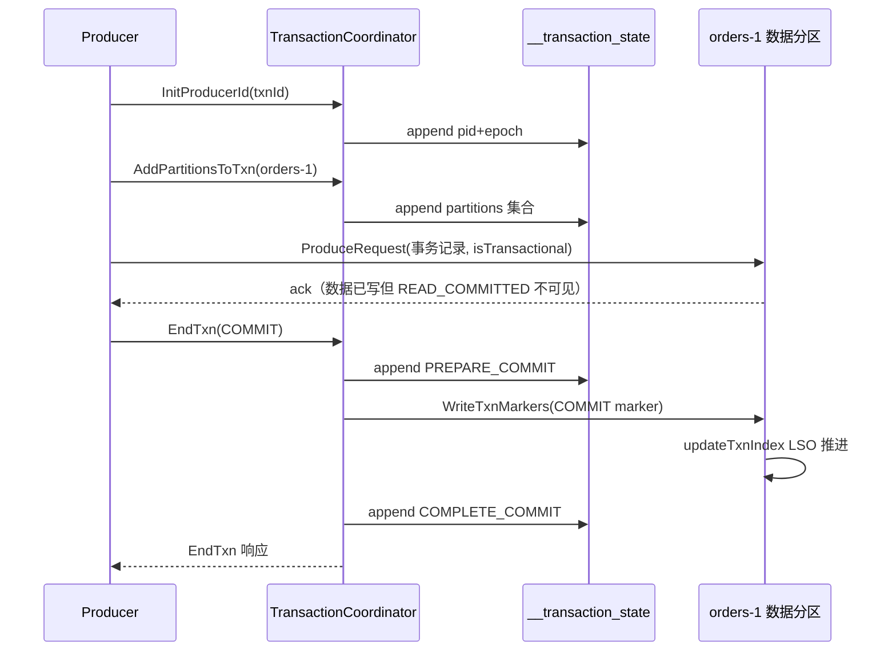

### 输入/输出表

| 阶段 | 输入 | 输出 | 关键行号 |
|---|---|---|---|
| group→分区 | groupId | offsets 分区号 | `GroupCoordinatorService.java:423-429` |
| shard 请求处理 | OffsetCommit/JoinGroup 等 | 记录进 offsets 分区日志 | `GroupCoordinatorShard.java:154` |
| 位移过期 | offsets.retention.minutes | 删除空组位移 | `OffsetMetadataManager.java:81` |
| InitProducerId | transactionalId | pid + epoch（旧 epoch 被 fence） | `TransactionCoordinator.scala:114` |
| AddPartitions | 新分区集合 | txn metadata 落日志 | `TransactionCoordinator.scala:413` |
| EndTxn | COMMIT/ABORT | Prepare 状态 + marker 广播 | `TransactionCoordinator.scala:512` |
| marker 生效 | COMMIT marker | 分区 LSO 推进、记录可见 | `UnifiedLog.java:1270-1274` |

### 端到端演算：一个 consume-transform-produce 事务

经典事务形态：从 `orders` 消费，聚合后写到 `order_summary`，位移随事务提交。

1. `initTransactions()`：producer 向 TransactionCoordinator 注册 transactionalId=`agg-1`，获得 pid=77、epoch=0，`__transaction_state` 写入一条 metadata；
2. `beginTransaction()`；
3. 消费：consumer poll 出 `orders` 的 100 条记录，本地聚合出 10 条汇总；
4. 生产：`send()` 到 `order_summary`，Sender 发 AddPartitionsToTxn(`order_summary-0`) 给 coordinator，事务元数据追加该分区；
5. `sendOffsetsToTransaction(offsets, groupId)`：把 `orders` 的位移封装成 TxnOffsetCommit 发往 GroupCoordinator，记录以"挂起事务"形态进入 `__consumer_offsets`（`completePendingTxn` 未落定前其他消费者读不到这批位移）；
6. `commitTransaction()`：EndTxn(COMMIT) → coordinator 把状态改 PREPARE_COMMIT 并写 `__transaction_state` → 向 `order_summary-0` 广播 COMMIT marker → 分区内 LSO 推进，10 条汇总对 READ_COMMITTED 消费者可见；同时通知 GroupCoordinator 把挂起位移落定；
7. coordinator 写 COMPLETE_COMMIT，状态回 Empty（保留 pid 供下次复用）；
8. 中途任何一步崩溃：重启后 TransactionCoordinator 从 `__transaction_state` 重放——若停在 PREPARE_COMMIT 且 marker 未写完，会**补写 marker**；`order_summary` 侧崩溃则由 LogManager 恢复时依据 txnindex 与 producer state 清理未完成事务的数据；`orders` 侧位移因为从未 commit 过，consumer 重新拉取重复处理——**事务保证的是"位移提交与数据写入原子"，不是端到端恰好一次**。

### 第六讲小结：把组状态和事务状态都变成日志记录

**一句话定位**：两个协调器共享同一套哲学——硬状态只在日志里（`__consumer_offsets`/`__transaction_state`），内存 shard 是可随时重建的缓存；classic 组的 Empty/Preparing/Completing/Stable 四态与事务的 Empty/Ongoing/Prepare/Complete 六态，本质都是"先追加记录、再改内存、后响应客户端"的确定性状态机。

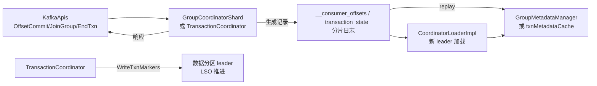

**协调器的输入/输出与关键机制**：

| 机制 | 输入 | 输出 | 关键行号 |
|---|---|---|---|
| 组分片 | groupId 哈希 | offsets 分区 | `GroupCoordinatorService.java:423-429` |
| classic 组状态机 | Join/Sync/Leave/Heartbeat | Empty↔Preparing↔Completing↔Stable | `ClassicGroupState.java:27-97` |
| 位移事务挂起 | TxnOffsetCommit | pending 标记，待 marker 落定 | `GroupCoordinatorShard.java:1334-1339` |
| pid 分配与 fence | transactionalId | pid+epoch，旧 epoch 被拒 | `TransactionCoordinator.scala:560-564` |
| 两阶段提交 | EndTxn(COMMIT) | Prepare 落日志 → marker → Complete | `TransactionCoordinator.scala:540-704` |
| marker 生效 | COMMIT marker | txnindex 更新、LSO 推进 | `UnifiedLog.java:1270-1274` |
| 崩溃恢复 | txn 日志重放 | 补写未完成的 marker | `TransactionState.java:95-97` |

**三个最值得记住的点**：

1. **组和事务的状态机都是"日志优先"**：先写分区日志再改内存，任何 broker 随时可以凭日志重建全部状态——这也是协调器能在 broker 间自由迁移的原因；
2. **Prepare 状态是崩溃恢复的锚点**：事务停留在 PREPARE_COMMIT/PREPARE_ABORT 意味着 marker 可能没发全，重启后必须补发，否则数据分区会永远等不到 LSO 推进；
3. **pid fence 靠 epoch 单调递增**：InitProducerId 对同一 transactionalId 总是提升 epoch（`TransactionCoordinator.scala:563-564`），旧 producer 的任何请求都会被 PRODUCER_FENCED——这是僵尸 producer 的终极防线，也是 `ProducerFencedException` 的唯一来源。

---

## 附：学习路线与复习卡汇总

### 推荐阅读顺序（由浅入深）

| 阶段 | 内容 | 建议时长 |
|---|---|---|
| 1 | 跑通单节点 KRaft 集群（`bin/kafka-storage.sh format` + `server.properties` 设 `process.roles=broker,controller`），用 `kafka-console-producer/consumer` 建立体感 | 半天 |
| 2 | 第一讲：SocketServer + RequestChannel + KafkaRequestHandler（先把线程名和队列画出来） | 1–2 天 |
| 3 | 第三讲：UnifiedLog + LogSegment（对着磁盘目录 `data/orders-0/` 看四个文件） | 2 天 |
| 4 | 第四讲：RecordAccumulator + Sender（debug 一次 send 到 drain 的完整路径） | 1–2 天 |
| 5 | 第五讲：KafkaConsumer + Fetcher + SubscriptionState（classic 协议优先） | 2 天 |
| 6 | 第二讲：KRaft（KafkaRaftServer → SharedServer → QuorumController，重点 replay） | 2 天 |
| 7 | 第六讲：GroupCoordinator + TransactionCoordinator（先 ClassicGroupState，再两阶段提交） | 2 天 |
| 8 | 专题：日志压缩（Cleaner.java 的 doClean 三步）与崩溃恢复（LogManager.loadLogs） | 1–2 天 |
| 9 | 专题：Purgatory 与配额（DelayedFetch/DelayedProduce + ClientQuotaManager） | 1 天 |
| 10 | 专题：KIP-848 新消费者协议（ConsumerMembershipManager + broker 侧 modern assignor） | 深入方向 |
| 11 | 专题：KIP-932 Share Groups（ShareCoordinator/SharePartitionManager） | 深入方向 |

### 全链路复习卡

**网络层（第一讲）：**
1. 线程模型：每 listener 1 个 Acceptor、N 个 Processor（各一个 Selector）、M 个 KafkaRequestHandler；线程名前缀分别是 `data-plane-kafka-socket-acceptor-`、`data-plane-kafka-network-thread-`、`data-plane-kafka-request-handler-`。
2. Processor 主循环七步：configureNewConnections → processNewResponses → poll → processCompletedReceives → processCompletedSends → processDisconnected → closeExcessConnections。
3. 三级队列：requestQueue（500）、callbackQueue（优先）、每 Processor 私有 responseQueue。
4. mute/unmute 流控：收请求即 mute，响应写完 unmute；限流靠 ThrottledChannel 到点回调。
5. 五段耗时：requestQueue/apiLocal/apiRemote/responseQueue/responseSend，全靠 Request 上的 volatile 时间戳。
6. Purgatory：512 个 watcher shard；tryCompleteElseWatch + checkAndComplete；DelayedFetch 的 Case A–H、DelayedProduce 的 ISR 检查。
7. 请求配额与带宽配额分开算，acks=0 免请求配额；fetch 被限流时要 unrecord 已记录值。

**KRaft（第二讲）：**
8. 三种进程角色由 `process.roles` 决定：broker / controller / combined（SharedServer 引用计数）。
9. 启动顺序 controller 先、broker 后；关闭顺序相反。
10. 元数据记录 25 种（`metadata/src/main/resources/common/metadata/*.json`），与控制记录（VOTE/BEGIN/END_QUORUM_EPOCH）共存在 `__cluster_metadata-0`。
11. QuorumController 单线程事件队列：写操作与提交回调都入队，先应用后响应。
12. 每个批次后建内存快照（OffsetControlManager.handleScheduleAppend），lastStableOffset 之前的旧快照被清理。
13. brokerEpoch 是 lease：注册发放、心跳续约、不匹配即 fence。
14. broker 不读 raft 日志，靠 controller 的 publisher（KRaftMetadataCachePublisher）推送增量。
15. ControllerApis 处理 raft 协议 API + broker 生命周期 API + ENVELOPE 转发的管理 API。

**存储引擎（第三讲）：**
16. segment 四件套：`.log`（数据）、`.index`（稀疏 offset 索引，4KB 一条）、`.timeindex`、`.txnindex`；外加 `.snapshot`（producer 状态）。
17. offset 只在 leader 分配且必须持锁；follower 只校验衔接，不衔接抛 UnexpectedAppendOffsetException。
18. 删数据绝不碰高水位之上；log start offset 只随删段前进。
19. 压缩三步：buildOffsetMap（key→最后 offset）→ groupSegmentsBySize → cleanSegments 写 `.cleaned` 新段再原子替换；checkpoint 记录清理进度。
20. 恢复靠 recovery-point-checkpoint：之前的段免检，之后的段需重放校验；正常关闭写 `.clean_shutdown`。
21. READ_COMMITTED 的可见性 = min(HW, LSO)，aborted txn 由 txnindex 在读取时过滤。

**Producer（第四讲）：**
22. `send()` 唯一可能阻塞点是内存池 allocate（max.block.ms）；发送永不阻塞。
23. sticky 分区器减少小请求；每分区同时只有 1 个 in-flight 批次（保序不变式）。
24. sequence 只在首次 drain 分配，重试带原 sequence——幂等去重的全部秘密。
25. TransactionManager 十态：UNINITIALIZED → INITIALIZING → READY → IN_TRANSACTION → (PREPARED) → COMMITTING/ABORTING，外加 ABORTABLE_ERROR/FATAL_ERROR。
26. 事务中新分区先入事务（AddPartitionsToTxn）才会被 drain。

**Consumer（第五讲）：**
27. poll 三件事：updateAssignmentMetadataIfNeeded → pollForFetches → 提前发下一轮。
28. position 随 fetch 前进，commit 只是存档；重复消费窗口来自此。
29. classic 协议 = Join/Sync/Heartbeat 三请求 + leader 算分配；new 协议（KIP-848）= 单心跳 + broker 指派 + 客户端增量 ack。
30. MemberState 五态：UNSUBSCRIBED → JOINING → RECONCILING → ACKNOWLEDGING → STABLE。
31. range 分配：同 topic 连续分片、余数给排序靠前者，跨 topic 可能倾斜。
32. cooperative 只撤销待移动分区；eager 每次全撤全分。

**协调器（第六讲）：**
33. group → `abs(hashCode) % offsets.topic.num.partitions`；一个组固定一个分区，操作天然串行。
34. ClassicGroupState 五态：Empty → PreparingRebalance → CompletingRebalance → Stable → Dead。
35. 协调器无状态 worker：硬状态只在 `__consumer_offsets`/`__transaction_state` 日志里，shard 随分区 leader 迁移。
36. 事务两阶段：EndTxn → PREPARE_*（落日志）→ WriteTxnMarkers → COMPLETE_* → Empty。
37. Prepare 状态是崩溃恢复锚点：重启后必须补发未写完的 marker。
38. pid fence = epoch 单调递增，旧 producer 一切请求收 PRODUCER_FENCED。
39. 事务位移（TxnOffsetCommit）以挂起态进 offsets 日志，marker 落定才转正——这就是 consume-transform-produce 原子性的来源。

---

## 涉及文件索引

| 主题 | 文件 |
|---|---|
| 网络层 | `core/src/main/scala/kafka/network/SocketServer.scala`, `RequestChannel.scala` |
| 请求处理 | `core/src/main/scala/kafka/server/{KafkaRequestHandler,KafkaApis,RequestHandlerHelper,DelayedFetch,ReplicaManager}.scala` |
| Purgatory/配额 | `server-common/src/main/java/org/apache/kafka/server/purgatory/DelayedOperationPurgatory.java`, `server/src/main/java/org/apache/kafka/server/purgatory/DelayedProduce.java`, `server/src/main/java/org/apache/kafka/server/quota/ClientQuotaManager.java` |
| KRaft 入口 | `core/src/main/scala/kafka/server/{KafkaRaftServer,SharedServer,ControllerServer,BrokerServer,ControllerApis,ControllerRegistrationManager}.scala` |
| raft 客户端 | `core/src/main/scala/kafka/raft/KafkaRaftManager.scala`, `raft/src/main/java/org/apache/kafka/raft/{KafkaRaftClient,KafkaRaftClientDriver,ControlRecord}.java`, `raft/src/main/java/org/apache/kafka/raft/internals/KRaftControlRecordStateMachine.java` |
| 元数据控制器 | `metadata/src/main/java/org/apache/kafka/controller/{QuorumController,OffsetControlManager,ClusterControlManager,ReplicationControlManager,ConfigurationControlManager,ProducerIdControlManager}.java` |
| 元数据记录 schema | `metadata/src/main/resources/common/metadata/*.json`（25 种） |
| 元数据缓存 | `metadata/src/main/java/org/apache/kafka/metadata/KRaftMetadataCache.java` |
| broker 生命周期 | `server/src/main/java/org/apache/kafka/server/BrokerLifecycleManager.java` |
| 存储引擎 | `storage/src/main/java/org/apache/kafka/storage/internals/log/{UnifiedLog,LocalLog,LogSegment,LogSegments,LogValidator,LogConfig,LogCleaner,Cleaner,LogCleanerManager,ProducerStateManager,TransactionIndex,OffsetIndex,TimeIndex,LogFileUtils}.java` |
| 日志管理（磁盘级） | `core/src/main/scala/kafka/log/LogManager.scala` |
| Producer | `clients/src/main/java/org/apache/kafka/clients/producer/{KafkaProducer,Partitioner,RecordMetadata,ProducerConfig}.java`, `clients/src/main/java/org/apache/kafka/clients/producer/internals/{RecordAccumulator,ProducerBatch,Sender,TransactionManager,BuiltInPartitioner,ProducerMetadata,FutureRecordMetadata,BufferPool}.java` |
| Consumer | `clients/src/main/java/org/apache/kafka/clients/consumer/{KafkaConsumer,RangeAssignor,RoundRobinAssignor,StickyAssignor,CooperativeStickyAssignor,GroupProtocol}.java`, `clients/src/main/java/org/apache/kafka/clients/consumer/internals/{ClassicKafkaConsumer,ConsumerNetworkThread,Fetcher,FetchCollector,SubscriptionState,ConsumerNetworkClient,ConsumerCoordinator,ConsumerMembershipManager,ConsumerHeartbeatRequestManager,MemberState,AbstractCoordinator,CommitRequestManager,BaseHeartbeatThread}.java` |
| Group Coordinator | `group-coordinator/src/main/java/org/apache/kafka/coordinator/group/{GroupCoordinator,GroupCoordinatorService,GroupCoordinatorShard,GroupMetadataManager,OffsetMetadataManager,GroupCoordinatorConfig}.java`, `group-coordinator/src/main/java/org/apache/kafka/coordinator/group/classic/ClassicGroupState.java`, `core/src/main/scala/kafka/coordinator/group/CoordinatorPartitionWriter.scala` |
| 协调器运行时 | `coordinator-common/src/main/java/org/apache/kafka/coordinator/common/runtime/{CoordinatorRuntime,CoordinatorLoaderImpl,CoordinatorMetadataImage}.java` |
| 事务协调 | `core/src/main/scala/kafka/coordinator/transaction/{TransactionCoordinator,TransactionStateManager,TransactionMarkerChannelManager}.scala`, `transaction-coordinator/src/main/java/org/apache/kafka/coordinator/transaction/{TransactionState,TransactionLog,TransactionMetadata,ProducerIdManager}.java` |
| 内部分区常量 | `clients/src/main/java/org/apache/kafka/common/internals/Topic.java`（`__consumer_offsets:27`、`__transaction_state:28`、`__cluster_metadata:30`） |
