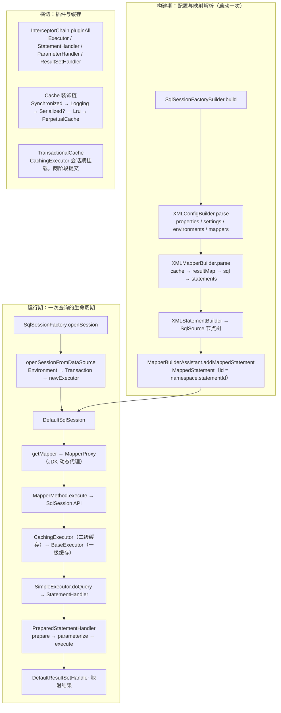
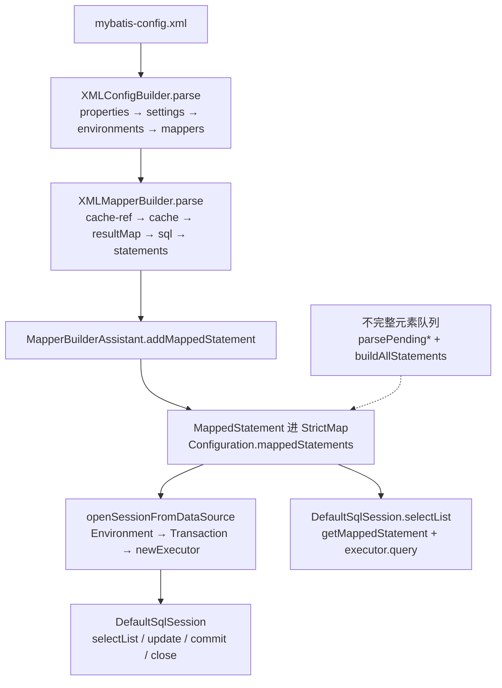
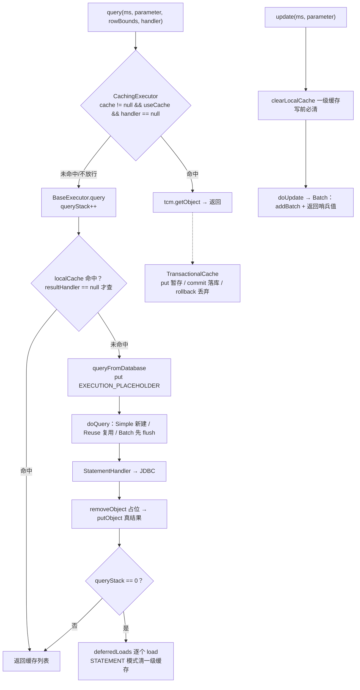
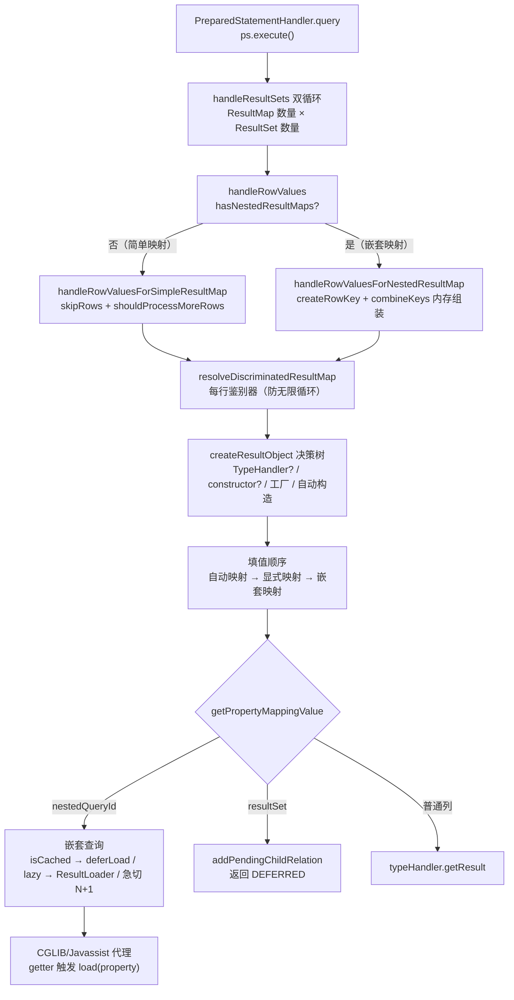
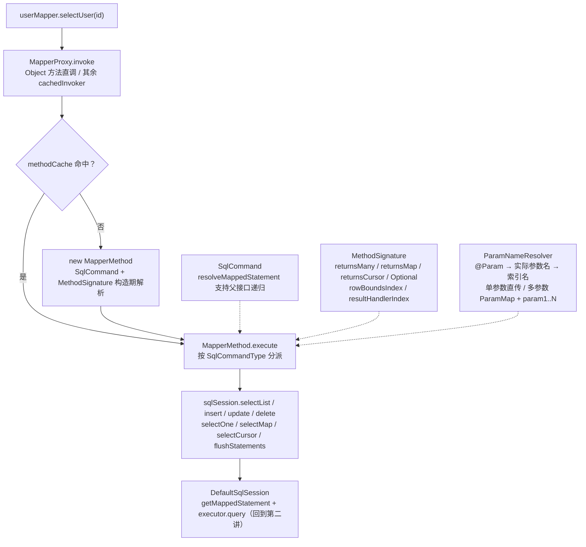
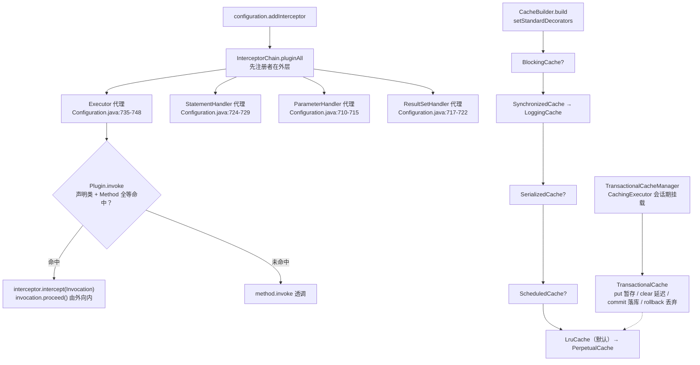

> 基于对 MyBatis 3.5.19 源码的逐文件精读整理而成。
> 仓库：`D:/work/2026/deep-dive/sources/mybatis`，版本 tag `mybatis-3.5.19`。
> Commit：`ee0d4f4831ffdd311b0183c202f4ad6492a3f404`，提交时间：`2025-01-02 15:30:10 -0500`（git shallow clone，工作区已从该 commit 对象还原）。
> 阅读顺序即学习顺序：入口与配置（`SqlSessionFactoryBuilder` → `Configuration`）→ Executor 执行器（一级/二级缓存）→ Statement 与参数/结果处理（`StatementHandler`/`ParameterHandler`/`ResultSetHandler`）→ SQL 映射与动态 SQL（`MappedStatement`/`SqlSource`/节点树）→ Mapper 接口绑定（JDK 动态代理）→ 插件与缓存装饰（Interceptor/装饰器链）。
> 所有结论均标注了源文件位置（相对仓库根的路径 + 行号），建议对照代码阅读。下文路径如 `session/Configuration.java:125` 均相对于仓库根目录下的 `src/main/java/org/apache/ibatis/`；涉及文件索引一节给出完整相对路径与行数。

---

## 〇、全景地图

```
┌──────────────────── 构建期：配置与映射解析（启动一次） ────────────────────┐
│ SqlSessionFactoryBuilder.build(InputStream)                              │
│   └─ XMLConfigBuilder.parse()                 ← mybatis-config.xml       │
│        properties → settings(MetaClass 校验) → typeAliases → plugins      │
│        → objectFactory → environments → databaseIdProvider → typeHandlers │
│        → mappers（resource / url / class / package 四种注册）              │
│            └─ XMLMapperBuilder.parse()        ← XxxMapper.xml             │
│                 cache-ref → cache → parameterMap → resultMap → sql        │
│                 → statements（XMLStatementBuilder → SqlSource 节点树）     │
│                      └─ MapperBuilderAssistant.addMappedStatement         │
│                           → MappedStatement（id = namespace.statementId） │
└───────────────────────────────────┬──────────────────────────────────────┘
                                    ▼
┌──────────────────── 运行期：一次查询的生命周期 ───────────────────────────┐
│ SqlSessionFactory.openSession()                                          │
│   └─ DefaultSqlSessionFactory.openSessionFromDataSource                   │
│        Environment → TransactionFactory → JdbcTransaction（懒连接）       │
│        → Configuration.newExecutor：Simple/Reuse/Batch → CachingExecutor  │
│        → new DefaultSqlSession                                           │
│ sqlSession.getMapper(XxxMapper.class)                                    │
│   └─ MapperRegistry.getMapper → MapperProxyFactory（JDK 动态代理）         │
│        MapperProxy.invoke → MapperMethod.execute → SqlSession API         │
│            └─ DefaultSqlSession.selectList：getMappedStatement + query    │
│                 CachingExecutor（二级缓存 TCM）→ BaseExecutor（一级缓存）  │
│                 → SimpleExecutor.doQuery → StatementHandler               │
│                      RoutingStatementHandler → PreparedStatementHandler  │
│                      prepare → parameterize（DefaultParameterHandler）    │
│                      → ps.execute → DefaultResultSetHandler 映射结果      │
└──────────────────────────────────────────────────────────────────────────┘
┌──────────────────── 横切：插件与缓存（贯穿运行期） ───────────────────────┐
│ InterceptorChain.pluginAll：Executor / StatementHandler / ParameterHandler│
│   / ResultSetHandler 四大对象，在 Configuration 四个工厂方法出口统一织入   │
│ Cache 装饰链：Blocking? → Synchronized → Logging → Serialized? →          │
│   Scheduled? → Lru(默认) → PerpetualCache；TransactionalCache 会话期挂载   │
└──────────────────────────────────────────────────────────────────────────┘
```

渲染友好版（GitHub/GitLab 直接出图，信息同上图）：



**三条主线**：

1. **配置与映射构建**：`SqlSessionFactoryBuilder` 把 `mybatis-config.xml` 与各个 `XxxMapper.xml`（或注解）解析成一张 `Configuration`——所有 `MappedStatement`、`ResultMap`、`Cache`、`TypeHandler`、插件都在这里登记；解析顺序（cache-ref 先于 cache、sql 先于 statements）与「不完整元素」延后补齐机制是这一阶段的两个关键设计（第一讲）。
2. **执行器与缓存**：`openSession` 装配出 `CachingExecutor` 装饰 `Simple/Reuse/BatchExecutor` 的链；一级缓存活在 `BaseExecutor.localCache`（会话级、默认开启），二级缓存活在 namespace 级 `Cache`（默认关闭、`TransactionalCache` 两阶段提交）（第二讲）。
3. **SQL 执行与映射**：`StatementHandler` 家族负责 JDBC 语句生命周期，`DefaultParameterHandler` 负责 `#{}` → `?` 绑定，`DefaultResultSetHandler` 负责 `ResultSet` → Java 对象（自动映射、嵌套映射/查询、鉴别器、延迟加载）；`SqlSource`（`RawSqlSource`/`DynamicSqlSource`）与 SqlNode 节点树负责"SQL 文本怎么来"（第三、四讲）。

---

## 面试速通：MyBatis 高频问题一页纸

> **先给结论**：MyBatis 的全部"魔法"可以压缩成六件事——XML/注解解析成 `MappedStatement`、JDK 动态代理把接口方法变成 SqlSession 调用、Executor 装饰链管缓存、StatementHandler 四件套管 JDBC、SqlNode 节点树管动态 SQL、Interceptor 管四大对象拦截。
> 面试被追问时按讲次展开：入口与配置找第一讲，缓存与执行器找第二讲，参数/结果处理找第三讲，动态 SQL 找第四讲，Mapper 代理找第五讲，插件找第六讲。
> 下表每条结论都出自对应讲次的小结，是"一页纸"的最低配置；`深入` 列指向讲次，供二次展开。
> 使用方式：先报一句话结论稳住场面，再按讲次递进；细节全部能在本笔记中找到源码级依据。
> 边界：本章只收文档正文出现过的结论，未展开的细节请回到对应讲次查证，不引入文档外知识点。

### 高频 Q&A（先结论）

先结论、后细节：18 个最高频问题各配一句话，覆盖配置解析、缓存、执行器、参数/结果、动态 SQL、Mapper 绑定与插件七条主线；
回答时避免一上来就陷入实现细节，先给结论再按 `深入` 列回讲次展开。

| # | 面试问题 | 一句话结论 | 深入 |
|---|---|---|---|
| 1 | MyBatis 的整体架构/工作原理？ | 分三层：接口层（`SqlSession` + Mapper 动态代理）→ 核心处理层（`Executor`/`StatementHandler`/`ParameterHandler`/`ResultSetHandler`）→ 基础支撑层（`Configuration`/`TypeHandler`/日志/缓存）；一次调用 = 接口方法 → `MappedStatement` 查找 → Executor 链 → StatementHandler → JDBC → 结果映射 | 第一、二讲 |
| 2 | `#{}` 和 `${}` 的区别？ | `#{}` 在 SqlSource 生成期被 `SqlSourceBuilder` 换成 `?` 占位符并记录 `ParameterMapping`，运行期由 TypeHandler 预编译绑定，**无注入风险**；`${}` 在运行期由 `TextSqlNode` 用 OGNL 求值后**直接文本拼接**，只能用于表名/列名等可信场景 | 第四讲 |
| 3 | 一级缓存是怎么回事？ | 就是 `BaseExecutor.localCache`（`PerpetualCache`），会话级、默认开启且**不可关闭**；`update` 前必清（`BaseExecutor.java:116`），`commit/rollback` 前也清；`queryStack` + `EXECUTION_PLACEHOLDER` 防同一 key 递归查询 | 第二讲 |
| 4 | 一级缓存默认作用域是 STATEMENT 吗？ | **不是，默认是 SESSION**（`Configuration.java:125` 与 `XMLConfigBuilder.java:278` 双重确认）；STATEMENT 模式才在每条最外层查询结束后清理（`BaseExecutor.java:169-172`） | 第二讲 |
| 5 | 二级缓存原理？ | namespace 级共享，`CachingExecutor` 在每个 Cache 外挂 `TransactionalCache`：事务内 put 只进 `entriesToAddOnCommit`，`commit` 才刷入 delegate，`rollback` 整体丢弃——**两阶段提交**；默认关闭，需 `<cache>` 或 `@CacheNamespace` 显式开启 | 第二讲 |
| 6 | 二级缓存默认装饰链长什么样？ | `BlockingCache? → SynchronizedCache → LoggingCache → SerializedCache? → ScheduledCache? → LruCache → PerpetualCache`（`CacheBuilder.java:118-140`）；`readWrite=true`（XML 不配 readOnly）时值必须可序列化 | 第六讲 |
| 7 | 三种 Executor 的区别？ | SIMPLE 每次新建 Statement；REUSE 按 SQL 文本复用 Statement（`statementMap`）；BATCH 累积 `addBatch`，`doFlushStatements` 统一 `executeBatch`——且只有 SQL 文本与 MappedStatement 都相同才并入同一条批次（`BatchExecutor.java:62`） | 第二讲 |
| 8 | BatchExecutor 的返回值为什么是 Integer.MIN_VALUE+1002？ | 因为 `doUpdate` 只是 `addBatch`，尚未真正执行，拿不到影响行数；真实行数在 `flushStatements` 后从 `BatchResult.getUpdateCounts()` 取（`BatchExecutor.java:43/79`） | 第二讲 |
| 9 | 动态 SQL 的原理？ | XML 被解析成 SqlNode 节点树（`if/choose/trim/where/set/foreach/bind`），运行期 `apply(context)` 拼 SQL；`isDynamic` 为假时启动期固化为 `RawSqlSource`，为真才用 `DynamicSqlSource` 每次重算（`XMLScriptBuilder.java:65-74`） | 第四讲 |
| 10 | Mapper 接口的原理？ | JDK 动态代理：`getMapper` → `MapperProxyFactory.newInstance` → `MapperProxy.invoke` → `cachedInvoker` 缓存 `MapperMethod` → `execute` 按 SqlCommandType 转调 SqlSession API；statementId = 接口全限定名 + `.` + 方法名 | 第五讲 |
| 11 | 插件（Interceptor）原理？ | `InterceptorChain.pluginAll` 按注册顺序用 JDK 动态代理逐层包裹四大对象（Executor/StatementHandler/ParameterHandler/ResultSetHandler）；`Plugin.wrap` 用「注解声明的接口 ∩ 目标类继承链接口」决定代理哪些接口，交集为空**静默不拦截** | 第六讲 |
| 12 | 延迟加载怎么做的？ | 嵌套查询且 `lazy=true` 时返回 CGLIB/Javassist 代理，`ResultLoaderMap` 挂起 `ResultLoader`；getter 触发 `load(property)` 才真正发起查询；`aggressive` 或命中 `lazyLoadTriggerMethods` 则 loadAll | 第三讲 |
| 13 | 嵌套查询和嵌套映射的区别？ | 嵌套查询（`select` 属性）= 先查主表再按外键逐条查（N+1）；嵌套映射（`resultMap` 属性）= 一次 join 查出所有行，靠 `createRowKey`/`combineKeys` 在内存里组装对象树（`DefaultResultSetHandler.java:1138-1169`） | 第三讲 |
| 14 | 主键回填的两种方式？ | `useGeneratedKeys=true` → `Jdbc3KeyGenerator` 用 JDBC `getGeneratedKeys`（仅 INSERT 默认生效）；`<selectKey>` → 抽出独立语句（id 加 `!selectKey` 后缀）由 `SelectKeyGenerator` 在 BEFORE/AFTER 执行 | 第三、四讲 |
| 15 | 多参数方法怎么传参？ | `@Param` 或天然多参时 `ParamNameResolver` 构造 `ParamMap`，同时挂 `param1..N` 通用名（不覆盖 `@Param` 名）；单 POJO 原样直传；集合/数组包装成 `{collection/list}` 或 `{array}` | 第五讲 |
| 16 | 分页怎么做？ | `RowBounds` 是**内存分页**：`skipRows` 跳过 offset 行、`shouldProcessMoreRows` 截断 limit（`DefaultResultSetHandler.java:391-403`）；生产上 PageHelper 类插件是在 Executor 拦截点改写 `BoundSql` | 第三、六讲 |
| 17 | MyBatis 和 Spring 整合后事务谁管？ | `ManagedTransaction` 的 commit/rollback 全是空实现，事务交给 Spring；`JdbcTransactionFactory` 的 `skipSetAutoCommitOnClose` 专为容器托管连接设计；`SqlSessionTemplate`/`SqlSessionManager` 管会话生命周期 | 第一、五讲 |
| 18 | statement 的解析顺序有什么讲究？ | `XMLMapperBuilder` 固定顺序：cache-ref → cache → parameterMap → resultMap → sql → statements；跨文件引用靠「不完整元素」机制延后补齐，最终 `buildAllStatements` 按 resultMaps→cacheRefs→statements→methods fail-fast | 第一讲 |

### 易错点与面试坑

以下都是文档中强调过的反直觉点，每一条对应一个"知道即加分、不知道就翻车"的瞬间；
按优先级排好了，前三条是源码结论与直觉冲突最厉害的地方。
每条都附了"怎么躲"：改法或排障入口，直接可用。

- **一级缓存默认作用域是 SESSION 不是 STATEMENT**（最常被记错的一条）：`Configuration.java:125` 字段默认值与 `XMLConfigBuilder.java:278` 的 settings 默认值两处都是 SESSION。这意味着同一 SqlSession 内多次相同查询会**命中旧数据**（比如中间被别的连接改了库）；
  排查"改了库却读到旧值"先问：是不是同一个 SqlSession？把 `localCacheScope` 设成 STATEMENT 也只是每条最外层查询后清（`BaseExecutor.java:169-172`），真正的根治是及时 commit/close。
- **二级缓存事务内不可见**：`TransactionalCache.putObject` 只写本地暂存（`TransactionalCache.java:78-81`），`commit` 才刷入（`:94-100`）；
  同一事务里"先写后查同一 namespace"读到的是旧值，这是设计而非 bug；`rollback` 只丢本事务新增、不动 delegate 旧数据（`:102-105`）。
- **二级缓存要求值可序列化**：`readWrite=true`（XML 不配 `readOnly` 时默认）时 `SerializedCache` 对出入参做序列化深拷贝（`SerializedCache.java:53-65`），缓存实体没实现 `Serializable` 启动不报错、运行期抛 `CacheException`；
  另一个隐蔽代价：读出来的永远是副本，改它不会影响缓存。
- **`${}` 就是 SQL 注入面**：`TextSqlNode.BindingTokenParser` 求值后 `String.valueOf` 直接拼进 SQL（`TextSqlNode.java:77-79`）；
  3.5.19 虽有 `injectionFilter` 正则校验字段（`:30/:83-87`），但核心链路两个构造点都传 null（`XMLScriptBuilder.java:83`、`XMLLanguageDriver.java:57`），**默认不启用**，需使用方自行传入 Pattern。
- **BatchExecutor 交替写不同 SQL 不会合成一批**：追加条件是"与**上一条** SQL 文本和 MappedStatement 都相同"（`BatchExecutor.java:62`），A/B/A 交替会产生三个批次；
  要真批量，先按 SQL 分组循环，且别忘了 `doQuery` 前会自动 `flushStatements`（`:87`）——批量写后紧跟查询会打断批次。
- **插件注解写错 type 静默不拦截**：`Plugin.wrap` 只代理「注解声明接口 ∩ 目标类实现接口」的交集（`Plugin.java:44-52`），交集为空原样返回；
  插件"没生效"时第一站就查这里，其次查 `InterceptorChain` 注册顺序（先注册在最外层，`InterceptorChain.java:29-34`）。
- **Mapper 重复注册直接炸启动**：`MapperRegistry.addMapper` 对同一接口二次注册抛 `BindingException`（`MapperRegistry.java:62-64`）——且只对接口生效，非接口静默跳过；
  XML 与注解混排时靠 `"namespace:" + namespace` 资源标记避免双加载（`XMLMapperBuilder.java:396`）。
- **`useGeneratedKeys` 只对 INSERT 生效**：XML 侧默认值是 `configuration.isUseGeneratedKeys() && SqlCommandType.INSERT`（`XMLStatementBuilder.java:93-95`），update/delete 写了也白写；多主键列必须同时给 `keyProperty`（逗号分隔）和 `keyColumn`。
- **`<include>` 没有循环检测**：`XMLIncludeTransformer` 递归展开时未做环检测（已通读全类确认），自引用会一路递归到 `StackOverflowError`（`XMLIncludeTransformer.java:62-65`）；
  大型项目里 `<sql>` 片段互相 include 时要人工把住关。
- **RowBounds 是大数据量杀手**：它先 `skipRows` 逐行 `next()` 跳过 offset 再取 limit（`DefaultResultSetHandler.java:391-403`），offset=100 万就是把 100 万行数据从数据库拉到内存再扔掉；
  生产分页要么 SQL 层 limit，要么用插件改写 BoundSql。
- **selectOne 返回多行直接抛异常**：`DefaultSqlSession.selectOne` 查到 >1 行抛 `TooManyResultsException`（`DefaultSqlSession.java:79-82`），0 行返回 null；
  别在"理论上唯一"的查询上偷懒，唯一性交给数据库索引保证。
- **`@Conditional` 式排错不适用于 MyBatis，排错看 ErrorContext**：`ErrorContext` 是 ThreadLocal 递归上下文（`ErrorContext.java:41-54`），异常消息尾部自带 "The error may exist in ..." + statement id + SQL；
  看不懂报错时先把完整堆栈尾巴读完，再开 `logImpl` 的 STDOUT_LOGGING 看 SQL 日志。

### 关键概念与默认值速记

默认值全部来自文档正文，考前过一遍这张表即可；讲次列即出处，可回查验证。

| 项 | 默认值/取值 | 说明 | 讲次 |
|---|---|---|---|
| `cacheEnabled` | true | 二级缓存总开关；为 true 时 `newExecutor` 一律包 `CachingExecutor`（`Configuration.java:745-747`） | 第二讲 |
| `localCacheScope` | SESSION | 枚举仅 SESSION/STATEMENT 两值 | 第一、二讲 |
| `defaultExecutorType` | SIMPLE | SIMPLE/REUSE/BATCH 三分支（`Configuration.java:738-744`） | 第二讲 |
| `jdbcTypeForNull` | JdbcType.OTHER | null 参数没给 jdbcType 时的兜底 | 第三讲 |
| `autoMappingBehavior` | PARTIAL | 嵌套场景要求 FULL 才自动映射 | 第三讲 |
| `autoMappingUnknownColumnBehavior` | NONE | 未映射列的行为（NONE/WARNING/FAILING） | 第三讲 |
| `callSettersOnNulls` | false | null 值是否调 setter | 第三讲 |
| `returnInstanceForEmptyRow` | false | 空行是否返回实例 | 第三讲 |
| `mapUnderscoreToCamelCase` | false | 下划线转驼戈总开关 | 第三讲 |
| `useColumnLabel` | true | 取列名用 label 还是 name | 第三讲 |
| `lazyLoadingEnabled` | false | 延迟加载总开关 | 第三讲 |
| `aggressiveLazyLoading` | false | true 时任意方法触发 loadAll | 第三讲 |
| `lazyLoadTriggerMethods` | {equals, clone, hashCode, toString} | 触发 loadAll 的方法名集合 | 第三讲 |
| `defaultStatementTimeout` | null | 语句超时（毫秒） | 第三讲 |
| `defaultFetchSize` | null | fetch size | 第三讲 |
| `defaultResultSetType` | null | 回落 ResultSetType.DEFAULT | 第四讲 |
| 默认 LanguageDriver | XMLLanguageDriver | `lang="RAW"` 禁动态标签 | 第四讲 |
| `statementType` 默认 | PREPARED | STATEMENT/PREPARED/CALLABLE | 第三、四讲 |
| `flushCache` XML 默认 | `!isSelect` | insert/update/delete 默认 true | 第二、四讲 |
| `useCache` XML 默认 | `isSelect` | 仅 select 默认 true | 第二讲 |
| `<selectKey>` order 默认 | AFTER | BEFORE/AFTER | 第四讲 |
| `<selectKey>` 语句 id 后缀 | `!selectKey` | `SelectKeyGenerator.java:35` | 第四讲 |
| 缓存实现默认 | PERPETUAL | eviction 默认 LRU | 第六讲 |
| 缓存 size 默认 | 1024 | LruCache/FifoCache 构造即设 | 第六讲 |
| `readOnly` 默认 | false | 即 readWrite=true，值须可序列化 | 第六讲 |
| `blocking` 默认 | false | 防缓存击穿，默认关 | 第六讲 |
| ScheduledCache 默认周期 | 1 小时 | `TimeUnit.HOURS.toMillis(1)` | 第六讲 |
| Soft/WeakCache 硬链接数 | 256 | 防刚取出的热点对象立即被回收 | 第六讲 |
| CacheKey 哈希常量 | multiplier=37, hashcode=17 | `CacheKey.java:47-48` | 第二讲 |
| `BATCH_UPDATE_RETURN_VALUE` | `Integer.MIN_VALUE + 1002` | BatchExecutor 的未执行哨兵值 | 第二讲 |
| `ForEachSqlNode` 变量前缀 | `__frch_` | `#{item}` 改写为 `#{__frch_item_N}` | 第四讲 |
| 连接池 active/idle/checkoutTimeout | 10 / 5 / 20000ms | `PooledDataSource.java:52-55` | 第六讲 |
| 日志发现顺序 | SLF4J → Commons → Log4J2 → Log4J → JDK → NoLogging | 首个可用的胜出（`LogFactory.java:35-42`） | 第六讲 |
| RowBounds 常量 | offset=0, limit=Integer.MAX_VALUE | 内存分页参数 | 第三讲 |
| `@Options` fetchSize/timeout | -1 | 解析期转 null（表示不设置） | 第五讲 |
| `@Options` flushCache | DEFAULT 策略 | SELECT→false，INSERT/UPDATE/DELETE→true | 第五讲 |
| `@CacheNamespace` 默认 | PerpetualCache/LruCache/1024/readWrite=true | flushInterval=0 转 null | 第五、六讲 |

> 用法：先背 Q&A 的一句话结论，再用"深入"列回对应讲次查证；
> 易错点与默认值表建议面试当天早上再过一遍，尤其是一级缓存作用域、二级缓存两阶段提交、`#{}` vs `${}` 这三条。
> 时间紧就只记三件事：一级缓存默认 SESSION 级、二级缓存 commit 才可见、`#{}` 是占位符而 `${}` 是字符串拼接。

---

## 第一讲：入口与配置体系 —— 从 SqlSessionFactoryBuilder 到 DefaultSqlSession

### 定位（先说人话）

MyBatis 的启动像一条"单行装配线"：`SqlSessionFactoryBuilder.build` 读 `mybatis-config.xml`，`XMLConfigBuilder` 按固定顺序把配置节点翻译成 `Configuration` 里的注册表，遇到 `<mappers>` 就交给 `XMLMapperBuilder` 把每个 `XxxMapper.xml` 翻译成一批 `MappedStatement`。产物 `DefaultSqlSessionFactory` 之后每次 `openSession` 都做同一件事：从 `Configuration` 取出 Environment → 造 Transaction → 造 Executor → 造 `DefaultSqlSession`。**理解这一讲就理解了"配置怎么进内存"和"会话怎么开出来"**，后面所有执行期行为都挂在这两个产物上。

### 目录结构：session 与 builder 包（本讲主角）

```
src/main/java/org/apache/ibatis/
├── session/
│   ├── SqlSessionFactoryBuilder.java       ← 构建入口（99 行）
│   ├── SqlSessionFactory.java              ← 工厂接口（45 行，7 个 openSession 重载）
│   ├── SqlSession.java                     ← 会话接口（380 行，25 个方法）
│   ├── Configuration.java                  ← 配置中枢（1211 行，全部注册表 + 四个工厂方法）
│   ├── defaults/DefaultSqlSessionFactory.java ← 工厂实现（150 行）
│   ├── defaults/DefaultSqlSession.java     ← 会话门面（341 行）
│   ├── RowBounds.java / ExecutorType.java / LocalCacheScope.java
│   └── AutoMappingBehavior.java / AutoMappingUnknownColumnBehavior.java
├── builder/
│   ├── xml/XMLConfigBuilder.java           ← mybatis-config.xml 解析（443 行）
│   ├── xml/XMLMapperBuilder.java           ← XxxMapper.xml 解析（402 行）
│   ├── xml/XMLStatementBuilder.java        ← 单条 statement 解析（209 行，第四讲展开）
│   ├── BaseBuilder.java                    ← 所有 Builder 的委派基类（134 行）
│   ├── MapperBuilderAssistant.java         ← MappedStatement 组装助手（470 行，第四讲展开）
│   └── ResultMapResolver.java / CacheRefResolver.java / IncompleteElementException.java
├── binding/MapperRegistry.java             ← Mapper 注册中心（124 行，第五讲展开）
└── reflection/MetaClass.java               ← settings 校验与反射基座（190 行）
```

### SqlSessionFactoryBuilder —— 8 个 build 重载收敛到 4 参数版

`SqlSessionFactoryBuilder.java:35-93` 的 8 个 build 重载（Reader/InputStream × environment/properties 有无）最终全部收敛到 4 参数版本，核心动作只有两步：`new XMLConfigBuilder(...)` + `parser.parse()`：

```java
// SqlSessionFactoryBuilder.java:47-63
  public SqlSessionFactory build(Reader reader, String environment, Properties properties) {
    try {
      XMLConfigBuilder parser = new XMLConfigBuilder(reader, environment, properties);
      return build(parser.parse());
    } catch (Exception e) {
      throw ExceptionFactory.wrapException("Error building SqlSession.", e);
    } finally {
      ErrorContext.instance().reset();
      try {
        if (reader != null) {
          reader.close();
        }
      } catch (IOException e) {
        // Intentionally ignore. Prefer previous error.
      }
    }
  }
```

三个细节值得记住：`:49`（Reader 版）与 `:79`（InputStream 版）是全类唯一创建 `XMLConfigBuilder` 的两处；所有异常统一经 `ExceptionFactory.wrapException("Error building SqlSession.", e)` 包装（`:51-52`、`:81-82`）；`finally` 里 `ErrorContext.instance().reset()` 清理线程级错误上下文，输入流关闭失败被**有意吞掉**（注释原文 "Intentionally ignore. Prefer previous error."）。另有 `SqlSessionFactoryBuilder.java:95-97`：若已持有 `Configuration`，直接 `new DefaultSqlSession(config)` 绕过 XML 解析——这是编程式配置的入口。

### DefaultSqlSessionFactory —— openSession 的五步装配

`DefaultSqlSessionFactory.java:94-109` 是 DataSource 路径的唯一实现，五行代码定义了运行期的起点：

```java
// DefaultSqlSessionFactory.java:94-109
  private SqlSession openSessionFromDataSource(ExecutorType execType, TransactionIsolationLevel level,
      boolean autoCommit) {
    Transaction tx = null;
    try {
      final Environment environment = configuration.getEnvironment();
      final TransactionFactory transactionFactory = getTransactionFactoryFromEnvironment(environment);
      tx = transactionFactory.newTransaction(environment.getDataSource(), level, autoCommit);
      final Executor executor = configuration.newExecutor(tx, execType);
      return createSqlSession(configuration, executor, autoCommit);
    } catch (Exception e) {
      closeTransaction(tx); // may have fetched a connection so lets call close()
      throw ExceptionFactory.wrapException("Error opening session.  Cause: " + e, e);
    } finally {
      ErrorContext.instance().reset();
    }
  }
```

- 步骤行号：`:98` getEnvironment → `:99` 取 TransactionFactory → `:100` newTransaction → `:101` **configuration.newExecutor**（第二讲的装配链在此触发）→ `:102` createSqlSession。
- `:104` 异常路径必须先 `closeTransaction(tx)`——newTransaction 可能已经取到连接，直接抛异常不关连接会泄漏（注释原文 "may have fetched a connection so lets call close()"）。
- `DefaultSqlSessionFactory.java:133-138`：environment 或 transactionFactory 为 null 时兜底返回 `new ManagedTransactionFactory()`——**没配 `<environments>` 也能开 Session**，这是 Spring 无事务环境下仍能工作的关键。
- `DefaultSqlSessionFactory.java:111-131` 的 `openSessionFromConnection`：从外部 Connection 读 autoCommit，读失败按注释（`:117-118` "Failover to true, as most poor drivers or databases won't support transactions"）兜底为 true；`transactionFactory.newTransaction(connection)` 只吃 Connection 一个参数——Spring 的 `SqlSessionTemplate` 走这条路径。
- `DefaultSqlSessionFactory.java:90-92` 的 `createSqlSession` 是 protected 钩子，默认 `new DefaultSqlSession(configuration, executor, autoCommit)`，集成方可继承替换。

### Configuration —— 默认值字段与五个注册表

#### 3.1 字段默认值（`Configuration.java:107-134`）

```java
// Configuration.java:107-134（节选）
  protected boolean safeRowBoundsEnabled;                 // :107 默认 false
  protected boolean safeResultHandlerEnabled = true;      // :108
  protected boolean mapUnderscoreToCamelCase;             // :109 默认 false
  protected boolean aggressiveLazyLoading;                // :110 默认 false
  protected boolean useGeneratedKeys;                     // :111 默认 false
  protected boolean useColumnLabel = true;                // :112
  protected boolean cacheEnabled = true;                  // :113
  protected boolean LocalCacheScope localCacheScope = LocalCacheScope.SESSION;  // :125
  protected JdbcType jdbcTypeForNull = JdbcType.OTHER;    // :126
  protected Set<String> lazyLoadTriggerMethods = new HashSet<>(
      Arrays.asList("equals", "clone", "hashCode", "toString"));  // :127-128
  protected Integer defaultStatementTimeout;              // :129 null
  protected Integer defaultFetchSize;                     // :130 null
  protected ResultSetType defaultResultSetType;           // :131 null
  protected ExecutorType defaultExecutorType = ExecutorType.SIMPLE;  // :132
  protected AutoMappingBehavior autoMappingBehavior = AutoMappingBehavior.PARTIAL;  // :133
```

注意 `defaultResultSetType`（`:131`）**无字段默认值**（null），运行期由 `MappedStatement.Builder` 兜底为 `ResultSetType.DEFAULT`（`MappedStatement.java:73`）；`proxyFactory` 字段默认 `JavassistProxyFactory`（`Configuration.java:142`，issue #224，CGLIB 工厂已废弃）。

#### 3.2 五个 final 注册表（`Configuration.java:152-161`）

```java
// Configuration.java:152-156
  protected final MapperRegistry mapperRegistry = new MapperRegistry(this);
  protected final InterceptorChain interceptorChain = new InterceptorChain();
  protected final TypeHandlerRegistry typeHandlerRegistry = new TypeHandlerRegistry(this);
  protected final TypeAliasRegistry typeAliasRegistry = new TypeAliasRegistry();
  protected final LanguageDriverRegistry languageRegistry = new LanguageDriverRegistry();
```

构造器（`Configuration.java:190-222`）注册 20+ 内置别名：事务工厂 `JDBC/MANAGED`（`:191-192`）、数据源工厂 `JNDI/POOLED/UNPOOLED`（`:194-196`）、缓存 `PERPETUAL/FIFO/LRU/SOFT/WEAK`（`:198-202`）、`DB_VENDOR`（`:204`）、语言驱动 `XML/RAW`（`:206-207`）、日志实现六件套（`:209-215`）、代理工厂 `CGLIB/JAVASSIST`（`:217-218`），最后 `:220` 设默认 LanguageDriver 为 XMLLanguageDriver、`:221` 注册 RawLanguageDriver。

#### 3.3 四个工厂方法：运行期组件的唯一装配点（`Configuration.java:710-749`）

```java
// Configuration.java:724-749
  public StatementHandler newStatementHandler(Executor executor, MappedStatement mappedStatement,
      Object parameterObject, RowBounds rowBounds, ResultHandler resultHandler, BoundSql boundSql) {
    StatementHandler statementHandler = new RoutingStatementHandler(executor, mappedStatement, parameterObject,
        rowBounds, resultHandler, boundSql);                                    // :726
    return (StatementHandler) interceptorChain.pluginAll(statementHandler);     // :728
  }

  public Executor newExecutor(Transaction transaction, ExecutorType executorType) {
    executorType = executorType == null ? defaultExecutorType : executorType;   // :736
    Executor executor;
    if (ExecutorType.BATCH == executorType) {
      executor = new BatchExecutor(this, transaction);                          // :739
    } else if (ExecutorType.REUSE == executorType) {
      executor = new ReuseExecutor(this, transaction);                          // :741
    } else {
      executor = new SimpleExecutor(this, transaction);                         // :743
    }
    if (cacheEnabled) {
      executor = new CachingExecutor(executor);                                 // :746
    }
    return (Executor) interceptorChain.pluginAll(executor);                     // :748
  }
```

四个工厂方法的分工：`newParameterHandler`（`:710-715`）实际创建委派给 `mappedStatement.getLang().createParameterHandler(...)`（`:712`，LanguageDriver 负责，Configuration 只做插件包装）；`newResultSetHandler`（`:717-722`）直接 `new DefaultResultSetHandler(...)`（`:719`）；`newStatementHandler`（`:724-729`）`new RoutingStatementHandler(...)` 再由它路由到三种具体处理器；`newExecutor`（`:735-749`）按 BATCH/REUSE/其他三分支后，**cacheEnabled 为 true 时统一包 CachingExecutor**（二级缓存总开关落点），最后过插件链。注意 `Configuration` 中**不存在** `setCacheExecutor` 方法（全树 grep 无匹配），能否用缓存执行器只由 `cacheEnabled` 决定。

#### 3.4 MappedStatement 查找与 StrictMap 的短路名机制

`Configuration.java:915-924` 的 `getMappedStatement(String id)` 默认触发 `buildAllStatements()` 补全未解析元素：

```java
// Configuration.java:915-924
  public MappedStatement getMappedStatement(String id) {
    return this.getMappedStatement(id, true);
  }

  public MappedStatement getMappedStatement(String id, boolean validateIncompleteStatements) {
    if (validateIncompleteStatements) {
      buildAllStatements();
    }
    return mappedStatements.get(id);
  }
```

`Configuration.java:973-978` 的 `buildAllStatements()` 按 resultMaps → cacheRefs → statements → methods 顺序强制解析，是 fail-fast 校验点。`mappedStatements` 是自定义 `StrictMap`（`Configuration.java:1111-1209`，继承 ConcurrentHashMap）：`put`（`:1155-1169`）遇重复全名直接抛 `IllegalArgumentException`；key 含 `.` 时同时以短名（最后一段）登记，短名冲突则放入 `Ambiguity` 占位对象；`get`（`:1180-1191`）值为 null 抛 `"... does not contain value for ..."`，值为 `Ambiguity` 抛 "... is ambiguous in ..."——**重复全名注册期即炸，短名歧义却要等到用短名查询时才炸**，这个不对称性是排查 "ambiguous" 报错时的关键线索。

#### 3.5 不完整元素机制：跨文件引用的救命稻草

MyBatis 允许 statement 引用定义在**后面文件**的 resultMap/sql，靠的是「不完整元素」队列：

```java
// Configuration.java:999-1016
  public void parsePendingStatements(boolean reportUnresolved) {
    if (incompleteStatements.isEmpty()) {
      return;
    }
    incompleteStatementsLock.lock();
    try {
      incompleteStatements.removeIf(x -> {
        x.parseStatementNode();
        return true;
      });
    } catch (IncompleteElementException e) {
      if (reportUnresolved) {
        throw e;
      }
    } finally {
      incompleteStatementsLock.unlock();
    }
  }
```

- statements/cacheRefs/methods 都是单遍 `removeIf`（`:999-1016`、`:1018-1032`、`:980-997`），解析失败且 `reportUnresolved=false` 时静默留下；
- **`parsePendingResultMaps`（`:1034-1062`）是唯一用 do-while 滚动重试的实现**（`:1042-1054`）：单轮中某个 resolver 失败只暂存异常，只要本轮有成功就再来一轮——因为 resultMap 之间有 extends 继承链，需要"滚动推进"；
- 每类不完整元素各有一把 `ReentrantLock`（`:169-177`），`addIncompleteStatement` 等四个 add 方法各自加锁（`:855-905`）。

### DefaultSqlSession —— 会话门面的写路径与事务语义

#### 4.1 构造器与 dirty 标记

`DefaultSqlSession.java:56-65` 持有 `configuration`/`executor`/`autoCommit` 三个 final 字段加一个 `dirty` 脏标记（`:53`）；类注释（`:43`）明确 "this class is not Thread-Safe"——一个 SqlSession 只属于一个线程。

#### 4.2 查询主干：selectOne → selectList → executor.query

```java
// DefaultSqlSession.java:73-85
  public <T> T selectOne(String statement, Object parameter) {
    // Popular vote was to return null on 0 results and throw exception on too many.
    List<T> list = this.selectList(statement, parameter);       // :75
    if (list.size() == 1) {
      return list.get(0);
    }
    if (list.size() > 1) {
      throw new TooManyResultsException(                        // :80
          "Expected one result (or null) to be returned by selectOne(), but found: " + list.size());
    } else {
      return null;
    }
  }
```

`DefaultSqlSession.java:150-160` 的 4 参私有 selectList 是全类查询的收敛点，也是 MappedStatement 查找 + `executor.query` 调用的唯一位置：`:152` getMappedStatement（id 不存在时 StrictMap 抛 IllegalArgumentException）；`:153` `dirty |= ms.isDirtySelect()`——**查询也可能弄脏会话**（select 里嵌了 flush cache 的 select），所以用 `|=`；`:154` `executor.query(ms, wrapCollection(parameter), rowBounds, handler)`，`wrapCollection`（`:319-321`）把集合/数组参数包装成 Map。`selectMap`（`:97-108`）在 selectList 外套 `DefaultMapResultHandler`；`selectCursor`（`:120-133`）走 `executor.queryCursor` 并把 cursor 登记进 `cursorList`（`:126`），close 时统一关闭（`:271-282`）。

#### 4.3 写路径与事务判定一行

`DefaultSqlSession.java:193-203` 的 update 是唯一写入口（insert/delete 都转调它）：`:195` 无条件 `dirty = true`。而事务语义收口在 `:315-317` 一行：

```java
// DefaultSqlSession.java:315-317
  private boolean isCommitOrRollbackRequired(boolean force) {
    return !autoCommit && dirty || force;
  }
```

运算符优先级即 `(!autoCommit && dirty) || force`：非 autoCommit 且有脏数据，或强制。据此：`commit()`（`:221-230`）在成功后 `:224` dirty = false；`rollback()`（`:238-247`）同理；`close()`（`:261-269`）用 `executor.close(isCommitOrRollbackRequired(false))`——**只查询过的会话 close 时不提交**，SqlSession 接口 Javadoc 也明说了这一点（`SqlSession.java:306-307`）。

### XMLConfigBuilder —— mybatis-config.xml 的 13 步解析

`XMLConfigBuilder.java:105-135` 的 parse 带一次性门禁（`parsed` 标志，`:106-108` 二次 parse 抛 "Each XMLConfigBuilder can only be used once."），`parseConfiguration` 的节点顺序是硬编码的 13 步：

```java
// XMLConfigBuilder.java:117-131（节选）
      propertiesElement(root.evalNode("properties"));          // :117
      Properties settings = settingsAsProperties(root.evalNode("settings"));  // :118
      loadCustomVfsImpl(settings);                              // :119
      loadCustomLogImpl(settings);                              // :120
      typeAliasesElement(root.evalNode("typeAliases"));         // :121
      pluginsElement(root.evalNode("plugins"));                 // :122
      objectFactoryElement(root.evalNode("objectFactory"));     // :123
      ...
      settingsElement(settings);                                // :126
      // read it after objectFactory and objectWrapperFactory issue #631
      environmentsElement(root.evalNode("environments"));       // :129
      databaseIdProviderElement(root.evalNode("databaseIdProvider"));  // :130
      typeHandlersElement(root.evalNode("typeHandlers"));       // :131
      mappersElement(root.evalNode("mappers"));                 // :132
```

两处带注释的顺序依赖：`:116` "issue #117 read properties first"（`${}` 变量要最先就位）；`:127-128` "read it after objectFactory and objectWrapperFactory issue #631"（environments 里建 DataSource 可能用到自定义 ObjectFactory）。

- **settings 双解析**：`:118` 先读成 Properties 供 vfsImpl/logImpl 提前生效，`:126` 再整体应用；`settingsAsProperties`（`:137-151`）用 `MetaClass.forClass(Configuration.class)` 校验每个 setting 都是 Configuration 的已知 setter（**大小写敏感**，拼错立即抛 `BuilderException`，`:145-148`）。
- **properties**（`:237-259`）：resource 与 url 同时指定抛异常（`:244-247`）；外部 props（build 时传入）覆盖文件内 props（`:253-256`）；`:257` `parser.setVariables(defaults)` 让后续所有节点解析都能用 `${}`。
- **environments**（`:297-316`）：未指定 environment 时取 `<environments default="...">`（`:301-303`）；遍历子节点只构建命中 id 的那一个（`:310-312`，命中即 break）；`transactionManagerElement`（`:338-347`）缺节点抛 "Environment declaration requires a TransactionFactory."，`dataSourceElement`（`:349-358`）缺节点抛对应的 DataSource 报错。
- **databaseIdProvider**（`:318-336`）：`:324-326` 有个 "awful patch to keep backward compatibility"——type 为 "VENDOR" 时改写为 "DB_VENDOR"；`:331-335` 仅当 environment != null 才计算 databaseId 并回写 Configuration。
- **mappers 四种注册**（`:388-423`）：`package` 走 `configuration.addMappers(packageName)`（`:393-395`）；`resource`（`:400-406`）/`url`（`:407-413`）交给 `XMLMapperBuilder` 解析，注意两者都把 `configuration.getSqlFragments()`（`:404`、`:411`）传下去——`<sql>` 片段表跨 mapper 文件共享；`class`（`:414-416`）走 `configuration.addMapper`（纯注解 Mapper）；多指定/零指定抛 "A mapper element may only specify a url, resource or class, but not more than one."（`:417-420`）。

### XMLMapperBuilder —— 防重入 + 顺序硬依赖

`XMLMapperBuilder.java:96-105` 是整个解析期最重要的 10 行：

```java
// XMLMapperBuilder.java:96-105
  public void parse() {
    if (!configuration.isResourceLoaded(resource)) {
      configurationElement(parser.evalNode("/mapper"));
      configuration.addLoadedResource(resource);
      bindMapperForNamespace();
    }
    configuration.parsePendingResultMaps(false);
    configuration.parsePendingCacheRefs(false);
    configuration.parsePendingStatements(false);
  }
```

- `:97` `isResourceLoaded` 防同 resource 重复解析（存于 `Configuration.java:384-390` 的 loadedResources）；但保护对象是 resource 字符串，**同一 XML 换路径加载（url 与 resource 指向同一文件）不会被去重**。
- `:102-104` 无论是否跳过解析，都对本文件产生的 pending 元素做 `reportUnresolved=false` 的补全尝试——只解能解的，解不掉的留下。
- `configurationElement`（`:111-127`）的顺序是硬依赖：cache-ref → cache → parameterMap → resultMap → sql → statements。**cache-ref 必须先于 cache**（前者登记引用关系），**sql 必须先于 statements**（`<include refid>` 依赖 sqlFragments 已填充）；namespace 为空直接抛 "Mapper's namespace cannot be empty"（`:113-116`）。
- `buildStatementFromContext`（`:129-134`）对 statement 做 databaseId 双遍解析：先按当前 databaseId 解析一遍（专属语句），再按 null 解析一遍（通用语句），命中优先。
- `cacheElement`（`:161-174`）的属性默认值：type 默认 `"PERPETUAL"`（`:163`）、eviction 默认 `"LRU"`（`:165`）、readOnly 默认 false 且取反为 readWrite（`:169`）、blocking 默认 false（`:170`）。
- `bindMapperForNamespace`（`:383-400`）是 XML 与注解的合流点：把 namespace 当类名尝试加载（`:388`），若该类存在且未注册，先打 `"namespace:" + namespace` 资源标记（`:396`，挡住 `MapperAnnotationBuilder.loadXmlResource` 的重复加载路径）再 `addMapper`（`:397`）；加载失败静默（纯 XML 命名空间也合法）。

### MapperRegistry.addMapper —— 先 put 后 parse 的顺序玄机

`Configuration.addMapper`（`Configuration.java:942-944`）的委派目标 `MapperRegistry.java:60-80`：

```java
// MapperRegistry.java:60-80（节选）
  public <T> void addMapper(Class<T> type) {
    if (type.isInterface()) {                                       // :61 只对接口生效
      if (hasMapper(type)) {
        throw new BindingException("Type " + type + " is already known to the MapperRegistry.");  // :63
      }
      boolean loadCompleted = false;
      try {
        knownMappers.put(type, new MapperProxyFactory<>(type));     // :67 先注册
        // It's important that the type is added before the parser is run
        // otherwise the binding may automatically be attempted by the
        // mapper parser. If the type is already known, it won't try.
        MapperAnnotationBuilder parser = new MapperAnnotationBuilder(config, type);
        parser.parse();                                             // :72 后解析
        loadCompleted = true;
      } finally {
        if (!loadCompleted) {
          knownMappers.remove(type);                                // :76 失败回滚
        }
      }
    }
  }
```

三个结论：重复注册抛 `BindingException`（`:62-64`）且只对 interface 生效，非接口类型整个方法静默跳过（`:61`）；**先 put 再 parse** 的顺序是故意的（注释 `:68-70`：防止注解解析过程中自动触发绑定）；parse 失败回滚 remove（`:74-78`）。`knownMappers` 是 `ConcurrentHashMap`（`MapperRegistry.java:37`）；`getMapper`（`:44-54`）未注册时抛 "Type ... is not known to the MapperRegistry."。

### BaseBuilder —— 所有 Builder 的委派基座

`BaseBuilder.java:39-43` 的构造器把 Configuration 的三个注册表下沉到子类字段；`resolveAlias`（`:131-133`）是唯一不抛包装异常的直接委派（`typeAliasRegistry.resolveAlias(alias)`）；`resolveClass`（`:99-105`）把任何异常包成 `BuilderException`；`resolveTypeHandler` 双参版（`:107-129`）先查注册表已实例化 handler、没有才 `getInstance`（`:126`，issue #746）；`resolveJdbcType`/`resolveResultSetType`/`resolveParameterMode`（`:66-88`）都是 `Enum.valueOf` + IllegalArgumentException 包装模式。`parseExpression`/`booleanValueOf`/`integerValueOf`/`stringSetValueOf`（`:49-64`）四个 null 兜底工具方法是 XMLConfigBuilder settingsElement 大量 `booleanValueOf(props.getProperty("x"), default)` 调用的基座。

### 第一讲小结：一次构建、两个产物、三个不变量

**一句话定位**：MyBatis 启动期把全部配置解析成一张 `Configuration`（五个注册表 + 全部 MappedStatement），运行期 `openSession` 从这张表装配出 `Executor` + `DefaultSqlSession`；解析顺序（properties 最先、cache-ref 先于 cache、sql 先于 statements）与「不完整元素」延后补齐共同保证了跨文件引用的可用性，而 `parsed`/`isResourceLoaded` 两道门禁保证了构建的一次性。



**入口与配置各环节的输入/输出**：

| 环节 | 输入 | 输出 |
|---|---|---|
| SqlSessionFactoryBuilder.build | InputStream + environment/properties | DefaultSqlSessionFactory（内持 Configuration） |
| XMLConfigBuilder.parse | mybatis-config.xml 节点树 | 五个注册表 + Environment + databaseId |
| XMLMapperBuilder.parse | XxxMapper.xml 节点树 | MappedStatement/ResultMap/Cache/CacheRef |
| MapperRegistry.addMapper | Mapper 接口 Class | MapperProxyFactory（knownMappers 登记） |
| openSessionFromDataSource | ExecutorType/隔离级别/autoCommit | DefaultSqlSession（内持 Executor） |
| DefaultSqlSession.selectList | statement id + parameter | List（经 Executor 链，第二讲展开） |

**三个最值得记住的点**：

1. **localCacheScope 默认是 SESSION 不是 STATEMENT**：`Configuration.java:125` 字段声明与 `XMLConfigBuilder.java:278` settings 默认值两处都是 SESSION；只有显式配置才变 STATEMENT，且 STATEMENT 模式也只是最外层查询结束清一级缓存（`BaseExecutor.java:169-172`）。这是"一级缓存脏读"类问题的总根源。
2. **解析顺序是硬依赖，靠三道门禁 + 一套补齐机制兜底**：`parsed`（`XMLConfigBuilder.java:106-108`）保证 config 只解析一次，`isResourceLoaded`（`XMLMapperBuilder.java:97`）保证同一 resource 不重解析（但换路径不去重），incomplete 系列（`Configuration.java:855-1062`）让跨文件引用可以"先欠账后结账"，最终 `buildAllStatements`（`:973-978`）fail-fast 收口。
3. **DefaultSqlSession 的 commit/rollback/close 全看 `!autoCommit && dirty || force`**（`DefaultSqlSession.java:315-317`）：dirty 只在 update（`:195` 无条件置真）与 `isDirtySelect`（`:153`）时置位；只查过的会话 close 不提交——这个语义是"忘了 commit 数据没进去"的标准答案。

---

## 第二讲：Executor 执行器体系 —— 一级缓存、三种执行器与二级缓存

### 定位（先说人话）

Executor 是 MyBatis 的"调度中枢"：`DefaultSqlSession` 把查询/更新请求交给它，它决定**用不用缓存、用什么 Statement、怎么和 JDBC 打交道**。结构上是一条装饰链：`Configuration.newExecutor` 先按 ExecutorType 造出 `Simple/Reuse/BatchExecutor`，再（cacheEnabled 时）包一层 `CachingExecutor`，最后过插件链。一级缓存在 `BaseExecutor.localCache`（会话级、永远开启），二级缓存在 namespace 级 `Cache`（默认关闭、两阶段提交）。本讲是理解"MyBatis 缓存到底怎么回事"的唯一入口。

### 目录结构：executor 与 cache 包（本讲主角）

```
src/main/java/org/apache/ibatis/
├── executor/
│   ├── Executor.java                  ← 执行器接口（69 行）
│   ├── BaseExecutor.java              ← 模板基类：一级缓存 + query/update 骨架（396 行）
│   ├── SimpleExecutor.java            ← 默认执行器（95 行）
│   ├── ReuseExecutor.java             ← Statement 复用（116 行）
│   ├── BatchExecutor.java             ← 批量执行（163 行）
│   ├── CachingExecutor.java           ← 二级缓存装饰器（180 行）
│   ├── ErrorContext.java              ← 递归错误上下文（146 行）
│   ├── ExecutionPlaceholder.java      ← 占位哨兵（23 行）
│   ├── BatchResult.java / BatchExecutorException.java
│   ├── statement/                     ← 第三讲展开
│   ├── resultset/ / loader/ / keygen/ ← 第三讲展开
│   └── result/                        ← DefaultResultHandler 等
├── cache/
│   ├── Cache.java / CacheKey.java / NullCacheKey.java
│   ├── impl/PerpetualCache.java       ← 最朴素缓存（91 行）
│   ├── TransactionalCacheManager.java ← 二级缓存事务管理器（59 行）
│   └── decorators/TransactionalCache.java ← 两阶段提交缓冲（135 行，第六讲展开其余装饰器）
└── transaction/                       ← Transaction 抽象（本讲末节）
```

### Executor 接口与组装链

`executor/Executor.java:33-69` 定义 12 个方法，核心是 `update`（`:37`）、`query` 两重载（`:39` 6 参版由上层传 CacheKey/BoundSql，4 参版自己算）、`queryCursor`（`:45`）、`flushStatements`（`:47`）、`commit/rollback`（`:49/51`）、`createCacheKey`（`:53`）、`clearLocalCache`（`:57`）、`close(forceRollback)`（`:63`）与 `setExecutorWrapper`（`:67`）。`setExecutorWrapper` 是装饰链的反注册钩子：`CachingExecutor` 构造时把 delegate 的 wrapper 设回自己（`CachingExecutor.java:44-47`），且 CachingExecutor 自身重写为抛异常（`:176-178`）——二级缓存执行器不允许再被包一层。

组装链在 `Configuration.java:735-749`（第一讲已引）：BATCH/REUSE/其他三分支 → cacheEnabled 时包 CachingExecutor → `interceptorChain.pluginAll`。**最终形态永远是 `CachingExecutor(Simple|Reuse|BatchExecutor)`，插件链在最外层**；`cacheEnabled=false` 时连二级缓存装饰都不加，mapper XML 里的 `<cache>` 声明也不会被使用。

### BaseExecutor —— 一级缓存与模板方法（396 行）

#### 2.1 字段与构造器

```java
// BaseExecutor.java:57-73（节选）
  protected ConcurrentLinkedQueue<DeferredLoad> deferredLoads;   // :57
  protected PerpetualCache localCache;                           // :58 一级缓存
  protected PerpetualCache localOutputParameterCache;            // :59 CALLABLE OUT 参数
  protected int queryStack;                                      // :62 嵌套查询计数器（无上限）
  private boolean closed;
  protected BaseExecutor(Configuration configuration, Transaction transaction) {
    this.transaction = transaction;
    this.deferredLoads = new ConcurrentLinkedQueue<>();
    this.localCache = new PerpetualCache("LocalCache");          // :68
    this.localOutputParameterCache = new PerpetualCache("LocalOutputParameterCache");  // :69
    this.closed = false;
    this.wrapper = this;                                         // :72 之后被 CachingExecutor 覆写
  }
```

一级缓存就是两个 `PerpetualCache`（一个存查询结果、一个存 CALLABLE 的 OUT 参数），**构造器无条件创建——一级缓存永远开启，不可配置关闭**。`wrapper` 初始指向自身，之后被 `CachingExecutor` 设置（`BaseExecutor.java:355-358`）。

#### 2.2 query 流程：缓存命中的全部条件

```java
// BaseExecutor.java:148-173（节选）
    if (queryStack == 0 && ms.isFlushCacheRequired()) {
      clearLocalCache();                                          // :149
    }
    List<E> list;
    try {
      queryStack++;                                               // :153
      list = resultHandler == null ? (List<E>) localCache.getObject(key) : null;  // :154
      if (list != null) {
        handleLocallyCachedOutputParameters(ms, key, parameter, boundSql);
      } else {
        list = queryFromDatabase(ms, parameter, rowBounds, resultHandler, key, boundSql);  // :158
      }
    } finally {
      queryStack--;                                               // :161
    }
    if (queryStack == 0) {
      for (DeferredLoad deferredLoad : deferredLoads) {
        deferredLoad.load();                                      // :165
      }
      deferredLoads.clear();
      if (configuration.getLocalCacheScope() == LocalCacheScope.STATEMENT) {
        clearLocalCache();                                        // :171 issue #482
      }
    }
```

逐条结论：**`resultHandler != null` 时完全不走一级缓存**（`:154` 三元表达式——流式/自定义结果处理器强制回源）；`queryStack == 0` 才执行 flushCache 语义的清理（`:148-150`，嵌套子查询不会冲掉父查询刚建的缓存）；`queryStack == 0`（最外层查询返回前）才统一执行 deferredLoads 延迟加载（`:163-168`）；仅当 `localCacheScope == STATEMENT` 时最外层查询结束顺手清缓存（`:169-172`）——**这是 SESSION 与 STATEMENT 两种作用域唯一的行为分叉点**。4 参 query 先 `ms.getBoundSql(parameter)` 再 `createCacheKey`（`:133-138`）。

#### 2.3 queryFromDatabase：EXECUTION_PLACEHOLDER 防递归

```java
// BaseExecutor.java:331-345
  private <E> List<E> queryFromDatabase(MappedStatement ms, Object parameter, RowBounds rowBounds,
      ResultHandler resultHandler, CacheKey key, BoundSql boundSql) throws SQLException {
    List<E> list;
    localCache.putObject(key, EXECUTION_PLACEHOLDER);             // :334
    try {
      list = doQuery(ms, parameter, rowBounds, resultHandler, boundSql);
    } finally {
      localCache.removeObject(key);                               // :338
    }
    localCache.putObject(key, list);                              // :340
    if (ms.getStatementType() == StatementType.CALLABLE) {
      localOutputParameterCache.putObject(key, parameter);        // :342
    }
    return list;
  }
```

执行 `doQuery` 前先把 key 占位为 `EXECUTION_PLACEHOLDER`（单例枚举，`ExecutionPlaceholder.java:21-23`）。占位符的消费方是 `DeferredLoad.canLoad()`（`BaseExecutor.java:382-384`）：同一 key 正在查询中时延迟加载不会被触发，**避免自引用死循环/拿到半个结果**。注意 `queryStack` 只是 int 计数器、**没有任何深度上限**，防递归靠的是占位符而非计数。

#### 2.4 update 流程：写前必清一级缓存

```java
// BaseExecutor.java:110-118
  @Override
  public int update(MappedStatement ms, Object parameter) throws SQLException {
    ErrorContext.instance().resource(ms.getResource()).activity("executing an update").object(ms.getId());
    if (closed) {
      throw new ExecutorException("Executor was closed.");
    }
    clearLocalCache();                                            // :116
    return doUpdate(ms, parameter);
  }
```

任何写操作前先清一级缓存——这是一级缓存"写后必失效"的根源；随后交给子类的抽象方法 `doUpdate`（`:276`）。

#### 2.5 commit / rollback 模板方法

```java
// BaseExecutor.java:242-266（节选）
  public void commit(boolean required) throws SQLException {
    if (closed) {
      throw new ExecutorException("Cannot commit, transaction is already closed");
    }
    clearLocalCache();                                            // :247
    flushStatements();                                            // :248 BatchExecutor 在此真正 executeBatch
    if (required) {
      transaction.commit();                                       // :250
    }
  }

  public void rollback(boolean required) throws SQLException {
    if (!closed) {
      try {
        clearLocalCache();
        flushStatements(true);                                    // :259 isRollback=true
      } finally {
        if (required) {
          transaction.rollback();                                 // :262
        }
      }
    }
  }
```

`required` 的来源是 `DefaultSqlSession.isCommitOrRollbackRequired`（`DefaultSqlSession.java:315-317`，`!autoCommit && dirty || force`），调用点分别是 `:223`/`:240`/`:263`。`flushStatements(true)` 的 `isRollback` 参数只有 BatchExecutor 消费——直接丢弃整个批次（见 2.8）。

#### 2.6 createCacheKey：一级缓存键的构成因子

`BaseExecutor.java:197-235` 按顺序 update 六个因子：**① statement id（`:203`）② rowBounds.offset（`:204`）③ rowBounds.limit（`:205`）④ boundSql.getSql()（`:206`）⑤ 每个非 OUT 模式参数的值（`:211-228`，注意是按 parameterMappings 逐个取值而非 parameterObject 整体，`:215-226` 区分 additionalParameter/null/有 TypeHandler 的整体参数/反射取属性）⑥ environment.id（`:230-233`，可为 null 时跳过）**。`CacheKey`（`CacheKey.java:74-84`）用 `hashcode = multiplier * hashcode + baseHashCode * count` 滚动累加（37/17 初值，`:47-48`），**count 参与乘法意味着 update 顺序影响哈希**；`checksum` 是与顺序无关的和校验，`equals`（`:92-115`）先比 hashcode/checksum/count 三元组再逐项比 updateList（`ArrayUtil.equals` 支持数组深比较，`reflection/ArrayUtil.java:82`）。

### SimpleExecutor / ReuseExecutor / BatchExecutor 三种执行器

#### 2.7 SimpleExecutor（95 行）：每次新建、用完即关

```java
// SimpleExecutor.java:43-54
  public int doUpdate(MappedStatement ms, Object parameter) throws SQLException {
    Statement stmt = null;
    try {
      Configuration configuration = ms.getConfiguration();
      StatementHandler handler = configuration.newStatementHandler(this, ms, parameter, RowBounds.DEFAULT, null, null);  // :48
      stmt = prepareStatement(handler, ms.getStatementLog());
      return handler.update(stmt);                                // :50 立即执行，返回真实行数
    } finally {
      closeStatement(stmt);                                       // :52
    }
  }
```

`doUpdate` 用 `this` 建 StatementHandler（`:48`）、`doQuery` 用 `wrapper`（`:62`，装饰链上的查询入口）；`prepareStatement`（`:87-93`）= getConnection → `handler.prepare(connection, transaction.getTimeout())` → `handler.parameterize(stmt)`；`doFlushStatements` 恒返回空列表（`:82-85`）。

#### 2.8 ReuseExecutor（116 行）：按 SQL 文本复用 Statement

```java
// ReuseExecutor.java:41
  private final Map<String, Statement> statementMap = new HashMap<>();   // key = SQL 字符串

// ReuseExecutor.java:83-97（节选）
  private Statement prepareStatement(StatementHandler handler, Log statementLog) throws SQLException {
    Statement stmt;
    BoundSql boundSql = handler.getBoundSql();
    String sql = boundSql.getSql();
    if (hasStatementFor(sql)) {
      stmt = getStatement(sql);
      applyTransactionTimeout(stmt);                              // :89 只续超时
    } else {
      Connection connection = getConnection(statementLog);
      stmt = handler.prepare(connection, transaction.getTimeout());  // :92
      putStatement(sql, stmt);
    }
    handler.parameterize(stmt);                                   // :95 每次都重新绑参
    return stmt;
  }
```

命中复用时只 `applyTransactionTimeout` + 重新 `parameterize`，省掉 SQL 预编译开销，代价是 Statement 长期不关（只有 `doFlushStatements`（`:74-81`）或 commit/rollback 时才统一关）。`hasStatementFor`（`:99-106`）除 map 命中外还要求 `!statement.getConnection().isClosed()`（`:102`），连接断了就重新 prepare。**复用的是 Statement 而非 addBatch——REUSE 与 BATCH 是两件不同的事**。

#### 2.9 BatchExecutor（163 行）：批量提交的完整事实链

```java
// BatchExecutor.java:54-80（节选）
  public int doUpdate(MappedStatement ms, Object parameterObject) throws SQLException {
    final Configuration configuration = ms.getConfiguration();
    final StatementHandler handler = configuration.newStatementHandler(this, ms, parameterObject, RowBounds.DEFAULT, null, null);
    final BoundSql boundSql = handler.getBoundSql();
    final String sql = boundSql.getSql();
    final Statement stmt;
    if (sql.equals(currentSql) && ms.equals(currentStatement)) {   // :62 追加条件
      int last = statementList.size() - 1;
      stmt = statementList.get(last);
      applyTransactionTimeout(stmt);
      handler.parameterize(stmt);// fix Issues 322
      BatchResult batchResult = batchResultList.get(last);
      batchResult.addParameterObject(parameterObject);
    } else {
      Connection connection = getConnection(ms.getStatementLog());
      stmt = handler.prepare(connection, transaction.getTimeout());
      handler.parameterize(stmt); // fix Issues 322
      currentSql = sql;
      currentStatement = ms;
      statementList.add(stmt);
      batchResultList.add(new BatchResult(ms, sql, parameterObject));
    }
    handler.batch(stmt);                                           // :78 对 PreparedStatement 即 addBatch()
    return BATCH_UPDATE_RETURN_VALUE;                              // :79 Integer.MIN_VALUE + 1002
  }
```

四个关键事实：**追加条件是"与上一条 SQL 文本和 MappedStatement 都相同"**（`:62`），交替写 A/B 两条 SQL 会产生多个批次；`handler.batch(stmt)`（`:78`）即 `ps.addBatch()`（`PreparedStatementHandler.java:57-60`）；**返回值恒为 `BATCH_UPDATE_RETURN_VALUE`**（常量定义 `:43`，因为尚未真正执行，影响行数要等 flushStatements 后从 `BatchResult.getUpdateCounts()` 拿）；`doQuery`/`doQueryCursor` 第一件事是 `flushStatements()`（`:87`/`:103`）——批量语句没执行完就查询会读到旧数据，且 JDBC 连接上混用未执行批次与查询不安全。

`doFlushStatements`（`:114-161`）是批量真正落库的地方：`isRollback=true` 直接返回空列表（`:118-120`，回滚即整批丢弃）；否则逐条 `executeBatch()`（`:126`）→ 主键回填（`:129-137`：Jdbc3KeyGenerator 走 `processBatch` 批处理接口，其他非 NoKeyGenerator 逐参数 `processAfter`）→ 关 Statement（`:139`）；部分失败抛 `BatchExecutorException`（`:148`），携带已成功的 results 与失败的 batchResult（`BatchExecutorException.java:68-79`），消息标注 batch index 与"前面 N 条成功但将回滚"；finally 无条件清空全部状态（`:153-160`），`currentSql = null` 保证下批从新建开始。

### CachingExecutor —— 二级缓存与两阶段提交

#### 2.10 query 流程：四个放行条件缺一不可

```java
// CachingExecutor.java:93-111（节选）
  public <E> List<E> query(MappedStatement ms, Object parameterObject, RowBounds rowBounds, ResultHandler resultHandler,
      CacheKey key, BoundSql boundSql) throws SQLException {
    Cache cache = ms.getCache();                                  // :96 namespace 级缓存
    if (cache != null) {
      flushCacheIfRequired(ms);                                   // :98
      if (ms.isUseCache() && resultHandler == null) {             // :99
        ensureNoOutParams(ms, boundSql);                          // :100 CALLABLE 有 OUT 参数则抛异常
        List<E> list = (List<E>) tcm.getObject(cache, key);       // :102
        if (list == null) {
          list = delegate.query(ms, parameterObject, rowBounds, resultHandler, key, boundSql);  // :104
          tcm.putObject(cache, key, list); // issue #578 and #116 // :105
        }
        return list;
      }
    }
    return delegate.query(ms, parameterObject, rowBounds, resultHandler, key, boundSql);  // :110
  }
```

4 参 query（`:85-90`）先自己算 boundSql + createCacheKey 再转调 6 参版；`createCacheKey` 直接委托 delegate（`:148-150`）——**二级缓存与一级缓存共用同一套键算法**。四个放行条件：`cache != null`（该 namespace 配了缓存，由 `MapperBuilderAssistant.useNewCache`（`:125-132`）创建，id 即 currentNamespace）、`ms.isUseCache()`（XML 默认仅 select 为 true）、`resultHandler == null`、CALLABLE 语句不得有 OUT 参数（`ensureNoOutParams`，`:135-145`）。4 参 query 里 boundSql 出现两次（`:88` 自己算一次、`:104` 透传一次）——这是"boundSql 只算一次"的设计。

#### 2.11 update / commit / rollback / close

`CachingExecutor.java:73-83`：update 与 queryCursor 前都先 `flushCacheIfRequired`——只要 `ms.isFlushCacheRequired()`（insert/update/delete 的 XML 默认值）就 `tcm.clear(cache)`（`:168-173`），即把该 namespace 缓存标记为待清空。`commit`（`:118-122`）先 `delegate.commit(required)` 再 `tcm.commit()`——**先落库再刷缓存**；`rollback`（`:124-133`）在 finally 里 `if (required) tcm.rollback()`；`close`（`:54-66`）forceRollback 时 `tcm.rollback()` 否则 `tcm.commit()`（issues #499/#524/#573），finally 再 `delegate.close`。

#### 2.12 TransactionalCache：二级缓存的两阶段提交

```java
// TransactionalCache.java:64-81（节选）
  public Object getObject(Object key) {
    // issue #116
    Object object = delegate.getObject(key);
    if (object == null) {
      entriesMissedInCache.add(key);                              // :69
    }
    // issue #146
    if (clearOnCommit) {
      return null;                                                // :73 本事务已要求清缓存，强制视为未命中
    }
    return object;
  }

  public void putObject(Object key, Object object) {
    entriesToAddOnCommit.put(key, object);                        // :79 只写暂存，不碰 delegate
  }
```

`commit()`（`:94-100`）：`clearOnCommit` 时先 `delegate.clear()`，再 `flushPendingEntries()`（`:113-122`）把暂存刷入 delegate，并把**未被本事务写入的未命中 key 补 put null 占位**（issue #116，触发 BlockingCache 释放锁）；`rollback()`（`:102-105`）：对未命中 key `removeObject` 解锁 + reset 丢弃暂存——**本事务新增对缓存不可见，已存在的旧数据保持不动**；`clear()`（`:88-92`）只置 `clearOnCommit=true`（issue #146，延迟清空）。管理器 `TransactionalCacheManager`（`:29-58`）用 `MapUtil.computeIfAbsent` 给每个 Cache 懒包装一个 TransactionalCache，宿主是 `CachingExecutor` 的 tcm 字段（`CachingExecutor.java:42`）。

### 事务体系与 ErrorContext

#### 2.13 JdbcTransaction：懒连接与 autocommit 门槛

`JdbcTransaction.java`（157 行）字段 `connection/dataSource/level/autoCommit/skipSetAutoCommitOnClose`（`:42-46`）；`getConnection()`（`:64-70`）为 null 才 `openConnection()`——**连接懒获取**；`commit`/`rollback`（`:72-90`）门槛都是 `connection != null && !connection.getAutoCommit()`（`:74/84`），autocommit 开启时静默 no-op；`close`（`:92-101`）先 `resetAutoCommit()`（`:121-139`：`!skipSetAutoCommitOnClose && !connection.getAutoCommit()` 时把 autocommit 复位为 true，规避 Sybase 等"select 也开事务"的驱动）再 `connection.close()`；`getTimeout()` 恒返回 null（`:152-155`）。工厂 `JdbcTransactionFactory` 解析 `skipSetAutoCommitOnClose` 属性（`JdbcTransactionFactory.java:43-46`）——**正是为 Spring 容器托管连接设计的**。

`ManagedTransaction`（`managed/ManagedTransaction.java`）的 commit/rollback 均为空实现（`:66-73`，事务完全交给外部管理器），`close` 仅当 `closeConnection=true` 才关连接（`:76-83`）；`ManagedTransactionFactory` 的 DataSource 版 newTransaction 静默忽略 autocommit 与隔离级别（`ManagedTransactionFactory.java:54-59`，注释 "Silently ignores autocommit and isolation level, as managed transactions are entirely controlled by an external manager."）。

#### 2.14 ErrorContext：递归错误上下文

`ErrorContext.java`（146 行）用 ThreadLocal 持有当前上下文，`store()`（`:41-46`）新建上下文并把当前实例挂到其 `stored` 字段形成链，`recall()`（`:48-54`）弹回上一层——构成可嵌套的递归栈。真实调用点：`BaseStatementHandler.generateKeys` 里 store → processBefore → recall（`BaseStatementHandler.java:140-145`），以及 `BaseExecutor.update/query` 入口设置 resource/activity/object（`:112`/`:144`）。`toString`（`:97-144`）按 message → resource → object → activity → sql → cause 顺序拼装，SQL 会把 `\n\r\t` 压成空格（`:133`）；`reset()` 全字段清空并 `LOCAL.remove()`（`:86-95`），`DefaultSqlSession` 每轮查询前后都会调（`DefaultSqlSession.java:131`）。

### 一级缓存 vs 二级缓存对比（全部源自上文行号）

| 维度 | 一级缓存（localCache） | 二级缓存（ms.getCache()） |
|---|---|---|
| 存储载体 | `PerpetualCache("LocalCache")`，`BaseExecutor.java:58/68`；OUT 参数另存一个 | namespace 级 `Cache`（默认 PerpetualCache + 装饰链），`MapperBuilderAssistant.java:127` |
| 作用域 | 一个 SqlSession/Executor 实例，线程内私有 | 跨 SqlSession，按 namespace 全局共享 |
| 默认开关 | **永远开启，不可关闭**（构造器无条件创建，`BaseExecutor.java:68`） | **默认关闭**；需 XML `<cache>` / `@CacheNamespace` 显式启用（`cache != null` 才走，`CachingExecutor.java:96`） |
| 访问入口 | `BaseExecutor.query` 直接查 localCache，`BaseExecutor.java:154` | `CachingExecutor.query` 经 `tcm.getObject(cache, key)`，`CachingExecutor.java:102` |
| CacheKey 构成 | statement id + offset + limit + sql + 各参数值 + environment.id，`BaseExecutor.java:202-234` | 同一算法（委托 delegate，`CachingExecutor.java:148-150`） |
| 清理时机 | ① update 前 `:116`；② flushCacheRequired 且 queryStack==0 `:148-150`；③ commit 前 `:247`；④ rollback 前 `:258`；⑤ STATEMENT 模式最外层查询后 `:169-172`；⑥ close `:83-103` | ① flushCacheIfRequired（update/Cursor/query 入口）`CachingExecutor.java:75/81/98/168-173`；② commit 时 TransactionalCache 落库或整体 clear `:94-100` |
| 事务可见性 | 会话内即时可见（无暂存区） | **两阶段**：put 只入暂存 `:78-81`，commit 才 flush `:94-100`，rollback 丢弃并解锁 `:102-105` |
| 与写操作关系 | 写前必清，强一致 | 写前仅标记 clearOnCommit，最终一致 |
| 序列化要求 | 无（进程内对象） | 装饰链含 SerializedCache 时值需可序列化 |

### 三种执行器对比

| 维度 | SimpleExecutor（95 行） | ReuseExecutor（116 行） | BatchExecutor（163 行） |
|---|---|---|---|
| Statement 生命周期 | 每次 doQuery/doUpdate 新建、finally 即关（`SimpleExecutor.java:49-53/64-68`） | `statementMap<sql, Statement>` 跨语句复用（`ReuseExecutor.java:41/87-94`），flush 时才关（`:74-81`） | 累积在 statementList，`doFlushStatements` 统一 executeBatch 后关（`BatchExecutor.java:121-160`） |
| batch 追加条件 | 无 batch 概念 | 无（复用的是 Statement，不是 addBatch） | `sql.equals(currentSql) && ms.equals(currentStatement)` 才追加（`:62`），否则新建 |
| doUpdate 返回值 | 真实影响行数（`:50`） | 真实影响行数（`:52`） | 恒为 `Integer.MIN_VALUE + 1002`（`:43/79`） |
| doQuery 前处理 | 直接查 | 直接查 | **先 flushStatements()**（`:87`），doQueryCursor 同理（`:103`） |
| doFlushStatements | 恒返回空（`:82-85`） | 关闭并清空 statementMap，返回空（`:74-81`） | isRollback 直接返回空（`:118-120`）；否则逐条 executeBatch + 主键回填（`:121-151`），失败抛 BatchExecutorException（`:140-149`） |
| 典型场景 | 默认（`Configuration.java:132/743`） | 大量重复 SQL、少写多读 | 批量 insert/update（需 ExecutorType.BATCH） |

### 第二讲小结：缓存分两级、执行器分三种、批量有哨兵

**一句话定位**：`newExecutor` 组装出 `CachingExecutor` 装饰 `Simple/Reuse/BatchExecutor` 的固定形态；一级缓存是 `BaseExecutor.localCache`（会话级、永远开启、写前必清、靠 EXECUTION_PLACEHOLDER 防递归），二级缓存是 namespace 级 Cache 外挂 `TransactionalCache`（默认关闭、事务内不可见、commit 才落库）；批量执行的返回值哨兵与"查询前强制 flush"是 BatchExecutor 最值得记住的两个行为。



**执行器体系各环节的输入/输出**：

| 环节 | 输入 | 输出 |
|---|---|---|
| Configuration.newExecutor | Transaction + ExecutorType | `CachingExecutor(Simple/Reuse/BatchExecutor)`（cacheEnabled 时） |
| BaseExecutor.query | MappedStatement + 参数 + RowBounds + CacheKey | List（命中一级缓存则无 DB 往返） |
| CachingExecutor.query | 同上 + namespace Cache | List（命中二级缓存则无 delegate 调用） |
| SimpleExecutor.doQuery | BoundSql | Statement 查询并立即关闭 |
| ReuseExecutor.prepareStatement | SQL 文本 | 复用或新建的 Statement |
| BatchExecutor.doUpdate | MappedStatement + 参数 | `Integer.MIN_VALUE + 1002` 哨兵值 |
| BatchExecutor.doFlushStatements | isRollback 标志 | `List<BatchResult>`（真实影响行数在此） |
| TransactionalCache.commit | — | 暂存刷入 delegate + 未命中 key 补 null 占位 |

**三个最值得记住的点**：

1. **一级缓存默认 SESSION 级且不可关闭，写前必清**：`Configuration.java:125` 与 `XMLConfigBuilder.java:278` 双重确认默认 SESSION；`BaseExecutor.java:116` 任何 update 前 `clearLocalCache()`，`commit/rollback` 前也清（`:247`/`:258`）；`resultHandler != null`（`:154`）与 STATEMENT 模式（`:169-172`）是唯二"主动不回缓存/清缓存"的路径。同 SqlSession 内"外部改库后读到旧值"的根因就在这里。
2. **二级缓存是两阶段提交，事务内 put 不可见**：`TransactionalCache.putObject` 只写 `entriesToAddOnCommit`（`:78-81`），`commit` 才 `delegate.clear()` + flush 暂存（`:94-100`），`rollback` 只解锁不动旧值（`:102-105`）；`clear()` 也只是置 `clearOnCommit` 延迟到 commit（`:88-92`）。同事务"先写后查同 namespace"读到旧值不是 bug。
3. **BatchExecutor 的三个反直觉点**：返回值恒为 `Integer.MIN_VALUE + 1002`（`:43/79`，因为还没执行）；追加条件是"与**上一条** SQL 和 MappedStatement 都相同"（`:62`，A/B 交替不成批）；`doQuery` 前强制 `flushStatements()`（`:87`，批量写后紧跟查询会打断批次）。

---

## 第三讲：StatementHandler 与参数/结果处理

### 定位（先说人话）

这一讲是 MyBatis 与 JDBC 之间的"适配层"：`StatementHandler` 家族负责 Statement 的生命周期（prepare/parameterize/batch/query/update），`ParameterHandler` 把 Java 参数填进 `?`，`ResultSetHandler` 把 `ResultSet` 变成 Java 对象。**`DefaultResultSetHandler`（1274 行）是全库最复杂的类**——自动映射、嵌套映射、嵌套查询、鉴别器、多结果集、延迟加载全在它里面；读这一讲的方法是先握住 `handleResultSets → handleResultSet → handleRowValues` 的主干，再把各种映射策略当分支挂上去。

### 目录结构：statement / resultset / loader / type / keygen（本讲主角）

```
src/main/java/org/apache/ibatis/
├── executor/statement/
│   ├── RoutingStatementHandler.java   ← 构造期路由（97 行）
│   ├── StatementHandler.java          ← 接口 8 方法（49 行）
│   ├── BaseStatementHandler.java      ← 模板基类（147 行）
│   ├── PreparedStatementHandler.java  ← PREPARED 实现（100 行）
│   ├── SimpleStatementHandler.java    ← STATEMENT 实现（99 行）
│   ├── CallableStatementHandler.java  ← CALLABLE 实现（123 行）
│   └── StatementUtil.java             ← 事务超时合并（59 行）
├── executor/resultset/
│   ├── DefaultResultSetHandler.java   ← 结果映射核心（1274 行）
│   ├── ResultSetWrapper.java          ← ResultSet 元数据包装（196 行）
│   └── ResultSetHandler.java          ← 接口（36 行）
├── scripting/defaults/DefaultParameterHandler.java ← 参数绑定（99 行）
├── executor/loader/
│   ├── ResultLoaderMap.java           ← 延迟加载注册表（313 行）
│   ├── ResultLoader.java              ← 真正发起查询（109 行）
│   ├── AbstractEnhancedDeserializationProxy.java ← 反序列化代理（109 行）
│   └── cglib/CglibProxyFactory.java   ← CGLIB 代理工厂（215 行，已废弃）
├── type/
│   ├── BaseTypeHandler.java           ← TypeHandler 模板基类（134 行）
│   ├── TypeHandlerRegistry.java       ← 注册表与查找链（496 行）
│   └── UnknownTypeHandler.java        ← OBJECT 特判（162 行）
└── executor/keygen/                   ← Jdbc3KeyGenerator(279)/SelectKeyGenerator(121)/NoKeyGenerator(46)
```

### StatementHandler 家族：构造期一次性路由

#### 3.1 RoutingStatementHandler（97 行）

```java
// RoutingStatementHandler.java:39-56（节选）
  public RoutingStatementHandler(Executor executor, MappedStatement ms, Object parameter, RowBounds rowBounds,
      ResultHandler resultHandler, BoundSql boundSql) {
    switch (ms.getStatementType()) {
      case STATEMENT:
        delegate = new SimpleStatementHandler(executor, ms, parameter, rowBounds, resultHandler, boundSql);  // :44
        break;
      case PREPARED:
        delegate = new PreparedStatementHandler(executor, ms, parameter, rowBounds, resultHandler, boundSql);  // :47
        break;
      case CALLABLE:
        delegate = new CallableStatementHandler(executor, ms, parameter, rowBounds, resultHandler, boundSql);  // :50
        break;
      default:
        throw new ExecutorException("Unknown statement type: " + ms.getStatementType());  // :53
    }
  }
```

**构造时即确定 delegate，之后 8 个方法全量委托**（`:58-96`：prepare/parameterize/batch/update/query/queryCursor/getBoundSql/getParameterHandler）。`StatementHandler` 接口（`StatementHandler.java:31-49`）就这 8 个方法。该对象由 `Configuration.newStatementHandler` 创建并过插件链（`Configuration.java:724-729`）。

#### 3.2 BaseStatementHandler（147 行）：模板基类

构造函数（`:53-73`）藏着一个 issue #435 的顺序修正——`boundSql == null` 时**先生成 key 再算 BoundSql**：

```java
// BaseStatementHandler.java:63-72（节选）
    if (boundSql == null) { // issue #435, get the key before calculating the statement
      generateKeys(parameterObject);                              // :64 keyGenerator.processBefore
      boundSql = mappedStatement.getBoundSql(parameterObject);    // :65
    }
    ...
    this.parameterHandler = configuration.newParameterHandler(mappedStatement, parameterObject, boundSql);  // :70
    this.resultSetHandler = configuration.newResultSetHandler(executor, mappedStatement, rowBounds, parameterHandler,
        resultHandler, boundSql);                                  // :71-72
```

即 `<selectKey order="BEFORE">` 的 `processBefore` 必须先于 `getBoundSql`——否则 selectKey 的附加参数还没进 BoundSql；两个 Handler 均来自 Configuration 工厂方法（均过 `interceptorChain.pluginAll`）。`prepare`（`:86-101`）= ErrorContext.sql → `instantiateStatement`（抽象方法，`:103`）→ `setStatementTimeout` → `setFetchSize`，异常时 `closeStatement` 并包装 `ExecutorException`。`setStatementTimeout`（`:105-116`）：`mappedStatement.getTimeout()` 优先、回落 `configuration.getDefaultStatementTimeout()`，两者都 null 则不调 `setQueryTimeout`，最后无论如何调 `StatementUtil.applyTransactionTimeout(stmt, queryTimeout, transactionTimeout)`（`:115`，事务超时更小则覆盖，`StatementUtil.java:51-56`）。`setFetchSize`（`:118-128`）同理双优先。`generateKeys`（`:140-145`）= ErrorContext.store → `keyGenerator.processBefore` → recall。

#### 3.3 三种实现的分工

- **PreparedStatementHandler**（100 行）：`update`（`:46-54`）= `ps.execute()` → `getUpdateCount()` → `keyGenerator.processAfter`；`query`（`:63-67`）= `ps.execute()` → **`resultSetHandler.handleResultSets(ps)`（结果处理总入口）**；`instantiateStatement`（`:77-93`）按 KeyGenerator 选 `RETURN_GENERATED_KEYS` / keyColumnNames、按 ResultSetType 选 `CONCUR_READ_ONLY`；`parameterize`（`:96-98`）= `parameterHandler.setParameters((PreparedStatement) statement)`。
- **SimpleStatementHandler**（99 行）：`update`（`:46-64`）三分支（Jdbc3KeyGenerator / SelectKeyGenerator / 裸执行）；`batch`（`:67-70`）整条 SQL `addBatch(sql)`；`parameterize`（`:95-97`）**空实现**（注释 `// N/A`，Statement 无占位符）。
- **CallableStatementHandler**（123 行）：`query`（`:67-73`）在 `handleResultSets` 后**必须** `handleOutputParameters(cs)`；`parameterize`（`:94-97`）先 `registerOutputParameters` 再 `setParameters`；OUT/INOUT 参数 jdbcType 必填否则抛 `ExecutorException`（`:104-107`）。

### DefaultParameterHandler —— 取值四级优先序

`DefaultParameterHandler.java:62-97`，每个 ParameterMapping（mode != OUT，`:69`）取 value 的顺序是源码里少见的"瀑布流"：

```java
// DefaultParameterHandler.java:72-83（节选）
          if (boundSql.hasAdditionalParameter(propertyName)) { // issue #448 ask first for additional params
            value = boundSql.getAdditionalParameter(propertyName);   // :73
          } else if (parameterObject == null) {
            value = null;                                               // :75
          } else if (typeHandlerRegistry.hasTypeHandler(parameterObject.getClass())) {
            value = parameterObject;                                    // :77 单值参数整体就是值
          } else {
            if (metaObject == null) {
              metaObject = configuration.newMetaObject(parameterObject);
            }
            value = metaObject.getValue(propertyName);                  // :82 反射/Map 取值
          }
```

- **additionalParameters 最高优先**（动态 SQL 的 `<bind>`/foreach 临时变量）：`BoundSql.hasAdditionalParameter`（`BoundSql.java:64-67`）用 `PropertyTokenizer` 只取第一段名字，支持 `item.id` 形式；
- **parameterObject 本身有 TypeHandler**（单个 String/Integer 参数）→ 整个对象就是 value；
- **否则走 MetaObject 反射**——不带 `@Param` 的 Map（`map.get(name)`）与 POJO（getter）在这里统一；
- **多参 `@Param`** 时 parameterObject 是 `MapperMethod.ParamMap`，`TypeHandlerRegistry.getTypeHandler` 对 ParamMap 直接返回 null（`TypeHandlerRegistry.java:241-243`），必然落到 `metaObject.getValue("paramName.property")` 分支；
- **null 兜底**：`value == null && jdbcType == null` 时用 `configuration.getJdbcTypeForNull()`（默认 `JdbcType.OTHER`，`Configuration.java:126`）（`:86-88`）；最终 `typeHandler.setParameter(ps, i + 1, value, jdbcType)`（`:90`，JDBC 下标从 1 开始）。

创建链：`Configuration.newParameterHandler`（`Configuration.java:710-715`）→ `mappedStatement.getLang().createParameterHandler(...)`（`:712`）→ 插件包装。

### DefaultResultSetHandler —— 结果映射核心（1274 行）

#### 3.4 关键字段与哨兵

`DefaultResultSetHandler.java`：`DEFERRED` 哨兵对象（`:79`，表示"该属性稍后才能赋值"）；嵌套结果三件套 `nestedResultObjects`（`:93`，CacheKey→已建对象，去重合并不重复 new）、`ancestorObjects`（`:94`，循环引用检测）、`previousRowValue`（`:95`，resultOrdered 跨行缓存）；多结果集 `nextResultMaps`（`:98`）/`pendingRelations`（`:99`）；缓存 `autoMappingsCache`（`:102`，resultMapId:columnPrefix → 自动映射列表）；内部类 `PendingRelation`（`:108-111`）与 `UnMappedColumnAutoMapping`（`:113-125`，column/property/typeHandler/primitive 四元组）。

#### 3.5 主流程：handleResultSets 的双循环

```java
// DefaultResultSetHandler.java:195-206（节选）
    ResultSetWrapper rsw = getFirstResultSet(stmt);
    List<ResultMap> resultMaps = mappedStatement.getResultMaps();
    int resultMapCount = resultMaps.size();
    validateResultMapsCount(rsw, resultMapCount);
    while (rsw != null && resultMapCount > resultSetCount) {
      ResultMap resultMap = resultMaps.get(resultSetCount);
      handleResultSet(rsw, resultMap, multipleResults, null);
      rsw = getNextResultSet(stmt);                                  // :203
      cleanUpAfterHandlingResultSet();                               // :204 清空 nestedResultObjects
      resultSetCount++;
    }
```

**双循环结构**：第一个 while（`:200-206`）按 ResultMap 数量消费 ResultSet（多结果集场景：第 N 个 ResultMap 吃第 N 个 ResultSet），每处理完一个 `cleanUpAfterHandlingResultSet()`（`:291-293`）；第二个 while（`:210-221`）处理 `resultSets` 属性声明的额外结果集，经 `nextResultMaps.get(...)` 找到父映射（`:211`），以 parentMapping 非空的方式 linkToParents。`collapseSingleResultList`（`:223`、`:322-324`）在单 ResultMap 时把 `List<List>` 拍平一层，保证 `selectList` 返回平铺列表。`getFirstResultSet`（`:244-257`）对 HSQLDB 等驱动做 `getMoreResults` 前移；`getNextResultSet`（`:259-279`）**必须先调 `getUpdateCount()`**（`:266`，注释警告不要"优化"该条件）。`handleResultSet`（`:303-319`）三分支：parentMapping 非空走 RowBounds.DEFAULT + parentMapping；无自定义 ResultHandler 时新建 `DefaultResultHandler` 并把结果 list 加入 multipleResults；有则用调用方 handler；finally 里 `closeResultSet`（issue #228）。

#### 3.6 行级循环与 RowBounds

```java
// DefaultResultSetHandler.java:363-368
    skipRows(resultSet, rowBounds);                                  // :363
    while (shouldProcessMoreRows(resultContext, rowBounds) && !resultSet.isClosed() && resultSet.next()) {  // :364
      ResultMap discriminatedResultMap = resolveDiscriminatedResultMap(resultSet, resultMap, null);  // :365
      Object rowValue = getRowValue(rsw, discriminatedResultMap, null);  // :366
      storeObject(resultHandler, resultContext, rowValue, parentMapping, resultSet);  // :367
    }
```

`skipRows`（`:391-403`）：TYPE_FORWARD_ONLY 用循环 `next()` 跳过 offset（`:397-401`），可滚动 ResultSet 用 `rs.absolute(offset)`（`:394`）——**RowBounds 是内存分页**；`shouldProcessMoreRows`（`:387-389`）= `!context.isStopped() && context.getResultCount() < rowBounds.getLimit()`；`storeObject`（`:371-378`）：有 parentMapping → `linkToParents`，否则 `callResultHandler`（`:376`）→ `resultContext.nextResultObject` + `handleResult`（`:381-385`）。

#### 3.7 结果映射决策树

**总入口** `handleRowValues`（`:330-339`）：

```java
// DefaultResultSetHandler.java:332-337
    if (resultMap.hasNestedResultMaps()) {
      ensureNoRowBounds();                                           // :333 safeRowBoundsEnabled 下嵌套映射禁用 RowBounds
      checkResultHandler();                                          // :334 safeResultHandlerEnabled 且非 resultOrdered 禁用自定义 handler
      handleRowValuesForNestedResultMap(rsw, resultMap, resultHandler, rowBounds, parentMapping);
    } else {
      handleRowValuesForSimpleResultMap(rsw, resultMap, resultHandler, rowBounds, parentMapping);
    }
```

决策顺序：

1. **有嵌套 ResultMap？**（`:332`）→ 嵌套路线；否则简单路线；
2. **鉴别器**：每行先过 `resolveDiscriminatedResultMap`（simple `:365` / nested `:1023`）：`:978-996` 按 discriminator 列值取 mapIdFor（`:984`），`pastDiscriminators` + 同一 discriminator 判定**防无限循环**（`:991-993`）；
3. **createResultObject 多分支**（`:675-693`）——建对象决策树：
   - `hasTypeHandlerForResultObject(rsw, resultType)` 为真 → `createPrimitiveResultObject`（单值映射，`:856-869`：有 ResultMapping 取第一个的 column，否则取第一列）；
   - `<constructor>` 映射非空 → `createParameterizedResultObject`（`:695-723`）；
   - 接口或有无参构造 → `objectFactory.create(resultType)`（`:686-687`）；
   - 允许自动映射 → `createByConstructorSignature`（`:725-730`，唯一构造/`@AutomapConstructor`/参数名匹配，细节在 `:732-766`）；
   - 都不满足 → `ExecutorException("Do not know how to create an instance of ...")`（`:692`）；
   - `hasTypeHandlerForResultObject`（`:1267-1272`）：**只有一列时**才允许按 (javaType, jdbcType) 判定"单值结果"；
   - 外层建对象后检查 lazy 嵌套查询：`nestedQueryId != null && isLazy` → `configuration.getProxyFactory().createProxy(...)` 生成代理（`:664-668`）；
4. **填值顺序**（simple `:412-421` / nested `:441-453`）：自动映射 → 显式 property 映射 → 嵌套映射（仅 nested 分支）→ 空行策略 `foundValues || returnInstanceForEmptyRow ? rowValue : null`（`:420`/`:453`）；
5. **applyPropertyMappings**（`:481-517`）：仅当 `isCompositeResult()` 或列名在 `mappedColumnNames` 或声明了 `resultSet` 才处理（`:492-494`）；property 为 null 跳过（issue #541，`:498-501`）；`callSettersOnNulls && !primitive` 才对 null 调 setter（`:509-513`）；
6. **getPropertyMappingValue 三分支**（`:519-532`）：nestedQueryId 非空 → 嵌套查询；resultSet 非空 → `addPendingChildRelation` 并返回 DEFERRED；普通列 → `typeHandler.getResult(rs, column)`；
7. **自动映射** `createAutomaticMappings`（`:534-578`）：按 `resultMapId:columnPrefix` 缓存（`:536-537`）；列名→属性名经 `findProperty(propertyName, mapUnderscoreToCamelCase)`（`:556`）；需 `hasSetter`（`:557`）且不在 `mappedProperties`（`:558-560`）；有 (propertyType, jdbcType) 的 TypeHandler 才纳入（`:562`），否则交 `autoMappingUnknownColumnBehavior.doAction`（`:567-572`）；
8. **嵌套 ResultMap（join 映射）**（`:1016-1091`）：`createRowKey`（`:1138-1155`）建行唯一键（优先 idResultMappings，回落 propertyResultMappings；全空时 Map 类型用全列；`updateCount < 2` 返回 `CacheKey.NULL_CACHE_KEY`）；`combineKeys`（`:1157-1169`）子行 key 与父行 key 组合，保证嵌套对象全局唯一（`nestedResultObjects.get(combinedKey)`，`:1074`）；循环引用：columnPrefix 未指定时查 `ancestorObjects` 直接链接祖先（issue #215/#385，`:1061-1071`）；`anyNotNullColumnHasValue`（`:1104-1126`）实现 notNullColumn 语义；
9. **构造器自动映射两种模式**：`applyColumnOrderBasedConstructorAutomapping`（`:783-803`，按列序，参数个数 > 列数报错）与 `applyArgNameBasedConstructorAutoMapping`（`:805-843`，按参数名匹配列），开关是 `argNameBasedConstructorAutoMapping`（`Configuration.java:119` 默认 false）。

#### 3.8 嵌套查询与 lazy/agg：`getNestedQueryMappingValue`

```java
// DefaultResultSetHandler.java:904-921（节选）
    if (nestedQueryParameterObject != null) {
      final BoundSql nestedBoundSql = nestedQuery.getBoundSql(nestedQueryParameterObject);
      final CacheKey key = executor.createCacheKey(nestedQuery, nestedQueryParameterObject, RowBounds.DEFAULT,
          nestedBoundSql);                                           // :906-907
      final Class<?> targetType = propertyMapping.getJavaType();
      if (executor.isCached(nestedQuery, key)) {
        executor.deferLoad(nestedQuery, metaResultObject, property, key, targetType);  // :910
        value = DEFERRED;
      } else {
        final ResultLoader resultLoader = new ResultLoader(configuration, executor, nestedQuery,
          nestedQueryParameterObject, targetType, key, nestedBoundSql);  // :913-914
        if (propertyMapping.isLazy()) {
          lazyLoader.addLoader(property, metaResultObject, resultLoader);  // :916
          value = DEFERRED;
        } else {
          value = resultLoader.loadResult();                         // :919 急切：同步 N+1
        }
      }
    }
```

三分支：**二级缓存命中** → `executor.isCached`（查 localCache，`BaseExecutor.java:238-240`）→ `deferLoad`（加入 deferredLoads，可加载则立即加载，`:184-195`）→ DEFERRED；**lazy** → 注册进 ResultLoaderMap 返回 DEFERRED 等代理触发；**急切** → 直接 loadResult（同步 N+1）。参数构造 `prepareParameterForNestedQuery`（`:926-932`）分简单键（`:934-943`）与组合键（`:945-961`，任一分量为 null 则不发起嵌套查询，issue #353/#560）；`instantiateParameterObject`（`:963-972`）对 null/ParamMap 特判返回 HashMap（issue #649）。构造器场景的 `getNestedQueryConstructorValue`（`:875-893`）无 lazy 分支。

#### 3.9 多结果集关联

`addPendingChildRelation`（`:614-630`）：子行按 `column=column` 建 key 存入 pendingRelations（`:616-623`）；同一 resultSet 名只能映射一个 property（`:624-629`，否则 `ExecutorException("Two different properties are mapped to the same resultSet")`）；`linkToParents`（`:601-612`）按 column→foreignColumn 建键找到父对象列表并 linkObjects；`createKeyForMultipleResults`（`:632-648`）支持逗号分割的多列组合键。

### ResultSetWrapper 与 TypeHandler 机制

#### 3.10 ResultSetWrapper：读路径的列元数据

`ResultSetWrapper.java` 构造（`:53-63`）：按 `isUseColumnLabel` 决定 `getColumnLabel`/`getColumnName`（`:59`）；`JdbcType.forCode(metaData.getColumnType(i))`（`:60`，`JdbcType.java:124-126` 对未知 code 返回 **null**）；记录 `columnClassName`（`:61`）。`getTypeHandler(propertyType, columnName)`（`:101-132`）：per-column 缓存（`:103-109`）→ registry 查 (propertyType, jdbcType)（`:112`）→ **复刻 UnknownTypeHandler 的解析逻辑**（`:113-125`，注释 "Replicate logic of UnknownTypeHandler#resolveTypeHandler"，issue #59）→ 最终兜底 `new ObjectTypeHandler()`（`:126-128`）。

#### 3.11 TypeHandlerRegistry：四张表与查找链

`TypeHandlerRegistry.java`：四张表（`:59-64`）——`jdbcTypeHandlerMap`（EnumMap，JdbcType→handler）、`typeHandlerMap`（ConcurrentHashMap，javaType→(JdbcType→handler)，**支持负缓存**）、`unknownTypeHandler`、`allTypeHandlersMap`；`NULL_TYPE_HANDLER_MAP` 空 Map 哨兵（`:64`）；`defaultEnumTypeHandler = EnumTypeHandler.class`（`:66`）。默认注册（构造 `:83-184`）里 `Object.class` 与 OTHER 的三行注册（`:152-154`）是「OBJECT→UnknownTypeHandler 特判」的根基。

查找链 `getTypeHandler(Type, JdbcType)`（`:240-258`）：先按 javaType 取 jdbcHandlerMap（`:244`），依次尝试 jdbcType 精确匹配（`:247`）→ jdbcType=null 的默认 handler（`:249`）→ `pickSoleHandler` 唯一 handler 兜底（`:253`，issue #591）。类型回退 `getJdbcHandlerMap`（`:260-282`）：`ParamMap` 直接返回 null（`:241-243`）；命中负缓存返回 null；枚举类→匿名类取超类（`:268-270`）+ 接口链（`:271-275`）；普通类→**沿超类链上浮**（`:277`，`getJdbcHandlerMapForSuperclass` `:303-313`）；失败写负缓存（`:280`）。

#### 3.12 BaseTypeHandler 与 UnknownTypeHandler

`BaseTypeHandler.java`（134 行，继承 `TypeReference<T>` 拿泛型实参）的 `setParameter`（`:59-80`）：null + jdbcType==null 抛 `TypeException("JDBC requires that the JdbcType must be specified for all nullable parameters.")`（`:61-63`，此时 DefaultParameterHandler 已用 jdbcTypeForNull 兜底）；三个 `getResult` 重载（`:83-110`）都 try-catch 包 `ResultMapException`，内部委托抽象方法 `getNullableResult`。**类注释声明**（`:29-31`）：3.5.0 起基类不再调用 `ResultSet#wasNull()`，null 语义完全由子类决定。

`UnknownTypeHandler.java`（162 行）是 OBJECT 的运行时特判：写路径 `resolveTypeHandler(parameter, jdbcType)`（`:94-106`）——查不到或查到自身就降级 OBJECT（`:101-103`）；读路径（`:108-145`）先建 columnIndexLookup（尊重 `useColumnLabel`，`:114`），**javaType+jdbcType 都有则联合查、只有 javaType 按 javaType 查、只有 jdbcType 按 jdbcType 查**（`:137-142`），取不到再降级 OBJECT；`safeGetJdbcTypeForColumn`/`safeGetClassForColumn`（`:147-161`）吞掉驱动异常返回 null——驱动不配合时退化为按 OTHER 处理。

### 延迟加载链路

#### 3.13 ResultLoaderMap：一次性队列

`ResultLoaderMap.java`（313 行）：`loaderMap` 的 key 是**属性名首段大写**（`getUppercaseFirstProperty`，`:103-106`，`split("\\.")[0]`）；`addLoader`（`:52-60`）要求同一 result map 内 lazy 属性首段唯一，否则 `ExecutorException`；`load(String property)`（`:82-89`）**取出即删除**（一次性）；`loadAll`（`:95-101`）遍历逐个 load（aggressive 模式用）；`LoadPair`（`:111-278`）的 transient 字段与"仅当宿主对象与参数均可序列化才保存"的策略（`:156-174`）保证了延迟加载对象能被序列化传出。

#### 3.14 ResultLoader：跨线程安全的重查询

`ResultLoader.java`（109 行）：`loadResult`（`:70-74`）= `selectList()` + `resultExtractor.extractObjectFromList`；`selectList`（`:76-89`）**创建线程 id 不匹配或 executor 已关闭 → 新建 SIMPLE executor**（`:78-80`，用后即关 `:85-87`）；`newExecutor`（`:91-103`）在 environment/dataSource 缺失时抛 `ExecutorException`（`:92-99`）。

#### 3.15 代理拦截逻辑

默认代理工厂是 `JavassistProxyFactory`（`Configuration.java:142`）；CGLIB 工厂在 `loader/cglib/CglibProxyFactory.java`（已 `@Deprecated`，`:46-48`）。CGLIB 增强代理 `EnhancedResultObjectProxyImpl.intercept`（`:137-175`）：

```java
// CglibProxyFactory.java:156-168（节选）
        if (lazyLoader.size() > 0 && !FINALIZE_METHOD.equals(methodName)) {
          if (aggressive || lazyLoadTriggerMethods.contains(methodName)) {
            lazyLoader.loadAll();                                   // :158
          } else if (PropertyNamer.isSetter(methodName)) {
            final String property = PropertyNamer.methodToProperty(methodName);
            lazyLoader.remove(property);                            // :161 用户主动赋值则不再懒加载
          } else if (PropertyNamer.isGetter(methodName)) {
            final String property = PropertyNamer.methodToProperty(methodName);
            if (lazyLoader.hasLoader(property)) {
              lazyLoader.load(property);                            // :165 getter 按需加载
            }
          }
        }
        return methodProxy.invokeSuper(enhanced, args);             // :168
```

即：aggressive 或命中 `lazyLoadTriggerMethods`（默认 equals/clone/hashCode/toString，`Configuration.java:127-128`）→ loadAll；setter → 移除 pending；getter → hasLoader + load。`writeReplace` 分支（`:141-155`）在序列化时把代理还原为原始对象 + `CglibSerialStateHolder`；反序列化侧 `AbstractEnhancedDeserializationProxy.invoke`（`:56-103`）对未加载属性 remove + `loadPair.load(enhanced)`，`reloadingProperty` 标志防重入。

### KeyGenerator：两种主键回填

`Jdbc3KeyGenerator.java`（279 行）：`processBefore` 空转（`:65-67`），`processAfter` → `processBatch`（`:70-72`）；`processBatch`（`:74-90`）try-with-resources 拿 `stmt.getGeneratedKeys()`（`:79`），`columnCount < keyProperties.length` 静默跳过（`:82-83`）；`assignKeys`（`:93-106`）三分支：ParamMap/StrictMap → `assignKeysToParamMap`（`:150-174`）、`ArrayList<ParamMap>`（批处理多参）→ `assignKeysToParamMapList`（`:128-148`）、普通单参 → `assignKeysToParam`（`:108-126`）；`KeyAssigner.assign`（`:251-277`）用 TypeHandler 从 ResultSet 取值回写 metaParam。

`SelectKeyGenerator.java`（121 行）：`executeBefore` 决定 processBefore/processAfter 谁干活（`:45-56`）；`processGeneratedKeys`（`:58-93`）**不复用主 executor，另开 SIMPLE keyExecutor**（`:66`，事务随父 executor），返回 0 条或 >1 条抛异常（`:68-72`），多 keyProperty 走 `handleMultipleProperties`（`:95-112`，keyColumns 与 keyProperties 数量必须一致）。语句 id 后缀常量 `SELECT_KEY_SUFFIX = "!selectKey"`（`:35`）。`NoKeyGenerator`（46 行）是共享单例（`:34`），两个方法均空实现。

### 第三讲小结：一个主干、两个映射范式、三级取值

**一句话定位**：`PreparedStatementHandler.query` 一句 `handleResultSets(ps)` 展开了 MyBatis 全部结果映射逻辑——双循环消费多 ResultSet、每行过鉴别器、按 `hasNestedResultMaps` 分流简单/嵌套两条路线、建对象走五分支决策树、填值按"自动映射 → 显式映射 → 嵌套映射"顺序；嵌套查询走"缓存命中 defer / lazy 挂起 / 急切 N+1"三分支，参数绑定走 additionalParameters → 单值 → MetaObject 反射的三级优先序。



**Statement 与结果处理各环节的输入/输出**：

| 环节 | 输入 | 输出 |
|---|---|---|
| RoutingStatementHandler 构造 | MappedStatement.statementType | 三种具体 Handler 之一（一次性路由） |
| BaseStatementHandler 构造 | parameterObject | boundSql + parameterHandler + resultSetHandler（先 generateKeys 后算 BoundSql） |
| DefaultParameterHandler.setParameters | PreparedStatement + parameterMappings | 绑好参数的 Statement（additionalParameters 最高优先） |
| handleResultSets | Statement 的 ResultSet 链 | `multipleResults`（List 的 List） |
| handleRowValues | ResultMap + 一行数据 | rowValue（POJO/Map/单值） |
| getPropertyMappingValue | ResultMapping | value 或 DEFERRED 哨兵 |
| createRowKey/combineKeys | 行数据 | CacheKey（嵌套对象全局唯一键） |
| ResultLoader.loadResult | 嵌套查询参数 | 目标类型对象（可跨线程新建 executor） |
| Jdbc3KeyGenerator.processBatch | getGeneratedKeys | 回写主键到参数对象 |

**三个最值得记住的点**：

1. **一级缓存不背"结果处理器"的锅**：`resultHandler != null` 时 `BaseExecutor.java:154` 直接不走一级缓存；嵌套查询的缓存判定则看 `executor.isCached`（查 localCache）+ `deferLoad` 延后到最外层查询结束统一执行（`BaseExecutor.java:163-168`）——这是延迟加载不会破坏缓存一致性的机制。
2. **嵌套映射的对象唯一性靠 CacheKey 组合，不靠 SQL 去重**：`createRowKey`（`:1138-1155`）优先用 id 列、回落 property 列、全空时 Map 用全列，子行 key 与父行 key `combineKeys`（`:1157-1169`）后查 `nestedResultObjects`（`:1074`）——同一父对象的多个子行只会 new 一次；循环引用靠 `ancestorObjects`（`:1061-1071`）兜底。
3. **TypeHandler 的查找是"逐级退让"的**：精确 (javaType, jdbcType) → jdbcType=null 默认 → 唯一 handler → 超类链上浮 → 枚举接口链 → UnknownTypeHandler → OBJECT；`pickSoleHandler`（`:315-326`）与负缓存（`:280`）是两个容易忽视的性能/正确性设计。

---

## 第四讲：SQL 映射与动态 SQL —— MappedStatement、SqlSource 与节点树

### 定位（先说人话）

这一讲回答两个问题：**"一条 statement 怎么从 XML 变成 `MappedStatement`"**（构建期）和**"SQL 文本运行期怎么算出来"**（运行期）。前者是 `XMLStatementBuilder.parseStatementNode` 的二十多步属性解析 + `MapperBuilderAssistant.addMappedStatement` 的组装；后者是 `SqlSource` 三兄弟（`StaticSqlSource`/`RawSqlSource`/`DynamicSqlSource`）与 SqlNode 节点树（`if/choose/trim/where/set/foreach/bind`）的分工。动态 SQL 的全部秘密只有一句话：**XML 被解析成节点树，运行期 OGNL 求值后拼接，`#{}` 换 `?`、`${}` 直接拼文本**。

### 目录结构：mapping / scripting / builder / parsing（本讲主角）

```
src/main/java/org/apache/ibatis/
├── mapping/
│   ├── MappedStatement.java        ← 一条语句的全部元数据（347 行）
│   ├── SqlSource.java              ← 接口：getBoundSql（28 行）
│   ├── BoundSql.java               ← SQL + 参数映射 + 附加参数（80 行）
│   ├── ResultMap.java / ResultMapping.java / Discriminator.java
│   ├── ParameterMap.java / ParameterMapping.java
│   ├── Environment.java / VendorDatabaseIdProvider.java
│   └── CacheBuilder.java           ← 二级缓存组装（218 行，第六讲展开）
├── scripting/
│   ├── LanguageDriver.java / LanguageDriverRegistry.java / defaults/RawLanguageDriver.java
│   ├── xmltags/XMLLanguageDriver.java    ← 默认语言驱动（65 行）
│   ├── xmltags/XMLScriptBuilder.java     ← 节点树构建（251 行）
│   ├── xmltags/DynamicSqlSource.java     ← 运行期求值（48 行）
│   ├── xmltags/DynamicContext.java       ← 拼接上下文（141 行）
│   ├── xmltags/{Text,If,Choose,Trim,Where,Set,ForEach,VarDecl,Mixed,StaticText}SqlNode.java
│   ├── xmltags/ExpressionEvaluator.java / OgnlCache.java / OgnlMemberAccess.java / OgnlClassResolver.java
│   └── defaults/RawSqlSource.java / DefaultParameterHandler.java
├── builder/
│   ├── xml/XMLStatementBuilder.java      ← statement 解析（209 行）
│   ├── xml/XMLIncludeTransformer.java    ← <include> 展开（144 行）
│   ├── xml/XMLMapperEntityResolver.java  ← DTD 本地化（89 行）
│   ├── MapperBuilderAssistant.java       ← MappedStatement 组装（470 行）
│   ├── SqlSourceBuilder.java             ← #{} → ?（162 行）
│   ├── StaticSqlSource.java / ParameterExpression.java / BaseBuilder.java
└── parsing/
    ├── XPathParser.java / XNode.java     ← DOM 解析与 ${} 变量替换
    ├── GenericTokenParser.java           ← 所有 ${}/#{} 替换的底层引擎（87 行）
    └── PropertyParser.java               ← mybatis-config 变量（97 行）
```

### 全局链路总览：一条 `<select>` 的一生

```
构建期：
XMLMapperBuilder.buildStatementFromContext (XMLMapperBuilder.java:136-138)
  └─ XMLStatementBuilder.parseStatementNode (XMLStatementBuilder.java:58)
       ├─ XMLIncludeTransformer.applyIncludes        # <include> 展开 (XMLIncludeTransformer.java:46)
       ├─ processSelectKeyNodes                      # <selectKey> 抽出为独立语句 (:125)
       ├─ langDriver.createSqlSource(configuration, context, parameterTypeClass)   # :98
       │    └─ XMLLanguageDriver.createSqlSource     # (XMLLanguageDriver.java:42-46)
       │         └─ XMLScriptBuilder.parseScriptNode # (XMLScriptBuilder.java:65)
       │              ├─ parseDynamicTags            # 构建 SqlNode 树 (:76)
       │              ├─ isDynamic ? DynamicSqlSource : RawSqlSource   # :68-72
       │              │     └─ RawSqlSource 构造期 SqlSourceBuilder.parse → StaticSqlSource
       └─ MapperBuilderAssistant.addMappedStatement  # (MapperBuilderAssistant.java:199)
            └─ MappedStatement.Builder.build()       # (MappedStatement.java:201)

运行期：
MappedStatement.getBoundSql(parameterObject)   (MappedStatement.java:319)
  └─ sqlSource.getBoundSql(parameterObject)
       ├─ StaticSqlSource.getBoundSql            # 直接 new BoundSql (StaticSqlSource.java:45)
       └─ DynamicSqlSource.getBoundSql           # 每次调用重建 (DynamicSqlSource.java:37)
            ├─ new DynamicContext + rootSqlNode.apply   # :38-39
            ├─ SqlSourceBuilder.parse(...)             # :40-42（#{} → ?）
            └─ bindings → boundSql.additionalParameters  # :44
```

### MappedStatement 与 BoundSql：元数据双雄

#### 4.1 MappedStatement（347 行）

字段全清单 `:36-59`：resource、configuration、id、fetchSize、timeout、statementType、resultSetType、sqlSource、cache、parameterMap、resultMaps、flushCacheRequired、useCache、resultOrdered、sqlCommandType、keyGenerator、keyProperties、keyColumns、hasNestedResultMaps、databaseId、statementLog、lang、resultSets、dirtySelect。无参构造被禁用（`:61-63`），只能走 `Builder`（4 个必需参数 `:68`），Builder 的默认值：statementType = PREPARED（`:72`）、resultSetType = DEFAULT（`:73`）、空 defaultParameterMap（`:74-75`）、keyGenerator 决策（`:78-79`）、statementLog 带 logPrefix（`:80-84`）、lang = 默认语言驱动（`:85`）。

`getBoundSql(Object)`（`:319-338`）有两个隐性逻辑：parameterMappings 为空时回退到 parameterMap 的映射（`:322-324`）；issue #30——遍历参数映射引用的 ResultMap 累积 `hasNestedResultMaps` 标记（`:326-335`）。`resultMaps(List)` setter 顺带累积 hasNestedResultMaps（`:104-106`）。

#### 4.2 BoundSql（80 行）

字段 `:37-41`：sql、parameterMappings、parameterObject、additionalParameters（`new HashMap<>()`，`:48`）、metaParameters（`configuration.newMetaObject(additionalParameters)`，`:49`）。`setAdditionalParameter`/`getAdditionalParameter` 走 MetaObject（`:69-75`，支持嵌套属性路径）；`hasAdditionalParameter` 用 `PropertyTokenizer` 取首段名（`:64-67`）——这是 DefaultParameterHandler 四级优先序第一级的判定基础。

### XMLStatementBuilder.parseStatementNode：一条 statement 的解析全流程

`XMLStatementBuilder.java:58-123` 按代码顺序：

| 步骤 | 行号 | 逻辑 |
|---|---|---|
| id / databaseId 读取 + 匹配 | `:59-64` | 不匹配直接 return |
| SqlCommandType | `:66-67` | `SqlCommandType.valueOf(nodeName.toUpperCase())` |
| flushCache / useCache / resultOrdered 默认值 | `:69-71` | flushCache 默认 `!isSelect`；useCache 默认 `isSelect` |
| `<include>` 展开 | `:73-75` | `new XMLIncludeTransformer(...).applyIncludes(context.getNode())` |
| parameterType → Class | `:77-78` | `resolveClass` |
| lang → LanguageDriver | `:80-81` | `getLanguageDriver(lang)`（`:201-207`） |
| `<selectKey>` 抽取 | `:83-84` | `processSelectKeyNodes`（`:125-132`） |
| KeyGenerator 决策 | `:87-96` | 见下 |
| SqlSource 生成 | `:98` | `langDriver.createSqlSource(configuration, context, parameterTypeClass)` |
| statementType / fetchSize / timeout | `:99-102` | statementType 默认 PREPARED |
| parameterMap / resultType / resultMap | `:103-109` | resultType/resultMap 都缺时回退到 Mapper 方法返回类型 |
| resultSetType | `:110-114` | 缺省取 `configuration.getDefaultResultSetType()` |
| keyProperty / keyColumn / resultSets / dirtySelect | `:115-118` | `affectData` → dirtySelect |
| 汇总交给 builderAssistant | `:120-122` | `addMappedStatement`（22 个参数） |

KeyGenerator 决策（内联，无独立方法）：

```java
// XMLStatementBuilder.java:87-96（节选）
    KeyGenerator keyGenerator;
    String keyStatementId = id + SelectKeyGenerator.SELECT_KEY_SUFFIX;   // :88 "!selectKey"
    keyStatementId = builderAssistant.applyCurrentNamespace(keyStatementId, true);  // :89
    if (configuration.hasKeyGenerator(keyStatementId)) {
      keyGenerator = configuration.getKeyGenerator(keyStatementId);      // :91 有 selectKey 就用它
    } else {
      keyGenerator = context.getBooleanAttribute("useGeneratedKeys",
          configuration.isUseGeneratedKeys() && SqlCommandType.INSERT.equals(sqlCommandType))  // :93-94
              ? Jdbc3KeyGenerator.INSTANCE : NoKeyGenerator.INSTANCE;
    }
```

**`useGeneratedKeys` 默认值是 `configuration.isUseGeneratedKeys() && SqlCommandType.INSERT`**——全局开关 + 仅 INSERT，两个条件同时满足才默认启用 JDBC 主键回填。`<selectKey>` 子流程（`:145-177`）：order 默认 `"AFTER"`（`:153`），硬编码一批默认值（useCache=false、resultOrdered=false、flushCache=false 等，`:155-164`），注册时包成 `SelectKeyGenerator`（`:176`）。

### MapperBuilderAssistant：组装与内联 ResultMap

`addMappedStatement`（`MapperBuilderAssistant.java:199-226`）把 22 个参数灌进 `MappedStatement.Builder`（`:211-216`），未解析的 cache-ref 会抛 `IncompleteElementException`（`:205-207`）；`applyCurrentNamespace(base, isReference)`（`:86-105`）是 statementId 全限定化的落点（isReference=true 时已含 `.` 即视为全限定）。

内联 ResultMap 生成（注意方法名不叫 setStatementResultMap）：

```java
// MapperBuilderAssistant.java:314-334（节选）
    } else if (resultType != null) {
      ResultMap inlineResultMap = new ResultMap.Builder(configuration, statementId + "-Inline", resultType,
          new ArrayList<>(), null).build();                          // :329-330
      resultMaps.add(inlineResultMap);
    }
```

只有 `resultType` 时构造 **id 为 `statementId + "-Inline"`、空 mappings** 的内联 ResultMap——自动映射全靠它 + 运行期 DefaultResultSetHandler。`resultMap` 属性支持逗号分隔多引用（`:319`），找不到抛 `IncompleteElementException`（`:324-325`）。`getStatementParameterMap`（`:296-312`）对称处理 ParameterMap。`addResultMap`（`:155-184`）处理 `extend` 继承（`:165-166` 合并父 mappings 并去重）与子类 constructor 声明时移除父类 constructor 映射（`:167-177`）。

### SqlSource 三兄弟与 isDynamic 判定

#### 4.3 StaticSqlSource / RawSqlSource / DynamicSqlSource

```java
// RawSqlSource.java:39-53（节选）——构建期求值
  public RawSqlSource(Configuration configuration, SqlNode rootSqlNode, Class<?> parameterType) {
    this(configuration, getSql(configuration, rootSqlNode), parameterType);   // :40
  }

  private static String getSql(Configuration configuration, SqlNode rootSqlNode) {
    DynamicContext context = new DynamicContext(configuration, null);         // :50
    rootSqlNode.apply(context);                                               // :51
    return context.getSql();                                                  // :52
  }
```

类注释（`:29`）："faster than DynamicSqlSource because mappings are calculated during startup"。构造期即以 `parameterObject = null` 跑一遍节点树（只有 isDynamic=false 时这才安全确定），随后 `SqlSourceBuilder.parse` 把 `#{}` 转 `?` 固化为 `StaticSqlSource`。`StaticSqlSource.getBoundSql`（`StaticSqlSource.java:44-47`）每次 new 一个新 BoundSql，sql 与 parameterMappings 已固化。

`DynamicSqlSource.getBoundSql`（`DynamicSqlSource.java:36-45`）每次调用都重建 DynamicContext、重跑节点树、**重新 parse**——这就是动态 SQL 的运行期开销来源；bindings 最后灌入 additionalParameters（`:43`）。

`isDynamic` 的判定在 `XMLScriptBuilder.parseScriptNode`（`:65-74`）：`isDynamic`（字段 `:38`）在 `parseDynamicTags` 两处置位——文本节点含 `${}`（`:84-86`，经 `TextSqlNode.isDynamic()` 探测）、出现任何动态标签元素（`:97`）。

### XMLScriptBuilder 与 DynamicContext：节点树怎么建、怎么拼

#### 4.4 节点树构建

`XMLScriptBuilder.java` 的 `initNodeHandlerMap`（`:53-63`）是标签→NodeHandler 映射表：

```java
// XMLScriptBuilder.java:54-62（节选）
    nodeHandlerMap.put("trim", new TrimHandler());
    nodeHandlerMap.put("where", new WhereHandler());
    nodeHandlerMap.put("set", new SetHandler());
    nodeHandlerMap.put("foreach", new ForEachHandler());
    nodeHandlerMap.put("if", new IfHandler());
    nodeHandlerMap.put("choose", new ChooseHandler());
    nodeHandlerMap.put("when", new IfHandler());          // :60 when 复用 IfHandler
    nodeHandlerMap.put("otherwise", new OtherwiseHandler());
    nodeHandlerMap.put("bind", new BindHandler());
```

`parseDynamicTags`（`:76-101`）：CDATA/TEXT → TextSqlNode（动态检测后）或 StaticTextSqlNode（`:81-89`）；ELEMENT_NODE 查 handler，未知名抛 `BuilderException("Unknown element <...> in SQL statement.")`（`:93-95`）并置 isDynamic；返回 `new MixedSqlNode(contents)`（`:100`）。`ChooseHandler`（`:211-249`）按 handler 实例类型分流 when/otherwise，多个 otherwise 抛 `BuilderException("Too many default (otherwise) elements in choose statement.")`（`:245`）。

#### 4.5 DynamicContext：绑定优先 + 单值回落

`DynamicContext.java` 常量 `PARAMETER_OBJECT_KEY = "_parameter"`（`:34`）、`DATABASE_ID_KEY = "_databaseId"`（`:35`）；`sqlBuilder = new StringJoiner(" ")`（`:42`，**SQL 片段以空格连接**）；`getUniqueNumber()`（`:73-75`）自增供 foreach 生成唯一变量名。内部类 **ContextMap**（`:77-104`，注意不叫 DynamicContextMap）的 get：绑定名优先，否则回落到参数对象的 MetaObject 取值，**单值类型参数（有 TypeHandler）且无同名 getter 时直接回落参数对象本身**（`:98-100`）；静态块（`:37-39`）给 ContextMap 注册 OGNL 的 `ContextAccessor`（`:106-140`），属性访问先查 map 再回落 `_parameter`。

#### 4.6 动态 SQL 节点树全表

| 类（`scripting/xmltags/`） | XML 标签 | apply 行为 | 关键行号 |
|---|---|---|---|
| `SqlNode`（接口） | — | `boolean apply(DynamicContext)` | `SqlNode.java:21-22` |
| `MixedSqlNode` | 复合容器 | 顺序 apply 全部子节点，恒返回 true | `MixedSqlNode.java:30-34` |
| `StaticTextSqlNode` | 静态文本 | 原样 appendSql | `StaticTextSqlNode.java:28-32` |
| `TextSqlNode` | 含 `${}` 的文本 | `${}` 经 OGNL 求值后拼接；**只处理 `${}` 不碰 `#{}`** | `TextSqlNode.java:48-53` |
| `IfSqlNode` | `<if>` | test 为真才 apply contents 并返回 true（Choose 短路依据） | `IfSqlNode.java:31-38` |
| `ChooseSqlNode` | `<choose>` | 顺序试 when，第一个 true 即停；全假执行 otherwise | `ChooseSqlNode.java:32-44` |
| `TrimSqlNode` | `<trim>` | prefix/suffix 增删与 overrides 剥离 | `TrimSqlNode.java:55-61, 89-97, 124-155` |
| `WhereSqlNode` | `<where>` | prefix "WHERE" + 剥离开头 AND/OR 清单 | `WhereSqlNode.java:28-33` |
| `SetSqlNode` | `<set>` | prefix "SET" + 剥离结尾逗号 | `SetSqlNode.java:28-32` |
| `ForEachSqlNode` | `<foreach>` | 集合迭代 + item/index 绑定 + separator | `ForEachSqlNode.java:67-107` |
| `VarDeclSqlNode` | `<bind>` | OGNL 求值写入 bindings，无 SQL 输出 | `VarDeclSqlNode.java:31-36` |

Trim 的实现值得细看——它先把 SQL 写进内部 `FilteredDynamicContext.sqlBuffer`（appendSql 被改写为缓冲，`:114-117`），`applyAll()` 再统一修剪（`:89-97`）：`applyPrefix`（`:124-136`）命中 `prefixesToOverride` 前缀则删除（大小写不敏感）再插入 prefix；`applySuffix`（`:138-155`）对称。Where/Set 只是两个预设参数（前缀清单 `WhereSqlNode.java:28-29` 含 `"AND ", "OR ", "AND\n"...` 八种变体）。

ForEachSqlNode.apply（`:67-107`）的顺序：求 iterable（nullable 缺省取 `configuration.isNullableOnForEach()`，`:70-71`）→ 空集合直接返回 true 不输出（`:72-74`）→ applyOpen → 每轮用 `PrefixedContext` 惰性加 separator（首次或 separator 为空时不加，`:80-84`、`:215-222`）→ applyIndex/applyItem 绑定 `item`、`index` 及 `__frch_item_N` 变体（`:109-121`）→ FilteredDynamicContext 应用子节点 → applyClose → **从 bindings 移除 item/index**（`:104-105`）。`Map.Entry` 特殊处理见 `:86-95`（issue #709）。

**ForEachSqlNode 的 `#{}` 重写机制**（最易被忽略的重点）：

```java
// ForEachSqlNode.java:169-180（节选）
    public void appendSql(String sql) {
      GenericTokenParser parser = new GenericTokenParser("#{", "}", content -> {
        String newContent = content.replaceFirst("^\\s*" + item + "(?![^.,:\\s])", itemizeItem(item, index));  // :172
        if (itemIndex != null && newContent.equals(content)) {
          newContent = content.replaceFirst("^\\s*" + itemIndex + "(?![^.,:\\s])", itemizeItem(itemIndex, index));  // :174
        }
        return "#{" + newContent + "}";
      });
      delegate.appendSql(parser.parse(sql));
    }
```

即 `<foreach>` 体内的 `#{item}` 在拼 SQL 时就被改写成 `#{__frch_item_N}`（前缀 `ITEM_PREFIX = "__frch_"`，`:28`，`itemizeItem` `:135-137`），与 applyItem 绑定的变量对应，**避免多轮迭代变量互相覆盖**。

### SqlSourceBuilder 与 #{} vs ${} 专题

#### 4.7 `#{}` → `?` + ParameterMapping

```java
// SqlSourceBuilder.java:44-55
  public SqlSource parse(String originalSql, Class<?> parameterType, Map<String, Object> additionalParameters) {
    ParameterMappingTokenHandler handler = new ParameterMappingTokenHandler(configuration, parameterType,
        additionalParameters);                                        // :45-46
    GenericTokenParser parser = new GenericTokenParser("#{", "}", handler);  // :47
    String sql;
    if (configuration.isShrinkWhitespacesInSql()) {
      sql = parser.parse(removeExtraWhitespaces(originalSql));        // :50
    } else {
      sql = parser.parse(originalSql);                                // :52
    }
    return new StaticSqlSource(configuration, sql, handler.getParameterMappings());  // :54
  }

// SqlSourceBuilder.java:88-92（TokenHandler 核心）
    public String handleToken(String content) {
      parameterMappings.add(buildParameterMapping(content));          // :90
      return "?";                                                     // :91
    }
```

`buildParameterMapping`（`:94-148`）的 propertyType 推断优先级：additionalParameters 有该属性 getter → 取其类型（issue #448，`:98-99`）；parameterType 本身有 TypeHandler（单值参数）→ parameterType；jdbcType=CURSOR → ResultSet；property 为空或 parameterType 是 Map → Object；否则 MetaClass getter 反射推断（`:107-112`）。未知属性抛 `BuilderException("An invalid property ... Valid properties are " + PARAMETER_PROPERTIES)`（`:139-142`，白名单 `"javaType,jdbcType,mode,numericScale,resultMap,typeHandler,jdbcTypeName"` 在 `:38`）。`#{}` 内属性语法（`:jdbcType`/`,mode=IN`/`(expression)`）由 `ParameterExpression`（`ParameterExpression.java:139`，extends HashMap）解析，被 `SqlSourceBuilder.java:150-159` 调用。

#### 4.8 `${}` 两阶段处理与注入面

`${}` **完全不经 SqlSourceBuilder**（其 parser 定界符只有 `"#{","}"`，`:47`），分两个阶段：

1. **XML 解析期**（`XNode.java:332` 属性、`:357` 文本）：`PropertyParser.parse(data, variables)` 只替换 mybatis-config `<properties>` 里定义过的变量，未命中原样保留（`PropertyParser.java:93`）；默认值语法 `${key:default}` 默认关闭（`ENABLE_DEFAULT_VALUE = "false"`，`:46`）；
2. **运行期**（`TextSqlNode.BindingTokenParser.handleToken`，`:69-81`）：单值参数绑定名 "value"（`:71-76`），`OgnlCache.getValue` 求值后 `String.valueOf` **直接拼进 SQL**（`:77-78`，issue #274：null 输出 `""` 而非 "null"）。

3.5.19 的 `TextSqlNode` 自带 `injectionFilter` 正则校验（字段 `:30`、`checkInjection` `:83-87`），但核心代码两个构造点均传 null（`XMLScriptBuilder.java:83`、`XMLLanguageDriver.java:57`）——**官方核心链路不启用该校验**，需使用方自行构造带 Pattern 的 TextSqlNode。

| 维度 | `#{}` | `${}` |
|---|---|---|
| 处理类 | `SqlSourceBuilder.ParameterMappingTokenHandler`（`:88-92`） | `TextSqlNode.BindingTokenParser`（`:69-81`）+ `PropertyParser`（解析期） |
| 时机 | SqlSource 生成期（Raw 启动期 / Dynamic 每次运行） | 运行期 apply 节点树时 |
| 产出 | `?` + ParameterMapping | 字符串值本身 |
| 求值 | 不求值，仅记录属性路径 | OGNL 表达式求值 |
| 运行期落地 | DefaultParameterHandler + TypeHandler 预编译绑定 | 文本拼接 |
| 注入风险 | 无 | 有（除非白名单/正则过滤） |

#### 4.9 OGNL 评估与访问控制

`ExpressionEvaluator`（85 行）单例 INSTANCE（`:31`）：`evaluateBoolean`（`:33-42`）Boolean 直接返回、Number 转 BigDecimal 与 0 比较、其余 `value != null`；`evaluateIterable`（`:55-83`）null 且 nullable 允许返回 null 否则 BuilderException，数组手动逐元素转换（`:66-77`，issue #209 防 `Arrays.asList` ClassCastException），Map 取 entrySet。`OgnlCache`（62 行）用 ConcurrentHashMap 缓存已解析表达式树（`:53-60`，issue #342）。`OgnlMemberAccess`（69 行）的可访问性由 `Reflector.canControlMemberAccessible()`（JDK 模块化环境下受 `--add-opens` 限制）统一裁决（`:64-66`），`restore` **故意空实现**（`:59-62`，注释 "Flipping accessible flag is not thread safe. See #1648"）。`OgnlClassResolver`（37 行）借 MyBatis 的类加载器/别名机制找类（`:32-35`，issue #161）。

### 解析层：XPathParser / XNode / GenericTokenParser

`GenericTokenParser`（87 行）是所有 `${}`/`#{}` 替换的底层引擎：按 openToken 找起点、closeToken 找终点（`:33-86`）；**转义支持**——openToken 前有 `\` 时去掉反斜杠原样保留（`:47-50`），closeToken 前有 `\` 同理（`:62-69`），所以 `\${name}` 不会被替换。`XNode`（362 行）构造器（`:42-49`）即完成属性与文本的 `PropertyParser.parse`（`:332-333`、`:355-358`）——**XML 解析期所有属性值和文本先过一遍变量替换**。`XPathParser`（274 行）的 `createDocument`（`:229-264`）集中了 DTD 校验与安全开关：`FEATURE_SECURE_PROCESSING`（`:233`）、`setValidating(validation)`（`:234`）、ErrorHandler 把 error/fatalError 直接抛异常（`:244-259`）。

DTD 本地化由 `XMLMapperEntityResolver`（89 行）完成：`resolveEntity`（`:56-72`）按 systemId 小写匹配（config/mapper 四种名称，常量 `:35-41`）映射到 jar 内资源 `mybatis-3-config.dtd`/`mybatis-3-mapper.dtd`，经 `Resources.getResourceAsStream` 读取（`:78`）——**防止解析 mapper XML 时访问外网**，由 `XPathParser.java:243` 装配。

### <include>/<sql> 与映射元数据速览

#### 4.10 XMLIncludeTransformer：递归展开 + 一个坑

```java
// XMLIncludeTransformer.java:61-72（节选）
    if ("include".equals(source.getNodeName())) {
      Node toInclude = findSqlFragment(getStringAttribute(source, "refid"), variablesContext);  // :63
      Properties toIncludeContext = getVariablesContext(source, variablesContext);
      applyIncludes(toInclude, toIncludeContext, true);            // :65 递归
      if (toInclude.getOwnerDocument() != source.getOwnerDocument()) {
        toInclude = source.getOwnerDocument().importNode(toInclude, true);  // :67
      }
      source.getParentNode().replaceChild(toInclude, source);      // :69
      while (toInclude.hasChildNodes()) {
        toInclude.getParentNode().insertBefore(toInclude.getFirstChild(), toInclude);  // :71 把片段节点换成其子节点
      }
      toInclude.getParentNode().removeChild(toInclude);
```

`findSqlFragment`（`:94-103`）：refid 先过 PropertyParser（支持 `${}` 拼 refid）再 `applyCurrentNamespace(refid, true)` 全限定化，从 `configuration.getSqlFragments()` 取 `<sql>` 节点并 `cloneNode(true)`；找不到抛 `IncompleteElementException`。`getVariablesContext`（`:119-143`）读取 `<property name=... value=...>` 子元素，同名变量重复定义抛 `BuilderException("Variable ... defined twice in the same include definition")`（`:131-133`）。**通读全类无任何 cycle/circular 检测**——`<include refid="self"/>` 自引用会在 `:63→:65` 之间无限递归直至 StackOverflowError，这是官方留下的已知缺口。

#### 4.11 映射元数据对象速览

- **ParameterMap**（67 行）：仅 id/type/parameterMappings 三字段（`:28-30`），`build()` 封不可变列表（`:48-52`）。
- **ParameterMapping**（224 行）：两个 Builder 构造器都把 mode 初始化为 `ParameterMode.IN`（`:52`、`:59`）；`build()`（`:102-106`）先 resolveTypeHandler 再 validate（javaType 为 ResultSet 时必须给 resultMapId，`:109-113`；typeHandler 为 null 抛 IllegalStateException，`:114-118`）。
- **ResultMap**（261 行）：`build()`（`:83-147`）把 resultMappings 分类进 constructor/id/property 三个列表；`hasNestedResultMaps` 条件含 `getResultSet() == null`（多结果集场景不算，`:96`）；mappedColumns 统一大写；**无 `<id>` 时 idResultMappings 回落为全部 mappings**（`:124-126`）；构造器映射按匹配构造器的参数下标排序（`:127-139`，`@Param` 与实际参数名支持在 `:182-206`）。
- **ResultMapping**（310 行）：`validate()`（`:144-174`）四条规则——nestedQueryId 与 nestedResultMapId 不能同时存在（issue #697）、无嵌套又无 typeHandler 报错（issue #5）、非嵌套 resultMap 必须给 column（issue #4）、resultSet 场景 column 与 foreignColumn 数量必须一致；`equals/hashCode` 仅按 property（`:263-286`）。
- **Discriminator**（64 行）：resultMapping + discriminatorMap（`:28-29`），Builder 断言三元组非空且 map 非空（`:43-45`），`getMapIdFor(String)` 按鉴别值取 resultMap id（`:60-62`）。

### 第四讲小结：节点树拼 SQL、TokenParser 换占位符、构建期固化

**一句话定位**：构建期 `XMLStatementBuilder` 把一条 statement 的属性全部解析进 `MappedStatement`，`XMLScriptBuilder` 把 SQL 文本解析成 SqlNode 节点树并按 `isDynamic` 固化为 `RawSqlSource`（启动期求值）或保留为 `DynamicSqlSource`（运行期求值）；运行期 `SqlSourceBuilder` 用 `GenericTokenParser` 把 `#{}` 换成 `?` 并记录 ParameterMapping，`${}` 则由 `TextSqlNode` 用 OGNL 求值后直接拼文本——这是两者安全性的分水岭。

```mermaid
flowchart TD
    XML["<select> 节点"] --> ISB["XMLStatementBuilder.parseStatementNode<br/>include 展开 → selectKey 抽取 → KeyGenerator 决策"]
    ISB --> LD["langDriver.createSqlSource"]
    LD --> XSB["XMLScriptBuilder.parseScriptNode<br/>parseDynamicTags 构建节点树"]
    XSB --> DYN{"isDynamic？"}
    DYN -- "否" --> RAW["RawSqlSource<br/>parameterObject=null 跑一遍 → SqlSourceBuilder.parse → StaticSqlSource"]
    DYN -- "是" --> DYNS["DynamicSqlSource<br/>每次 getBoundSql 重跑"]
    RAW --> BS["BoundSql<br/>sql + parameterMappings + additionalParameters"]
    DYNS --> CTX["DynamicContext + rootSqlNode.apply<br/>if/choose/trim/foreach/bind"]
    CTX --> SSB["SqlSourceBuilder.parse<br/>#{} → ? + ParameterMapping"]
    SSB --> BS
    TXT["TextSqlNode.apply<br/>${} OGNL 求值 → String.valueOf 拼接"] -.-> CTX
```



**SQL 映射各环节的输入/输出**：

| 环节 | 输入 | 输出 |
|---|---|---|
| XMLStatementBuilder.parseStatementNode | `<select|insert|update|delete>` 节点 | 22 个属性（含 SqlSource/KeyGenerator） |
| XMLScriptBuilder.parseDynamicTags | XML 子节点 | MixedSqlNode 节点树 + isDynamic 标志 |
| RawSqlSource 构造 | 节点树 + parameterType | StaticSqlSource（sql/mappings 固化） |
| DynamicSqlSource.getBoundSql | parameterObject | 每次重算的 BoundSql |
| SqlSourceBuilder.parse | SQL 文本 + parameterType | StaticSqlSource（`#{}`→`?`） |
| GenericTokenParser.parse | 文本 + TokenHandler | 替换后的文本（支持 `\` 转义） |
| TextSqlNode.handleToken | `${}` 表达式 | OGNL 求值字符串（直接拼接） |
| XMLIncludeTransformer.applyIncludes | `<include refid>` | 展开后的节点（无循环检测） |
| MapperBuilderAssistant.addMappedStatement | 22 参数 | MappedStatement（进 StrictMap） |

**三个最值得记住的点**：

1. **`isDynamic` 是性能分水岭**：为假时启动期以 null 参数跑一遍节点树固化成 StaticSqlSource（`RawSqlSource.java:49-53`），运行期零节点树开销；为真时每次查询都重建 DynamicContext + 重跑节点树 + 重新 parse（`DynamicSqlSource.java:36-45`）——同一个 `<if>` 就让 SQL 从"静态"变"动态"，这是动态 SQL 的隐性成本。
2. **`#{}` 与 `${}` 的安全分水岭在 `SqlSourceBuilder.java:91` 那一行 `return "?"`**：`#{}` 产出占位符 + ParameterMapping，值走 TypeHandler 预编译绑定；`${}` 产出的是 `String.valueOf(求值结果)` 直接拼进 SQL（`TextSqlNode.java:78`），3.5.19 的 injectionFilter 默认不启用（两个构造点传 null）——`${}` 只应用于表名/列名等可信场景。
3. **`<foreach>` 的 `#{item}` 会被改写成 `#{__frch_item_N}`**（`ForEachSqlNode.java:169-180`）：这是 `GenericTokenParser` 在拼 SQL 阶段对 `#{}` 的二次改写，与 `applyItem` 绑定的临时变量（`:109-121`）对应；不理解这个改写，就看不懂为什么 foreach 里 `#{item}` 与 bindings 里的 `item` 是两套名字。

---

## 第五讲：Mapper 接口绑定与方法调用

### 定位（先说人话）

MyBatis 最"魔法"的部分：定义一个接口 + 一行 `getMapper`，方法调用就变成了 SQL 执行。原理其实是标准 JDK 动态代理——`MapperProxyFactory` 为每个 Mapper 接口造代理，`MapperProxy.invoke` 拦截所有方法，`MapperMethod`（带 `SqlCommand` + `MethodSignature` 两个内部类）把方法签名解析成"调哪个 statement、怎么包装返回值"，最后转调 SqlSession API。**这一讲是"接口方法 → SqlSession 调用"的映射词典**，附带注解 SQL（`@Select`/`@*Provider`）的完整解析流程。

### 目录结构：binding / annotations / reflection（本讲主角）

```
src/main/java/org/apache/ibatis/
├── binding/
│   ├── MapperRegistry.java          ← 注册中心（124 行）
│   ├── MapperProxy.java             ← InvocationHandler（157 行）
│   ├── MapperProxyFactory.java      ← JDK 代理工厂 + methodCache（56 行）
│   ├── MapperMethod.java            ← 方法分派核心（386 行）
│   └── BindingException.java
├── reflection/ParamNameResolver.java ← @Param/Map/POJO 参数命名（181 行）
├── builder/annotation/
│   ├── MapperAnnotationBuilder.java ← 注解解析主流程（706 行）
│   └── ProviderSqlSource.java       ← Provider 路径 SqlSource（271 行）
├── annotations/
│   ├── Select/Insert/Update/Delete.java          ← 语句注解（value 数组）
│   ├── SelectProvider/InsertProvider/UpdateProvider/DeleteProvider.java
│   ├── Options.java                 ← flushCache/useCache/timeout 默认值唯一定义处（157 行）
│   ├── Param.java / MapKey.java / Lang.java / Flush.java
│   ├── Results/Result/One/Many/ConstructorArgs/Arg/TypeDiscriminator.java
│   └── CacheNamespace/CacheNamespaceRef.java
└── session/defaults/DefaultSqlSession.java / SqlSessionManager.java（会话 API 与类级 façade）
```

### 全景链路：`sqlSession.getMapper(X.class)` 之后的八跳

| 顺序 | 位置 | 职责 |
|---|---|---|
| ① | `SqlSession.java:372` | `<T> T getMapper(Class<T> type);` 接口声明 |
| ② | `DefaultSqlSession.java:289-292` | `return configuration.getMapper(type, this);` 委派（把自身传进去） |
| ③ | `Configuration.java:946-948` | `return mapperRegistry.getMapper(type, sqlSession);` 委派 |
| ④ | `MapperRegistry.java:44-54` | 查 knownMappers → `mapperProxyFactory.newInstance(sqlSession)`；未注册抛 `BindingException` |
| ⑤ | `MapperProxyFactory.java:51-54` | `new MapperProxy<>(...)` + `Proxy.newProxyInstance`（`:46-49`） |
| ⑥ | `MapperProxy.java:80-90` | `Object.class` 方法直调反射；其余走 `cachedInvoker(method)` |
| ⑦ | `MapperProxy.java:92-112` | `MapUtil.computeIfAbsent(methodCache, ...)`：非 default → PlainMethodInvoker（包 MapperMethod）；default → DefaultMethodInvoker（MethodHandle） |
| ⑧ | `MapperMethod.java:57-104` | `execute` 按 SqlCommandType 分派到 SqlSession API |

Configuration 中 `MapperRegistry` 是单例字段（`Configuration.java:152`），每个 Configuration 一个注册中心。`getMapper` 每次调用都新建代理实例（`MapperRegistry.java:50`），但代理共享 `MapperProxyFactory.methodCache`（`MapperProxyFactory.java:32`，ConcurrentHashMap）——**方法解析结果的一级缓存在 Factory 而非 Proxy**。

### MapperRegistry 与 MapperProxy

#### 5.1 MapperRegistry：先 put 后 parse

`addMapper`（`:60-80`）已在第一讲展开（先 put 后 parse、失败回滚、只对 interface 生效）；`getMapper`（`:44-54`）未注册时抛 "Type ... is not known to the MapperRegistry."；`addMappers(String packageName, Class superType)`（`:103-110`）用 `ResolverUtil.IsA` 扫描后逐个 addMapper（包内重复即炸）；`getMappers()`（`:89-91`）返回不可变视图。

#### 5.2 MapperProxy：invoke 与 default 方法分派

```java
// MapperProxy.java:80-90
  public Object invoke(Object proxy, Method method, Object[] args) throws Throwable {
    try {
      if (Object.class.equals(method.getDeclaringClass())) {
        return method.invoke(this, args);                           // :83 Object 方法走 this
      }
      return cachedInvoker(method).invoke(proxy, method, args, sqlSession);  // :85
    } catch (Throwable t) {
      throw ExceptionUtil.unwrapThrowable(t);                       // :87
    }
  }

// MapperProxy.java:92-112（节选）
      return MapUtil.computeIfAbsent(methodCache, method, m -> {
        if (!m.isDefault()) {
          return new PlainMethodInvoker(new MapperMethod(mapperInterface, method, sqlSession.getConfiguration()));  // :96
        }
        try {
          if (privateLookupInMethod == null) {
           return new DefaultMethodInvoker(getMethodHandleJava8(method));   // :100
         }
         return new DefaultMethodInvoker(getMethodHandleJava9(method));     // :102
```

两个细节：`computeIfAbsent` 抛 RuntimeException 时取出 cause 重抛（`:108-111`），保证 BindingException 等原始异常类型不被包装；default 方法走 MethodHandle 而非反射——JDK9 优先 `privateLookupIn`（`:114-120`），JDK8 回退反射构造 `Lookup`（`:122-126`），探测逻辑在静态块（`:54-78`）。**3.5.19 中不存在 `MethodHandleUtil` 类**（3.4.x 有，3.5.0 起重构进 MapperProxy），缓存值为 `MapperMethodInvoker` 而非直接缓存 MapperMethod。两类 Invoker：PlainMethodInvoker（`:132-143`，`mapperMethod.execute(sqlSession, args)` 在 `:141`）；DefaultMethodInvoker（`:145-156`，`methodHandle.bindTo(proxy).invokeWithArguments(args)` 在 `:154`）。

### MapperMethod：execute 分派与签名解析（386 行）

#### 5.3 execute：按 SqlCommandType 的六路分派

```java
// MapperMethod.java:75-91（节选）
      case SELECT:
        if (method.returnsVoid() && method.hasResultHandler()) {
          executeWithResultHandler(sqlSession, args);               // :77
          result = null;
        } else if (method.returnsMany()) {
          result = executeForMany(sqlSession, args);                // :80
        } else if (method.returnsMap()) {
          result = executeForMap(sqlSession, args);                 // :82
        } else if (method.returnsCursor()) {
          result = executeForCursor(sqlSession, args);              // :84
        } else {
          Object param = method.convertArgsToSqlCommandParam(args);
          result = sqlSession.selectOne(command.getName(), param);  // :87
          if (method.returnsOptional() && (result == null || !method.getReturnType().equals(result.getClass()))) {
            result = Optional.ofNullable(result);                   // :89
          }
        }
```

构造器（`:52-55`）一次性解析 `SqlCommand` + `MethodSignature`，全部前置。INSERT/UPDATE/DELETE 三分支结构一致（`:60-74`）：convertArgsToSqlCommandParam → sqlSession.insert/update/delete → `rowCountResult` 包装。`rowCountResult`（`:106-121`）：void→null、Integer/int→原值、Long/long→强转、Boolean/boolean→`rowCount > 0`、其余抛 `BindingException`。FLUSH 分支（`:93-95`）转调 `sqlSession.flushStatements()`；全部完成后 `:99-102` 统一校验"基本类型返回 null"并抛 BindingException。**selectOne 的 TooManyResults 判断不在 MapperMethod 而在 DefaultSqlSession**（`DefaultSqlSession.java:79-82`）。

#### 5.4 内部类 SqlCommand：statementId 解析与父接口递归

```java
// MapperMethod.java:225-239（节选）
    MappedStatement ms = resolveMappedStatement(mapperInterface, methodName, declaringClass, configuration);  // :225
    if (ms == null) {
      if (method.getAnnotation(Flush.class) == null) {
        throw new BindingException(
            "Invalid bound statement (not found): " + mapperInterface.getName() + "." + methodName);  // :228-229
      }
      name = null;
      type = SqlCommandType.FLUSH;
    } else {
      name = ms.getId();
      type = ms.getSqlCommandType();
      if (type == SqlCommandType.UNKNOWN) {
        throw new BindingException("Unknown execution method for: " + name);  // :237
      }
    }
```

`resolveMappedStatement`（`:250-268`）：statementId = `mapperInterface.getName() + "." + methodName`（`:252`），未命中时**递归父接口**（`:259-266`）——支持继承的 Mapper 方法。

#### 5.5 内部类 MethodSignature：返回值与特殊参数

构造器（`:284-302`）解析返回类型（经 `TypeParameterResolver` 解泛型，`:286-292`）与全部标志位：

```java
// MapperMethod.java:293-301
    this.returnsVoid = void.class.equals(this.returnType);
    this.returnsMany = configuration.getObjectFactory().isCollection(this.returnType) || this.returnType.isArray();  // :294
    this.returnsCursor = Cursor.class.equals(this.returnType);
    this.returnsOptional = Optional.class.equals(this.returnType);
    this.mapKey = getMapKey(method);                                // :297 仅返回 Map 且有 @MapKey 才非空
    this.returnsMap = this.mapKey != null;
    this.rowBoundsIndex = getUniqueParamIndex(method, RowBounds.class);      // :299
    this.resultHandlerIndex = getUniqueParamIndex(method, ResultHandler.class);  // :300
    this.paramNameResolver = new ParamNameResolver(configuration, method);
```

`getUniqueParamIndex`（`:355-368`）对 RowBounds/ResultHandler 参数做唯一性校验（重复抛 BindingException）；`getMapKey`（`:374-383`）仅当返回类型是 Map 且存在 `@MapKey` 才非空；`convertArgsToSqlCommandParam`（`:304-306`）一转手给 ParamNameResolver。`ParamMap`（`:203-215`）的 get 在键不存在时抛 `BindingException` 并列出可用参数（`:210`）。

### ParamNameResolver：参数命名的三条岔路

`reflection/ParamNameResolver.java`（181 行）：常量 `GENERIC_NAME_PREFIX = "param"`（`:36`）+ 预生成的 `param1..param10`（`:38-44`）；构造器（`:63-97`）**`@Param` 优先**（`:76-82` 置 hasParamAnnotation），否则 `useActualParamName` 时取真实参数名（`:85-87`，`ParamNameUtil.getParamNames`，需编译开 `-parameters`），再退化为索引名字 `"0","1"...`（`:88-92`，issue #71）；RowBounds/ResultHandler 特殊参数跳过（`:71-74` + `isSpecialParameter` `:103-105`）。`getNamedParams`（`:125-148`）三分支：

```java
// ParamNameResolver.java:126-143（节选）
    final int paramCount = names.size();
    if (args == null || paramCount == 0) {
      return null;                                                  // :128
    }
    if (!hasParamAnnotation && paramCount == 1) {
      Object value = args[names.firstKey()];
      return wrapToMapIfCollection(value, useActualParamName ? names.get(names.firstKey()) : null);  // :132 单参数直传
    } else {
      final Map<String, Object> param = new ParamMap<>();
      int i = 0;
      for (Map.Entry<Integer, String> entry : names.entrySet()) {
        param.put(entry.getValue(), args[entry.getKey()]);          // :137
        final String genericParamName = i < 10 ? GENERIC_NAME_CACHE[i] : GENERIC_NAME_PREFIX + (i + 1);
        if (!names.containsValue(genericParamName)) {
          param.put(genericParamName, args[entry.getKey()]);        // :142 挂 param1..N 通用名，不覆盖 @Param 名
        }
```

即：**单 POJO 原样直传**；多参数/带 `@Param` 时构造 ParamMap 同时挂 `param1..N` 通用名（`:141-143` 保证不覆盖 `@Param` 名）；`wrapToMapIfCollection`（`:162-179`）把 Collection 包装成 `{collection, list}`、数组包装成 `{array}`（3.5.5 起支持，这是 `DefaultSqlSession.wrapCollection`（`:319-321`）的落点）。

### 注解 SQL 解析：MapperAnnotationBuilder（706 行）

#### 5.6 parse 主流程与 loadXmlResource

```java
// MapperAnnotationBuilder.java:114-138（节选）
  public void parse() {
    String resource = type.toString();
    if (!configuration.isResourceLoaded(resource)) {
      loadXmlResource();                                            // :117 注解与 XML 混排的关键
      configuration.addLoadedResource(resource);
      assistant.setCurrentNamespace(type.getName());
      parseCache();                                                 // :120
      parseCacheRef();
      for (Method method : type.getMethods()) {
        if (!canHaveStatement(method)) {
          continue;                                                 // :124 跳过 bridge 与 default 方法
        }
        if (getAnnotationWrapper(method, false, Select.class, SelectProvider.class).isPresent()
            && method.getAnnotation(ResultMap.class) == null) {
          parseResultMap(method);                                   // :128
        }
        try {
          parseStatement(method);                                   // :131
        } catch (IncompleteElementException e) {
          configuration.addIncompleteMethod(new MethodResolver(this, method));  // :133
        }
      }
    }
    configuration.parsePendingMethods(false);                       // :137
  }
```

`loadXmlResource`（`:145-167`）是**注解与 XML 混排的关键**：按类名找同名 XML 交给 `XMLMapperBuilder`；`namespace:` 标志（`:149`）防止重复加载——这正是 `XMLMapperBuilder.bindMapperForNamespace`（`:396`）打标记要挡的路径。`parseCache`（`:169-178`）处理 `@CacheNamespace`（size/flushInterval 为 0 时转 null，`:172-173`）；`parseResultMap`（`:211-219`）收集 `@Results`/`@ConstructorArgs`/`@TypeDiscriminator`。

#### 5.7 parseStatement：一条 MappedStatement 的诞生

```java
// MapperAnnotationBuilder.java:282-292（节选）
  void parseStatement(Method method) {
    final Class<?> parameterTypeClass = getParameterType(method);   // :283
    final LanguageDriver languageDriver = getLanguageDriver(method);
    ...
    getAnnotationWrapper(method, true, statementAnnotationTypes).ifPresent(statementAnnotation -> {
      final SqlSource sqlSource = buildSqlSource(statementAnnotation.getAnnotation(), parameterTypeClass,
          languageDriver, method);                                   // :287-288
      final SqlCommandType sqlCommandType = statementAnnotation.getSqlCommandType();
      final Options options = getAnnotationWrapper(method, false, Options.class).map(x -> (Options) x.getAnnotation())
          .orElse(null);                                             // :290-291
      final String mappedStatementId = type.getName() + "." + method.getName();  // :292
```

KeyGenerator 决策（`:294-314`）：仅 INSERT/UPDATE 参与；`@SelectKey` 覆盖一切（`:299-304`）；无 Options 时看全局 `useGeneratedKeys`（`:306`）；有 Options 看注解（`:308-310`）；其余语句 NoKeyGenerator（`:313`）。默认值装载（`:316-337`）：fetchSize=null、timeout=null、statementType=PREPARED、resultSetType=configuration.getDefaultResultSetType()、**flushCache=!isSelect、useCache=isSelect**（与 XML 侧 `XMLStatementBuilder.java:69-70` 完全一致）。落库（`:349-355`）`assistant.addMappedStatement(...)` 18 个参数一路对齐 XML `<select|insert|update|delete>` 的属性集。

#### 5.8 两条 SqlSource 构造路径的差异

```java
// MapperAnnotationBuilder.java:573-588（节选）
  private SqlSource buildSqlSource(Annotation annotation, Class<?> parameterType, LanguageDriver languageDriver,
      Method method) {
    if (annotation instanceof Select) {
      return buildSqlSourceFromStrings(((Select) annotation).value(), parameterType, languageDriver);  // :576
    }
    ...
    return new ProviderSqlSource(assistant.getConfiguration(), annotation, type, method);  // :587
  }
```

| 维度 | @Select/@Insert/@Update/@Delete/@SelectKey 字符串路径 | @*Provider 路径 |
|---|---|---|
| 入口 | `buildSqlSourceFromStrings`：`:590-593` | `new ProviderSqlSource(...)`：`:587` |
| SQL 定型时机 | **解析期（启动时）**：`String.join(" ", strings).trim()` 后直接 `languageDriver.createSqlSource(...)`（`:592`） | **运行期（每次执行）**：构造只解析 provider 方法（`ProviderSqlSource.java:100-161`），`getBoundSql` 时先调 provider 方法拿 SQL 再 createSqlSource（`:163-167`、`:169-212`） |
| parameterType | 来自 `getParameterType`（`:283`） | 运行时实参类型 `parameterObject.getClass()`（`:205`） |
| 额外能力 | 无 | ProviderMethodResolver 自动方法发现（`:111-114`）、`provideSql` 回退命名（`:117-118`）、ProviderContext 注入（`:144-160`）、databaseId 标注 |

`ProviderSqlSource` 构造器收尾解析 provider 方法的参数名（`ParamNameResolver.getNames()`，`:141`）；`getProviderType`（`:254-270`）在 value/type 均未指定时回落 `configuration.getDefaultSqlProviderType()`。

#### 5.9 AnnotationWrapper：注解 → SqlCommandType 映射

`AnnotationWrapper`（`:644-705`）：Select→SELECT（含 `affectData` 属性，`:653-655`）、Update→UPDATE、Insert→INSERT、Delete→DELETE、四个 Provider→对应类型、其余→UNKNOWN（`:678-687`）；`getAnnotationWrapper`（`:595-625`）做 databaseId 匹配（多 databaseId 冲突抛 `BuilderException`，`:606-610`；无匹配且 errorIfNoMatch 时报错，`:618-623`）。

### DefaultSqlSession 与 SqlSessionManager

#### 5.10 会话 API 层

`DefaultSqlSession`（341 行）的核心方法第一讲已展开（selectOne `:73-85`、selectList `:150-160`、update `:193-203`、事务判定 `:315-317`）；本讲相关的是：`getMapper`（`:289-292`）把自身（SqlSession）传给 MapperProxy——Mapper 调用由此拿到会话；`flushStatements`（`:250-258`）转调 `executor.flushStatements()`，对应 `@Flush` 注解方法；`clearCache`（`:303-306`）仅清一级缓存；`close`（`:261-269`）用 `isCommitOrRollbackRequired(false)` 决定是否提交。

`SqlSessionManager`（366 行）是类级 façade：持 `sqlSessionFactory` + SqlSession 接口代理 + `localSqlSession` ThreadLocal（`:37-46`）；`SqlSessionInterceptor`（`:338-364`）的逻辑是**有托管会话则转发，否则开-用-提交-关一条龙**（`:344-363`，autoSqlSession 异常时 rollback）；`getMapper`（`:257-260`）把 SqlSessionManager 自己作为 SqlSession 传入——Mapper 调用也获得"自动会话"语义，这是 Spring `SqlSessionTemplate` 之外的另一条托管路线。

### 第五讲小结：一个代理、两个内部类、三条参数岔路

**一句话定位**：`getMapper` 返回的 JDK 动态代理把每次接口调用变成 `MapperMethod.execute` 的分派——`SqlCommand`（构造期解析 statementId、支持父接口递归）决定"调哪个 statement"，`MethodSignature`（构造期解析返回类型与 RowBounds/ResultHandler/@MapKey 位置）决定"怎么包装返回值"，`ParamNameResolver`（`@Param` → 真实参数名 → 索引名三级回退）决定"参数怎么命名"；注解 SQL 在 `MapperAnnotationBuilder.parse` 中与 XML 路径合流到同一个 `addMappedStatement`。



**Mapper 绑定各环节的输入/输出**：

| 环节 | 输入 | 输出 |
|---|---|---|
| MapperRegistry.getMapper | Mapper 接口 Class + SqlSession | JDK 动态代理实例（共享 methodCache） |
| MapperProxy.cachedInvoker | Method | PlainMethodInvoker（MapperMethod）或 DefaultMethodInvoker（MethodHandle） |
| SqlCommand 构造 | 接口 + 方法名 + Configuration | statement name + SqlCommandType（未找到且无 @Flush 抛 BindingException） |
| MethodSignature 构造 | Method + Configuration | 返回值标志位 + 特殊参数下标 + ParamNameResolver |
| ParamNameResolver.getNamedParams | args 数组 | 单参数原样 / ParamMap（含 param1..N） |
| MapperAnnotationBuilder.parseStatement | 注解方法 | SqlSource + KeyGenerator + 18 参数 → addMappedStatement |
| buildSqlSource | 语句注解 | 字符串路径：启动期定型；Provider 路径：运行期生成 |
| rowCountResult | int rowCount | void→null / int→原值 / boolean→rowCount>0 |

**三个最值得记住的点**：

1. **方法解析全部前置到构造期**：`MapperMethod` 构造器一次性解析 SqlCommand + MethodSignature（`:52-55`），statement 不存在在**第一次调用就炸**而不是每次调用查一次；`methodCache`（`MapperProxyFactory.java:32`）跨代理实例共享，重复 getMapper 不重复解析。
2. **参数命名三级回退 + 通用名双保险**：`@Param`（`:76-82`）→ 真实参数名（需 `-parameters`，`:85-87`）→ 索引名 `"0","1"`（issue #71，`:88-92`）；多参数时同时挂 `param1..N` 通用名且不覆盖 `@Param` 名（`:141-143`）——这保证了没开 `-parameters` 编译的老项目也能用 `#{param1}` 取到值。
3. **注解与 XML 在 statement 层完全合流**：`MapperAnnotationBuilder.loadXmlResource`（`:145-167`）让同名 XML 被优先加载，`XMLMapperBuilder.bindMapperForNamespace`（`:396`）打 `"namespace:" + namespace` 标记防重复；两条路径最终都调 `assistant.addMappedStatement`，默认值（flushCache=!isSelect 等，`:316-322`）与 XML 侧逐字对齐——混排时行为一致。

---

## 第六讲：插件拦截器、缓存装饰器与日志

### 定位（先说人话）

这一讲是 MyBatis 的"横切面"：插件用 JDK 动态代理给四大对象织入逻辑，二级缓存用装饰器链给一个 HashMap 逐层加能力（锁/日志/序列化/淘汰/定时），日志用另一组 JDK 动态代理给 Connection/Statement 加 SQL 打点。三个机制看似无关，内核是同一个：**面向接口 + 动态代理 + 装饰器**。生产上最常用的 PageHelper（分页）、事务监控、慢 SQL 统计都落在第一块。

### 目录结构：plugin / cache / logging / io / datasource（本讲主角）

```
src/main/java/org/apache/ibatis/
├── plugin/
│   ├── Interceptor.java / Intercepts.java / Signature.java   ← SPI 与注解
│   ├── Invocation.java             ← 调用上下文 + 四大对象白名单（64 行）
│   ├── Plugin.java                 ← JDK 动态代理 + 定位（102 行）
│   └── InterceptorChain.java       ← 拦截链（44 行）
├── cache/
│   ├── Cache.java / CacheKey.java / NullCacheKey.java / impl/PerpetualCache.java
│   ├── TransactionalCacheManager.java
│   ├── mapping/CacheBuilder.java   ← 缓存组装（218 行）
│   └── decorators/                 ← Logging/Synchronized/Serialized/Blocking/Lru/Fifo/
│                                     Scheduled/Soft/Weak/Transactional 十个装饰器
├── logging/
│   ├── Log.java / LogFactory.java  ← 日志抽象与发现顺序
│   ├── jdbc/BaseJdbcLogger.java    ← 三组 JDK 动态代理的基类（157 行）
│   ├── jdbc/{Connection,Statement,PreparedStatement,ResultSet}Logger.java
│   └── slf4j/ log4j2/ log4j/ jdk14/ commons/ nologging/ stdout/ ← 八个适配器
├── io/                              ← VFS / DefaultVFS / ResolverUtil / ClassLoaderWrapper / Resources
└── datasource/pooled/PooledDataSource.java ← 内置连接池（644 行）
```

### 插件机制：Interceptor SPI 与 Plugin 定位

#### 6.1 SPI 三件套

`Interceptor.java`（35 行）：唯一抽象方法 `intercept(Invocation)`（`:25`）；`plugin(Object target)` 默认实现就是 `Plugin.wrap(target, this)`（`:27-29`）；`setProperties(Properties)` 默认空实现（`:31-33`）。`@Intercepts`（`Intercepts.java:44-53`）唯一属性 `Signature[] value()`；`@Signature`（`Signature.java:30-53`）三要素：`Class<?> type()`（`:39`，目标接口）、`String method()`（`:46`，方法名）、`Class<?>[] args()`（`:53`，参数类型精确定位重载）。

#### 6.2 Invocation：白名单兜底

```java
// Invocation.java:33-34
  private static final List<Class<?>> targetClasses = Arrays.asList(Executor.class, ParameterHandler.class,
      ResultSetHandler.class, StatementHandler.class);
```

构造器（`:39-46`）强校验：`method.getDeclaringClass()` 不在白名单即抛 `IllegalArgumentException("Method '...' is not supported as a plugin target.")`——**全库仅这四类对象的方法可被拦截**；`proceed()`（`:60-62`）就是 `method.invoke(target, args)`。

#### 6.3 Plugin：定位与包装

```java
// Plugin.java:44-52
  public static Object wrap(Object target, Interceptor interceptor) {
    Map<Class<?>, Set<Method>> signatureMap = getSignatureMap(interceptor);
    Class<?> type = target.getClass();
    Class<?>[] interfaces = getAllInterfaces(type, signatureMap);
    if (interfaces.length > 0) {
      return Proxy.newProxyInstance(type.getClassLoader(), interfaces, new Plugin(target, interceptor, signatureMap));  // :49
    }
    return target;                                                 // :51 交集为空原样返回，不代理
  }
```

`getSignatureMap`（`:67-87`）：读 `@Intercepts`，缺失抛 `PluginException("No @Intercepts annotation was found in interceptor ...")`（issue #251，`:70-73`）；每个 Signature 经 `sig.type().getMethod(sig.method(), sig.args())` 解析成 Method（`:79`），找不到抛 `PluginException("Could not find method on ...")`（`:81-84`）。`getAllInterfaces`（`:89-100`）：沿 `getSuperclass()` 向上遍历，收集「注解声明接口 ∩ 目标类继承链上的接口」。`invoke`（`:54-65`）按 `method.getDeclaringClass()` 查 map 再 `methods.contains(method)` 精确命中（依赖 Method.equals 声明类+方法名+参数类型全等），命中才 `interceptor.intercept(new Invocation(...))`，否则透调；异常经 `ExceptionUtil.unwrapThrowable` 解包（`:62-63`）。

#### 6.4 InterceptorChain：应用顺序即嵌套顺序

```java
// InterceptorChain.java:29-34
  public Object pluginAll(Object target) {
    for (Interceptor interceptor : interceptors) {
      target = interceptor.plugin(target);                         // :31 逐个包裹
    }
    return target;
  }
```

**先 add 的拦截器包在最外层**，一次 `proceed()` 由外向内逐层穿过。四大对象的创建位置（全部经 `interceptorChain.pluginAll`）：ParameterHandler `Configuration.java:710-715`、ResultSetHandler `:717-722`、StatementHandler `:724-729`、Executor `:735-749`。注意 **CachingExecutor 包装发生在 pluginAll 之前**（`:745-747`），插件看到的是已开启缓存的 Executor。

### 二级缓存：CacheBuilder 与装饰器链

#### 6.5 CacheBuilder：默认装饰顺序的唯一定义处

```java
// CacheBuilder.java:92-107（节选）
  public Cache build() {
    setDefaultImplementations();                                   // :93
    Cache cache = newBaseCacheInstance(implementation, id);        // :94
    setCacheProperties(cache);                                     // :95
    // issue #352, do not apply decorators to custom caches
    if (PerpetualCache.class.equals(cache.getClass())) {           // :97
      for (Class<? extends Cache> decorator : decorators) {
        cache = newCacheDecoratorInstance(decorator, cache);       // :99
        setCacheProperties(cache);
      }
      cache = setStandardDecorators(cache);                        // :102
    } else if (!LoggingCache.class.isAssignableFrom(cache.getClass())) {
      cache = new LoggingCache(cache);                             // :104
    }
    return cache;
  }
```

`setDefaultImplementations`（`:109-116`）：implementation 为 null 时置 PerpetualCache 且 decorators 为空时 `decorators.add(LruCache.class)`——**默认淘汰算法 LRU 的源码出处**。`setStandardDecorators`（`:118-140`）定义标准装饰顺序；`setCacheProperties`（`:142-180`）借 `SystemMetaObject.forObject(cache)` 反射找 setter 按类型转换 String 值（不支持的类型抛 `CacheException`，`:167`），末尾对 `InitializingObject` 调 initialize（`:172-179`）。装饰器统一约定：**构造参数为被装饰 Cache**（`newCacheDecoratorInstance`，`:201-217`）。

#### 6.6 默认装饰器链（从外到内）

| 顺序 | 装饰层 | 触发条件 | 出处 |
|---|---|---|---|
| 0（最外） | BlockingCache | `blocking=true` | `CacheBuilder.java:133-135` |
| 1 | SynchronizedCache | 恒套（仅 PERPETUAL 路径） | `CacheBuilder.java:132` |
| 2 | LoggingCache | 恒套（仅 PERPETUAL 路径） | `CacheBuilder.java:131` |
| 3 | SerializedCache | `readWrite=true`（XML 未设 readOnly） | `CacheBuilder.java:128-130` |
| 4 | ScheduledCache | `clearInterval != null` | `CacheBuilder.java:124-127` |
| 5 | LruCache（默认） | `decorators` 列表逐个 | `CacheBuilder.java:98-101`、`:112-114` |
| 6（最内） | PerpetualCache | `implementation==null` 时 | `CacheBuilder.java:110-111` |

即 `Blocking? → Synchronized → Logging → Serialized? → Scheduled? → Lru → PerpetualCache`——**日志与锁在淘汰算法外侧**。XML 侧默认值解析在 `XMLMapperBuilder.java:161-173`（type 默认 PERPETUAL `:163`、eviction 默认 LRU `:165`、readOnly 默认 false→readWrite `:169`、blocking 默认 false `:170`）；注解侧在 `CacheNamespace.java:55-90`，`MapperAnnotationBuilder.java:172-176` 把 size()==0/flushInterval()==0 归一为 null。

#### 6.7 装饰器逐个精读

| 装饰器 | 行数 | 关键实现 |
|---|---|---|
| PerpetualCache | 91 | `HashMap`（**非线程安全**，靠外层 Synchronized 兜底，`:31`）；equals/hashCode 以 id 为准（`:67-89`） |
| LoggingCache | 89 | 构造即取 Log（`:32-35`）；getObject 统计 requests/hits 并 debug 打印命中率（`:52-63`，`getHitRatio` `:85-87`） |
| SynchronizedCache | 99 | 单例 `ReentrantLock`（`:27`），五个方法全部 lock/unlock 后委托（`:39-87`） |
| SerializedCache | 123 | putObject 时 `serialize` 成 byte[]（非 Serializable 抛 `CacheException`，`:53-59`）；getObject `deserialize` 副本（`:61-65`）；反序列化前 `SerialFilterChecker.check()`（`:99`，JDK 反序列化过滤器加固） |
| BlockingCache | 127 | `ConcurrentHashMap<Object, CountDownLatch> locks`（`:39-41`）；未命中则**保持锁**等首个线程 put 后释放（`:67-75`）；`removeObject` 只 releaseLock（注释直言 "despite its name, this method is called only to release locks"，`:77-82`）；超时抛 `CacheException`（`:89-110`） |
| LruCache | 96 | 构造即 `setSize(1024)`（`:34-37`）；`LinkedHashMap(size, .75F, true)` accessOrder=true（`:49-62`），`removeEldestEntry` 把 eldest key 记入 eldestKey（`:88-94`） |
| FifoCache | 85 | LinkedList 纯排队（`:34-38`），不看访问频次（`:77-83`） |
| ScheduledCache | 93 | 默认周期 1 小时（`TimeUnit.HOURS.toMillis(1)`，`:33`）；各方法前 `clearWhenStale()`（`:52-61`、`:85-91`） |
| SoftCache / WeakCache | 129/128 | 软/弱引用值 + **256 个硬链接**保底（`:40-45`，防刚取出的热点对象立即被回收，issue #586/#335，`:81-84`）；ReferenceQueue 清理死键（`:113-118`） |
| TransactionalCache | 135 | 不在构建链上，由 CachingExecutor 会话期挂载（见 6.8） |

#### 6.8 TransactionalCache：二级缓存的两阶段提交（缓存侧收口）

`TransactionalCache.java` 字段（`:42-45`）：delegate、clearOnCommit、entriesToAddOnCommit、entriesMissedInCache。四个方法构成完整语义：`getObject`（`:64-76`）未命中记入 miss 集合（issue #116）+ clearOnCommit 期间强制返回 null（issue #146）；`putObject`（`:78-81`）只写暂存；`clear()`（`:88-92`）只置 clearOnCommit；`commit()`（`:94-100`）= delegate.clear（若标记过）+ flushPendingEntries + reset；`rollback()`（`:102-105`）= unlockMissedEntries + reset。`flushPendingEntries`（`:113-122`）把暂存刷入 delegate 后，**对未被本事务写入的未命中 key 补 put null 占位**——目的是触发 BlockingCache 释放锁；`unlockMissedEntries`（`:124-133`）对 miss 集合逐个 removeObject，异常仅 log.warn 不抛出。管理器 `TransactionalCacheManager`（`:29-58`）用 `MapUtil.computeIfAbsent` 懒包装，宿主是 `CachingExecutor.tcm`（`CachingExecutor.java:42`）。

### 日志体系

#### 6.9 Log 与 LogFactory：首个可用的胜出

```java
// LogFactory.java:35-42
    tryImplementation(LogFactory::useSlf4jLogging);                // :36
    tryImplementation(LogFactory::useCommonsLogging);              // :37
    tryImplementation(LogFactory::useLog4J2Logging);               // :38
    tryImplementation(LogFactory::useLog4JLogging);                // :39 已 @Deprecated（since 3.5.9）
    tryImplementation(LogFactory::useJdkLogging);                  // :40
    tryImplementation(LogFactory::useNoLogging);                   // :41
```

`tryImplementation`（`:96-104`）：`logConstructor == null` 才运行，抛任何 Throwable 均忽略——**类缺失自动降级**；自动链不含 `useStdOutLogging`（`:88-90` 方法存在但需手动指定）。`setImplementation`（`:106-120`）反射 `(String.class)` 构造并自检 `isDebugEnabled`。适配器清单：Slf4jImpl（86 行，LocationAwareLogger 检测）、Jdk14LoggingImpl（69 行，debug→FINE/trace→FINER）、Log4j2Impl（75 行）、JakartaCommonsLoggingImpl（67 行）、NoLoggingImpl（64 行，全空实现兜底）、StdOutImpl（64 行，isDebugEnabled 恒 true）。

#### 6.10 JDBC 日志：三组动态代理

`BaseJdbcLogger.java`（157 行）是三组代理的基类：`columnMap/columnNames/columnValues` 记录 setXxx 参数（`:46-49`）；静态块（`:66-75`）预计算 `SET_METHODS`（PreparedStatement 的 set 开头方法）与 `EXECUTE_METHODS = {execute, executeUpdate, executeQuery, addBatch}`；`prefix`（`:145-155`）用 `=` 填充 `queryStack*2+2` 长实现嵌套 SQL 缩进（输入标 `>`、输出标 `<`）。

- **ConnectionLogger**（93 行）：prepareStatement/prepareCall → debug(" Preparing: " + ...) 并把返回的 PreparedStatement 再包 PreparedStatementLogger（`:49-55`）；createStatement → StatementLogger（`:56-59`）；newInstance 是 `Proxy.newProxyInstance(..., Connection.class, ...)`（`:78-82`）。
- **PreparedStatementLogger**（113 行）：EXECUTE_METHODS 命中 → debug("Parameters: ...") + clearColumnInfo，executeQuery 的 ResultSet 再包 ResultSetLogger（`:49-56`）；SET_METHODS 命中 → setColumn 记录参数后放行（`:61-67`）；getUpdateCount → debug(" Updates: ...")（`:71-76`）；newInstance 代理两个接口（PreparedStatement + CallableStatement，`:97-102`）。
- **织入点**在 `BaseExecutor.getConnection(Log)`（`:347-353`）：**仅 debug 开启时才产生代理开销**（`statementLog.isDebugEnabled()`，`:349`）；queryStack 嵌套计数由 `BaseExecutor.java:153/161` 维护，驱动日志缩进。

### io/VFS 与数据源池

#### 6.11 VFS：包扫描的地基

`VFS.java`（244 行）：内置实现顺序 `JBoss6VFS → DefaultVFS`（`:39`），用户实现优先于内置（`addImplClass`，`:100-104`）；`VFSHolder` 单例 + createVFS 逐个探测 isValid（`:47-81`）；`list(String path)`（`:237-243`）遍历 classpath 所有同名资源汇总。`DefaultVFS.java`（358 行）：`isValid()` 恒 true（最终兜底，`:51-54`）；`list`（`:56-172`）先 findJarForResource 逐层解包 URL 找 `.jar`（`:233-305`，含 WebLogic 文件系统回退）再 JarInputStream 流式列举（`:188-218`）；`isJar` 读魔数比对（`:343-357`）。`ResolverUtil.java`（303 行）：`AnnotatedWith`（`:118-143`）/`IsA`（`:87-112`）两种 Test；`find`（`:246-261`）对 `.class` 结尾调 `addIfMatching`（`:286-302`，loadClass 异常仅 warn 不中断扫描）——**MapperRegistry.addMappers 的包扫描走这条路**。`ClassLoaderWrapper`（235 行）：五级类加载器顺序（指定 CL → defaultClassLoader → TCCL → 本类 CL → systemClassLoader，`:230-233`）。

#### 6.12 PooledDataSource：内置连接池

`PooledDataSource.java`（644 行）：`PoolState state`（`:47`）+ 内部持 UnpooledDataSource（`:49`）；默认值（`:52-59`）：active=10、idle=5、checkoutTimeout=20000ms、timeToWait=20000ms、坏连接容忍=3、ping 查询未设、pingEnabled=false；`ReentrantLock + Condition`（`:63-64`）。`popConnection`（约 `:435-520`）：idle 优先（`:444-449`）→ 未达 active 上限新建（`:450-455`）→ 超 poolMaximumCheckoutTime 抢占最老连接（`:458-485`）→ 否则 `condition.await(poolTimeToWait)` 等待（`:486-506`）。`pushConnection`（`:391-433`）：有效且 idle 未满且类型码匹配 → 回滚未提交事务后包新 PooledConnection 入 idle 并 signal（`:397-411`）；否则关真实连接；无效连接 `badConnectionCount++`（`:428`）。

### 第六讲小结：白名单拦截、装饰链有序、两阶段提交

**一句话定位**：插件靠 `InterceptorChain.pluginAll` 顺序包裹四大对象（Executor/StatementHandler/ParameterHandler/ResultSetHandler），`Plugin.wrap` 用「注解接口 ∩ 目标类接口」定位、交集为空静默跳过；二级缓存靠 `CacheBuilder` 的固定装饰链（Blocking?→Synchronized→Logging→Serialized?→Scheduled?→Lru→Perpetual）给 HashMap 加能力，`TransactionalCache` 不在构建链上而是 CachingExecutor 会话期挂载，用暂存/延迟清空/补占位实现两阶段提交；日志靠三组 JDK 动态代理在 debug 开启时才织入。



**横切机制各环节的输入/输出**：

| 环节 | 输入 | 输出 |
|---|---|---|
| InterceptorChain.pluginAll | 目标对象 + 拦截器列表 | 逐层包裹的代理（先注册在最外） |
| Plugin.wrap | target + interceptor | JDK 代理（交集为空则原对象） |
| Plugin.invoke | Method + args | intercept 转发或 method.invoke 透调 |
| CacheBuilder.build | implementation/decorators/size 等 | 装饰后的 Cache（自定义实现不加装饰器，issue #352） |
| BlockingCache.getObject | key | 命中即释放锁；未命中保持锁等 put |
| TransactionalCache.commit | — | delegate.clear + 暂存 flush + 未命中 key 补 null 占位 |
| TransactionalCache.rollback | — | 未命中 key remove 解锁 + 暂存丢弃（不动旧值） |
| BaseExecutor.getConnection | statementLog | debug 开启时才包 ConnectionLogger |
| LogFactory 静态块 | classpath 上的日志实现 | 首个可用的 Log 实现（SLF4J 优先） |
| PooledDataSource.popConnection | — | 空闲连接/新建连接/抢占最老/等待 |

**三个最值得记住的点**：

1. **插件"没生效"先查两处**：`Plugin.wrap`（`:44-52`）注解声明的接口与目标类实现接口**交集为空时静默返回原对象**——type 写错/写多都不报错；其次查注册顺序（先 add 在最外层，`InterceptorChain.java:29-34`）。方法级命中靠「声明类 + Method 全等」双条件（`Plugin.java:57-58`），重载方法必须写全 args。
2. **装饰链顺序不能凭直觉**：实际是 `Blocking?→Synchronized→Logging→Serialized?→Scheduled?→Lru→Perpetual`（`CacheBuilder.java:118-140`）——**锁和日志在淘汰算法外侧**；而 TransactionalCache 不在构建链上，是 CachingExecutor 运行期为每个 Cache 动态挂载的会话级缓冲（`CachingExecutor.java:42`）。自定义 Cache 实现（type 指定非 PERPETUAL）**不加任何装饰器**（issue #352，`:97`），只补 LoggingCache。
3. **TransactionalCache 的两个"延迟"是 BlockingCache 不死锁的关键**：`clear()` 只置 clearOnCommit 延迟到 commit 才清（`:88-92`）；miss 集合在 commit 时补 null 占位、rollback 时 remove 解锁（`:113-133`）——前者让 BlockingCache 的等待线程被 put 唤醒，后者让回滚不会把锁永远留在缓存里。

---

## 附：学习路线与复习卡汇总

### 推荐阅读顺序（由浅入深）

| 阶段 | 内容 | 建议时长 |
|---|---|---|
| 1 | 建立体感：用 mybatis-3.5.19 + H2 写一个最小示例（XML 与注解各一），打开 STDOUT_LOGGING 看 SQL 日志 | 半天 |
| 2 | 第一讲前半：`SqlSessionFactoryBuilder` → `XMLConfigBuilder` → `Configuration`（默认值 + StrictMap） | 1 天 |
| 3 | 第一讲后半：`DefaultSqlSession` + `XMLMapperBuilder`（解析顺序 + 不完整元素） | 1 天 |
| 4 | 第二讲前半：`BaseExecutor` query/update/commit/rollback 全流程 + CacheKey | 2 天 |
| 5 | 第二讲后半：三种执行器对比 + CachingExecutor + TransactionalCache 两阶段 | 1–2 天 |
| 6 | 第三讲前半：StatementHandler 家族 + DefaultParameterHandler 四级优先序 | 1 天 |
| 7 | 第三讲核心：`DefaultResultSetHandler` 决策树（简单/嵌套/鉴别器/构造器） | 2 天 |
| 8 | 第三讲余料：TypeHandler 查找链 + 延迟加载（ResultLoaderMap + 代理）+ KeyGenerator | 1 天 |
| 9 | 第四讲前半：parseStatementNode 全流程 + MapperBuilderAssistant + SqlSource 三兄弟 | 1–2 天 |
| 10 | 第四讲核心：SqlNode 节点树 + DynamicContext + ForEachSqlNode 的 `#{}` 重写 | 2 天 |
| 11 | 第四讲专题：`#{}` vs `${}` + OGNL 访问控制 + XMLIncludeTransformer（含无循环检测的坑） | 1 天 |
| 12 | 第五讲：MapperProxy/MapperMethod/ParamNameResolver 三件套 + 注解解析 | 1–2 天 |
| 13 | 第六讲：写一个自己的 Interceptor（如慢 SQL 统计）+ CacheBuilder 装饰链推演 | 1 天 |
| 14 | 端到端复盘：跟一遍 `getMapper` → `selectOne` → `handleResultSets` 的完整调用栈 | 1 天 |

### 全链路复习卡

**入口与配置：**
1. 构建入口 8 个 build 重载收敛到 4 参数版（`SqlSessionFactoryBuilder.java:47-63`），异常统一 `ExceptionFactory.wrapException`，finally 必 `ErrorContext.instance().reset()`。
2. `openSessionFromDataSource` 五步：getEnvironment → TransactionFactory → newTransaction → **newExecutor** → createSqlSession；异常路径先 closeTransaction（`:104`）。
3. environment 缺省时兜底 `ManagedTransactionFactory`（`DefaultSqlSessionFactory.java:133-138`）——没配 `<environments>` 也能开 Session。
4. 解析顺序 13 步硬编码（`XMLConfigBuilder.java:117-131`）：properties 最先（issue #117）、environments 在 objectFactory 之后（issue #631）；settings 未知 key 大小写敏感立即报错（`:145-148`）。
5. XMLMapperBuilder 顺序依赖：cache-ref 先于 cache、sql 先于 statements；`parsed`/`isResourceLoaded` 两道门禁保证一次性（后者不防换路径）。
6. 不完整元素四队列（resultMaps/cacheRefs/statements/methods）各有 ReentrantLock；`parsePendingResultMaps` 是唯一 do-while 滚动重试（`:1042-1054`）。
7. StrictMap：重复全名注册期即抛，短名歧义静默降级为 Ambiguity 占位、用短名查时才抛（`:1155-1191`）。

**执行器与缓存：**
8. `newExecutor` 固定形态：`CachingExecutor(Simple|Reuse|BatchExecutor)` + 插件链最外；cacheEnabled=false 时二级缓存完全不挂（`Configuration.java:745-747`）。
9. 一级缓存永远开启不可关闭；`resultHandler != null` 不走缓存（`BaseExecutor.java:154`）；写前必清（`:116`）；commit/rollback 前清（`:247`/`:258`）。
10. `queryStack` 无深度上限；防递归靠 `EXECUTION_PLACEHOLDER` 占位（`:334-338` + `DeferredLoad.canLoad` `:382-384`）；最外层（queryStack==0）才执行 deferredLoads 与 STATEMENT 清理（`:163-172`）。
11. CacheKey 六因子：statement id + offset + limit + sql + 逐参数值 + environment.id（`:202-234`）；37/17 滚动哈希，count 参与乘法故顺序敏感。
12. BatchExecutor：追加条件是"与上一条 SQL 和 MappedStatement 都相同"（`:62`）；返回值恒为 `Integer.MIN_VALUE + 1002`（`:43`）；doQuery 前强制 flush（`:87`）；回滚即整批丢弃（`:118-120`）。
13. 二级缓存四放行条件：cache != null + useCache + resultHandler == null + CALLABLE 无 OUT 参数（`CachingExecutor.java:96-100`）。
14. TransactionalCache 两阶段：put 只进暂存（`:78-81`），clear 只置 clearOnCommit（`:88-92`），commit 才 clear+flush+补占位（`:94-100`），rollback 只解锁不动旧值（`:102-105`）。

**Statement 与结果映射：**
15. RoutingStatementHandler 构造期一次性路由三种实现；BaseStatementHandler 构造顺序 issue #435：先生成 key 再算 BoundSql（`:63-65`）。
16. 参数取值四级优先：additionalParameters（`:73`）→ 单值参数整体（`:77`）→ MetaObject 反射（`:82`）→ null 兜底 jdbcTypeForNull=OTHER（`:86-88`）。
17. `handleResultSets` 双循环：ResultMap 数量 × ResultSet 数量；`getNextResultSet` 必须先调 getUpdateCount（`:266`）。
18. 建对象五分支：TypeHandler 单值 → constructor → 工厂 → 自动构造 → 抛异常（`:675-693`）；lazy 嵌套查询建代理（`:664-668`）。
19. 嵌套映射对象唯一性靠 createRowKey + combineKeys（`:1138-1169`）查 nestedResultObjects，循环引用靠 ancestorObjects（`:1061-1071`）。
20. 嵌套查询三分支：isCached → deferLoad；lazy → ResultLoaderMap；急切 → loadResult（N+1）（`:904-921`）。
21. TypeHandler 查找逐级退让：精确 → jdbcType=null 默认 → 唯一 handler → 超类链 → 枚举接口链 → UnknownTypeHandler → OBJECT；负缓存加速（`:240-282`）。
22. 延迟加载触发逻辑：aggressive 或 triggerMethods（equals/clone/hashCode/toString）→ loadAll；setter → 移除 pending；getter → hasLoader + load（`CglibProxyFactory.java:156-168`）。

**动态 SQL：**
23. `isDynamic` 为假启动期固化为 RawSqlSource（以 null 参数跑节点树，`:49-53`），为真每次重算（`DynamicSqlSource.java:36-45`）。
24. `#{}` → `?` + ParameterMapping（`SqlSourceBuilder.java:91`），值走 TypeHandler 预编译；`${}` → String.valueOf 拼接（`TextSqlNode.java:78`），injectionFilter 默认不启用。
25. `GenericTokenParser` 支持 `\` 转义（`:47-50`、`:62-69`）；`\${name}` 原样保留。
26. foreach 的 `#{item}` 拼 SQL 时改写为 `#{__frch_item_N}`（`ForEachSqlNode.java:169-180`），与 applyItem 绑定对应；循环结束从 bindings 移除 item/index（`:104-105`）。
27. Where/Set 是 TrimSqlNode 的两个预设（前缀剥离清单 `WhereSqlNode.java:28-29`；后缀剥离 `SetSqlNode.java:28`）。
28. `<include>` 无循环检测（通读全类确认），自引用 StackOverflowError；`<sql>` 片段表跨 mapper 文件共享（`XMLConfigBuilder.java:404`）。
29. DTD 本地化防外网请求（`XMLMapperEntityResolver.java:56-72`），由 XPathParser 装配（`:243`）。

**Mapper 绑定：**
30. `getMapper` 每次新建代理但共享 `MapperProxyFactory.methodCache`（`:32`）；方法解析构造期一次完成（`MapperMethod.java:52-55`）。
31. default 方法走 MethodHandle（JDK9 privateLookupIn 优先，`:114-126`）；3.5.19 无 MethodHandleUtil 类。
32. SqlCommand 未命中 statement 且无 @Flush 抛 BindingException（`:225-230`）；`resolveMappedStatement` 递归父接口（`:259-266`）。
33. 参数命名三级回退：@Param → 实际参数名（需 -parameters）→ 索引名；多参数挂 param1..N 通用名不覆盖 @Param 名（`ParamNameResolver.java:76-92`、`:141-143`）。
34. 单参数（无 @Param）原样直传；集合/数组包装 `{collection,list}`/`{array}`（`:162-179`）。
35. 注解与 XML 在 addMappedStatement 合流；默认值 flushCache=!isSelect/useCache=isSelect 两侧逐字对齐（`MapperAnnotationBuilder.java:316-322` vs `XMLStatementBuilder.java:69-70`）。
36. 字符串注解 SQL 启动期定型；Provider 路径运行期每次调 provider 方法生成（`ProviderSqlSource.java:163-166`）。

**插件与横切：**
37. 插件白名单仅四类对象（`Invocation.java:33-34`）；`Plugin.wrap` 交集为空静默不拦截（`:44-52`）——排障第一站。
38. 拦截链先注册在最外层（`InterceptorChain.java:29-34`）；CachingExecutor 在 pluginAll 之前包装，插件看到的是带缓存的 Executor。
39. 默认装饰链：Blocking?→Synchronized→Logging→Serialized?→Scheduled?→Lru→Perpetual（`CacheBuilder.java:118-140`）；自定义 Cache 不加装饰器（issue #352）。
40. 日志发现顺序 SLF4J→Commons→Log4J2→Log4J→JDK→NoLogging（`LogFactory.java:35-42`）；JDBC 日志仅 debug 开启才织入（`BaseExecutor.java:347-353`）。
41. 连接池默认 active=10/idle=5/checkoutTimeout=20000ms/坏连接容忍 3（`PooledDataSource.java:52-59`）。

**端到端与排障：**
42. 端到端主线：`getMapper` → `MapperProxy.invoke` → `MapperMethod.execute` → `DefaultSqlSession.selectList` → `CachingExecutor` → `BaseExecutor` → `SimpleExecutor.doQuery` → `PreparedStatementHandler.query` → `handleResultSets`。
43. 排错先读 `ErrorContext`：异常消息尾部带 "The error may exist in ..." + statement id + SQL（`ErrorContext.java:97-144`）；它是 ThreadLocal 递归栈（`:41-54`）。
44. "Invalid bound statement (not found)" = statementId 拼写错或 namespace 不对（`MapperMethod.java:228`）；"is already known to the MapperRegistry" = 接口重复注册（`MapperRegistry.java:63`）。
45. "ambiguous" 报错来自 StrictMap 短名冲突（`Configuration.java:1186-1189`），用全限定名或改名解决。

---

## 涉及文件索引

以下路径均相对仓库根 `D:/work/2026/deep-dive/sources/mybatis/`（Java 源码根为 `src/main/java/org/apache/ibatis/`），行数为 `wc -l` 实测值。

### session 与 builder（第一讲）

| 文件 | 行数 |
|---|---|
| `src/main/java/org/apache/ibatis/session/SqlSessionFactoryBuilder.java` | 99 |
| `src/main/java/org/apache/ibatis/session/SqlSessionFactory.java` | 45 |
| `src/main/java/org/apache/ibatis/session/defaults/DefaultSqlSessionFactory.java` | 150 |
| `src/main/java/org/apache/ibatis/session/Configuration.java` | 1211 |
| `src/main/java/org/apache/ibatis/session/defaults/DefaultSqlSession.java` | 341 |
| `src/main/java/org/apache/ibatis/session/SqlSession.java` | 380 |
| `src/main/java/org/apache/ibatis/session/RowBounds.java` / `ExecutorType.java` / `LocalCacheScope.java` | 48 / 29 / 23 |
| `src/main/java/org/apache/ibatis/builder/xml/XMLConfigBuilder.java` | 443 |
| `src/main/java/org/apache/ibatis/builder/xml/XMLMapperBuilder.java` | 402 |
| `src/main/java/org/apache/ibatis/builder/BaseBuilder.java` | 134 |
| `src/main/java/org/apache/ibatis/binding/MapperRegistry.java` | 124 |

### executor / cache / transaction（第二讲）

| 文件 | 行数 |
|---|---|
| `src/main/java/org/apache/ibatis/executor/Executor.java` | 69 |
| `src/main/java/org/apache/ibatis/executor/BaseExecutor.java` | 396 |
| `src/main/java/org/apache/ibatis/executor/SimpleExecutor.java` | 95 |
| `src/main/java/org/apache/ibatis/executor/ReuseExecutor.java` | 116 |
| `src/main/java/org/apache/ibatis/executor/BatchExecutor.java` / `BatchResult.java` / `BatchExecutorException.java` | 163 / 74 / 80 |
| `src/main/java/org/apache/ibatis/executor/CachingExecutor.java` | 180 |
| `src/main/java/org/apache/ibatis/executor/ErrorContext.java` / `ExecutionPlaceholder.java` | 146 / 23 |
| `src/main/java/org/apache/ibatis/cache/CacheKey.java` / `NullCacheKey.java` / `Cache.java` | 138 / 40 / 101 |
| `src/main/java/org/apache/ibatis/cache/impl/PerpetualCache.java` | 91 |
| `src/main/java/org/apache/ibatis/cache/TransactionalCacheManager.java` | 59 |
| `src/main/java/org/apache/ibatis/cache/decorators/TransactionalCache.java` | 135 |
| `src/main/java/org/apache/ibatis/transaction/{Transaction,TransactionFactory}.java` | 73 / 70 |
| `src/main/java/org/apache/ibatis/transaction/jdbc/JdbcTransaction.java` / `JdbcTransactionFactory.java` | 157 / 58 |
| `src/main/java/org/apache/ibatis/transaction/managed/ManagedTransaction.java` / `ManagedTransactionFactory.java` | 100 / 60 |

### statement / resultset / type / keygen（第三讲）

| 文件 | 行数 |
|---|---|
| `src/main/java/org/apache/ibatis/executor/statement/RoutingStatementHandler.java` | 97 |
| `src/main/java/org/apache/ibatis/executor/statement/StatementHandler.java` | 49 |
| `src/main/java/org/apache/ibatis/executor/statement/BaseStatementHandler.java` | 147 |
| `src/main/java/org/apache/ibatis/executor/statement/PreparedStatementHandler.java` / `SimpleStatementHandler.java` / `CallableStatementHandler.java` | 100 / 99 / 123 |
| `src/main/java/org/apache/ibatis/executor/statement/StatementUtil.java` | 59 |
| `src/main/java/org/apache/ibatis/executor/resultset/DefaultResultSetHandler.java` | 1274 |
| `src/main/java/org/apache/ibatis/executor/resultset/ResultSetWrapper.java` / `ResultSetHandler.java` | 196 / 36 |
| `src/main/java/org/apache/ibatis/executor/result/DefaultResultHandler.java` / `DefaultResultContext.java` / `DefaultMapResultHandler.java` | 50 / 60 / 60 |
| `src/main/java/org/apache/ibatis/scripting/defaults/DefaultParameterHandler.java` | 99 |
| `src/main/java/org/apache/ibatis/executor/loader/ResultLoaderMap.java` / `ResultLoader.java` | 313 / 109 |
| `src/main/java/org/apache/ibatis/executor/loader/AbstractEnhancedDeserializationProxy.java` / `cglib/CglibProxyFactory.java` | 109 / 215 |
| `src/main/java/org/apache/ibatis/type/BaseTypeHandler.java` / `TypeHandlerRegistry.java` / `UnknownTypeHandler.java` / `JdbcType.java` | 134 / 496 / 162 / 128 |
| `src/main/java/org/apache/ibatis/executor/keygen/Jdbc3KeyGenerator.java` / `SelectKeyGenerator.java` / `NoKeyGenerator.java` / `KeyGenerator.java` | 279 / 121 / 46 / 32 |
| `src/main/java/org/apache/ibatis/mapping/BoundSql.java` | 80 |

### mapping / scripting / parsing（第四讲）

| 文件 | 行数 |
|---|---|
| `src/main/java/org/apache/ibatis/mapping/MappedStatement.java` / `SqlSource.java` | 347 / 28 |
| `src/main/java/org/apache/ibatis/mapping/ResultMap.java` / `ResultMapping.java` / `Discriminator.java` | 261 / 310 / 64 |
| `src/main/java/org/apache/ibatis/mapping/ParameterMap.java` / `ParameterMapping.java` / `StatementType.java` / `ResultSetType.java` / `ParameterMode.java` | 67 / 224 / 29 / 41 / 23 |
| `src/main/java/org/apache/ibatis/builder/StaticSqlSource.java` | 49 |
| `src/main/java/org/apache/ibatis/scripting/defaults/RawSqlSource.java` / `RawLanguageDriver.java` | 60 / 54 |
| `src/main/java/org/apache/ibatis/scripting/xmltags/DynamicSqlSource.java` / `XMLLanguageDriver.java` | 48 / 65 |
| `src/main/java/org/apache/ibatis/scripting/xmltags/XMLScriptBuilder.java` | 251 |
| `src/main/java/org/apache/ibatis/scripting/xmltags/DynamicContext.java` | 141 |
| `src/main/java/org/apache/ibatis/scripting/xmltags/{Text,If,Choose,Trim,Where,Set,ForEach,VarDecl,Mixed,StaticText}SqlNode.java` | 109 / 40 / 45 / 159 / 35 / 34 / 235 / 38 / 35 / 34 |
| `src/main/java/org/apache/ibatis/scripting/xmltags/{ExpressionEvaluator,OgnlCache,OgnlMemberAccess,OgnlClassResolver,SqlNode}.java` | 85 / 62 / 69 / 37 / 23 |
| `src/main/java/org/apache/ibatis/scripting/LanguageDriver.java` / `LanguageDriverRegistry.java` | 78 / 72 |
| `src/main/java/org/apache/ibatis/builder/xml/XMLStatementBuilder.java` / `XMLIncludeTransformer.java` / `XMLMapperEntityResolver.java` | 209 / 144 / 89 |
| `src/main/java/org/apache/ibatis/builder/MapperBuilderAssistant.java` / `SqlSourceBuilder.java` / `ParameterExpression.java` | 470 / 162 / 139 |
| `src/main/java/org/apache/ibatis/parsing/{GenericTokenParser,PropertyParser,XNode,XPathParser}.java` | 87 / 97 / 362 / 274 |

### binding / annotations（第五讲）

| 文件 | 行数 |
|---|---|
| `src/main/java/org/apache/ibatis/binding/MapperProxy.java` / `MapperProxyFactory.java` / `MapperMethod.java` / `BindingException.java` | 157 / 56 / 386 / 41 |
| `src/main/java/org/apache/ibatis/reflection/ParamNameResolver.java` | 181 |
| `src/main/java/org/apache/ibatis/session/SqlSessionManager.java` | 366 |
| `src/main/java/org/apache/ibatis/builder/annotation/MapperAnnotationBuilder.java` / `ProviderSqlSource.java` | 706 / 271 |
| `src/main/java/org/apache/ibatis/annotations/{Select,Insert,Update,Delete}.java` | 100 / 72 / 72 / 72 |
| `src/main/java/org/apache/ibatis/annotations/{SelectProvider,InsertProvider,UpdateProvider,DeleteProvider}.java` | 125 / 115 / 114 / 115 |
| `src/main/java/org/apache/ibatis/annotations/Options.java` | 157 |
| `src/main/java/org/apache/ibatis/annotations/{Results,Result,One,Many,ConstructorArgs,Arg,TypeDiscriminator}.java` | 61 / 96 / 69 / 69 / 51 / 108 / 84 |
| `src/main/java/org/apache/ibatis/annotations/{CacheNamespace,CacheNamespaceRef,Param,MapKey,Lang,Flush}.java` | 101 / 61 / 48 / 49 / 51 / 44 |

### plugin / logging / io / datasource（第六讲）

| 文件 | 行数 |
|---|---|
| `src/main/java/org/apache/ibatis/plugin/{Interceptor,Intercepts,Signature,Invocation,Plugin,InterceptorChain,PluginException}.java` | 35 / 54 / 54 / 64 / 102 / 44 / 41 |
| `src/main/java/org/apache/ibatis/mapping/CacheBuilder.java` | 218 |
| `src/main/java/org/apache/ibatis/cache/decorators/{LoggingCache,SynchronizedCache,SerializedCache,BlockingCache,LruCache,FifoCache,ScheduledCache,SoftCache,WeakCache}.java` | 89 / 99 / 123 / 127 / 96 / 85 / 93 / 129 / 128 |
| `src/main/java/org/apache/ibatis/logging/Log.java` / `LogFactory.java` | 37 / 122 |
| `src/main/java/org/apache/ibatis/logging/jdbc/{BaseJdbcLogger,ConnectionLogger,PreparedStatementLogger,StatementLogger,ResultSetLogger}.java` | 157 / 93 / 113 / 97 / 147 |
| `src/main/java/org/apache/ibatis/logging/{slf4j,jdk14,log4j2,log4j,commons,nologging,stdout}/`（各适配器 64–86 行） | — |
| `src/main/java/org/apache/ibatis/io/{VFS,DefaultVFS,ResolverUtil,ClassLoaderWrapper,Resources}.java` | 244 / 358 / 303 / 235 / 333 |
| `src/main/java/org/apache/ibatis/exceptions/{PersistenceException,TooManyResultsException,ExceptionFactory}.java` | 40 / 39 / 33 |
| `src/main/java/org/apache/ibatis/type/SimpleTypeRegistry.java` | 60 |
| `src/main/java/org/apache/ibatis/datasource/pooled/PooledDataSource.java` / `PoolState.java` / `PooledConnection.java` | 644 / 178 / 271 |
| `src/main/java/org/apache/ibatis/reflection/Reflector.java` / `MetaClass.java` / `TypeParameterResolver.java` | 488 / 190 / 316 |

> 复验方式：`python verify_citations.py`（脚本内 `DOC_REPO` 已含 `mybatis.md: ["mybatis"]`），逐条核对本文 `路径:行号` 引用在上游源码中的真实性与行号范围。
