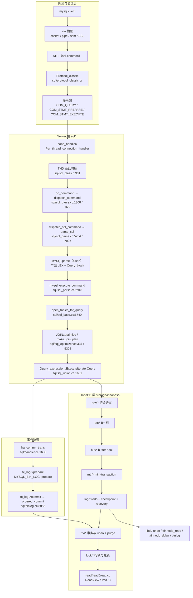
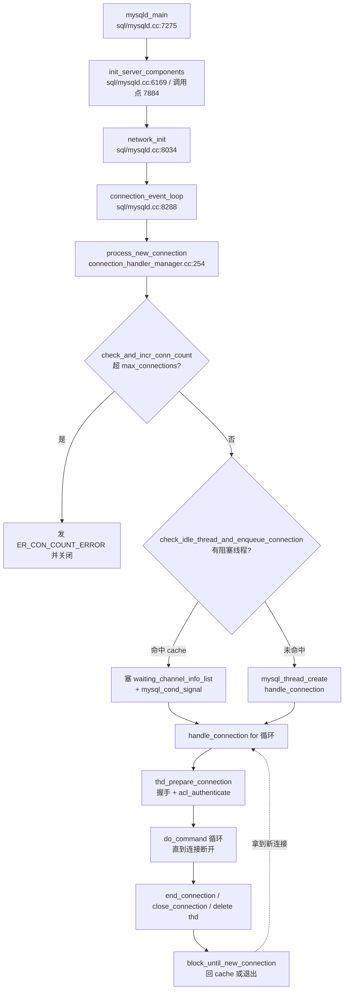
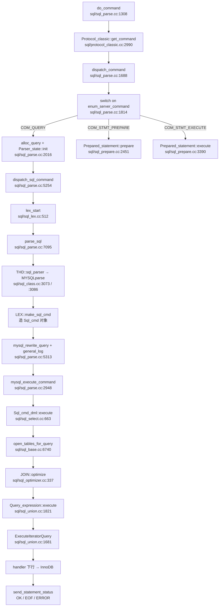
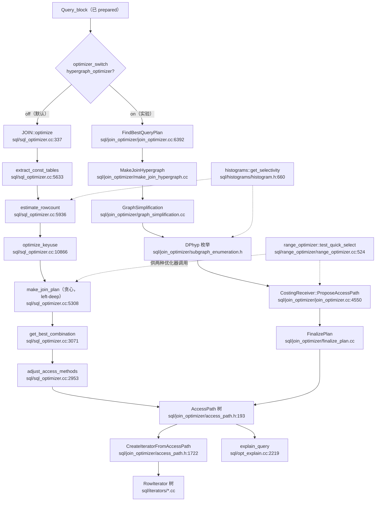
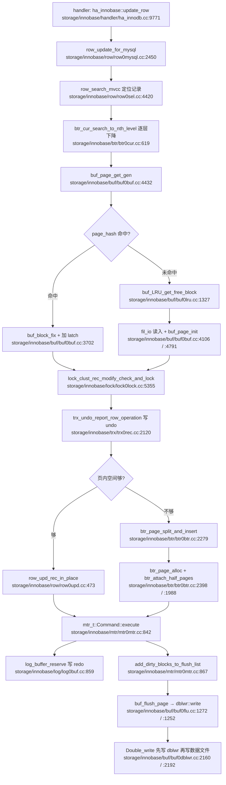
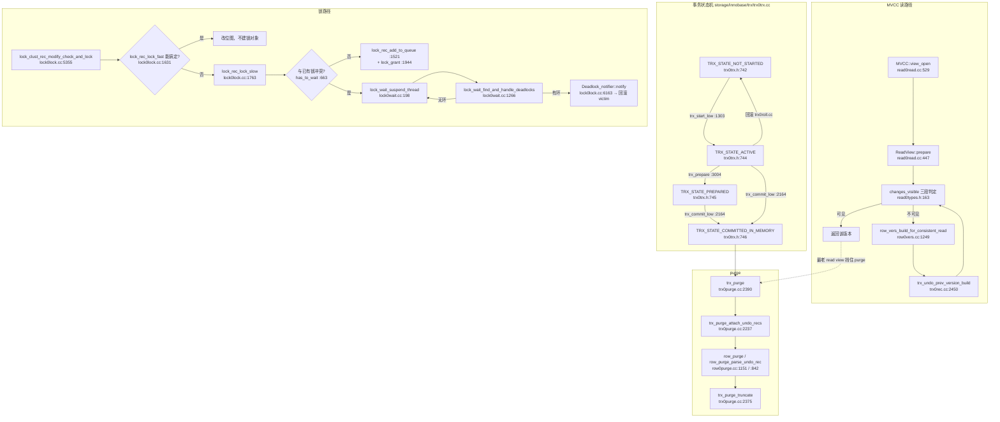
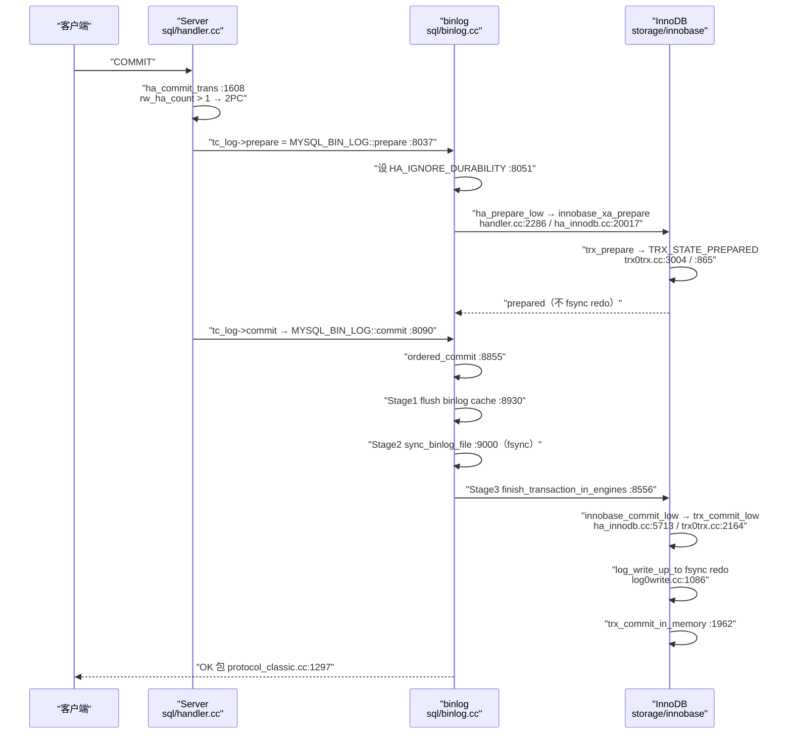

> 基于对 `sql/`、`storage/innobase/`、`vio/`、`include/`、`strings/`、`mysys/` 等源码的逐文件精读整理而成。
>
> 仓库：`D:/work/2026/deep-dive/sources/mysql`，版本 tag **mysql-8.0.46**，精确 commit `0a7df2e4693d8f10901a26034ae6257699356e30`（提交时间 `2026-04-07 17:11:55 +0200`）。
>
> 稀疏检出（shallow clone + sparse checkout）目录：`sql/`、`storage/innobase/`、`include/`、`strings/`、`mysys/`、`vio/`、`client/`、`sql-common/`、`plugin/`、`libbinlogevents/`、`libbinlogstandalone/`、`unittest/`、`extra/`、`cmake`。**不在检出范围内的目录一律标注"未检出"，不做推测。**
>
> 阅读顺序即学习顺序：启动与连接 → 查询生命周期 → 优化器 → InnoDB 存储引擎 → 事务/MVCC/锁 → redo/undo/binlog 与两阶段提交。
>
> 所有行号均用 Read/Grep 逐条核对过，路径写成从仓库根开始的完整相对路径，形如 `sql/sql_parse.cc:1308`。

---

## 〇、全景地图

```
┌──────────────────────────── 客户端与协议层 ────────────────────────────┐
│  mysql client ── vio(网络抽象: socket/pipe/shared-mem/SSL)              │
│        └► NET (sql-common) ── Protocol_classic (sql/protocol_classic.cc)│
│              COM_QUERY / COM_STMT_* 命令包                              │
└───────────────────────────────────┬───────────────────────────────────┘
                                    ▼
┌──────────────────────────── Server 层（sql/） ─────────────────────────┐
│  连接层 conn_handler/ : Per_thread_connection_handler（一连接一线程）    │
│        └► THD（sql/sql_class.h:931）会话句柄：LEX / MDL / NET / 事务    │
│  解析层 do_command → dispatch_command → dispatch_sql_command           │
│        └► MYSQLparse(bison, sql/sql_yacc.yy) → LEX + Query_block       │
│  执行层 mysql_execute_command → Sql_cmd_dml::execute                   │
│        └► open_tables_for_query（MDL + table share + handler）         │
│  优化层 JOIN::optimize / make_join_plan / range_optimizer / hypergraph  │
│  事务协调 TC_LOG(MYSQL_BIN_LOG) : prepare → binlog → commit（2PC）      │
└───────────────────────────────────┬───────────────────────────────────┘
                                    ▼  handlerton（ha_innodb.cc 注册）
┌──────────────────────────── InnoDB 层（storage/innobase/） ────────────┐
│  row/*（行级语义） → btr/*（B+ 树） → page/rem（页与记录格式）          │
│        └► buf/*（buffer pool: page_hash / LRU / flush_list / dblwr）    │
│  mtr/*（mini-transaction：把页修改打包成 redo 记录）                    │
│  log/*（redo log buffer → 文件；checkpoint；recovery）                  │
│  trx/*（事务状态机、undo、purge） + lock/*（行锁、GAP、死锁）           │
│        + read/read0read.cc（ReadView / MVCC） + ibuf/*（change buffer） │
└───────────────────────────────────┬───────────────────────────────────┘
                                    ▼
┌──────────────────────────── 持久化 ───────────────────────────────────┐
│  .ibd 表空间 / undo tablespace / #innodb_redo / #innodb_dblwr          │
│  binlog（sql/binlog.cc）+ gtid_executed（mysql.gtid_executed 表）      │
└───────────────────────────────────────────────────────────────────────┘
```

渲染友好版（GitHub/GitLab 直接出图，信息同上图）：



**三条主线**：

1. **连接/命令流**：`mysqld_main` 起监听 → `Mysqld_socket_listener` accept → `Channel_info` → `Per_thread_connection_handler::add_connection`（先找 thread cache，命中失败才 `mysql_thread_create`）→ `handle_connection` 内 `thd_prepare_connection`（握手 + 认证）→ 死循环 `do_command` → `dispatch_command` 按 `enum_server_command` 分发。
2. **查询优化执行流**：`parse_sql` → `MYSQLparse` 产出 parse tree → `LEX::make_sql_cmd` 造 `Sql_cmd` → `mysql_execute_command` → `Sql_cmd_dml::execute`（prepare → optimize → `ExecuteIteratorQuery`）→ `handler` 接口下行到 InnoDB → 结果经 `Protocol_classic` 写回。
3. **事务与恢复流**：mtr 把页修改变 redo（`mtr_t::Command::execute`）→ 提交时 `trx_write_serialisation_history` 写 undo + 赋 trx no → `ha_commit_trans` 走 2PC（InnoDB prepare → binlog flush/sync → InnoDB commit）→ 崩溃后 `recv_recovery_from_checkpoint_start` 重放 redo，`trx_resurrect` 复活未决事务，`trx_purge` 清历史版本。

---

## 速览：六讲各自做了什么（先看这个再进细节）

> 如果只读一张表就要看懂 MySQL，就是这张。六讲是**一条数据流的六个接力棒**——客户端字节流进来，逐棒加工，最后变成结果字节流回去或落盘。下面每行一句话讲清这棒在干嘛、接到什么、交出什么。

| 讲 | 一句话白话 | 接到什么（输入） | 交出什么（输出） | 这棒最怕什么 |
|---|---|---|---|---|
| **第一讲·启动与连接** | mysqld 进程"开店营业"：备齐家当→开监听门→每来个连接派一个服务员（OS 线程）专职伺候、服务完打盹等下一个 | OS 分配的一个 TCP/socket 连接 | 一个带着握手认证、能收发字节包的 THD 会话 | 家当没备齐就开门（比如引擎想写日志时日志还没起来）；连接洪峰压垮进程 |
| **第二讲·查询生命周期** | 一条 SQL 从字节包进来，被拆成"这是什么命令"→"语法树"→"可执行对象"→跑出结果行→打包成回包 | THD 里那条还没解析的 SQL 字节 | 结果集字节包（OK/结果行/ERROR） | SQL 解析失败、权限不够、表不存在 |
| **第三讲·优化器** | 拿到"要查什么"的逻辑计划，决定"用哪个索引、几张表谁先扫谁后扫、怎么连"凑出代价最小的执行计划树 | 一个还没定怎么执行的 `Sql_cmd_dml`（逻辑计划） | 一棵 `AccessPath` 树 + `RowIterator` 执行器 | 选错索引/选错连接顺序 → 慢几十倍 |
| **第四讲·InnoDB 引擎** | 执行器要读/改磁盘上的行时，这一棒负责：经 buffer pool 取页→B+ 树下降找记录→改→把页改动攒进 mtr | handler 接口的一组"读这行/改这行"请求 | 页内的行数据（读）或被改脏的页（写，挂在 flush list 等刷盘） | buffer pool 抖动、页分裂、double write 没起导致页损坏 |
| **第五讲·事务·MVCC·锁** | 多个事务同时读写时互不打架：读走 MVCC（快照 + undo 回溯不加锁）、写加锁排队、冲突就等或检测死锁 | 一个事务要做的一串读写操作 | 这事务的读写要么都生效要么都不生效；并发的别人看到的要么是旧版本要么阻塞 | 死锁、脏读、不可重复读、幻读 |
| **第六讲·redo·undo·binlog·2PC** | 一次提交怎么把"内存里改的"真正写到不丢：mtr 写 redo→引擎 prepare→binlog 落地→引擎 commit；崩了靠 redo 重放+binlog 仲裁 | 第五讲确认要提交的事务 | redo/undo/binlog 都落盘的已提交事务；崩溃后能恢复到一致状态 | 提交到一半崩了（靠 2PC 保证引擎和 binlog 不撕裂） |

**整本书一条线**：客户端字节 → 【一·开店接客】THD → 【二·解析执行】逻辑计划 → 【三·优化器】AccessPath → 【四·InnoDB】改脏页+记redo → 【五·事务】加锁/MVCC保证并发正确 → 【六·提交恢复】2PC落盘保证不丢。


> **第四讲是个枢纽**：读请求走到第四讲拿完行数据就可以直接回包（不经五六两讲）；只有写请求才需要继续走第五讲加锁、第六讲提交落盘。这就是为什么很多 SELECT 看起来"秒回"——它只走了前四棒。

---

## 面试速通：MySQL 高频问题一页纸

> **一句话定位**：MySQL 的高频面试题，答案都在这本笔记的一条数据流里——客户端字节流进来，经"启动连接 → 解析执行 → 优化选路 → InnoDB 存取 → 事务并发 → 提交恢复"六棒加工，最后变成结果字节流回去或落盘。
> 先记住本节每张表、每条 bullet 的一句话结论；被追问时，按"深入"列回到对应讲次，那里有函数与行号级的证据。

### 高频 Q&A（先结论）

用法：自上而下扫"一句话结论"列，能脱口而出的跳过；卡壳的题按"深入"列回对应讲次补证据链。18 条结论全部提炼自各讲小结的"三个最值得记住的点"，不引入文档之外的知识点。

| # | 面试问题 | 一句话结论 | 深入 |
| --- | --- | --- | --- |
| 1 | MySQL 是一连接一线程吗？thread cache 是什么？ | 默认 `Per_thread_connection_handler` 一连接一线程；thread cache 不是"池里的线程"，而是一群阻塞在条件变量上的线程，来连接就 signal 一个复用，服务完回到 `block_until_new_connection` 等下一个 | 第一讲 |
| 2 | 8.0 的 SQL 解析入口是什么？`mysql_parse` 还在吗？ | `mysql_parse()` 在 8.0 已不存在；入口是 `dispatch_sql_command` → `parse_sql` → `THD::sql_parser` → `MYSQLparse`，产出 LEX 和 `Sql_cmd` 两个产物 | 第二讲 |
| 3 | prepared statement 为什么能防注入？ | 参数值不拼进 SQL 文本，而是用 `Item_param` 在 LEX 里占位、执行时才填值；这既是防注入的根本，也是"参数化查询可能拿到不同执行计划"的根源 | 第二讲 |
| 4 | 8.0 有几套优化器？怎么共存？ | 老优化器（贪心、只产 left-deep 树）与 hypergraph 优化器（DPhyp 枚举、支持 bushy，默认关闭）并存；两者都产出同一种中间表示 `AccessPath`，再由同一个 `CreateIteratorFromAccessPath` 统一变 RowIterator | 第三讲 |
| 5 | buffer pool 的结构是什么？大表扫描会冲掉热数据吗？ | "一个 page_hash + 五个链表"（LRU / free / flush_list / withdraw / unzip_LRU）；LRU 分 young/old 两段，且 `Page_fetch::SCAN` 模式不把页移到 LRU 头部，全表扫描不置顶 | 第四讲 |
| 6 | 聚簇索引和二级索引的区别？为什么会回表？ | 聚簇索引的 key 是主键、叶子页存整行；二级索引叶子只存"索引列 + 主键值"不存完整行，所以通过二级索引查整行必须回表 | 第四讲 |
| 7 | 自增主键为什么比随机 UUID 快？ | 页分裂前先试右兄弟，顺序插入走 `to_right` 分支几乎不搬数据；随机键插入方向不定，分裂时代价高得多 | 第四讲 |
| 8 | double write 解决什么问题？ | 半页写（torn page）：InnoDB 页 16KB 而磁盘通常只保证 4KB 原子写，redo 又是基于完整页的增量，页写坏一半无从修复——所以先顺序写一份完整副本，再写真正的表空间 | 第四讲 |
| 9 | change buffer 缓存什么？唯一索引能用吗？ | 只缓存非唯一二级索引的修改，等页因别的原因被读入时再 merge；唯一索引必须读页做唯一性检查，享受不到这个优化 | 第四讲 |
| 10 | MVCC 的实现原理？ | 记录带隐藏列 `DB_TRX_ID` + `DB_ROLL_PTR` 串起 undo 版本链；ReadView 在创建瞬间记下活跃事务 id 集合，`changes_visible` 三段判定可见性——读旧版本不加锁 | 第五讲 |
| 11 | 四个隔离级别分别解决什么问题？RR 怎么防幻读？ | 默认 RR：RU 直接读最新（脏读）、RC 每条语句一个快照、RR 每事务一个快照、SERIALIZABLE 把普通 SELECT 也转成 `LOCK IN SHARE MODE`；RR 与 RC 的差异就在 read view 创建时机 + 是否用 GAP 锁，而 GAP/Next-Key 锁是文档原话"唯一能阻止幻读的机制" | 第五讲 |
| 12 | 普通 SELECT 和 `SELECT ... FOR UPDATE` 的区别？ | 普通 SELECT 走一致性读：顺 `DB_ROLL_PTR` 回溯 undo 找可见版本，不加锁；加锁读走 `lock_clust_rec_read_check_and_lock`，读最新已提交版本并加锁 | 第五讲 |
| 13 | InnoDB 的锁有哪几种模式？死锁怎么检测？ | S/X 之上叠加四种精确模式位：Next-Key(0) / GAP(512) / REC_NOT_GAP(1024) / INSERT_INTENTION(2048)；死锁由 wait-for 图找环，挑环上 `reservation_no` 最大（最后加入环）的事务做 victim 回滚 | 第五讲 |
| 14 | 长事务有什么危害？ | 版本链越长，一致性读回溯越慢；purge 不能清任何活跃 ReadView 还需要的版本，最老视图挡住 purge 使 history list 持续增长——而 undo 页本身也在 buffer pool 里、也要写 redo，"读历史版本"可能触发 IO | 第五讲 |
| 15 | redo / undo / binlog 三大日志的分工？ | redo（InnoDB，物理逻辑）保 crash-safe；undo（InnoDB，逻辑）保原子性和 MVCC 版本链；binlog（Server，逻辑）保复制和时间点恢复，并充当 2PC 的仲裁者 | 第六讲 |
| 16 | 两阶段提交的过程？为什么开了 binlog 就一定是 2PC？ | `rw_ha_count > 1` 才 prepare，而注册 binlog handlerton 后即使只有 InnoDB 计数也是 2；流程：InnoDB prepare（故意不 fsync redo）→ binlog flush/sync → 引擎 commit + redo fsync | 第六讲 |
| 17 | 组提交怎么提速？`innodb_flush_log_at_trx_commit` 三值区别？ | binlog 侧 `Commit_stage_manager` 每阶段由 leader 攒批一次 fsync，redo 侧 `log_write_up_to` "推进到某个 LSN"让并发提交自然合并；三值：1=每次提交 write+fsync，2=只 write、fsync 交后台每秒一次，0=write 和 fsync 都交后台 | 第六讲 |
| 18 | 崩溃恢复的流程？binlog 起什么作用？ | 重放 redo（定位 checkpoint → scan → apply）→ `trx_resurrect` 按 undo 标记复活未决事务 → binlog 收集 XID 由 `ha_recover` 仲裁：有 XID 则提交，否则回滚；且 redo fsync 必须在 binlog fsync 之后，反了会出现"redo 已提交但 binlog 没有"，从库丢事务 | 第六讲 |
| 19 | char 和 varchar 的区别？ | char 定长：写入右补空格、读出再去尾部空格，不怕碎片；varchar 变长：行内存 1~2 字节长度前缀，省空间但更新容易页分裂/行迁移。定长内容（hash、UUID、状态码）用 char，不定长文本用 varchar——**会不会溢出看行格式不看列长度**，DYNAMIC 下超长部分整体走溢出页 | 第三讲 |
| 20 | InnoDB 和 MyISAM 有什么区别？ | InnoDB：数据即聚簇索引（挂在主键上）、行级锁、MVCC、事务、外键、redo 崩溃恢复；MyISAM：数据/索引分离的堆表、表级锁、无事务无 MVCC、但 `count(*)` 有 O(1) 计数器、全文索引老牌。5.5 起默认存储引擎就是 InnoDB，MyISAM 只剩历史遗留和极少数只读场景 | 第三/五讲 |
| 21 | MySQL 深度分页如何优化？ | `LIMIT 100000, 10` 要先把前 10 万行捞出来再丢掉，成本在"搬"不在"找"。三板斧：①延迟关联——子查询先走覆盖索引只取主键，再回表拿整行；②游标分页——`WHERE id > 上一页最大id LIMIT n`，把"跳过 N 行"变成"从定位点往后读"；③业务改版成"加载更多/滚动翻页"。索引解决定位，解决不了搬运 | 第四讲 |
| 22 | 唯一索引和主键索引的区别？ | 主键：一表一个、聚簇索引（叶子即整行）、绝不接受 null；唯一索引：一表可多个、二级索引（叶子存"索引列+主键"）、允许多个 null（`null != null` 不判重）。代价上唯一索引还多一笔"必须读页做唯一性检查"，所以 change buffer 救不了它（只缓存非唯一二级索引修改） | 第三/四讲 |
| 23 | `count(1)`、`count(*)` 与 `count(列名)` 的区别？ | `count(*)` 与 `count(1)` 等价：不取值，优化器挑成本最低的索引扫行数；`count(列名)` 只统计该列**非 null** 的行，必须把值读出来判断；`count(主键)` 走聚簇索引。InnoDB 没有 MyISAM 那种 O(1) 计数器，哪种都是扫索引——大表统计要靠 `information_schema` 估算或离线数 | 第四讲 |
| 24 | InnoDB 中索引类型有哪些？ | 按结构分：B+ 树索引（聚簇 + 二级）、AHI 自适应哈希索引（自动给稳定的等值查询前缀建，`btr_ahi_parts` 分区锁保护，不是全表哈希）；按功能分：主键索引、唯一索引、普通索引、联合索引（最左前缀）、前缀索引、覆盖索引、全文/空间索引。默认战场是 B+ 树 | 第三/四讲 |
| 25 | truncate、delete、drop 的区别？ | delete：逐行删、记 undo/redo、**可回滚**、可带 WHERE、不释放空间、不动自增值；truncate：整表抹掉重建（DDL），快、不可回滚、自增计数复位、释放空间；drop：连表定义一起删。truncate/drop 都是隐式提交的 DDL，别在事务里用 | 第三讲 |
| 26 | 用了索引还是很慢，可能是什么原因？ | 索引没真走：列上有函数/运算、隐式类型转换、前导模糊 `LIKE '%x'`；走了但代价高：回表行太多（非覆盖索引）、区分度太低（性别/状态位）、统计信息过期选错索引；SQL 写法：深分页、`ORDER BY` 触发 filesort、大 `IN` 列表；最后也可能是锁等待/IO 打满，与索引无关。先 `EXPLAIN` 看 type/key/rows/Extra 四列再下结论 | 第四讲 |
| 27 | 设计索引时应遵循哪些原则？ | 为 WHERE/JOIN/ORDER BY 的高频组合服务而不是越多越好：区分度高的列放联合索引前置、利用覆盖索引避免回表、控制索引数量（每个索引都是写放大 + 优化器选错概率）、长列用前缀索引、删除冗余与从未用过的索引、表结构变更后及时 `ANALYZE TABLE` 刷新统计信息 | 第三/四讲 |
| 28 | 什么是最左前缀匹配？为什么要遵守？ | 联合索引 `(a,b,c)` 的 B+ 树按 a→b→c 的字典序组织，只有查询从最左列开始且不跳列，后面的列才能借排序结构收敛范围；缺了 a（或中间断档），MySQL 只能用到部分索引甚至退化为全扫/哈希过滤。"遵守"不是规矩而是 B+ 树的物理事实——索引列顺序设计错了，建了也白建 | 第四讲 |
| 29 | 乐观锁与悲观锁怎么实现？ | 悲观锁假设一定冲突：`SELECT ... FOR UPDATE`（next-key lock 锁范围，RR 下防幻读）或应用层互斥，冲突多的时候少做无畏重试；乐观锁假设基本不冲突：加 `version` 列或时间戳，`UPDATE ... SET v=v+1, version=version+1 WHERE id=? AND version=?`，**影响行数为 0 就说明被改过、走重试/失败分支**，读多写少时吞吐远高于锁 | 第五讲 |
| 30 | InnoDB 的表级锁、页级锁、行级锁？ | 行级锁是**逻辑**的：记录锁（锁单行）、间隙锁 gap（锁"行与行之间"防幻读，仅 RR）、next-key（记录 + 左开右闭间隙）；表级有**意向锁** IS/IX（行锁意图登记，让表锁判断"有没有行锁"不用全表扫）和 MDL 元数据锁（DDL 与读写互斥）；页级只是 InnoDB 内部结构锁（如 AHI 分区锁），不是用户可选的粒度 | 第五讲 |
| 31 | InnoDB 加索引，这个时候会锁表吗？ | 5.6 起是 Online DDL：默认 `ALGORITHM=INPLACE` 允许并发 DML，只在"准备/提交"两个极短点拿排他元数据锁；`ALGORITHM=COPY` 才整表重建阻塞写，`LOCK` 子句还能再收并发度。所以加索引不等于锁表——但大表 INPLACE 期间有主从延迟与 IO 压力，稳妥做法仍是低峰执行或 pt-osc/gh-ost 这类无锁变更工具 | 第三讲 |

**如果只背五条**：索引与存储背第 6、7 条（聚簇/回表、自增 vs UUID）；并发背第 10、11、13 条（MVCC、隔离级别与幻读、锁与死锁）；持久化背第 15、16、18 条（三日志、2PC、恢复仲裁）。这三组覆盖了绝大多数 MySQL 面试的主干，其余条目是它们的展开。

**按讲次回查索引**（被追问时按这个顺序翻原文）：

- 第一讲：进程怎么起来、连接怎么被伺候——`mysqld_main` 初始化顺序、thread cache 语义、THD/LEX 生命周期粒度。
- 第二讲：一条 SQL 从包到结果——解析入口、两层分发、Iterator 执行、PS 占位防注入。
- 第三讲：执行计划怎么来——两套优化器、贪心 vs DPhyp、代价口径、`AccessPath` 收敛。
- 第四讲：数据怎么存怎么读——buffer pool"1 哈希 + 5 链表"、B+ 树分裂、聚簇/二级索引、mtr 纪律。
- 第五讲：并发怎么正确——MVCC 三段判定、隔离级别映射、四种锁模式位、死锁检测与 purge。
- 第六讲：提交怎么不丢——三大日志分工、2PC、组提交、崩溃恢复与 binlog 仲裁。

### 易错点与面试坑

以下都是文档里明确强调过的反直觉点。每条先给"坑"，再给"文档里的正解"——面试答反了比不答更糟。

- **thread cache 不是线程池**。坑：答成"线程池里放着一群空闲线程等着被挑"。
  正解：文档原话是"一群线程阻塞在条件变量上"，cache 的本体是 `handle_connection` 的 `for(;;)`——同一个 OS 线程依次服务多个连接，中间只 `delete thd` 不退出；`thread_cache_size` 缩容靠 `shrink_cache` 标志逐个 signal 让多余线程退出。
- **别按 5.7 的记忆 grep 8.0**。坑：张嘴就是 `mysql_parse()`、`sql/opt_range.cc`。
  正解：前者在 8.0 已不存在（入口是 `dispatch_sql_command` → `parse_sql` → `THD::sql_parser`），后者拆成了 `sql/range_optimizer/` 30 个文件；而 `sql/sql_optimizer.cc` 仍然存在且仍是老优化器主体（11830 行）——"没了的"和"还在的"都反直觉。
- **`Cost_estimate` 的位置和口径都容易记错**。坑：说它在 `sql/opt_costmodel.h`，或者说 `total_cost()` 含内存代价。
  正解：它定义在 `sql/handler.h`，`total_cost()` = io + cpu + import，不含 mem_cost；所有常量归一化到"读一个随机页 = 1.0"（`DISK_SEEK_BASE_COST=0.9` + `DISK_SEEK_PROP_COST=0.1/128`）。
- **RR 解决幻读靠的是锁，不是快照读**。坑：说"RR 的快照读解决了幻读"。
  正解：文档原话——GAP/Next-Key 锁是"唯一能阻止幻读的机制"；还有隐藏细节：删除记录时 GAP 锁必须继承给下一条记录，否则删除造成的间隙失去保护，幻读照样发生。
- **double write 防的是"半页写"，不是"页写错"**。坑：答成"防止页损坏"或"给 redo 做备份"。
  正解：16KB 页 vs 4KB 原子写，掉电写一半时 redo 无从下手（redo 是相对完整页的增量）；所以先顺序写一份完整副本到 dblwr 文件再写真正的表空间，坏页从副本还原。
- **行溢出看行格式，不是只看 varchar 长度**。坑：以为"varchar 够长就一定溢出、不够长就一定不溢出"。
  正解：COMPACT 在行内留前 768 字节 + 20 字节指针，DYNAMIC 只留 20 字节指针、整列进溢出页；TEXT/BLOB 列多的表选 DYNAMIC（8.0 默认），一行能装下的东西完全不同。
- **change buffer 和 AHI 都有适用边界**。坑：以为"所有二级索引改动都能被 change buffer 缓存""InnoDB 会给热表建哈希"。
  正解：change buffer 只缓存非唯一二级索引的修改（唯一索引必须读页做唯一性检查）；AHI 按"稳定的等值查询模式"自动建，不是全表建哈希，范围查询受益有限。
- **autocommit=1 时每条 DML 都是一次完整 2PC**。坑：以为"一条语句谈不上事务协议"。
  正解：语句执行自带隐式提交，开了 binlog 就是一次 prepare + binlog fsync + 引擎 commit + redo fsync——语句级没有"批"可言，组提交的"批"是并发事务攒出来的。
- **`sync_binlog=1` 不只是性能选项**。坑：只把它当 durability/性能开关。
  正解：崩溃后 binlog 里有没有 XID，直接决定未决事务提交还是回滚（binlog 是最终真相源）；配 `innodb_flush_log_at_trx_commit=1` 才是文档端到端演算里的"双 1"组合，后者取 2 表示 fsync 交后台每秒一次、取 0 表示连 write 都交后台——提交返回时数据并未落盘。
- **长事务的危害要说出物理链条**。坑：只会背"长事务会堵 purge"。
  正解：undo 页本身也在 buffer pool 中、也要走 mtr、也要写 redo，版本链越长一致性读回溯越慢；同时 purge 被最老 ReadView 挡住，history list 持续增长，undo 表空间只涨不消——这是一条完整的性能雪崩链。

### 关键数值与默认值速记

下面每个数值都在文档中出现过，按讲次归档；没有补充文档之外的默认值——文档没给出具体数值的（如 buffer pool 大小、`max_connections`）一律不写，不要脑补。

| 数值 | 是什么 | 讲次 |
| --- | --- | --- |
| 16KB / 4KB | InnoDB 页 16KB，磁盘/文件系统通常只保证 4KB 原子写——double write 与"半页写"的由来 | 第四讲 |
| 768 字节 + 20 字节指针 | COMPACT 行格式的溢出列：行内保留前 768 字节，其余进溢出页 | 第四讲 |
| 20 字节指针 | DYNAMIC 行格式的溢出列：只存指针、整列进溢出页；8.0 默认行格式 | 第四讲 |
| 8 | `btr_ahi_parts` 默认分区数；AHI 按查询模式自动建，不是全表建哈希 | 第四讲 |
| REPEATABLE READ | 默认隔离级别：每事务一个 ReadView + 使用 Next-Key 锁 | 第五讲 |
| 0 / 512 / 1024 / 2048 | 四种锁模式位：`LOCK_ORDINARY`(Next-Key) / `LOCK_GAP` / `LOCK_REC_NOT_GAP` / `LOCK_INSERT_INTENTION` | 第五讲 |
| 1.0 | 代价归一化尺度"读一个随机页 = 1.0"；`DISK_SEEK_BASE_COST=0.9`、`DISK_SEEK_PROP_COST=0.1/128` | 第三讲 |
| 11830 行 / 30 个文件 | `sql_optimizer.cc` 行数 / `range_optimizer` 文件数（`sql/opt_range.cc` 已不存在） | 第三讲 |
| 42 个 / 21 个文件 | `sql/join_optimizer/`（hypergraph）/ `sql/iterators/`（RowIterator）的文件数 | 第三讲 |
| 8.0.22 / 8.0.31 | 8.0.22 起执行全面 Iterator 化；8.0.31 起 hypergraph 实验性引入（默认关闭） | 第二、三讲 |
| 一万两千多行 | `sql/mysqld.cc` 行数，其中 `mysqld_main` 占近一千行 | 第一讲 |
| 1 / 2 / 0 | `innodb_flush_log_at_trx_commit`：1=每次提交 write+fsync；2=只 write、fsync 交后台每秒一次；0=write 和 fsync 都交后台 | 第六讲 |
| sync_binlog=1 | 每次提交 fsync binlog；不止是性能选项，直接决定崩溃后事务的去留 | 第六讲 |

**组合记忆**：持久化的"双 1"是 `innodb_flush_log_at_trx_commit=1` + `sync_binlog=1`——前者管 redo 的落盘时机，后者管 binlog 的落盘与崩溃仲裁；第六讲的端到端演算正是按这个组合走完 29 步的，两步 fsync 的先后顺序（binlog 先、redo 后）不能反。

---

## 第一讲：mysqld 启动与连接线程模型

### 先说人话：本讲每个阶段在干什么

把 mysqld 想象成一家餐厅开门营业：先在后厨把水电、账本、供货商（日志、权限、存储引擎）备齐，然后才挂"营业中"的牌子开大门（监听 socket）；每来一位客人就安排一位服务员（OS 线程）专门伺候，服务员送走客人不下班，而是站在原地打盹等下一位（thread cache）。本讲就看这家店"怎么开门、怎么接客、服务员怎么复用"。

| 阶段/组件 | 它干了什么（白话） | 为什么需要它（白话） |
| --- | --- | --- |
| `mysqld_main` 初始化 | 一条线跑完：先日志/权限，再引擎/数据字典，最后开监听 | 顺序错了会出怪事：引擎想记日志时日志还没起来 |
| 连接数闸门 | accept 后先查 `max_connections`，超了直接拒绝 | 防止连接洪峰把进程压垮 |
| thread cache | 空闲线程阻塞在条件变量上，来连接就唤醒一个接客 | 省掉每次连接都付一次建线程的成本 |
| `handle_connection` | 一个线程的 for(;;)：握手→命令循环→收尾→回缓存 | 线程复用的本体：服务完不退出 |
| 握手与认证 | 验用户名密码（默认 caching_sha2 插件） | 得确认"来的是谁、让不让他进" |
| `Protocol_classic` | 读包：首字节是命令号，剩下是参数；发 OK/EOF/ERROR | 把字节流翻译成结构化命令进出 |
| THD | 一个连接的全套状态：权限、事务、锁、当前语句 | 会话级状态要有跨语句存活的地方 |
| vio | 一层函数指针壳，TCP/SSL/socket/管道统一读写接口 | 上层不必关心底下是哪种网络 |

**本讲主线**：`mysqld_main` 备齐家当 → 开监听 accept → 过连接数闸门 → 唤醒缓存线程（没有就新建）→ 握手认证 → `do_command` 命令循环 → 断开收尾 → 线程回缓存打盹等下一个

### 定位

这一讲回答两个问题：**mysqld 这个进程是怎么从 `main()` 走到"能接客"的**，以及**一个客户端连接进来后，到底谁在伺候它**。

关键事实先摆在前面：`sql/main.cc:26` 只有一行 `int main(int argc, char **argv) { return mysqld_main(argc, argv); }`，真正的启动逻辑在 `sql/mysqld.cc`。MySQL 8.0 的 `mysqld.cc` 有一万两千多行，其中 `mysqld_main` 就占了近一千行。

### 目录结构：本讲涉及的检出文件

```
sql/
├── main.cc                      # main() → mysqld_main()，只有两行
├── mysqld.cc                    # mysqld_main 初始化序列（8460 行为 Windows 版本入口）
├── sql_class.h / sql_class.cc   # THD 类定义与实现
├── sql_parse.cc                 # do_command / dispatch_command（第一、二讲共用）
├── sql_connect.cc               # thd_prepare_connection / login_connection / check_connection
├── protocol_classic.cc          # Protocol_classic：读包、解析命令、发 OK/EOF/ERROR
└── conn_handler/
    ├── connection_handler_manager.cc   # 连接计数器 + 选择 handler
    ├── connection_handler_per_thread.cc # 官方默认：一连接一线程 + thread cache
    ├── connection_handler_one_thread.cc # 调试用：单线程串行
    ├── channel_info.cc/.h              # 监听端 accept 出的连接抽象
    ├── socket_connection.cc/.h         # TCP/UNIX socket 监听
    ├── named_pipe_connection.cc        # Windows named pipe
    ├── shared_memory_connection.cc     # Windows shared memory
    ├── init_net_server_extension.cc    # 把 PFS socket 埋进 vio 回调
    └── plugin_connection_handler.h     # 插件式 handler 接口（线程池插件用）
vio/
├── vio.cc / viosocket.cc / viossl.cc / viopipe.cc / vioshm.cc
```

> 说明：`sql/conn_handler/thread_pool*` 之类**未在本次稀疏检出中出现**（社区线程池不在 8.0.46 的这几个目录里；本仓库也没有 `sql/threadpool_unix.cc`）。如需要研究线程池，需另外检出。

### 1.1 `mysqld_main`：一条线性的初始化长河

`mysqld_main` 有两个入口，注意区分：

- `sql/mysqld.cc:7275` —— 由 `#ifdef _WIN32` 包裹，非 Windows 平台这就是 `mysqld_main`；Windows 平台这里叫 `win_main`。
- `sql/mysqld.cc:8460` —— Windows 平台下 `win_main` 经 `mysql_service(NULL)`（调用点在 `sql/mysqld.cc:8600`）转过来的 `mysqld_main`。

下面按非 Windows 路径（`sql/mysqld.cc:7275` 起）列出**核对过的**初始化调用序列：

| 行号（sql/mysqld.cc） | 调用 | 干什么 |
| --- | --- | --- |
| 7278 | `initialize_stack_direction()` | 探测栈增长方向，供栈溢出检查用 |
| 7294 | `pre_initialize_performance_schema()` | PFS 早期初始化（此时还没有 PSI 钩子） |
| 7297 | `my_init()` | mysys 库 + pthread 初始化，失败直接 `unireg_abort` |
| 7330 | `sys_var_init()` | 系统变量框架初始化 |
| 7370 | `handle_early_options()` | 只解析"早选项"（如 `--defaults-file`、`--initialize`） |
| 7376 | `init_error_log()` | 错误日志（此时才可能有 log_error_services） |
| 7390 | `initialize_performance_schema(...)` | 真正装 PSI 钩子，返回 mutex/rwlock/thread 三个 hook |
| 7408 | `LO_init(...)` | lock order 子系统（debug_lock_order.cc），用于死锁/锁序校验 |
| 7564 | `init_server_psi_keys()` | 注册 server 各线程的 PSI key |
| 7571 | `my_thread_global_reinit()` | 用真实 PSI 重建早期创建的对象 |
| 7575 | `init_ssl()` | SSL 库初始化 |
| 7588 | `component_infrastructure_init()` | **组件基础设施**（8.0 的 component 框架，早于 plugin） |
| 7604 | `initialize_manifest_file_components()` | 读 `mysqld.my` manifest，加载 keyring 等组件 |
| 7642 | `res_grp_mgr->init()` | Resource Group 子系统 |
| 7656 | `mysql_audit_initialize()` | 审计接口 |
| 7658 | `Srv_session::module_init()` | server session 服务（插件用） |
| 7664 | `query_logger.init()` | general log / slow log |
| 7684 | `init_common_variables()` | **大块**：datadir、字符集、table cache、max_connections 等 |
| 7691 | `my_init_signals()` | 信号处理 |
| 7884 | `init_server_components()` | **核心**：plugin、DD、存储引擎 handlerton |
| 8033 | `init_ssl_communication()` | SSL 通信上下文 |
| 8034 | `network_init()` | **建监听 socket**（TCP / unix socket / named pipe / shared mem） |
| 8102 | `acl_init(opt_noacl)` | 权限缓存（--skip-grant-tables 时跳过） |
| 8115 | `grant_init(opt_noacl)` | 列级/库级权限 |
| 8137 | `servers_init(nullptr)` | 非 DD 的 servers 表 |
| 8163 / 8166 | `initialize_performance_schema_acl()` / `initialize_information_schema_acl()` | PFS / I_S 的 ACL |
| 8175 | `start_signal_handler()` | 起信号处理线程 |
| 8196 | `process_bootstrap()` | `--initialize` / `--init-file` 时跑 bootstrap 线程 |
| 8208 | `create_shutdown_and_restart_thread()` | 停机/重启线程 |
| 8268 / 8269 | `check_and_spawn_admin_connection_handler_thread()` / `setup_conn_event_handler_threads()` | 管理端口连接线程 |
| 8288 | `mysqld_socket_acceptor->connection_event_loop()` | **主 accept 循环，进程就此常驻** |

`init_server_components()` 定义在 `sql/mysqld.cc:6169`，是这一段里最值得单独读的函数：它负责 `plugin_init`（加载所有插件，包括 InnoDB）、`dd::init`（数据字典，`sql/mysqld.cc:6546` 起按 `DD_INITIALIZE` / `DD_RESTART_OR_UPGRADE` 等分支处理）、`tc_log` 的早期设置（`sql/mysqld.cc:6500` 注释明确说要把 `tc_log` 先指向 `TC_LOG_DUMMY`，因为 `plugin_init()` 里可能会有 DDL）。

一句话记住这个序列的形状：**先让"能报错 + 能记日志 + 能统计"这三件事成立（7294–7664），再装存储引擎和数据字典（7884），最后才开监听（8034）**。顺序错了会出很诡异的问题——比如存储引擎想写 error log 但日志还没起来。

### 1.2 连接线程模型：thread cache 优先，然后才创建线程

监听端 accept 到一个连接，会包成 `Channel_info`，走到：

`sql/conn_handler/connection_handler_manager.cc:254` → `Connection_handler_manager::process_new_connection()`：

```cpp
void Connection_handler_manager::process_new_connection(
    Channel_info *channel_info) {
  if (connection_events_loop_aborted() ||
      !check_and_incr_conn_count(channel_info->is_admin_connection())) {
    channel_info->send_error_and_close_channel(ER_CON_COUNT_ERROR, 0, true);
    delete channel_info;
    return;
  }

  if (m_connection_handler->add_connection(channel_info)) {
    inc_aborted_connects();
    delete channel_info;
  }
}
```

三个要点：

1. **先过连接数闸门** `check_and_incr_conn_count`（`sql/conn_handler/connection_handler_manager.cc:104`），超了就发 `ER_CON_COUNT_ERROR`（Too many connections）并关掉；
2. 闸门过了才交给具体 handler（默认 `Per_thread_connection_handler`）；
3. handler 返回失败要 `inc_aborted_connects()`，对应 `Aborted_connects` 状态变量。

`Per_thread_connection_handler::add_connection` 在 `sql/conn_handler/connection_handler_per_thread.cc:398`：

```cpp
bool Per_thread_connection_handler::add_connection(Channel_info *channel_info) {
  int error = 0;
  my_thread_handle id;
  ...
  if (!check_idle_thread_and_enqueue_connection(channel_info)) return false;

  /*
    There are no idle threads available to take up the new
    connection. Create a new thread to handle the connection
  */
  channel_info->set_prior_thr_create_utime();
  error =
      mysql_thread_create(key_thread_one_connection, &id, &connection_attrib,
                          handle_connection, (void *)channel_info);
  ...
  if (error) {
    connection_errors_internal++;
    if (!create_thd_err_log_throttle.log())
      LogErr(ERROR_LEVEL, ER_CONN_PER_THREAD_NO_THREAD, error);
    channel_info->send_error_and_close_channel(ER_CANT_CREATE_THREAD, error,
                                               true);
    Connection_handler_manager::dec_connection_count();
    return true;
  }

  Global_THD_manager::get_instance()->inc_thread_created();
  return false;
}
```

**thread cache 的真相**就在这里：所谓 cache 并不是一群线程在池里等着被挑，而是**一群线程阻塞在条件变量上**。看 `sql/conn_handler/connection_handler_per_thread.cc:381`：

```cpp
bool Per_thread_connection_handler::check_idle_thread_and_enqueue_connection(
    Channel_info *channel_info) {
  bool res = true;

  mysql_mutex_lock(&LOCK_thread_cache);
  if (Per_thread_connection_handler::blocked_pthread_count > wake_pthread) {
    waiting_channel_info_list->push_back(channel_info);
    wake_pthread++;
    mysql_cond_signal(&COND_thread_cache);
    res = false;
  }
  mysql_mutex_unlock(&LOCK_thread_cache);

  return res;
}
```

只要 `blocked_pthread_count > wake_pthread`（有线程正阻塞在 cache 里、且还没被叫醒），就把 `Channel_info` 塞进 `waiting_channel_info_list` 并 signal 一个线程，**返回 false 表示"不用创建新线程"**。对应的等待端是 `sql/conn_handler/connection_handler_per_thread.cc:144` 的 `block_until_new_connection()`，它把 `blocked_pthread_count++` 然后 `mysql_cond_wait`，被唤醒后从 `waiting_channel_info_list` 里 `pop_front()` 拿走连接（第 171–173 行）。

`thread_cache_size` 的动态调整在 `sql/conn_handler/connection_handler_per_thread.cc:354` 的 `modify_thread_cache_size()`：cache 要缩小时置 `shrink_cache = true`，用 `mysql_cond_signal` 逐个叫醒多余的线程让它们退出，然后等 `COND_flush_thread_cache` 直到 `blocked_pthread_count` 降到目标值。

### 1.3 `handle_connection`：一个连接的完整生命周期

`sql/conn_handler/connection_handler_per_thread.cc:246`：

```cpp
static void *handle_connection(void *arg) {
  ...
  Channel_info *channel_info = static_cast<Channel_info *>(arg);
  bool pthread_reused [[maybe_unused]] = false;

  if (my_thread_init()) { ... }

  for (;;) {
    THD *thd = init_new_thd(channel_info);
    if (thd == nullptr) { ...; break; }
```

这个 `for(;;)` 就是 thread cache 的实现本体：**一个 OS 线程在服务完一个连接后不退出，而是回到循环顶部复用自己**。循环体内部（`sql/conn_handler/connection_handler_per_thread.cc:297–346`）按顺序是：

| 行号 | 动作 | 说明 |
| --- | --- | --- |
| 297 | `thd_manager->add_thd(thd)` | 注册到全局 THD 列表（`SHOW PROCESSLIST` 的来源） |
| 299 | `thd_prepare_connection(thd)` | **握手 + 认证**，失败计 aborted_connects |
| 302–304 | `while (thd_connection_alive(thd)) { if (do_command(thd)) break; }` | 命令循环 |
| 305 | `end_connection(thd)` | 收尾（回滚、释放事务资源） |
| 307 | `close_connection(thd, 0, false, false)` | 断 vio、审计 disconnect |
| 309–310 | `reset_diagnostics_area()` / `release_resources()` | 清 DA、释放 MDL/表/prepare stmt |
| 316 | `thd_manager->remove_thd(thd)` | 从全局列表摘掉 |
| 317 | `dec_connection_count()` | 连接计数减一 |
| 325 | `delete thd` | 释放 THD 对象 |
| 333 | `if (connection_events_loop_aborted()) break;` | 服务器在停机就退出 |
| 335 | `block_until_new_connection()` | **回到 thread cache 阻塞，等待下一个连接** |
| 337 | `pthread_reused = true` | 标记这是复用的线程 |

### 1.4 握手与认证

`thd_prepare_connection` 在 `sql/sql_connect.cc:888`：

```cpp
bool thd_prepare_connection(THD *thd) {
  thd->enable_mem_cnt();

  bool rc;
  lex_start(thd);
  rc = login_connection(thd);

  if (rc) return rc;

  prepare_new_connection_state(thd);
  return false;
}
```

`login_connection`（`sql/sql_connect.cc:696`）→ `check_connection`（`sql/sql_connect.cc:441`）→ `acl_authenticate(thd, COM_CONNECT)`（`sql/sql_connect.cc:652`）。认证实现在 `sql/auth/sql_authentication.cc:3827` 的 `acl_authenticate()`，内部通过 `do_auth_once`（`sql/auth/sql_authentication.cc:3385`）调用具体插件的服务端认证函数，8.0.46 默认是 `caching_sha2_password`（`sql/auth/sha2_password.cc:924` 的 `caching_sha2_password_authenticate`）。

连接存活判断 `sql/sql_connect.cc:931`：

```cpp
bool thd_connection_alive(THD *thd) {
  NET *net = thd->get_protocol_classic()->get_net();
  if (!net->error && net->vio != nullptr &&
      !(thd->killed == THD::KILL_CONNECTION))
    return true;
  return false;
}
```

断连 `sql/sql_connect.cc:913` 的 `close_connection()` 会按需发一个错误包、调 `thd->disconnect()`、发审计 disconnect 事件、最后 `security_context()->logout()`。

### 1.5 `Protocol_classic`：命令包是怎么进出的

`sql/protocol_classic.cc:2990` 的 `get_command()` 是最底层的一环：

```cpp
int Protocol_classic::get_command(COM_DATA *com_data,
                                  enum_server_command *cmd) {
  // read packet from the network
  if (int rc = read_packet()) return rc;
  ...
  *cmd = (enum enum_server_command)(uchar)input_raw_packet[0];

  if (*cmd >= COM_END) *cmd = COM_END;  // Wrong command
  ...
  // Skip 'command'
  input_packet_length--;
  input_raw_packet++;

  return parse_packet(com_data, *cmd);
}
```

即：**包第一个字节是命令号，剩下的是参数**；`parse_packet`（`sql/protocol_classic.cc:2833`）按命令号把字节流填进 `COM_DATA` 联合体。`read_packet()` 在 `sql/protocol_classic.cc:1409`，底层最终落到 `vio` 的 `vio_read`。

出方向：`Protocol_classic::send_ok`（`sql/protocol_classic.cc:1297`）→ `net_send_ok`（`sql/protocol_classic.cc:860`）；错误 `Protocol_classic::send_error`（`sql/protocol_classic.cc:1341`）→ `net_send_error_packet`（`sql/protocol_classic.cc:1173` / `:1197`）。

### 1.6 THD：一个连接的所有状态

`sql/sql_class.h:931`：

```cpp
class THD : public MDL_context_owner,
            public Query_arena,
            public Open_tables_state {
```

关键成员（行号已核对）：

| 成员 | 行号 | 含义 |
| --- | --- | --- |
| `MDL_context mdl_context` | `sql/sql_class.h:949` | 元数据锁上下文 |
| `LEX *lex` | `sql/sql_class.h:984` | 当前语句的语法树/命令描述 |
| `Security_context *m_security_ctx` | `sql/sql_class.h:1298` | 用户/角色/权限 |
| `Protocol *m_protocol` | `sql/sql_class.h:1351` | 当前协议（classic / plugin） |
| `enum enum_server_command m_command` | `sql/sql_class.h:1563` | 当前命令号 |
| `Prealloced_array<Ha_data, PREALLOC_NUM_HA> ha_data` | `sql/sql_class.h:1630` | **每个 handlerton 一份槽位**，InnoDB 在这里存 `trx_t*` |
| `NET net` | `sql/sql_class.h:1911` | 客户端连接描述符 |
| `std::unique_ptr<Transaction_ctx> m_transaction` | `sql/sql_class.h:1945` | 事务上下文（含 XID_STATE） |
| `get_transaction()` | `sql/sql_class.h:2078` | 取事务上下文 |

构造函数 `THD::THD(bool enable_plugins)` 在 `sql/sql_class.cc:625`。

> **本讲最容易踩的坑**：`THD` 的生命周期比"一个语句"长得多——它从 `init_new_thd` 起，跨过 N 条语句，直到连接断开才 `delete`；而 `LEX` 是每条语句 `lex_start()`（`sql/sql_lex.cc:512`）重置一次的。所以"会话级状态"放 THD，"语句级状态"放 LEX。

### 1.7 vio：网络层的抽象壳

`vio/` 目录已检出，包含 `vio.cc`、`viosocket.cc`、`viossl.cc`、`viopipe.cc`、`vioshm.cc`。核心是 `Vio` 结构体上的一组函数指针，`vio_new`（`vio/vio.cc:443`）按类型构造、`vio_delete`（`vio/vio.cc:552`）销毁。这样上层的 `NET` 只管读写字节，不需要知道底下是 TCP、unix socket、SSL、named pipe 还是 shared memory。

### 1.8 本讲的端到端演算：一次 `mysql -h127.0.0.1 -P3306 -uroot -p` 连上来

| 阶段 | 调用 | 落在哪个文件:行 |
| --- | --- | --- |
| ① 进程起监听 | `network_init()` | `sql/mysqld.cc:8034` |
| ② accept 循环 | `mysqld_socket_acceptor->connection_event_loop()` | `sql/mysqld.cc:8288` |
| ③ accept 到 fd，包成 Channel_info | `Mysqld_socket_listener` → `Channel_info` | `sql/conn_handler/socket_connection.cc` |
| ④ 计数闸门 | `check_and_incr_conn_count()` | `sql/conn_handler/connection_handler_manager.cc:104` |
| ⑤ 找空闲线程 | `check_idle_thread_and_enqueue_connection()` | `sql/conn_handler/connection_handler_per_thread.cc:381` |
| ⑥ 没命中则建线程 | `mysql_thread_create(... handle_connection ...)` | `sql/conn_handler/connection_handler_per_thread.cc:415` |
| ⑦ 线程内建 THD | `init_new_thd(channel_info)` | `sql/conn_handler/connection_handler_per_thread.cc` |
| ⑧ 注册到全局表 | `thd_manager->add_thd(thd)` | `sql/conn_handler/connection_handler_per_thread.cc:297` |
| ⑨ 握手 + 认证 | `thd_prepare_connection` → `login_connection` → `acl_authenticate` | `sql/sql_connect.cc:888` / `:696` / `sql/auth/sql_authentication.cc:3827` |
| ⑩ 进入命令循环 | `while (thd_connection_alive(thd)) do_command(thd)` | `sql/conn_handler/connection_handler_per_thread.cc:302` |
| ⑪ 断开 | `end_connection` → `close_connection` → `delete thd` | `sql/conn_handler/connection_handler_per_thread.cc:305–325` |
| ⑫ 线程回 cache | `block_until_new_connection()` | `sql/conn_handler/connection_handler_per_thread.cc:335` |

### 第一讲小结：一连接一线程，thread cache 是"阻塞在条件变量上的线程"，不是"池里的线程"

**一句话定位**：`mysqld_main` 从 `sql/mysqld.cc:7275` 线性初始化到 `sql/mysqld.cc:8288` 的 `connection_event_loop` 常驻；每个连接由 `handle_connection`（`sql/conn_handler/connection_handler_per_thread.cc:246`）用一个 OS 线程伺候，服务完不退出而是阻塞在 `block_until_new_connection()` 上等待复用。



**关键机制的输入/输出**：

| 机制 | 输入 | 输出 | 防什么 |
| --- | --- | --- | --- |
| `check_and_incr_conn_count` | 是否 admin 连接 | bool（能否接入） | 连接数超过 `max_connections` |
| `check_idle_thread_and_enqueue_connection` | `Channel_info*` | false=已交给 cache 线程 | 每次连接都付一次 `pthread_create` 成本 |
| `block_until_new_connection` | 无 | `Channel_info*` 或 nullptr | 线程退出导致 cache 失效 |
| `modify_thread_cache_size` | 新 `thread_cache_size` | 无 | 缩容时线程不能优雅退出 |
| `thd_connection_alive` | `THD*` | bool | 网络错误/KILL 后继续读命令 |

**三个最值得记住的点**：

1. **thread cache 的语义是"signal 一个阻塞线程"**：`check_idle_thread_and_enqueue_connection` 返回 false 就表示"已有线程接手，不要建新线程"。`thread_cache_size` 缩容靠 `shrink_cache` 标志 + 逐个 `mysql_cond_signal`，见 `sql/conn_handler/connection_handler_per_thread.cc:354`。
2. **`handle_connection` 的 `for(;;)` 才是 cache 本体**：同一个 OS 线程依次服务多个连接，中间只 `delete thd` 而不 `my_thread_end()`；只有 `connection_events_loop_aborted()`（停机）或 `block_until_new_connection()` 返回 nullptr 才真正退出（`sql/conn_handler/connection_handler_per_thread.cc:333–346`）。
3. **THD 与 LEX 的生命周期粒度不同**：THD 跨语句（`sql/sql_class.h:931`），LEX 每语句 `lex_start()` 重置（`sql/sql_lex.cc:512`）；引擎侧的 `trx_t*` 通过 `THD::ha_data`（`sql/sql_class.h:1630`）挂在 THD 上，所以 InnoDB 事务天然跨语句。

---

## 第二讲：查询生命周期 —— 从 COM_QUERY 到结果包

### 先说人话：本讲每个阶段在干什么

一条 SQL 进来就像一封信进分拣中心：先拆封看是什么业务（命令号），翻译成内部工作单（语法树 + Sql_cmd 对象），审批（权限）后交给车间定方案（优化）、上流水线生产（迭代器逐行执行），最后按统一格式打包寄回（OK/EOF/ERROR 包）。这一讲把信从进到出的每一站都走一遍。

| 阶段/组件 | 它干了什么（白话） | 为什么需要它（白话） |
| --- | --- | --- |
| `do_command` | 阻塞读一个网络包，设好超时后上交 | 命令循环的最外层入口 |
| `dispatch_command` | 按命令号进大 switch，顺手记账（时间/计数/审计） | 几十种命令要各走各的路 |
| `COM_QUERY` 分支 | 把 SQL 文本抄进 THD，建 Parser_state | SQL 要有自有缓冲才能被解析 |
| `dispatch_sql_command` | 重置 LEX → 解析 → 重写脱敏 → 记 general log → 执行 | 一条文本 SQL 的总装车间 |
| `parse_sql`/`MYSQLparse` | bison 把文本变语法树，再造出 Sql_cmd 对象 | 文本必须先变成可执行结构 |
| `mysql_execute_command` | 按 sql_command 二次分发，查权限 | DDL/DML/管理命令分道走 |
| `Sql_cmd_dml::execute` | prepare → optimize → execute 三段式 | 普通语句与 PS 在 prepare 处分叉 |
| Iterator 执行 | AccessPath 树变 RowIterator，逐行 Read 出结果 | 8.0 用迭代器全面替代老的 JOIN::exec |
| 协议输出 | 把诊断区状态统一转成 OK/EOF/ERROR 包 | 客户端需要一个确定的"回执" |
| Prepared statement | 参数用 Item_param 占位，执行时才填值 | 防注入的根本，且可能复用首次计划 |

**本讲主线**：`do_command` 读包 → `dispatch_command` 分发 → `dispatch_sql_command` 解析出 Sql_cmd → `mysql_execute_command` 二次分发 → prepare/开表 → 优化（下一讲）→ ExecuteIteratorQuery 逐行 → `send_statement_status` 发回执

### 定位

这一讲跟踪一条 `SELECT`/`UPDATE` 语句从网络包到结果包的完整路径。**8.0 相较 5.7 有一个必须注意的变化：`mysql_parse()` 已经不存在了**，取而代之的是 `dispatch_sql_command()` + `parse_sql()`，语法解析入口收敛到 `THD::sql_parser()`。

### 目录结构

```
sql/
├── sql_parse.cc        # do_command / dispatch_command / dispatch_sql_command / parse_sql
│                       # mysql_execute_command / mysql_reset_thd_for_next_command
├── sql_class.cc        # THD::sql_parser()（含 MYSQLparse 的 extern 声明）
├── sql_yacc.yy         # bison 语法文件（已检出）
├── sql_lex.h / sql_lex.cc  # struct LEX / Query_block / lex_start
├── sql_base.cc         # open_tables_for_query / open_tables
├── sql_select.cc       # Sql_cmd_dml::execute（prepare → optimize → execute）
├── sql_union.cc        # Query_expression::execute / ExecuteIteratorQuery
├── sql_update.cc       # Sql_cmd_update::execute_inner / update_single_table
├── sql_insert.cc       # Sql_cmd_insert_base::*
├── sql_prepare.cc      # Prepared_statement::prepare / execute
├── protocol_classic.cc # 结果包输出
└── opt_explain.cc      # explain_query
```

### 2.1 `do_command`：读一个包，交给 `dispatch_command`

`sql/sql_parse.cc:1308`。前半段是收尾与超时设置，核心两行：

- `sql/sql_parse.cc:1339`：`my_net_set_read_timeout(net, thd->variables.net_wait_timeout)` —— **空闲等待用 wait_timeout**；
- `sql/sql_parse.cc:1381`：`rc = thd->get_protocol()->get_command(&com_data, &command)` —— 阻塞读包。

读到包后 `sql/sql_parse.cc:1436` 把超时换回 `net_read_timeout`，然后 `sql/sql_parse.cc:1440` 调 `dispatch_command`。

读失败的处理（`sql/sql_parse.cc:1385–1414`）分两档：`rc < 0` 表示必须关连接（返回 true 让上层跳出 `do_command` 循环），否则只清 `net->error` 继续。

### 2.2 `dispatch_command`：一个巨大的 switch

`sql/sql_parse.cc:1688`。开头做这些事（行号已核对）：

- `sql/sql_parse.cc:1714`：`thd->set_command(command)`；
- `sql/sql_parse.cc:1730`：`if (thd->killed == THD::KILL_QUERY) thd->killed = THD::NOT_KILLED;` —— 注释解释了为什么只清 KILL_QUERY 不清 KILL_CONNECTION；
- `sql/sql_parse.cc:1731`：`thd->set_time()`（含 2038 问题的兜底检查，一直到 `sql/sql_parse.cc:1767`）；
- `sql/sql_parse.cc:1768`：`thd->set_query_id(next_query_id())`；
- `sql/sql_parse.cc:1770`：`thd_manager->inc_thread_running()`；
- `sql/sql_parse.cc:1772`：`questions++`（除 `CF_SKIP_QUESTIONS` 的命令）；
- `sql/sql_parse.cc:1809`：审计 `MYSQL_AUDIT_COMMAND_START` 通知；
- `sql/sql_parse.cc:1814`：`switch (command)`。

### 2.3 `COM_QUERY` 分支：`sql/sql_parse.cc:2011`

```cpp
    case COM_QUERY: {
      assert(thd->m_digest == nullptr);
      thd->m_digest = &thd->m_digest_state;
      thd->m_digest->reset(thd->m_token_array, max_digest_length);

      if (alloc_query(thd, com_data->com_query.query,
                      com_data->com_query.length))
        break;  // fatal error is set
      ...
      Parser_state parser_state;
      if (parser_state.init(thd, thd->query().str, thd->query().length)) break;

      parser_state.m_input.m_has_digest = true;
      ...
      copy_bind_parameter_values(thd, com_data->com_query.parameters,
                                 com_data->com_query.parameter_count);

      dispatch_sql_command(thd, &parser_state);
```

四个动作：**分配查询缓冲 → 建 `Parser_state` → 绑定 query attributes → 调 `dispatch_sql_command`**。`parser_state.m_input.m_compute_digest` 只在 `get_max_digest_length() != 0` 时置 true（`sql/sql_parse.cc:2041`），这就是 `max_digest_length=0` 能关掉 digest 计算的原因。

后面 `sql/sql_parse.cc:2071` 起的 `while (!thd->killed && (parser_state.m_lip.found_semicolon != nullptr) && !thd->is_error())` 是**多语句（multi-statement）循环**：一个包里带 `;` 分隔的多条语句时，逐条重跑 `dispatch_sql_command`。

### 2.4 `dispatch_sql_command`：解析 + 重写 + 执行

`sql/sql_parse.cc:5254`。顺序（`sql/sql_parse.cc:5260–5395`）：

| 行号 | 动作 |
| --- | --- |
| 5260 | `mysql_reset_thd_for_next_command(thd)`（定义在 `sql/sql_parse.cc:5146`） |
| 5264 | `lex_start(thd)` —— 重置 LEX |
| 5267 | `invoke_pre_parse_rewrite_plugins(thd)` —— 解析前重写插件 |
| 5282 | **`parse_sql(thd, parser_state, nullptr)`** —— 语法解析 |
| 5283 | `invoke_post_parse_rewrite_plugins(thd, false)` |
| 5285–5296 | 处理 `found_semicolon`，把 `thd->query_length` 截到 `;` 之前（避免 binlog 里出现 `;;`） |
| 5313 | `mysql_rewrite_query(thd)` —— 脱敏重写（密码等） |
| 5331–5339 | general log 写盘 |
| 5352 | `check_mqh(thd, lex->sql_command)` —— 查询额度（QUERY/UPDATE 限额） |
| 5361 | 若有多语句，置 `SERVER_MORE_RESULTS_EXISTS` |
| 5385 | **`mysql_execute_command(thd, true)`** |

### 2.5 `parse_sql`：解析的包装层

`sql/sql_parse.cc:7095`。它做四件事：

1. 备份/恢复 `Object_creation_ctx`（`sql/sql_parse.cc:7107` / `:7244`）；
2. 挂 digest（`sql/sql_parse.cc:7126–7148`），只有顶层语句才计算；
3. **用临时 Diagnostics_area 解析**（`sql/sql_parse.cc:7157` / `:7167`）——注释解释得很清楚：解析完才知道这条是不是诊断语句（`SHOW WARNINGS` / `GET DIAGNOSTICS`），是的话要保留上一个 DA；
4. 限制 parser 内存：`thd->mem_root->set_max_capacity(thd->variables.parser_max_mem_size)`（`sql/sql_parse.cc:7163`），对应 `parser_max_mem_size` 变量。

真正的解析只有一行 —— `sql/sql_parse.cc:7169`：

```cpp
  bool mysql_parse_status = thd->sql_parser();
```

而 `THD::sql_parser()` 在 `sql/sql_class.cc:3073`，里面 `sql/sql_class.cc:3086` 声明并调用 bison 生成的入口：

```cpp
  extern int MYSQLparse(class THD * thd, class Parse_tree_root * *root);

  Parse_tree_root *root = nullptr;
  if (MYSQLparse(this, &root) || is_error()) {
    cleanup_after_parse_error();
    return true;
  }
  if (root != nullptr && lex->make_sql_cmd(root)) {
    return true;
  }
  return false;
```

**这里有两个产物**：语法树 `root`，以及 `lex->make_sql_cmd(root)` 造出来的 `Sql_cmd` 对象。8.0 的 `Sql_cmd` 体系把 `prepare` / `execute` 做成虚函数，是"解析一次执行多次"的基础。

`parse_sql` 结束前（`sql/sql_parse.cc:7190–7220`）把 parser DA 里的错误合并回主 DA，若是诊断语句则保留原条件。

### 2.6 `mysql_execute_command`：命令的第二层分发

`sql/sql_parse.cc:2948`（返回类型是 `int`，不是 `bool`）。这一层按 `lex->sql_command`（`SQLCOM_*`）分发：

- 权限检查、`deny_updates_if_read_only_option`（`sql/sql_parse.cc:1464`，注意 `SQLCOM_UPDATE_MULTI` 是例外）；
- DDL 走各自的 `Sql_cmd`；
- DML 走 `lex->m_sql_cmd->execute(thd)`。

### 2.7 `Sql_cmd_dml::execute`：prepare → optimize → execute

`sql/sql_select.cc:663`。核心分支：

```cpp
  if (!is_prepared()) {
    if (prepare(thd)) goto err;
  } else {
    /*
      Prepared statement, open tables referenced in statement and check
      privileges for it.
    */
    cleanup(thd);
    if (open_tables_for_query(thd, lex->query_tables, 0)) goto err;
    ...
    if (restore_cmd_properties(thd)) return true;
    if (check_privileges(thd)) goto err;
    ...
  }
```

**这个 `if/else` 是 prepared statement 与普通语句的分水岭**：普通语句走 `prepare(thd)`（内部会开表、做 name resolution、optimize）；prepared statement 走 `open_tables_for_query` + `restore_cmd_properties`，因为 prepare 阶段已经把大部分工作做完了。

`open_tables_for_query` 定义在 `sql/sql_base.cc:6740`，它内部调 `open_tables`（`sql/sql_base.cc:5759`）和 `lock_tables`；MDL 获取与 table share 缓存都在这一层。

### 2.8 执行：iterators，不再是 `JOIN::exec`

**8.0 已经没有 `JOIN::exec()` 了**（全仓库 grep `JOIN::exec` 只出现在注释里）。执行入口是：

- `Query_expression::execute`（`sql/sql_union.cc:1821`）→ `ExecuteIteratorQuery`（`sql/sql_union.cc:1681`）：

```cpp
bool Query_expression::execute(THD *thd) {
  DBUG_TRACE;
  assert(is_optimized());

  if (is_executed() && !uncacheable) return false;

  assert(!unfinished_materialization());
  ...
  return ExecuteIteratorQuery(thd);
}
```

8.0.22 之后 MySQL 全面改成 **Iterator 模型**：优化器产出 `AccessPath` 树（`sql/join_optimizer/access_path.h:193`），执行前由 `CreateIteratorFromAccessPath`（同文件 `:1722`，实现在 `sql/iterators/composite_iterators.cc`）把树变成 `RowIterator` 树，然后 `ExecuteIteratorQuery` 反复 `iterator->Read()` 拿行、交给 `Query_result` 写到 `Protocol`。

DML 走各自的 `execute_inner`，例如 `Sql_cmd_update::execute_inner`（`sql/sql_update.cc:1806`）→ 单表时 `Sql_cmd_update::update_single_table`（`sql/sql_update.cc:367`）。

### 2.9 错误与协议输出

执行的最后统一由 `thd->send_statement_status()`（在 `dispatch_command` 尾部和 `do_command` 中调用）把 DA 状态转成协议包：OK / EOF / ERROR。相关实现：

- `Protocol_classic::send_ok`（`sql/protocol_classic.cc:1297`）→ `net_send_ok`（`sql/protocol_classic.cc:860`）
- `Protocol_classic::send_eof`（`sql/protocol_classic.cc:1315`）
- `Protocol_classic::send_error`（`sql/protocol_classic.cc:1341`）→ `net_send_error_packet`（`sql/protocol_classic.cc:1173`）

错误从引擎冒上来的路径是：InnoDB 返回 `dberr_t` → `convert_error_code_to_mysql`（在 `ha_innodb.cc`）→ `my_error()` 写进 DA → 统一出口发包。因此**"什么时候把错误写进 DA"决定了客户端看到什么**，这也就是 `parse_sql` 要临时换 DA 的原因。

### 2.10 Prepared statement

`sql/sql_prepare.cc`（4142 行）：

| 函数 | 行号 | 职责 |
| --- | --- | --- |
| `Prepared_statement::prepare` | `sql/sql_prepare.cc:2451` | COM_STMT_PREPARE 入口，解析 + 参数占位符收集 |
| `Prepared_statement::prepare_query` | `sql/sql_prepare.cc:1248` | 内部解析并缓存 parse tree |
| `Prepared_statement::execute` | `sql/sql_prepare.cc:3390` | COM_STMT_EXECUTE 入口 |
| `Prepared_statement::execute_loop` | `sql/sql_prepare.cc:2987` | 执行 + 元数据过期时自动 reprepare |
| `Prepared_statement::reprepare` | `sql/sql_prepare.cc:3210` | 表结构变更后重解析 |
| `Prepared_statement::validate_metadata` | `sql/sql_prepare.cc:3299` | 检查元数据是否变化 |
| `Prepared_statement::set_parameters` | `sql/sql_prepare.cc:2747` | 绑定参数值 |

对应命令在 `dispatch_command` 里是 `COM_STMT_PREPARE` / `COM_STMT_EXECUTE` / `COM_STMT_CLOSE` / `COM_STMT_SEND_LONG_DATA` / `COM_STMT_RESET`，与 `COM_QUERY` 并列。

`COM_STMT_EXECUTE` 的一个关键设计：参数值不拼进 SQL 文本，而是通过 `Item_param` 在 `LEX` 里占位；执行时 `insert_parameters`（`sql/sql_prepare.cc:731`）把值填进 `Item_param`。**这既是防注入的根本，也是"参数化查询可能拿到不同执行计划"的根源**（第一次执行时按具体值优化，之后复用）。

### 2.11 本讲的端到端演算：`SELECT c FROM t WHERE id=5`

| 阶段 | 函数 | 文件:行 |
| --- | --- | --- |
| ① 读包 | `Protocol_classic::get_command` | `sql/protocol_classic.cc:2990` |
| ② 命令循环 | `do_command` | `sql/sql_parse.cc:1308` |
| ③ 分发 | `dispatch_command` | `sql/sql_parse.cc:1688` |
| ④ COM_QUERY | `alloc_query` + `Parser_state::init` | `sql/sql_parse.cc:2016` / `:2035` |
| ⑤ 解析包装 | `dispatch_sql_command` | `sql/sql_parse.cc:5254` |
| ⑥ 重置 LEX | `lex_start` | `sql/sql_lex.cc:512` |
| ⑦ 语法解析 | `parse_sql` → `THD::sql_parser` → `MYSQLparse` | `sql/sql_parse.cc:7095` → `sql/sql_class.cc:3073` → `:3086` |
| ⑧ 造 Sql_cmd | `LEX::make_sql_cmd` | `sql/sql_class.cc:3096` |
| ⑨ 重写 + 记日志 | `mysql_rewrite_query` / `general_log_write` | `sql/sql_parse.cc:5313` / `:5337` |
| ⑩ 执行命令 | `mysql_execute_command` | `sql/sql_parse.cc:2948`（调用点 `sql/sql_parse.cc:5385`） |
| ⑪ DML 执行 | `Sql_cmd_dml::execute` | `sql/sql_select.cc:663` |
| ⑫ 开表加锁 | `open_tables_for_query` | `sql/sql_base.cc:6740` |
| ⑬ 优化 | `JOIN::optimize`（第三讲） | `sql/sql_optimizer.cc:337` |
| ⑭ 执行 | `Query_expression::execute` → `ExecuteIteratorQuery` | `sql/sql_union.cc:1821` / `:1681` |
| ⑮ 下行引擎 | `ha_innobase::index_read` → `row_search_mvcc` | `storage/innobase/handler/ha_innodb.cc:10189` → `storage/innobase/row/row0sel.cc:4420` |
| ⑯ 发结果 | `Protocol_classic::send_ok` / `send_eof` | `sql/protocol_classic.cc:1297` / `:1315` |

### 第二讲小结：`mysql_parse` 已消失，解析的入口是 `dispatch_sql_command` → `parse_sql` → `THD::sql_parser`

**一句话定位**：`do_command`（`sql/sql_parse.cc:1308`）读一个包，`dispatch_command`（`:1688`）按命令号 switch，`COM_QUERY` 走 `dispatch_sql_command`（`:5254`）→ `parse_sql`（`:7095`）→ `THD::sql_parser`（`sql/sql_class.cc:3073`）→ `MYSQLparse`，再由 `mysql_execute_command`（`:2948`）交给 `Sql_cmd` 执行，最后统一 `send_statement_status()` 发包。



**各阶段输入/输出**：

| 阶段 | 输入 | 输出 |
| --- | --- | --- |
| `get_command` | 网络字节流 | `COM_DATA` + `enum_server_command` |
| `alloc_query` | 原始 SQL 字节 | `thd->query()`（含 digest 缓冲） |
| `parse_sql` | `Parser_state` | `LEX`（含 `m_sql_cmd`）+ 可能的解析错误 |
| `make_sql_cmd` | parse tree root | `Sql_cmd*` 挂在 `LEX::m_sql_cmd` |
| `open_tables_for_query` | `lex->query_tables` | `TABLE_LIST` 上的 `TABLE` + MDL ticket |
| `JOIN::optimize` | prepared `Query_block` | `AccessPath` 树 + `JOIN_TAB`/`QEP_TAB` |
| `ExecuteIteratorQuery` | `AccessPath` 树 | `RowIterator` 树 + 结果行流 |
| `send_statement_status` | `Diagnostics_area` | OK / EOF / ERROR 协议包 |

**三个最值得记住的点**：

1. **`mysql_parse()` 在 8.0 已不存在**，不要按 5.7 的记忆去 grep。现在是 `dispatch_sql_command`（`sql/sql_parse.cc:5254`）→ `parse_sql`（`:7095`）→ `THD::sql_parser()`（`sql/sql_class.cc:3073`）。
2. **解析期用的是临时 Diagnostics Area**（`sql/sql_parse.cc:7157`），这样 `SHOW WARNINGS` / `GET DIAGNOSTICS` 这类"诊断语句"才能看到上一条语句的错误——注释在 `sql/sql_parse.cc:7152–7156` 写得很清楚。
3. **执行已经全面 Iterator 化**：`JOIN::exec()` 没了，取而代之的是 `Query_expression::execute`（`sql/sql_union.cc:1821`）+ `ExecuteIteratorQuery`（`sql/sql_union.cc:1681`）+ `AccessPath` 树。这也是第三讲 hypergraph 优化器能与老优化器共存的前提——两者都产出 `AccessPath`。

---

## 第三讲：优化器骨架 —— 从 JOIN::optimize 到 AccessPath

### 先说人话：本讲每个阶段在干什么

优化器像导航软件规划路线：先看路况统计（行数估计、直方图），枚举每条能走的路（全表扫描/索引 range/ref），再按统一的价格尺（代价模型）算耗时、挑最省的一条。8.0 里有新旧两套"导航"并存——老优化器只会一站一站往后加（左深树），新的 hypergraph 能全盘统筹（支持 bushy 树）——但最后都输出同一种路线图：AccessPath。

| 阶段/组件 | 它干了什么（白话） | 为什么需要它（白话） |
| --- | --- | --- |
| `JOIN::optimize` | 老优化器总入口：简化条件、摘常量表、估行数 | 查询要变成计划才能执行 |
| `make_join_plan` | 贪心逐层加表选 join 顺序，深度可调 | 表多了穷举不现实，贪心换速度 |
| range optimizer | 把 WHERE 转 SEL_TREE，生成 range/跳扫等候选 | 索引范围扫描常比全表便宜 |
| hypergraph 优化器 | 建超图 + DPhyp 枚举 join 顺序（实验特性） | 老优化器只认左深，多表时未必最优 |
| 代价模型 | io+cpu+import 加总，归一化"读一随机页=1.0" | 候选之间要有统一的"价格尺" |
| EXPLAIN | 把 AccessPath 树打印给用户看 | 排查慢查询的窗口 |
| optimizer trace | 把优化器每步决策记成 JSON | 看懂"它为什么这么选" |
| 直方图 | 按列值分布分桶统计，供选择率估计 | 索引统计不够时补充数据分布 |

**本讲主线**：`JOIN::optimize` → 摘常量表 + 估行数（直方图/统计供数）→ range 候选 + `make_join_plan` 贪心选序 → 代价累加择优 → 组装 AccessPath 树 → 变 RowIterator 执行（EXPLAIN/trace 随时可看）

### 定位

8.0.46 的优化器处在**新旧两套并存**的状态：

- **老优化器（"greedy/left-deep"）**：`sql/sql_optimizer.cc` + `sql/sql_select.cc` + `sql/range_optimizer/`，基于 `JOIN_TAB`、贪心搜索 `make_join_plan()`。
- **新优化器（hypergraph）**：`sql/join_optimizer/`，基于 `Hypergraph` + `AccessPath` + DPhyp 子查询枚举，8.0.31 起实验性引入。

**两套都产出同一种中间表示 `AccessPath`**（`sql/join_optimizer/access_path.h:193`），然后由 `CreateIteratorFromAccessPath`（同文件 `:1722`）统一变 `RowIterator`。这是 8.0 优化器最大的架构变化。

还有一处必须提前说明：**`sql/opt_range.cc` 在本版本不存在**。range optimizer 已经被拆到 `sql/range_optimizer/` 子目录（共 30 个文件），这是 8.0.22 之后的重构结果。同样地，`sql/sql_optimizer.cc` **仍然存在**（11830 行），并没有被合并掉。

### 目录结构

```
sql/
├── sql_optimizer.cc        # JOIN::optimize / make_join_plan / estimate_rowcount 等（11830 行）
├── sql_select.cc           # JOIN::reset / prepare_result / destroy；Sql_cmd_dml::execute
├── sql_executor.cc         # QEP_TAB → AccessPath 的桥接、代价回填
├── sql_planner.cc          # （未在本检出中逐行核对，仅提及）
├── opt_costmodel.h/.cc     # Cost_model_server / Cost_model_table；DISK_SEEK_* 常量
├── opt_costconstants.h/.cc # 代价常量表（mysql.server_cost / engine_cost）
├── opt_costconstantcache.cc
├── opt_statistics.cc       # 统计信息（records_in_range 等）
├── opt_trace.cc/.h         # optimizer trace
├── opt_hints.cc/.h         # optimizer hints
├── opt_sum.cc              # 简单聚合优化（MIN/MAX → 索引扫描）
├── opt_explain.cc/.h       # EXPLAIN 主体
├── opt_explain_format.cc / opt_explain_json.cc / opt_explain_traditional.cc
├── iterators/              # RowIterator 实现（21 个文件，已检出）
│   ├── row_iterator.h          # RowIterator 基类
│   ├── basic_row_iterators.cc # TableScanIterator / IndexScanIterator 等
│   ├── composite_iterators.cc # NestedLoop / Materialize / Sort / HashJoin iterator
│   ├── ref_row_iterators.cc / bka_iterator.cc / hash_join_iterator.cc
│   └── sorting_iterator.cc / window_iterators.cc / timing_iterator.cc
├── range_optimizer/        # 原 opt_range.cc 拆分后的目录（30 个文件）
│   ├── range_optimizer.cc      # test_quick_select（:524）
│   ├── range_analysis.cc       # SEL_TREE / SEL_ARG 构造与合并
│   ├── index_range_scan.cc / _plan.cc
│   ├── index_merge.cc / _plan.cc
│   ├── index_skip_scan.cc / _plan.cc
│   ├── group_index_skip_scan.cc / _plan.cc
│   ├── rowid_ordered_retrieval.cc / _plan.cc
│   ├── tree.cc / internal.h
│   └── partition_pruning.cc
├── join_optimizer/         # hypergraph 优化器（42 个文件）
│   ├── join_optimizer.cc       # FindBestQueryPlan（:6392）
│   ├── make_join_hypergraph.cc # 从 Query_block 建超图
│   ├── hypergraph.cc           # Hypergraph 数据结构
│   ├── cost_model.cc           # 新代价模型
│   ├── access_path.h/.cc       # struct AccessPath（:193）+ CreateIteratorFromAccessPath（:1722）
│   ├── estimate_selectivity.cc # 选择率估计
│   ├── interesting_orders.cc / build_interesting_orders.cc
│   ├── finalize_plan.cc        # 计划收尾
│   ├── graph_simplification.cc # 超图化简
│   └── subgraph_enumeration.h  # DPhyp 枚举
└── histograms/             # 直方图
    ├── histogram.h/.cc         # class Histogram（:312）、get_selectivity（:660）
    ├── equi_height.h/.cc       # 等宽（等高）直方图
    ├── singleton.h/.cc         # 单值直方图
    └── value_map.h/.cc         # 采样时的值计数容器
```

> **路径提醒**：`AccessPath` 结构体在 **`sql/join_optimizer/access_path.h:193`**，不是 `sql/access_path.h`（该文件不存在）。`RowIterator` 家族在 `sql/iterators/`（21 个文件，已检出）。
> **未核对说明**：`sql/sql_planner.cc` 在目录中存在，但本讲未逐行核对，故不标注行号。

### 3.1 `JOIN::optimize`：老优化器的总入口

`sql/sql_optimizer.cc:337`：

```cpp
bool JOIN::optimize(bool finalize_access_paths) {
```

它的主干大致是（行号取自 `sql/sql_optimizer.cc`）：

| 阶段 | 函数/行号 | 干什么 |
| --- | --- | --- |
| 条件化简与常量传播 | `sql/sql_optimizer.cc:5633` `extract_const_tables()` | 把能确定为常量的表摘出来 |
| 函数依赖表 | `sql/sql_optimizer.cc:5732` `extract_func_dependent_tables()` | 等值推导出的常量表 |
| **行数估计** | `sql/sql_optimizer.cc:5936` `estimate_rowcount()` | 每张表的 `records` / `read_time` |
| 可用索引整理 | `sql/sql_optimizer.cc:10866` `optimize_keyuse()` | 去掉被更优索引支配的 Key_use |
| **核心：join 顺序搜索** | `sql/sql_optimizer.cc:5308` `make_join_plan()` | 贪心/穷举选 join 顺序 |
| 物化结果 | `sql/sql_optimizer.cc:3071` `get_best_combination()` | 把 POSITION 变 QEP_TAB / AccessPath |
| 访问方法调整 | `sql/sql_optimizer.cc:2953` `adjust_access_methods()` | 决定 ref/range/scan |
| DISTINCT/GROUP/ORDER | `sql/sql_optimizer.cc:1455` `optimize_distinct_group_order()` | 排序/分组优化 |
| 分区裁剪 | `sql/sql_optimizer.cc:2802` `prune_table_partitions()` | 分区表裁剪 |

`JOIN::reset()`（`sql/sql_select.cc:1790`）和 `JOIN::destroy()`（`sql/sql_select.cc:1873`）负责优化前后状态的清理，prepared statement 的重复执行依赖这两个函数。

### 3.2 `make_join_plan`：贪心 + 深度剪枝

`sql/sql_optimizer.cc:5308`。名字叫"plan"，实际是经典的 MySQL greedy search：

- 用 `greedy_search()` 逐层扩展 join 前缀（第 1 张表 → 前 2 张 → …），每层用 `best_extension_by_limited_search()` 在剩余表里挑最优；
- 搜索深度受 `optimizer_search_depth` 控制（0 = 自动）；超过阈值退化为纯贪心；
- 每个候选的代价由 `POSITION` 累加 `Cost_estimate`。

老优化器**只考虑左深树（left-deep）**，这是它与 hypergraph 最本质的区别——hypergraph 能做 bushy tree 和星型/雪花型。

### 3.3 range optimizer（原 `opt_range.cc`）

`sql/range_optimizer/range_optimizer.cc:524`：

```cpp
int test_quick_select(THD *thd, MEM_ROOT *return_mem_root, ...)
```

流程：

1. `setup_range_optimizer_param`（`sql/range_optimizer/range_optimizer.cc:342`）填 `RANGE_OPT_PARAM`；
2. `get_mm_tree()`（在 `sql/range_optimizer/range_analysis.cc`）把 WHERE 条件树转成 `SEL_TREE`（内部是 `SEL_ARG` 的红黑树结构，见 `sql/range_optimizer/tree.cc`）；
3. 按类型生成候选 `AccessPath`：`index_range_scan_plan.cc`、`index_skip_scan_plan.cc`、`index_merge_plan.cc`、`group_index_skip_scan_plan.cc`、`rowid_ordered_retrieval_plan.cc`；
4. 挑代价最低的返回。

调试输出用的 `print_tree`（`sql/range_optimizer/range_optimizer.cc:1740`）、`append_range`（`:1536`）是理解 `SEL_TREE` 最快的入口——`EXPLAIN` 里 `range` 类型的那些 range 串就是它们打的。

### 3.4 hypergraph 优化器（8.0.31+ 实验特性）

`sql/join_optimizer/` 目录**已完整检出**（42 个文件），这是本版本相对 5.7 最大的新增：

- `sql/join_optimizer/join_optimizer.cc:6392`：`FindBestQueryPlan()` —— 新优化器入口；
- `sql/join_optimizer/make_join_hypergraph.cc`：把 `Query_block` 的 join 条件（含外连接、半连接）建成 `Hypergraph`（`sql/join_optimizer/hypergraph.cc`）；
- `sql/join_optimizer/subgraph_enumeration.h`：DPhyp 算法（DPsize + DPsub，支持 bushy tree）；
- `sql/join_optimizer/costing_receiver` 概念体现在 `CostingReceiver::ProposeAccessPath`（`sql/join_optimizer/join_optimizer.cc:4550`）——每个候选子树都往 receiver 里"提议"一个 `AccessPath`，由它按代价择优；
- `sql/join_optimizer/estimate_selectivity.cc`：用直方图/索引统计估选择率（`EstimateSelectivity` 在 `join_optimizer.cc:5427`、`:6246`、`:6327`、`:6353` 被大量调用）；
- `sql/join_optimizer/finalize_plan.cc`：把选中的 `AccessPath` 树补上排序/聚合/物化等节点；
- `sql/join_optimizer/build_interesting_orders.cc` + `interesting_orders.cc`：对 ORDER BY / GROUP BY 的 interesting order 建模（这是 hypergraph 能省掉 filesort 的关键）。

开关：`set optimizer_switch="hypergraph_optimizer=on"`。默认关闭，生产上仍是老优化器。

### 3.5 代价模型

`Cost_estimate` 定义在 **`sql/handler.h:3706`**（不是 `opt_costmodel.h`，这点容易记错）：

```cpp
class Cost_estimate {
 private:
  double io_cost;      ///< cost of I/O operations
  double cpu_cost;     ///< cost of CPU operations
  double import_cost;  ///< cost of remote operations
  double mem_cost;     ///< memory used (bytes)

 public:
  Cost_estimate() : io_cost(0), cpu_cost(0), import_cost(0), mem_cost(0) {}

  /// Returns sum of time-consuming costs, i.e., not counting memory cost
  double total_cost() const { return io_cost + cpu_cost + import_cost; }
```

**关键：`total_cost()` 不含 `mem_cost`**（`sql/handler.h:3717`）。内存只用于在若干候选代价相同时做 tie-break / 或者判断是否能放进内存临时表。

`sql/opt_costmodel.h` 提供的是**代价常量与公式**：

- `sql/opt_costmodel.h:46`：`DISK_SEEK_BASE_COST = 0.9`
- `sql/opt_costmodel.h:47`：`BLOCKS_IN_AVG_SEEK = 128`
- `sql/opt_costmodel.h:48`：`DISK_SEEK_PROP_COST = 0.1 / BLOCKS_IN_AVG_SEEK`

顶部注释（`sql/opt_costmodel.h:38–44`）明确了磁盘 seek 公式：

```
DISK_SEEK_BASE_COST + DISK_SEEK_PROP_COST * #blocks_to_skip
```

且标定条件是"平均一次 seek 的代价 = 1.0"，即 `0.9 + (0.1/128) * 128 = 1.0`。**所有代价常量都归一化到"读一个随机页 = 1.0"这个尺度上**，这是理解 MySQL 代价数字的基础。

`Cost_model_server`（`sql/opt_costmodel.h:53`）管与表无关的代价（临时表创建、排序等），`Cost_model_table`（同文件后续）管表扫描/索引读，`Cost_model_constants`（`sql/opt_costconstants.h`）是 `mysql.server_cost` / `mysql.engine_cost` 两张系统表的内存镜像，`opt_costconstantcache.cc` 负责刷新。

### 3.6 EXPLAIN 输出

`sql/opt_explain.cc:2219` 的 `explain_query()` 是总入口，`sql/opt_explain.cc:2002` 的 `explain_query_specification()` 处理单个 query block。三种格式：

- traditional：`sql/opt_explain_traditional.cc`
- JSON：`sql/opt_explain_json.cc`
- 公共基类：`sql/opt_explain_format.cc`

8.0 的 `EXPLAIN FORMAT=TREE` 直接打印 `AccessPath` 树，实现在 `sql/join_optimizer/explain_access_path.cc`；**这点是老优化器也能受益的**——因为老优化器最后也会产出 `AccessPath`。

### 3.7 optimizer trace

`sql/opt_trace.cc`（1159 行）+ `sql/opt_trace_context.h` + `sql/opt_trace2server.cc`。打开方式：

```sql
SET optimizer_trace="enabled=on";
SELECT ...;
SELECT * FROM information_schema.OPTIMIZER_TRACE\G
```

trace 用 JSON 结构写入 `Opt_trace_context`，`JOIN::optimize` 里到处是 `Opt_trace_object` / `Opt_trace_array`。**读优化器源码时强烈建议配合 trace**：`Opt_trace_array` 的 key 名和代码里的字符串一一对应，反向 grep 能直接定位到源码位置。

### 3.8 直方图

`sql/histograms/histogram.h:312`：

```cpp
class Histogram {
 public:
  enum class enum_histogram_type { EQUI_HEIGHT, SINGLETON };
```

两种类型：

- **SINGLETON**（`sql/histograms/singleton.h/.cc`）：每个桶一个具体值 + 频次，适合低基数列；
- **EQUI_HEIGHT**（`sql/histograms/equi_height.h/.cc`）：等高直方图，桶内值范围 + 该桶总频次 + 桶内不同值个数，适合高基数列。

选择率接口 `sql/histograms/histogram.h:660`：

```cpp
  bool get_selectivity(Item **items, size_t item_count, enum_operator op, ...)
```

内部经 `get_selectivity_dispatcher`（`sql/histograms/histogram.h:475`）按 `enum_operator`（等于/大于/小于/介于等）分派到具体直方图实现。

采样与构建：`sql/histograms/value_map.h/.cc` 在 `ANALYZE TABLE ... UPDATE HISTOGRAM` 时用**采样**（`histogram_generation_max_mem_size` 限制内存）统计值频数，`sql/histograms/equi_height.cc:129` 的 `FitsIntoBuckets` / `:193` 的 `FindBucketMaxValues` / `:307` 的 `EstimateDistinctValues` 负责桶划分。

直方图存在数据字典里（`mysql.column_stats`），优化器在 `estimate_selectivity` 路径上读取。

### 3.9 本讲的端到端演算：`SELECT * FROM t1 JOIN t2 ON t1.a=t2.a WHERE t1.b BETWEEN 10 AND 20`

| 步 | 做什么 | 文件:行 |
| --- | --- | --- |
| ① 解析完，进 optimize | `JOIN::optimize` | `sql/sql_optimizer.cc:337` |
| ② 常量表摘除 | `extract_const_tables` | `sql/sql_optimizer.cc:5633` |
| ③ 行数/代价估计 | `estimate_rowcount` | `sql/sql_optimizer.cc:5936` |
| ④ `t1.b BETWEEN 10 AND 20` 生成 range | `test_quick_select` | `sql/range_optimizer/range_optimizer.cc:524` |
| ⑤ 条件 → SEL_TREE | `get_mm_tree` | `sql/range_optimizer/range_analysis.cc` |
| ⑥ 生成 index range scan 候选 | `index_range_scan_plan.cc` | `sql/range_optimizer/index_range_scan_plan.cc` |
| ⑦ Key_use 去重 | `optimize_keyuse` | `sql/sql_optimizer.cc:10866` |
| ⑧ join 顺序搜索 | `make_join_plan` | `sql/sql_optimizer.cc:5308` |
| ⑨ 代价累加 | `Cost_estimate::operator+=` | `sql/handler.h:3755` |
| ⑩ 组装计划 | `get_best_combination` | `sql/sql_optimizer.cc:3071` |
| ⑪ 访问方法定型 | `adjust_access_methods` | `sql/sql_optimizer.cc:2953` |
| ⑫ 产出 AccessPath 树 | `create_access_paths()` | 调用点 `sql/sql_optimizer.cc:1036`；结构见 `sql/join_optimizer/access_path.h:193` |
| ⑬ 变 RowIterator | `CreateIteratorFromAccessPath` | 声明 `sql/join_optimizer/access_path.h:1722`；实现在 `sql/iterators/composite_iterators.cc` |
| ⑭ EXPLAIN（可选） | `explain_query` | `sql/opt_explain.cc:2219` |

**hypergraph 路径的对照**：若打开 `hypergraph_optimizer=on`，第 ⑧ 步换成 `FindBestQueryPlan`（`sql/join_optimizer/join_optimizer.cc:6392`），先 `MakeJoinHypergraph` 建超图，再 DPhyp 枚举（`subgraph_enumeration.h`），候选经 `CostingReceiver::ProposeAccessPath`（`:4550`）择优，`finalize_plan.cc` 收尾。

### 第三讲小结：两套优化器共存，靠 AccessPath 这一种 IR 收敛

**一句话定位**：老优化器 `JOIN::optimize`（`sql/sql_optimizer.cc:337`）走贪心 `make_join_plan`（`:5308`）产出 `AccessPath`；新 hypergraph 优化器 `FindBestQueryPlan`（`sql/join_optimizer/join_optimizer.cc:6392`）走 DPhyp 枚举也产出 `AccessPath`；两者共用 `Cost_estimate`（`sql/handler.h:3706`）与 iterator 执行层。



**两套优化器对照**：

| 维度 | 老优化器 | hypergraph |
| --- | --- | --- |
| 入口 | `sql/sql_optimizer.cc:337` | `sql/join_optimizer/join_optimizer.cc:6392` |
| 搜索 | 贪心 + 有限深度回溯 | DPhyp 动态规划（子集枚举） |
| 树形 | 仅 left-deep | 支持 bushy / 星型 / 雪花 |
| 中间表示 | `JOIN_TAB` → `QEP_TAB` → `AccessPath` | 直接 `AccessPath` |
| 排序建模 | 事后 `test_skip_sort` | interesting orders 全程参与（`interesting_orders.cc`） |
| 状态 | 默认开启，生产可用 | 实验特性，默认关闭 |

**三个最值得记住的点**：

1. **`sql/opt_range.cc` 已经不存在**，range optimizer 拆到 `sql/range_optimizer/`（30 个文件），入口是 `test_quick_select`（`sql/range_optimizer/range_optimizer.cc:524`）。而 `sql/sql_optimizer.cc` **仍然存在**且是老优化器主体（11830 行）。
2. **`Cost_estimate::total_cost()` 不含内存代价**（`sql/handler.h:3717`：`io + cpu + import`）。所有常量归一化成"读一页 = 1.0"，见 `sql/opt_costmodel.h:38–48` 的 `DISK_SEEK_BASE_COST = 0.9` + `DISK_SEEK_PROP_COST = 0.1/128`。
3. **hypergraph 不是"另一个分支"，而是"另一条产同一种 IR 的路"**：两套都产出 `AccessPath`（`sql/join_optimizer/access_path.h:193`），再由同一个 `CreateIteratorFromAccessPath`（同文件 `:1722`）变成 `RowIterator`，这让 `EXPLAIN FORMAT=TREE`、secondary engine 卸载能共用一套代码。读 `sql/join_optimizer/` 时先读 `cost_model.cc` 和 `access_path.h`，再读 `subgraph_enumeration.h`，最容易建立整体感。

---

## 第四讲：InnoDB 存储引擎 —— buffer pool、B+ 树与行格式

### 先说人话：本讲每个阶段在干什么

InnoDB 像一家图书馆：buffer pool 是门口的畅销书架，常看的书伸手就拿、不用进仓库（磁盘）；全馆书目按编号层层分柜（B+ 树逐层定位），柜子放满就分新柜（页分裂）；改书之前必须先填一张统一的工作单（mtr），单子上写清改了什么（redo），并登记"这本书改过了"（挂 flush list）。本讲就看"一个页是怎么被找到、被改、被安全写回磁盘"的。

| 阶段/组件 | 它干了什么（白话） | 为什么需要它（白话） |
| --- | --- | --- |
| buffer pool | 页缓存：1 个哈希定位 + 5 条链表管页的一生 | 磁盘慢，热页必须留在内存 |
| `buf_page_get_gen` | 查哈希命中直接用；没命中则腾块读盘 | 所有取页操作的统一入口 |
| LRU（young/old 两段） | 新页先进 old 段，全表扫描不置顶 | 防大扫描把热页冲掉 |
| flush list 刷脏 | 脏页按最老修改 LSN 排队，page cleaner 后台刷 | 内存里改的最终要落盘 |
| double write | 写数据文件前先顺序写一份完整副本 | 4KB 原子写写坏 16KB 页时能还原 |
| B+ 树与页分裂 | 逐层二分定位；页满先试右兄弟，再分裂搬一半 | 数据保持有序，插入不能撑爆页 |
| 行格式/页结构 | 记录头+列数据+隐藏列（trx_id/roll_ptr） | 行在页里的物理布局，MVCC 的载体 |
| 聚簇/二级索引 | 主键叶子存整行；二级索引存"索引列+主键" | 多套查找目录，整行只存一份 |
| 自适应哈希（AHI） | 稳定等值查询模式自动建哈希，跳过逐层下降 | 把 O(log N) 树下降变 O(1) 定位 |
| change buffer | 非唯一二级索引的改动先记账，等页读入时再合并 | 省掉为一次小改把整页读进来 |
| mtr | 页修改的外壳：加页 latch、记 redo、挂脏页 | 改页的崩溃一致与并发安全 |

**本讲主线**：handler 进来 → `buf_page_get_gen` 取页（哈希命中/LRU 腾块）→ B+ 树下降定位记录 → 改行（页满则分裂）→ 包进 mtr：记 redo + 挂 flush list → page cleaner 经 double write 刷盘

### 定位

InnoDB 是 MySQL 8.0 的默认引擎，代码在 `storage/innobase/`，约 40 个子目录。这一讲聚焦**"一个 page 是怎么被找到、被改、被写回磁盘的"**，即 `buf/` + `btr/` + `row/` 这条纵线。

先明确一条贯穿始终的纪律：**InnoDB 对页的任何修改都必须包在 mini-transaction（mtr）里**。mtr 负责三件事：加页 latch、记 redo、把脏页挂进 flush list。这条纪律在第五、六讲还会反复出现。

### 目录结构

```
storage/innobase/
├── buf/                        # buffer pool
│   ├── buf0buf.cc (6989 行)    # 主文件：page_hash 查找、buf_page_get_gen、buf_page_init
│   ├── buf0lru.cc (2640)       # LRU 链表、free block 获取、evict
│   ├── buf0flu.cc (3877)       # flush list、刷脏、page cleaner 线程
│   ├── buf0dblwr.cc (3638)     # double write buffer
│   ├── buf0rea.cc              # 线性/随机 read-ahead
│   ├── buf0buddy.cc            # 压缩页的 buddy 分配器
│   ├── buf0dump.cc             # shutdown 时导出/导入 LRU 热页
│   └── buf0block_hint.cc / checksum.cc
├── btr/
│   ├── btr0btr.cc (4758)       # B+ 树：create / split / merge / compress
│   ├── btr0cur.cc (5623)       # 游标：search_to_nth_level / optimistic_insert / pessimistic_insert
│   ├── btr0sea.cc              # 自适应哈希（AHI）
│   ├── btr0pcur.cc             # 持久化游标
│   └── btr0load.cc             # 快速建索引（bulk load）
├── row/
│   ├── row0mysql.cc            # MySQL 行格式 ↔ InnoDB 行的转换入口
│   ├── row0ins.cc (3755)       # 插入（聚簇 + 二级索引）
│   ├── row0upd.cc (3505)       # 更新（in-place / 非 in-place）
│   ├── row0sel.cc (6485)       # 查询（row_search_mvcc）
│   ├── row0undo.cc / row0uins.cc / row0umod.cc   # undo 的三种回滚动作
│   ├── row0purge.cc (1408)     # purge 执行
│   ├── row0vers.cc (1468)      # 一致性读的版本链回溯
│   ├── row0row.cc / row0ext.cc # 行 ↔ tuple 转换、外部存储
│   ├── row0pread.cc / row0pread-adapter.cc / row0pread-histogram.cc  # 并行读
│   └── row0log.cc / row0import.cc / row0quiesce.cc
├── page/                       # 页内结构（page0page.cc / page0cur.cc / page0zip.cc）
├── rem/                        # 记录格式（rem0rec.cc）
├── dict/                       # 数据字典缓存
├── mtr/                        # mini-transaction
├── ibuf/                       # change buffer（ibuf0ibuf.cc，4566 行）
├── handler/                    # handler 接口（ha_innodb.cc 等）
└── include/                    # 头文件（buf0buf.h 2702 行、page0types.h 等）
```

### 4.1 buffer pool：五个链表 + 一个哈希表

`buf_pool_t` 定义在 `storage/innobase/include/buf0buf.h:2222`。**整个 buffer pool 的骨架就是"一个哈希 + 五个链表"**，行号已核对：

| 成员 | 行号 | 作用 |
| --- | --- | --- |
| `hash_table_t *page_hash` | `storage/innobase/include/buf0buf.h:2291` | 按 `(space_id, page_no)` 索引緩存页 |
| `hash_table_t *zip_hash` | `storage/innobase/include/buf0buf.h:2295` | 压缩页 buddy frame 索引 |
| `UT_LIST_BASE_NODE_T(buf_page_t, list) flush_list` | `storage/innobase/include/buf0buf.h:2335` | **脏页链表**，按 `oldest_modification` 排序 |
| `UT_LIST_BASE_NODE_T(buf_page_t, list) free` | `storage/innobase/include/buf0buf.h:2382` | 空闲块 |
| `UT_LIST_BASE_NODE_T(buf_page_t, list) withdraw` | `storage/innobase/include/buf0buf.h:2387` | 缩容时待迁出的块 |
| `UT_LIST_BASE_NODE_T(buf_page_t, LRU) LRU` | `storage/innobase/include/buf0buf.h:2405` | **LRU 链表**（含 young/old 两段） |
| `buf_page_t *LRU_old` | `storage/innobase/include/buf0buf.h:2408` | old 子链表的头，`LRU_old_ratio` 决定其比例 |
| `UT_LIST_BASE_NODE_T(buf_block_t, unzip_LRU) unzip_LRU` | `storage/innobase/include/buf0buf.h:2420` | 解压页链表 |
| `UT_LIST_BASE_NODE_T(buf_page_t, list) zip_clean` | `storage/innobase/include/buf0buf.h:2430` | 只缓存了压缩页的块 |
| `buf_chunk_t *chunks` | `storage/innobase/include/buf0buf.h:2273` | 物理内存块（在线 resize 的单位） |

对应的互斥锁：`chunks_mutex`（`:2231`）、`LRU_list_mutex`（`:2234`）、`free_list_mutex`（`:2237`）、`flush_list_mutex`（`:2325`）、`zip_mutex`（`:2250`）。

`buf_pool_init`（`storage/innobase/buf/buf0buf.cc:1505`）按 `innodb_buffer_pool_instances` 创建多个实例；`buf_pool_create`（`storage/innobase/buf/buf0buf.cc:1253`）分配 chunk 并初始化上面这些链表。

### 4.2 `buf_page_get_gen`：取一个页的全部路径

`storage/innobase/buf/buf0buf.cc:4432`。它按 fetch mode 分成两条路：

```cpp
  if (mode == Page_fetch::NORMAL && !fsp_is_system_temporary(page_id.space())) {
    Buf_fetch_normal fetch(page_id, page_size);
    ...
    return (fetch.single_page());

  } else {
    Buf_fetch_other fetch(page_id, page_size);
    ...
    return (fetch.single_page());
  }
```

`Buf_fetch<T>::single_page()` 在 `storage/innobase/buf/buf0buf.cc:4282`，主干是 `for(;;)` 循环调 `static_cast<T *>(this)->get(block)`：

- `Buf_fetch_normal::get`（`storage/innobase/buf/buf0buf.cc:3702`）：

```cpp
  for (;;) {
    block = lookup();

    if (block != nullptr) {
      if (block->page.was_stale()) {
        if (!buf_page_free_stale(m_buf_pool, &block->page, m_hash_lock)) {
          std::this_thread::sleep_for(std::chrono::microseconds(100));
        }
        continue;
      }

      buf_block_fix(block);

      /* Now safe to release page_hash S lock. */
      rw_lock_s_unlock(m_hash_lock);
      break;
    }

    /* Page not in buf_pool: needs to be read from file */
    read_page();
  }
```

- `Buf_fetch<T>::lookup()`（`storage/innobase/buf/buf0buf.cc:3815`）：page_hash 查找；
- `Buf_fetch<T>::read_page()`（`storage/innobase/buf/buf0buf.cc:4106`）：从 `free` 或 LRU 拿一个块，发起同步/异步 IO。

命中后 `single_page()` 尾部（`storage/innobase/buf/buf0buf.cc:4372–4418`）还有两个动作：

```cpp
  /* Check if this is the first access to the page */
  const auto access_time = buf_page_is_accessed(&block->page);
  ...
  /* Don't move the page to the head of the LRU list so that the
  page can be discarded quickly if it is not accessed again. */
  if (m_mode != Page_fetch::PEEK_IF_IN_POOL && m_mode != Page_fetch::SCAN) {
    buf_page_make_young_if_needed(&block->page);
  }
  ...
  if (m_mode != Page_fetch::PEEK_IF_IN_POOL &&
      access_time == std::chrono::steady_clock::time_point{}) {
    /* In the case of a first access, try to apply linear read-ahead */
    buf_read_ahead_linear(m_page_id, m_page_size, ibuf_inside(m_mtr));
  }
```

**两个值得记住的细节**：

1. `Page_fetch::SCAN` 模式（全表扫描）**不把页移到 LRU 头部**——这是防止大扫描把热数据冲掉的关键设计；
2. `buf_page_make_young_if_needed`（`storage/innobase/buf/buf0buf.cc:3205`）才是真正的"young 化"逻辑，它不是无脑移到头，而是看该页距上次 young 化的时间间隔（避免频繁扫描同一个页反复置顶）。`buf_page_make_young` 是无条件的版本（`:3177`）。

### 4.3 LRU：拿不到空闲块怎么办

`buf_LRU_get_free_block` 在 `storage/innobase/buf/buf0lru.cc:1327`。它的策略是：

1. 先看 `free` 链表，有就直接拿；
2. 没有则扫描 LRU 尾部找可替换页（`buf_LRU_scan_and_free_block`，`storage/innobase/buf/buf0lru.cc:1157`）；
3. 单页 flush 也是一条路（`buf_LRU_free_page`，`storage/innobase/buf/buf0lru.cc:1757`）；
4. 压缩页场景下先尝试 `buf_LRU_evict_from_unzip_LRU`（`storage/innobase/buf/buf0lru.cc:185`）、`buf_LRU_free_from_unzip_LRU_list`（`:1047`）、`buf_LRU_free_from_common_LRU_list`（`:1095`）。

LRU 的 young/old 维护：`buf_LRU_add_block`（`storage/innobase/buf/buf0lru.cc:1721`）、`buf_LRU_make_block_young`（`:1733`）、`buf_LRU_make_block_old`（`:1748`）；old 段长度由 `buf_LRU_old_adjust_len`（`:1456`）按 `LRU_old_ratio` 调整，初始化在 `buf_LRU_old_init`（`:1513`）。

### 4.4 flush list 与刷脏

脏页入链：`buf_flush_insert_into_flush_list`（`storage/innobase/buf/buf0flu.cc:504`）。注意它是**尾插**（新脏页 oldest_modification 最大）；有序插入版本 `buf_flush_insert_sorted_into_flush_list`（`storage/innobase/buf/buf0flu.cc:599`）只在 recovery 时用（注释说明重做时 LSN 未必递增）。

刷脏的三个入口：

| 入口 | 行号 | 场景 |
| --- | --- | --- |
| `buf_flush_page` | `storage/innobase/buf/buf0flu.cc:1272` | 刷单个页 |
| `buf_do_LRU_batch` | `storage/innobase/buf/buf0flu.cc:1850` | 从 LRU 尾部刷（腾空间） |
| `buf_do_flush_list_batch` | `storage/innobase/buf/buf0flu.cc:1876` | 按 flush list 顺序刷（推进 checkpoint） |

后台线程：`buf_flush_page_coordinator_thread`（`storage/innobase/buf/buf0flu.cc:3177`）协调，`buf_flush_page_cleaner_thread`（`storage/innobase/buf/buf0flu.cc:3600`）是真正干活的 worker；线程创建在 `storage/innobase/buf/buf0flu.cc:2844`（coordinator）和 `:3202`（cleaner）。

单个页写盘：`buf_flush_write_block_low`（`storage/innobase/buf/buf0flu.cc:1169`），其核心一行在 `storage/innobase/buf/buf0flu.cc:1252`：

```cpp
  dberr_t err = dblwr::write(flush_type, bpage, sync);
```

### 4.5 double write：为什么要写两遍

`Double_write` 类在 `storage/innobase/buf/buf0dblwr.cc:430`。**要解决的问题**：InnoDB 页 16KB，而磁盘/文件系统通常只保证 4KB 原子写；写一半掉电就产生"半页写（torn page）"，redo 也无法修复（redo 是基于完整页做增量）。

解法是"先顺序写一份到 double write buffer，再写真正的数据文件"：

- `Double_write::prepare`（`storage/innobase/buf/buf0dblwr.cc:1305`）把页拷进 dblwr 的 batch buffer；
- `Double_write::write_dblwr_pages`（`storage/innobase/buf/buf0dblwr.cc:2160`）把 batch 顺序写到 `#innodb_dblwr` 文件并 fsync；
- `Double_write::write_data_pages`（`storage/innobase/buf/buf0dblwr.cc:2192`）再把页写到真正的表空间；
- 若某页写坏了，从 dblwr 文件还原：`is_dblwr_page_corrupted`（`storage/innobase/buf/buf0dblwr.cc:2927`）判断、`Double_write::write_to_datafile`（`:1603`）负责回写。

8.0.46 里还有**精简版 double write**（`Reduced_double_write::allocate`，`storage/innobase/buf/buf0dblwr.cc:1200`）与**原子写探测**（若设备支持 16KB 原子写则跳过 dblwr，见 `storage/innobase/buf/buf0dblwr.cc:830` 的 "Atomic write enabled" 日志）。

### 4.6 B+ 树：页分裂

B+ 树游标下降：`btr_cur_search_to_nth_level`（`storage/innobase/btr/btr0cur.cc:619`）。它从 root 页开始，逐层 `buf_page_get_gen` + 页内二分，最终把 `btr_cur_t` 定位到目标记录（或插入位置）。

插入分乐观/悲观：

- `btr_cur_optimistic_insert`（`storage/innobase/btr/btr0cur.cc:2662`）：页内空间够，只改本页，只持本页 latch；
- `btr_cur_pessimistic_insert`（`storage/innobase/btr/btr0cur.cc:2930`）：需要分裂，会持整棵树的 `SX`/`X` 索引锁。

**页分裂主函数** `btr_page_split_and_insert`（`storage/innobase/btr/btr0btr.cc:2279`）。它的关键步骤：

1. **先试右兄弟**（`storage/innobase/btr/btr0btr.cc:2348`）：`btr_insert_into_right_sibling`，能进右兄弟就不分裂；
2. **决定分裂点**（`storage/innobase/btr/btr0btr.cc:2357–2395`）：
   - `n_iterations > 0`：用 `btr_page_get_split_rec`（按插入方向）；
   - 否则先试 `btr_page_get_split_rec_to_right`（`storage/innobase/btr/btr0btr.cc:1677`），再试 `btr_page_get_split_rec_to_left`（`:1639`）；
   - 都不行就取中间记录 `page_get_middle_rec`；只剩一条记录时按 `btr_page_tuple_smaller` 决定插左还是插右；
3. **分配新页**（`storage/innobase/btr/btr0btr.cc:2398`）：`btr_page_alloc(index, hint_page_no, direction, level, mtr, mtr)`，hint_page_no 是 `page_no ± 1`，direction 是 `FSP_UP`/`FSP_DOWN`；
4. `btr_page_create`（`storage/innobase/btr/btr0btr.cc:320`）初始化新页；
5. `btr_attach_half_pages`（`storage/innobase/btr/btr0btr.cc:1988`）搬记录、接链表、改父节点。

**注意这里的"分裂方向"**：`direction` 不只是用来选 hint page，它还决定了新页是插在原页的左边还是右边，以及父节点 node pointer 怎么改。这也是为什么顺序插入场景下 InnoDB 的分裂效率比随机插入高很多——顺序插入命中 `to_right` 分支，直接把新记录放到新页，几乎不搬数据。

页合并是 `btr_compress`（`storage/innobase/btr/btr0btr.cc:2981`），页重组是 `btr_page_reorganize_low`（`:1141`）/`btr_page_reorganize`（`:1370`）。

### 4.7 行格式与页结构

**页头字段**（`storage/innobase/include/page0types.h`，已核对）：

| 常量 | 行号 | 含义 |
| --- | --- | --- |
| `PAGE_HEADER` | `storage/innobase/include/page0types.h:53` | 页头起始偏移（= `FSEG_PAGE_DATA`） |
| `PAGE_HEAP_TOP` | `storage/innobase/include/page0types.h:59` | 堆顶（空闲空间起点） |
| `PAGE_FREE` | `storage/innobase/include/page0types.h:63` | 已删除记录链 |
| `PAGE_LAST_INSERT` | `storage/innobase/include/page0types.h:68` | 最后一次插入位置（用于插入优化） |
| `PAGE_N_DIRECTION` | `storage/innobase/include/page0types.h:72` | 同方向连续插入计数（分裂方向启发式） |
| `PAGE_N_RECS` | `storage/innobase/include/page0types.h:74` | 记录数 |
| `PAGE_DATA` | `storage/innobase/include/page0types.h:105` | 用户记录区起点 |
| `PAGE_NEW_INFIMUM` | `storage/innobase/include/page0types.h:119` | COMPACT/DYNAMIC 的 infimum |
| `PAGE_NEW_SUPREMUM` | `storage/innobase/include/page0types.h:122` | COMPACT/DYNAMIC 的 supremum |

**行格式**（`storage/innobase/include/rem0types.h:78–81`）：

```cpp
  REC_FORMAT_REDUNDANT = 0,  /*!< REDUNDANT row format */
  REC_FORMAT_COMPACT = 1,    /*!< COMPACT row format */
  REC_FORMAT_COMPRESSED = 2, /*!< COMPRESSED row format */
  REC_FORMAT_DYNAMIC = 3     /*!< DYNAMIC row format */
```

8.0 默认 `DYNAMIC`（`innodb_default_row_format=dynamic`）。DYNAMIC 与 COMPACT 的本质区别：**溢出列（overflow）的处理**——COMPACT 在行内存前 768 字节 + 20 字节指针，DYNAMIC 只存 20 字节指针，整列都放到溢出页。这就是 `ROW_FORMAT=DYNAMIC` 能让一行装更多 `TEXT`/`BLOB` 列的原因。

COMPACT/DYNAMIC 记录头布局：变长字段长度列表 → NULL 位图 → 5 字节记录头（`next` 指针 + 类型 + heap_no + n_owned）→ 实际列数据 + 两个隐藏列（`DB_TRX_ID`、`DB_ROLL_PTR`）+ `DB_ROW_ID`（无主键时）。**`DB_TRX_ID` 与 `DB_ROLL_PTR` 就是 MVCC 的物理载体**，第五讲会围绕它们展开。

### 4.8 聚簇索引与二级索引

- **聚簇索引**：`row_ins_clust_index_entry`（`storage/innobase/row/row0ins.cc:3116`）→ `row_ins_clust_index_entry_low`（`:2396`）。聚簇索引的 key 是主键，叶子页存完整行。
- **二级索引**：`row_ins_sec_index_entry`（`storage/innobase/row/row0ins.cc:3200`）→ `row_ins_sec_index_entry_low`（`:2832`）。二级索引的叶子页存"索引列 + 主键值"，**不存完整行**——所以通过二级索引查整行要回表。
- **更新**：`row_upd`（`storage/innobase/row/row0upd.cc:3161`）。若更新不改变任何索引列的长度（`row_upd_changes_field_size_or_external`，`storage/innobase/row/row0upd.cc:358` 返回 false），走 `row_upd_rec_in_place`（`storage/innobase/row/row0upd.cc:473`）**原地更新**；否则删除+插入。
- **查询**：`row_search_mvcc`（`storage/innobase/row/row0sel.cc:4420`）；二级索引回表用 `row_sel_get_clust_rec`（`storage/innobase/row/row0sel.cc:797`）。
- **入口**：`row_insert_for_mysql`（`storage/innobase/row/row0mysql.cc:1709`）、`row_update_for_mysql`（`storage/innobase/row/row0mysql.cc:2450`）——这两个是 handler 层 `ha_innobase::write_row`（`storage/innobase/handler/ha_innodb.cc:9017`）/`update_row`（`:9771`）的落点。

### 4.9 自适应哈希索引（AHI）

`btr_search_guess_on_hash`（`storage/innobase/btr/btr0sea.cc:804`）—— 在 B+ 树下降之前先用哈希试一次，命中就直接定位到页内记录，把 O(log N) 层下降变成 O(1)。

维护点：

| 函数 | 行号 | 触发 |
| --- | --- | --- |
| `btr_search_sys_create` | `storage/innobase/btr/btr0sea.cc:186` | 启动时建哈希表 |
| `btr_search_info_update_slow` | `storage/innobase/btr/btr0sea.cc:649` | 查询后统计"是否值得建哈希" |
| `btr_search_build_page_hash_index` | `storage/innobase/btr/btr0sea.cc:1404` | 为真查询模式建哈希 |
| `btr_search_update_hash_on_insert` | `storage/innobase/btr/btr0sea.cc:1736` | 插入维护 |
| `btr_search_update_hash_on_delete` | `storage/innobase/btr/btr0sea.cc:1631` | 删除维护 |
| `btr_search_drop_page_hash_index` | `storage/innobase/btr/btr0sea.cc:1005` | 页被淘汰/失效 |

AHI 是**按查询模式自动建立**的（不是全表建哈希），所以只有稳定的等值查询前缀才受益。分区数 `btr_ahi_parts`（`storage/innobase/btr/btr0sea.cc:74`）默认 8，用 `ut::fast_modulo_t` 加速取模。

### 4.10 change buffer

`ibuf_insert`（`storage/innobase/ibuf/ibuf0ibuf.cc:3283`）→ `ibuf_insert_low`（`:2978`）。

**解决的问题**：二级索引页不在 buffer pool 时，为了做一次 INSERT/DELETE-MARK 而把页读进来，代价很高。change buffer 把"对二级索引的修改"缓存下来（存在 ibuf 自己的 B+ 树里，位于系统表空间），等该页因为别的原因被读入时再 merge 进去。

关键约束（从 `storage/innobase/ibuf/ibuf0ibuf.cc` 的设计可见）：

- 只缓存**非唯一二级索引**的修改——唯一索引必须读页才能做唯一性检查；
- 缓存的操作类型见 `ibuf_op_t`（`IBUF_OP_INSERT` / `IBUF_OP_DELETE_MARK` / `IBUF_OP_DELETE`）；
- 每个页缓存了多少操作由 `ibuf_bitmap` 页跟踪（`ibuf_bitmap_page_get_bits`，`storage/innobase/ibuf/ibuf0ibuf.cc:626`；`ibuf_update_free_bits_low`，`:840`）；
- merge 时机：`buf_page_get_gen` 读入页时（ibuf merge 在 `buf_read_page_handle_error` 等路径上）、purge、或后台 `ibuf_contract`。
- 启动时 `ibuf_init_at_db_start`（`storage/innobase/ibuf/ibuf0ibuf.cc:458`）。

### 4.11 本讲的端到端演算：`UPDATE t SET x=1 WHERE id=5` 落在 InnoDB 的 page 上

假设 `t` 有主键 `id`、无二级索引上 `x`、autocommit=1、页已在 buffer pool。

| 步 | 做什么 | 文件:行 |
| --- | --- | --- |
| ① handler 层入口 | `ha_innobase::update_row` | `storage/innobase/handler/ha_innodb.cc:9771` |
| ② 转 MySQL 行 → InnoDB 行 | `row_update_for_mysql` | `storage/innobase/row/row0mysql.cc:2450` |
| ③ 定位记录（主键等值） | `row_search_mvcc`（先查） | `storage/innobase/row/row0sel.cc:4420` |
| ④ B+ 树下降 | `btr_cur_search_to_nth_level` | `storage/innobase/btr/btr0cur.cc:619` |
| ⑤ 逐层取页 | `buf_page_get_gen` | `storage/innobase/buf/buf0buf.cc:4432` |
| ⑥ page_hash 命中 | `Buf_fetch<T>::lookup` | `storage/innobase/buf/buf0buf.cc:3815` |
| ⑦ 加页 latch、挂进 mtr | `mtr_add_page` | `storage/innobase/mtr/mtr0mtr.cc` |
| ⑧ 加行锁（X，not gap） | `lock_clust_rec_modify_check_and_lock` | `storage/innobase/lock/lock0lock.cc:5355` |
| ⑨ 写 undo 记录 | `trx_undo_report_row_operation` | `storage/innobase/trx/trx0rec.cc:2120` |
| ⑩ 判断是否原地更新 | `row_upd_changes_field_size_or_external` | `storage/innobase/row/row0upd.cc:358` |
| ⑪ 原地改记录 + 记 redo | `row_upd_rec_in_place` + `row_upd_index_write_log` | `storage/innobase/row/row0upd.cc:473` / `:595` |
| ⑫ 页空间不够则分裂 | `btr_page_split_and_insert` | `storage/innobase/btr/btr0btr.cc:2279` |
| ⑬ AHI 维护 | `btr_search_update_hash_on_insert` | `storage/innobase/btr/btr0sea.cc:1736` |
| ⑭ mtr 提交：写 redo + 挂 flush list | `mtr_t::Command::execute` | `storage/innobase/mtr/mtr0mtr.cc:842` |
| ⑮ 脏页入 flush list | `add_dirty_blocks_to_flush_list` | `storage/innobase/mtr/mtr0mtr.cc:867` |
| ⑯ 后续刷脏 | `buf_flush_write_block_low` → `dblwr::write` | `storage/innobase/buf/buf0flu.cc:1169` / `:1252` |

### 第四讲小结：一切页修改都要过 mtr，mtr 同时负责 redo 与 flush list

**一句话定位**：`buf_pool_t`（`storage/innobase/include/buf0buf.h:2222`）用"一个 page_hash + LRU/free/flush/withdraw/unzip 五个链表"管理页；B+ 树通过 `btr_cur_search_to_nth_level`（`storage/innobase/btr/btr0cur.cc:619`）下降、必要时 `btr_page_split_and_insert`（`storage/innobase/btr/btr0btr.cc:2279`）分裂；所有修改包在 mtr 里，由 `mtr_t::Command::execute`（`storage/innobase/mtr/mtr0mtr.cc:842`）统一写 redo 并把脏页挂进 flush list。



**关键结构的输入/输出**：

| 结构/函数 | 输入 | 输出 |
| --- | --- | --- |
| `buf_page_get_gen` | `page_id` + `Page_fetch` mode + mtr | `buf_block_t*`（已 fix、已 latch） |
| `buf_LRU_get_free_block` | `buf_pool_t*` | 可用 `buf_block_t*`（可能触发 evict/flush） |
| `buf_flush_insert_into_flush_list` | `buf_page_t*` | 挂进 flush list（按 oldest_modification） |
| `btr_page_split_and_insert` | cursor + tuple + mtr | 新页 + 分裂后的记录分布 |
| `Double_write::write` | `buf_page_t*` | 先 dblwr 落地，再写表空间 |
| `ibuf_insert` | 二级索引操作 | 缓存在 ibuf B+ 树，或立即 merge |

**三个最值得记住的点**：

1. **buffer pool 是"1 哈希 + 5 链表"**：`page_hash`（`buf0buf.h:2291`）负责 O(1) 定位，`LRU` / `free` / `flush_list` / `withdraw` / `unzip_LRU` 各管一种生命周期状态。看 `buf0buf.h:2222` 的结构体定义比看任何文档都快。
2. **分裂前先试右兄弟、分裂方向由 `direction` 决定**：`btr_page_split_and_insert` 第一步是 `btr_insert_into_right_sibling`（`storage/innobase/btr/btr0btr.cc:2348`），顺序插入走 `btr_page_get_split_rec_to_right`（`:1677`）分支几乎不搬数据——这解释了为什么自增主键的插入性能远好于随机 UUID。
3. **double write 解决的是"半页写"，不是"页写错"**：redo 是相对完整页的增量，页被写坏一半时 redo 无从下手，所以必须先有一份完整的副本。实现见 `Double_write::write_dblwr_pages`（`storage/innobase/buf/buf0dblwr.cc:2160`）→ `write_data_pages`（`:2192`）。

---

## 第五讲：事务、MVCC 与锁

### 先说人话：本讲每个阶段在干什么

MVCC 像共享文档的"历史版本"功能：每次改动都把旧内容存档（undo 版本链），每个人打开文档时拍一张"此刻谁还在改"的快照（ReadView），各看各的定稿、互不打扰也不用排队（读不加锁）。而"锁"就是编辑权本身：谁在改哪一段、连空位（间隙）归谁管都有精确规矩；起了环路争执，还有裁判（死锁检测）当场裁掉一个。

| 阶段/组件 | 它干了什么（白话） | 为什么需要它（白话） |
| --- | --- | --- |
| 事务状态机 | NOT_STARTED→ACTIVE→（PREPARED）→COMMITTED 一生 | 事务状态要让并发读者看得一致 |
| ReadView | 记下创建瞬间"还活跃的事务 id 集合" | 可见性判定的事实依据 |
| changes_visible 三段判定 | 太老的可见、太新的不可见、中间查活跃表 | 几行代码判可见性，读不加锁 |
| undo 版本链 | 旧版本写进 undo，roll_ptr 把版本串起来 | 当前版不可见时沿链回溯旧版 |
| purge | 后台按最老 ReadView 清理不再需要的旧版本 | undo 不能无限增长 |
| 锁四种模式位 | Next-Key/GAP/记录锁/插入意向叠加在 S/X 上 | 精确控制写冲突和防幻读 |
| 锁等待/死锁检测 | 冲突则挂起等唤醒；wait-for 图找环挑 victim | 环路僵持必须有裁判打破 |
| 隔离级别映射 | RC 每语句建视图+跳过 GAP；RR 每事务一次+Next-Key | 一个配置决定可见性与锁行为 |

**本讲主线**：事务启动建 ReadView → 读走三段判定 + undo 版本链回溯（不加锁）→ 写加锁，冲突则等待/死锁检测 → 提交释放锁 → purge 按最老视图清旧版本

### 定位

这一讲把三条线拧在一起：

1. **事务状态机**（`trx0trx.cc`）：一个 `trx_t` 从 `NOT_STARTED` 走到 `COMMITTED_IN_MEMORY`；
2. **MVCC**（`read/read0read.cc` + `trx/trx0rec.cc` + `row/row0vers.cc`）：靠 `ReadView` + undo 版本链实现"读不加锁"；
3. **锁**（`lock/lock0lock.cc` + `lock/lock0wait.cc`）：靠行锁 + GAP + Next-Key + 插入意向锁实现写隔离，配 wait-for graph 做死锁检测。

### 目录结构

```
storage/innobase/
├── trx/
│   ├── trx0trx.cc (3720)    # 事务状态机、start / commit / prepare / resurrect
│   ├── trx0rec.cc (2754)    # undo 记录的产生与解析（report / prev_version_build）
│   ├── trx0undo.cc (2204)   # undo 段与 undo 页的分配、history list
│   ├── trx0rseg.cc (1223)   # rollback segment
│   ├── trx0purge.cc (2683)  # purge 协调线程：取 undo、派发、truncate
│   ├── trx0roll.cc          # 回滚
│   ├── trx0sys.cc           # trx_sys_t：trx id 分配、rw_trx_ids、serialisation list
│   └── trx0i_s.cc           # INFORMATION_SCHEMA.INNODB_TRX
├── read/
│   └── read0read.cc (748)   # ReadView / MVCC：view_open / prepare / view_close
├── lock/
│   ├── lock0lock.cc (6294)  # 锁系统主体：rec lock、table lock、冲突判定
│   ├── lock0wait.cc         # 锁等待与死锁检测（wait-for graph）
│   ├── lock0latches.cc      # lock_sys 分片锁
│   ├── lock0iter.cc         # 锁队列迭代
│   ├── lock0prdt.cc         # predicate lock（空间索引）
│   └── lock0guards.cc       # 分片锁的 RAII guard
├── row/
│   ├── row0vers.cc (1468)   # row_vers_build_for_consistent_read：版本链回溯
│   ├── row0purge.cc (1408)  # purge 的具体动作
│   └── row0undo.cc / row0uins.cc / row0umod.cc
└── include/
    ├── read0types.h         # ReadView 定义 + changes_visible（:163）
    ├── read0read.h          # MVCC 定义（:44）
    ├── trx0trx.h            # trx_t；状态枚举（:742–746）；隔离级别（:682–698）
    └── lock0lock.h          # LOCK_ORDINARY / LOCK_GAP / LOCK_REC_NOT_GAP / LOCK_INSERT_INTENTION
```

### 5.1 事务状态机

状态枚举在 `storage/innobase/include/trx0trx.h:742–746`：

```
  TRX_STATE_NOT_STARTED
  TRX_STATE_ACTIVE
  TRX_STATE_PREPARED
  TRX_STATE_COMMITTED_IN_MEMORY (alias below COMMITTED)
```

注意 `trx->state` 是 `std::atomic`（赋值处用 `store(..., std::memory_order_relaxed)`，见 `storage/innobase/trx/trx0trx.cc:268`、`:474`），因为崩溃恢复和后台线程会并发读它。

关键函数（行号已核对）：

| 函数 | 行号 | 职责 |
| --- | --- | --- |
| `trx_init` | `storage/innobase/trx/trx0trx.cc:154` | 初始化一个 trx 对象的字段 |
| `trx_start_low` | `storage/innobase/trx/trx0trx.cc:1303` | 真正启动：分配 trx id、选 rseg、置 ACTIVE |
| `trx_write_serialisation_history` | `storage/innobase/trx/trx0trx.cc:1570` | **提交的核心**：写 undo 的 history 记录、分配 trx no |
| `trx_commit_in_memory` | `storage/innobase/trx/trx0trx.cc:1962` | 提交的内存部分：从各种链表摘除、释放锁、置状态 |
| `trx_commit_low` | `storage/innobase/trx/trx0trx.cc:2164` | = `trx_write_serialisation_history` + `mtr_commit` + `trx_commit_in_memory` |
| `trx_commit` | `storage/innobase/trx/trx0trx.cc:2256` | 带本地 mtr 的提交包装 |
| `trx_commit_for_mysql` | `storage/innobase/trx/trx0trx.cc:2442` | handler 层的提交入口 |
| `trx_commit_complete_for_mysql` | `storage/innobase/trx/trx0trx.cc:2497` | 提交后的收尾（是否同步刷日志由这里决定） |
| `trx_prepare_low` | `storage/innobase/trx/trx0trx.cc:2942` | XA PREPARE 的低层实现 |
| `trx_prepare` | `storage/innobase/trx/trx0trx.cc:3004` | 对 redo rseg / noredo rseg 分别 prepare |
| `trx_prepare_for_mysql` | `storage/innobase/trx/trx0trx.cc:3133` | handler 层的 prepare 入口 |
| `trx_lists_init_at_db_start` | `storage/innobase/trx/trx0trx.cc:1084` | 启动时重建 rw_trx_list / serialisation_list |
| `trx_resurrect` | `storage/innobase/trx/trx0trx.cc:1019` | 从 undo 复活一个未决事务（第六讲详述） |

`trx_commit_low`（`storage/innobase/trx/trx0trx.cc:2164`）里那段注释值得逐字读（`storage/innobase/trx/trx0trx.cc:2200–2215`）：

```
    /* The following call commits the mini-transaction, making the
    whole transaction committed in the file-based world, at this
    log sequence number. The transaction becomes 'durable' when
    we write the log to disk, but in the logical sense the commit
    in the file-based data structures (undo logs etc.) happens
    here.
```

即：**`mtr_commit(mtr)` 这一行（`:2224`）就是"事务在文件世界里提交"的那一刻**。

### 5.2 ReadView 与 MVCC

`ReadView::prepare`（`storage/innobase/read/read0read.cc:447`）：

```cpp
void ReadView::prepare(trx_id_t id) {
  ut_ad(trx_sys_mutex_own());

  m_creator_trx_id = id;

  m_low_limit_no = trx_get_serialisation_min_trx_no();

  m_low_limit_id = trx_sys_get_next_trx_id_or_no();

  ut_a(m_low_limit_no <= m_low_limit_id);

  if (!trx_sys->rw_trx_ids.empty()) {
    copy_trx_ids(trx_sys->rw_trx_ids);
  } else {
    m_ids.clear();
  }

  /* The first active transaction has the smallest id. */
  m_up_limit_id = !m_ids.empty() ? m_ids.front() : m_low_limit_id;

  ut_a(m_up_limit_id <= m_low_limit_id);

  ut_d(m_view_low_limit_no = m_low_limit_no);
  m_closed = false;
}
```

四个字段的含义：

- `m_low_limit_id` = 创建视图时"下一个还没分配的 trx id"，**>= 它的修改一律不可见**；
- `m_up_limit_id` = 活跃事务里最小的 id，**< 它的修改一律可见**；
- `m_ids` = 创建视图时还活着的读写事务 id 列表（**有序**，供二分）；
- `m_low_limit_no` = 当前最小未提交事务的 trx no，purge 用它判断"能不能删"。

可见性判断 `storage/innobase/include/read0types.h:163`：

```cpp
  [[nodiscard]] bool changes_visible(trx_id_t id,
                                     const table_name_t &name) const {
    ut_ad(id > 0);

    if (id < m_up_limit_id || id == m_creator_trx_id) {
      return (true);
    }

    check_trx_id_sanity(id, name);

    if (id >= m_low_limit_id) {
      return (false);

    } else if (m_ids.empty()) {
      return (true);
    }

    const ids_t::value_type *p = m_ids.data();

    return (!std::binary_search(p, p + m_ids.size(), id));
  }
```

**这段代码就是 MVCC 的全部**：三段判定 —— 比最小活跃 id 还小（或自己改的）可见；比 low_limit 还大不可见；中间则查活跃集合二分。

`ReadView` 的复用与管理：

- `MVCC::view_open`（`storage/innobase/read/read0read.cc:529`）：注释（`:532–533`）写明"若上次建视图后没有新的 RW 事务启动，则复用已有视图"；
- `MVCC::get_view`（`storage/innobase/read/read0read.cc:478`）：优先从 `m_free` 链表取，否则新建；
- `MVCC::view_release`（`storage/innobase/read/read0read.cc:501`）：归还到 `m_free`（注意指针低位 bit 被用作"已释放"标记，见 `:505–509`）；
- `MVCC::view_close`（`storage/innobase/read/read0read.cc:721`）。

### 5.3 undo 版本链与一致性读

一条记录被更新时，旧版本写进 undo：`trx_undo_report_row_operation`（`storage/innobase/trx/trx0rec.cc:2120`）→ 插入走 `trx_undo_page_report_insert`（`:481`）、更新走 `trx_undo_page_report_modify`（`:1152`）。记录里的 `DB_ROLL_PTR` 指向这个 undo 记录。

回滚指针的另一半是 `trx_undo_prev_version_build`（`storage/innobase/trx/trx0rec.cc:2450`）——从当前记录 + undo 记录"重建"出上一个版本。

一致性读的完整回溯在 `row_vers_build_for_consistent_read`（`storage/innobase/row/row0vers.cc:1249`）：顺着 `DB_ROLL_PTR` 一路往前，直到找到一个 `changes_visible()` 为 true 的版本，或者版本链走完。

二级索引的一致性读要特殊处理：`row_vers_old_has_index_entry`（`storage/innobase/row/row0vers.cc:974`）判断"历史上这个二级索引项是否曾经存在"，因为二级索引记录没有 trx_id/roll_ptr。

> **关键事实：undo 存在于 rollback segment 里，而 undo 页本身也在 buffer pool 中、也要走 mtr、也要写 redo**。所以"读历史版本"可能触发 IO。这就是长事务导致性能雪崩的物理原因——版本链越长，一致性读回溯越慢。

### 5.4 purge

`trx_purge`（`storage/innobase/trx/trx0purge.cc:2390`）由后台 purge 线程循环调用（`trx_purge_run`，`storage/innobase/trx/trx0purge.cc:2574`）。一次 purge 的流程：

1. `trx_purge_choose_next_log`（`storage/innobase/trx/trx0purge.cc:1864`）选下一个要处理的 undo log（**按 history list 的 trx no 升序**，保证顺序）；
2. `trx_purge_rseg_get_next_history_log`（`storage/innobase/trx/trx0purge.cc:1703`）从 rseg 的 history list 取；
3. `trx_purge_attach_undo_recs`（`storage/innobase/trx/trx0purge.cc:2237`）把 undo 记录批量分配给各个 purge worker 线程（`innodb_purge_threads`）；
4. worker 侧 `row_purge`（`storage/innobase/row/row0purge.cc:1151`）→ `row_purge_record`（`:1141`）→ `row_purge_parse_undo_rec`（`:842`）解析记录类型，再决定：
   - 删除二级索引项：`row_purge_poss_sec`（`storage/innobase/row/row0purge.cc:275`）先判断这个二级索引项还是否可能被任何活跃 read view 看到；
   - 真正删除聚簇索引记录。
5. 清理：`trx_purge_truncate`（`storage/innobase/trx/trx0purge.cc:2375`）→ `trx_purge_truncate_history`（`:1596`）→ 释放不再需要的 undo 页/段（`trx_purge_free_segment`，`:418`）。

**purge 不能删的判据**：`purge_sys->view`（最老的活跃 ReadView）的 `m_low_limit_no`。只要还有 read view 需要看到某版本，对应 undo 就不能清。这也是 ` history list length` 增长的直接原因。

`trx_purge_add_update_undo_to_history`（`storage/innobase/trx/trx0purge.cc:317`）是提交时把 update undo 挂进 history list 的地方。

### 5.5 锁：四种模式的组合

模式常量（`storage/innobase/include/lock0lock.h`，已核对）：

| 常量 | 行号 | 值 | 含义 |
| --- | --- | --- | --- |
| `LOCK_ORDINARY` | `storage/innobase/include/lock0lock.h:966` | 0 | **Next-Key Lock**（记录 + 前面的间隙） |
| `LOCK_GAP` | `storage/innobase/include/lock0lock.h:971` | 512 | 只锁间隙，不锁记录 |
| `LOCK_REC_NOT_GAP` | `storage/innobase/include/lock0lock.h:977` | 1024 | 只锁记录，不锁间隙 |
| `LOCK_INSERT_INTENTION` | `storage/innobase/include/lock0lock.h:983` | 2048 | 插入意向锁 |

**这四个是"精确模式位"，叠加在 `LOCK_S` / `LOCK_X` 之上**（`storage/innobase/include/lock0lock.h:990` 的掩码集合说明了它们的组合关系）。所以：

- `LOCK_X`（= X + LOCK_ORDINARY + not gap? 注意 LOCK_ORDINARY=0 表示"默认 Next-Key"）：更新/删除加的 Next-Key 锁；
- `LOCK_X | LOCK_REC_NOT_GAP`：主键等值更新时退化成纯记录锁；
- `LOCK_X | LOCK_GAP`：间隙锁，**唯一能阻止幻读的机制**；
- `LOCK_X | LOCK_GAP | LOCK_INSERT_INTENTION`：插入意向锁，与 GAP 锁之间的冲突规则是"插入意向 vs GAP 冲突，插入意向 vs 插入意向不冲突"（后者保证同一间隙里的多个不冲突插入能并发）。

加锁入口：

| 场景 | 函数 | 行号 |
| --- | --- | --- |
| INSERT 前的冲突检查 | `lock_rec_insert_check_and_lock` | `storage/innobase/lock/lock0lock.cc:5144` |
| UPDATE/DELETE 加 X 锁 | `lock_clust_rec_modify_check_and_lock` | `storage/innobase/lock/lock0lock.cc:5355` |
| 二级索引修改 | `lock_sec_rec_modify_check_and_lock` | `storage/innobase/lock/lock0lock.cc:5407` |
| 一致性读（加锁读） | `lock_clust_rec_read_check_and_lock` | `storage/innobase/lock/lock0lock.cc:5514` |
| 插入后维护 GAP 继承 | `lock_update_insert` | `storage/innobase/lock/lock0lock.cc:3163` |
| 删除后维护 | `lock_update_delete` | `storage/innobase/lock/lock0lock.cc:3189` |

加锁的三级优化（`storage/innobase/lock/lock0lock.cc` 的命名已经说明了策略）：

- `lock_rec_lock_fast`（`:1631`）：**页面上只有一个锁且就是本事务的**，直接改位图，不建新锁对象；
- `lock_rec_lock_slow`（`:1763`）：需要遍历队列检查冲突；
- `lock_rec_lock`（`:1878`）：按情况分派到 fast / slow。

建锁对象与入队：`lock_rec_add_to_queue`（`storage/innobase/lock/lock0lock.cc:1521`）；冲突判定 `rec_lock_check_conflict`（`:553`）→ `has_to_wait`（`:663`）。

**一个容易忽略的细节**：删除记录时，被删记录上的 GAP 锁要"继承"给下一条记录 —— `lock_rec_inherit_to_gap`（`storage/innobase/lock/lock0lock.cc:2458`）和 `lock_rec_inherit_to_gap_if_gap_lock`（`:2514`）。没有这一步，删除后的间隙就不再被保护，幻读防不住。

### 5.6 锁等待与死锁检测

等待：`lock_wait_suspend_thread`（`storage/innobase/lock/lock0wait.cc:198`）——把当前线程挂起，等着被 `lock_grant`（`storage/innobase/lock/lock0lock.cc:1944`）唤醒，或者超时（`innodb_lock_wait_timeout`）。

死锁检测**不在 lock0lock.cc 里**，而在 `storage/innobase/lock/lock0wait.cc`：

| 函数 | 行号 | 职责 |
| --- | --- | --- |
| `lock_wait_request_check_for_cycles` | `storage/innobase/lock/lock0wait.cc:196` | 有新等待边时请求一次环检测 |
| `lock_wait_build_wait_for_graph` | `storage/innobase/lock/lock0wait.cc:651` | 构 wait-for 图 |
| `lock_wait_compute_initial_weights` | `storage/innobase/lock/lock0wait.cc:608` | 初始权重（递归 CTE 风格） |
| `lock_wait_accumulate_weights` | `storage/innobase/lock/lock0wait.cc:835` | 按可达性累加权重，剩下的就是环上节点 |
| `lock_wait_find_and_handle_deadlocks` | `storage/innobase/lock/lock0wait.cc:1266` | 找环并挑 victim |
| `lock_wait_handle_deadlock` | `storage/innobase/lock/lock0wait.cc:1133` | 通知 + 回滚 victim |
| `lock_wait_find_latest_pos_on_cycle` | `storage/innobase/lock/lock0wait.cc:714` | 按 `reservation_no` 找"最后加入环"的事务 |
| `lock_wait_timeout_thread` | `storage/innobase/lock/lock0wait.cc:1433` | 后台线程：超时 + 环检测的主循环 |

死锁报告由 `Deadlock_notifier`（`storage/innobase/lock/lock0lock.cc:106`）负责格式化：

- `Deadlock_notifier::notify`（`storage/innobase/lock/lock0lock.cc:6163`）打印事务列表；
- `Deadlock_notifier::is_allowed_to_be_on_cycle`（`storage/innobase/lock/lock0lock.cc:6207`）判断一条锁是否允许出现在环上（只统计"真正阻塞"的边）。

### 5.7 隔离级别 → 锁行为的映射

`storage/innobase/include/trx0trx.h:682–698` 定义了四个级别，注释本身就讲清了锁的差异。落到代码上是两个判定：

```cpp
  bool skip_gap_locks() const {
    switch (isolation_level) {
      case READ_UNCOMMITTED:
      case READ_COMMITTED:
        return (true);
      case REPEATABLE_READ:
      case SERIALIZABLE:
        return (false);
    }
    ...
  }
```

（`storage/innobase/include/trx0trx.h:1113`）

| 隔离级别 | READ VIEW 创建时机 | GAP / Next-Key | 一致性读 |
| --- | --- | --- | --- |
| READ UNCOMMITTED | 不创建（直接读最新） | 跳过（`skip_gap_locks` = true） | 无（脏读） |
| READ COMMITTED | **每条语句**创建一次 | 跳过（只锁记录） | 每语句一个快照 |
| REPEATABLE READ（默认） | **事务第一条语句**创建一次 | 使用 Next-Key | 整个事务一个快照 |
| SERIALIZABLE | 同上 | 使用 Next-Key | 普通 SELECT 也转成 LOCK IN SHARE MODE |

RC 与 RR 最重要的两条差异：**read view 的创建时机**（每语句 vs 每事务）、**是否使用 GAP 锁**。这就是为什么 RC 下没有间隙锁死锁、但可能出现"同一事务两次读不一致"和幻读。

### 5.8 本讲的端到端演算：RR 下两个事务并发更新同一行

场景：`id=5` 这行，`T1`（trx_id=100）先 `UPDATE`，`T2`（trx_id=101）再 `UPDATE` 同一行。

| 步 | T1（trx 100） | T2（trx 101） |
| --- | --- | --- |
| ① 启动 | `trx_start_low` 分配 id=100，置 ACTIVE（`storage/innobase/trx/trx0trx.cc:1303`） | 同，id=101 |
| ② 建 read view | `MVCC::view_open` → `ReadView::prepare`，`m_up_limit_id=100`、`m_ids={100}`、`m_low_limit_id=102`（`storage/innobase/read/read0read.cc:529` / `:447`） | 同，`m_ids={100,101}` |
| ③ 定位记录 | `row_search_mvcc`（`storage/innobase/row/row0sel.cc:4420`） | 同 |
| ④ 加 X 锁 | `lock_clust_rec_modify_check_and_lock`（`storage/innobase/lock/lock0lock.cc:5355`）→ `lock_rec_lock_fast`（`:1631`）成功 | 同 → 发现冲突，`lock_rec_add_to_queue`（`:1521`）入队 |
| ⑤ 写 undo | `trx_undo_report_row_operation`（`storage/innobase/trx/trx0rec.cc:2120`） | 阻塞中 |
| ⑥ mtr 提交 | `mtr_t::Command::execute`（`storage/innobase/mtr/mtr0mtr.cc:842`） | 阻塞中 |
| ⑦ 等待 | — | `lock_wait_suspend_thread`（`storage/innobase/lock/lock0wait.cc:198`） |
| ⑧ 提交 | `trx_commit_low`（`storage/innobase/trx/trx0trx.cc:2164`）→ 释放锁 `lock_trx_release_locks`（`storage/innobase/lock/lock0lock.cc:5909`）→ `lock_grant`（`:1944`）唤醒 T2 | 被唤醒，加锁成功 |
| ⑨ T2 继续 | — | 写 undo、mtr 提交、提交 |

若反过来 T2 先持有 T1 要的锁，则 `lock_wait_find_and_handle_deadlocks`（`storage/innobase/lock/lock0wait.cc:1266`）发现环，挑 `reservation_no` 最大的（最后加入的）做 victim 回滚。

**一致性读的对照**：假如 T2 在第 ⑤ 步之前执行的是普通 `SELECT`（非 `FOR UPDATE`），它不会加锁，而是走 `row_vers_build_for_consistent_read`（`storage/innobase/row/row0vers.cc:1249`）：

1. 读到记录的 `DB_TRX_ID = 100`；
2. `ReadView::changes_visible(100)`：100 >= `m_up_limit_id`、100 < `m_low_limit_id`、且 100 ∈ `m_ids` → **不可见**；
3. 顺着 `DB_ROLL_PTR` 取 undo，`trx_undo_prev_version_build`（`storage/innobase/trx/trx0rec.cc:2450`）重建旧版本；
4. 对旧版本重复 1–3，直到可见。

### 第五讲小结：MVCC 是"版本链 + ReadView 三段判定"，锁是"四种精确模式位的组合"

**一句话定位**：事务在 `trx_start_low`（`storage/innobase/trx/trx0trx.cc:1303`）启动、在 `trx_commit_low`（`:2164`）的 `mtr_commit` 那一行"在文件世界里提交"；读靠 `ReadView::changes_visible`（`storage/innobase/include/read0types.h:163`）三段判定 + `row_vers_build_for_consistent_read`（`storage/innobase/row/row0vers.cc:1249`）回溯 undo 版本链；写靠 `LOCK_ORDINARY`/`LOCK_GAP`/`LOCK_REC_NOT_GAP`/`LOCK_INSERT_INTENTION` 四种模式位组合，死锁由 `lock_wait_find_and_handle_deadlocks`（`storage/innobase/lock/lock0wait.cc:1266`）按 wait-for 图检测。



**核心机制的输入/输出**：

| 机制 | 输入 | 输出 | 关键约束 |
| --- | --- | --- | --- |
| `ReadView::prepare` | 创建者 trx id | 四元组（up/low/id 列表/low_limit_no） | 必须在 `trx_sys` mutex 下调用 |
| `changes_visible` | 记录的 `DB_TRX_ID` | bool 可见性 | `m_ids` 有序才能二分 |
| `row_vers_build_for_consistent_read` | 当前 rec + ReadView | 可见版本 | 版本链越长越慢 |
| `lock_rec_lock_fast` | block + heap_no + 模式 | 是否成功 | 仅当页上只有本事务一把锁时可用 |
| `lock_wait_find_and_handle_deadlocks` | wait-for 图 | victim trx | victim = 环上 `reservation_no` 最大者 |
| `trx_purge` | purge_sys + 最老 view | 清理的 undo 记录数 | 不能清掉任何活跃 view 需要的版本 |

**三个最值得记住的点**：

1. **`changes_visible` 只有三段判定**（`storage/innobase/include/read0types.h:163`）：`id < m_up_limit_id` 或 `id == 自己` → 可见；`id >= m_low_limit_id` → 不可见；中间查 `m_ids` 二分。**因为 `m_ids` 有序才能二分**（`std::binary_search`），这也是 `ReadView::prepare` 要 `copy_trx_ids(trx_sys->rw_trx_ids)` 的原因。
2. **"跳过 GAP 锁"就是 RC 与 RR 的分水岭**：`trx_t::skip_gap_locks()`（`storage/innobase/include/trx0trx.h:1113`）在 RC/RU 返回 true。加上 read view 的创建时机差异（每语句 vs 每事务），这两条足以解释 RC 与 RR 的绝大部分行为差异。
3. **删除记录时 GAP 锁要继承**：`lock_rec_inherit_to_gap`（`storage/innobase/lock/lock0lock.cc:2458`）。删掉一条记录后，它上面的间隙锁必须转给下一条记录，否则删除造成的间隙失去保护，幻读就防不住了。

---

## 第六讲：redo / undo / binlog 与两阶段提交

### 先说人话：本讲每个阶段在干什么

提交一笔事务像银行做"双账本对账"：redo 是柜台的流水账（记每个页物理上改了什么），binlog 是给客户的对账单（记逻辑上发生了什么），undo 是改动前的旧凭证。转账前先在两本账上都标"待定"（prepare），对账单先盖钢印（binlog fsync），柜台账才落袋（redo fsync + commit）；万一中途停电，重启后拿对账单当最终裁判：单子上有这笔就确认，没有就当没发生过。

| 阶段/组件 | 它干了什么（白话） | 为什么需要它（白话） |
| --- | --- | --- |
| redo（mtr 写入） | 页改动包进 mtr：预留 buffer、拷记录、页挂脏链 | 崩溃后能把页重做到崩溃前 |
| log_t | 管 sn/write_lsn/flushed_lsn，无锁 Link_buf 推进 | 并发写 buffer 和落盘互不阻塞 |
| redo group commit | 提交时"推进到 commit_lsn"，并发合并成一次 fsync | 每事务独占一次 fsync 太贵 |
| undo | 旧值副本存独立表空间，供回滚和 MVCC 读旧版本 | 回滚、一致性读要有历史依据 |
| binlog 组提交 | FLUSH/SYNC/COMMIT 三阶段，leader 攒批一次 fsync | 高并发下 sync_binlog=1 也不慢 |
| 两阶段提交（2PC） | binlog+InnoDB 双方先 prepare 后 commit | 两本日志必须同进同退、不丢不重 |
| 崩溃恢复 | 重放 redo → 复活未决事务 → binlog 有 XID 则提交否则回滚 | 任何时刻崩溃都能恢复到一致 |

**本讲主线**：mtr 把页改动写进 redo buffer → 提交：prepare（故意不 fsync）→ binlog FLUSH+SYNC 落地 → 引擎 commit + fsync redo → 万一崩溃：重放 redo + 复活事务 + binlog 仲裁提交/回滚

### 定位

这一讲回答"提交到底发生了什么"，以及"崩溃后凭什么能恢复"。三份日志各有分工：

- **redo（InnoDB）**：物理逻辑日志，保证 crash-safe（崩溃后能把页重做到崩溃前状态）；
- **undo（InnoDB）**：逻辑日志，保证原子性（回滚）和 MVCC（版本链）；
- **binlog（Server）**：逻辑日志，保证复制和时间点恢复。

**三者必须原子一致**，靠的就是两阶段提交（2PC）。

### 目录结构

```
storage/innobase/
├── log/
│   ├── log0log.cc (1923)    # log_sys 生命周期、后台线程、log_start
│   ├── log0buf.cc           # log buffer：reserve / write / close（:859 / :922 / :1142）
│   ├── log0write.cc (2876)  # log_writer / log_flusher / log_write_up_to（:1086）
│   ├── log0chkp.cc          # checkpoint（log_checkpoint :443）
│   ├── log0recv.cc (4250)   # 崩溃恢复：scan / apply / finish（:3353 / :1121 / :3974）
│   ├── log0files_*.cc       # 8.0.30+ 的 redo 文件管理（governor / capacity / io / finder / dict）
│   ├── log0meb.cc / log0pfs.cc / log0ddl.cc / log0consumer.cc
│   ├── log0encryption.cc    # redo 加密
│   └── log0pre_8_0_30.cc    # 从 8.0.30 之前版本升级时的兼容代码
├── mtr/
│   └── mtr0mtr.cc           # mtr_t::commit（:662）/ Command::execute（:842）
├── trx/
│   ├── trx0undo.cc / trx0rseg.cc    # undo 段 / rseg / undo tablespace
│   ├── trx0rec.cc                    # undo 记录
│   └── trx0purge.cc                  # 清理
├── srv/srv0start.cc         # srv_start（:1542）里串起整个恢复流程
└── include/
    ├── log0sys.h            # struct log_t（:77）：recent_written / write_lsn / flushed_to_disk_lsn
    ├── log0types.h / log0constants.h / log0buf.h / log0chkp.h / log0write.h
    └── log0log.h            # 382 行，只是"主头文件"，把各子头文件聚合起来
sql/
├── binlog.cc (11662)        # MYSQL_BIN_LOG：prepare / commit / ordered_commit
├── handler.cc               # ha_commit_trans（:1608）/ ha_prepare_low（:2286）
├── tc_log.cc / tc_log.h     # TC_LOG 抽象（MYSQL_BIN_LOG 是其实现）
└── transaction.cc           # trans_commit（:233）/ trans_commit_stmt（:513）
```

> **关于 `log0log.h`**：任务里提到"8.0.30+ 已无 log0log.h 旧结构"。实际核对结果 —— **`storage/innobase/include/log0log.h` 仍存在**（382 行），但它确实**已经不是 `log_t` 的宿主**：文件头注释（`log0log.h:28–38`）明确写着 "Basic types are defined inside log0types.h / Constant values ... log0constants.h / The log_sys is defined in log0sys.h / Functions related to the log buffer ... log0buf.h / checkpoints ... log0chkp.h / writer/flusher ... log0write.h"。**`log_t` 现在在 `storage/innobase/include/log0sys.h:77`**。这一点按实际文件为准。

### 6.1 redo 的写入：mtr 是唯一入口

`mtr_t::commit`（`storage/innobase/mtr/mtr0mtr.cc:662`）→ `mtr_t::Command::execute`（`storage/innobase/mtr/mtr0mtr.cc:842`）：

```cpp
void mtr_t::Command::execute() {
  ut_ad(m_impl->m_log_mode != MTR_LOG_NONE);

  ulint len = prepare_write();

  if (len > 0) {
    mtr_write_log_t write_log;

    write_log.m_left_to_write = len;

    auto handle = log_buffer_reserve(*log_sys, len);

    write_log.m_handle = handle;
    write_log.m_lsn = handle.start_lsn;

    m_impl->m_log.for_each_block(write_log);

    ut_ad(write_log.m_left_to_write == 0);
    ut_ad(write_log.m_lsn == handle.end_lsn);

    log_wait_for_space_in_log_recent_closed(*log_sys, handle.start_lsn);

    DEBUG_SYNC_C("mtr_redo_before_add_dirty_blocks");

    add_dirty_blocks_to_flush_list(handle.start_lsn, handle.end_lsn);

    log_buffer_close(*log_sys, handle);

    m_impl->m_mtr->m_commit_lsn = handle.end_lsn;

  } else {
    DEBUG_SYNC_C("mtr_noredo_before_add_dirty_blocks");

    add_dirty_blocks_to_flush_list(0, 0);
  }

  release_all();
  release_resources();
}
```

**四步，缺一不可**：

1. `log_buffer_reserve`（`storage/innobase/log/log0buf.cc:859`）：在 log buffer 里按 `sn`（不含块头的"数据字节数"）原子地预留一段空间，返回 `Log_handle{start_lsn, end_lsn}`；
2. 把 redo 记录拷进 buffer（`storage/innobase/log/log0buf.cc:922` 的 `log_buffer_write`）；
3. `add_dirty_blocks_to_flush_list`（`mtr0mtr.cc:867`）：**把 mtr 改过的页按 start_lsn 挂进 flush list**；
4. `log_buffer_close`（`storage/innobase/log/log0buf.cc:1142`）：用 `recent_written` 这个 `Link_buf` 标记"这段已经写完"，让 log_writer 可以推进。

第 3 步与第 4 步的**顺序是 WAL 的核心**：必须先挂 flush list（页的 oldest_modification = start_lsn），再宣布 redo 可写。反过来就会出现"redo 写了但页没标记脏"，崩溃后页丢失修改。

### 6.2 log_t：8.0.30+ 的 redo 结构

`storage/innobase/include/log0sys.h:77`。关键成员（已核对）：

| 成员 | 行号 | 含义 |
| --- | --- | --- |
| `atomic_sn_t sn` | `storage/innobase/include/log0sys.h:103` | 已预留的数据字节数（不含块头）；高位 bit 用作锁标记 |
| `buf` / `buf_size_sn` / `buf_size` | `storage/innobase/include/log0sys.h:116` / `:120` / `:124` | log buffer 本身及其两种尺寸（数据字节 / 总字节） |
| `Link_buf<lsn_t> recent_written` | `storage/innobase/include/log0sys.h:143` | 标记"哪些 LSN 区间已经写完"，供 writer 推进 |
| `Link_buf<lsn_t> recent_closed` | `storage/innobase/include/log0sys.h:157` | 标记"哪些 mtr 已经完成"，供 checkpointer 推进 |
| `atomic_lsn_t write_lsn` | `storage/innobase/include/log0sys.h:178` | 已发起 OS write 的位置 |
| `atomic_lsn_t flushed_to_disk_lsn` | `storage/innobase/include/log0sys.h:234` | 已 fsync 到磁盘的位置（**耐久性的判据**） |
| `lsn_t available_for_checkpoint_lsn` | `storage/innobase/include/log0sys.h:608` | 可以打 checkpoint 的 LSN 上界 |

**`recent_written` / `recent_closed` 是 8.0 redo 重写的关键**：老版本用一个大 mutex 保护 log buffer，新版本用这两个无锁 `Link_buf` 让"并发写 buffer"和"推进 write_lsn / checkpoint"解耦。这也是 `innodb_log_writer_threads` 能开关的原因。

后台线程起在 `log_start_background_threads`（`storage/innobase/log/log0log.cc:907`），停 `log_stop_background_threads`（`:954`）。redo 系统的创建 `log_sys_create`（`:584`）、启动 `log_start`（`:710`）。

刷盘入口 `log_write_up_to`（`storage/innobase/log/log0write.cc:1086`），参数 `flush_to_disk` 决定是只 write 还是连 fsync 一起做。

### 6.3 group commit 在 InnoDB 侧

mtr 提交只保证"redo 进了 buffer"。**真正决定"落盘时机"的是提交时的 `log_write_up_to`**：

- `innodb_flush_log_at_trx_commit = 1`：每次提交都 write + fsync（`log_write_up_to(..., true)`）；
- `= 2`：每次提交只 write，fsync 交给后台每秒一次；
- `= 0`：write 和 fsync 都交给后台。

`mtr0mtr.cc:1240` 就是 `log_write_up_to(*log_sys, commit_lsn(), true)` 这一行的位置。由于 `log_write_up_to` 是"推进到某个 LSN"，并发提交会自然合并成一次 fsync —— 这就是 **redo group commit**。

### 6.4 undo

undo 的组织：`trx_t` → `trx_rseg_t`（rollback segment，`storage/innobase/trx/trx0rseg.cc`）→ `trx_undo_t`（undo log）→ undo 页。

8.0 的 undo 放在**独立的 undo tablespace**（`undo_001`、`undo_002`，可 `CREATE UNDO TABLESPACE`）。rollback segment 数量由 `innodb_rollback_segments` 控制，其中一部分固定给临时表（noredo rseg，见 `trx0trx.cc:3024` 对 `trx->rsegs.m_noredo` 的处理）。

undo 分两类：

- **insert undo**：只用于回滚，事务提交后**立即可以丢弃**（因为没有 read view 需要看到"插入前的空"）；
- **update undo**：还要服务 MVCC，提交后挂进 history list 等 purge（`trx_purge_add_update_undo_to_history`，`storage/innobase/trx/trx0purge.cc:317`）。

### 6.5 binlog 与组提交

`MYSQL_BIN_LOG` 继承自 `TC_LOG`，是 server 层的事务协调者。事务提交分两步落到这里：

**第一步 prepare**（`sql/binlog.cc:8037`）：

```cpp
int MYSQL_BIN_LOG::prepare(THD *thd, bool all) {
  DBUG_TRACE;

  assert(opt_bin_log);

  /*
    Set HA_IGNORE_DURABILITY to not flush the prepared record of the
    transaction to the log of storage engine (for example, InnoDB
    redo log) during the prepare phase. So that we can flush prepared
    records of transactions to the log of storage engine in a group
    right before flushing them to binary log during binlog group
    commit flush stage. Reset to HA_REGULAR_DURABILITY at the
    beginning of parsing next command.
  */
  thd->durability_property = HA_IGNORE_DURABILITY;

  CONDITIONAL_SYNC_POINT_FOR_TIMESTAMP("before_prepare_in_engines");
  int error = ha_prepare_low(thd, all);
  ...
}
```

**这段注释是理解 8.0 binlog group commit 的钥匙**：prepare 阶段故意设 `HA_IGNORE_DURABILITY`，让 InnoDB **不要在 prepare 时单独 fsync redo**；把这个 fsync 推迟到 binlog flush 阶段，和一批事务一起做。原来是"每个事务两次 fsync（prepare 一次 + commit 一次）"，现在是"一批事务三次（binlog flush 前 redo fsync 一次 + binlog fsync 一次）"。

**第二步 commit**（`sql/binlog.cc:8090`）→ `ordered_commit`（`sql/binlog.cc:8855`）。五个阶段：

| 阶段 | 代码位置 | 干什么 |
| --- | --- | --- |
| Stage #0 | `sql/binlog.cc:8890` | 从库上保证提交顺序与 relay log 一致（`Commit_order_manager`） |
| **Stage #1 FLUSH** | `sql/binlog.cc:8907` → `process_flush_stage_queue`（`:8930`）+ `flush_cache_to_file`（`:8933`） | 各 THD 的 binlog cache 写入 binlog 文件（write，不 fsync） |
| **Stage #2 SYNC** | `sql/binlog.cc:8975` → `sync_binlog_file`（`:9000`） | fsync，按 `sync_binlog` 计数 |
| **Stage #3 COMMIT** | `sql/binlog.cc:9045` → `process_commit_stage_queue`（`:9075`） | **在引擎里提交**（`finish_transaction_in_engines`） |
| AFTER COMMIT | `sql/binlog.cc:9080` → `process_after_commit_stage_queue`（`:9091`） | GTID 更新、after_commit 钩子 |

组提交的机制是 `Commit_stage_manager`：每个阶段有一个队列和一把锁，第一个进入阶段的线程成为 leader，把后续进入的线程攒成一批（`change_stage` 返回 false 表示"我是 follower，被 leader 带着走"）。所以 **`sync_binlog=1` 在高并发下并不慢**——一次 fsync 覆盖整个队列。

`process_commit_stage_queue`（`sql/binlog.cc:8517`）里对每个 THD 调 `::finish_transaction_in_engines(head, all, false)`（`:8556`），最终落到 `ha_commit_low` → InnoDB 的 `innobase_commit_low`（`storage/innobase/handler/ha_innodb.cc:5713`）。

### 6.6 两阶段提交的完整链路

Server 侧入口 `ha_commit_trans`（`sql/handler.cc:1608`），两行最关键：

```cpp
    if (!trn_ctx->no_2pc(trx_scope) && (trn_ctx->rw_ha_count(trx_scope) > 1))
      error = tc_log->prepare(thd, all);
```
（`sql/handler.cc:1765–1766`）

```cpp
  if (error || (error = tc_log->commit(thd, all))) {
    ha_rollback_trans(thd, all);
    error = 1;
    goto end;
  }
```
（`sql/handler.cc:1781–1785`）

**注意 `rw_ha_count(trx_scope) > 1`**：只有参与事务的引擎数 > 1 才做 prepare。因为注册了 binlog handlerton 之后，即使只有一个 InnoDB，计数也是 2（binlog + InnoDB），所以**开了 binlog 就一定是 2PC**。注释在 `sql/binlog.cc:8245–8248` 抱怨过这件事："This is kind of strange since registering the binlog handlerton will then make the transaction 2PC, which is not really true."

InnoDB 侧的 prepare：`innobase_xa_prepare`（`storage/innobase/handler/ha_innodb.cc:20017`，前向声明在 `:1497`，注册在 `:5161`）→ `trx_prepare_for_mysql`（`storage/innobase/trx/trx0trx.cc:3133`）→ `trx_prepare`（`:3004`）→ `trx_prepare_low`（`:2942`）。

### 6.7 崩溃恢复

InnoDB 侧由 `srv_start`（`storage/innobase/srv/srv0start.cc:1542`）串起来（行号已核对）：

| 行号 | 动作 |
| --- | --- |
| `storage/innobase/srv/srv0start.cc:1773` | `buf_pool_init` —— buffer pool 先起来，恢复要用 |
| `storage/innobase/srv/srv0start.cc:1795` | `recv_sys_init()` —— 恢复用的哈希表 |
| `storage/innobase/srv/srv0start.cc:1874` | `log_start(*log_sys, ...)` —— 全新安装路径 |
| `storage/innobase/srv/srv0start.cc:1987` | **`recv_recovery_from_checkpoint_start(*log_sys, flushed_lsn)`** |
| `storage/innobase/srv/srv0start.cc:2082` | **`recv_recovery_from_checkpoint_finish(false)`** |
| `storage/innobase/srv/srv0start.cc:2150` | `log_start_background_threads` —— 恢复完才起 redo 后台线程 |

`recv_recovery_from_checkpoint_start`（`storage/innobase/log/log0recv.cc:3767`）：

1. 定位最近的 checkpoint（从 `#innodb_redo` 的 checkpoint 头里）；
2. `recv_scan_log_recs`（`storage/innobase/log/log0recv.cc:3353`）：从 checkpoint LSN 开始顺序扫描 redo，按 `(space_id, page_no)` 哈希到 `recv_sys` 的哈希表（**只做扫描和哈希，不应用**）；
3. `recv_apply_hashed_log_recs`（`storage/innobase/log/log0recv.cc:1121`）：真正把 redo 应用到页上（此时才按需 `buf_page_get_gen` 读页）。

分两步的原因：`storage/innobase/log/log0recv.cc:723–725` 的注释说明了三步划分（Step 1 在 `recv_recovery_from_checkpoint_start`，Step 3 在 `recv_recovery_from_checkpoint_finish`），中间那步留给并行应用和 ibuf merge。

`recv_recovery_from_checkpoint_finish`（`storage/innobase/log/log0recv.cc:3974`）做收尾：清理 `recv_sys`、处理 ibuf、返回元数据恢复对象。

**未决事务的处理**：`trx_lists_init_at_db_start`（`storage/innobase/trx/trx0trx.cc:1084`）→ 对每个 rseg 调 `trx_resurrect`（`storage/innobase/trx/trx0trx.cc:1019`），把崩溃时还活着的事务"复活"成 `trx_t`，状态按 undo 记录决定：

- undo 里有 commit 标记 → `TRX_STATE_COMMITTED_IN_MEMORY`（`storage/innobase/trx/trx0trx.cc:874`），稍后直接清理；
- 有 prepare 标记 → `TRX_STATE_PREPARED`（`:865`），**等 binlog 决定提交还是回滚**；
- 都没有 → `TRX_STATE_ACTIVE`（`:871` / `:887`），走回滚。

**binlog 侧的恢复**：调用点在 `sql/binlog.cc:7926`（注释原文："If the binary log was not properly closed it means that the server may have crashed. In that case, we need to call `binlog::Binlog_recovery::recover()` to: a) collect logged XIDs; b) complete the 2PC of the pending XIDs; c) collect the last valid position."）。

实现在 **`sql/binlog/recovery.cc:59`**（该文件已检出）：

```cpp
binlog::Binlog_recovery &binlog::Binlog_recovery::recover() {
  binlog::Decompressing_event_object_istream istream{this->m_reader};
  std::shared_ptr<Log_event> ev;
  this->m_valid_pos = this->m_reader.position();

  while (istream >> ev) {
    switch (ev->get_type_code()) {
      case binary_log::QUERY_EVENT: {
        this->process_query_event(dynamic_cast<Query_log_event &>(*ev));
        break;
      }
      case binary_log::XID_EVENT: {
        this->process_xid_event(dynamic_cast<Xid_log_event &>(*ev));
        break;
      }
      case binary_log::XA_PREPARE_LOG_EVENT: {
        this->process_xa_prepare_event(
            dynamic_cast<XA_prepare_log_event &>(*ev));
        break;
      }
      default: { break; }
    }
    // Whenever the current position is at a transaction boundary, save it
    // to m_valid_pos
    ...
  }
  ...
  if (!this->m_is_malformed && total_ha_2pc > 1) {
    Xa_state_list xa_list{this->m_external_xids};
    this->m_no_engine_recovery = ha_recover(&this->m_internal_xids, &xa_list);
    if (this->m_no_engine_recovery) {
      this->m_failure_message.assign("Recovery failed in storage engines");
    }
  }

  return (*this);
}
```

扫完 binlog 后，**`sql/binlog/recovery.cc:112` 的 `ha_recover(&m_internal_xids, &xa_list)` 就是仲裁动作本身**：

- `m_internal_xids`（`sql/binlog/recovery.h:170`，类型 `Xid_commit_list`）= binlog 里出现的 XID 集合；
- `m_external_xids`（`sql/binlog/recovery.h:172`）= 外部协调（用户 XA）事务的状态列表；
- 引擎侧把 prepared 事务交上来，在这个集合里查得到 → 提交，查不到 → 回滚。

事件处理分派在 `process_query_event`（`sql/binlog/recovery.h:191`，处理 `BEGIN` / `COMMIT` / `ROLLBACK` / `XA START|COMMIT|ROLLBACK` / 原子 DDL）、`process_xid_event`（`:208`）、`process_xa_prepare_event`（`:228`）。

这就是 2PC 的"仲裁者"逻辑：**binlog 是最终真相源**。

### 6.8 端到端演算 ①：`UPDATE t SET x=1 WHERE id=5` 从协议层到落 page/redo

假设 autocommit=1、开了 binlog、`innodb_flush_log_at_trx_commit=1`、`sync_binlog=1`，目标页已在 buffer pool。

| 步 | 层 | 动作 | 文件:行 |
| --- | --- | --- | --- |
| 1 | 协议 | `do_command` 读到 `COM_QUERY` 包 | `sql/sql_parse.cc:1308` |
| 2 | 协议 | `dispatch_command` switch | `sql/sql_parse.cc:1688` |
| 3 | 解析 | `dispatch_sql_command` → `parse_sql` → `MYSQLparse` | `sql/sql_parse.cc:5254` / `:7095` / `sql/sql_class.cc:3086` |
| 4 | 解析 | 产出 `Sql_cmd_update` | `sql/sql_class.cc:3096` |
| 5 | 执行 | `mysql_execute_command` | `sql/sql_parse.cc:2948` |
| 6 | 执行 | `Sql_cmd_update::execute_inner`（`autocommit` 时带隐式提交） | `sql/sql_update.cc:1806` |
| 7 | 执行 | `Sql_cmd_update::update_single_table` | `sql/sql_update.cc:367` |
| 8 | 开表 | `open_tables_for_query`（MDL + TABLE） | `sql/sql_base.cc:6740` |
| 9 | 引擎 | `ha_innobase::update_row` | `storage/innobase/handler/ha_innodb.cc:9771` |
| 10 | 引擎 | `row_update_for_mysql` | `storage/innobase/row/row0mysql.cc:2450` |
| 11 | InnoDB | `row_search_mvcc` 定位 `id=5` | `storage/innobase/row/row0sel.cc:4420` |
| 12 | InnoDB | `btr_cur_search_to_nth_level` 下降 | `storage/innobase/btr/btr0cur.cc:619` |
| 13 | InnoDB | `buf_page_get_gen` 取页（命中 page_hash） | `storage/innobase/buf/buf0buf.cc:4432` |
| 14 | 锁 | `lock_clust_rec_modify_check_and_lock` 加 X（not gap）锁 | `storage/innobase/lock/lock0lock.cc:5355` |
| 15 | undo | `trx_undo_report_row_operation` 写 undo 记录 | `storage/innobase/trx/trx0rec.cc:2120` |
| 16 | 行 | `row_upd_rec_in_place` 原地改 + `row_upd_index_write_log` 记 redo | `storage/innobase/row/row0upd.cc:473` / `:595` |
| 17 | mtr | `mtr_t::Command::execute`：`log_buffer_reserve` 写 redo | `storage/innobase/mtr/mtr0mtr.cc:842` → `storage/innobase/log/log0buf.cc:859` |
| 18 | mtr | `add_dirty_blocks_to_flush_list` 页变脏 | `storage/innobase/mtr/mtr0mtr.cc:867` |
| 19 | mtr | `log_buffer_close` 宣布可写 | `storage/innobase/log/log0buf.cc:1142` |
| 20 | 2PC | `ha_commit_trans`：`rw_ha_count > 1` → `tc_log->prepare` | `sql/handler.cc:1765` |
| 21 | 2PC | `MYSQL_BIN_LOG::prepare`（设 `HA_IGNORE_DURABILITY`）→ `ha_prepare_low` → `innobase_xa_prepare` | `sql/binlog.cc:8037` / `sql/handler.cc:2286` / `storage/innobase/handler/ha_innodb.cc:20017` |
| 22 | 2PC | `tc_log->commit` → `MYSQL_BIN_LOG::commit` → `ordered_commit` | `sql/handler.cc:1781` / `sql/binlog.cc:8090` / `:8855` |
| 23 | binlog | Stage #1：写 binlog cache 到文件 | `sql/binlog.cc:8930` / `:8933` |
| 24 | binlog | Stage #2：`sync_binlog_file` fsync | `sql/binlog.cc:9000` |
| 25 | 2PC | Stage #3：`process_commit_stage_queue` → `finish_transaction_in_engines` | `sql/binlog.cc:9075` / `:8556` |
| 26 | InnoDB | `innobase_commit_low` → `trx_commit_low`：`trx_write_serialisation_history` + `mtr_commit` | `storage/innobase/handler/ha_innodb.cc:5713` / `storage/innobase/trx/trx0trx.cc:2164` |
| 27 | InnoDB | `log_write_up_to(commit_lsn, true)` fsync redo | `storage/innobase/log/log0write.cc:1086` |
| 28 | 协议 | `send_statement_status` → OK 包 | `sql/protocol_classic.cc:1297` |
| 29 | 异步 | page cleaner 后续刷脏：`buf_flush_page` → `dblwr::write` | `storage/innobase/buf/buf0flu.cc:1272` / `:1252` |

**注意第 26/27 步的顺序**：redo 的 fsync 发生在 binlog fsync **之后**。这个顺序不能反——否则可能出现"redo 已提交但 binlog 没有"，从库就丢事务了。

### 6.9 端到端演算 ②：一次事务提交的两阶段提交与崩溃恢复

> 🎬 配套动画：[MySQL 两阶段提交与崩溃恢复](/animations/mysql-2pc/) —— 25 步单步播放，含“崩在第 12 步之后”的完整恢复分支。

场景：`BEGIN; UPDATE a ...; UPDATE b ...; COMMIT;`，开了 binlog，两个 UPDATE 都已写完 redo/undo。

**正常路径**：

| 步 | 动作 | 文件:行 |
| --- | --- | --- |
| 1 | 客户端发 `COM_QUERY` = "COMMIT" | `sql/sql_parse.cc:2011` |
| 2 | `trans_commit`（`mysql_execute_command` 里 SQLCOM_COMMIT 分支） | `sql/transaction.cc:233` |
| 3 | `ha_commit_trans(thd, all=true, ...)` | `sql/handler.cc:1608` |
| 4 | 2PC 判定：`!no_2pc && rw_ha_count > 1` | `sql/handler.cc:1765` |
| 5 | `tc_log->prepare` = `MYSQL_BIN_LOG::prepare` | `sql/binlog.cc:8037` |
| 6 | 设 `HA_IGNORE_DURABILITY`（prepare 不 fsync redo） | `sql/binlog.cc:8051` |
| 7 | `ha_prepare_low` → `innobase_xa_prepare` → `trx_prepare` | `sql/handler.cc:2286` / `ha_innodb.cc:20017` / `trx0trx.cc:3004` |
| 8 | InnoDB 写 prepare undo + 置 `TRX_STATE_PREPARED` | `storage/innobase/trx/trx0trx.cc:2942` / `:865` |
| 9 | `tc_log->commit` = `MYSQL_BIN_LOG::commit` | `sql/handler.cc:1781` / `sql/binlog.cc:8090` |
| 10 | `binlog_cache_data::finalize` 补 Xid_log_event | `sql/binlog.cc:2310` / `:2330` |
| 11 | `ordered_commit` → Stage #0/1/2/3/AFTER_COMMIT | `sql/binlog.cc:8855` |
| 12 | Stage #2 fsync binlog | `sql/binlog.cc:9000` |
| 13 | Stage #3 `finish_transaction_in_engines` → `innobase_commit_low` | `sql/binlog.cc:8556` / `ha_innodb.cc:5713` |
| 14 | `trx_commit_low`：`trx_write_serialisation_history` + `mtr_commit` | `storage/innobase/trx/trx0trx.cc:2164` |
| 15 | `log_write_up_to` fsync redo | `storage/innobase/log/log0write.cc:1086` |
| 16 | `trx_commit_in_memory`：释放锁、置 COMMITTED_IN_MEMORY | `storage/innobase/trx/trx0trx.cc:1962` |
| 17 | 返回 OK 包 | `sql/protocol_classic.cc:1297` |

**崩溃恢复路径（假设在第 12 步之后、第 13 步之前崩了）**：

| 步 | 动作 | 文件:行 |
| --- | --- | --- |
| R1 | `mysqld_main` → `init_server_components` → 加载 InnoDB | `sql/mysqld.cc:7884` / `:6169` |
| R2 | `srv_start` 启动 InnoDB | `storage/innobase/srv/srv0start.cc:1542` |
| R3 | `buf_pool_init` | `storage/innobase/srv/srv0start.cc:1773` |
| R4 | `recv_sys_init` | `storage/innobase/srv/srv0start.cc:1795` |
| R5 | **`recv_recovery_from_checkpoint_start`**（定位 checkpoint） | `storage/innobase/log/log0recv.cc:3767` |
| R6 | `recv_scan_log_recs` 扫描 redo 并按页哈希 | `storage/innobase/log/log0recv.cc:3353` |
| R7 | `recv_apply_hashed_log_recs` 应用 redo（两个 UPDATE 的页修改被重做） | `storage/innobase/log/log0recv.cc:1121` |
| R8 | **`recv_recovery_from_checkpoint_finish(false)`** | `storage/innobase/log/log0recv.cc:3974` |
| R9 | `trx_lists_init_at_db_start` → `trx_resurrect` 复活未决事务 | `storage/innobase/trx/trx0trx.cc:1084` / `:1019` |
| R10 | 该事务的 undo 是 PREPARED 状态 → `TRX_STATE_PREPARED`（`:865`） | `storage/innobase/trx/trx0trx.cc:865` |
| R11 | server 层 `binlog::Binlog_recovery::recover()` 扫最后的 binlog 文件，收集 XID | `sql/binlog/recovery.cc:59` |
| R12 | `ha_recover(&m_internal_xids, &xa_list)`：该 XID **在 binlog 中**（第 12 步已 fsync）→ 决定提交 | `sql/binlog/recovery.cc:112` |
| R13 | `trx_commit_for_mysql` 或 `innobase_commit_by_xid` 完成提交 | `storage/innobase/trx/trx0trx.cc:2442` / `storage/innobase/handler/ha_innodb.cc:1521` |
| R14 | `log_start_background_threads` 起 redo 后台线程 | `storage/innobase/srv/srv0start.cc:2150` |
| R15 | purge 线程开始清历史版本 | `storage/innobase/trx/trx0purge.cc:2574` |

**若崩溃在第 11 步之前（binlog 还没 fsync）**：R11/R12 时该 XID 不在 binlog 里 → 决定**回滚** → `trx_rollback` → 用 undo 把两个 UPDATE 撤销。

**这就是 2PC 的本质**：InnoDB prepare 让事务进入"可以提交也可以回滚"的中间态，binlog 的落盘与否充当仲裁。两边都用 fsync 保证各自的持久化，中间任何时刻崩溃都能靠这个仲裁达成一致。

### 第六讲小结：binlog 是仲裁者，redo 保证物理一致，undo 保证逻辑可回退

**一句话定位**：mtr 提交（`storage/innobase/mtr/mtr0mtr.cc:842`）把页修改写进 log buffer 并把页挂进 flush list；提交时 `ha_commit_trans`（`sql/handler.cc:1608`）先 `tc_log->prepare`（`sql/binlog.cc:8037`，设 `HA_IGNORE_DURABILITY` 把 redo fsync 推迟）再 `tc_log->commit` → `ordered_commit`（`sql/binlog.cc:8855`）走 FLUSH/SYNC/COMMIT 三阶段组提交；崩溃后 `recv_recovery_from_checkpoint_start`（`storage/innobase/log/log0recv.cc:3767`）重放 redo，`trx_resurrect`（`storage/innobase/trx/trx0trx.cc:1019`）复活未决事务，由 binlog 中是否有 XID 决定提交还是回滚。



**三份日志的分工**：

| 日志 | 层 | 内容 | 保证什么 | 谁清理 |
| --- | --- | --- | --- | --- |
| redo | InnoDB | 物理逻辑（页级增量） | crash-safe：崩溃后重放到崩溃前 | checkpoint 推进后可覆盖 |
| undo | InnoDB | 逻辑（旧版本） | 原子性 + MVCC 版本链 | purge（`trx0purge.cc:2390`） |
| binlog | Server | 逻辑（事件流） | 复制 + 时间点恢复 + 2PC 仲裁 | `PURGE BINARY LOGS` / 自动过期 |

**关键机制的输入/输出**：

| 机制 | 输入 | 输出 |
| --- | --- | --- |
| `log_buffer_reserve` | 需要的字节数 | `Log_handle{start_lsn, end_lsn}` |
| `add_dirty_blocks_to_flush_list` | mtr 改过的页 + start/end lsn | 页挂进 flush list（oldest_modification = start_lsn） |
| `log_write_up_to` | end_lsn + flush_to_disk | 推进 `write_lsn` / `flushed_to_disk_lsn` |
| `MYSQL_BIN_LOG::prepare` | THD | 引擎侧 prepared；redo **不** fsync |
| `ordered_commit` | THD + all + skip_commit | 一批事务的 flush/sync/commit |
| `recv_recovery_from_checkpoint_start` | log_t + flushed_lsn | 已重做的页 |
| `trx_resurrect` | rseg + undo | 复活的 `trx_t`（ACTIVE / PREPARED / COMMITTED_IN_MEMORY） |

**三个最值得记住的点**：

1. **prepare 阶段的 `HA_IGNORE_DURABILITY` 是 8.0 性能的关键**：`sql/binlog.cc:8051` 故意让 InnoDB prepare 时不 fsync redo，把这次 fsync 挪到 binlog flush 阶段跟一批事务一起做。原来是"每事务 2 次 fsync"，现在是"每批 2 次"。
2. **`add_dirty_blocks_to_flush_list` 必须早于 `log_buffer_close`**（`storage/innobase/mtr/mtr0mtr.cc:867` vs `:869`）：先标记页脏、再宣布 redo 可写；反了就会出现"redo 写了但页没标记脏"，崩溃后丢修改。这是 WAL 在代码里的具体形状。
3. **恢复时 binlog 是仲裁者，仲裁动作就是一行 `ha_recover`**：`trx_resurrect`（`storage/innobase/trx/trx0trx.cc:1019`）把事务复活成 PREPARED，然后 `binlog::Binlog_recovery::recover()`（`sql/binlog/recovery.cc:59`）扫 binlog 收集 XID，在 `sql/binlog/recovery.cc:112` 用 `ha_recover(&m_internal_xids, &xa_list)` 一次性决定所有未决事务的提交/回滚。所以 **`sync_binlog=1` 不只是性能选项，它直接决定崩溃后事务的去留**。

---

## 附：学习路线与复习卡汇总

### 推荐阅读顺序（由浅入深）

| 阶段 | 内容 | 建议时长 |
| -- | -- | ----- |
| 1 | `sql/main.cc` → `sql/mysqld.cc:7275` 初始化序列表（本笔记第一讲 1.1） | 半天 |
| 2 | `sql/conn_handler/` 四个文件 + `sql/sql_connect.cc`（第一讲 1.2–1.4） | 1 天 |
| 3 | `sql/protocol_classic.cc` + `sql/sql_class.h` 的 THD（第一讲 1.5–1.6） | 1 天 |
| 4 | `sql/sql_parse.cc` 的 `do_command` → `dispatch_sql_command` → `parse_sql`（第二讲） | 2 天 |
| 5 | `sql/sql_select.cc:663` + `sql/sql_union.cc:1821` 的执行路径（第二讲 2.7–2.8） | 1 天 |
| 6 | `sql/sql_optimizer.cc:337` 老优化器骨架（第三讲 3.1–3.2） | 2–3 天 |
| 7 | `sql/range_optimizer/` 与 `sql/histograms/`（第三讲 3.3、3.8） | 2 天 |
| 8 | `sql/join_optimizer/`：先 `access_path.h` + `cost_model.cc`，再 `subgraph_enumeration.h`（第三讲 3.4） | 3 天 |
| 9 | `storage/innobase/include/buf0buf.h:2222` + `buf/buf0buf.cc` + `buf/buf0lru.cc`（第四讲 4.1–4.3） | 2–3 天 |
| 10 | `buf/buf0flu.cc` + `buf/buf0dblwr.cc`（第四讲 4.4–4.5） | 1–2 天 |
| 11 | `btr/btr0cur.cc:619` + `btr/btr0btr.cc:2279` + `rem0types.h` + `page0types.h`（第四讲 4.6–4.7） | 2–3 天 |
| 12 | `row/row0sel.cc:4420` + `row/row0ins.cc` + `row/row0upd.cc`（第四讲 4.8） | 2 天 |
| 13 | `btr/btr0sea.cc` + `ibuf/ibuf0ibuf.cc`（第四讲 4.9–4.10） | 1 天 |
| 14 | `trx/trx0trx.cc` 状态机 + `read/read0read.cc` + `read0types.h:163`（第五讲 5.1–5.2） | 2 天 |
| 15 | `trx/trx0rec.cc` + `row/row0vers.cc` + `trx/trx0purge.cc`（第五讲 5.3–5.4） | 2 天 |
| 16 | `lock/lock0lock.cc` + `lock/lock0wait.cc` + `lock0lock.h:966–983`（第五讲 5.5–5.7） | 2–3 天 |
| 17 | `mtr/mtr0mtr.cc:842` + `log/log0buf.cc` + `log/log0chkp.cc`（第六讲 6.1–6.3） | 2 天 |
| 18 | `sql/binlog.cc:8037/8090/8855` + `sql/handler.cc:1608`（第六讲 6.5–6.6） | 2 天 |
| 19 | `log/log0recv.cc` + `srv/srv0start.cc` + `sql/binlog/recovery.cc`（第六讲 6.7） | 2–3 天 |
| 20 | 两个端到端演算对照 gdb 断点走一遍（第六讲 6.8–6.9） | 2 天 |

### 全链路复习卡

**启动与连接：**

1. `mysqld_main` 在 `sql/mysqld.cc:7275`（非 Windows）/ `:8460`（Windows，经 `win_main` 转发）。
2. 初始化顺序的记忆锚点：先"能报错 + 能记日志 + 能统计"（7294–7664），再 `init_server_components` 装引擎和 DD（7884），最后 `network_init` 开监听（8034）。
3. thread cache = 一群阻塞在 `COND_thread_cache` 上的线程；`check_idle_thread_and_enqueue_connection` 返回 false 表示"已交给 cache 线程，别建新线程"。
4. `handle_connection` 的 `for(;;)` 是 cache 本体；服务完只 `delete thd`，不停 OS 线程。
5. THD 跨语句（连接级），LEX 每语句 `lex_start()` 重置；引擎 trx 挂 `THD::ha_data`。
6. 命令包的第一个字节是 `enum_server_command`，剩下是参数（`Protocol_classic::get_command`，`sql/protocol_classic.cc:2990`）。

**查询生命周期：**

7. **`mysql_parse()` 在 8.0 已不存在**；现在是 `dispatch_sql_command` → `parse_sql` → `THD::sql_parser` → `MYSQLparse`。
8. `parse_sql` 用**临时 Diagnostics Area**，为的是让 `SHOW WARNINGS` / `GET DIAGNOSTICS` 能看到上一条语句的错误。
9. `dispatch_command` 只按命令号 switch（第一层），`mysql_execute_command` 按 `lex->sql_command` switch（第二层）。
10. 多语句（一个包里带 `;`）由 `sql/sql_parse.cc:2071` 的 while 循环逐条执行。
11. 执行已全面 Iterator 化：`Query_expression::execute` → `ExecuteIteratorQuery`，`JOIN::exec()` 没了。
12. `Sql_cmd_dml::execute` 的 `if (!is_prepared())` 分支是 PS 与普通语句的分水岭。
13. prepared statement 的参数不拼进 SQL 文本，靠 `Item_param` 占位 —— 既防注入，也是"参数化查询计划复用"的根源。

**优化器：**

14. **`sql/opt_range.cc` 不存在**，range optimizer 在 `sql/range_optimizer/`（30 个文件），入口 `test_quick_select:524`。
15. **`sql/sql_optimizer.cc` 仍然存在**（11830 行），是老优化器主体；`JOIN::optimize:337`、`make_join_plan:5308`。
16. 老优化器只产 left-deep 树；hypergraph 能做 bushy / 星型 / 雪花。
17. `Cost_estimate` 在 **`sql/handler.h:3706`**（不是 `opt_costmodel.h`）；`total_cost()` = `io + cpu + import`，**不含 mem_cost**。
18. 代价尺度归一化：平均一次随机读页 = 1.0，`DISK_SEEK_BASE_COST=0.9` + `DISK_SEEK_PROP_COST=0.1/128`。
19. `AccessPath` 在 **`sql/join_optimizer/access_path.h:193`**，`CreateIteratorFromAccessPath` 在同文件 `:1722`。
20. 直方图两种：`SINGLETON`（低基数）/ `EQUI_HEIGHT`（高基数），选择率接口 `get_selectivity`（`sql/histograms/histogram.h:660`）。
21. 8.0 已移除 query cache（本仓库 `sql/` 下无 `sql_cache.cc` 等相关文件）。

**InnoDB 存储：**

22. buffer pool = 1 个 `page_hash` + 5 个链表：`LRU` / `free` / `flush_list` / `withdraw` / `unzip_LRU`（`buf0buf.h:2405/2382/2335/2387/2420`）。
23. `Page_fetch::SCAN` 不把页移到 LRU 头 —— 防大扫描冲掉热数据。
24. 页分裂先试右兄弟；顺序插入走 `btr_page_get_split_rec_to_right` 分支几乎不搬数据。
25. DYNAMIC vs COMPACT 的本质是溢出列处理：COMPACT 留前 768 字节，DYNAMIC 只留 20 字节指针。
26. 隐藏列 `DB_TRX_ID` + `DB_ROLL_PTR` 是 MVCC 的物理载体。
27. double write 解决"半页写"，不是"页写错"；先顺序写 dblwr 文件，再写表空间。
28. change buffer 只缓存**非唯一二级索引**的修改；唯一索引必须读页做唯一性检查。
29. AHI 按查询模式自动建，只有稳定的等值查询前缀受益。

**事务 / MVCC / 锁：**

30. 事务状态：`NOT_STARTED` → `ACTIVE` → (`PREPARED`) → `COMMITTED_IN_MEMORY`（`trx0trx.h:742–746`）。
31. `trx_commit_low` 里的 `mtr_commit(mtr)` 一行（`trx0trx.cc:2224`）就是"事务在文件世界里提交"的那一刻。
32. `changes_visible` 只有三段判定：`id < m_up_limit_id` 或 `id == 自己` → 可见；`id >= m_low_limit_id` → 不可见；中间二分查 `m_ids`（`read0types.h:163`）。
33. `m_ids` 有序才能二分 —— 这是 `ReadView::prepare` 要 `copy_trx_ids` 的原因。
34. RC 与 RR 的两条差异：read view 创建时机（每语句 vs 每事务）+ 是否用 GAP 锁（`skip_gap_locks()`，`trx0trx.h:1113`）。
35. 四种精确模式位：`LOCK_ORDINARY`(0，Next-Key) / `LOCK_GAP`(512) / `LOCK_REC_NOT_GAP`(1024) / `LOCK_INSERT_INTENTION`(2048)。
36. 加锁三级优化：`lock_rec_lock_fast`（页上只有本事务一把锁时直接改位图）/ `slow` / `lock_rec_lock` 分派。
37. 删除记录时 GAP 锁要继承给下一条记录（`lock_rec_inherit_to_gap`），否则幻读防不住。
38. 死锁检测在 **`lock/lock0wait.cc`**（不是 `lock0lock.cc`），victim = 环上 `reservation_no` 最大者。
39. purge 不能清掉任何活跃 read view 需要的版本；判据是最老 view 的 `m_low_limit_no`。

**redo / undo / binlog / 2PC：**

40. mtr 提交四步：`log_buffer_reserve` → 拷贝 → `add_dirty_blocks_to_flush_list` → `log_buffer_close`。**第 3 步必须早于第 4 步**。
41. `log_t` 在 **`storage/innobase/include/log0sys.h:77`**；`log0log.h` 仍存在（382 行）但只是聚合头。
42. `recent_written` / `recent_closed` 两个无锁 `Link_buf` 取代了老版本的大 mutex。
43. `flushed_to_disk_lsn` 是耐久性的判据；`available_for_checkpoint_lsn` 是 checkpoint 的上界。
44. prepare 阶段设 `HA_IGNORE_DURABILITY`（`sql/binlog.cc:8051`），把 redo fsync 推迟到 binlog flush 阶段批量做。
45. `ordered_commit` 五阶段：Stage#0（从库顺序）→ FLUSH → SYNC → COMMIT → AFTER_COMMIT。
46. `ha_commit_trans` 的 `rw_ha_count > 1` 判定：开了 binlog 就一定 2PC（binlog handlerton 也算一个）。
47. redo fsync 必须在 binlog fsync **之后**（`sql/binlog.cc:9000` → `log_write_up_to`）。
48. 恢复分两段：`recv_recovery_from_checkpoint_start`（扫描 + 应用 redo）→ `recv_recovery_from_checkpoint_finish`。
49. `trx_resurrect` 按 undo 标记复活事务：commit → COMMITTED_IN_MEMORY，prepare → PREPARED，都没有 → ACTIVE（回滚）。
50. 仲裁动作就是 `sql/binlog/recovery.cc:112` 的 `ha_recover(&m_internal_xids, &xa_list)`：binlog 里有 XID 就提交，没有就回滚。

---

## 涉及文件索引

| 主题 | 文件 |
| ---- | ---- |
| 启动序列 | `sql/main.cc`, `sql/mysqld.cc`（`mysqld_main` 7275 / 8460；`init_server_components` 6169） |
| 连接处理 | `sql/conn_handler/connection_handler_manager.cc`, `sql/conn_handler/connection_handler_per_thread.cc`, `sql/conn_handler/connection_handler_one_thread.cc`, `sql/conn_handler/channel_info.cc`, `sql/conn_handler/socket_connection.cc` |
| 握手与认证 | `sql/sql_connect.cc`, `sql/auth/sql_authentication.cc`, `sql/auth/sha2_password.cc` |
| 协议层 | `sql/protocol_classic.cc`, `sql/protocol.h`, `sql-common/`（`NET` 实现） |
| 网络抽象 | `vio/vio.cc`, `vio/viosocket.cc`, `vio/viossl.cc`, `vio/viopipe.cc`, `vio/vioshm.cc` |
| 会话对象 | `sql/sql_class.h`（THD 931）, `sql/sql_class.cc`（THD 625 / sql_parser 3073）, `sql/current_thd.cc` |
| 解析 | `sql/sql_parse.cc`（do_command 1308 / dispatch_command 1688 / dispatch_sql_command 5254 / parse_sql 7095 / mysql_execute_command 2948）, `sql/sql_yacc.yy`, `sql/sql_lex.h`（LEX 3739 / Query_block 1160）, `sql/sql_lex.cc`（lex_start 512） |
| 表打开 | `sql/sql_base.cc`（open_tables 5759 / open_and_lock_tables 6577 / open_tables_for_query 6740） |
| 执行 | `sql/sql_select.cc`（Sql_cmd_dml::execute 663）, `sql/sql_union.cc`（ExecuteIteratorQuery 1681 / Query_expression::execute 1821）, `sql/sql_executor.cc`, `sql/iterators/`（21 个文件）, `sql/sql_update.cc`, `sql/sql_insert.cc`, `sql/sql_delete.cc` |
| 老优化器 | `sql/sql_optimizer.cc`（JOIN::optimize 337 / make_join_plan 5308 / estimate_rowcount 5936 / get_best_combination 3071）, `sql/sql_select.cc`, `sql/sql_executor.cc` |
| range optimizer | `sql/range_optimizer/range_optimizer.cc`（test_quick_select 524）, `sql/range_optimizer/range_analysis.cc`, `sql/range_optimizer/tree.cc`, `sql/range_optimizer/{index_range_scan,index_merge,index_skip_scan,group_index_skip_scan,rowid_ordered_retrieval}*.cc` |
| hypergraph | `sql/join_optimizer/join_optimizer.cc`（FindBestQueryPlan 6392 / ProposeAccessPath 4550）, `sql/join_optimizer/access_path.h`（AccessPath 193 / CreateIteratorFromAccessPath 1722）, `sql/join_optimizer/hypergraph.cc`, `sql/join_optimizer/make_join_hypergraph.cc`, `sql/join_optimizer/subgraph_enumeration.h`, `sql/join_optimizer/cost_model.cc`, `sql/join_optimizer/finalize_plan.cc`, `sql/join_optimizer/interesting_orders.cc` |
| 代价模型 | `sql/handler.h`（Cost_estimate 3706）, `sql/opt_costmodel.h`, `sql/opt_costmodel.cc`, `sql/opt_costconstants.h/.cc`, `sql/opt_costconstantcache.cc` |
| 统计与直方图 | `sql/histograms/histogram.h`（:312 / :660）, `sql/histograms/equi_height.cc`, `sql/histograms/singleton.cc`, `sql/histograms/value_map.cc`, `sql/opt_statistics.cc` |
| EXPLAIN / trace | `sql/opt_explain.cc`（explain_query 2219）, `sql/opt_explain_{format,json,traditional}.cc`, `sql/opt_trace.cc`, `sql/opt_hints.cc` |
| buffer pool | `storage/innobase/include/buf0buf.h`（buf_pool_t 2222 / buf_block_t 1708）, `storage/innobase/buf/buf0buf.cc`, `storage/innobase/buf/buf0lru.cc`, `storage/innobase/buf/buf0flu.cc`, `storage/innobase/buf/buf0rea.cc`, `storage/innobase/buf/buf0buddy.cc`, `storage/innobase/buf/buf0dump.cc` |
| double write | `storage/innobase/buf/buf0dblwr.cc`（Double_write 430 / write_dblwr_pages 2160 / write_data_pages 2192） |
| B+ 树 | `storage/innobase/btr/btr0btr.cc`（btr_page_split_and_insert 2279 / btr_compress 2981）, `storage/innobase/btr/btr0cur.cc`（btr_cur_search_to_nth_level 619）, `storage/innobase/btr/btr0pcur.cc`, `storage/innobase/btr/btr0load.cc` |
| 自适应哈希 | `storage/innobase/btr/btr0sea.cc`（btr_search_guess_on_hash 804） |
| change buffer | `storage/innobase/ibuf/ibuf0ibuf.cc`（ibuf_insert 3283 / ibuf_insert_low 2978） |
| 行操作 | `storage/innobase/row/row0mysql.cc`, `storage/innobase/row/row0ins.cc`, `storage/innobase/row/row0upd.cc`, `storage/innobase/row/row0sel.cc`, `storage/innobase/row/row0row.cc`, `storage/innobase/row/row0ext.cc`, `storage/innobase/row/row0pread*.cc` |
| 页与记录格式 | `storage/innobase/include/page0types.h`, `storage/innobase/include/page0page.h`, `storage/innobase/page/page0page.cc`, `storage/innobase/include/rem0types.h`（:78–81）, `storage/innobase/rem/rem0rec.cc` |
| mini-transaction | `storage/innobase/mtr/mtr0mtr.cc`（mtr_t::commit 662 / Command::execute 842）, `storage/innobase/include/mtr0mtr.h`, `storage/innobase/mtr/mtr0log.cc` |
| redo log | `storage/innobase/include/log0sys.h`（log_t 77）, `storage/innobase/include/log0types.h`, `storage/innobase/include/log0log.h`, `storage/innobase/log/log0log.cc`, `storage/innobase/log/log0buf.cc`（reserve 859 / write 922 / close 1142）, `storage/innobase/log/log0write.cc`（log_write_up_to 1086）, `storage/innobase/log/log0chkp.cc`（log_checkpoint 443）, `storage/innobase/log/log0files_*.cc`, `storage/innobase/log/log0recv.cc` |
| 崩溃恢复 | `storage/innobase/log/log0recv.cc`（start 3767 / scan 3353 / apply 1121 / finish 3974）, `storage/innobase/srv/srv0start.cc`（srv_start 1542）, `sql/binlog/recovery.cc`（recover 59 / ha_recover 112）, `sql/binlog/recovery.h` |
| 事务 | `storage/innobase/trx/trx0trx.cc`, `storage/innobase/include/trx0trx.h`（状态 742–746 / 隔离级别 682–698 / skip_gap_locks 1113）, `storage/innobase/trx/trx0sys.cc`, `storage/innobase/trx/trx0roll.cc` |
| undo | `storage/innobase/trx/trx0undo.cc`, `storage/innobase/trx/trx0rseg.cc`, `storage/innobase/trx/trx0rec.cc`（report 2120 / prev_version_build 2450） |
| MVCC | `storage/innobase/read/read0read.cc`（prepare 447 / view_open 529 / view_close 721）, `storage/innobase/include/read0read.h`, `storage/innobase/include/read0types.h`（changes_visible 163 / sees 188）, `storage/innobase/row/row0vers.cc`（:1249 / :974） |
| 锁 | `storage/innobase/lock/lock0lock.cc`, `storage/innobase/include/lock0lock.h`（:966 / :971 / :977 / :983）, `storage/innobase/lock/lock0wait.cc`（suspend 198 / find_and_handle_deadlocks 1266）, `storage/innobase/lock/lock0latches.cc`, `storage/innobase/lock/lock0iter.cc` |
| purge | `storage/innobase/trx/trx0purge.cc`（trx_purge 2390）, `storage/innobase/row/row0purge.cc`（row_purge 1151） |
| binlog | `sql/binlog.cc`（prepare 8037 / commit 8090 / ordered_commit 8855 / process_commit_stage_queue 8517）, `sql/binlog/recovery.cc`, `sql/binlog/global.cc`, `libbinlogevents/`, `libbinlogstandalone/` |
| 事务协调 | `sql/handler.cc`（ha_commit_trans 1608 / ha_prepare_low 2286）, `sql/tc_log.cc`, `sql/tc_log.h`, `sql/transaction.cc`（trans_commit 233）, `sql/xa.cc` |
| handler 接口 | `storage/innobase/handler/ha_innodb.cc`（write_row 9017 / update_row 9771 / index_read 10189 / innobase_commit_low 5713 / innobase_xa_prepare 20017） |

### 未检出 / 未逐行核对项（如实说明）

| 项 | 状态 |
| -- | ---- |
| `sql/threadpool_unix.cc` 等社区线程池实现 | **未检出**（本次稀疏检出不含；8.0.46 社区版无内置线程池） |
| `sql/sql_planner.cc` | 目录内存在，但本笔记未逐行核对，故未标注行号 |
| `storage/innobase/arch`、`clone`、`ddl`、`fts`、`lob`、`gis`、`sync`、`os`、`ut` 等子目录 | 已检出但本笔记未展开，仅在必要时提及 |
| `unittest/`、`extra/`、`cmake/`、`client/`、`plugin/`、`strings/`、`mysys/` | 已检出但本笔记未涉及 |
| `sql/rpl_*` 复制主链路（除 binlog 组提交与 `Commit_order_manager` 外） | 已在检出范围，但本笔记未展开 |
| `mysql.gtid_executed` / `sql/rpl_gtid_*` | 已检出但未逐行核对 |
| `sql/binlog/group_commit/`（Bgc_ticket_manager 等） | 已检出，本笔记仅从 `sql/binlog.cc:8861` 的调用点提及 |
