> 基于对 `bootstrap`、`core`、`naming`、`config`、`consistency`、`client` 等模块源码的逐文件精读整理而成。
> 源码版本：tag `3.2.4`，commit `2c587c04891d532df1544ae95b906b677ac8eeff`，commit 时间 `2026-08-27 11:16:33 +0800`。
> 阅读顺序即学习顺序：启动装配 → 服务发现（naming）→ 配置中心（config）→ 一致性协议 → 客户端 SDK。
> 所有结论均标注了源文件位置（相对仓库根目录的 `路径:行号`），建议对照代码阅读。
> 注意：3.2.4 与 2.x 相比有结构性变化——`NacosApplication` 已不存在（被 `bootstrap` 模块的 `NacosBootstrap` 取代）、UDP 推送已在 3.2.0 移除（改走 gRPC）、v2 数据模型从 `core/` 迁到 `core/v2/`。凡与旧版认知不符之处，本笔记均以 3.2.4 实际代码为准并明确标注。

---

## 〇、全景地图

```
┌──────────────────── 启动层（bootstrap 模块） ────────────────────┐
│ NacosBootstrap.main                                             │
│   读 nacos.deployment.type（MERGED / SERVER / CONSOLE）           │
│   ├─ startCoreContext      NacosServerBasicApplication（非 Web）  │
│   │     └─ NacosStartUpManager.start("core")  建 logs/conf/data  │
│   ├─ startServerWebContext NacosServerWebApplication（父上下文）   │
│   ├─ startConsoleContext   NacosConsole（管理台 UI + API）        │
│   └─ startAiRegistryContext（nacos.ai.*.enabled 才启动）          │
│ 模块开关：NacosTypeExcludeFilter（SPI 过滤包，naming/config/...） │
└──────────────────────────────┬──────────────────────────────────┘
                               ▼
┌──────────────────── 服务发现 naming（AP + 最终一致） ────────────────────┐
│ InstanceControllerV3 / InstanceRequestHandler(gRPC)                     │
│   └─ InstanceOperatorClientImpl.registerInstance                        │
│        └─ EphemeralClientOperationServiceImpl（写 IpPortBasedClient）    │
│             ├─ ServiceManager（Service 单例注册表）                      │
│             ├─ ClientEvent → DistroClientDataProcessor → DistroProtocol  │
│             │      └─ 延迟任务 → gRPC DistroDataRequest → 对端 onReceive  │
│             └─ ServiceChangedEvent → PushDelayTaskEngine（500ms 合并）   │
│                    └─ PushExecutorRpcImpl → RpcPushService（gRPC 推送）  │
│ 心跳：ClientBeatCheckTaskV2 每 5s；过期：ExpiredClientCleaner（3min）     │
└──────────────────────────────┬─────────────────────────────────────────┘
                               ▼
┌──────────────────── 配置中心 config（CP 元数据 + 本地缓存） ──────────────┐
│ ConfigControllerV3 / ConfigPublishRequestHandler(gRPC)                  │
│   └─ ConfigOperationService.publishConfig                                │
│        ├─ 落库（外部数据库 / 内嵌 Derby）                                 │
│        ├─ ConfigCacheService.dumpWithMd5（JVM CACHE + 磁盘 + MD5）        │
│        └─ ConfigDataChangeEvent                                          │
│             ├─ AsyncNotifyService → gRPC 通知其它 Server                  │
│             └─ LocalDataChangeEvent → LongPollingService / RpcNotifier   │
│ 客户端：长轮询 30s（HTTP）或 ConfigBatchListen（gRPC 长连接监听）          │
└──────────────────────────────┬─────────────────────────────────────────┘
                               ▼
┌──────────────────── 一致性层 consistency ────────────────────────────────┐
│ ProtocolManager（懒加载，双协议）                                          │
│   ├─ AP：DistroProtocol —— 路由表 + 异步同步 + 定期校验（最终一致）        │
│   └─ CP：JRaftProtocol —— Raft 选主 + 日志复制（强一致，持久实例/内嵌存储配置）│
└──────────────────────────────────────────────────────────────────────────┘
```

渲染友好版（GitHub/GitLab 直接出图，信息同上图）：

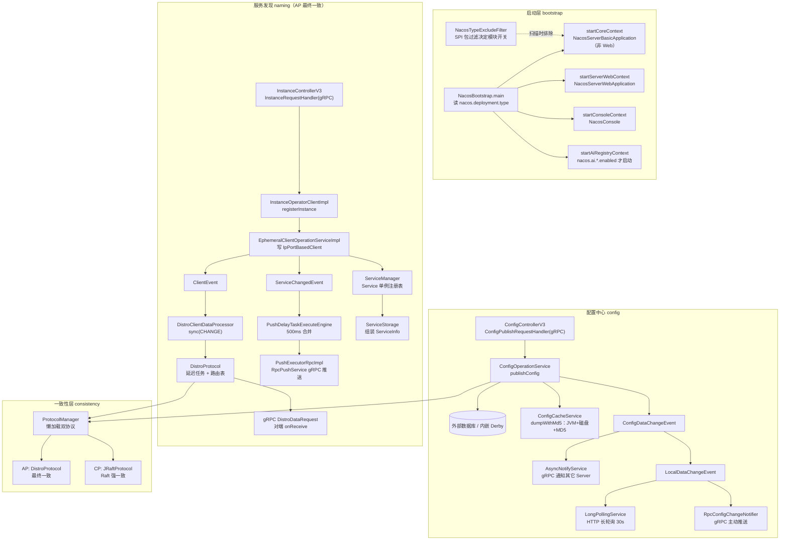

**三条主线**：

1. **数据流（注册数据）**：HTTP/gRPC 注册请求 → `Instance` → `InstancePublishInfo` → `IpPortBasedClient.publishers` → distro 序列化成 `ClientSyncData` → 对端 `clientManager.syncClientConnected` → `ServiceStorage.getPushData` 组装 `ServiceInfo` → 推送给订阅者；
2. **控制流（配置数据）**：发布请求 → 落库 → `ConfigCacheService.dumpWithMd5`（JVM CACHE + 磁盘 + MD5）→ `ConfigDataChangeEvent` →（本机）`LocalDataChangeEvent` 唤醒长轮询 / gRPC 主动推送，（他机）`AsyncNotifyService` gRPC 同步；
3. **恢复流（故障转移）**：客户端 `FailoverReactor` 读本地 failover 文件（naming）与 snapshot/failover 目录（config）；`NacosGrpcRedoService` 断线标记未注册、重连后重放；服务端 distro 定期校验 + 快照全量加载修补漏同步；配置侧 dump 任务定时扫描数据库补偿本地缓存。

---

## 面试速通：Nacos 高频问题一页纸

> 先给结论：Nacos 3.2.4 的面试叙事收敛为三句话——naming 是"客户端即数据、责任即路由、推送即 gRPC"；
> config 是"内容落库、缓存双层、通知三路、补偿兜底"；
> 一致性层由 `ProtocolManager` 懒加载 AP/CP 双协议，临时实例走 distro（最终一致）、持久实例走 JRaft（强一致）。
> 用法：先答"一句话结论"列，被追问再按"深入"列回查讲次；数值题只报文档出现过的常量，不要现场编。

被追问时的展开顺序（结论 → 讲次，一句话均取自各讲小结）：

| 追问方向 | 该讲一句话 | 回查 |
|---|---|---|
| 启动装配 / 部署类型 / 模块开关 / standalone | 一次 main，三/四个上下文，SPI 裁衣；standalone 是短路不是分支 | 第一讲 |
| 数据模型 / 心跳 / distro / gRPC 推送 | 客户端即数据，责任即路由，推送即 gRPC | 第二讲 |
| 缓存 / dump / 长轮询 / 节点间通知 | 内容落库、缓存双层、通知三路、补偿兜底 | 第三讲 |
| AP 与 CP / Raft / 协议懒加载 | 一份数据两条轨道，临时广播、持久选举 | 第四讲 |
| redo / failover / 监听引擎 | 先缓存意图再执行，push 只敲门、内容自己拉 | 第五讲 |

### 高频 Q&A（先结论）

14 题，按"注册 → 同步 → 推送 → 配置 → 一致性 → 客户端"的链路排序；结论均提炼自各讲小结与复习卡：

| # | 面试问题 | 一句话结论 | 深入 |
|---|---|---|---|
| 1 | Nacos 如何保证 AP 与 CP 的取舍？ | 临时实例（默认 `ephemeral=true`）走 AP：distro 本机写即成功，靠延迟广播 + 定期校验 + 快照补齐做到最终一致；持久实例走 CP：JRaft 多数派提交才返回；判决写在业务写方法里，`ProtocolManager` 只懒加载管生命周期 | 第四讲 |
| 2 | 临时实例与持久实例的区别？ | `ephemeral` 是 Service 四元组的一等字段：同名服务的临时/持久实例是两个 key、两套存储、两条一致性轨道；持久实例没有订阅推送概念，订阅是临时实例专属 | 第二、四讲 |
| 3 | 服务注册的心跳与健康检查？ | 临时实例靠客户端心跳：每 5s 检查，空发布 30s、有发布 3min 未更新才回收；主动健康检查（TCP/HTTP/MySQL/NONE）失败计数达 `checkTimes` 且本节点对该 client 负责才真正置不健康，地址非法则跳过计数直接摘除 | 第二讲 |
| 4 | 一次注册到被推送的完整链路？ | 注册写入 `IpPortBasedClient.publishers` → `ClientRegisterServiceEvent` → `ServiceChangedEvent` → 500ms 延迟任务合并 → gRPC 发 `NotifySubscriberRequest`；读路径 `ServiceStorage` 实时拼装 `ServiceInfo`，不是独立存储 | 第二讲 |
| 5 | Nacos 集群间 naming 数据如何同步？ | distro：`DistroMapper` 把全节点排序后取模分责任，只同步本机负责的 ephemeral client，最小单元是"一个 client 的全部发布"（带 revision）；三板斧 = 即时 sync + 定期 VERIFY + 新节点拉 SNAPSHOT 全量 | 第二、四讲 |
| 6 | distro 是强一致协议吗？ | 不是：无 leader 无日志，写本机立即返回成功，其他节点只是镜像，期间可能读到旧数据；最终一致靠延迟同步 + 定期校验 + 快照补齐，没有任何强一致保证 | 第四讲 |
| 7 | 配置发布后如何通知客户端？ | HTTP 客户端走长轮询（挂起最长 30s，有变更即时唤醒）；gRPC 客户端由服务端推 `ConfigChangeNotifyRequest`，但只带 key 不带内容，内容永远客户端主动拉 | 第三讲 |
| 8 | 长轮询的原理与关键参数？ | `allSubs` 队列持有 in-flight 客户端，进来先比 md5，有变秒回；无变挂起至 `max(10s, 客户端值-500ms)`，服务端提前 500ms 返回、超时自管理；连接超限返回 503 并随机延迟 1-3s 防惊群 | 第三讲 |
| 9 | 配置监听如何保证最终一致？ | 事实源是数据库；服务端缓存三层 = 落库 + JVM CACHE + 磁盘 dump；节点间通知不可靠（平方退避重试），兜底是 `DumpChangeConfigWorker` 定时扫 DB 补偿；md5 是唯一变更标尺，md5 不变不通知 | 第三讲 |
| 10 | Nacos 的数据模型（namespace/group）？ | `Service` 是 namespace + group + name + ephemeral 的不可变四元组，`ServiceManager` 保全进程单例；实例数据不在 Service 里，在客户端的发布表里 | 第二讲 |
| 11 | 客户端缓存与故障转移？ | Naming 侧有 `ServiceInfoHolder` 本地缓存 + `FailoverReactor` 每 5s 读 failover 开关，开则整体切本地文件数据；Config 侧 failover 是运维覆盖（优先级高于服务端），snapshot 仅启动兜底 | 第五讲 |
| 12 | 客户端断线恢复怎么做？ | 注册/订阅先缓存意图再执行，断线全部标记未注册，重连后定时重放；服务端 `addServiceInstance` 幂等覆盖使重放安全；Config 监听是"bell + 5s 轮询 + 3min 全量"三速引擎 | 第五讲 |
| 13 | standalone 与 cluster 的差异？ | standalone 是短路不是特例分支：`DistroProtocol` 直接置初始化完成、不做节点间同步，寻址用 `StandaloneMemberLookup`；`EnvUtil.getStandaloneMode()` 一个布尔扩散到寻址、distro、持久化各处 | 第一讲 |
| 14 | Nacos 2.x 与 3.x 的差异？ | `NacosApplication` 被 `NacosBootstrap` 多上下文取代；UDP 推送在 3.2.0 已移除，gRPC 一统客户端与节点间通信；v2 数据模型迁入 `core/v2/`，HTTP 管理 API 在 v3 | 第一、二讲 |

追问"为什么这样设计"时的通用答案：所有取舍都指向同一组三角——高可用（AP 本机写即成功）、最终一致（补偿三板斧）、
读写不对称（CP 用最长 10s 的阻塞换强一致）——先答取舍，再答机制，最后答数值。

### 易错点与面试坑

- **"临时实例 30s 不心跳就被摘除"不准确**：文档口径是空发布 30s（`DEFAULT_IP_DELETE_TIMEOUT`）、
  发布了服务则 3min（`DEFAULT_CLIENT_EXPIRED_TIME`）未更新才回收，且清理前还要过"本节点对该 client 是否负责"这一层。
- **数据不在"服务"里，在"客户端"里**：`ServiceManager` 只维护 Service 单例，实例真实存储是 `IpPortBasedClient.publishers`，
  所以 distro 同步的最小单元是"一个 client 的全部发布"，不是单个实例——这决定了同步粒度与 revision 校验方式。
- **写临时实例成功 ≠ 集群都已同步**：AP 本机写即返回，其他节点靠延迟广播追赶，期间读到旧数据是设计使然；
  要强一致就得用持久实例走 Raft，代价是同步写最长阻塞 10s、读等 5s。
- **长轮询不是干等 30s**：服务端主动提前 500ms 返回（`max(10s, 客户端值-500ms)`），且超时由服务端自管理（`setTimeout(0L)`），
  客户端在自家超时前就拿到空响应进入下一轮；连接超限还会吃到 503。
- **配置推送不带内容**：`ConfigChangeNotifyRequest` 只带 dataId/group/tenant，答"服务端推全量配置"即错；
  另外 md5 不变（哪怕时间戳变）不发本地事件——没有假变更。
- **"所有实例都能被订阅推送"是错的**：持久实例没有订阅者概念，`subscribeService` 直接抛 `UnsupportedOperationException`；
  订阅推送是临时实例专属，这与"临时实例可丢、持久实例要一致"的定位一致。
- **健康检查摘除有三个前提**：失败计数达 `checkTimes`、服务/实例开关打开、本节点对该 client 负责；
  非责任节点只做镜像不做决策——责任模型贯穿心跳、健康检查、distro 同步三处。
- **同一个集群两套端口语义**：AP 成员是 `ip:port`，CP 成员是 `ip:raftPort`；
  CP 同步写最长等 10s、读等 5s，AP 写本机立即返回——这就是"临时实例高可用、持久实例强一致"的工程代价。

### 关键数值与默认值速记

均为文档中出现过的源码常量或默认值，答数值题优先报常量名：

| 数值 | 含义 | 讲次 |
|---|---|---|
| `ephemeral=true` | 实例默认临时的开关值（`SwitchDomain`） | 第二讲 |
| 5s | 心跳检查周期，也是过期清理扫描周期 | 第二讲 |
| 30s / 3min | 客户端回收阈值：空发布 30s、有发布 3min 未更新 | 第二讲 |
| 500ms | 推送合并窗口（`pushTaskDelay`），防推送风暴 | 第二讲 |
| 30s | HTTP 长轮询默认挂起时长 | 第三讲 |
| `max(10s, 客户端值-500ms)` | 长轮询实际超时，提前 500ms 返回 | 第三讲 |
| 503 + 1-3s | 长轮询连接超限的响应与随机延迟 | 第三讲 |
| 10s | `StatTask` 订阅数打点周期 | 第三讲 |
| `500 + failCount²×1000ms`（封顶 6 次） | 节点间通知的平方退避公式 | 第三讲 |
| 100/页 | 删除扫描的分页大小 | 第三讲 |
| 10s / 5s | JRaft 同步写 / 读超时 | 第四讲 |
| 5 次 × 100ms | Raft 成员变更失败重试 | 第四讲 |
| 多数派（3 节点示例 2/3） | Raft 提交条件 | 第四讲 |
| 延迟 0 | distro 校验失败后的立即补发 | 第四讲 |
| 由配置控制 | distro 定期校验周期（`verifyIntervalMillis`，无硬编码默认值） | 第四讲 |
| 5s / 3min | Config 监听轮询间隔 / 全量同步周期 | 第五讲 |
| 5s | `FailoverReactor` 读 failover 开关周期 | 第五讲 |

收尾：一页纸只放结论与数值，机制细节回对应讲次查；本表与 Q&A 的全部内容均出自前五讲，未引入文档外知识点。

---

## 第一讲：模块装配与启动 —— NacosBootstrap 的三段式点火

### 定位

Nacos 3.2.4 是一个**多 Maven 模块的单体 Spring Boot 应用**：根 `pom.xml:661-690` 声明 30 个模块（config/core/naming/api/client/common/console/auth/consistency/istio/sys/persistence/bootstrap/server/lock/ai/copilot 等）。所有模块打进同一个可执行 jar（`nacos-all`），运行时由 `bootstrap` 模块的 `NacosBootstrap` 按部署类型**分阶段点亮多个 Spring 上下文**。旧版的统一入口 `Nacos.java`（console 模块）仍保留但已标记 `@Deprecated`（`console/src/main/java/com/alibaba/nacos/Nacos.java:36`），其 javadoc 明确指向 `NacosBootstrap`。

### 目录结构：启动相关文件的树

```
bootstrap/src/main/java/com/alibaba/nacos/bootstrap/
└── NacosBootstrap.java              # 唯一 main 入口，部署类型分发
server/src/main/java/com/alibaba/nacos/
├── NacosServerBasicApplication.java # core 上下文（非 Web）
└── NacosServerWebApplication.java   # server web 上下文
console/src/main/java/com/alibaba/nacos/
├── Nacos.java                       # 旧全量入口（已废弃）
└── console/NacosConsole.java        # console 上下文（管理台）
core/src/main/java/com/alibaba/nacos/core/
├── listener/startup/                # 启动阶段 SPI（core/web/console/ai-registry）
│   ├── NacosStartUp.java            #   阶段常量与生命周期接口
│   ├── NacosStartUpManager.java     #   阶段管理器（SPI 加载）
│   ├── AbstractNacosStartUp.java
│   ├── NacosCoreStartUp.java        #   core 阶段：建目录/注入 Environment
│   └── NacosWebStartUp.java
├── cluster/lookup/                  # 成员寻址（standalone/file/address-server）
└── config/                          # 模块状态构建器（Distro/Raft）
sys/src/main/java/com/alibaba/nacos/sys/
├── env/EnvUtil.java                 # standalone/cluster 模式判定
└── filter/                          # 包级 SPI 排除过滤器（模块开关）
naming/src/main/java/com/alibaba/nacos/naming/
└── config/NamingEnabledFilter.java  # naming 模块开关实现
```

### 逐文件精读

#### 1. `bootstrap/src/main/java/com/alibaba/nacos/bootstrap/NacosBootstrap.java` —— 部署类型分发

`main`（`NacosBootstrap.java:48-66`）先读系统属性 `nacos.deployment.type`（默认 `merged`），转成 `DeploymentType` 存入 `EnvUtil`，再 switch：

| 部署类型 | 方法 | 启动的上下文 |
|---|---|---|
| MERGED（默认） | `startWithConsole`（`:86-95`） | core → server web → console →（可选）ai-registry |
| SERVER | `startWithoutConsole`（`:76-84`） | core → server web →（可选）ai-registry |
| CONSOLE | `startOnlyConsole`（`:125-129`） | 仅 console |

每个上下文都用 `SpringApplicationBuilder(...).parent(coreContext)` 挂到 core 上下文下，且启动前调 `NacosStartUpManager.start(phase)`（如 `startCoreContext`，`:97-102`）：core 上下文是 `WebApplicationType.NONE` 的非 Web 容器，加载"公共非 Web bean"；server web 上下文加载 Web 层；console 上下文加载管理台。AI Registry 上下文是否启动由 `nacos.ai.mcp.registry.enabled` 或 `nacos.ai.skill.registry.enabled` 决定（`:135-141`）。`prepareCoreContext`（`:68-74`）处理 JMX 重复注册（设 `IGNORE_EXISTING`）。

#### 2. 启动阶段 SPI：`core/listener/startup/` 包

`NacosStartUp`（`NacosStartUp.java:30-36`）定义四个阶段常量：`core`、`web`、`console`、`ai-registry`。`NacosStartUpManager` 构造时通过 `NacosServiceLoader.load(NacosStartUp.class)` 加载所有 SPI 实现并按阶段名建 map（`NacosStartUpManager.java:43-49`）；`start(phase)` 记录进入新阶段并加入 `startedList`（`:60-67`），`getReverseStartedList()` 反序返回供停机时逆序销毁（`:85-89`）。

`NacosCoreStartUp` 的关键动作：

- `makeWorkDir`（`NacosCoreStartUp.java:85-99`）：强制创建 `$nacos.home/{logs,conf,data}`；
- `injectEnvironment`（`:101-104`）：把 Spring `Environment` 注入 `EnvUtil`；
- `loadPreProperties`（`:106-115`）：加载 `application.properties` 并注册文件监听（配置热更新基础）；
- `initSystemProperty`（`:118-137`）：standalone 模式下设置 `nacos.standalone=true` 系统属性，并按 `functionMode` 设置功能模式。

#### 3. standalone vs cluster 的判定点

模式判定分散在两处，共同决定行为差异：

- `EnvUtil.getStandaloneMode()`（`sys/env/EnvUtil.java:275-277`）：读系统属性 `nacos.standalone`（布尔），即 `mode=standalone` 的启动参数最终落点；
- `LookupFactory.createLookUp(ServerMemberManager)`（`core/cluster/lookup/LookupFactory.java:64-75`）：**standalone 直接返回 `StandaloneMemberLookup`**；cluster 模式才按 `nacos.core.member.lookup.type` 配置选 `FileConfigMemberLookup`（读 `cluster.conf`）或 `AddressServerMemberLookup`。`chooseLookup`（`:124-136`）在未显式配置时的兜底逻辑：`cluster.conf` 存在或配置了成员列表 → FILE_CONFIG，否则 ADDRESS_SERVER。

`StandaloneMemberLookup.doStart`（`StandaloneMemberLookup.java:32-36`）只把本机地址当作唯一成员上报。standalone 的深远影响：`DistroProtocol` 构造时若 `EnvUtil.getStandaloneMode()` 为真，直接置 `isInitialized=true` 并跳过校验/加载任务（`core/distributed/distro/DistroProtocol.java:63-70`），即**单机不做节点间同步**。

#### 4. 模块开关：`NacosTypeExcludeFilter` 与 SPI 过滤器

`NacosTypeExcludeFilter`（`sys/filter/NacosTypeExcludeFilter.java:53-80`）是 Spring 组件扫描的 `TypeFilter`：构造时 SPI 加载所有 `NacosPackageExcludeFilter` 按包前缀建 map（`:43-51`）；匹配时先剔除任何带 `@SpringBootApplication` 的类防重复扫描（`:60-68`），再按类名前缀委托对应过滤器裁决（`:69-77`）。

以 `naming/config/NamingEnabledFilter.java:42-52` 为例：读 `EnvUtil.getFunctionMode()`，若为空（未指定功能模式）则**不排除**（naming 默认加载）；若指定了 `config` 等其它功能模式，则排除 `com.alibaba.nacos.naming` 包——这就是 `nacos.functionMode` 配置裁剪模块的机制。同类实现还有 `ConfigEnabledFilter`、`ConsolePackageExcludeFilter`、`IstioEnabledFilter`、`K8sSyncEnabledFilter`、`AiEnabledFilter`、`AiRegistryPackageExcludeFilter`、`AuthImplPackageExcludeFilter`。

#### 5. console 模块简述

`console/NacosConsole.java:28-37` 是管理台上下文入口（`@PropertySource("classpath:nacos-console.properties")`），依赖 `nacos-config/nacos-naming/nacos-core/nacos-ai/nacos-istio` 等（`console/pom.xml:34-72`），即控制台 API 是**跨模块的聚合层**，自身几乎不含业务逻辑，只有 UI 资源（console-ui）与参数装配。`Nacos.java`（旧入口）用 `@ComponentScan(basePackages = "com.alibaba.nacos")` 一次性扫全量包，靠同一套 excludeFilters 裁剪——这也是它被拆成多上下文的原因：单上下文无法区分 core/web/console 生命周期。

### 关键图：启动时序

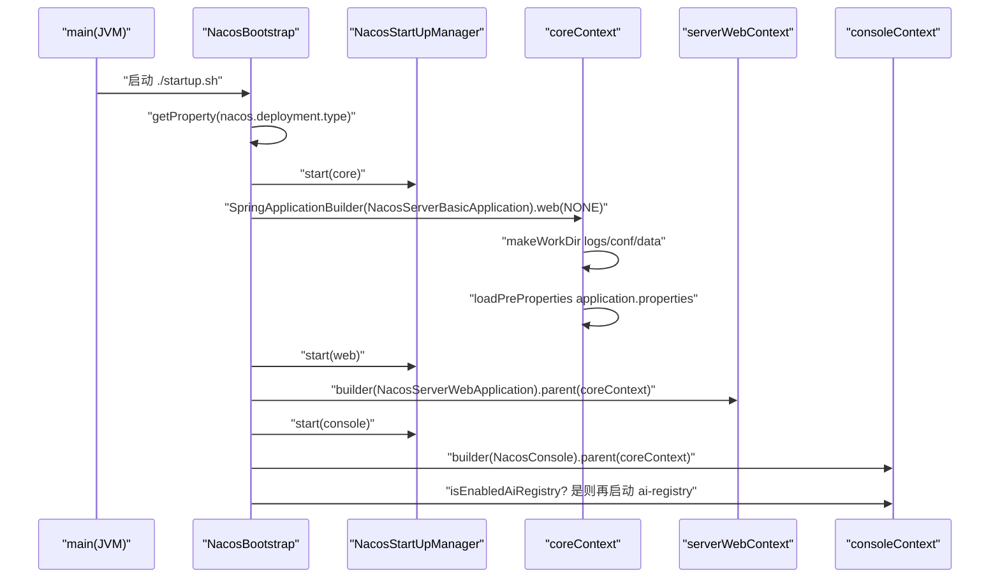

### 输入/输出表

| 输入 | 处理 | 输出 |
|---|---|---|
| `nacos.deployment.type`（默认 merged） | switch 分发 | 三个/四个 Spring 上下文 |
| `nacos.standalone` / `mode=standalone` | `EnvUtil.getStandaloneMode` | distro/寻址行为切换 |
| `nacos.functionMode`（config/naming/...） | `NacosTypeExcludeFilter` SPI 裁决 | 被排除包的 bean 不注册 |
| `cluster.conf` 或成员列表 | `LookupFactory.chooseLookup` | FILE_CONFIG / ADDRESS_SERVER 寻址 |
| `application.properties` | `NacosCoreStartUp.loadPreProperties` | Environment + 文件监听 |

### 端到端演算：一次 `./startup.sh -m standalone`

1. JVM 起 `NacosBootstrap.main`，`nacos.deployment.type` 缺省 → `MERGED`；
2. `startCoreContext`：先 `NacosStartUpManager.start("core")`，再跑非 Web 的 `NacosServerBasicApplication`——建 `logs/conf/data`、加载 application.properties、`EnvUtil` 就位；`@ComponentScan` 被 `NacosTypeExcludeFilter` 过滤（standalone 不改变包过滤，只改变运行时行为）；
3. `startServerWebContext`：`NacosServerWebApplication` 以 core 为父上下文启动，gRPC/HTTP 端点、naming/config 的远程处理器在此装配；
4. `startConsoleContext`：管理台上下文挂上；
5. 集群场景下，`ServerMemberManager` 此时才会通过 `LookupFactory` 选出寻址方式；standalone 下 `StandaloneMemberLookup` 直接上报单成员列表，`DistroProtocol` 标记 `isInitialized=true`，本机即全部。

### 第一讲小结：一次 main，三/四个上下文，SPI 裁衣

**一句话定位**：`NacosBootstrap` 按 `nacos.deployment.type` 把应用拆成 core（非 Web）→ server web → console 三级父子上下文依次点亮，模块增减不靠改代码而靠 `NacosTypeExcludeFilter` 的 SPI 包过滤，standalone/cluster 的差异从 `EnvUtil.getStandaloneMode()` 一个布尔值扩散到寻址、distro、持久化各处的行为分支。

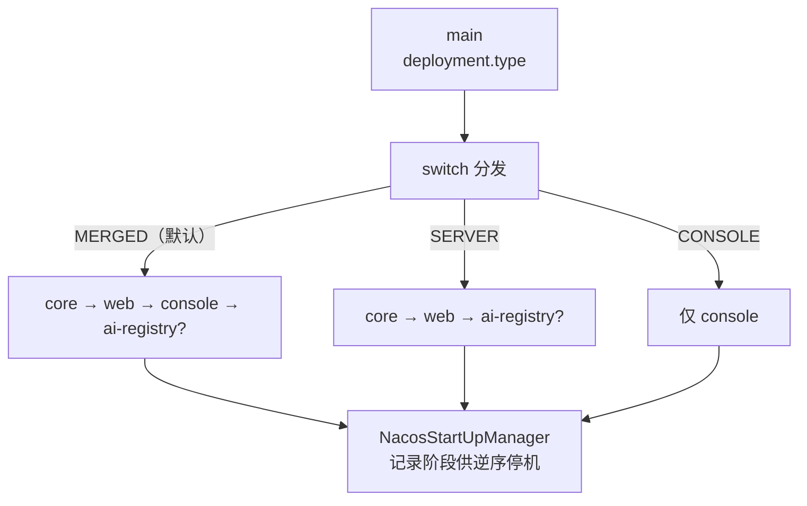

**启动装配的输入/输出**：

| 组件 | 输入 | 输出 |
|---|---|---|
| `NacosBootstrap` | `nacos.deployment.type` | 上下文链（父子关系） |
| `NacosTypeExcludeFilter` | 类名 + 注解 + SPI 过滤器 | 排除/保留决策 |
| `NacosCoreStartUp` | `nacos.home`、application.properties | 工作目录、Environment、系统属性 |
| `LookupFactory` | `nacos.core.member.lookup.type`、cluster.conf | MemberLookup 实例 |

**三个最值得记住的点**：

1. **多上下文而非单上下文**：core 上下文 `WebApplicationType.NONE`，web/console 是它的子上下文——这解决了旧版"一个上下文扫全量包"导致模块无法按阶段装配和停机的问题；
2. **模块开关是 SPI 包过滤**：`NacosPackageExcludeFilter` 按包前缀裁决，`functionMode` 只影响"加载哪些模块"，不改 classpath；
3. **standalone 不是 cluster 的特例分支而是短路**：`DistroProtocol` 在 standalone 下直接 `isInitialized=true` 不同步（`DistroProtocol.java:63-70`），寻址直接用 `StandaloneMemberLookup`——读集群代码时永远要先问"这行在 standalone 下会执行吗"。

---

## 第二讲：naming 服务发现核心 —— v2 模型、distro 与 gRPC 推送

### 定位

naming 模块管理"服务 → 实例"的内存模型与分发。3.2.4 的命名模块已全面 v2 化：数据模型在 `core/v2/`，HTTP 管理 API 在 `controllers/v3/`，客户端连接走 gRPC（`remote/rpc/handler/`），推送走 gRPC。**与 2.x 最大的两个差异**：① `core/ServiceManager.java` 已不存在，服务注册表是 `naming/core/v2/ServiceManager.java`；② UDP 推送在 3.2.0 被移除——`InstanceOperatorClientImpl.java:201-204` 对使用旧 HTTP 订阅的客户端直接打 warn："UDP push has been removed in Nacos 3.2.0"，旧订阅者不再收到推送。

### 目录结构：naming 模块的树（只列主路径）

```
naming/src/main/java/com/alibaba/nacos/naming/
├── controllers/v3/
│   ├── InstanceControllerV3.java      # HTTP 管理 API：注册/注销/更新/列表
│   └── ...
├── core/
│   ├── InstanceOperatorClientImpl.java # 实例操作门面（v1/v2 适配）
│   ├── DistroMapper.java               # 路由表：谁负责哪个 client
│   └── v2/
│       ├── ServiceManager.java         # Service 单例注册表（内存模型核心）
│       ├── pojo/Service.java           # namespace+group+name+ephemeral
│       ├── pojo/InstancePublishInfo.java # 实例发布信息（v2 存储单元）
│       ├── index/ServiceStorage.java   # 组装 ServiceInfo 的读路径
│       ├── client/impl/IpPortBasedClient.java # IP:Port 客户端（发布/订阅容器）
│       ├── client/manager/impl/EphemeralIpPortClientManager.java
│       └── service/impl/EphemeralClientOperationServiceImpl.java # 临时实例写路径
├── consistency/ephemeral/distro/v2/
│   └── DistroClientDataProcessor.java  # 临时数据的 distro 处理器（AP）
├── remote/rpc/handler/
│   ├── InstanceRequestHandler.java     # gRPC 注册/注销
│   └── DistroDataRequestHandler.java   # gRPC 节点间 distro 数据
├── push/v2/
│   ├── NamingSubscriberServiceV2Impl.java # 订阅事件 → 延迟推送任务
│   ├── task/PushDelayTaskExecuteEngine.java
│   └── executor/PushExecutorRpcImpl.java  # gRPC 推送执行器
├── healthcheck/
│   ├── heartbeat/ClientBeatCheckTaskV2.java  # 心跳检查任务
│   └── v2/processor/HealthCheckProcessorV2Delegate.java # 健康检查家族
└── misc/SwitchDomain.java              # 开关域：默认 ephemeral=true、心跳 5s
```

### 逐文件精读

#### 1. 注册入口：`controllers/v3/InstanceControllerV3.java`

`register`（`InstanceControllerV3.java:99-120`）是 HTTP 管理面注册：`instanceForm.validate()` → `checkWeight` → `InstanceUtil.buildInstance(form, switchDomain.isDefaultInstanceEphemeral())` 构造 `Instance`（**ephemeral 默认 true**，见 `SwitchDomain.java:107`）→ `instanceService.registerInstance(namespaceId, groupName, serviceName, instance)` → 发 `RegisterInstanceTraceEvent`。生产客户端主要走 gRPC：`remote/rpc/handler/InstanceRequestHandler.java:64-95` 的 `handle` 按 `RegisterInstance/DeregisterInstance` 类型分发，最终同样调 `clientOperationService.registerInstance(service, instance, meta.getConnectionId())`（注意 clientId 是 **gRPC 连接 ID**，与 HTTP 面的 `ip:port` 不同）。

#### 2. 写路径门面：`core/InstanceOperatorClientImpl.java`

`registerInstance`（`InstanceOperatorClientImpl.java:102-111`）四步：

```java
NamingUtils.checkInstanceIsLegal(instance);
boolean ephemeral = instance.isEphemeral();
String clientId = IpPortBasedClient.getClientId(instance.toInetAddr(), ephemeral); // ip:port$ephemeral
createIpPortClientIfAbsent(clientId);          // 不存在则 clientConnected
Service service = Service.newService(namespaceId, groupName, serviceName, ephemeral);
clientOperationService.registerInstance(service, instance, clientId);
```

`createIpPortClientIfAbsent`（`:382-388`）在 `ClientManager` 不存在该 clientId 时调 `clientConnected`。`handleBeat`（`:246-279`）处理 1.x 心跳：client 不存在且带 beat 信息时**顺带注册**（`:258-261`），然后调度 `ClientBeatProcessorV2` 并刷新 `lastUpdatedTime`。

#### 3. 内存模型：`core/v2/ServiceManager.java` 与 `Service`

`Service`（`core/v2/pojo/Service.java:32-46`）是不可变值对象：`namespace/group/name/ephemeral` 四元组 + `AtomicLong revision` + `lastUpdatedTime`。**ephemeral 是 Service 的一等字段**——同一 serviceName 的临时实例和持久实例是两个不同的 key。

`ServiceManager`（`core/v2/ServiceManager.java`）是进程内单例（`:36`）：

- `singletonRepository`：`ConcurrentHashMap<Service, Service>`（`:38`），保证同一 Service 全进程唯一；
- `namespaceSingletonMaps`：按 namespace 分组的索引（`:40`）；
- `getSingleton(service)`（`:61-70`）：`computeIfAbsent` 放入新 Service 时发 `ServiceMetadataEvent`——**"服务诞生"事件从这儿流出**；
- `removeSingleton`（`:104-110`）、`containSingleton`（`:112-114`）供清理与查询。

#### 4. 临时实例写路径：`core/v2/service/impl/EphemeralClientOperationServiceImpl.java`

`registerInstance`（`EphemeralClientOperationServiceImpl.java:56-78`）：

1. `ServiceManager.getSingleton(service)` 拿单例，校验 `isEphemeral()`（持久服务拒绝临时实例，`:61-66`）；
2. `clientManager.getClient(clientId)` + `checkClientIsLegal`（`:153-168`，client 不存在或类型不匹配抛 `CLIENT_DISCONNECT`/`INVALID_PARAM`）；
3. `client.addServiceInstance(singleton, instanceInfo)`——**写入 `IpPortBasedClient.publishers`**（临时实例的真实存储是"客户端对象里的发布表"）；
4. `client.recalculateRevision()` 重算 client 修订号；
5. 发布 `ClientOperationEvent.ClientRegisterServiceEvent` + `MetadataEvent.InstanceMetadataEvent`。

注意第 5 步的事件流：`ClientRegisterServiceEvent` 最终会触发 `ServiceChangedEvent`（服务实例集合变化），这是推送与 distro 的共同源头。

#### 5. 读路径：`core/v2/index/ServiceStorage.java`

`getData`（`ServiceStorage.java:78-81`）先查缓存 `serviceDataIndexes`，未命中走 `getPushData`（`:83-92`）：`getAllInstancesFromIndex`（`:108-132`）遍历该 Service 的所有注册 client，逐个取 `InstancePublishInfo`，经 `InstanceUtil.parseToApiInstance` 转成 API 层 `Instance`，并合并元数据；`BatchInstancePublishInfo`（批量注册）在此展开（`:116-121`）。**读路径是"实时拼装"而非独立存储**——这与 config 的 CACHE 是两种哲学。

#### 6. distro 路由与同步：`DistroMapper` + `DistroClientDataProcessor`

`DistroMapper`（`core/DistroMapper.java`）是**路由表**：

- `healthyList`（`:48`）由 `MembersChangeEvent` 维护，**排序保证所有节点顺序一致**（`:129-142`，`Collections.sort(list)`）；
- `responsible(tag)`（`:78-99`）：`distroHash(tag) % servers.size()` 落在本机负责区间则返回 true；**standalone 或 distro 关闭直接 true**（`:81-83`）；
- `mapSrv(tag)`（`:107-123`）：算出 tag 应落在哪台机器；
- v1 的 responsibleTag 是 serviceName，v2 是 `ip:port`（clientId，`:75` 注释）。

`DistroClientDataProcessor`（`consistency/ephemeral/distro/v2/DistroClientDataProcessor.java`）是临时数据的 AP 同步器，同时实现 `DistroDataStorage` 与 `DistroDataProcessor`（`:58-59`），类型常量 `Nacos:Naming:v2:ClientData`（`:61`）：

- `onEvent`（`:95-104`）订阅三类 client 事件：`ClientChangedEvent`/`ClientDisconnectEvent`/`ClientVerifyFailedEvent`；standalone 直接 return（`:96-98`）；
- `syncToAllServer`（`:116-128`）：断连 → `sync(key, DELETE)`，变更 → `sync(key, CHANGE)`；`isInvalidClient`（`:130-134`）**只同步 ephemeral 且本机负责的 client**（持久实例走 Raft，见第四讲）；
- `processData`（`:142-159`）：收到 ADD/CHANGE 反序列化 `ClientSyncData` → `handlerClientSyncData`（`:161-170`）→ `clientManager.syncClientConnected` + `upgradeClient`（`:172-207`，按 revision 逐服务对齐，多出的服务删掉）；
- 校验失败事件 `syncToVerifyFailedServer`（`:106-114`）：**延迟 0 立即补发**到指定节点。

`DistroDataRequestHandler`（`remote/rpc/handler/DistroDataRequestHandler.java:56-81`）是节点间 gRPC 入口：VERIFY/SNAPSHOT/ADD/CHANGE/DELETE/QUERY 六种数据操作分别转 `distroProtocol.onVerify/onSnapshot/onReceive/onQuery`。

#### 7. 推送：`push/v2/` 家族

事件到推送的链路（`NamingSubscriberServiceV2Impl.java:111-137`）：

- 订阅 `ServiceChangedEvent`（服务变更）→ `delayTaskEngine.addTask(service, new PushDelayTask(service, pushTaskDelay))`；
- 订阅 `ServiceSubscribedEvent`（新订阅者）→ 只推这一个 client（`:133-135`）；
- `PushDelayTaskExecuteEngine.PushDelayTaskProcessor.process`（`PushDelayTaskExecuteEngine.java:101-109`）到点后经 `NamingExecuteTaskDispatcher` 按 service 哈希分发到并行 executor，生成 `PushExecuteTask`；
- `PushExecutorRpcImpl.doPush`（`PushExecutorRpcImpl.java:46-49`）：`pushService.pushWithoutAck(clientId, NotifySubscriberRequest.buildNotifySubscriberRequest(serviceInfo))`；带回调的 `doPushWithCallback`（`:52-59`）用于失败重试/统计。

**3.2.4 没有 UDP 也没有 SocketAddrReplacementTask**——`misc/` 包里只剩配置类与工具类；默认 `pushTaskDelay=500ms`（`constants/PushConstants.java:31`），即 500ms 内的连续变更会被延迟任务合并，天然防推送风暴。

#### 8. 健康检查家族：`healthcheck/`

- `ClientBeatCheckTaskV2`（`heartbeat/ClientBeatCheckTaskV2.java:67-78`）：每 5s（`SwitchDomain.java:47`）遍历 client 的所有发布服务，逐个构造 `InstanceBeatCheckTask` 过拦截链（`InstanceBeatCheckTaskInterceptorChain`，含"服务是否开启检查""实例是否开启检查""是否本节点负责"等拦截器）；
- `HealthCheckProcessorV2Delegate`（`healthcheck/v2/processor/HealthCheckProcessorV2Delegate.java:66-77`）：按集群元数据的 `healthyCheckType` 选处理器（TCP/HTTP/MySQL/NONE...），未命中回落 `NoneHealthCheckProcessor`；主动检查地址非法直接 `checkFailNow`（`:72-74`）；
- `HealthCheckCommonV2.checkFail`（`HealthCheckCommonV2.java:144-188`）：失败计数达 `switchDomain.getCheckTimes()` 且**本节点对该 client 负责**（`:157-159` 的 `distroMapper.responsible`）才真正置不健康并同步状态；`checkFailNow`（`:197-232`）跳过计数直接置不健康。

#### 9. 过期清理：`EphemeralIpPortClientManager`

构造时即注册定时清理（`EphemeralIpPortClientManager.java:61-66`），周期 `Constants.DEFAULT_HEART_BEAT_INTERVAL=5s`（`api/common/Constants.java:189`）。`ExpiredClientCleaner.isExpireClient`（`:171-175`）：**既发布了服务又超过 3 分钟未更新**（`ClientConstants.DEFAULT_CLIENT_EXPIRED_TIME`，`ClientConstants.java:44`）或空发布等组合条件才回收。`IpPortBasedClient.isExpire`（`IpPortBasedClient.java:92-97`）同理。`isResponsibleClient`（`:122-126`）委托 `distroMapper.responsible(getResponsibleId())`——**责任模型贯穿心跳、健康检查、distro 同步三处**。

### 关键图：一次注册的完整生命周期

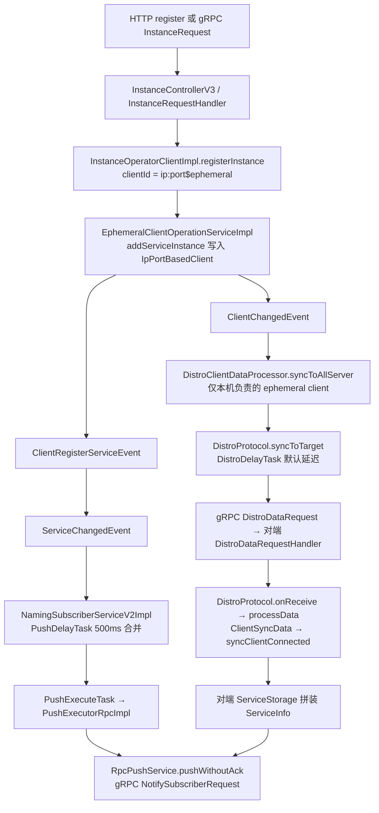

### 输入/输出表

| 环节 | 输入 | 输出 |
|---|---|---|
| `InstanceControllerV3.register` | `InstanceForm` | `Instance`（ephemeral 默认 true） |
| `EphemeralClientOperationServiceImpl.registerInstance` | `Service + Instance + clientId` | client.publishers 新增 + 2 个事件 |
| `ServiceManager.getSingleton` | `Service` | 全进程唯一 Service（可能新诞生） |
| `DistroMapper.responsible` | clientId（v2） | 本机是否负责 |
| `DistroClientDataProcessor.processData` | `DistroData(ClientSyncData)` | 对端 client 数据对齐 |
| `ServiceStorage.getPushData` | `Service` | `ServiceInfo`（含 hosts/metadata） |
| `PushExecutorRpcImpl.doPush` | `clientId + PushDataWrapper` | gRPC `NotifySubscriberRequest` |

### 端到端演算 ①：一个实例从注册到被推送

场景：3 节点集群（A/B/C），客户端 X（10.0.0.1:8080，ephemeral）连到节点 A 注册 `default@@order-service`，订阅者 Y 连到节点 C。

1. **注册落本机**：X 的 gRPC `InstanceRequest` 到 A → `InstanceRequestHandler.registerInstance`（`InstanceRequestHandler.java:81-95`）→ `InstanceOperatorClientImpl.registerInstance` → `clientId = "10.0.0.1:8080$true"` → `EphemeralClientOperationServiceImpl` 把 `InstancePublishInfo` 写进 A 上的 `IpPortBasedClient`，`recalculateRevision`；
2. **判定责任**：A 的 `DistroMapper.responsible("10.0.0.1:8080$true")` 为 true（假设哈希落在 A），A 是该 client 的责任节点；
3. **distro 同步**：写操作发 `ClientChangedEvent` → `DistroClientDataProcessor.onEvent` → `syncToAllServer` → `DistroProtocol.sync(CHANGE)` → 对 B、C 各建 `DistroDelayTask` → 到点经 gRPC 发 `DistroDataRequest`；B/C 的 `DistroDataRequestHandler.handleSyncData` → `DistroProtocol.onReceive` → `processData` 反序列化 → `syncClientConnected` + `upgradeClient`（B/C 上凭空出现 X 的 client 记录，但**不产生真实连接**）；
4. **触发推送**：A 上 `ClientRegisterServiceEvent` 汇成 `ServiceChangedEvent` → `NamingSubscriberServiceV2Impl.onEvent` → 500ms 延迟任务 → `PushExecuteTask`；
5. **执行推送**：`PushExecutorRpcImpl.doPushWithCallback` 先从 `ServiceStorage` 拼 `ServiceInfo`（此时 C 节点上也已能拼出含 X 的列表）→ 对订阅者 Y 的 gRPC 连接 `pushWithCallback(NotifySubscriberRequest)`；
6. **兜底**：若 B 错过 CHANGE（丢包/不在线），A 的 `DistroVerifyTimedTask`（默认周期由 `DistroConfig.verifyIntervalMillis` 控制）定期向 B 发 VERIFY，B 校验 revision 不符返回失败 → A 对该 target 立即补发（`syncToVerifyFailedServer` 延迟 0）；B 重启则 `DistroLoadDataTask` 向 A 拉 SNAPSHOT 全量（`DistroClientDataProcessor.processSnapshot`，`:254-261`）。

### 第二讲小结：客户端即数据，责任即路由，推送即 gRPC

**一句话定位**：3.2.4 的 naming 把"临时实例"存成"客户端对象的发布表"（`IpPortBasedClient.publishers`），用 `DistroMapper` 哈希环决定每台机器负责哪些 client，变更经事件总线同时流向 distro 同步（节点间）与延迟推送引擎（订阅者），读路径 `ServiceStorage` 实时拼装 `ServiceInfo`；UDP 已死，gRPC 一统客户端与节点间通信。

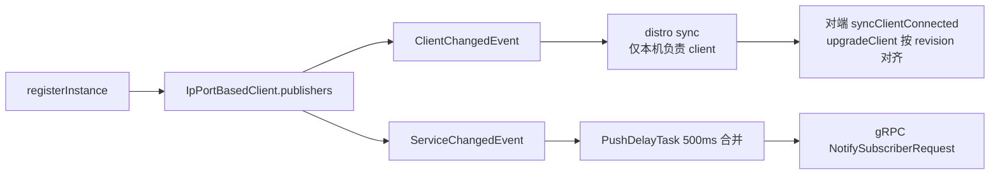

**naming 核心的输入/输出**：

| 机制 | 输入 | 输出 |
|---|---|---|
| ServiceManager | Service 四元组 | 单例 + 诞生事件 |
| DistroMapper | clientId / serviceName | 责任归属（哈希环） |
| DistroClientDataProcessor | ClientEvent | 节点间 ADD/CHANGE/DELETE 同步 |
| PushDelayTaskExecuteEngine | ServiceChangedEvent | 合并后的 PushExecuteTask |
| ClientBeatCheckTaskV2 | 5s 定时 | 心跳过期判定 |
| ExpiredClientCleaner | 5s 定时 + 3min 阈值 | client 回收 |

**三个最值得记住的点**：

1. **数据不在"服务"里，在"客户端"里**：`ServiceManager` 只管服务单例，实例数据在 `IpPortBasedClient.publishers`，所以 distro 同步的最小单元是"一个 client 的全部发布"（`ClientSyncData` 带 revision），不是单个实例——这决定了同步粒度与校验方式；
2. **责任模型是三处共用的一把尺**：心跳检查、健康检查摘除、distro 同步都先问 `distroMapper.responsible(...)`，非责任节点只做镜像不做决策（`HealthCheckCommonV2.java:157-159`）；
3. **3.2.4 没有 UDP**：`InstanceOperatorClientImpl.java:201` 的 warn 是旧版迁移的硬边界；推送统一走 `RpcPushService` 的 gRPC，且 `pushWithoutAck`（不等客户端 ACK，失败靠客户端侧查询补偿）与 `pushWithCallback`（带重试回调）两种语义并存。

---

## 第三讲：config 配置中心 —— 缓存、dump、长轮询与 gRPC 监听

### 定位

config 模块管理"配置内容"的全生命周期：发布 → 落库 → 本地双层缓存（JVM + 磁盘）→ 通知。3.2.4 的 config 与 naming 形成有趣对照：**naming 的数据在内存里实时拼装，config 的数据必须落库 + dump 磁盘**（配置是耐久资产）；**naming 节点间同步走 distro（AP），config 在外部数据库模式下节点间只走 `AsyncNotifyService` 的 gRPC 点对点通知 + 失败重试**，而内嵌 Derby 模式下配置数据改由 Raft（CP）跨节点复制、且只有 leader 能执行 dump（`EmbeddedDumpService.java:178-183`，见第四讲）。

### 目录结构：config 模块的树（只列主路径）

```
config/src/main/java/com/alibaba/nacos/config/server/
├── Config.java                        # 模块独立启动类（生产由 bootstrap 统一点火）
├── controller/v3/ConfigControllerV3.java   # HTTP 发布/查询/beta 管理
├── service/
│   ├── ConfigCacheService.java        # JVM 缓存 CACHE + MD5 + 磁盘 dump
│   ├── ConfigOperationService.java    # 发布编排（正式/beta/tag 三路）
│   ├── ConfigChangePublisher.java     # ConfigDataChangeEvent 发布门面
│   ├── LongPollingService.java        # HTTP 长轮询（30s）
│   ├── notify/AsyncNotifyService.java # 节点间 gRPC 通知 + 退避重试
│   └── dump/
│       ├── DumpService.java           # dump 抽象（内嵌/外部存储）
│       ├── DumpChangeConfigWorker.java# 定时扫描 DB 补偿本地缓存
│       └── disk/ConfigDiskServiceFactory.java
├── model/event/ConfigDataChangeEvent.java  # 跨节点事件
├── model/event/LocalDataChangeEvent.java   # 本机事件
└── remote/
    ├── ConfigPublishRequestHandler.java      # gRPC 发布
    ├── ConfigChangeBatchListenRequestHandler.java # gRPC 批量监听
    ├── ConfigChangeListenContext.java        # 连接→监听组 双向索引
    └── RpcConfigChangeNotifier.java          # gRPC 主动推送
```

### 逐文件精读

#### 1. 发布入口：`controller/v3/ConfigControllerV3.java` 与 gRPC handler

HTTP 发布（`ConfigControllerV3.java:204-250`）：校验参数 → 加密处理（`EncryptionHandler.encryptHandler`，`:233-237`）→ 组装 `ConfigRequestInfo`（含 `betaIps`、`casMd5` 头，`:239-245`）→ `configOperationService.publishConfig`。gRPC 入口 `ConfigPublishRequestHandler` 逻辑同构（`ConfigPublishRequestHandler.java:117-131`），只是来源换成请求附加参数。

#### 2. 发布编排：`service/ConfigOperationService.java`

`publishConfig`（`ConfigOperationService.java:88-191`）按优先级分三路：

| 分支 | 条件 | 动作 |
|---|---|---|
| beta | `configRequestInfo.betaIps` 非空（`:106`） | `grayName=beta`、优先级 `Integer.MAX_VALUE`，落 `config_info_beta` 表 + `publishConfigGray` |
| tag | `configForm.tag` 非空（`:118`） | `grayName=tag_<tag>`、优先级 `MAX-1`，落 tag 灰度 |
| 正式 | 其余 | `insertOrUpdateCas`（带 casMd5，冲突抛 `RESOURCE_CONFLICT`，`:136-148`）或 `addConfigInfo`/`insertOrUpdate` |

正式路最后 `ConfigChangePublisher.notifyConfigChange(new ConfigDataChangeEvent(...))`（`:172-175`），istio 标签额外发 `IstioConfigChangeEvent`（`:176-182`）。

#### 3. 事件门面：`service/ConfigChangePublisher.java`

`notifyConfigChange`（`ConfigChangePublisher.java:36-41`）有一个关键短路：**内嵌存储且非 standalone 时直接丢弃**（`:37-39`）——因为内嵌 Derby 在多节点下没有"主库触发变更"的语义，此时节点间同步完全靠轮询 dump 补偿，这是 3.x 推荐外部数据库的原因之一。

#### 4. 双层缓存：`service/ConfigCacheService.java`

`CACHE` 是 `static ConcurrentHashMap<String, CacheItem>`（`ConfigCacheService.java:66`），key 是 `GroupKey2.getKey(dataId, group, tenant)`。`dumpWithMd5`（`:84-164`）是缓存写核心：

1. `tryWriteLock(groupKey)`（`:90`，CacheItem 级读写锁，拿不到返回 false）；
2. **时间戳防线**：`lastModifiedTs` 旧于本地则忽略（`:100-105`）——防旧消息覆盖新状态；
3. `md5` 为 null 则现算（`:110-112`）；
4. md5 变化 → `saveToDisk`（`:117-122`）+ `updateMd5`；md5 相同但时间戳更新 → 只 `updateTimeStamp`（`:135-139`）；
5. `updateMd5`（`:385-396`）里 md5 真变了才 `NotifyCenter.publishEvent(new LocalDataChangeEvent(groupKey))`——**本地事件只在内容真变时发**；
6. 磁盘满（"No space left on device"/"超出磁盘限额"）→ `EnvUtil.systemExit()`（`:149-157`）：**宁可退出也不丢数据**。

灰度缓存 `dumpGray`（`:197-280`）同构：md5 变 → 更新 JVM + 磁盘；灰度规则变 → 只更新规则；时间戳变 → 只更新时间。`isUptodate(groupKey, md5, ip, tag)`（`:541-553`）是长轮询的比对基础，支持按 ip/tag 匹配灰度优先级（`getContentMd5`，`:431-463`）。

#### 5. 磁盘 dump 与补偿：`service/dump/` 家族

`DumpService`（`DumpService.java:61`）是抽象类，`EmbeddedDumpService`/`ExternalDumpService` 两种实现对应内嵌/外部存储。`DumpChangeConfigWorker.run`（`DumpChangeConfigWorker.java:73-173`）是**数据库 → 本地缓存的补偿循环**：

- 开关 `PropertyUtil.isDumpChangeOn()`（`:75-78`）；
- 先扫删除：`historyConfigInfoPersistService.findDeletedConfig` 分页（100/页）找已删配置 → `ConfigCacheService.remove`（`:90-101`）；
- 再扫变更：`findChangeConfig(startTime, cursorId, pageSize)`（`:116-118`）按 `id` 游标翻页，md5 或时间戳变化则 `ConfigCacheService.dump` 拉全量内容入缓存（`:131-145`）；
- finally 里**自调度下一轮**：`scheduleConfigChangeTask(this, dumpChangeWorkerInterval)`（`:167-169`）——间隔由配置控制，这是"别人改的库，我怎么知道"的答案：定时轮询补偿。

#### 6. HTTP 长轮询：`service/LongPollingService.java`

`allSubs` 是 `ConcurrentLinkedQueue<ClientLongPolling>`（`LongPollingService.java:278`），即 in-flight 客户端集合。`addLongPollingClient`（`:177-226`）流程：

1. `MD5Util.compareMd5(req, rsp, clientMd5Map)` 立即比对，有变化**秒回**（`:184-191`，日志 `instant`）；
2. 带 `Long-Pulling-Timeout-No-Hangup` 头则直接返回不挂起（`:192-198`）；
3. `req.startAsync()` + `asyncContext.setTimeout(0L)`（`:201-203`）——**超时完全自己管**；
4. `checkLimit`（`:205-211`）连接数超限 → 延迟 1-3s 随机返回 **503**（防惊群）；
5. 超时时间 = `max(10000, 客户端请求值 - 500)`（`:215-222`，提前 500ms 返回防客户端超时）；
6. `ConfigExecutor.executeLongPolling(new ClientLongPolling(...))`。

构造函数里注册 `LocalDataChangeEvent` 订阅（`:243-269`）：`DataChangeTask`（`:280-316`）遍历 `allSubs`，把监听该 groupKey 的 client **移出队列并 sendResponse**（`:287-300`）。`ClientLongPolling.run`（`:330-357`）到超时后同样移出队列并 `sendResponse(null)`（空响应=无变化，客户端下一轮再来）。`StatTask` 每 10s 打点订阅数（`:246`、`:318-325`）。

#### 7. 节点间通知：`service/notify/AsyncNotifyService.java`

构造时订阅 `ConfigDataChangeEvent`（`AsyncNotifyService.java:83-104`）。`handleConfigDataChangeEvent`（`:106-129`）对每个非本机成员生成 `NotifySingleRpcTask`；`executeAsyncRpcTask`（`:164-207`）：

- 成员不健康（`isUnHealthy`，`:160-162`）→ 不进 RPC，直接 `asyncTaskExecute` 延迟重试（`:181-189`）；
- 健康 → `configClusterRpcClientProxy.syncConfigChange(member, syncRequest, callback)`（`:194`）gRPC 通知对端"你的缓存该更新了"；
- 回调 `AsyncRpcNotifyCallBack`（`:334-412`）：`onResponse` 成功记 trace；失败/异常都回 `asyncTaskExecute`；
- **退避公式**：`delay = 500 + failCount^2 * 1000`，`failCount` 封顶 6 次后不再涨（`getDelayTime`，`:421-428`）。

注意与 2.x 的命名差异：旧版 `ConfigChangeNotifier` 在 3.2.4 已不存在，其职责由 `AsyncNotifyService`（节点间）+ `RpcConfigChangeNotifier`（对 gRPC 客户端）分担。

#### 8. gRPC 监听与主动推送

服务端 `ConfigChangeBatchListenRequestHandler.handle`（`ConfigChangeBatchListenRequestHandler.java:60-97`）：对每个监听项 `configChangeListenContext.addListen(groupKey, md5, connectionId, ...)`（`:80`），**顺手比对 `ConfigCacheService.isUptodate`**，不一致直接把该配置塞进响应 `addChangeConfig`（`:82-89`）——即 gRPC 监听请求本身是一次性检查。`ConfigChangeListenContext`（`:48`）维护 `connectionId → groupKey → md5` 与 `groupKey → connectionId` 双向索引（`addListen`，`:57-64`）。

`RpcConfigChangeNotifier.configDataChanged`（`RpcConfigChangeNotifier.java:87-116`）：本地/远程事件到达后，从 context 取该 groupKey 的全部 connectionId，逐个发 `ConfigChangeNotifyRequest`（只带 dataId/group/tenant，不带内容——客户端收到后自己来取，`:107-108`）。

### 关键图：一次配置发布的两条通知路径

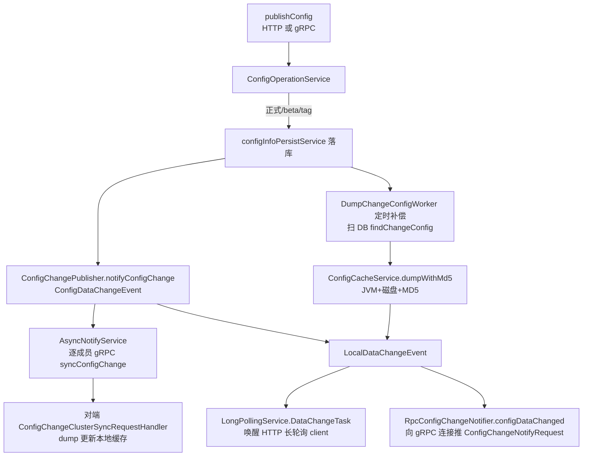

### 输入/输出表

| 环节 | 输入 | 输出 |
|---|---|---|
| `ConfigControllerV3.publishConfig` | `ConfigFormV3` + betaIps/casMd5 头 | 布尔成功 |
| `ConfigCacheService.dumpWithMd5` | dataId/group/tenant/content/md5/ts | JVM CACHE + 磁盘 + 可选 `LocalDataChangeEvent` |
| `LongPollingService.addLongPollingClient` | 客户端 md5 map | 变更 groupKey 列表 or 空（30s 后） |
| `AsyncNotifyService` | `ConfigDataChangeEvent` | 逐成员 `ConfigChangeClusterSyncRequest` |
| `DumpChangeConfigWorker` | startTime + 游标 | 本地缓存与 DB 对齐 |
| `ConfigChangeBatchListenRequestHandler` | 监听项 + md5 | 不一致的配置列表（立即） |

### 端到端演算 ②：一次配置发布到长轮询客户端收到变更

场景：3 节点集群（A/B/C，外部 MySQL），客户端 Z 用 **HTTP 长轮询**监听 `order-service.yaml`，发布者 P 向 A 发布新内容。

1. **发布**：P → A 的 `ConfigControllerV3.publishConfig` → `ConfigOperationService.publishConfig` 正式路 → `configInfoPersistService.addConfigInfo` 写 MySQL（带 `lastModifiedTs`）；
2. **本机缓存更新**：`ConfigChangePublisher.notifyConfigChange` 发 `ConfigDataChangeEvent` → A 的订阅者 `ConfigCacheService.dumpWithMd5`（经 dump 链路）把新内容 + 新 md5 写入 JVM CACHE 与磁盘，md5 真变 → 发 `LocalDataChangeEvent`；
3. **本机长轮询唤醒**：A 上挂着 Z 的 `ClientLongPolling`（在 `allSubs` 里），`DataChangeTask` 遍历发现监听该 groupKey → 移出队列、`sendResponse` 返回变更的 groupKey 列表（`:287-300`）；
4. **Z 的下一轮**：Z 收到非空响应 → 立即用 `getConfig` 拉全量新内容 → `CacheData.checkListenerMd5` 发现 md5 与 `lastCallMd5` 不同 → `safeNotifyListener` 触发用户 `Listener`（`CacheData.java:346-352`）；
5. **通知 B/C**：`AsyncNotifyService` 同时（步骤 2 的事件）对 B、C 各发 gRPC `ConfigChangeClusterSyncRequest`；B/C 收到后触发本机 dump 更新本地 CACHE——**B/C 上监听该配置的长轮询客户端也在各自节点被唤醒**（Z 若连 B 则走 B 的 `DataChangeTask`）；
6. **兜底**：若 B 不在线没收到通知，B 恢复后 `DumpChangeConfigWorker` 下一轮 `findChangeConfig` 会按 `lastModified` 扫到该变更并 dump（`DumpChangeConfigWorker.java:116-145`）——**轮询补偿保证最终一致**；
7. **gRPC 客户端对照**：若 Z 用 2.x/3.x SDK（gRPC），则步骤 3 换成：Z 发 `ConfigBatchListenRequest` 进 `ConfigChangeListenContext`，A 的 `RpcConfigChangeNotifier` 向 Z 的连接推 `ConfigChangeNotifyRequest`（只带 key），Z 的 `ClientWorker.handleConfigChangeNotifyRequest`（`ClientWorker.java:770-790`）置 `receiveNotifyChanged=true` 并敲响监听铃，下一轮 `executeConfigListen` 对比 md5 后拉取。

### 第三讲小结：内容落库、缓存双层、通知三路、补偿兜底

**一句话定位**：config 把"发布"拆成落库（事实源）+ JVM 缓存（读热点）+ 磁盘 dump（重启恢复）三层，变更以 `ConfigDataChangeEvent` 为轴同时驱动本机长轮询唤醒、本机 gRPC 主动推送、他机 gRPC 通知三条路径，再用定时轮询 DB 的 `DumpChangeConfigWorker` 补偿一切漏网之问。

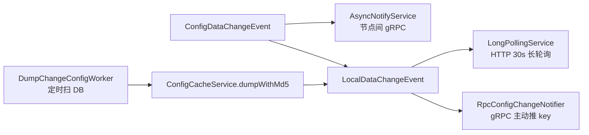

**config 核心的输入/输出**：

| 机制 | 输入 | 输出 |
|---|---|---|
| `ConfigCacheService` | content + md5 + ts | CACHE + 磁盘 + 事件 |
| `LongPollingService` | 客户端 md5 map | 变更 key 列表（instant/in-advance/timeout） |
| `AsyncNotifyService` | 成员列表 | 逐成员 RPC + 平方退避重试 |
| `DumpChangeConfigWorker` | DB 变更扫描 | 本地缓存对齐 |
| `ConfigChangeListenContext` | 连接 + md5 | 双向索引 + 即时不一致响应 |

**三个最值得记住的点**：

1. **md5 是唯一变更标尺**：缓存、长轮询、gRPC 监听、灰度匹配全部围绕 md5 比较；md5 不变即使时间戳变也不发 `LocalDataChangeEvent`（`ConfigCacheService.java:389-395`）——没有"假变更"；
2. **长轮询 30s 但服务端提前 500ms 返回**：`timeout = max(10000, 客户端值 - 500)`（`LongPollingService.java:215-222`），且超时由服务端自管理（`setTimeout(0L)`）；连接超限返回 503 且延迟随机 1-3s，防惊群；
3. **通知不可靠，补偿才可靠**：节点间通知失败只做平方退避重试（最多约 500+36×1000ms 量级），真正的最终一致靠 `DumpChangeConfigWorker` 定时扫库；内嵌存储 + 集群模式直接不发节点间通知（`ConfigChangePublisher.java:37-39`），因为内嵌库没有跨节点共享语义。

---

## 第四讲：一致性协议 —— AP（distro）与 CP（JRaft）双轨制

### 定位

Nacos 集群把数据按"重要性"分流到两套协议：**临时实例（ephemeral）走 AP**——distro 协议，最终一致、可丢、追求高可用；**持久实例（以及内嵌 Derby 模式下的配置数据）走 CP**——JRaft，强一致、选主、日志复制。分流的总闸是 `ProtocolManager`，而"哪种数据走哪条路"的判决写在业务服务的写方法里（`EphemeralClientOperationServiceImpl` vs `PersistentClientOperationServiceImpl`/`EmbeddedDumpService`）。本讲读 `consistency/` 模块的协议抽象与 `core/distributed/` 的两个实现。

### 目录结构：一致性层的树

```
consistency/src/main/java/com/alibaba/nacos/consistency/
├── ConsistencyProtocol.java        # 协议总接口（init/write/read/memberChange/shutdown）
├── Config.java                     # 协议配置（members 集合）
├── DataOperation.java              # ADD/CHANGE/DELETE/VERIFY/SNAPSHOT/QUERY
├── RequestProcessor.java           # 处理器总接口
├── ap/
│   ├── APProtocol.java             # AP 标记接口（无额外方法）
│   └── RequestProcessor4AP.java    # AP 侧处理器（onRequest/onApply）
├── cp/
│   ├── CPProtocol.java             # CP 标记接口 + isLeader(group)
│   └── RequestProcessor4CP.java    # CP 侧处理器
└── snapshot/                       # 快照序列化支撑

core/src/main/java/com/alibaba/nacos/core/distributed/
├── ProtocolManager.java            # 双协议懒加载 + 成员变更分发
├── ProtocolExecutor.java           # AP/CP 成员变更的单线程执行器
├── distro/                         # AP 实现（第二讲已详述同步链路）
│   ├── DistroProtocol.java
│   ├── task/{delay,load,verify,execute}/   # 延迟同步/全量加载/定期校验
│   └── component/                  # DistroDataProcessor/Storage/TransportAgent
└── raft/                           # CP 实现（JRaft 集成）
    ├── JRaftProtocol.java          # CPProtocol 实现
    ├── JRaftServer.java            # JRaft 服务器封装
    ├── NacosStateMachine.java      # 状态机：apply 日志
    └── JRaftMaintainService.java   # 运维指令（transfer leader 等）
```

### 逐文件精读

#### 1. 协议抽象：`consistency/` 包

`APProtocol`（`consistency/ap/APProtocol.java`，全文 31 行）只是个标记接口，`extends ConsistencyProtocol<C, P>`，无任何额外方法——AP 的能力全部由实现类（distro）自己定义。`CPProtocol`（`consistency/cp/CPProtocol.java:37-39`）比 AP 多一个 `boolean isLeader(String group)`：CP 语义必须能回答"这个组我现在是不是主"，这是重定向/拒绝写的基础。

`DataOperation` 枚举（`consistency/DataOperation.java`）被两条协议共用：`ADD/CHANGE/DELETE/VERIFY/SNAPSHOT/QUERY`——注意 distro 的六种数据操作与 CP 的写操作共用同一套词汇，但语义完全不同（distro 是"广播意图"，CP 是"日志条目类型"）。

#### 2. 总闸：`core/distributed/ProtocolManager.java`

`ProtocolManager`（`ProtocolManager.java:47`）同时监听成员变更（构造时 `NotifyCenter.registerSubscriber(this)`，`:65-68`），并以**双检锁懒加载**两个协议：

- `getCpProtocol()`（`:86-96`）/`getApProtocol()`（`:98-108`）：首次调用才 `initCPProtocol`/`initAPProtocol`——**不用的协议绝不启动**（纯 config 部署不会拉起 JRaftServer）；
- `initCPProtocol`（`:139-147`）：反射解析协议实现类的泛型拿到 `RaftConfig`，注入成员列表后 `protocol.init(config)`；
- `injectMembers4CP`（`:149-155`）：成员地址带 **Raft 端口**（`MemberUtil.calculateRaftPort`），而 `injectMembers4AP`（`:157-161`）用普通 `ip:port`——**同一个集群，两套端口语义**；
- `onEvent(MembersChangeEvent)`（`:163-181`）：把成员变化同时翻译成两份（AP 用 address，CP 用 ip:raftPort），经 `ProtocolExecutor.apMemberChange/cpMemberChange`（`ProtocolExecutor.java:37-41`）单线程串行执行——注释明确说"不同协议的节点变更不应互相阻塞，用单线程池串行通知一致性层"；
- `destroy()`（`:118-127`）：停机时先 AP 后 CP  shutdown。

#### 3. CP 实现：`core/distributed/raft/JRaftProtocol.java`

`JRaftProtocol`（`JRaftProtocol.java:95-96`）`extends AbstractConsistencyProtocol<RaftConfig, RequestProcessor4CP> implements CPProtocol`：

- `init`（`:120-166`）：CAS 保证只初始化一次；`raftServer.init/start` 后注册 `RaftEvent` 订阅——**每次 leader/term 变化都把元数据（leader、term、raft 组成员、错误信息）写进协议 metadata 并 `injectProtocolMetaData` 更新到成员列表**（`:144-156`），这就是控制台上能看到每个节点的 raft 角色的来源；
- `addRequestProcessors`（`:169-171`）：`raftServer.createMultiRaftGroup(processors)`——**一个进程多 Raft group**，naming 持久实例、config 元数据各占一个 group；
- `write`（`:185-189`）/`writeAsync`（`:192-194`）：`raftServer.commit(group, request, future)`，同步写**等 10 秒**（`:188`）；
- `getData/aGetData`（`:174-182`）：读走 `raftServer.get(request)`，同步读等 5 秒；
- `isLeader`（`:227-232`）：`node.isLeader()`；
- `memberChange`（`:196-205`）：`raftServer.peerChange` 变更组成员，**失败重试 5 次、每次睡 100ms**，仍失败只 warn 不抛。

#### 4. CP 的业务落点：`naming/core/v2/service/impl/PersistentClientOperationServiceImpl.java`

这个类一身三职：`extends RequestProcessor4CP implements ClientOperationService`（`PersistentClientOperationServiceImpl.java:85-86`）。构造时（`:100-104`）从 `ProtocolManager` 拿 CP 协议并**把自己注册为请求处理器**。

写路径（`registerInstance`，`:106-131`）：

```java
final InstanceStoreRequest request = new InstanceStoreRequest(); // service+instance+clientId
final WriteRequest writeRequest = WriteRequest.newBuilder().setGroup(group())
        .setData(ByteString.copyFrom(serializer.serialize(request)))
        .setOperation(DataOperation.ADD.name()).build();
protocol.write(writeRequest);   // 阻塞至 Raft 提交（最长 10s）
```

读路径（`onApply`，`:200-240`）是**状态机回调**：leader 把日志 apply 到本机时按 `DataOperation` 分派——ADD/CHANGE → `onInstanceRegister`（写 `PersistentIpPortClientManager` 的 client 发布表 + 发与临时实例相同的事件，`:240-258`），DELETE → `onInstanceDeregister`。注意 `subscribeService` 直接抛 `UnsupportedOperationException("No persistent subscribers")`（`:186-188`）——**持久实例没有订阅者概念**，订阅推送是临时实例专属。

#### 5. CP 的第二个业务落点：内嵌存储的 config

除 naming 持久实例外，config 在内嵌 Derby（Derby + Raft）模式下也复用 CP：`EmbeddedDumpService.canExecute`（`config/src/main/java/com/alibaba/nacos/config/server/service/dump/EmbeddedDumpService.java:178-183`）先问 `protocol.isLeader(PersistenceConstant.CONFIG_MODEL_RAFT_GROUP)`——**只有 Raft leader 执行 dump 写本地 Derby**，其余节点等 leader 通过 Raft 复制数据；`init`（`:88-110`）监听 leader 元数据变化触发 dump。这正是 `ConfigChangePublisher` 在内嵌存储 + 集群时丢弃通知的原因（第三讲）：数据走 Raft，不走事件通知。

#### 6. AP 侧的对照（回指第二讲）

AP 没有 leader、没有日志：`DistroProtocol.sync`（`core/distributed/distro/DistroProtocol.java:107-122`）对每个成员建延迟任务；`DistroVerifyTimedTask`（`task/verify/DistroVerifyTimedTask.java:52-85`）定期对每种数据存储发 VERIFY；`DistroLoadDataTask`（`task/load/DistroLoadDataTask.java:62-113`）启动时向责任节点拉 SNAPSHOT 全量。**AP 的"一致性"= 延迟同步 + 定期校验 + 快照补齐三板斧**，没有任何强一致保证。

### 关键图：一次持久实例注册的 CP 链路 vs 临时实例的 AP 链路

```mermaid
flowchart TD
    subgraph EPHEMERAL["AP：临时实例"]
        E1["registerInstance<br/>ephemeral=true"] --> E2["EphemeralClientOperationServiceImpl<br/>直接写本机 publishers"]
        E2 --> E3["ClientChangedEvent"]
        E3 --> E4["DistroProtocol.sync(CHANGE)<br/>异步延迟广播"]
        E4 --> E5["对端 onReceive → processData<br/>镜像数据"]
    end
    subgraph PERSIST["CP：持久实例"]
        P1["registerInstance<br/>ephemeral=false"] --> P2["PersistentClientOperationServiceImpl<br/>构造 InstanceStoreRequest"]
        P2 --> P3["protocol.write(WriteRequest)<br/>JRaft commit，最长等 10s"]
        P3 --> P4["leader 复制日志到 follower"]
        P4 --> P5["各节点 NacosStateMachine.onApply<br/>状态机回放"]
        P5 --> P6["onInstanceRegister<br/>写本机 publishers + 发事件"]
    end
```

### 输入/输出表

| 组件 | 输入 | 输出 |
|---|---|---|
| `ProtocolManager.getCpProtocol` | 首次调用触发 | 初始化后的 CP 协议（懒加载） |
| `injectMembers4CP` | `ServerMemberManager.allMembers()` | `ip:raftPort` 集合 |
| `JRaftProtocol.write` | `WriteRequest(group, data, operation)` | `Response`（提交结果） |
| `PersistentClientOperationServiceImpl.onApply` | Raft 日志条目 | 本机 client 数据 + 事件 |
| `DistroProtocol.sync` | `DistroKey + DataOperation` | 每目标一个 `DistroDelayTask` |
| `DistroVerifyTimedTask.run` | 数据存储类型列表 | 每成员一个 `DistroVerifyExecuteTask` |

### 端到端演算：持久实例在 3 节点集群的注册

1. 客户端带 `ephemeral=false` 注册到节点 B → `ClientOperationServiceProxy` 路由到 `PersistentClientOperationServiceImpl.registerInstance`（`PersistentClientOperationServiceImpl.java:106`）；
2. 构造 `InstanceStoreRequest` 序列化进 `WriteRequest`（group = 持久实例的 raft 组名），调 `protocol.write`；
3. `JRaftProtocol.writeAsync` → `raftServer.commit`：B 是 follower 则转发给 leader（假设是 A）；
4. A 的 JRaft 把日志持久化并复制到 B、C，**多数派（2/3）确认即提交**；
5. 三台机器的 `NacosStateMachine` 按日志顺序 `onApply` → `onInstanceRegister` 各自写入本机 `PersistentIpPortClientManager`，发 `ClientRegisterServiceEvent`；
6. 写调用在 A 提交后返回，调用方收到成功；此时三台机器数据**强一致**；
7. 若 A 宕机，JRaft 在 B/C 中选出新 leader（term+1），`RaftEvent` 订阅者更新各节点协议元数据（`JRaftProtocol.java:144-156`），未提交的日志由新 leader 决策——**可能有已返回成功的写在新 leader 上被截断（Raft 的线性一致边界）**，但所有节点看到的已提交日志一致。

### 第四讲小结：一份数据两条轨道，临时广播、持久选举

**一句话定位**：`ProtocolManager` 用懒加载管住 AP/CP 两套协议的生命周期，临时实例（ephemeral）写进本机即成功、靠 distro 延迟广播 + 定期校验 + 快照补齐最终一致；持久实例（及内嵌 Derby 模式下的配置数据）经 `JRaftProtocol` 走 Raft 日志复制，多数派提交才返回，`onApply` 在各机器上以相同顺序回放——**业务类自己决定数据进哪条轨道**（`EphemeralClientOperationServiceImpl` vs `PersistentClientOperationServiceImpl`/`EmbeddedDumpService`）。

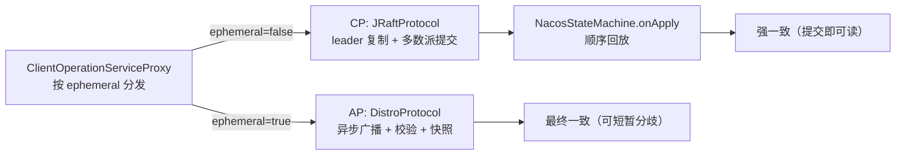

**一致性层的输入/输出**：

| 协议 | 输入 | 输出 | 一致性 |
|---|---|---|---|
| AP（distro） | `DistroKey + DataOperation` | 延迟任务广播 | 最终一致 |
| CP（JRaft） | `WriteRequest` | `Response`（阻塞≤10s） | 强一致（线性） |
| `ProtocolManager` | 成员变更事件 | AP/CP 各自成员视图 | — |
| `JRaftProtocol.init` | `RaftConfig` | raftServer + 元数据订阅 | — |

**三个最值得记住的点**：

1. **两套端口语义**：AP 成员是 `ip:port`，CP 成员是 `ip:raftPort`（`MemberUtil.calculateRaftPort`）——同一个集群在一致性层有两张成员表（`ProtocolManager.java:149-161`）；
2. **CP 的读写不对称**：写必须经 leader 且最长阻塞 10s（`JRaftProtocol.java:188`），读也有 5s 超时（`:176`），而 AP 写本机立即返回——**这就是"临时实例高可用、持久实例强一致"的工程代价**；
3. **懒加载是部署裁剪的关键**：`getCpProtocol()` 首次调用才初始化（`ProtocolManager.java:86-96`），纯 config 集群不会白白启动 JRaftServer；同理 standalone 下 distro 直接短路（`DistroProtocol.java:63-70`）。

---

## 第五讲：客户端 SDK —— Naming/Config 双客户端的韧性设计

### 定位

客户端 SDK（`client/` 模块）是普通 Java 应用接触 Nacos 的门面：`NacosNamingService` 与 `NacosConfigService`。3.x SDK 的骨架与 2.x 一脉相承，但连接层全面 gRPC 化（`nacos.client.naming.remote.gprc` 注意目录名拼写就是 `gprc`），并新增了 fuzzy watch 能力。本讲聚焦三个韧性设计：**注册重放（redo）**、**故障转移文件（failover）**、**长轮询监听环**。

### 目录结构：client SDK 的树（只列主路径）

```
client/src/main/java/com/alibaba/nacos/client/
├── naming/
│   ├── NacosNamingService.java            # 门面：注册/心跳/订阅/查询
│   ├── core/ServiceInfoHolder.java        # 本地服务信息缓存（旧 HostReactor 演进）
│   ├── backups/FailoverReactor.java       # 故障转移：读 failover 文件
│   ├── remote/NamingClientProxyDelegate.java # gRPC/HTTP 代理选择
│   └── remote/gprc/
│       ├── NamingGrpcClientProxy.java     # gRPC 代理：注册/订阅/推送处理
│       └── redo/NamingGrpcRedoService.java # 断线重放：注册/订阅缓存
├── config/
│   ├── NacosConfigService.java            # 门面：getConfig/addListener
│   └── impl/
│       ├── ClientWorker.java              # 监听引擎（内部类 ConfigRpcTransportClient）
│       ├── CacheData.java                 # 单配置缓存（content+md5+listeners）
│       ├── LocalConfigInfoProcessor.java  # snapshot/failover 本地文件
│       └── ConfigServerListManager.java   # 服务器列表（含地址刷新）
└── security/SecurityProxy.java            # 登录 token 管理
```

### 逐文件精读

#### 1. Naming 门面：`naming/NacosNamingService.java`

构造器（`NacosNamingService.java:106-136`）装配四件套：`InstancesChangeNotifier`（事件范围 UUID）、`ServiceInfoHolder`（本地缓存）、`NamingFuzzyWatchServiceListHolder`（模糊监听）、`NamingClientProxyDelegate`（代理）。`registerInstance(serviceName, groupName, instance)`（`:179-184`）只做三件事：合法性检查 → 剥离 group 前缀 → `clientProxy.registerService(...)`。**门面极薄，逻辑全在代理层**。

#### 2. gRPC 代理与重放：`remote/gprc/`

`NamingGrpcClientProxy.start`（`NamingGrpcClientProxy.java:127-139`）启动 `rpcClient`（gRPC 连接）与 fuzzy watch holder，并把 `NamingGrpcRedoService` 注册为连接监听器（`:134`）。`registerServiceForEphemeral`（`:166-176`）先 `redoService.cacheInstanceForRedo(...)` 再发请求——**先缓存意图，再执行**。

`NamingGrpcRedoService`（`redo/NamingGrpcRedoService.java`）是韧性核心，实现 `ConnectionEventListener`（`:52`）：

- `onConnected`（`:99-103`）：置 connected=true；
- `onDisConnect`（`:105-119`）：**把所有注册实例与订阅的 `registered` 标记置 false**（"mark to redo"），模糊监听重置一致性状态；
- `cacheInstanceForRedo`（`:129-137`）：按 `serviceName@@group` 为 key 存 `InstanceRedoData`；
- `instanceRegistered`（`:160-169`）：请求成功后 `redoData.registered()` 标记完成。

重放定时器（`RedoScheduledTask`）周期性扫描 `!isRegistered()` 的条目重新发起注册——**断线期间的注册意图不丢，重连即补**。

#### 3. 故障转移：`naming/backups/FailoverReactor.java`

`FailoverReactor`（`FailoverReactor.java:52`）单线程定时器每 5s 跑 `FailoverSwitchRefresher`（`:88-91`）：

- 读 `failoverDataSource.getSwitch()`，开关关 → 若之前在 failover 状态，则用 `ServiceInfoHolder` 的真实数据 diff 后发 `InstancesChangeEvent` 通知回切（`:134-154`）；
- 开关开 → 读 failover 文件数据，与服务缓存 diff，有变化发事件（`:106-131`）；
- 数据源经 `NacosServiceLoader.load(FailoverDataSource.class)` SPI 加载（`:72-78`）。

即：**运维在客户端机器的 `failover` 目录放一个开关文件 + 服务数据文件，客户端就整体切到本地数据**，Nacos 挂了也能发现（代价是数据静态）。

#### 4. Config 门面与 ClientWorker：`config/`

`NacosConfigService` 构造器（`NacosConfigService.java:73-89`）：校验参数 → `ConfigServerListManager`（服务器列表）→ `ClientWorker`。`ClientWorker` 构造（`ClientWorker.java:546-562`）创建 `ConfigRpcTransportClient` 并 `start()`。

`ConfigRpcTransportClient`（`ClientWorker.java:674-691`）是配置客户端的监听引擎，内部类结构：

- `listenExecutebell`（`:680`）：容量 1 的队列作"警铃"；
- `startInternal`（`:895-918`）：单线程循环 `poll(5s)` → `executeConfigListen()`；
- `executeConfigListen`（`:931-984`）：对每个 `CacheData` 先 `checkLocalConfig`（本地 failover 文件优先，`:992-1038`）→ 一致且未到全量同步周期（3min，`:691`）则跳过 → 否则按 taskId 分组；
- `checkListenCache`（`:1145-1238`）：对每组发 `ConfigBatchListenRequest`（`listen=true`），响应里的 `changedConfigs` 逐条 `refreshContentAndCheck`（查询新内容 + `checkListenerMd5`）；被服务端主动 push 过的（`receiveNotifyChanged`）也刷新；`hasChangedKeys` 则再敲铃立即下一轮（`:980-982`）；
- `handleConfigChangeNotifyRequest`（`:770-790`）：**服务端主动推送到达**（gRPC 双流），只置 `receiveNotifyChanged=true` + `setConsistentWithServer(false)` + 敲铃——**推送只带 key 不带内容，内容总是客户端来拉**。

#### 5. 单配置缓存：`config/impl/CacheData.java`

`CacheData`（`CacheData.java`）持有 `dataId/group/tenant/content/md5/type/encryptedDataKey` + `listeners`（`ManagerListenerWrap` 列表，每个 wrap 记 `lastCallMd5`）。`checkListenerMd5`（`:346-352`）：

```java
for (ManagerListenerWrap wrap : listeners) {
    if (!md5.equals(wrap.lastCallMd5)) {
        safeNotifyListener(...);   // md5 与上次通知不同才回调
    }
}
```

`safeNotifyListener`（`:426-527`）异步执行用户 Listener（用户有 executor 则用用户的），带超时看门狗（`LongNotifyHandler`），`AbstractConfigChangeListener` 额外收到 diff 后的 `ConfigChangeEvent`。**"每个 listener 记住自己上次被通知的 md5"**——同一进程多个 listener、不同订阅时机都能精确去重。

#### 6. 本地文件：`config/impl/LocalConfigInfoProcessor.java`

`LOCAL_SNAPSHOT_PATH`（`:45`）是 snapshot 根目录；`getFailoverFile`（`:198`）/`getSnapshotFile`（`:211`）按 `serverName/dataId/group/tenant` 组织。snapshot 是**最近一次成功拉取的配置内容**（启动时兜底），failover 是**运维下发的覆盖数据**（优先级高于服务端，见 `ClientWorker.checkLocalConfig` `:1002-1013`）。

#### 7. 登录态：`security/SecurityProxy.java`

`login(Properties)`（`SecurityProxy.java:80-86`）调 `clientAuthService.login` 拿 `LoginIdentityContext`，之后每个请求头带上 token（`:99-102`）；token 过期前定时 `login` 刷新（`:114-126`）。auth 开关关闭时整段短路，对业务透明。

### 关键图：客户端的韧性三件套

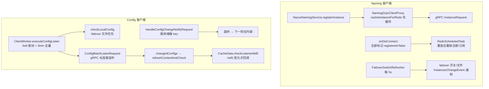

### 输入/输出表

| 组件 | 输入 | 输出 |
|---|---|---|
| `NacosNamingService` | serviceName/group/instance | 代理调用 |
| `NamingGrpcRedoService` | 断线事件 | 全部重放标记 |
| `FailoverReactor` | failover 开关 + 文件 | `InstancesChangeEvent` |
| `ClientWorker.executeConfigListen` | bell / 5s 轮询 | 分组监听请求 |
| `CacheData.checkListenerMd5` | 新 content + md5 | Listener 回调（去重） |
| `LocalConfigInfoProcessor` | snapshot/failover 文件 | 本地内容 |

### 端到端演算：gRPC 断线恢复中的注册不丢

1. 客户端 X 调 `registerInstance("order-service", instance)` → `NacosGrpcClientProxy.registerServiceForEphemeral` → `redoService.cacheInstanceForRedo` 存 `InstanceRedoData(registered=false)` → 发 gRPC `InstanceRequest` → 成功回调 `instanceRegistered` 置 true；
2. 网络抖动，gRPC 连接断开 → `NamingGrpcRedoService.onDisConnect` 把所有 redo 数据（包括订阅 `SubscriberRedoData`）`setRegistered(false)`；
3. `RedoScheduledTask` 到点发现未注册条目 → 重连成功后逐条重发 `InstanceRequest`（注册）+ `InstanceRequest`（订阅）；
4. 服务端侧（第二讲）：重连后 clientId 不变（仍以 `ip:port$ephemeral` 计），若数据未过期则 `addServiceInstance` 幂等覆盖；若已过期被 `ExpiredClientCleaner` 回收，则重连的 `clientConnected` 重建 client，重放的注册把数据补回；
5. 若客户端配了 failover 文件且打开开关，`FailoverReactor` 每 5s 用文件数据发事件，`selectInstances` 直接返回本地列表——**Nacos 全程不可用也能启动**。

### 第五讲小结：先缓存意图再执行，push 只敲门、内容自己拉

**一句话定位**：3.x 客户端把"意图"与"执行"分离——注册/订阅先入 redo 缓存再发 gRPC，断线全部标记重放；配置监听用"bell + 5s 轮询 + 3min 全量"三速引擎，服务端推送只带 key（敲门），内容永远是客户端主动拉；本地 snapshot/failover 文件构成最后一道兜底，md5 差值是 listener 去重的唯一标尺。

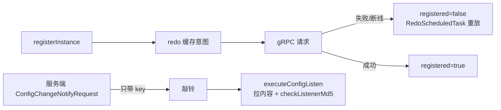

**客户端韧性的输入/输出**：

| 机制 | 输入 | 输出 |
|---|---|---|
| `NamingGrpcRedoService` | 连接事件 + 注册意图 | 重放集合 |
| `FailoverReactor` | failover 文件 | 本地服务列表事件 |
| `ClientWorker` | bell + 定时 | 分组监听请求 |
| `CacheData` | 新 content | 去重后的 listener 回调 |
| `LocalConfigInfoProcessor` | 本地文件 | snapshot/failover 内容 |

**三个最值得记住的点**：

1. **redo 模式是"意图持久化"的轻量版**：注册先进 `registeredInstances` map 再执行，断线统一置 false 重放——服务端幂等（`addServiceInstance` 覆盖语义）使重放安全；
2. **配置推送不带内容**：`ConfigChangeNotifyRequest` 只有 dataId/group/tenant（`RpcConfigChangeNotifier.java:107-108`），客户端必须回查——避免了"推送大配置把双流打满"；
3. **failover > snapshot > 服务端**：`checkLocalConfig`（`ClientWorker.java:1002-1013`）优先用 failover 文件，文件删除才回服务端；snapshot 只在启动取不到服务端数据时兜底——本地文件优先级是设计出来的降级链。

---

## 附：学习路线与复习卡汇总

### 推荐阅读顺序（由浅入深）

| 阶段 | 内容 | 建议时长 |
|---|---|---|
| 1 | 跑起来建立体感：`./mvnw -pl distribution -am package` 后 `sh distribution/target/nacos-server-*/bin/startup.sh -m standalone`，开控制台看服务/配置列表 | 半天 |
| 2 | 第一讲：启动装配（bootstrap + core/listener/startup + sys/filter） | 1 天 |
| 3 | 第二讲前半：v2 数据模型（`core/v2/ServiceManager`、`pojo/Service`、`IpPortBasedClient`、`ServiceStorage`） | 1–2 天 |
| 4 | 第二讲后半：distro 同步与推送（`DistroMapper`、`DistroClientDataProcessor`、`push/v2/`、`healthcheck/`） | 2 天 |
| 5 | 第三讲：config 缓存与长轮询（`ConfigCacheService`、`LongPollingService`、`dump/`、`notify/`） | 2 天 |
| 6 | 第四讲：一致性协议（`consistency/` 抽象 + `ProtocolManager` + `JRaftProtocol` + distro 任务族） | 1–2 天 |
| 7 | 第五讲：客户端 SDK（`NacosNamingService`/`NacosConfigService` 门面 → redo/FailoverReactor/CacheData） | 2 天 |
| 8 | 端到端演算复盘：注册→distro→推送、发布→长轮询/gRPC 两条链路各画一遍时序图 | 1 天 |
| 9 | （深入方向）fuzzy watch（`NamingFuzzyWatch*` / `ConfigFuzzyWatch*`）、istio 同步、ai-registry 适配、lock 模块 | 深入方向 |

### 全链路复习卡

**启动装配（第一讲）：**

1. `NacosBootstrap` 按 `nacos.deployment.type`（MERGED/SERVER/CONSOLE）分阶段点亮 core（非 Web）→ web → console 父子上下文，AI Registry 按 `nacos.ai.*.enabled` 可选启动。
2. 旧统一入口 `Nacos.java` 已 `@Deprecated`，多上下文拆分是为了让 core/web/console 有独立生命周期与逆序停机（`NacosStartUpManager.getReverseStartedList`）。
3. 模块开关 = `NacosTypeExcludeFilter` + SPI `NacosPackageExcludeFilter` 按包前缀裁决，`functionMode` 决定加载哪些模块，不改 classpath。
4. standalone 是短路而非分支：`DistroProtocol` 直接 `isInitialized=true`，寻址用 `StandaloneMemberLookup`，全机单成员。
5. 集群寻址三选一：显式 `nacos.core.member.lookup.type` > 有 cluster.conf/成员列表（FILE_CONFIG）> ADDRESS_SERVER。

**naming 数据模型（第二讲前半）：**

6. 临时实例不存在"服务表"里，存在 `IpPortBasedClient.publishers`；`ServiceManager` 只维护 `Service`（namespace+group+name+ephemeral）单例。
7. `ephemeral` 是 Service 四元组的一等字段：同名服务的临时/持久实例是两个 key、两套存储、两条一致性轨道。
8. 读路径 `ServiceStorage.getPushData` 实时拼装 `ServiceInfo`，带 `serviceDataIndexes` 缓存兜底；批量注册 `BatchInstancePublishInfo` 在此展开。
9. 客户端标识 v2 是 `ip:port$ephemeral`（HTTP 管理面）或 gRPC 连接 ID（`meta.getConnectionId()`），clientId 是 distro 同步与责任判定的 key。
10. 默认 ephemeral=true（`SwitchDomain.java:107`）；心跳 5s（`SwitchDomain.java:47`）；空发布 30s（`DEFAULT_IP_DELETE_TIMEOUT`）、有心跳 3min（`DEFAULT_CLIENT_EXPIRED_TIME`）才回收客户端。
11. `ExpiredClientCleaner` 每 5s 扫全量 client；`isExpireClient` 是"空发布且超时"或"超过 3 分钟未更新"的组合条件。

**naming 同步与推送（第二讲后半）：**

12. `DistroMapper.healthyList` 全节点排序后取模（`distroHash(tag) % size`），责任判定 `responsible()` 在 standalone/distro 关闭时直接返回 true。
13. distro 同步最小单元是"一个 client 的全部发布"（`ClientSyncData` 带 revision），只同步 ephemeral 且本机负责的 client；持久实例走 Raft。
14. 同步三板斧：变更即时 `sync`（延迟任务）→ 定期 `DistroVerifyTimedTask` 发 VERIFY（revision 不符即补发，延迟 0）→ 新节点 `DistroLoadDataTask` 拉 SNAPSHOT 全量。
15. 节点间 distro 走 gRPC `DistroDataRequest`（`DistroDataRequestHandler` 六种数据操作）；客户端推送走 `RpcPushService`。
16. 推送防抖：`ServiceChangedEvent` → `PushDelayTask` 默认 500ms 合并 → `NamingExecuteTaskDispatcher` 按 service 哈希并行执行；新订阅者只推自己。
17. **3.2.4 已无 UDP 推送**（3.2.0 移除，`InstanceOperatorClientImpl.java:201` 有 warn），也没有 `SocketAddrReplacementTask`；旧 HTTP 订阅者收不到推送。
18. 健康检查三前提：失败计数达 `checkTimes`、服务/实例开关打开、**本节点对该 client 负责**（`HealthCheckCommonV2.java:157-159`）；地址非法走 `checkFailNow` 跳过计数。

**config 中心（第三讲）：**

19. 发布三路分流：betaIps 非空 → beta 灰度（优先级 MAX）；tag 非空 → tag 灰度（MAX-1）；其余正式路（支持 casMd5 乐观锁，冲突抛 `RESOURCE_CONFLICT`）。
20. `ConfigCacheService.CACHE` 是 `groupKey → CacheItem`，`dumpWithMd5` 写缓存三板斧：时间戳旧则忽略、md5 变则写磁盘+更新+发事件、仅时间戳变则只更新时间。
21. md5 是唯一变更标尺：md5 不变不发 `LocalDataChangeEvent`，没有假变更；磁盘满直接 `EnvUtil.systemExit()` 保数据。
22. 长轮询：`allSubs`（ConcurrentLinkedQueue）持有 in-flight 客户端；立即比对有变秒回（instant），无变挂起至 `max(10s, 客户端值-500ms)`；超限延迟 1-3s 随机返回 503。
23. 超时自管理：`asyncContext.setTimeout(0L)`，到期由 `ClientLongPolling.run` 移出队列回空响应；`DataChangeTask` 负责变更唤醒。
24. 节点间通知 = `AsyncNotifyService` 逐成员 gRPC `syncConfigChange`，失败平方退避（`500 + failCount²×1000`，failCount 封顶 6）；内嵌存储+集群直接不发通知。
25. 最终一致靠 `DumpChangeConfigWorker` 定时扫 DB（删除/变更两路游标分页）补偿本地缓存，finally 自调度下一轮。
26. gRPC 客户端：`ConfigChangeBatchListenRequestHandler` 顺手做一次性 md5 比对直接返回不一致项；`ConfigChangeListenContext` 维护 connectionId↔groupKey 双向索引；`RpcConfigChangeNotifier` 推送只带 key。
27. 旧版 `ConfigChangeNotifier` 已不存在，职责由 `AsyncNotifyService` + `RpcConfigChangeNotifier` 分担。

**一致性协议（第四讲）：**

28. `ProtocolManager` 双检锁懒加载 AP/CP；成员变更经 `ProtocolExecutor` 单线程串行分发，AP 用 `ip:port`、CP 用 `ip:raftPort` 两套成员视图。
29. AP（distro）：无 leader 无日志，本机写即成功 + 延迟广播 + 定期校验 + 快照补齐 = 最终一致。
30. CP（JRaft）：`write` 经 leader 复制、多数派提交才返回（同步最长等 10s，读等 5s）；`NacosStateMachine.onApply` 按 `DataOperation` 顺序回放到本机。
31. `PersistentClientOperationServiceImpl` 一身三职（ClientOperationService + RequestProcessor4CP + 状态机回调）；持久实例无订阅概念（`subscribeService` 抛 UnsupportedOperation）。
32. Raft 事件驱动元数据更新：leader/term/组成员变化写进协议 metadata 并同步到成员列表，是控制台 raft 角色的数据源。

**客户端 SDK（第五讲）：**

33. Naming 门面极薄，逻辑在 `NamingClientProxyDelegate` → gRPC 代理；注册先 `cacheInstanceForRedo` 缓存意图再发请求。
34. 断线即重放：`NamingGrpcRedoService.onDisConnect` 把全部注册/订阅标记 `registered=false`，`RedoScheduledTask` 重连后重发；服务端 `addServiceInstance` 幂等使重放安全。
35. `FailoverReactor` 每 5s 读 failover 开关：开 → 用文件数据 diff 后发事件；关 → 用 `ServiceInfoHolder` 真实数据 diff 回切。
36. Config 监听三速引擎：bell 敲铃（即时）+ 5s 轮询 + 3min 全量同步；`checkListenCache` 分组发 `ConfigBatchListenRequest`，按需 `refreshContentAndCheck`。
37. 服务端推送只敲门：`ConfigChangeNotifyRequest` 只带 key，客户端置 `receiveNotifyChanged` 后自己拉内容，避免大配置打满双流。
38. `CacheData.checkListenerMd5` 按 listener 粒度去重（每个 wrap 记 `lastCallMd5`），`AbstractConfigChangeListener` 额外收到 diff 事件。
39. 本地文件优先级链：failover（运维覆盖）> 服务端；snapshot 仅启动兜底；文件删除自动回切服务端（`checkLocalConfig`）。
40. `SecurityProxy` 登录拿 token 后按请求头携带，过期前定时刷新；auth 关闭时全链路短路。

**跨讲串联：**

41. 三条主线一句话：注册数据 = 写 client 发布表 → 事件总线 → distro 广播/延迟推送；配置数据 = 落库 → dump 三层缓存 → 事件三路通知 + 轮询补偿；故障恢复 = 客户端 redo/failover + 服务端 verify/snapshot/dump 轮询。
42. 责任模型（`DistroMapper.responsible`）是 naming 集群的总开关：心跳、健康检查、distro 同步都先问它，非责任节点只镜像不决策。
43. 事件总线（`NotifyCenter`）是 naming 与 config 共同的中枢：client 事件→distro，service 事件→推送，config 事件→通知/唤醒——读源码时先画事件图再读代码会很快。
44. 3.2.4 三处硬变化：`NacosApplication`→`NacosBootstrap`、UDP 推送移除（gRPC 一统）、v2 模型迁入 `core/v2/`。

---

## 涉及文件索引

| 主题 | 文件 |
|---|---|
| 启动入口 | `bootstrap/src/main/java/com/alibaba/nacos/bootstrap/NacosBootstrap.java`, `server/src/main/java/com/alibaba/nacos/NacosServerBasicApplication.java`, `server/src/main/java/com/alibaba/nacos/NacosServerWebApplication.java`, `console/src/main/java/com/alibaba/nacos/console/NacosConsole.java` |
| 旧入口（已废弃） | `console/src/main/java/com/alibaba/nacos/Nacos.java` |
| 启动阶段 SPI | `core/src/main/java/com/alibaba/nacos/core/listener/startup/{NacosStartUp,NacosStartUpManager,AbstractNacosStartUp,NacosCoreStartUp,NacosWebStartUp}.java` |
| 模块开关过滤 | `sys/src/main/java/com/alibaba/nacos/sys/filter/{NacosTypeExcludeFilter,NacosPackageExcludeFilter}.java`, `naming/src/main/java/com/alibaba/nacos/naming/config/NamingEnabledFilter.java`, `config/src/main/java/com/alibaba/nacos/config/server/filter/ConfigEnabledFilter.java` |
| 模式判定与寻址 | `sys/src/main/java/com/alibaba/nacos/sys/env/EnvUtil.java`, `core/src/main/java/com/alibaba/nacos/core/cluster/lookup/{LookupFactory,StandaloneMemberLookup,FileConfigMemberLookup,AddressServerMemberLookup}.java` |
| naming 数据模型 | `naming/src/main/java/com/alibaba/nacos/naming/core/v2/{ServiceManager.java,pojo/Service.java,pojo/InstancePublishInfo.java,pojo/BatchInstancePublishInfo.java}`, `naming/src/main/java/com/alibaba/nacos/naming/core/v2/index/ServiceStorage.java`, `naming/src/main/java/com/alibaba/nacos/naming/core/v2/client/impl/IpPortBasedClient.java` |
| naming 写路径 | `naming/src/main/java/com/alibaba/nacos/naming/controllers/v3/InstanceControllerV3.java`, `naming/src/main/java/com/alibaba/nacos/naming/core/InstanceOperatorClientImpl.java`, `naming/src/main/java/com/alibaba/nacos/naming/core/v2/service/impl/EphemeralClientOperationServiceImpl.java` |
| naming gRPC 入口 | `naming/src/main/java/com/alibaba/nacos/naming/remote/rpc/handler/{InstanceRequestHandler,DistroDataRequestHandler,BatchInstanceRequestHandler,SubscribeServiceRequestHandler}.java` |
| distro 路由与同步 | `naming/src/main/java/com/alibaba/nacos/naming/core/DistroMapper.java`, `naming/src/main/java/com/alibaba/nacos/naming/consistency/ephemeral/distro/v2/DistroClientDataProcessor.java`, `core/src/main/java/com/alibaba/nacos/core/distributed/distro/DistroProtocol.java`, `core/src/main/java/com/alibaba/nacos/core/distributed/distro/task/{delay/DistroDelayTask.java,load/DistroLoadDataTask.java,verify/DistroVerifyTimedTask.java,execute/DistroSyncChangeTask.java}` |
| 推送 | `naming/src/main/java/com/alibaba/nacos/naming/push/v2/{NamingSubscriberServiceV2Impl.java,task/PushDelayTaskExecuteEngine.java,task/PushExecuteTask.java,executor/PushExecutorRpcImpl.java,PushConfig.java}`, `naming/src/main/java/com/alibaba/nacos/naming/constants/PushConstants.java` |
| 健康检查 | `naming/src/main/java/com/alibaba/nacos/naming/healthcheck/heartbeat/ClientBeatCheckTaskV2.java`, `naming/src/main/java/com/alibaba/nacos/naming/healthcheck/v2/processor/{HealthCheckProcessorV2Delegate,HealthCheckCommonV2}.java`, `naming/src/main/java/com/alibaba/nacos/naming/core/v2/client/manager/impl/EphemeralIpPortClientManager.java` |
| config 缓存与发布 | `config/src/main/java/com/alibaba/nacos/config/server/service/{ConfigCacheService,ConfigOperationService,ConfigChangePublisher}.java`, `config/src/main/java/com/alibaba/nacos/config/server/controller/v3/ConfigControllerV3.java` |
| config dump | `config/src/main/java/com/alibaba/nacos/config/server/service/dump/{DumpService,DumpChangeConfigWorker,EmbeddedDumpService,ExternalDumpService}.java` |
| config 通知 | `config/src/main/java/com/alibaba/nacos/config/server/service/notify/AsyncNotifyService.java`, `config/src/main/java/com/alibaba/nacos/config/server/service/LongPollingService.java`, `config/src/main/java/com/alibaba/nacos/config/server/remote/{ConfigChangeBatchListenRequestHandler,ConfigChangeListenContext,RpcConfigChangeNotifier,ConfigPublishRequestHandler}.java` |
| 一致性抽象 | `consistency/src/main/java/com/alibaba/nacos/consistency/{ConsistencyProtocol,Config,DataOperation,RequestProcessor}.java`, `consistency/src/main/java/com/alibaba/nacos/consistency/ap/APProtocol.java`, `consistency/src/main/java/com/alibaba/nacos/consistency/cp/CPProtocol.java` |
| 一致性实现 | `core/src/main/java/com/alibaba/nacos/core/distributed/{ProtocolManager,ProtocolExecutor,AbstractConsistencyProtocol}.java`, `core/src/main/java/com/alibaba/nacos/core/distributed/raft/{JRaftProtocol,JRaftServer,NacosStateMachine,JRaftMaintainService}.java`, `naming/src/main/java/com/alibaba/nacos/naming/core/v2/service/impl/PersistentClientOperationServiceImpl.java` |
| 客户端 naming | `client/src/main/java/com/alibaba/nacos/client/naming/NacosNamingService.java`, `client/src/main/java/com/alibaba/nacos/client/naming/core/ServiceInfoHolder.java`, `client/src/main/java/com/alibaba/nacos/client/naming/backups/FailoverReactor.java`, `client/src/main/java/com/alibaba/nacos/client/naming/remote/gprc/{NamingGrpcClientProxy.java,redo/NamingGrpcRedoService.java}` |
| 客户端 config | `client/src/main/java/com/alibaba/nacos/client/config/NacosConfigService.java`, `client/src/main/java/com/alibaba/nacos/client/config/impl/{ClientWorker,CacheData,LocalConfigInfoProcessor,ConfigServerListManager}.java` |
| 客户端安全 | `client/src/main/java/com/alibaba/nacos/client/security/SecurityProxy.java` |
