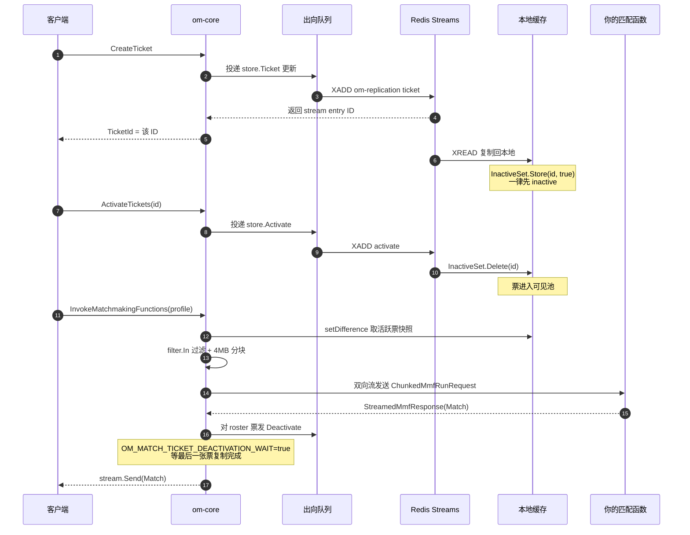
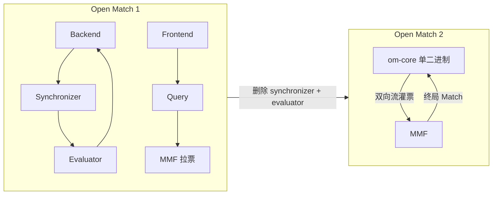
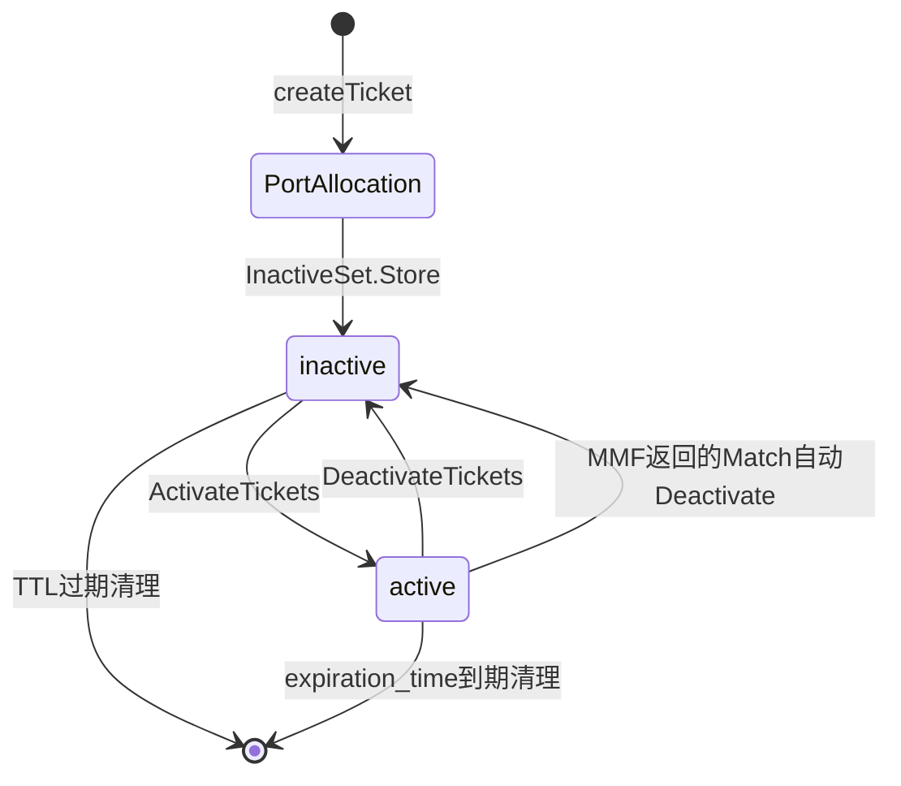
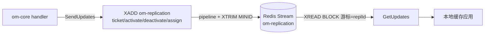
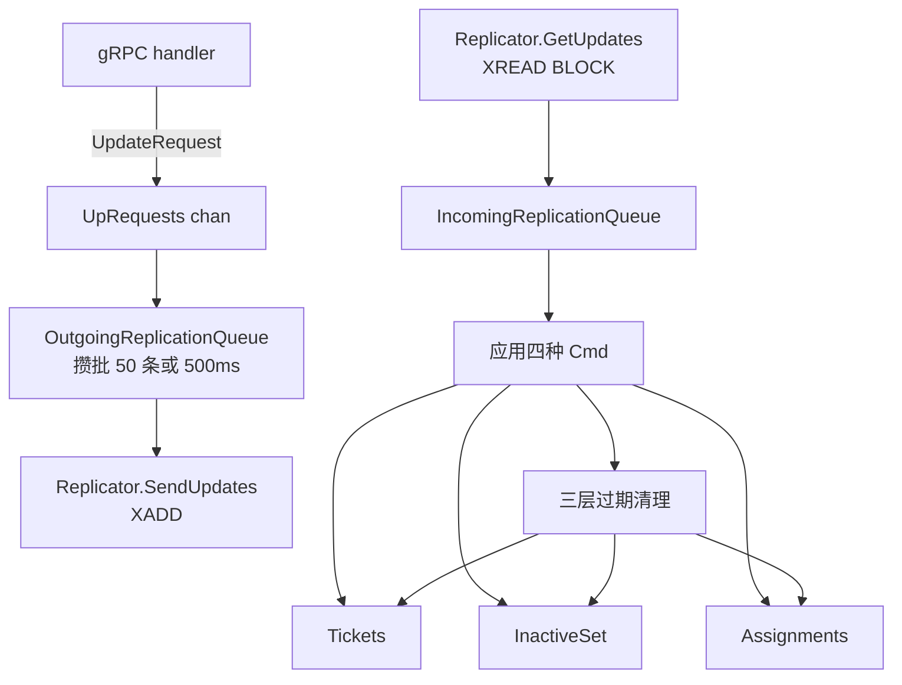
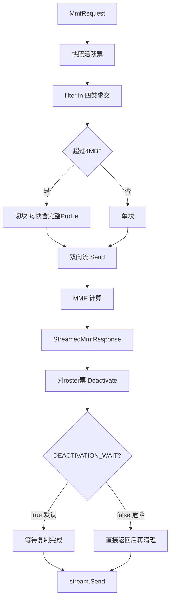
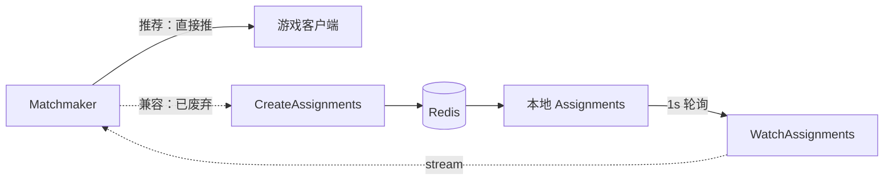

> **对象**：Open Match 2（`github.com/googleforgames/open-match2`）—— 开源游戏匹配框架的第二代精简实现
> **版本**：commit `ac392a0576ea65a73d17aa07090519efcdba99cd`（2026-01-05）
> **代码规模**：22 个 `.go` 文件，合计约 **8597 行**（另有 proto / docs / deploy 若干）
> **文档定位**：面向"要把 Open Match 跑起来并调得动"的工程师。全文逐文件精读，**所有结论标注 `路径:行号`**，可对照源码复验。
>
> ⚠️ **版本基准声明**：本仓库 HEAD 为 `ac392a0`，但采样时工作区有 2 个文件存在未提交修改（`main.go` 1402→1491 行、`internal/statestore/cache/replicatedticketcache.go` 456→461 行），且工作区版本存在重复声明（`MMFConnectionManager` 在 `main.go` 中出现两次）**无法编译**。
> **本文所有行号以 HEAD（`ac392a0`）为准**。读者若想按行号对照，请先执行：
> ```bash
> git checkout -- main.go internal/statestore/cache/replicatedticketcache.go
> ```
> 其余 20 个 `.go` 文件经确认工作区与 HEAD 完全一致，行号无歧义。
>
> 🔄 **2026-10-16 复核**：`git fetch origin` 后确认远端默认分支 `main` **仍停在 `ac392a0`，没有新提交**。但远端存在一个比 main 更新的**未合入分支** `origin/misc-fixes`（`66e7dd9`，2026-02-17，领先 main 4 个提交），其中 4 处改动正好修正了本文记录的若干行为（含一个真实的指标统计 bug 与一处 `time.Time` 误用）。
> 本文正文行号**仍以 `main`（`ac392a0`）为准**（可复现、可编译），上游这 4 处修复单独整理在文末 [附：上游待合入修复（`origin/misc-fixes`）](#附上游待合入修复originmisc-fixes)。

---

## 目录

- [〇、全景地图](#〇全景地图)
- [速览：各讲做了什么](#速览各讲做了什么先看这个再进细节)
- [面试速通：Open Match 高频问题一页纸](#面试速通open-match-高频问题一页纸)
- [第一讲：组件拓扑与进程模型 —— v2 到底砍了什么](#第一讲组件拓扑与进程模型--v2-到底砍了什么)
- [第二讲：Ticket 生命周期 —— 从创建到激活](#第二讲ticket-生命周期--从创建到激活)
- [第三讲：状态存储抽象 —— Redis Streams 是唯一的真相](#第三讲状态存储抽象--redis-streams-是唯一的真相)
- [第四讲：ReplicatedTicketCache —— 把读路径整个下沉到内存](#第四讲replicatedticketcache--把读路径整个下沉到内存)
- [第五讲：过滤与匹配编排 —— InvokeMatchmakingFunctions 全景](#第五讲过滤与匹配编排--invokematchmakingfunctions-全景)
- [第六讲：Assignment 下发、配置与可观测性](#第六讲assignment-下发配置与可观测性)
- [附：学习路线与复习卡汇总](#附学习路线与复习卡汇总)
- [涉及文件索引](#涉及文件索引)

---

## 〇、全景地图

### 先说人话：Open Match 是干什么的

多人游戏的服务器有两种：一种是"大厅服"，谁都能进；另一种是"对局服"，需要**把水平相近、延迟可接受、模式一致的玩家凑成一桌**，再给他们开一个专属的房间。

这个"凑一桌"的过程就叫 **Matchmaking（匹配）**。Open Match 做的事是：

1. 每个等待匹配的玩家（或队伍）抽象成一张 **Ticket（票）**，票上写着"我是什么段位 / 什么模式 / 我在哪个区"；
2. 匹配器告诉 Open Match："给我找出所有段位在 1500~1600、模式是 3v3 的票"（这叫 **Pool / 池**）；
3. Open Match 把这些票喂给你写的 **MMF（Match Making Function，匹配函数）**；
4. MMF 返回它认为合适的分组（**Match**），Open Match 把这些票从池里摘掉；
5. 匹配器拿到 Match，去开房间，把连接信息给玩家。

**v1 与 v2 的分水岭**：v1 是"微服务全家桶"（frontend / backend / query / synchronizer / evaluator / swaggerui / scale 七个进程），框架深度参与"谁和谁配"的裁决；**v2 把这些全砍了**，只剩一个二进制 `om-core`，它的职责止于"编排 MMF 并把结果流式吐回来"——**不再关心票是否被重复分配**。

### ASCII 全景图

```
   ┌──────────────┐        ┌──────────────────────────────────────┐
   │  游戏客户端   │        │         Matchmaker（你写的）           │
   └──────┬───────┘        └──────┬───────────────────────┬────────┘
          │ 1. 我要匹配            │ 3. 给我配一局           │ 6. 收到 Match
          │                       │                       │
          ▼                       ▼                       ▲
   ┌────────────────────────────────────────────────────────────────┐
   │                      om-core（单二进制）                        │
   │                                                                │
   │  ┌──────────────┐   ┌──────────────────────────────────────┐   │
   │  │ gRPC Server  │   │  ReplicatedTicketCache（本地全量副本） │   │
   │  │   :50581     │◄──┤   Tickets / InactiveSet / Assignments │   │
   │  ├──────────────┤   └────────▲──────────────┬───────────────┘   │
   │  │ grpc-gateway │            │ 入向          │ 出向              │
   │  │   :8080      │   ┌────────┴───────┐   ┌──▼───────────────┐   │
   │  └──────────────┘   │ IncomingQueue  │   │ OutgoingQueue    │   │
   │                     │  (XREAD BLOCK) │   │  (攒批 50/500ms) │   │
   │                     └────────▲───────┘   └──┬───────────────┘   │
   └──────────────────────────────┼──────────────┼───────────────────┘
                                  │              │
                          ┌───────┴──────────────▼───────┐
                          │  Redis Streams               │
                          │  om-replication              │
                          │  XADD / XREAD / XTRIM MINID  │
                          └──────────────────────────────┘
                                       ▲
                                       │ 4. 灌 tickets（4MB 分块双向流）
                                       │ 5. 返回 Match
                                  ┌────┴─────┐
                                  │   MMF     │（你写的匹配函数）
                                  └──────────┘
```

### mermaid 全景图

```mermaid
flowchart TB
    Client["游戏客户端/匹配器"] -->|"HTTP或gRPC"| GW["grpc-gateway :8080"]
    GW --> Core["om-core gRPC :50581"]
    Client -->|"直连gRPC"| Core

    Core --> CT["CreateTicket"]:::api
    Core --> AT["ActivateTickets"]:::api
    Core --> DT["DeactivateTickets"]:::api
    Core --> IMF["InvokeMatchmakingFunctions"]:::api
    Core --> CA["CreateAssignments 已废弃"]:::dep
    Core --> WA["WatchAssignments 已废弃"]:::dep

    CT --> Out["OutgoingReplicationQueue 攒批"]
    AT --> Out
    DT --> Out
    CA --> Out
    Out --> Redis[("Redis Streams<br/>om-replication")]

    Redis --> In["IncomingReplicationQueue XREAD BLOCK"]
    In --> Cache[("本地 ReplicatedTicketCache<br/>Tickets/InactiveSet/Assignments")]

    IMF --> Snap["setDifference 快照活跃票"]
    Cache --> Snap
    Snap --> Filter["filter.In 四类过滤器求交"]
    Filter --> Chunk["4MB 分块打包"]
    Chunk --> MMF["MMF 双向流"]
    MMF --> Match["收到 Match"]
    Match --> Deact["对roster票发 Deactivate"]
    Deact --> Out
    Match --> Stream["stream.Send 回匹配器"]

    classDef api fill:"#e3f2fd",stroke:"#1565c0",color:"#0d47a1"
    classDef dep fill:"#fbe9e7",stroke:"#c62828",color:"#b71c1c"
```

---

## 速览：各讲做了什么（先看这个再进细节）

| 讲 | 主题 | 一句话结论 | 关键文件 |
|----|------|-----------|---------|
| 一 | 组件拓扑与进程模型 | v2 从 7 个微服务收敛成**一个二进制 `om-core`**，删掉了 synchronizer 与 evaluator，唯一对外服务是 `OpenMatchService`（6 个 RPC，其中 2 个已废弃） | `main.go`、`server.go`、`proto/api.proto` |
| 二 | Ticket 生命周期 | Ticket **无 `assignment` 字段**；创建后**一律先 inactive**，必须显式 `ActivateTickets` 才进池；**Ticket ID = Redis Stream entry ID**，由存储层生成 | `main.go:190`、`replicatedticketcache.go:254` |
| 三 | 状态存储抽象 | 接口**只有 3 个方法**；v2 从 v1 的"sorted set + Lua"全面改用 **Redis Streams**（`XADD`/`XREAD BLOCK`/`XTRIM MINID`），源码中**没有任何 `EVAL`/`ZADD`** | `datatypes/store.go:56`、`redis/redis.go` |
| 四 | ReplicatedTicketCache | 每个实例本地持有**全量副本**，三个 `sync.Map`；读（尤其过滤）**完全打内存**，Redis 降级为"复制总线" | `cache/replicatedticketcache.go:60` |
| 五 | 过滤与匹配编排 | 过滤器是**自研四类硬编码求交**（不是 CEL）；pool 超过 **4MB 就分块**；MMF 结果里的票**自动 Deactivate**，默认要等复制完成才返回 Match | `filter/filter.go:52`、`main.go:665` |
| 六 | Assignment / 配置 / 观测 | Assignment **推荐由 matchmaker 自己做**；OM 提供的两个端点**已废弃**，且 `WatchAssignments` 内部是 **1 秒 sleep 轮询** | `main.go:1265`、`config/config.go` |

### 全流程图：一次完整匹配



---

## 面试速通：Open Match 高频问题一页纸

### 高频 Q&A（先结论）

| # | 问题 | 结论 |
|---|------|------|
| 1 | Open Match v2 和 v1 最大的区别？ | **v1 是微服务全家桶 + 框架裁决唯一性；v2 是单二进制 `om-core` + 不裁决**。v2 删掉了 `synchronizer` 和 `evaluator`（`docs/MIGRATION.md:45-49`），MMF 的产物从"提案"变成"终局 match"。 |
| 2 | v2 还有哪些服务？ | 只有**一个** `OpenMatchService`，6 个 RPC：`CreateTicket` / `DeactivateTickets` / `ActivateTickets` / `InvokeMatchmakingFunctions` / `CreateAssignments`（废弃）/ `WatchAssignments`（废弃）（`proto/api.proto:29-82`）。 |
| 3 | Ticket ID 谁生成？ | **存储层生成**，就是 Redis Stream 的 entry ID。这是贯穿性不变式：`replicatedticketcache.go:254` 才回填 `ticketPb.Id = curUpdate.Key`。 |
| 4 | 新创建的 Ticket 能立刻被匹配到吗？ | **不能。** 一律先进 `InactiveSet`（`replicatedticketcache.go:257`），必须 `ActivateTickets` 才进池。这保证"没成功复制并返回给客户端的票"永不被分配（`main.go:176-182`）。 |
| 5 | v2 用什么 Redis 数据结构？ | **Streams**。命令是 `XADD` / `XREAD BLOCK` / `XTRIM MINID`（`redis.go:365/538/447`）。**没有** v1 的 sorted set 和 Lua 脚本。 |
| 6 | 过滤器是 CEL 吗？ | **不是**。是自研的、基于 protobuf 字段的**四类固定过滤器求交集**：`TagPresent` / `StringEquals` / `DoubleRange` / `CreationTimeRange`（`filter.go:52-139`）。go.mod 里没有任何 CEL 依赖。 |
| 7 | 一次能过滤多少票？ | gRPC 单消息 4MB 上限，OM **不调大它**，而是把 participants **分块**，每块带完整 Profile、只有票列表不同（`main.go:670`）。 |
| 8 | 两个 MMF 返回了包含同一张票的 Match 会怎样？ | **OM 完全不介入**（"OM2 is no longer aware of ticket collisions"，`docs/MIGRATION.md:49`）。票会被 Deactivate 两次，冲突由开发者自己处理。 |
| 9 | Match 返回前要不要等票下线复制完成？ | 默认**要**（`OM_MATCH_TICKET_DEACTIVATION_WAIT=true`，`config.go:57`）。关掉会更快但可能重复分配。 |
| 10 | Assignment 怎么给客户端？ | **推荐 matchmaker 自己推**。OM 的 `CreateAssignments`/`WatchAssignments` 都是 DEPRECATED（`proto/api.proto:72-81`）。 |
| 11 | `WatchAssignments` 是长轮询还是事件驱动？ | **都不是**——是 server-streaming 接口 + 内部**每票一个 goroutine + `time.Sleep(1s)` 死循环轮询**（`main.go:1282-1298`）。代码自己承认 naive（`main.go:1318`）。 |
| 12 | v2 怎么保证读性能？ | 每个实例内存持有**全量** ticket 副本，过滤/快照全走内存；Redis 只做复制总线。Redis 读端点还能挂只读副本横向扩展。 |
| 13 | v2 能删 Ticket 吗？ | **没有删除 API**。靠 TTL + deactivate 惰性清理（`main.go:342-343` 注释）。 |
| 14 | 本地开发要起 Redis 吗？ | 不用。`OM_STATE_STORAGE_TYPE=memory` 用内存复制器（`main.go:143-151`），但生产不推荐（`main.go:150` 有 WARN）。 |
| 15 | 支持 Redis Cluster / 分片吗？ | **明确不支持**（`docs/FAQ.md:42`），假设单写实例。 |

### 易错点与面试坑

1. **把 v1 的 `FetchMatches` / `ReleaseTickets` 套到 v2**：v2 里这两个符号**完全不存在**（全仓库 grep 为 0）。等价物是 `InvokeMatchmakingFunctions` 与 `ActivateTickets`。
2. **以为 Ticket 有 `assignment` 字段**：v2 删掉了。Ticket 只有 `id` / `expiration_time` / `attributes` / `extensions`（`proto/messages.proto:51-78`），`create_time` 也下沉到了 `attributes.creation_time`。
3. **以为过滤器支持表达式**：只有四类固定语义，且**字段缺失即淘汰**（`filter.go:90-93` 的 `!ok → return false`）—— 这一点和 SQL 的 `NULL` 行为完全不同。
4. **忽略 `OM_CACHE_TICKET_TTL_MS` 的 clamp 语义**：客户端指定的 `expiration_time` 只能比默认更短，不能更长，否则 `InvalidArgument`（`main.go:296-321`）。
5. **以为 `DeactivateTickets` 的部分失败会整体失败**：不会。坏 ID 走 `Status.details` 的 `BadRequest.FieldViolations` 返回（`main.go:1349-1367`）。
6. **以为 `OM_MATCH_TICKET_DEACTIVATION_WAIT=true` 就万无一失**：源码明确承认**无法等所有实例**复制完成（`main.go:1023-1029`），这是最终一致性的固有限制。
7. **`WatchAssignments` 的性能**：每票一个 goroutine + 1s 轮询，票多时 goroutine 数和 CPU 都是问题（这是它废弃的原因之一）。
8. **以为 OM 会帮你去重**：不会。要绕开自动 Deactivate，把候选放 `Match.extensions` 而不是 roster，由 Director 审批后自行 `DeactivateTickets`（`docs/FAQ.md:80-86`）。
9. **用 `==` 比 `time.Time`**：`filter.go:79` / `:84` 就是这么写的。`time.Time` 是结构体，`==` 要求 wall + monotonic + `*Location` 三者全等；判相等一律用 `.Equal()`。上游 `origin/misc-fixes`（`1bc2ae6`）已修。
10. **照着 `TicketCount` 这个指标做容量决策**：`replicatedticketcache.go:381` 在删票分支里做了 `numTickets++`，导致**清理过期票时存活计数反而 +1**（`:433` `TicketCount = numTickets`）。上游 `60c9ddd` 已删掉该行；在合入前请自行 patch 或改用 `otel` 侧别的口径。

### 关键数值速记

| 项 | 值 | 出处 |
|----|-----|------|
| gRPC 端口（不对外） | **50581** | `config.go:146` |
| HTTP gateway 端口 | **8080** | `config.go:138` |
| 本地 Prometheus 端口 | **2223** | `metrics.go:151` |
| `OM_MMF_TIMEOUT_SECS` | **600**（10 分钟） | `config.go:64` |
| `OM_MAX_STATE_UPDATES_PER_CALL` | **500** | `config.go:61` |
| `OM_CACHE_TICKET_TTL_MS` | **600000**（10 分钟） | `config.go:133` |
| `OM_CACHE_ASSIGNMENT_ADDITIONAL_TTL_MS` | 600000，**已废弃** | `config.go:135` |
| `OM_CACHE_OUT_MAX_QUEUE_THRESHOLD` | **50** | `config.go:131` |
| `OM_CACHE_OUT_WAIT_TIMEOUT_MS` | **500** | `config.go:132` |
| `OM_CACHE_IN_MAX_UPDATES_PER_POLL` | **10000** | `config.go:128` |
| `OM_CACHE_IN_WAIT_TIMEOUT_MS` | **1500** | `config.go:129` |
| `OM_CACHE_IN_SLEEP_BETWEEN_APPLYING_UPDATES_MS` | **500** | `config.go:130` |
| `OM_MATCH_TICKET_DEACTIVATION_WAIT` | **true** | `config.go:57` |
| Ticket ID 正则 | `^\d{13}-\d+$` | `redis.go:133`、`memory.go:54` |
| Redis stream 名 | `om-replication` | `redis.go:378` |
| gRPC 分块阈值 | `4 * 1000 * 1000` | `main.go:670` |
| 入向 update 应用锁超时 | 500 ms | `replicatedticketcache.go:221` |
| 单票下线确认超时/间隔 | 60 s / 100 ms | `main.go:1084/1094` |
| `WatchAssignments` 轮询间隔 | 1 s | `main.go:1296` |
| metrics 前缀 | `om_core.` / `om_core.cache.` | `metrics.go:33`、`cache/metrics.go:23` |
| 服务名/版本 | `open_match` / `2.0.0` | `metrics.go:85-86` |

---

## 第一讲：组件拓扑与进程模型 —— v2 到底砍了什么

### 先说人话：本讲每个阶段在干什么

读 v2 最容易犯的错，是拿着 v1 的架构图去找对应组件。所以第一讲先做一件事：**把 v1 的组件逐一拿来，确认它在 v2 里是"删除"、"改名"还是"保留"**。结论出来之后，剩下五讲才不会走偏。

第二个目标是看清 `om-core` 这个进程**启动时要开哪些东西**——因为 v2 的"状态在内存、Redis 只做总线"这个设计，决定了它启动时必须先拉起两条常驻队列，否则整个服务是空的。

### 逐文件精读

#### 1）v2 只有一个二进制：`om-core`

`README.md:10` 的原话：

```
10|* `main.go` (also called `om-core` in places where it may not be obvious that it is part of Open Match) is the core Open Match 2 application. It serves all the Open Match 2 API endpoints from a single horizontally-scalable container image.
```

关键词是 **single horizontally-scalable**——单进程、可水平扩展。这一点与 v1 的"frontend/backend/query 各自独立部署"形成根本差异。

#### 2）唯一对外服务：`OpenMatchService`（6 个 RPC）

`proto/api.proto:29-82`：

```protobuf
29	service OpenMatchService {
35	  rpc CreateTicket(CreateTicketRequest)             returns (CreateTicketResponse) { }
40	  rpc DeactivateTickets(DeactivateTicketsRequest)     returns (DeactivateTicketsResponse) { }
45	  rpc ActivateTickets(ActivateTicketsRequest)       returns (ActivateTicketResponse) { }
70	  rpc InvokeMatchmakingFunctions(MmfRequest)        returns (stream StreamedMmfResponse) { }
72	  // *** NOTE: DEPRECATED RPCs BELOW, DO NOT USE IN PRODUCTION ***
77	  rpc CreateAssignments(CreateAssignmentsRequest)   returns (CreateAssignmentsResponse) { }
81	  rpc WatchAssignments(WatchAssignmentsRequest)     returns (stream StreamedWatchAssignmentsResponse) { }
82	}
```

**只有两个是流式的**：`InvokeMatchmakingFunctions`（server-streaming）与 `WatchAssignments`（server-streaming）。生成的 FullMethodName 在 `pkg/pb/api_grpc.pb.go:43-48`。

**v1 的 `FrontendService` / `BackendService` / `QueryService` / `MatchFunctionService` 全部消失**。这一点做过全仓库验证：在 `*.go` 与 `*.proto` 中 grep `Frontend|Backend|QueryService|FetchMatches|ReleaseTickets|GetAssignments|Evaluator|Synchronizer`，除 `metrics.go:66` 注释里一句 "observability backend" 外，**零命中**。

#### 3）MMF 契约：om-core 是**客户端**，不是服务端

`proto/mmf.proto:23-29`：

```protobuf
23	service MatchMakingFunctionService {
28	  rpc Run(stream ChunkedMmfRunRequest) returns (stream StreamedMmfResponse) { }
29	}
```

注意方向：这是 **om-core 调你的 MMF** 用的契约，OM 自己不实现它（生成代码里的 `Unimplemented` 版本直接返回 `codes.Unimplemented`，`pkg/pb/mmf_grpc.pb.go:106-108`）。**双向流**——OM 流式灌票，MMF 流式回 Match。

> 这是与 v1 的另一处关键差异：v1 的 MMF 要**主动调 query service 拉 pool**，v2 是 **OM 主动把票喂过去**（`docs/MIGRATION.md:171-175`）。MMF 因此变成了一个纯粹的无状态函数，非常容易测试和水平扩展。

#### 4）砍掉了什么：evaluator 与 synchronizer

源码中无任何 trace。`docs/MIGRATION.md:45-49` 把这件事讲得最透：

```markdown
45	In Open Match 1, the framework was deeply involved in ensuring match uniqueness through a multi-stage process involving a `synchronizer` and an `evaluator`. Matchmaking Functions (MMFs) did not produce final matches; they produced *match proposals*. ...
49	Open Match 2 solves this by removing the `synchronizer` and `evaluator` entirely. Its responsibility now ends with orchestrating MMFs and streaming their results back to the client. OM2 is no longer aware of ticket collisions; if two MMFs return matches with an overlapping ticket, it will not intervene.
```

**这是 v2 最重要的哲学转变**：唯一性保证从"框架责任"变成"开发者责任"。代价是你要自己处理冲突；收益是砍掉了两个最难运维的有状态组件。

#### 5）进程启动链：`main()` → `start()`

`main.go:98-170`。按顺序做五件事：

**① 读配置 + 配日志**（`main.go:100-101`）：
```go
100		cfg = config.Read()
101		logging.ConfigureLogging(cfg)
```

**② TLS 根证书**（`main.go:109-119`）：给调用 https MMF 时用。

**③ 可观测性二选一**（`main.go:122-129`）：
```go
122	if cfg.GetBool("OM_OTEL_SIDECAR") {
123		meter, otelShutdownFunc = initializeOtel()
124	} else {
125		meter, otelShutdownFunc = initializeOtelWithLocalProm()
126	}
127	defer otelShutdownFunc(ctx) //nolint:errcheck
128	registerMetrics(meter)
129	cache.RegisterMetrics(meter)
```
默认走 OTLP sidecar（`OM_OTEL_SIDECAR=true`，`config.go:46`）；关掉则起本地 Prometheus。

**④ 选复制器并拉起两条常驻队列**（`main.go:131-156`）——**这是本讲最关键的一段**：
```go
131	// Set up the replicated ticket cache.
133	tc.Cfg = cfg
134	tc.UpRequests = make(chan *cache.UpdateRequest)
135	switch cfg.GetString("OM_STATE_STORAGE_TYPE") {
136	case "redis":
138		rr, err := redisReplicator.New(cfg)
142		tc.Replicator = rr
143	case "memory":
150		logger.Warnf("OM_STATE_STORAGE_TYPE configuration variable set to 'memory'. NOT RECOMMENDED FOR PRODUCTION")
151		tc.Replicator = memoryReplicator.New(cfg)
152	}
155	go tc.OutgoingReplicationQueue(ctx)
156	go tc.IncomingReplicationQueue(ctx)
159	start(cfg)
```

**注意顺序**：两条 goroutine 必须在 `start()`（开始接受请求）**之前**拉起来。否则请求进来时本地缓存是空的，过滤不到任何票。

**⑤ `start()` 起双端口**（`server.go:43-98`）：
```go
55	logger.Infof("Open Match Server starting unexposed gRPC server on port %v", cfg.GetString("OM_GRPC_PORT"))
56	lis, err := net.Listen("tcp", ":"+cfg.GetString("OM_GRPC_PORT"))
61	opts = append(opts, grpc.StatsHandler(&Handler{}))
62	omServer := grpc.NewServer(opts...)
63	pb.RegisterOpenMatchServiceServer(omServer, &grpcServer{})
72	logger.Infof("Open Match Server starting HTTP gRPC proxy on port %v", cfg.GetString("PORT"))
74	err = gw.RegisterOpenMatchServiceHandlerFromEndpoint(
77		"localhost:"+cfg.GetString("OM_GRPC_PORT"),
```

即：**gRPC 在 50581（不对外暴露），HTTP gateway 在 8080，gateway 再反向拨到本地 gRPC 端口**。所有 RPC 的指标由 `server.go:61` 注入的 `stats.Handler` **零侵入**采集。

#### 6）部署拓扑

| 环境 | 清单 | 结构 |
|------|------|------|
| Cloud Run | `deploy/cloud_run/service.yaml:36-50` | 单 Service，`om-core` + `otel-collector-sidecar` 两个容器；`containerConcurrency: 1000`（`:35`），maxScale 100（`:29`） |
| GKE | `deploy/gke/om.yaml:24-60` | 单 Deployment（replicas 1）+ otel sidecar |

两处都把 Redis **读写端点分离**（`deploy/cloud_run/service.yaml:44-47`、`deploy/gke/om.yaml:48-51`），这是"读走只读副本、写走主库"的支撑。

REST 路由（grpc-gateway 的 http rules）在 `proto/api.yaml:22-44`：`/tickets`(POST)、`/tickets:deactivate`(DELETE)、`/tickets:activate`(POST)、`/matches:fetch`(POST)、`/assignments:create`(POST)、`/assignments:watch`(POST)。

> ⚠️ 使用 gateway 时响应会被包在 `"result"` 键里，客户端要先解一层（`docs/FAQ.md:96-98`）。

### v1 vs v2 组件对照（本讲核心表）

| 维度 | v1 | v2（源码事实） |
|------|-----|---------------|
| 进程数 | 多微服务（frontend/backend/query/synchronizer/evaluator/swaggerui/scale） | **单二进制 `om-core`**（`README.md:10`） |
| 对外服务 | 4 个 Service | **1 个 `OpenMatchService`**（`proto/api.proto:29`） |
| evaluator | 必需 | **删除**（`docs/MIGRATION.md:49`） |
| synchronizer | 必需（同步窗口） | **删除**（同上） |
| MMF 取票 | MMF 主动调 query service 拉 | **OM 主动灌双向流**（`main.go:980-986`） |
| MMF 产物 | 提案（需 evaluator 裁决） | **终局 Match**（`docs/MIGRATION.md:183`） |
| REST MMF | 支持 | **不支持**，硬报错（`main.go:826-835`） |
| 构建 | 1000+ 行 Makefile | CNCF Buildpacks（`docs/MIGRATION.md:17-19`） |

### 第一讲小结：v2 是"把裁决权还给开发者，把状态收敛到一个进程"

| 项 | 内容 |
|----|------|
| **一句话定位** | v1 → v2 不是优化，是**职责重划**：框架从"匹配裁决者"退回到"MMF 编排器 + 状态复制器" |
| **输入** | Redis Streams 复制来的状态 + 客户端请求 |
| **输出** | 6 个 RPC 响应（其中 2 个废弃）+ 流式 Match + OTel 指标 |
| **三个最值得记住的点** | ① **删掉了 synchronizer/evaluator**，唯一性由开发者负责；② 唯一服务 `OpenMatchService`，`FetchMatches`/`ReleaseTickets` 已不存在；③ 启动顺序是**先拉两条复制队列、再 `start()`** |



---

## 第二讲：Ticket 生命周期 —— 从创建到激活

### 先说人话：本讲每个阶段在干什么

一张 Ticket 的一生只有四件事：**被创建 →（必须）被激活 → 被某个 MMF 选中 → 被摘出池子**。听起来简单，但 v2 在这条链上埋了三个反直觉的设计：

1. Ticket **没有 ID 字段**——ID 是存储层（Redis Stream）给的；
2. 创建出来的票**默认不参与匹配**，必须显式激活；
3. 没有"删除 Ticket"这个 API，票只会因为过期而消失。

这三个设计其实由**同一个不变式**串起来：**Ticket ID ≡ Redis Stream entry ID**。本讲会看到它如何同时决定了 ID 回填时机、初始 inactive、以及过期为什么能直接解析 ID 前 13 位当时间戳。

### 逐文件精读

#### 1）Ticket 数据结构

`proto/messages.proto:51-78`：

```protobuf
51	message Ticket {
53	  string id = 1;
55	  google.protobuf.Timestamp expiration_time = 2;
64	  message FilterableData {
65	    repeated string tags = 1;               // Strings, filterable on presence of tag.
66	    map<string, string> string_args = 2;    // key+value pairs, string values filterable on equality.
67	    map<string, double> double_args = 3;    // key+value pairs, float values filterable on ranges.
72	    google.protobuf.Timestamp creation_time = 4;
73	  }
74	  FilterableData attributes = 3;
77	  map<string, google.protobuf.Any> extensions = 4;
78	}
```

**与 v1 的字段差异**（`docs/MIGRATION.md:83-87`）：

| v1 | v2 | 说明 |
|----|----|------|
| `Assignment assignment` | **删除** | Ticket 不再持有 assignment |
| `SearchFields search_fields` | `Ticket_FilterableData attributes` | 重命名 |
| `google.protobuf.Timestamp create_time` | **删除顶层** → `attributes.creation_time` | 由存储层生成并 augment |
| — | **`expiration_time`（新增）** | 开发者可控 TTL |

#### 2）`CreateTicket`：不写存储，只投递更新

gRPC 入口是薄转发（`main.go:183-185`），真正的实现在 `createTicket`（`main.go:190-235`）：

```go
190	func createTicket(parentCtx context.Context, tc *cache.ReplicatedTicketCache, req *pb.CreateTicketRequest) (*pb.CreateTicketResponse, error) {
201		ticketPb, err := validateAndMarshalIncomingTicket(req)
210		otelTicketSize.Record(parentCtx, float64(len(ticketPb))/1024.0)
213		rChan := make(chan *store.StateResponse)
217		tc.UpRequests <- &cache.UpdateRequest{
223			ResultsChan: rChan,
224			Ctx:         parentCtx,
225			Update: store.StateUpdate{
226				Cmd:   store.Ticket,
227				Value: string(ticketPb[:]),
228			},
229		}
232		results := <-rChan
234		return &pb.CreateTicketResponse{TicketId: results.Result}, results.Err
235	}
```

**读法**：handler 根本不碰存储。它往 `tc.UpRequests` 投递一条 `store.Ticket` 更新，然后**阻塞等**异步 pipeline 回传的 `StateResponse.Result`——那个值就是 Ticket ID。

#### 3）Ticket ID 由存储层生成：一条不变式串起五处设计

`replicatedticketcache.go:251-258` 把这件事讲得很清楚：

```go
251					// Set TicketID. Must do it post-replication since
252					// TicketID /is/ the Replication ID
253					// (e.g. redis stream entry id)
254					ticketPb.Id = curUpdate.Key
255
256					// All tickets begin inactive
257					tc.InactiveSet.Store(curUpdate.Key, true)
258					tc.Tickets.Store(curUpdate.Key, ticketPb)
```

Redis 侧的对应代码是 `redis.go:594`：`thisUpdate.Key = replId`（replId 即 stream entry ID）。

**这条不变式解释了五个看似无关的地方**：

| 现象 | 位置 | 为什么 |
|------|------|--------|
| ID 在 cache 层才回填，不在 handler 里 | `replicatedticketcache.go:254` | ID 就是复制 ID，只有复制完才有 |
| 新票一律先进 `InactiveSet` | `replicatedticketcache.go:257` | 拿到 ID 才证明已复制；未复制的票不许进池 |
| 过期可以直接 `strings.Split(id,"-")[0]` 取毫秒时间戳 | `replicatedticketcache.go:369` | entry ID 前 13 位就是毫秒时间戳 |
| `WatchAssignments` 能凭 ticket id 反推创建时间算超时 | `main.go:1301-1305` | 同上 |
| ID 校验正则是 `^\d{13}-\d+$` | `redis.go:133`、`memory.go:54` | 就是 entry ID 的格式 |

#### 4）时间戳校验：`validateAndMarshalIncomingTicket`

`main.go:255-335` 做三件事：

**① 自带 ID 就警告**（`main.go:264-269`）：OM 自己生成，客户端传了也白传。

**② creation time 归一化**（`main.go:277-292`）：空 / 非法 / 未来 → 一律替换为 `timestamppb.Now()`。

**③ expiration time 归一化**（`main.go:299-321`）——注意这里是**硬 clamp**：

```go
299	exTime := req.GetTicket().GetExpirationTime()
300	maxExTime := time.Now().Add(time.Millisecond *
301		time.Duration(cfg.GetInt("OM_CACHE_TICKET_TTL_MS")))
303	switch {
304	case exTime == nil:
311		exTime = timestamppb.New(maxExTime)
312	case !exTime.IsValid():
313		fallthrough
314	case exTime.AsTime().After(maxExTime):
315		fallthrough
316	case exTime.AsTime().Before(time.Now()):
318		return nil, fmt.Errorf("%w", status.Error(codes.InvalidArgument,
319			fmt.Sprintf("specified expiration time not between (now, now + %v)",
320				cfg.GetInt("OM_CACHE_TICKET_TTL_MS"))))
321	}
```

**匹配器只能要求比默认 TTL 更短的过期，不能更长**（注释在 `main.go:296-298`）。这是防止单个客户端拖垮全局缓存的设计。

最后 marshal 成只带 4 个字段的 Ticket（`main.go:324-333`），**Id 不写入存储**。

#### 5）"新票一律 inactive"的官方表述

`main.go:176-182` 的文档注释：

```go
176	// CreateTicket generates an event to update the ticket state storage, adding a
177	// new ticket. The ticket's id will be generated by the state storage and
178	// returned asynchronously.  This request hangs until it can return the ticket
179	// id. When a ticket is created, it starts off as inactive and must be
180	// activated with the ActivateTickets call. This ensures that no ticket that
181	// was not successfully replicated and returned to the om-core client is ever
182	// put in the pool.
```

最后一句是设计意图：**保证"没有成功复制并返回给客户端的票"永远不会被分配出去**。

#### 6）Activate / Deactivate：对称三步 + 两个设计细节

- gRPC 壳：`main.go:349-354`（Deactivate）、`main.go:402-408`（Activate）
- 实现：`main.go:359-393`、`main.go:413-447`

```go
368		validTicketIds, invalidIdErrorDetails, err := validateTicketStateUpdates(logger,
369			tc.Replicator.GetReplIdValidator(), req.GetTicketIds())
376		updateStateErrDetails := updateTicketsActiveState(ctx, logger, tc, validTicketIds, store.Deactivate)
380		maps.Copy(updateStateErrDetails, invalidIdErrorDetails)
382			err = addErrorDetails(updateStateErrDetails, status.New(codes.InvalidArgument, err.Error()))
```

**细节一：不可取消**（`main.go:361-362`）：
```go
361		// This function does not allow for cancelling once the request is received.
362		ctx := context.WithoutCancel(parentCtx)
```
请求一旦收到就必须走完——否则状态会与客户端认知不一致。

**细节二：部分成功语义**。坏 ID 不中断整批，而是通过 gRPC `Status.details` 的 `errdetails.BadRequest.FieldViolations` 返回，字段名格式 `ticket_id/<id>`（`main.go:1349-1367`）：

```go
1352		deets := &errdetails.BadRequest{}
1353		for ticketId, e := range errs {
1354			deets.FieldViolations = append(deets.FieldViolations, &errdetails.BadRequest_FieldViolation{
1355				Field:       fmt.Sprintf("ticket_id/%v", ticketId),
1356				Description: e.Error(),
1357			})
1358		}
```

`updateTicketsActiveState`（`main.go:505-566`）里还有一处注释值得记住——**必须读满结果数量，哪怕 ctx 已取消**（`main.go:548-555`），否则提前关闭 results channel 会让不感知 context 的状态存储层 panic。

#### 7）Ticket ID 合法性校验

`main.go:454-499`，先卡数量上限再正则校验：

```go
464		numReqUpdates := len(ticketIds)
465		if numReqUpdates > cfg.GetInt("OM_MAX_STATE_UPDATES_PER_CALL") {
466			return nil, nil, fmt.Errorf("%w (configured maximum %v, requested %v)",
467				TooManyUpdatesErr, cfg.GetInt("OM_MAX_STATE_UPDATES_PER_CALL"), numReqUpdates)
468		}
477			for _, id := range ticketIds {
478				if idValidator.MatchString(id) {
479					validIds = append(validIds, id)
483					invalidIdErrorDetails[id] = InvalidIdErr
```

### 端到端演算 ①：一次 `CreateTicket` + `ActivateTickets` 的完整链路

```
① grpc-gateway 路由            proto/api.yaml:22-24
② HTTP→gRPC 转发               server.go:89
③ grpcServer.CreateTicket      main.go:183-185
④ createTicket                 main.go:190
   ├ validateAndMarshal        main.go:255-335
   │   ├ creation time 归一     main.go:277-292
   │   ├ expiration time 归一    main.go:299-321  （上限 = now + TTL）
   │   └ proto.Marshal         main.go:324-333   （Id 不落盘）
   ├ otelTicketSize.Record     main.go:210
   └ tc.UpRequests <- Update   main.go:217-229   （Cmd = store.Ticket）
⑤ OutgoingReplicationQueue     replicatedticketcache.go:85   攒批
⑥ Replicator.SendUpdates       redis.go:357     XADD + XTRIM
⑦ 回传 StateResponse{Result}   replicatedticketcache.go:150-152
⑧ createTicket 读 rChan 返回    main.go:232-234   ← TicketId 诞生
———————————— 以下为独立常驻路径 ————————————
⑨ IncomingReplicationQueue     replicatedticketcache.go:157
   ├ GetUpdates (XREAD BLOCK)  redis.go:528
   ├ Id = Key                  replicatedticketcache.go:254
   ├ InactiveSet.Store         replicatedticketcache.go:257  ← 一律先 inactive
   └ Tickets.Store             replicatedticketcache.go:258
———————————— Activate ————————————
⑩ grpcServer.ActivateTickets   main.go:402-408
⑪ validateTicketStateUpdates   main.go:454-499   （数量 + 正则）
⑫ updateTicketsActiveState     main.go:505-566   （Cmd = store.Activate）
⑬ Redis XADD "activate"        redis.go:394-395
⑭ InactiveSet.Delete           replicatedticketcache.go:262  ← 票进入可见池
```

### 第二讲小结：Ticket ID 就是 Redis Stream 的 entry ID

| 项 | 内容 |
|----|------|
| **一句话定位** | Ticket 的一生由**一条不变式**驱动：**ID ≡ Stream entry ID**，它同时决定了 ID 回填时机、初始 inactive、以及过期算法 |
| **输入** | `CreateTicketRequest`（含 attributes 与可选 expiration） |
| **输出** | `TicketId`（由存储层生成）+ 一张默认 inactive 的票 |
| **三个最值得记住的点** | ① 新票**必须显式 Activate** 才进池，这是"未复制不分配"的保证；② `expiration_time` **只能比 TTL 短不能长**；③ 没有删除 API，票只因过期而消失 |



---

## 第三讲：状态存储抽象 —— Redis Streams 是唯一的真相

### 先说人话：本讲每个阶段在干什么

如果只能记住 v2 的一个技术决策，那就是：**用 Redis Streams 当复制日志，而不是当数据库**。

v1 把 Redis 当查询引擎（sorted set 索引 + Lua 脚本做过期扫描）；v2 把它当**只追加的复制总线**：写是 `XADD` 一条记录，读是 `XREAD BLOCK` 从游标往后拉，过期是 `XTRIM MINID` 按时间点裁掉。真正的"查询"发生在每个实例的内存里。

本讲先看接口有多薄（**3 个方法**），再看 Redis 实现怎么把四种操作映射成 stream fields，最后看 memory 实现为什么要刻意模仿 entry ID 的格式。

### 逐文件精读

#### 1）接口只有三个方法

`internal/statestore/datatypes/store.go:56-60`：

```go
56	type StateReplicator interface {
57		GetUpdates() []*StateUpdate
58		SendUpdates([]*StateUpdate) []*StateResponse
59		GetReplIdValidator() *regexp.Regexp
60	}
```

配套的 4 种操作枚举（`datatypes/store.go:19-24`）：

```go
19	const (
20		Ticket = iota
21		Activate
22		Deactivate
23		Assign
24	)
```

更新与响应载体（`datatypes/store.go:27-31`、`:48-51`）：

```go
27	type StateUpdate struct {
28		Cmd   int    // The operation this update contains
29		Key   string // The key to update
30		Value string // The value to associate with this key (if applicable)
31	}
48	type StateResponse struct {
49		Result string
50		Err    error
51	}
```

**三方法接口是整个 v2 状态层的收敛点**——v1 那个多方法的 `StateStore` 被彻底砍掉了。

#### 2）Redis 实现：Streams，不是 sorted set + Lua

> **重要更正**：`redis.go` 里**没有任何 `EVAL` / Lua 脚本，也没有 `ZADD` / 有序集合**。这是 v1→v2 最大的变化之一。

**写：`SendUpdates`**（`redis.go:357-519`）

```go
365		const redisCmd = "XADD"
366		out := make([]*store.StateResponse, len(updates))
369		rConn := rr.wConnPool.Get()
378			redisArgs = append(redisArgs, "om-replication", "*")
379			switch update.Cmd {
380			case store.Ticket:
382				if update.Value == "" {
383					out[i].Err = NoTicketDataErr
386				redisArgs = append(redisArgs, "ticket")
387				redisArgs = append(redisArgs, update.Value)
```

四种 Cmd → stream fields 的映射：

| Cmd | stream fields | 行号 |
|-----|---------------|------|
| `store.Ticket` | `ticket <pb bytes>` | `redis.go:386-387` |
| `store.Activate` | `activate <id>` | `redis.go:394-395` |
| `store.Deactivate` | `deactivate <id>` | `redis.go:402-403` |
| `store.Assign` | `assign <id> connection <pb bytes>` | `redis.go:421-424` |

所有 `XADD` 走 pipeline 攒批（`redis.go:435`），批尾追加一条 XTRIM 做过期（`redis.go:443-452`）：

```go
443		// Append one additional command to the pipeline to remove expired entries.
444		expirationThresh := strconv.FormatInt(time.Now().UnixMilli()-rr.cfg.GetInt64("OM_CACHE_TICKET_TTL_MS"), 10)
445		redisCmdWithArgs := fmt.Sprintf("XTRIM om-replication MINID %v", expirationThresh)
447		err = rConn.Send("XTRIM", "om-replication", "MINID", expirationThresh)
```

真正的 flush 是 `rConn.Do("")`（`redis.go:455`）。

**读：`GetUpdates`**（`redis.go:528-617`）

```go
538		redisCmd := "XREAD"
541		redisArgs = append(redisArgs, "COUNT", rr.cfg.GetString("OM_CACHE_IN_MAX_UPDATES_PER_POLL"))
544		redisArgs = append(redisArgs, "BLOCK", rr.cfg.GetString("OM_CACHE_IN_WAIT_TIMEOUT_MS"))
546		redisArgs = append(redisArgs, "STREAMS", "om-replication")
548		redisArgs = append(redisArgs, rr.replId)
558		data, err := rConn.Do(redisCmd, redisArgs...)
```

**阻塞式 XREAD，游标是上一次读到的 `replId`**。解析时把 stream fields 还原成 `StateUpdate`（`redis.go:591-606`）：

```go
591				switch y[0] {
592				case "ticket":
593					thisUpdate.Cmd = store.Ticket
594					thisUpdate.Key = replId
595					thisUpdate.Value = y[1] // Only argument for a ticket is the ticket PB
596				case "activate":
597					thisUpdate.Cmd = store.Activate
598					thisUpdate.Key = y[1] // Only argument for a ticket activation is the ticket's ID
602				case "assign":
603					thisUpdate.Cmd = store.Assign
604					thisUpdate.Key = y[1]   // ticket's ID
605					thisUpdate.Value = y[3] // assignment
```

**`redis.go:594` 的 `thisUpdate.Key = replId` 就是"Ticket ID ≡ entry ID"的源头。**

其他要点：
- **读写连接池分离**：`redis.go:136-226`（read）与 `redis.go:227-309`（write），分别走 `OM_REDIS_READ_*` / `OM_REDIS_WRITE_*`
- 连接建立用 `backoff.RetryNotify` 指数退避 + jitter，且能被 SIGTERM/SIGINT 打断（`redis.go:164-223`、`:246-306`）
- 启动时的初始游标往前回溯 `TTL + assignment TTL`（`redis.go:86-88`）
- 哨兵错误在 `redis.go:56-59`（`NoTicketKeyErr` / `NoTicketDataErr` / `NoAssignmentErr` / `InvalidInputErr`）

#### 3）Memory 实现：刻意模仿 entry ID

`memory.go:38-44`：

```go
38	type memoryReplicator struct {
39		cfg             *viper.Viper
40		replChan        chan *store.StateUpdate
41		replTS          time.Time
42		replCount       int
43		replIdValidator *regexp.Regexp
44	}
```

`replChan` 是**无缓冲** channel（`memory.go:55`）。`SendUpdates`（`memory.go:103-122`）为 `store.Ticket` 生成 replId 并写回 `up.Key`（`memory.go:113-115`）：

```go
113			if up.Cmd == store.Ticket {
114				up.Key = replId
115			}
116			rc.replChan <- up
117			out = append(out, &store.StateResponse{Result: replId, Err: nil})
```

`getReplId`（`memory.go:126-135`）手工拼 `<unixMs>-<count>`，**刻意模仿 Redis entry ID 格式**，同毫秒内计数递增：

```go
127		if time.Now().UnixMilli() == rc.replTS.UnixMilli() {
128			rc.replCount += 1
129		} else {
130			rc.replTS = time.Now()
131			rc.replCount = 0
132		}
133		id := fmt.Sprintf("%v-%v", strconv.FormatInt(rc.replTS.UnixMilli(), 10), rc.replCount)
```

**为什么必须模仿？** 因为上层 cache 的过期逻辑、WatchAssignments 的超时计算都直接 `strings.Split(id,"-")[0]` 解析时间戳（`replicatedticketcache.go:369`、`main.go:1301`）。格式不一致就会全线崩溃。

**memory 实现没有真正的过期**：TTL 清理由上层 cache 统一负责。生产环境有明确 WARN（`main.go:150`）。

### 第三讲小结：Redis 从"数据库"降级为"复制总线"

| 项 | 内容 |
|----|------|
| **一句话定位** | 三方法接口 + Redis Streams，把状态层从"查询引擎"改造成"只追加复制日志" |
| **输入** | `[]*StateUpdate`（4 种 Cmd） |
| **输出** | `[]*StateResponse`（Result 即新 Ticket ID） |
| **三个最值得记住的点** | ① 接口**只有 3 个方法**；② 命令只有 `XADD`/`XREAD BLOCK`/`XTRIM MINID`，**没有 Lua 和 sorted set**；③ memory 实现**必须模仿 entry ID 格式**，否则上层过期/超时逻辑失效 |



### v1 vs v2 状态存储对照

| 维度 | v1 | v2 |
|------|-----|-----|
| 引擎 | Redis sorted sets + Lua | **Redis Streams** |
| 接口方法数 | 多 | **3 个** |
| 读模型 | 每次查询打 Redis | **本地全量副本** |
| Redis 端点 | 单实例 | **读写分离** |
| Ticket ID | 客户端/框架生成 | **存储层生成 = entry ID** |
| 删除 | `DeleteTicket` | **无删除 API**，靠 TTL |
| 分片 | — | 明确不支持（`docs/FAQ.md:42`） |
| 本地开发 | 需 Redis | `memory` 模式 |

---

## 第四讲：ReplicatedTicketCache —— 把读路径整个下沉到内存

### 先说人话：本讲每个阶段在干什么

这是 v2 性能故事的**全部答案**。

传统做法是"要过滤就去 Redis 查"；v2 反过来：**每个 om-core 实例在内存里持有全量 ticket 副本**，过滤、快照、选票全部打内存，Redis 只负责把变更复制过来。好处是读操作完全无网络开销、且读端点可以挂只读副本横向扩展；代价是**最终一致**——你看到的永远是一份可能滞后几百毫秒的快照。

理解本讲只需要抓住三个 `sync.Map` + 两条队列。

### 逐文件精读

#### 1）数据结构：三个 sync.Map

`replicatedticketcache.go:60-76`：

```go
60	type ReplicatedTicketCache struct {
61		// Local copies of all the state data.
62		Tickets     sync.Map
63		InactiveSet sync.Map
64		Assignments sync.Map
66		// How this replicatedTicketCache is replicated.
67		Replicator store.StateReplicator
68		// The queue of cache updates
69		UpRequests chan *UpdateRequest
71		//
72		IdValidator *regexp.Regexp
74		// Application config
75		Cfg *viper.Viper
76	}
```

| Map | 内容 | 语义 |
|-----|------|------|
| `Tickets` | id → `*pb.Ticket` | 全量票 |
| `InactiveSet` | id → bool | **存在即 inactive** |
| `Assignments` | id → `*pb.Assignment` | 已下发的分配 |

**"活跃"的定义是差集**：不在 `InactiveSet` 里就算活跃。`main.go:1390-1402`：

```go
1390	func setDifference(tix *sync.Map, inactiveSet *sync.Map) (activeTickets []any) {
1391		inactiveTicketIds := syncMapDump(inactiveSet)
1393		tix.Range(func(id, ticket any) bool {
1396			if _, ok := inactiveTicketIds[id.(string)]; !ok {
1397				activeTickets = append(activeTickets, ticket)
1398			}
1399			return true
1400		})
1401		return
1402	}
```

#### 2）出向队列：攒批写 Redis

`replicatedticketcache.go:85-133`。攒批由**两个条件**触发——达到 `OM_CACHE_OUT_MAX_QUEUE_THRESHOLD`（50）条，或 `OM_CACHE_OUT_WAIT_TIMEOUT_MS`（500ms）到期：

```go
 95		maxBatchSize := tc.Cfg.GetInt("OM_CACHE_OUT_MAX_QUEUE_THRESHOLD")
 96		pipelineRequests := make([]*UpdateRequest, 0, maxBatchSize)
 97		pipeline := make([]*store.StateUpdate, 0, maxBatchSize)
 99		timeoutMs := time.Duration(tc.Cfg.GetInt("OM_CACHE_OUT_WAIT_TIMEOUT_MS"))
100		timer := time.NewTimer(timeoutMs)
113			for !batchComplete {
114				select {
115				case req := <-tc.UpRequests:
116					pipelineRequests = append(pipelineRequests, req)
117					pipeline = append(pipeline, &req.Update)
120					if len(pipelineRequests) >= maxBatchSize {
121						otelCacheOutgoingThresholdReachedCount.Add(ctx, 1)
123						batchComplete = true
124					}
126				case <-timer.C:
127					otelCacheOutgoingQueueTimeouts.Add(ctx, 1)
129					batchComplete = true
130				}
131			}
```

> 这是典型的"**攒批换吞吐**"：把 N 次 Redis 往返压成 1 次 pipeline。代价是单次请求的延迟至少多等一个攒批窗口（默认最多 500ms）。

#### 3）入向队列：应用四种 Cmd + 三层过期清理

`replicatedticketcache.go:157-456`，是本文件最核心的部分。

**内层 goroutine** 轮询 `GetUpdates()`，塞进带缓冲的 `replStream`（`:167`），并被 `deadline` 限流到至少 `OM_CACHE_IN_WAIT_TIMEOUT_MS` 一轮（`:177`、`:185`）：

```go
167		replStream := make(chan store.StateUpdate, tc.Cfg.GetInt("OM_CACHE_IN_MAX_UPDATES_PER_POLL"))
177			deadline := time.After(time.Millisecond * time.Duration(tc.Cfg.GetInt("OM_CACHE_IN_WAIT_TIMEOUT_MS")))
185			results := tc.Replicator.GetUpdates()
```

**外层主循环**每轮先强制 sleep `OM_CACHE_IN_SLEEP_BETWEEN_APPLYING_UPDATES_MS`（`:213`），再带 **500ms 硬上限**地消费（`:221`、`:226`、`:279`）：

```go
213		time.Sleep(time.Millisecond * time.Duration(tc.Cfg.GetInt("OM_CACHE_IN_SLEEP_BETWEEN_APPLYING_UPDATES_MS")))
221			updateTimeout := time.After(time.Millisecond * 500)
226			case curUpdate := <-replStream:
279			case <-updateTimeout:
```

**四种 Cmd 的应用**（`:228-278`）：

```go
229				case store.Ticket:
249					err = proto.Unmarshal([]byte(curUpdate.Value), ticketPb)
254					ticketPb.Id = curUpdate.Key
257					tc.InactiveSet.Store(curUpdate.Key, true)
258					tc.Tickets.Store(curUpdate.Key, ticketPb)
261				case store.Activate:
262					tc.InactiveSet.Delete(curUpdate.Key)
265				case store.Deactivate:
266					tc.InactiveSet.Store(curUpdate.Key, true)
269				case store.Assign:
276					tc.Assignments.Store(curUpdate.Key, assignmentPb)
```

**三层过期清理**（每轮更新后立刻执行，`:334-455`）：

**① InactiveSet 清理**（按 ID 前 13 位时间戳 + TTL），且**连带删 Ticket**（`:360-392`）：

```go
360			tc.InactiveSet.Range(func(id, _ any) bool {
369				ticketCreationTime, err := strconv.ParseInt(strings.Split(id.(string), "-")[0], 10, 64)
377				if (time.Now().UnixMilli() - ticketCreationTime) > int64(tc.Cfg.GetInt("OM_CACHE_TICKET_TTL_MS")) {
378					// Ensure that when expiring a ticket from the inactive set, the ticket is always deleted as well.
379					_, existed := tc.Tickets.LoadAndDelete(id)
380					if existed {
381						numTickets++          // ← BUG，见下
386					tc.InactiveSet.Delete(id)
```

> 🐞 **第 381 行是一个真实的复制粘贴 bug**（提交 `60c9ddd` "remove cut/paste mistake resulting in **ActiveTickets metric inaccuracy**"）：
> 对照 ② 的写法（`:395-403`）就一目了然 —— 那里是"**没过期就 `numTickets++`，过期就 `numTicketDeletions++`**"，`numTickets` 统计的是**存活票**。
> 而 ① 的分支语义是"这张票**刚被删掉**"（`:379` 的 `LoadAndDelete` 返回 `existed=true`），却同样 `numTickets++`。结果是：**每清理掉一张过期票，`TicketCount` 反而 +1**（`:433` `TicketCount = numTickets`）。
> 影响面：只污染指标上报（`otel` 侧的 ActiveTickets），不影响匹配正确性 —— 因为票确实已从 `tc.Tickets` 删除。但你的容量告警会看到一个"越清理票越多"的诡异曲线。上游的修法是**直接删掉这一行**。

**② 按 ticket 自带 `expiration_time` 清理**（`:390-403`）：
```go
390			tc.Tickets.Range(func(id, ticket any) bool {
391				if time.Now().After(ticket.(*pb.Ticket).GetExpirationTime().AsTime()) {
392					tc.Tickets.Delete(id)
```

**③ Assignments 清理**（Ticket TTL + Assignment 附加 TTL，`:410-429`）：
```go
410			tc.Assignments.Range(func(id, _ any) bool {
417					int64(tc.Cfg.GetInt("OM_CACHE_TICKET_TTL_MS")+tc.Cfg.GetInt("OM_CACHE_ASSIGNMENT_ADDITIONAL_TTL_MS")) {
418						tc.Assignments.Delete(id)
```

> **一处值得讨论的实现缝隙**：Redis 侧的 `XTRIM` 只用 `OM_CACHE_TICKET_TTL_MS`（`redis.go:444`），**没有**加 `OM_CACHE_ASSIGNMENT_ADDITIONAL_TTL_MS`；但本地 cache 清理 assignments 却用了两者之和（`replicatedticketcache.go:417`）。而 `OM_CACHE_ASSIGNMENT_ADDITIONAL_TTL_MS` 在 config 里已被标 DEPRECATED（`config.go:135`）。两者不一致。

#### 4）最终一致性的代价：源码里的三处"自白"

v2 的代码里有大量坦率的注释，是理解设计取舍的最好素材：

| 位置 | 内容 |
|------|------|
| `main.go:1023-1029` | 承认即使等了也无法保证**所有实例**复制完成 |
| `main.go:626-632` | 承认 pool 快照**不反映**此后的 cache 更新 |
| `replicatedticketcache.go:329-333` | 承认时间戳解析**直接耦合** Redis ID 格式（抽象泄漏） |

### 第四讲小结：读全在内存，Redis 只做总线

| 项 | 内容 |
|----|------|
| **一句话定位** | 三个 `sync.Map` + 出/入向两条队列，把 v2 的读路径从 Redis 完全搬进内存 |
| **输入** | 出向：`UpdateRequest`；入向：`Replicator.GetUpdates()` |
| **输出** | 内存中的 `Tickets`/`InactiveSet`/`Assignments`，供过滤与快照直接读 |
| **三个最值得记住的点** | ① "活跃"= `Tickets` 减 `InactiveSet` 的**差集**；② 出向攒批 50 条/500ms，换吞吐牺牲单请求延迟；③ 三层过期清理，且 Redis 侧 XTRIM 与本地 assignment 清理的 TTL 口径**不一致** |



---

## 第五讲：过滤与匹配编排 —— InvokeMatchmakingFunctions 全景

### 先说人话：本讲每个阶段在干什么

这是全篇最长、也最有意思的一讲。一次匹配请求的完整流程是：

1. 拿一份**活跃票快照**（不是实时查询）；
2. 用**四类过滤器**把票分到各个 pool；
3. 把 pool 打包成请求，**超过 4MB 就切块**；
4. **并发调用**你注册的所有 MMF（双向流）；
5. MMF 每返回一个 Match，就把 Match 里的票**摘出池子**，并把 Match 流式推回调用方。

三个反直觉点：过滤器**不是** CEL；MMF **不会被调用方断连取消**；默认要**等票下线复制完**才把 Match 返回。

### 逐文件精读

#### 1）上下文策略：调用方断连不取消 MMF

`main.go:589-600`：

```go
589		// Set a timeout for this API call, but ignore context cancellations from
590		// the  background context. It is fully intended that MMFs can run longer
591		// than the matchmaker is willing to wait, so we want them not to get
592		// cancelled when the calling matchmaker cancels its context. However, best
593		// practices dictate that we define /some/ timeout (default: 10 mins)
594		mmfTimeout := time.Duration(cfg.GetInt("OM_MMF_TIMEOUT_SECS")) * time.Second
595		ctx, cancel := context.WithCancelCause(context.WithoutCancel(context.Background())) // ignore cancellation from parent context
596		ctx, _ = context.WithTimeoutCause(ctx, mmfTimeout, MMFTimeoutError)
597		defer func() {
598			logger.Debugf("MMFs complete, sending context cancellation after %04d ms", time.Since(startTime).Milliseconds())
599			cancel(MMFsComplete)
600		}()
```

**一句话**：调用方断连**不会**取消 MMF（`WithoutCancel`），但 OM 自己有 `OM_MMF_TIMEOUT_SECS`（默认 600s）硬上限。

#### 2）快照 + 过滤

先做快照再过滤，避免长时间持有 contention（`main.go:626-635`）：

```go
634		// Copy the ticket cache, leaving out inactive tickets.
635		activeTickets := setDifference(&tc.Tickets, &tc.InactiveSet)
```

Profile 名按最后一段反 DNS 截断，是为了压指标基数（`main.go:610-619`）：

```go
615		profileName := req.GetProfile().GetName()
616		i := strings.LastIndex(profileName, ".")
617		if i > 0 {
618			profileName = profileName[0:i]
619		}
```

#### 3）过滤器：自研四类求交，不是 CEL

**结论：既不是 CEL 也不是任何 DSL。** 两条佐证：
- `go.mod` 中不存在任何 `cel` / `cel-go` / `expr` 依赖；
- `filter.go` 全文 139 行，全是 switch/range。

四类过滤器对应 `proto/messages.proto:114-139`。Pool 是**集合交**（`proto/messages.proto:113`），且注释明写"Filters only access data in the Ticket's `attributes` field"。

**`In()`**（`filter.go:52-139`）：

**(a) CreationTimeRangeFilter（含边界开关）** `filter.go:60-88`：
```go
69			// Created before the filter Start time
70			if crTime.Before(crTimeFilterStart) {
71				return false
72			}
73			// Created after the filter End time
74			if crTime.After(crTimeFilterEnd) {
75				return false
77			// Created on the filter Start timestamp
78			if crTimeFilter.GetBounds() == pb.Pool_EXCLUDE_START || crTimeFilter.GetBounds() == pb.Pool_EXCLUDE_BOTH {
79				if crTime == crTimeFilterStart {
80					return false
81				}
82			}
```

> 🐞 **这一行是被上游点名修掉的写法**（提交 `1bc2ae6` "use more robust time.Equals comparison"）：`crTime` / `crTimeFilterStart` / `crTimeFilterEnd` 都是 `time.Time`（`filter.go:57`、`:65-66`），而 `time.Time` 是**结构体**，`==` 比的是 wall clock + **monotonic clock** + `*Location` 指针三者全等。
> 当前路径下两者都由 `timestamppb.AsTime()` 产出（UTC、无单调时钟），所以实际能work；但只要哪天过滤阈值改成 `time.Now()` 或任何带单调时钟的本地时间，`==` 就会**静默失效** —— `EXCLUDE_START` / `EXCLUDE_END` 的"恰好落在边界就排除"语义直接变 no-op，**不报错、不告警**，属于最难排查的那类 bug。
> 上游已改为 `crTime.Equal(crTimeFilterStart)` / `crTime.Equal(crTimeFilterEnd)`（`filter.go:78`、`:84` 两处）。详见文末附录。

**(b) DoubleRangeFilter（字段缺失即淘汰）** `filter.go:90-115`：
```go
90		for _, filter := range pool.GetDoubleRangeFilters() {
91			v, ok := filterableFields.GetDoubleArgs()[filter.GetDoubleArg()]
92			if !ok {
				return false
94			}
96			switch filter.GetBounds() {
97			case pb.Pool_EXCLUDE_NONE:
98				if !(v >= filter.GetMinimum() && v <= filter.GetMaximum()) {
99					return false
100				}
```

**(c) StringEqualsFilter** `filter.go:117-125`——同样缺 key 即淘汰，且**大小写敏感**。

**(d) TagPresentFilter** `filter.go:127-136`：
```go
127		ticketTags := filterableFields.GetTags()
128	tagFilterTest:
129		for _, f := range pool.GetTagPresentFilters() {
130			for _, v := range ticketTags {
131				if v == f.GetTag() {
132					continue tagFilterTest
133				}
134			}
135			return false
136		}
```

> 花絮：第 128 行 `tagFilterTest:` 标签没有缩进（其他行都有 tab），是文件里唯一的格式异常。

**NaN 行为**：没有专门处理，靠 IEEE754 比较天然返回 false——testcases 里有 24 个 NaN 用例验证这点（`testcases.go:200-234`）。

**校验**：`ValidatePoolFilters`（`filter.go:32-47`）只校验 CreationTimeRangeFilter 的时间戳合法性；校验不通过的 pool 被**直接丢弃**（`main.go:651-658`），不会让整个 InvokeMMF 失败。

#### 4）4MB 分块：v2 相对 v1 新增的机制

gRPC 默认 4MB 上限，OM **不调大它**，而是把 pool 的 participants 切块；每块带完整 Profile，只有票列表不同（`main.go:665-738`）：

```go
670		maxPbSize := 4 * 1000 * 1000
672		emptyChunkSize := proto.Size(&pb.ChunkedMmfRunRequest{Profile: req.GetProfile(), NumChunks: math.MaxInt32})
681		for _, ticket := range activeTickets {
682			for name, _ := range validPools {
684				if filter.In(req.GetProfile().GetPools()[name], ticket.(*pb.Ticket)) {
685					ticketSize := proto.Size(ticket.(*pb.Ticket))
687					if (curChunkSize + ticketSize) >= maxPbSize {
689						curChunkSize = emptyChunkSize
690						chunkCount++
691						chunkedPools = append(chunkedPools, map[string][]*pb.Ticket{})
692					}
693					chunkedPools[chunkCount][name] = append(chunkedPools[chunkCount][name], ticket.(*pb.Ticket))
694					curChunkSize += ticketSize
```

roster 名固定为 `<poolname>_roster`（`main.go:723-733`）。**MMF 侧要按 pool 名 concat 还原**（`proto/messages.proto:207-211`、`docs/MIGRATION.md:175`）——这是写 MMF 时最容易漏的一步。

#### 5）三重 goroutine：fan-in / fan-out / per-match

**(a) fan-in**（`main.go:740-773`）：从 `matchChan` 读 match 并 `stream.Send`。**不重试**，发送失败就丢弃剩余结果：

```go
754			for match := range matchChan {
761				err := stream.Send(&pb.StreamedMmfResponse{Match: match})
762				// om-core doesn't retry sending MMF results; if your matchmaker cancels the
763				// context or stops responding, om-core drops the rest of the match results.
764				if err != nil {
765					logger.Errorf("Unable to stream match result back to matchmaker, dropping %v matches: %v, %v", len(matchChan)+1, err, context.Cause(ctx))
766					logger.Errorf("dropped: %v", match.GetId())
767				return
768				}
```

**(b) fan-out**（`main.go:798-1164`）：每个 MMF 一个 goroutine。要点：
- **REST 类型 MMF 明确不支持**（`main.go:825-836`）：
```go
825			// Legacy REST is not implemented in OM2; error.
826			if mmf.GetType() == pb.MatchmakingFunctionSpec_REST {
834				return status.Error(codes.Internal, fmt.Errorf("REST Mmf invocation NYI %v: %w", mmfUrl.Host, err).Error())
835			} // pb.MatchmakingFunctionSpec_gRPC is default.
```
- https 走 Google IAM ID token，token 按 audience 缓存（`main.go:792-793`、`852-928`）；
- 每次调用**新建** client conn，**故意不做连接池**，为了让多实例 MMF 能被负载均衡（`main.go:948-955` 注释）；
- 所有 chunk 依次 `Send`（`main.go:980-986`），然后进 Recv 循环。

**(c) per-match**（`main.go:1032-1136`）：每个 match 提取所有 roster 的 ticket id 做 Deactivate（`main.go:1046-1051`），空 match 跳过（`main.go:1053-1060`）：

```go
1046				ticketIdsToDeactivate := []string{}
1047				for _, roster := range res.GetRosters() {
1048					for _, ticket := range roster.GetTickets() {
1049						ticketIdsToDeactivate = append(ticketIdsToDeactivate, ticket.GetId())
1050					}
1051				}
1064				errs := updateTicketsActiveState(ctx, logger, &tc, ticketIdsToDeactivate, store.Deactivate)
```

#### 6）`OM_MATCH_TICKET_DEACTIVATION_WAIT`：两条分支

等待函数 `deactivationCheck`（`main.go:1080-1101`）轮询本地 `InactiveSet`，每 100ms 一次，60s 硬超时：

```go
1084					timeout := time.After(time.Second * 60)
1091					default:
1094						time.Sleep(100 * time.Millisecond)
1095						if _, replComplete := tc.InactiveSet.Load(ticketId); replComplete == true {
1096							logger.Tracef("deactivation of ticket %v replicated to local cache", ticketId)
1097							return
1098						}
```

**只等最后一个 ticket 的下线**（`main.go:1106`）——因为 replication 是按序的，最后一条到位即代表前面都已到位：

```go
1103				// Option 1 (default): Wait for deactivation to complete
1104				// BEFORE returning the match.
1105				if cfg.GetBool("OM_MATCH_TICKET_DEACTIVATION_WAIT") {
1106					deactivationCheck(ticketIdsToDeactivate[len(ticketIdsToDeactivate)-1])
1107					logger.Trace("ticket deactivations complete, returning match")
1108				}
1125				matchChan <- res
1127				// Option 2 (dangerous!): Match already returned; clean up
1129				// goroutine when deactivation is complete.
1131				if !cfg.GetBool("OM_MATCH_TICKET_DEACTIVATION_WAIT") {
1132					deactivationCheck(ticketIdsToDeactivate[len(ticketIdsToDeactivate)-1])
1133				}
```

源码注释直接把 option 2 标为 **dangerous**。

#### 7）收尾

```go
1169		mmfwg.Wait()
1173		close(matchChan) // tell the fan-in goroutine that we're done sending
1174		fanwg.Wait()     // wait for the fan-in goroutine to finish anything left in the channel
1176		return nil
```

> 值得注意：`mmfwg.Wait()`（`:1169`）与 `fanwg.Add(1)`（`:750`）分别在 goroutine 外/内调用，而 fan-in 若在 `:767` 那个 Send 失败分支过早 `return`，`fanwg.Done()` 不会被调用。是否真实悬挂取决于时序，标注为"值得注意"而非确证缺陷。

### 端到端演算 ②：一次 `InvokeMatchmakingFunctions` 的完整链路

```
① grpcServer.InvokeMMF              main.go:585
② ctx 策略(WithoutCancel+timeout)    main.go:594-600
③ profile 名截断（降指标基数）        main.go:615-619
④ 快照活跃票 setDifference           main.go:635 → main.go:1390-1402
⑤ ValidatePoolFilters               main.go:651-658 → filter.go:32-47
⑥ 过滤 + 4MB 分块                    main.go:681-697 → filter.go:52-139
⑦ 组装 ChunkedMmfRunRequest         main.go:712-738
⑧ fan-out: 每个 MMF 一个 goroutine   main.go:806
   ├ REST → 报错                     main.go:826-835
   ├ https → IAM ID token            main.go:852-928
   ├ grpc.NewClient（不复用连接）     main.go:936
   └ 逐 chunk Send                   main.go:980-986
⑨ MMF 返回 Match → per-match goroutine  main.go:1032
   ├ 收集 roster ticket ids          main.go:1046-1051
   ├ updateTicketsActiveState(Deactivate) main.go:1064
   ├ [默认] deactivationCheck         main.go:1105-1106
   └ matchChan <- res                main.go:1125
⑩ fan-in: stream.Send 回客户端       main.go:754/761
⑪ mmfwg.Wait → close → fanwg.Wait    main.go:1169-1174
```

### 第五讲小结：OM 只负责"喂票 + 摘票 + 回传"，不裁决

| 项 | 内容 |
|----|------|
| **一句话定位** | 快照 → 四类硬编码过滤 → 4MB 分块 → 并发调 MMF → 自动摘票 → 流式回传 |
| **输入** | `MmfRequest`（Profile + Pools + MMF 列表） |
| **输出** | `stream StreamedMmfResponse`（Match 流）+ 被自动 Deactivate 的票 |
| **三个最值得记住的点** | ① 过滤器**不是 CEL**，是四类硬编码求交，**字段缺失即淘汰**；② MMF **不受调用方断连影响**，但有 600s 硬超时；③ 默认**等票下线复制完**才返回 Match（关掉会更快但可能重复分配） |



---

## 第六讲：Assignment 下发、配置与可观测性

### 先说人话：本讲每个阶段在干什么

匹配完之后，玩家还需要知道"去哪个 IP:端口"。这个信息叫 **Assignment**。

v2 的态度很明确：**这件事不该由 OM 做**。OM 只保留两个 DEPRECATED 端点做兼容，且其中一个（`WatchAssignments`）的实现相当朴素。本讲最后一节把配置项和指标清点一遍，方便你上线后调参和排障。

### 逐文件精读

#### 1）推荐路径：Assignment 不走 OM

`main.go:1179-1182` 的分区注释与 `main.go:1257-1264`：

```go
1257	// WatchAssignments should be considered deprecated, and is only provided for
1258	// use by developers when programming against om-core. In production, having
1259	// the matchmaker handle this functionality doesn't make for clean failure
1260	// domains and introduces unnecessary load on the matchmaker.
1261	// Functionally, it asynchronously watches for exactly one replication update
1262	// containing an assignment for each of the provided ticket ids, and streams
1263	// those assignments back to the caller.  This is rather limited functionality
1264	// as reflected by this function's deprecated status.
```

v1 的 `Frontend.GetAssignments`（长轮询）**已不存在**，只在 `docs/MIGRATION.md:55,77` 作为历史被提及。

#### 2）写：`CreateAssignments`

`main.go:1191-1255`，普通一元 RPC（**不是流**）。为 roster 里每个 ticket 发一条 `store.Assign`：

```go
1213			tc.UpRequests <- &cache.UpdateRequest{
1219				Update: store.StateUpdate{
1220					Cmd:   store.Assign,
1221					Key:   ticket.GetId(),
1222					Value: string(assignmentPb[:]),
1223				},
1224				ResultsChan: rChan,
1225				Ctx:         parentCtx,
1226			}
```

#### 3）读：`WatchAssignments` —— 对外是流，内部是 1 秒轮询

**本节最反直觉的一段**（`main.go:1265-1336`）：对外是 server-streaming RPC，内部却是个 **1 秒 sleep 轮询**：

```go
1275		updateChan := make(chan *pb.StreamedWatchAssignmentsResponse)
1276		defer close(updateChan)
1278		for _, id := range req.GetTicketIds() {
1282			go func(ticketId string) {
1283				for {
1284					if value, ok := tc.Assignments.Load(ticketId); ok {
1285						assignment := value.(*pb.Assignment)
1288						updateChan <- &pb.StreamedWatchAssignmentsResponse{
1289							Assignment: assignment,
1290							Id:         ticketId,
1291						}
1292						return
1293					}
1294					// TODO exp bo + jitter. Not a priority since this API is
1295					// marked as deprecated.
1296					time.Sleep(1 * time.Second)
1297				}
1298			}(id)
```

**每个 ticket ID 一个 goroutine + 死循环 + `time.Sleep(1s)`**，命中一次就 return。代码自己承认这是 naive 实现（`main.go:1318`）。

超时计算取请求里最新 ticket 的创建时间 + TTL（`main.go:1300-1319`）：

```go
1300			// Get creation timestamp from ID
1301			x, err := strconv.ParseInt(strings.Split(id, "-")[0], 0, 64)
1305			ticketCtime := time.UnixMilli(x)
1308			if ticketCtime.After(newestTicketCtime) {
1309				newestTicketCtime = ticketCtime
1310			}
1319		timeout := time.After(time.Until(newestTicketCtime.Add(time.Millisecond * time.Duration(cfg.GetInt("OM_CACHE_TICKET_TTL_MS")))))
```

> 注意这里又是"从 Ticket ID 前 13 位取创建时间"——第三讲那条不变式的又一次应用。

**Assignment 全链路无推送**：写入 Redis → XREAD 复制 → `tc.Assignments.Store`（`replicatedticketcache.go:276`）→ 被轮询 goroutine 看到。

#### 4）配置：Viper 的一个大坑

`internal/config/config.go:38-152` 是单一入口。注释里点出了 Viper 的行为（`config.go:26-37`）：

```go
26	// readConfig reads Open Match configuration from the environment.
29	// The AutomaticEnv function of Viper reads values from env vars, but critically,
30	// ONLY FOR KEYS IT ALREADY HAS A DEFAULT VALUE FOR. If you've defined a new env var and you're
31	// trying to access it as a config value in OM, you MUST specify a default for it here, or
32	// Viper will NOT read the value you set in the env var!
```

**新增环境变量必须在这里 `SetDefault`，否则 Viper 不会读**。命名约定：全大写、`OM_` 前缀、时长带单位后缀（`_SECS` / `_MS`）。

另外：只有 `AutomaticEnv()`（`config.go:149`），**没有读取 YAML 配置文件**的能力。

#### 5）日志与指标

`internal/logging/logging.go:30-48`：debug 及以上会把**全部配置** dump 出来（`logging.go:42-47`）。只有 `json` 走 JSONFormatter（`:53-60`），其余一律 TextFormatter；`stackdriver` 在注释里提到（`logging.go:28`）但**代码中未实现**。

**两套指标出口**：

| 分支 | 条件 | 说明 |
|------|------|------|
| `initializeOtel()` | `OM_OTEL_SIDECAR=true`（默认） | OTLP gRPC exporter，**insecure**（`metrics.go:101`），配 GCP resource detector |
| `initializeOtelWithLocalProm()` | `OM_OTEL_SIDECAR=false` | `promhttp` 在 `:2223/metrics`（`metrics.go:150-151`） |

核心指标（前缀 `om_core.`，`metrics.go:33`）：

| 指标 | 类型 | 注册行 |
|------|------|--------|
| `om_core.ticket.size` | Float64Histogram (kb) | `metrics.go:171` |
| `om_core.rpc.duration` | Float64Histogram (ms) | `metrics.go:180` |
| `om_core.rpc.errors` | Int64Counter | `metrics.go:189` |
| `om_core.ticket.activation.requests` | Int64Histogram | `metrics.go:197` |
| `om_core.profile.chunks` | Int64Histogram | `metrics.go:262` |
| `om_core.cache.tickets.available` | Int64Histogram | `metrics.go:270` |
| `om_core.mmf.failures` | Int64Counter | `metrics.go:286` |
| `om_core.match.received` | Int64Counter | `metrics.go:302` |
| `om_core.ticket.assigment.watch` | Int64UpDownCounter | `metrics.go:254` ⚠️ **拼写错误：assigment** |

> `metrics.go:255` 的 `assigment` 漏了一个 `n`，是源码里真实的拼写 bug。

缓存指标（前缀 `om_core.cache.`，`cache/metrics.go:23`）中三个 Observable 计数器走 callback 采样，**活跃数用 `TicketCount - InactiveCount` 现算**（`cache/metrics.go:173-183`）。

**RPC 指标零侵入采集**：`server.go:129-166` 的 `HandleRPC` 只在 `*stats.End` 时记录 duration 与 error，业务代码不需要埋点。

### 第六讲小结：Assignment 是你的事，OM 只留了个废弃端点

| 项 | 内容 |
|----|------|
| **一句话定位** | Assignment 推荐由 matchmaker 自己推；OM 的两个端点已废弃，`WatchAssignments` 内部是 1s 轮询 |
| **输入** | `CreateAssignmentsRequest` / `WatchAssignmentsRequest` |
| **输出** | Assignment（经 Redis 复制到本地缓存后被轮询到） |
| **三个最值得记住的点** | ① `WatchAssignments` 是**每票一个 goroutine + 1s sleep**，票多时有资源压力；② 新增环境变量**必须在 `config.go` 里 `SetDefault`**；③ 默认走 **OTLP sidecar**，本地 Prometheus 要显式关掉 `OM_OTEL_SIDECAR` |



---

## 附：学习路线与复习卡汇总

### 学习路线建议

1. **先跑起来再读代码**：`OM_STATE_STORAGE_TYPE=memory go run .`（`docs/MIGRATION.md:21`），用 `main_test.go` 熟悉 CreateTicket / ActivateTickets 的语义。
2. **搞懂一条不变式**：Ticket ID ≡ Redis Stream entry ID。搞懂它，第二/三/四讲全部串起来。
3. **重点读两个文件**：`internal/statestore/cache/replicatedticketcache.go`（读路径）与 `main.go:585-1177`（匹配编排）。其余都是配角。
4. **自己写一个 MMF**：从 `proto/mmf.proto` 的双向流契约出发，注意**要按 pool 名 concat 分块**（`docs/MIGRATION.md:175`）。
5. **上线前必读 FAQ**：`docs/FAQ.md:11-14`（关键指标）、`:18-23`（DEACTIVATION_WAIT）、`:42`（不支持 sharding）、`:56-70`（TTL 计算）、`:80-86`（绕开自动下线）。

### 复习卡

| # | 卡片 | 答案 |
|---|------|------|
| 1 | v2 有几个二进制？ | **一个** `om-core`（`README.md:10`） |
| 2 | 唯一服务名与 RPC 数？ | `OpenMatchService`，6 个（2 个废弃）（`proto/api.proto:29-82`） |
| 3 | v2 删掉了哪两个组件？ | `synchronizer` + `evaluator`（`docs/MIGRATION.md:49`） |
| 4 | Ticket ID 谁生成？ | Redis Stream entry ID（存储层）（`redis.go:594`） |
| 5 | 新票默认什么状态？ | **inactive**，必须显式 Activate（`replicatedticketcache.go:257`） |
| 6 | StateReplicator 有几个方法？ | **3 个**（`datatypes/store.go:56-60`） |
| 7 | Redis 用的什么数据结构？ | **Streams**（XADD/XREAD/XTRIM），无 Lua、无 sorted set |
| 8 | Redis stream 名？ | `om-replication`（`redis.go:378`） |
| 9 | 本地缓存有几个 sync.Map？ | **3 个**：Tickets / InactiveSet / Assignments（`replicatedticketcache.go:62-64`） |
| 10 | "活跃票"怎么算？ | `setDifference`：不在 InactiveSet 里的（`main.go:1390-1402`） |
| 11 | 过滤器有几类？是 CEL 吗？ | **4 类硬编码求交**，不是 CEL（`filter.go:52-139`） |
| 12 | 字段缺失时过滤器如何判定？ | **直接淘汰**（`filter.go:92-94`） |
| 13 | gRPC 分块阈值？ | `4 * 1000 * 1000`（`main.go:670`） |
| 14 | MMF 会被调用方断连取消吗？ | **不会**（`WithoutCancel`，`main.go:595`） |
| 15 | MMF 硬超时？ | `OM_MMF_TIMEOUT_SECS=600`（`config.go:64`） |
| 16 | 返回 Match 前默认要等什么？ | 等票 Deactivate 复制完成（`OM_MATCH_TICKET_DEACTIVATION_WAIT=true`） |
| 17 | 下线确认的轮询间隔/超时？ | 100ms / 60s（`main.go:1094/1084`） |
| 18 | Assignment 推荐谁下发？ | **Matchmaker 自己**（OM 的两个端点已废弃） |
| 19 | `WatchAssignments` 内部实现？ | 每票一个 goroutine + `time.Sleep(1s)`（`main.go:1282-1298`） |
| 20 | `OM_CACHE_TICKET_TTL_MS` 默认？ | 600000（10 分钟）（`config.go:133`） |
| 21 | 出向攒批的条数/超时？ | 50 条 / 500ms（`config.go:131-132`） |
| 22 | 单次状态更新上限？ | `OM_MAX_STATE_UPDATES_PER_CALL=500`（`config.go:61`） |
| 23 | Ticket ID 正则？ | `^\d{13}-\d+$`（`redis.go:133`） |
| 24 | 能删 Ticket 吗？ | **不能**，无删除 API，靠 TTL |
| 25 | 支持 Redis 分片吗？ | **不支持**（`docs/FAQ.md:42`） |
| 26 | gRPC / HTTP / Prometheus 端口？ | 50581 / 8080 / 2223 |
| 27 | 默认指标出口？ | OTLP sidecar（`OM_OTEL_SIDECAR=true`） |
| 28 | 新增环境变量要注意什么？ | 必须在 `config.go` 里 `SetDefault`（`config.go:26-37`） |
| 29 | 源码里一个真实的拼写 bug？ | `om_core.ticket.assigment.watch`（`metrics.go:255`） |
| 30 | 碰撞谁负责？ | **开发者/匹配器**，OM 完全不介入（`docs/MIGRATION.md:49`） |

---

## 涉及文件索引

> 行数为 HEAD（`ac392a0`）版本。⚠️ 标注的两个文件在工作区已被修改且**无法编译**，行号以 HEAD 为准。

| 相对路径 | 行数 | 角色 |
|---------|------|------|
| `main.go` | 1402 ⚠️ | 全部 gRPC handler + 匹配编排；本笔记主角 |
| `server.go` | 171 | 进程启动（gRPC + gateway）与 `stats.Handler` RPC 埋点 |
| `metrics.go` | 310 | OTel 初始化（OTLP / Prometheus）与 core 指标注册 |
| `main_test.go` | 492 | createTicket / validateTicketStateUpdates / act-deact 测试 |
| `internal/config/config.go` | 162 | 全部配置默认值与注释（单一事实源） |
| `internal/config/config_test.go` | 91 | 默认值/类型断言 |
| `internal/logging/logging.go` | 63 | logrus 格式与级别配置 |
| `internal/logging/logging_test.go` | 43 | `newFormatter` 三种入参 |
| `internal/statestore/datatypes/store.go` | 60 | `StateReplicator` 接口 + `StateUpdate`/`StateResponse` + 4 个 Cmd 常量 |
| `internal/statestore/memory/memory.go` | 142 | 内存复制器（无缓冲 channel 模拟 Redis Streams） |
| `internal/statestore/redis/redis.go` | 624 | Redis Streams 复制器（连接池 + 退避 + XADD/XREAD/XTRIM） |
| `internal/statestore/cache/replicatedticketcache.go` | 456 ⚠️ | 本地副本 + 出入向队列 + 过期；本笔记另一主角 |
| `internal/statestore/cache/metrics.go` | 184 | cache 指标注册与 Observable callback |
| `internal/filter/filter.go` | 139 | `In()` 四类过滤器求交 + `ValidatePoolFilters()` |
| `internal/filter/filter_test.go` | 101 | 正反用例驱动 |
| `internal/filter/testcases/testcases.go` | 415 | 全部 filter 测试用例（含 NaN 全套与四类交集） |
| `pkg/pb/messages.pb.go` | 2369 | Ticket / Pool / Profile / Match / Roster 等 Go 生成物 |
| `pkg/pb/api.pb.go` | 150 | `OpenMatchService` 消息注册 |
| `pkg/pb/api_grpc.pb.go` | 462 | `OpenMatchService` client/server 契约 |
| `pkg/pb/mmf.pb.go` | 92 | `ChunkedMmfRunRequest` / `StreamedMmfResponse` |
| `pkg/pb/mmf_grpc.pb.go` | 165 | `MatchMakingFunctionService` 双向流契约（om-core 作 client） |
| `pkg/api/api.pb.gw.go` | 504 | grpc-gateway 反向代理生成物 |
| **合计 22 个 .go 文件** | **8597** | |

### 非 Go 素材

| 相对路径 | 用途 |
|---------|------|
| `proto/messages.proto` | 260 行。Ticket `:51-78`、Assignment `:81-86`、Pool `:90-146`、Profile `:148-166`、Match `:168-174`、Roster `:177-184`、MatchmakingFunctionSpec `:187-203`、ChunkedMmfRunRequest `:212-217` |
| `proto/api.proto` | 83 行。唯一服务定义 `:29-82` |
| `proto/mmf.proto` | 30 行。MMF 双向流 `:23-29` |
| `proto/api.yaml` | 44 行。HTTP→gRPC 路由 `:22-44` |
| `docs/MIGRATION.md` | 184 行。**v1/v2 差异官方对照**：`:45-49`（evaluator/synchronizer）、`:83-87`（Ticket 字段）、`:161-167`（MMF 契约） |
| `docs/FAQ.md` | 121 行。`:11-14`（关键指标）、`:18-23`（DEACTIVATION_WAIT）、`:42`（不支持 sharding）、`:56-70`（TTL 计算）、`:80-86`（绕开自动下线）、`:96-98`（gateway 的 result 包装） |
| `docs/ADVANCED.md` | 长文。队列角色、长生命周期票模式 |
| `docs/METRICS.md` | 56 行。`:13-36` core 指标、`:37+` cache 指标 |
| `docs/DEVELOPMENT.md` | 82 行 |
| `deploy/cloud_run/service.yaml` | 51 行。sidecar 拓扑、读写 Redis 端点分离 |
| `deploy/gke/om.yaml` | ~100 行。同构 GKE 部署 |
| `deploy/gke/redis.yaml` | Redis 部署清单 |
| `go.mod` | 依赖清单，**无 CEL 依赖**（佐证 filter 为自研） |
