> **对象**：OpenCoze 后端 · 单智能体（SingleAgent）模块 —— 从配置到流式回复的完整链路
> **版本**：commit `5ec991c4be724b4fba2d511dc164884e86edef05`（2026-09-28）
> **代码规模**：agent 相关约 **9008 行 Go**（`domain/agent/singleagent` + `application/singleagent` + `crossdomain/agent` + `crossdomain/agentrun`）
> **核心依赖**：`github.com/cloudwego/eino v0.4.8`（`go.mod:20`）—— **图编排完全基于 Eino 的 `compose`，不是自研**
> **文档定位**：面向"要改 Agent 行为、加工具节点、排查流式问题"的工程师。全文逐文件精读，**所有结论标注 `路径:行号`**，可对照源码复验。
>
> 阅读前提：本文只讲 **Agent 侧**。RAG 引擎本身（索引、分片、重排）见 `agent/rag.md`，RRF 见 `agent/rrf.md`；本文只覆盖 Agent 与 RAG 的**衔接点**。

---

## 目录

- [〇、全景地图](#〇全景地图)
- [速览：各讲做了什么](#速览各讲做了什么先看这个再进细节)
- [面试速通：Agent 模块高频问题一页纸](#面试速通agent-模块高频问题一页纸)
- [第一讲：数据模型 —— Draft / Version / Publish 三形态](#第一讲数据模型--draft--version--publish-三形态)
- [第二讲：构建期 —— 配置是怎么被编译成一张图的](#第二讲构建期--配置是怎么被编译成一张图的)
- [第三讲：运行期 —— StreamExecute 与"回调即输出"](#第三讲运行期--streamexecute-与回调即输出)
- [第四讲：五类工具节点 —— 工具是怎么"长"进图里的](#第四讲五类工具节点--工具是怎么长进图里的)
- [第五讲：知识检索与建议回复 —— 两条支线](#第五讲知识检索与建议回复--两条支线)
- [第六讲：发布与端到端 —— 从草稿到线上](#第六讲发布与端到端--从草稿到线上)
- [附：学习路线、复习卡与文件索引](#附学习路线复习卡与文件索引)

---

## 〇、全景地图

### 先说人话：这个模块是干什么的

你在 Coze 类平台上拖拖拽拽配出来的一个"智能体"——选模型、写人设 Prompt、挂插件、挂知识库、设变量、开建议问题——在 OpenCoze 里就是一个 `SingleAgent` 配置对象。

这个模块负责把这份配置**变成一次真正能跑的对话**：

1. **构建期**：读配置 → 装配工具 → 声明节点 → 连边 → 编译成一张可执行的图（Eino `compose.Runnable`）；
2. **运行期**：一次用户提问 → 图执行 → 各种事件（函数调用、知识、回答分片、建议问题、中断）通过回调写进一个 `Pipe` → 上层会话侧消费并转成 SSE 吐给前端。

**最关键的一句话**：`agent_flow_runner.go:129` 把图自己的返回值**整个丢弃**了（`_, _ = r.runner.Stream(...)`）——所有对外的可见输出**只**通过 callback 写出。理解这一点，是读懂本模块的钥匙。

### ASCII 全景图：主图拓扑

```
                            START
                              │
        ┌─────────────┬───────┴────────┬──────────────────┐
        ▼             ▼                ▼                  ▼
  persona_render  prompt_variables  knowledge_retriever  tools_pre_retriever
        │             │                │                  │
        │             │                ▼                  │
        │             │        knowledge_retriever_pack   │
        └─────────────┴────────────────┴──────────────────┘
                              │
                              ▼
                       prompt_template
                              │
                              ▼
              ┌───────────────────────────────┐
              │  有工具？                      │
              ├──── 是 → react_agent（子图）   │
              │        re_act_chat_model ⇄    │
              │        agent_tool             │
              ├──── 否 → llm（裸 ChatModel）   │
              └───────────────────────────────┘
                              │
                    (建议问题开启？)
              ┌───────────────┴───────────────┐
              ▼                               ▼
   suggest_pre_input_parse              END
              ▼
      suggest_graph（子图，6 节点）
              ▼
             END
```

### mermaid 全景图

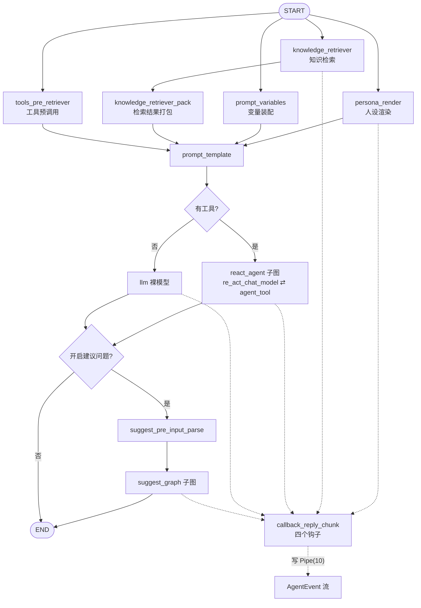

### 分层架构（DDD）

```
application/singleagent/     应用层：用例编排（create/get/update/duplicate/publish）
        ↓
crossdomain/agent/           跨域层：对外契约 + 真正的主数据结构 model.SingleAgent
        ↓
domain/agent/singleagent/    领域层：实体 + 领域服务 + agentflow（图）+ dal（持久化）
        ↓
infra/ + 各 crossdomain/*     基础设施与兄弟域（plugin / workflow / knowledge / database / variables / ragflow）
```

> **一个反直觉的依赖关系**：领域实体 `entity.SingleAgent` 反过来**组合**了跨域层的 `model.SingleAgent`（`entity/single_agent.go:24-26`），而非相反。写作时会点明这是一个跨层反向依赖设计。

---

## 速览：各讲做了什么（先看这个再进细节）

| 讲 | 主题 | 一句话结论 | 关键文件 |
|----|------|-----------|---------|
| 一 | 数据模型 | 一个 Agent 有**三种形态**：`Draft`（可编辑）、`Version`（发布时的不可变快照）、`Publish`（发布动作账本）。领域实体只是跨域模型的**薄封装**，字段真身在 `crossdomain/agent/model/single_agent.go:56-82` | `entity/single_agent.go`、`crossdomain/agent/model/single_agent.go`、dal/model |
| 二 | 构建期 | `BuildAgent` 加载变量 → 装配 5 类工具 → **按有无工具决定 ReAct/裸 LLM** → 挂 10 个节点（开建议时 +2）→ 连边 → `Compile`；触发模式是 `AllPredecessor`，所以四个前置节点天然并行 | `agentflow/agent_flow_builder.go:63-285` |
| 三 | 运行期 | `StreamExecute` 建 `Pipe(10)` → 挂回调 → 起 goroutine 跑图；**图的返回值被丢弃**，输出只经 callback | `agentflow/agent_flow_runner.go:67-133`、`callback_reply_chunk.go` |
| 四 | 工具节点 | 插件/数据库/工作流/变量/预调用五类统一降级为 `tool.BaseTool`；数据库工具**运行时校验 SQL 表名**；`tool_knowledge` 是**死代码** | `node_tool_plugin.go`、`node_tool_database.go`、`node_tool_workflow.go` |
| 五 | 知识与建议 | 检索是**构建期无条件执行**的图节点（不是工具）；suggest 是真子图，但**解析逻辑在 callback 里**而非图上 | `node_retriever.go`、`node_suggest_graph.go`、`callback_reply_chunk.go:376-402` |
| 六 | 发布与端到端 | 发布 = 四个子资源**版本化快照替换** + 按 connector 并发写 version 行；端到端经过 12 跳才到 SSE | `application/singleagent/publish.go:42-143` |

### 全流程图：一次流式对话

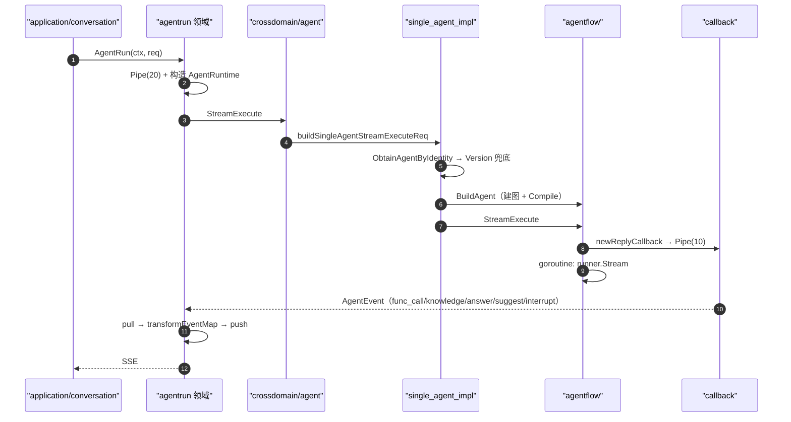

---

## 面试速通：Agent 模块高频问题一页纸

### 高频 Q&A（先结论）

| # | 问题 | 结论 |
|---|------|------|
| 1 | 图编排是自研的吗？ | **不是**。基于 **CloudWeGo Eino `compose`**（`go.mod:20`，v0.4.8）。ReAct 用的是官方 `flow/agent/react`。 |
| 2 | Agent 有几种数据形态？ | **三种**：`Draft`（`single_agent_draft` 表，一 agent 一行）、`Version`（`single_agent_version` 表，发布时整行深拷贝的不可变快照）、`Publish`（`single_agent_publish` 表，发布动作账本，含 channels）。 |
| 3 | 领域实体里有什么字段？ | **几乎没有**。`entity.SingleAgent` 只组合了 `*model.SingleAgent`（`entity/single_agent.go:24-26`），真身在 `crossdomain/agent/model/single_agent.go:56-82`。 |
| 4 | 有工具和没工具的图有什么区别？ | 有工具 → 用 Eino 官方 `react.NewAgent` 导出一个**子图**挂进主图（`agent_flow_builder.go:177-189`）；无工具 → 只挂一个裸 ChatModel（`:234`）。 |
| 5 | 为什么四个前置节点是并行的？ | 编译选项里写了 `WithNodeTriggerMode(compose.AllPredecessor)`（`agent_flow_builder.go:272`），`prompt_template` 必须等**全部前驱**完成才触发。 |
| 6 | 对外输出从哪来？ | **只从 callback 来**。`agent_flow_runner.go:129` 把 `runner.Stream` 的返回值整个丢弃了。 |
| 7 | 流式管道多大？ | 会话侧 `Pipe(20)`（`agent_run_impl.go:49-74`），agentflow 侧 `Pipe(10)`（`callback_reply_chunk.go:44`）。 |
| 8 | 有几种事件类型？ | **8 种**（`crossdomain/agent/model/single_agent.go:31-40`）：chatmodel_answer / tools_as_chatmodel_answer / tool_mid_answer / tools_message / func_call / suggest / knowledge / interrupt。 |
| 9 | 知识检索是工具吗？ | **不是**。是构建期无条件挂上的图节点 `knowledge_retriever`。`node_tool_knowledge.go` 里的 `newKnowledgeTool` **全仓无调用点**（死代码）。 |
| 10 | 建议问题在哪解析？ | **在 callback 里**（`callback_reply_chunk.go:376-402` 做 JSON 反序列化），图上的 `suggest_parser` 只是透传（`node_suggest_parser.go:25-28`）。 |
| 11 | 数据库工具怎么防越权查表？ | 运行时用 `sqlparser` 解析 SQL 的表名，与工具绑定的表名**不相等就报错**（`node_tool_database.go:86-88`）。 |
| 12 | 草稿和线上的工具执行怎么隔离？ | 靠 `ExecScene` 字段：草稿走 `ExecSceneOfDraftAgent`，线上走 `ExecSceneOfOnlineAgent`（`node_tool_plugin.go:127-132`）。 |
| 13 | 每次请求都会重建图吗？ | **是的**。`single_agent_impl.go:96-136` 每次请求都 `BuildAgent`，图**没有任何缓存**。 |
| 14 | 中断（Interrupt）怎么传递？ | 走 **error 通道**：`compose.ExtractInterruptInfo(err)` 从子图 extra 里取（`callback_reply_chunk.go:73`），再转成 `EventTypeOfInterrupt`。 |
| 15 | 多模态输入不支持会怎样？ | **降级成文本**拼进 Content（`agent_flow_runner.go:255-273`）。注意 `isSupportFile()` 硬编码 `return false`（`:293`），文件输入永远降级。 |

### 易错点与面试坑

1. **以为 `newKnowledgeTool` 提供了 `recallKnowledge` 工具**：它**全仓无调用点**（`node_tool_knowledge.go:47`），是死代码。真实的知识检索是构建期强制节点。
2. **改了 callback 忘了 `output.Close()`**：非目标节点必须显式 Close（`callback_reply_chunk.go:186-189`），否则下游 Pipe 阻塞泄漏——这是改 callback 时的**硬性不变量**。
3. **以为 `req.Variables` 会生效**：`single_agent_impl.go:126-134` 从未给 `exeReq.Variables` 赋值，所以 `node_persona_render.go:41` 的一级查找**永远失效**，只能走 `:46` 兜底。
4. **以为 `{{ name }}` 能取到变量**：`extractJinja2Placeholder` 做了 trim 校验却 append 了**未 trim** 的 `match[1]`（`agent_flow_builder.go:294`），`{{ name }}` 会提取出 `" name "`，查表取不到值。
5. **并发发布**：`publish.go:100` 的 `err` 是**共享外层变量**（循环变量未遮蔽），Mutex 只保护了 map——典型并发写共享变量隐患。
6. **发布失败对前端不可见**：`publish.go:122` 的 `_ = tasks.Wait()` 丢弃了所有错误，且 `:139` 恒返回 `CheckNotPass: false`。
7. **`knowledgeConfig == nil` 会 panic**：`node_retriever.go:57` 在 `:60` 的 nil 判断**之前**就解引用了 `r.knowledgeConfig`。
8. **Draft ↔ Version 的 PO 转换不对称**：`singleAgentVersionPo2Do` 未映射 `BackgroundImageInfoList`（`dal/single_agent_version.go:85-113`），而 draft 侧映射了（`:158`）——线上版本读回会丢背景图。
9. **以为 Reserve/Interrupt 会处理多个工具中断**：`callback_reply_chunk.go:244` 无脑 `break`，多工具同时中断只保留第一个。
10. **`ValidateAgentDraftAccess` 的返回值**：非创建者会返回 **`do` 与 `err` 同时非 nil**（`application/singleagent/single_agent.go:550-557`），调用方只看 `do` 会误放行。

### 关键数值速记

| 项 | 值 | 出处 |
|----|-----|------|
| Eino 版本 | v0.4.8 | `go.mod:20` |
| agentflow 侧 Pipe 容量 | **10** | `callback_reply_chunk.go:44` |
| 会话侧 Pipe 容量 | **20** | `agent_run_impl.go:49-74` |
| workflow 中间流 Pipe | 5 | `agent_flow_runner.go:160` |
| return-directly 流 Pipe | 5 | `callback_reply_chunk.go:318` |
| `singleagent_run.go` mainChan | 100 | `singleagent_run.go:43-81` |
| RAGFlow 默认 topK | **8**（topK<=0 时） | `node_retriever.go:114-117` |
| RAGFlow 相似度阈值 | **0.3** | `node_retriever.go:124` |
| RAGFlow 向量权重 | **0.7** | `node_retriever.go:125` |
| 默认知识 TopK / MinScore | **1 / 0.01** | `create.go:112-115` |
| 默认历史轮数 | **30** | `create.go:156` |
| 默认上下文模式 | `ContextMode_FunctionCall_2` | `create.go:155` |
| Node 触发模式 | `AllPredecessor` | `agent_flow_builder.go:272` |
| 发布白名单 connector | WebSDK / API | `entity/publish.go:24-27` |
| BotMode 枚举 | Single=0 / Multi=1 / Workflow=2 | `bot_common.go:1283-1289` |
| SuggestReplyMode 枚举 | System=0 / Custom=1 / Disable=2 / OriBot=3 | `bot_common.go:587-595` |
| SearchStrategy 枚举 | Semantic=0 / Hybrid=1 / FullText=20 | `bot_common.go:789-798` |
| Interrupt 类型数 | 8（含 100=WorkflowLLM） | `crossdomain/agent/model/single_agent.go:86-95` |
| 变量工具名 | `setKeywordMemory` | `node_tool_variables.go:80` |
| Knowledge 的二次开发字段 | `RagFlowDsId` | `bot_common.go:8462` |
| 主图 key 常量数 | **10**（+suggest 2 = 实际 12 个节点 key） | `agent_flow_builder.go:51-60` |
| suggest 子图 key 常量数 | 7 | `node_suggest_graph.go:32-38` |

---

## 第一讲：数据模型 —— Draft / Version / Publish 三形态

### 先说人话：本讲每个阶段在干什么

读代码最容易被绕晕的是：**同样一个"Agent"，代码里有 `SingleAgent`、`SingleAgentDraft`、`SingleAgentVersion`、`SingleAgentPublish` 四个名字相近的东西**，而且 `entity` 包里的实体几乎是空的。

本讲先解决这个命名混乱：

1. `entity.SingleAgent` —— 只是个壳，字段在跨域层；
2. Draft / Version / Publish —— 分别是"可编辑态 / 不可变快照 / 发布账本"，对应三张表；
3. 事件枚举与 Interrupt 类型 —— 这是 agentflow 与上层通信的**唯一协议**。

把这三点理清，后面所有流程里的"传进来一个 agent"才知道传的到底是什么。

### 逐文件精读

#### 1）领域实体只是跨域模型的薄封装

`domain/agent/singleagent/entity/single_agent.go:23-26`，注释明确写了理由：

```go
23	// Use composition instead of aliasing for domain entities to enhance extensibility
24	type SingleAgent struct {
25		*model.SingleAgent
26	}
```

同文件 `:28-39` 是四个类型别名 + 唯一的自建结构 `DuplicateInfo`：

```go
28	type AgentIdentity = model.AgentIdentity
30	type ExecuteRequest = model.ExecuteRequest
32	type InterruptInfo = model.InterruptInfo
34	type DuplicateInfo struct {
35		UserID     int64
36		SpaceID    int64
37		NewAgentID int64
38		DraftAgent *SingleAgent
39	}
```

> **架构观察**：这是一个**跨层反向依赖**——领域层（domain）指向跨域层（crossdomain），而不是相反。严格 DDD 下不常见，但在"多域共享同一份大结构体"的场景下能省掉大量转换代码。代价是领域层其实没有自己的数据主权。

#### 2）真正的主结构体：全字段

`crossdomain/agent/model/single_agent.go:56-82`：

```go
56	type SingleAgent struct {
57		AgentID   int64
58		CreatorID int64
59		SpaceID   int64
60		Name      string
61		Desc      string
62		IconURI   string
63		CreatedAt int64
64		UpdatedAt int64
65		Version   string
66		DeletedAt gorm.DeletedAt
67	
68		VariablesMetaID         *int64
69		OnboardingInfo          *bot_common.OnboardingInfo
70		ModelInfo               *bot_common.ModelInfo          // 模型参数
71		Prompt                  *bot_common.PromptInfo         // 人设 Prompt
72		Plugin                  []*bot_common.PluginInfo       // 插件/工具
73		Knowledge               *bot_common.Knowledge          // 知识库
74		Workflow                []*bot_common.WorkflowInfo
75		SuggestReply            *bot_common.SuggestReplyInfo   // 建议问题
76		JumpConfig              *bot_common.JumpConfig
77		BackgroundImageInfoList []*bot_common.BackgroundImageInfo
78		Database                []*bot_common.Database
79		BotMode                 bot_common.BotMode
80		LayoutInfo              *bot_common.LayoutInfo
81		ShortcutCommand         []string
82	}
```

字段溯源（均在 `api/model/app/bot_common/bot_common.go`，共 32075 行）：

| 实体字段 | 定义位置 | 关键含义 |
|---|---|---|
| `Prompt` | `bot_common.go:2544-2547` | 只有一个 `*string Prompt`，取值为 **Jinja2 模板原文** |
| `ModelInfo` | `bot_common.go:2695-2725` | ModelId / Temperature / MaxTokens / TopP / FrequencyPenalty / PresencePenalty / TopK / ResponseFormat / ModelStyle / CacheType + `Parameters map[string]string` |
| `ShortMemoryPolicy` | `bot_common.go:3672` | 上下文策略，默认值见 `create.go:154-157` |
| `Plugin` | `bot_common.go:3881` | `PluginInfo` 列表 |
| `Workflow` | `bot_common.go:4260` | `WorkflowInfo` 列表 |
| `SuggestReply` | `bot_common.go:5681-5688` | `SuggestReplyMode` + `CustomizedSuggestPrompt` + `ChainTaskName` |
| `Knowledge` | `bot_common.go:8440-8463` | 含二次开发字段 `RagFlowDsId`（`:8462`） |
| `RecallStrategy` | `bot_common.go:9126` | UseRerank / UseRewrite / UseNl2sql |
| `Database` | `bot_common.go:10786-10798` | TableId / TableName / TableDesc / FieldList / **PromptDisabled** / RWMode |
| `BotMode` | `bot_common.go:1283-1289` | `SingleMode=0 / MultiMode=1 / WorkflowMode=2` |
| `SuggestReplyMode` | `bot_common.go:587-595` | `System=0 / Custom=1 / Disable=2 / OriBot=3` |
| `SearchStrategy` | `bot_common.go:789-798` | `Semantic=0 / Hybrid=1 / FullText=20` |

> ⚠️ **一个 IDL 瑕疵**：`bot_common.go:8462` 的 `RagFlowDsId` 的 thrift tag 序号写成了 `1`，与前面的 `KnowledgeInfo,1` **重复**。

#### 3）三张表：Draft / Version / Publish

| 角色 | 文件 | 结构体（表名） | 差异字段 |
|---|---|---|---|
| **草稿** | `dal/model/single_agent_draft.gen.go:28-56` | `single_agent_draft` | **无** Version / ConnectorID |
| **版本快照** | `dal/model/single_agent_version.gen.go:28-58` | `single_agent_version` | 多 `ConnectorID`（`:51`）与 `Version`（`:52`） |
| **发布记录** | `dal/model/single_agent_publish.gen.go:7-23` | `single_agent_publish` | PublishID / ConnectorIds / Version / PublishTime / Status |

```go
// single_agent_version.gen.go:51-52
51		ConnectorID             int64  `gorm:"column:connector_id;not null;comment:Connector ID" json:"connector_id"`
52		Version                 string `gorm:"column:version;not null;comment:Agent Version" json:"version"`
```

```go
// single_agent_publish.gen.go:14,21
14		ConnectorIds []int64 `gorm:"column:connector_ids;comment:connector_ids;serializer:json" json:"connector_ids"`
21		Status       int32   `gorm:"column:status;not null;comment:Status 0: In use 1: Delete 3: Disabled" json:"status"`
```

**三形态关系一句话**：
- `Draft` = 可变编辑态（`single_agent_draft` 一 agent 一行）；
- `Publish` = 一次发布动作的**账本**（含发布到哪些渠道）；
- `Version` = 发布时被**整行深拷贝**出来的不可变配置快照（同一 version 可能按 connector 拆成多行）。

#### 4）事件枚举：agentflow → 上层的唯一协议

`crossdomain/agent/model/single_agent.go:29-40` 定义 **8 种流式事件**：

```go
31	const (
32		EventTypeOfChatModelAnswer        EventType = "chatmodel_answer"
33		EventTypeOfToolsAsChatModelStream EventType = "tools_as_chatmodel_answer"
34		EventTypeOfToolMidAnswer          EventType = "tool_mid_answer"
35		EventTypeOfToolsMessage           EventType = "tools_message"
36		EventTypeOfFuncCall               EventType = "func_call"
37		EventTypeOfSuggest                EventType = "suggest"
38		EventTypeOfKnowledge              EventType = "knowledge"
39		EventTypeOfInterrupt              EventType = "interrupt"
40	)
```

载体 `AgentEvent`（`:42-54`）中 `ToolMidAnswer` / `ToolAsChatModelAnswer` / `ChatModelAnswer` 三个字段都是 `*schema.StreamReader[*schema.Message]`——**嵌套流**是本模块最关键的流式设计。

Interrupt 类型枚举（`:84-95`，注意 100 是 workflow 专用）：

```go
86	const (
87		InterruptEventType_LocalPlugin         InterruptEventType = 1
88		InterruptEventType_Question            InterruptEventType = 2
89		InterruptEventType_RequireInfos        InterruptEventType = 3
90		InterruptEventType_SceneChat           InterruptEventType = 4
91		InterruptEventType_InputNode           InterruptEventType = 5
92		InterruptEventType_WorkflowLocalPlugin InterruptEventType = 6
93		InterruptEventType_OauthPlugin         InterruptEventType = 7
94		InterruptEventType_WorkflowLLM         InterruptEventType = 100
95	)
```

#### 5）三个小实体

- `entity/single_agent_pulish.go:19-33` `SingleAgentPublish` —— 注意**文件名拼错**（pulish → publish）
- `entity/publish.go:24-41` 发布白名单与 KV 缓存结构：

```go
24	var PublishConnectorIDWhiteList = map[int64]bool{
25		consts.WebSDKConnectorID: true,
26		consts.APIConnectorID:    true,
27	}
37	type PublishInfo struct {
38		AgentID                 int64
39		LastPublishTimeMS       int64
40		ConnectorID2PublishTime map[int64]int64
41	}
```

- `entity/agent_draft_display_info.go:21-25` UI 展示态（存 Redis，key 为 `agent_display_info:%d:%d`，见 `dal/agent_display_info.go:32-34`）
- `entity/agent_event.go:21-23` 纯别名转发

### 第一讲小结：实体是壳，表有三种，事件有八种

| 项 | 内容 |
|----|------|
| **一句话定位** | `entity` 是薄壳、`model` 是实体真身、三张表承载 Draft/Version/Publish 三形态、8 种事件是唯一对外协议 |
| **输入** | 用户配置（模型/人设/插件/知识/变量/建议） |
| **输出** | `*entity.SingleAgent`（构建期）、`*entity.AgentEvent`（运行期） |
| **三个最值得记住的点** | ① 领域实体**组合**跨域模型，是刻意的反向依赖；② Version 是**深拷贝快照**，Publish 是**动作账本**；③ `AgentEvent` 里有三个**嵌套 StreamReader**，这是流式设计的核心 |

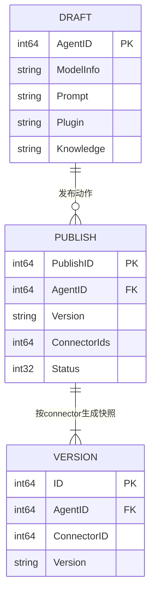

---

## 第二讲：构建期 —— 配置是怎么被编译成一张图的

### 先说人话：本讲每个阶段在干什么

`BuildAgent` 是本模块**最重要的一个函数**（`agent_flow_builder.go:63-285`，222 行）。它做的事情可以类比"把配置文件编译成可执行程序"：

1. **加载变量**（Agent 级别的记忆/变量）；
2. **装配工具**（插件、工作流、数据库、变量工具）；
3. **决定主节点形态**：有工具就上 ReAct 子图，没工具就一个裸模型；
4. **声明 11 个节点、连边**；
5. **`Compile`**。

它最后产出的 `AgentRunner` 里装的是一个 `compose.Runnable`——后面第三讲就靠它跑。

### 逐文件精读

#### 1）入口配置

`agent_flow_builder.go:37-48`：

```go
37	type Config struct {
38		Agent    *entity.SingleAgent
39		UserID   string
40		Identity *entity.AgentIdentity
41		CPStore  compose.CheckPointStore
42	
43		CustomVariables map[string]string
44	
45		ConversationID int64
46	
47		RagflowClient *ragflow.Client
48	}
```

#### 2）节点名常量（图的"字典"）

`agent_flow_builder.go:50-61`：

```go
50	const (
51		keyOfPersonRender           = "persona_render"
52		keyOfKnowledgeRetriever     = "knowledge_retriever"
53		keyOfKnowledgeRetrieverPack = "knowledge_retriever_pack"
54		keyOfPromptVariables        = "prompt_variables"
55		keyOfPromptTemplate         = "prompt_template"
56		keyOfReActAgent             = "react_agent"
57		keyOfReActAgentToolsNode    = "agent_tool"
58		keyOfReActAgentChatModel    = "re_act_chat_model"
59		keyOfLLM                    = "llm"
60		keyOfToolsPreRetriever      = "tools_pre_retriever"
61	)
```

（suggest 子图的 7 个常量在 `node_suggest_graph.go:32-38`，见第五讲。）

#### 3）Build 主流程八步

**Step 1 — 加载变量**（`agent_flow_builder.go:66-79`），`CustomVariables` 会**覆盖**库中同名变量：

```go
66		avConf := &variableConf{
67			Agent:       conf.Agent,
68			UserID:      conf.UserID,
69			ConnectorID: conf.Identity.ConnectorID,
70		}
71		avs, err := loadAgentVariables(ctx, avConf)
75		if conf.CustomVariables != nil {
76			for k, v := range conf.CustomVariables {
77				avs[k] = v
78			}
79		}
```

**Step 2 — 构建三个 raw builder**（`:81-98`）：persona 渲染器 / prompt 变量 / 知识检索器。

**Step 3 — 模型 & 四类工具装配**（`:100-145`）：plugin(106) / pre-retriever(117) / workflow(119) / database(127) / agent-variable(141)。

**Step 4 — ReAct 与否的分叉**（`:151-194`）——**整个模块最重要的分支**：

```go
151		agentTools := make([]tool.BaseTool, 0, len(pluginTools)+len(wfTools)+len(dbTools)+len(avTools))
164		var isReActAgent bool
165		if len(agentTools) > 0 {
166			isReActAgent = true
167			requireCheckpoint = true
168			if modelInfo.Capability != nil && !modelInfo.Capability.GetFunctionCall() {
169				return nil, fmt.Errorf("model %v does not support function call", modelInfo.DisplayInfo.Name)
170			}
171		}
```

```go
176		if isReActAgent {
177			agent, err := react.NewAgent(ctx, &react.AgentConfig{
178				ToolCallingModel: chatModel,
179				ToolsConfig: compose.ToolsNodeConfig{
180					Tools: agentTools,
181				},
182				ToolReturnDirectly: returnDirectlyTools,
183				ModelNodeName:      keyOfReActAgentChatModel,
184				ToolsNodeName:      keyOfReActAgentToolsNode,
185			})
189			agentGraph, agentNodeOpts = agent.ExportGraph()
191			agentNodeName = keyOfReActAgent
192		} else {
193			agentNodeName = keyOfLLM
194		}
```

> **核心洞察**：有工具则用 Eino 官方 `flow/agent/react` 导出一个**子图**，作为单个节点挂进主图（`:232 AddGraphNode`）；无工具则只挂一个裸 ChatModel（`:234 AddChatModelNode`）。另外注意 `:168`——模型不支持 function call 但有工具时，**直接构建失败**。

**Step 5 — 主图声明**（`:198-201`），带本地状态：

```go
198		g := compose.NewGraph[*AgentRequest, *schema.Message](
199			compose.WithGenLocalState(func(ctx context.Context) (state *AgentState) {
200				return &AgentState{}
201			}))
```

**Step 6 — 逐个添加节点**（`:203-245`）。persona 节点用 `WithStatePreHandler` 把用户输入存进 State：

```go
203		_ = g.AddLambdaNode(keyOfPersonRender,
204			compose.InvokableLambda[*AgentRequest, string](personaVars.RenderPersona),
205			compose.WithStatePreHandler(func(ctx context.Context, ar *AgentRequest, state *AgentState) (*AgentRequest, error) {
206				state.UserInput = ar.Input
207				return ar, nil
208			}),
209			compose.WithOutputKey(placeholderOfPersona))
```

> ⚠️ **所有 `AddXxxNode` 的 error 都被 `_ =` 吞掉**（`:203/211/214/218/223/227/232/234/238/244`），节点注册失败不会显式暴露。

**Step 7 — 拓扑边**（`:247-266`）：

```go
247		_ = g.AddEdge(compose.START, keyOfPersonRender)
248		_ = g.AddEdge(compose.START, keyOfPromptVariables)
249		_ = g.AddEdge(compose.START, keyOfKnowledgeRetriever)
250		_ = g.AddEdge(compose.START, keyOfToolsPreRetriever)
251	
252		_ = g.AddEdge(keyOfPersonRender, keyOfPromptTemplate)
253		_ = g.AddEdge(keyOfPromptVariables, keyOfPromptTemplate)
254		_ = g.AddEdge(keyOfKnowledgeRetriever, keyOfKnowledgeRetrieverPack)
255		_ = g.AddEdge(keyOfKnowledgeRetrieverPack, keyOfPromptTemplate)
256		_ = g.AddEdge(keyOfToolsPreRetriever, keyOfPromptTemplate)
257	
258		_ = g.AddEdge(keyOfPromptTemplate, agentNodeName)
259	
260		if nsg {
261			_ = g.AddEdge(agentNodeName, keyOfSuggestPreInputParse)
262			_ = g.AddEdge(keyOfSuggestPreInputParse, keyOfSuggestGraph)
263			_ = g.AddEdge(keyOfSuggestGraph, compose.END)
264		} else {
265			_ = g.AddEdge(agentNodeName, compose.END)
266		}
```

**Step 8 — 编译**（`:268-284`）：

```go
268		var opts []compose.GraphCompileOption
269		if requireCheckpoint {
270			opts = append(opts, compose.WithCheckPointStore(conf.CPStore))
271		}
272		opts = append(opts, compose.WithNodeTriggerMode(compose.AllPredecessor))
273		runner, err := g.Compile(ctx, opts...)
278		return &AgentRunner{
279			runner:              runner,
280			requireCheckpoint:   requireCheckpoint,
281			modelInfo:           modelInfo,
282			containWfTool:       containWfTool,
283			returnDirectlyTools: returnDirectlyTools,
284		}, nil
```

> **`AllPredecessor` 触发模式是关键**（`:272`）：四个 START 节点并行出射，`prompt_template` 必须等**全部**前驱完成才触发。这解释了为什么 Persona / Variables / Knowledge / PreTool 天然并行——但也意味着**任一检索慢会拖慢整体首字延迟**。

#### 4）Jinja2 占位符提取（一处 bug）

`agent_flow_builder.go:287-298`：

```go
287	func extractJinja2Placeholder(persona string) (variableNames []string) {
288		re := regexp.MustCompile(`{{([^}]*)}}`)
289		matches := re.FindAllStringSubmatch(persona, -1)
293			if val != "" {
294				variables = append(variables, match[1])
295			}
```

⚠️ `val` 做了 TrimSpace 校验，但 append 的是**未 trim 的 `match[1]`**（`:294`）——`{{ name }}` 会提取出带空格的 `" name "`，与 `:41` 查表时的 key 不一致。

#### 5）System Prompt 模板

`system_prompt.go:19-25` 五个占位符 + `:27-65` 模板：

```go
19	const (
20		placeholderOfAgentName = "agent_name"
21		placeholderOfPersona   = "persona"
22		placeholderOfKnowledge = "knowledge"
23		placeholderOfVariables = "memory_variables"
24		placeholderOfTime      = "time"
25	)
```

模板要点：`system_prompt.go:31-41` 是"内容安全护栏 + Persona 区"，`:43-45` 是变量区，`:47-58` 是知识区（含 `` 转 Markdown 的强制指令），`:60-61` 是 Pre-toolCall 区——**这几段是 Agent 最重要的 prompt 工程资产**。

`node_chat_prompt.go:24-30` 把模板编为 ChatTemplate 节点：

```go
24	var (
25		chatPrompt = prompt.FromMessages(schema.Jinja2,
26			schema.SystemMessage(REACT_SYSTEM_PROMPT_JINJA2),
27			schema.MessagesPlaceholder(placeholderOfChatHistory, true),
28			schema.MessagesPlaceholder(placeholderOfUserInput, false),
29		)
30	)
```

#### 6）四个并行前置节点

**① Persona 渲染** `node_persona_render.go:29-59`，**两级变量查找**（请求级优先，构建级兜底）：

```go
36	func (p *personaRender) RenderPersona(ctx context.Context, req *AgentRequest) (persona string, err error) {
39		for _, name := range p.personaVariableNames {
41			if val, ok := req.Variables[name]; ok {
42				variables[name] = val
43				continue
44			}
46			if val, ok := p.variables[name]; ok {
47				variables[name] = val
48				continue
49			}
50			variables[name] = ""
51		}
53		msgs, err := prompt.FromMessages(schema.Jinja2, schema.UserMessage(p.persona)).Format(ctx, maps.ToAnyValue(variables))
58		return msgs[0].Content, nil
```

**② Prompt 变量装配** `node_prompt_variables.go:29-32`（另两个占位符）+ `:39-65`：

```go
42		variables[placeholderOfTime] = time.Now().Format("Monday 2006/01/02 15:04:05 -07")
43		variables[placeholderOfAgentName] = p.Agent.Name
52			variables[placeholderOfChatHistory] = req.History
57		for k, v := range p.avs {
58			variables[k] = v
59			memoryVariablesList = append(memoryVariablesList, fmt.Sprintf("%s: %s\n", k, v))
61			variables[placeholderOfVariables] = memoryVariablesList
```

> 注意时间格式串 `"Monday 2006/01/02 15:04:05 -07"`（**星期在前**），非标准 Layout。

**③ 知识检索** → 第五讲。**④ 工具预调用** → 第四讲 6.4。

### 端到端演算 ①：一次 `BuildAgent` 的八个动作

```
① loadAgentVariables         agent_flow_builder.go:66-79    （CustomVariables 覆盖）
② 构建 3 个 raw builder      agent_flow_builder.go:81-98
③ 装配 5 类工具             agent_flow_builder.go:100-145
④ ReAct 分叉判断            agent_flow_builder.go:164-194
   ├ 有工具 → react.NewAgent + ExportGraph   :177-189
   └ 无工具 → agentNodeName = llm            :193
⑤ NewGraph（带 GenLocalState）agent_flow_builder.go:198-201
⑥ AddNode × 11               agent_flow_builder.go:203-245
⑦ AddEdge                    agent_flow_builder.go:247-266
⑧ Compile（AllPredecessor）  agent_flow_builder.go:268-284
   → 返回 AgentRunner{runner, requireCheckpoint, modelInfo, containWfTool, returnDirectlyTools}
```

### 第二讲小结：有工具上 ReAct 子图，没工具一个裸模型

| 项 | 内容 |
|----|------|
| **一句话定位** | `BuildAgent` = 加载变量 + 装配工具 + 声明节点 + 连边 + Compile，产出 `compose.Runnable` |
| **输入** | `*Config`（Agent 配置 + Identity + CustomVariables + RagflowClient） |
| **输出** | `*AgentRunner`（持有 runner 与四个标志位） |
| **三个最值得记住的点** | ① **有工具 → ReAct 子图，无工具 → 裸 LLM**（`:176-194`）；② `AllPredecessor` 让四个前置节点**天然并行**（`:272`）；③ 所有 `AddXxxNode` 的 error **被 `_ =` 吞掉**，注册失败静默 |

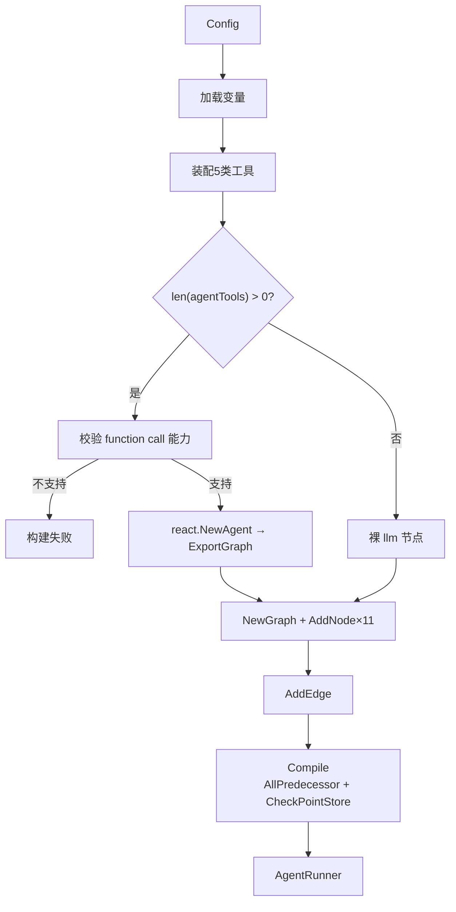

---

## 第三讲：运行期 —— StreamExecute 与"回调即输出"

### 先说人话：本讲每个阶段在干什么

图编译好了，怎么跑？`StreamExecute`（`agent_flow_runner.go:67-133`）只有五步：

1. 建一个 `Pipe(10)`，拿读写两端；
2. 装配 compose 选项（回调、checkpoint、workflow 管道）；
3. 注册可序列化的 State 类型；
4. **起一个 goroutine 跑图**；
5. 把读端 `sr` 返回给调用方。

**最反直觉的一点**：第 4 步里 `r.runner.Stream(...)` 的返回值被**整个丢弃**（`:129`）。也就是说，图计算出来的 `*schema.Message` 根本不参与对外输出——所有用户看得见的内容，都是 callback 在图上"旁路"写进 `sw` 的。

理解了这一点，就知道**改输出 = 改 callback，不是改图**。

### 逐文件精读

#### 1）三个运行时结构

`agent_flow_runner.go:40-65`：

```go
40	type AgentState struct {
41		Messages                 []*schema.Message
42		UserInput                *schema.Message
43		ReturnDirectlyToolCallID string
44	}
46	type AgentRequest struct {
47		UserID  string
48		Input   *schema.Message
49		History []*schema.Message
50	
51		Identity *singleagent.AgentIdentity
52	
53		ResumeInfo   *singleagent.InterruptInfo
54		PreCallTools []*agentrun.ToolsRetriever
55		Variables    map[string]string
56	}
58	type AgentRunner struct {
59		runner            compose.Runnable[*AgentRequest, *schema.Message]
60		requireCheckpoint bool
61	
62		returnDirectlyTools map[string]struct{}
63		containWfTool       bool
64		modelInfo           *modelmgr.Model
65	}
```

#### 2）`StreamExecute` 五步

`agent_flow_runner.go:67-133`：

```go
67	func (r *AgentRunner) StreamExecute(ctx context.Context, req *AgentRequest) (
68		sr *schema.StreamReader[*entity.AgentEvent], err error,
69	) {
70		executeID := uuid.New()
71	
72		hdl, sr, sw := newReplyCallback(ctx, executeID.String(), r.returnDirectlyTools)
```

**workflow 管道**（仅当含 workflow 工具，`:78-94`）：

```go
78		if r.containWfTool {
79			cfReq := crossworkflow.ExecuteConfig{
80				AgentID:      &req.Identity.AgentID,
81				ConnectorUID: req.UserID,
82				ConnectorID:  req.Identity.ConnectorID,
83				BizType:      crossworkflow.BizTypeAgent,
84			}
85			if req.Identity.IsDraft {
86				cfReq.Mode = crossworkflow.ExecuteModeDebug
87			} else {
88				cfReq.Mode = crossworkflow.ExecuteModeRelease
89			}
```

**挂载回调 + 注册可序列化 State**（`:96-97`）：

```go
96		composeOpts = append(composeOpts, compose.WithCallbacks(hdl))
97		_ = compose.RegisterSerializableType[*AgentState]("agent_state")
```

**断点续跑（checkpoint）**（`:98-111`），这里决定 ICP 的 key：

```go
 98		if r.requireCheckpoint {
100			defaultCheckPointID := executeID.String()
101			if req.ResumeInfo != nil {
102				resumeInfo := req.ResumeInfo
103				if resumeInfo.InterruptType != singleagent.InterruptEventType_OauthPlugin {
104					defaultCheckPointID = resumeInfo.InterruptID
105					opts := crossworkflow.DefaultSVC().WithResumeToolWorkflow(resumeInfo.AllWfInterruptData[resumeInfo.ToolCallID], req.Input.Content, resumeInfo.AllWfInterruptData)
106					composeOpts = append(composeOpts, opts)
107				}
108			}
110			composeOpts = append(composeOpts, compose.WithCheckPointID(defaultCheckPointID))
111		}
```

**双 goroutine + panic 兜底**（`:112-132`）：

```go
112		if r.containWfTool && workflowMsgSr != nil {
113			safego.Go(ctx, func() {
114				r.processWfMidAnswerStream(ctx, sw, workflowMsgSr)
115			})
116		}
117		safego.Go(ctx, func() {
118			defer func() {
119				if pe := recover(); pe != nil {
120					logs.CtxErrorf(ctx, "[AgentRunner] StreamExecute recover, err: %v", pe)
121	
122					sw.Send(nil, errors.New("internal server error"))
123				}
124				if workflowMsgCloser != nil {
125					workflowMsgCloser()
126				}
127				sw.Close()
128			}()
129			_, _ = r.runner.Stream(ctx, req, composeOpts...)
130		})
132		return sr, nil
```

> **`:129` 是整个模块的设计原点**。图产出的 `*schema.Message` 被丢弃，所有可见输出**只**通过 callback 写到 `sw`。

#### 3）workflow 中间流转发

`agent_flow_runner.go:135-180`，只转发 `NodeTypeOutputEmitter` 节点消息，并在首次命中时**动态创建嵌套 Pipe**：

```go
155			if msg.DataMessage.NodeType != crossworkflow.NodeTypeOutputEmitter {
156				continue
157			}
158			if !streamInitialized {
159				streamInitialized = true
160				srT, swT = schema.Pipe[*schema.Message](5)
161				sw.Send(&entity.AgentEvent{
162					EventType:     singleagent.EventTypeOfToolMidAnswer,
163					ToolMidAnswer: srT,
164				}, nil)
165			}
166			swT.Send(&schema.Message{
167				Role:    msg.DataMessage.Role,
168				Content: msg.DataMessage.Content,
169				Extra: func(msg *crossworkflow.WorkflowMessage) map[string]any {
171					extra := make(map[string]any)
172					extra["workflow_node_name"] = msg.NodeTitle
173					if msg.DataMessage.Last {
174						extra["is_finish"] = true
175					}
176					return extra
177				}(msg),
178			}, nil)
```

#### 4）输入预处理：多模态按厂商能力降级

`agent_flow_runner.go:182-188`：

```go
182	func (r *AgentRunner) PreHandlerReq(ctx context.Context, req *AgentRequest) *AgentRequest {
183		req.Input = r.preHandlerInput(req.Input)
184		req.History = r.preHandlerHistory(req.History)
185		logs.CtxInfof(ctx, "[AgentRunner] PreHandlerReq, req: %v", conv.DebugJsonToStr(req))
186	
187		return req
188	}
```

能力探测矩阵 `agent_flow_runner.go:286-304`：

```go
286	func (r *AgentRunner) isSupportMultiContent() bool {
287		return r.modelInfo.Capability.GetSupportMultiModal()
288	}
289	func (r *AgentRunner) isSupportImage() bool {
290		return r.modelInfo.Capability.GetImageUnderstanding()
291	}
292	func (r *AgentRunner) isSupportFile() bool {
293		return false              // ← 文件能力被硬编码关闭
294	}
```

不支持的模态会被**降级成文本**拼进 Content（`:255-273`）：

```go
262				textContent += "  this is a image:" + v.ImageURL.URL
264				textContent += "  this is a file:" + v.FileURL.URL
266				textContent += "  this is a audio:" + v.AudioURL.URL
268				textContent += "  this is a video:" + v.VideoURL.URL
```

URL → Base64 转换四件套在 `:306-359`。

#### 5）流式回调：四个钩子

`callback_reply_chunk.go:41-60`：

```go
44		sr, sw = schema.Pipe[*entity.AgentEvent](10)
46		rcc := &replyChunkCallback{
47			sw:                  sw,
48			executeID:           executeID,
49			returnDirectlyTools: returnDirectlyTools,
50		}
52		clb = callbacks.NewHandlerBuilder().
53			OnStartFn(rcc.OnStart).
54			OnEndFn(rcc.OnEnd).
55			OnEndWithStreamOutputFn(rcc.OnEndWithStreamOutput).
56			OnErrorFn(rcc.OnError).
57			Build()
```

**OnStart —— 只在 ReAct 工具节点发 `func_call`**（`:109-125`）：

```go
112		switch info.Component {
113		case compose.ComponentOfToolsNode:
114			if info.Name != keyOfReActAgentToolsNode {
115				return ctx
116			}
117			ae := &entity.AgentEvent{
118				EventType: singleagent.EventTypeOfFuncCall,
119				FuncCall:  convToolsNodeCallbackInput(input),
120			}
121			r.sw.Send(ae, nil)
122		}
```

**OnEnd —— knowledge / tools_pre_retriever / suggest_parser 三个终点事件**（`:127-178`）：

```go
129		switch info.Name {
130		case keyOfKnowledgeRetriever:
131			knowledgeEvent := &entity.AgentEvent{
132				EventType: singleagent.EventTypeOfKnowledge,
133				Knowledge: retriever.ConvCallbackOutput(output).Docs,
134			}
136			if knowledgeEvent.Knowledge != nil {
137				r.sw.Send(knowledgeEvent, nil)
138			}
160		case keyOfSuggestParser:
161			sg := convSuggestionNodeCallbackOutput(output)
163			if len(sg) > 0 {
164				for _, item := range sg {
165					suggestionEvent := &entity.AgentEvent{
166						EventType: singleagent.EventTypeOfSuggest,
167						Suggest:   item,
168					}
169					r.sw.Send(suggestionEvent, nil)
```

**OnEndWithStreamOutput —— 模型回答与工具回答**（`:180-215`）：

```go
184		switch info.Component {
185		case compose.ComponentOfGraph, components.ComponentOfChatModel:
186			if info.Name != keyOfReActAgentChatModel && info.Name != keyOfLLM {
187				output.Close()
188				return ctx
189			}
190			sr := schema.StreamReaderWithConvert(output, func(t callbacks.CallbackOutput) (*schema.Message, error) {
191				cbOut := model.ConvCallbackOutput(t)
192				return cbOut.Message, nil
193			})
195			r.sw.Send(&entity.AgentEvent{
196				EventType:       singleagent.EventTypeOfChatModelAnswer,
197				ChatModelAnswer: sr,
198			}, nil)
199			return ctx
200		case compose.ComponentOfToolsNode:
201			toolsMessage, err := r.concatToolsNodeOutput(ctx, output)
207			r.sw.Send(&entity.AgentEvent{
208				EventType:    singleagent.EventTypeOfToolsMessage,
209				ToolsMessage: toolsMessage,
210			}, nil)
```

> **`:186-189` 是一道关键闸门**：只有 `re_act_chat_model` / `llm` 两个名字才放行上层流；其余节点**必须显式 `output.Close()`**，否则下游 Pipe 会阻塞泄漏。**这是改 callback 时的硬性不变量。**

**OnError —— Interrupt 事件还原**（`:68-107`）：

```go
 71		switch info.Component {
 72		case compose.ComponentOfGraph:
 73			if interruptInfo, ok := compose.ExtractInterruptInfo(err); ok {
 74				if info.Name != "" {
 75					return ctx
 76				}
 77				interruptData := convInterruptInfo(ctx, interruptInfo)
 78				interruptData.InterruptID = r.executeID
 92				interruptEvent := &entity.AgentEvent{
 93					EventType: singleagent.EventTypeOfInterrupt,
 94					Interrupt: interruptData,
 95				}
 96				r.sw.Send(interruptEvent, nil)
```

> Interrupt 是**通过 error 通道传递**的，靠 `compose.ExtractInterruptInfo(err)` 还原。

`convInterruptInfo`（`:217-254`）从子图 extra 里取第一个 RerunExtra：

```go
219		output = interruptInfo.SubGraphs[keyOfReActAgent]
234		for k, v := range toolsNodeExtra.RerunExtraMap {
235			toolCallID = k
237			interruptEventType = convInterruptEventType(v)
239			if interruptEventType == singleagent.InterruptEventType_OauthPlugin {
240				toolResultData[k] = v.(*plugin.ToolInterruptEvent)
241			} else {
242				wfResumeData[k] = v.(*crossworkflow.ToolInterruptEvent)
243			}
244			break                        // ← 只处理第一个
245		}
```

⚠️ 两处脆弱点：`:219` 直接取 map 值未判存在性（nil 则在 `:222` panic）；`:244` 无脑 `break`，多工具同时中断只保留一个。

#### 6）return-directly 工具的"边 concat 边旁路"

`callback_reply_chunk.go:270-347`：

```go
308			if len(r.returnDirectlyTools) > 0 {
309				if isReturnDirectToolsFirstCheck {
310					isReturnDirectToolsFirstCheck = false
311					if _, ok := r.returnDirectlyTools[msg.ToolName]; ok {
312						returnDirectToolsMap[mIndex] = true
313					}
314				}
316				if _, ok := returnDirectToolsMap[mIndex]; ok {
317					if !streamInitialized {
318						sr, sw = schema.Pipe[*schema.Message](5)
319						r.sw.Send(&entity.AgentEvent{
320							EventType:             singleagent.EventTypeOfToolsAsChatModelStream,
321							ToolAsChatModelAnswer: sr,
322						}, nil)
323						streamInitialized = true
324					}
325					sw.Send(msg, nil)
326				}
327			}
338		for _, msgChunks := range toolsMsgChunks {
339			msg, err := schema.ConcatMessages(msgChunks)
```

> 语义：工具输出被**同时**用在两处——(a) 逐片喂给 `ToolsAsChatModelAnswer` 流做实时展示；(b) 累积后 `ConcatMessages` 成完整 `ToolsMessage` 供后续链路使用。

### 第三讲小结：图的返回值被丢弃，callback 是唯一出口

| 项 | 内容 |
|----|------|
| **一句话定位** | `StreamExecute` 建 Pipe(10) → 挂回调 → 起 goroutine 跑图；**输出只经 callback** |
| **输入** | `*AgentRequest`（用户 Input + History + Identity + ResumeInfo） |
| **输出** | `*schema.StreamReader[*entity.AgentEvent]`（8 种事件的流） |
| **三个最值得记住的点** | ① `runner.Stream` 返回值**被丢弃**（`:129`），改输出必须改 callback；② 非目标节点必须 `output.Close()`（`:186-189`）；③ Interrupt 走 **error 通道**，靠 `ExtractInterruptInfo` 还原 |

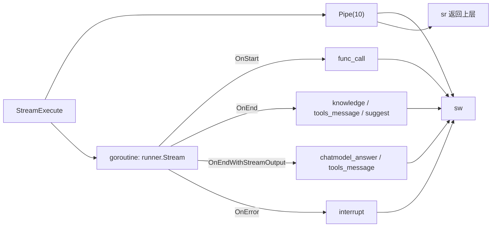

---

## 第四讲：五类工具节点 —— 工具是怎么"长"进图里的

### 先说人话：工具不是节点，工具是 ToolsNode 的参数

第三讲我们看到 `react_agent` 是一个**整体节点**。本讲拆开看：所谓"工具"在图里根本不是独立节点，而是 `compose.ToolsNodeConfig{Tools: agentTools}` 的一批参数（`agent_flow_builder.go:179-181`）。

所以"加一个工具"这件事，发生的时间点是**构建期**，不是运行期：

- `BuildAgent` 时就把 4 类工具全部构造好、塞进 `agentTools` 切片（`:151-162`）；
- 只有**至少 1 个工具**时才退化成 ReAct（`isReActAgent = true`，`:165-171`），否则直接挂裸 LLM；
- 一旦有工具，**强制要求 checkpoint**（`requireCheckpoint = true`，`:167`），且**模型必须支持 function call**（`:168-170`）。

> 💡 **一条重要的架构推论**：`agentTools` 为空 → 没有 ReAct → 没有 checkpoint → 也就没有中断恢复能力。Coze 的"问答中断续跑"能力是**被工具的存在性激活的**，不是全局开关。

### 4.1 工具装配全景

```go
// agent_flow_builder.go:151-162
agentTools := make([]tool.BaseTool, 0, len(pluginTools)+len(wfTools)+len(dbTools)+len(avTools))
agentTools = append(agentTools, slices.Transform(pluginTools, ...)...)  // ① 插件工具
agentTools = append(agentTools, slices.Transform(wfTools,   ...)...)   // ② 工作流工具
agentTools = append(agentTools, slices.Transform(dbTools,    ...)...)   // ③ 数据库工具
agentTools = append(agentTools, slices.Transform(avTools,    ...)...)   // ④ 变量工具
```

外加一类"**运行前预调用工具**"（`PreCallTools`），它**不进 `agentTools`**，而是单独的 `tools_pre_retriever` 节点（`:218-222`）。所以严格说是 **4 + 1 = 5 类**。

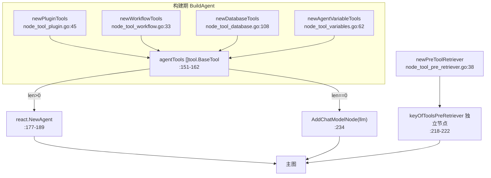

### 4.2 ① 插件工具：`ExecScene` 把草稿态传下去

`node_tool_plugin.go` 是最短的一个（148 行），但它藏着一个容易被忽略的设计：

```go
// node_tool_plugin.go:119-133
func (p *pluginInvokableTool) InvokableRun(ctx context.Context, argumentsInJSON string, _ ...tool.Option) (string, error) {
	req := &model.ExecuteToolRequest{
		UserID:          p.userID,
		PluginID:        p.toolInfo.PluginID,
		ToolID:          p.toolInfo.ID,
		ExecDraftTool:   false,
		PluginFrom:      p.pluginFrom,
		ArgumentsInJson: argumentsInJSON,
		ExecScene: func() consts.ExecuteScene {
			if p.isDraft {
				return consts.ExecSceneOfDraftAgent
			}
			return consts.ExecSceneOfOnlineAgent
		}(),
	}
```

**关键解读**：

1. **`ExecScene` 是一个匿名函数立刻求值**（`func(){...}()`），不是传函数引用。它把 `isDraft` 这个**构建期的身份信息**编码进每次执行请求里。
2. `ExecDraftTool: false` 是**硬编码**的（`:124`）—— 意思是"工具本身永远执行线上版本"，但**执行场景**区分草稿/线上。这两件事是正交的：Agent 在草稿态调试时，调用的是线上插件实现，只是审计/配额记为草稿场景。
3. `Info()` 方法（`:98-117`）做了一件防御性处理：`len(paramInfos) == 0` 时 `ParamsOneOf: nil` 而不是空的 `NewParamsOneOfByParams`。因为部分模型对空 params schema 会报错，`nil` 才是安全的"无参数"表达。

另外 `invalidRespProcessStrategy` 固定为 `ReturnDefault`（`:136`），即插件返回非法响应时**返回默认值而不是报错中断**。

### 4.3 ② 工作流工具：`return-directly` 的双返回值设计

这是 5 类工具里**唯一返回两个值**的：

```go
// node_tool_workflow.go:33-64
func newWorkflowTools(ctx context.Context, conf *workflowConfig) ([]workflow.ToolFromWorkflow, map[string]struct{}, error) {
	...
	toolsReturnDirectly := make(map[string]struct{})
	workflowTools, err := crossworkflow.DefaultSVC().WorkflowAsModelTool(ctx, policies)
	if len(workflowTools) > 0 {
		for _, workflowTool := range workflowTools {
			if workflowTool.TerminatePlan() == vo.UseAnswerContent {
				toolInfo, err := workflowTool.Info(ctx)
				...
				toolsReturnDirectly[toolInfo.Name] = struct{}{}
			}
		}
	}
	return workflowTools, toolsReturnDirectly, err
}
```

**语义**：如果某个工作流声明了 `TerminatePlan() == UseAnswerContent`（"终止计划、直接把工作流答案当最终回复"），它的名字就被记进 `toolsReturnDirectly` 这个 set，最终通过 `react.AgentConfig.ToolReturnDirectly`（`:182`）交给 ReAct Agent。

> 这就是为什么"工作流作为工具调用"在 Coze 里能**直接结束对话**而不是把结果回灌给模型再总结一遍——它是 ReAct 层面的短路，不是提示词层面的约定。

⚠️ **一处细节**：`err` 在函数末尾才 `return`（`:63`），但循环里 `err != nil` 已提前 return（`:53`）。所以 `WorkflowAsModelTool` 出错时走的是 `:63` 的 `return ..., err`，逻辑正确但**变量复用**容易误读。

### 4.4 ③ 数据库工具：**运行期 SQL 表名校验**

这是我认为**全模块最值得单独拿出来说的一段防御代码**：

```go
// node_tool_database.go:69-88
func (d *databaseTool) Invoke(ctx context.Context, req ExecuteSQLRequest) (string, error) {
	if req.SQL == "" {
		return "", fmt.Errorf("sql is empty")
	}
	if d.promptDisabled {
		return "the tool to be called is not available", nil
	}

	tableType := table.TableType_OnlineTable
	if d.agentIdentity.IsDraft {
		tableType = table.TableType_DraftTable
	}

	tableName, err := sqlparser.New().GetTableName(req.SQL)
	if err != nil {
		return "", err
	}
	if tableName != d.name {
		return "", fmt.Errorf("sql table name %s not match database %s", tableName, d.name)
	}
	...
}
```

三层防线：

| 层 | 代码 | 防御什么 |
|----|------|---------|
| 空 SQL | `:70-72` | 模型没生成 SQL |
| 工具被禁用 | `:73-75` | `promptDisabled` 时**返回字符串而非 error**（`"the tool to be called is not available"`），让模型自己知道不可用 |
| **表名不匹配** | `:82-88` | **核心**：用 `sqlparser` 解析出 SQL 里的表名，与该工具绑定的 `d.name` 比对，不一致直接拒绝 |

> 🔑 **为什么这条重要**：数据库工具是**每个表生成一个工具**（`:116-136` 循环，工具名就是表名，`:130`）。模型被允许写任意 SQL（`ExecuteSQLRequest` 的描述里明说支持 SELECT/INSERT/UPDATE/DELETE，`:66`），但**只能操作它自己的那张表**。这是 LLM 生成 SQL 场景下**最实用的一道越权防线**——比在 prompt 里写"不要碰别的表"可靠得多。

顺带两个设计点：

- **草稿/线上表切换**：`IsDraft` 决定 `TableType_DraftTable` / `TableType_OnlineTable`（`:77-80`），和插件的 `ExecScene` 是同一种思路。
- **结果格式化成 Markdown 表格**：`formatDatabaseResult`（`:190-252`）把结果拼成 `| a | b |` 的 markdown，因为**输出最终要进 LLM 上下文**；headers 做了 `sort.Strings`（`:208`）保证列顺序稳定（Go map 遍历无序，不排序会导致同一次查询的两次渲染不一致）。
- `convertDBValueToString`（`:254-301`）专门处理 `[]uint8`（MySQL driver 返回的 `[]byte`）到 string 的转换——这是 Go + MySQL 的老坑。

### 4.5 ④ 变量工具：`setKeywordMemory` —— 让 Agent 反过来改变量

```go
// node_tool_variables.go:62-86
func newAgentVariableTools(ctx context.Context, v *variableConf) ([]tool.InvokableTool, error) {
	tools := make([]tool.InvokableTool, 0, 1)
	a := &avTool{...}
	desc := `
## Skills Conditions
1. When the user's intention is to set a variable and the user provides the variable to be set, call the tool.
2. If the user wants to set a variable but does not provide the variable, do not call the tool.
3. If the user's intention is not to set a variable, do not call the tool.
...`
	at, err := utils.InferTool("setKeywordMemory", desc, a.Invoke)
```

**这是全部工具里唯一"写"方向的工具**——前三类（插件/工作流/数据库）本质上都是"读"或"远程执行"，只有这个会**回写用户变量**（`:121` `SetVariableInstance`），写入后在下一次对话的 `loadAgentVariables`（`:40-60`）里生效，从而改变 persona 渲染结果。

⚠️ **注意它的挂载条件是 `len(avs) > 0`**（`agent_flow_builder.go:140`）——也就是说：**Agent 必须先有已设置的变量，才会获得"设置变量"的工具**。第一次对话时没有变量 → 没有这个工具 → 永远无法凭空创建变量（除非前端显式设置过）。这是一个"鸡生蛋"式的约束。

⚠️ **另一个反直觉点**：`Invoke` 失败时**返回 `"fail", nil`**（`:124`）——error 是 `nil`！只打了一条日志（`:123`）。模型会看到 "fail" 字符串而不是触发错误中断。

### 4.6 ⑤ 预调用工具：`tools_pre_retriever` 伪造消息对

```go
// node_tool_pre_retriever.go:42-137
func (pr *toolPreCallConf) toolPreRetrieve(ctx context.Context, ar *AgentRequest) ([]*schema.Message, error) {
	if len(ar.PreCallTools) == 0 {
		return nil, nil
	}
	for _, item := range ar.PreCallTools {
		switch item.Type {
		case agentrun.ToolTypePlugin:   // :52-82  同步 ExecuteTool
		case agentrun.ToolTypeWorkflow: // :84-109 同步 SyncExecuteWorkflow
		}
		if toolResp != "" {
			uID := uuid.New()
			toolCallID := "call_" + uID.String()
			tms = append(tms, &schema.Message{
				Role: schema.Assistant,
				ToolCalls: []schema.ToolCall{{
					Type: "function",
					Function: schema.FunctionCall{Name: item.ToolName, Arguments: item.Arguments},
					ID: toolCallID,
				}},
			})
			tms = append(tms, &schema.Message{
				Role: schema.Tool, Content: toolResp, ToolCallID: toolCallID,
			})
		}
	}
```

**核心技巧：伪造 ToolCall / ToolMessage 消息对**（`:112-134`）。

它用 `uuid.New()` 现造一个 `call_<uuid>` 的 toolCallID，然后手动构造一条 Assistant（带 ToolCalls）和一条 Tool（带同样的 ToolCallID）消息。**这样 ReAct 模型看到的历史里，就"好像"它自己刚才调用过这个工具并拿到了结果**。

> 用途：某些工具（比如"开场白前先查一下用户信息"）需要在**模型第一次决策之前**就执行，把结果塞进上下文。用伪造消息对的方式，既满足了 OpenAI 消息格式的合法性（Tool 消息必须紧跟在有 ToolCalls 的 Assistant 消息之后），又不需要真的走一轮模型推理。

**与插件工具的执行差异**：

| | 插件工具（4.2） | 预调用插件（本节的 ToolTypePlugin） |
|----|------|------|
| 触发时机 | 模型决策后 | 模型决策**前** |
| `ExecScene` | 由 `p.isDraft` 决定 | 由 `ar.Identity.IsDraft` 决定（`:60-66`） |
| `ProjectInfo` | 带 `ProjectVersion`（`:137-138`） | 带 `ProjectVersion`（`:72-77`） |
| `WithPluginHTTPHeader` | 有（`:139`，带 conversationID） | **没有** |

⚠️ 预调用插件比正常插件**少了一个 `WithPluginHTTPHeader(conversationID)`**，意味着预调用时插件拿不到会话级 HTTP 头。这是一个容易踩的一致性差异。

### 4.7 彩蛋：`newKnowledgeTool` 是死代码

```bash
$ grep -rn "newKnowledgeTool\|knowledgeToolName" --include="*.go" .
./domain/agent/singleagent/internal/agentflow/node_tool_knowledge.go:36:	knowledgeToolName = "recallKnowledge"
./domain/agent/singleagent/internal/agentflow/node_tool_knowledge.go:47:func newKnowledgeTool(ctx context.Context, conf *knowledgeConfig) (tool.InvokableTool, error) {
./domain/agent/singleagent/internal/agentflow/node_tool_knowledge.go:84:	return utils.InferTool(knowledgeToolName, knowledgeDesc, kl.Retrieve, ...)
```

**只有定义，没有任何调用点。** 这是一个"按需召回知识"的工具化方案（`recallKnowledge`，模型自己传 `knowledge_ids`，`:87-89`），但最终**没有被采用**——Coze 选择了**构建期无条件召回**（`knowledge_retriever` 节点，见第五讲）。

> 这个死代码很有价值：它说明了架构选型上的一个分叉点——**知识是"模型想查才查"（tool）还是"每轮都塞进上下文"（retriever）**。Coze 选了后者，且**没有留下开关**。
>
> 有意思的是，它的 `customTagsFn`（`:54-82`）写得很完整：把 `KnowledgeIDs` 字段的 schema 动态替换成 `type: array<integer>` 并附上**枚举值**（`schema.Enum`，`:76-79`），让模型只能从合法知识库 ID 里选。这是 `utils.WithSchemaCustomizer` 的一个教科书级用法。

### 第四讲小结：工具是构建期参数，不是运行期节点

| 项 | 内容 |
|----|------|
| **一句话定位** | 4 类工具在 `BuildAgent` 时构造并塞进 `react.AgentConfig`；另有 1 类"预调用工具"独立成节点 |
| **输入** | `conf.Agent.Plugin / Workflow / Database / Variables` + `AgentRequest.PreCallTools` |
| **输出** | `[]tool.BaseTool`（进 ReAct） + `[]*schema.Message`（预调用伪造消息对，进 prompt_template） |
| **三个最值得记住的点** | ① 无工具 → 无 ReAct → 无 checkpoint（`:165-171`）；② 数据库工具**运行期校验 SQL 表名**（`:86-88`）是 LLM-SQL 越权的核心防线；③ 预调用工具靠**伪造 ToolCall/ToolMessage 对**（`node_tool_pre_retriever.go:112-134`）提前注入上下文 |

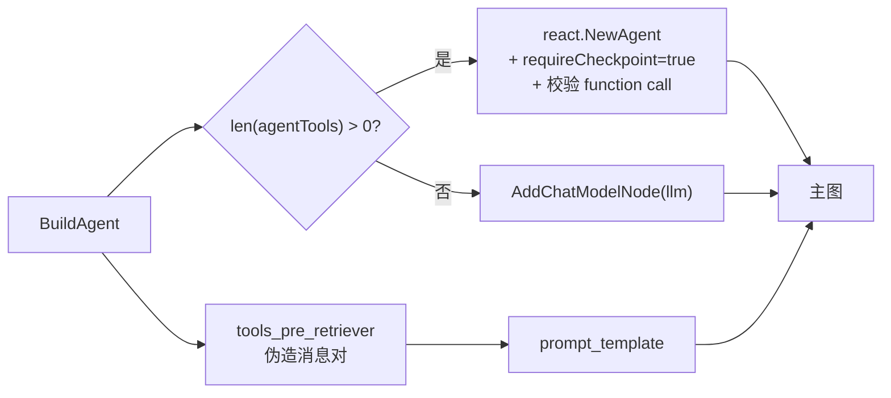

---

## 第五讲：知识检索与建议回复 —— 两条支线

### 先说人话：主链路之外，还有两条"顺手做"的支线

主链路是 `START → persona/prompt/knowledge/pre-tools → prompt_template → react_agent → END`。但如果开了"推荐问题"（SuggestReply），后面会**再接两个节点**（`agent_flow_builder.go:260-263`）：

```go
if nsg {
    _ = g.AddEdge(agentNodeName, keyOfSuggestPreInputParse)
    _ = g.AddEdge(keyOfSuggestPreInputParse, keyOfSuggestGraph)
    _ = g.AddEdge(keyOfSuggestGraph, compose.END)
} else {
    _ = g.AddEdge(agentNodeName, compose.END)
}
```

本讲讲两条支线：**知识检索**（进主线）和**建议回复**（出主线）。

### 5.1 知识检索：双通道设计

`node_retriever.go` 的 `Retrieve` 是个 **双分支**入口：

```go
// node_retriever.go:56-93
func (r *knowledgeRetriever) Retrieve(ctx context.Context, req *AgentRequest) ([]*schema.Document, error) {
	if r.knowledgeConfig.RagFlowDsId != nil {
		return r.retrieveFromRagflow(ctx, req)     // 通道 B：直连 RAGFlow
	}
	if r.knowledgeConfig == nil || len(r.knowledgeConfig.KnowledgeInfo) == 0 {
		return nil, nil
	}
	knowledgeIDs := ...                              // 通道 A：走 Coze 知识库链
	knowledgeIDs = expandKnowledgeIDsWithChildren(ctx, knowledgeIDs)  // :74 父知识库展开子库
	kr, err := genKnowledgeRequest(ctx, knowledgeIDs, r.knowledgeConfig, req.Input.Content, req.History)
	resp, err := crossknowledge.DefaultSVC().Retrieve(ctx, kr)
	docs, err := convertDocument(ctx, resp.RetrieveSlices)
	return docs, nil
}
```

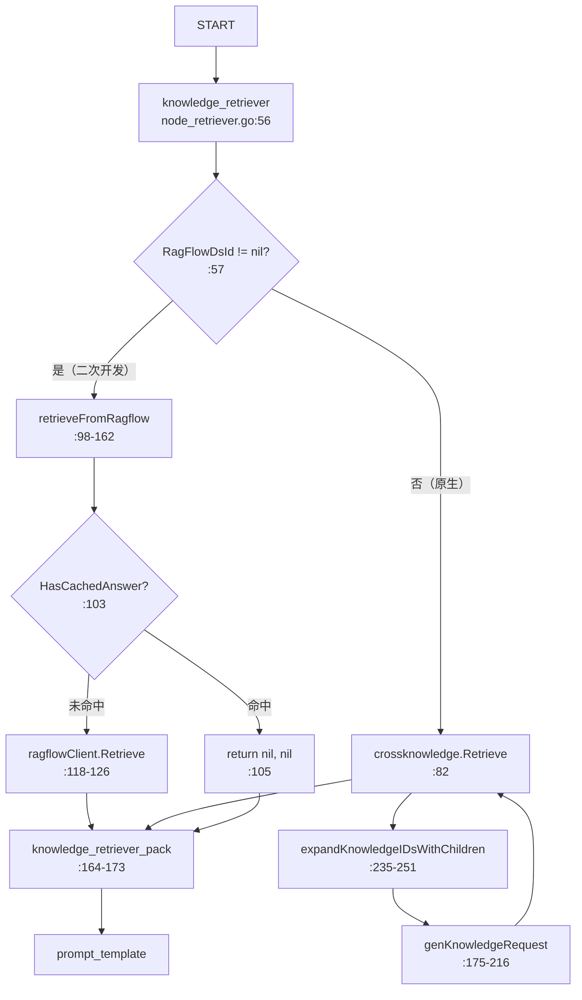

#### 通道 A（原生 Coze 知识库）

关键在 `genKnowledgeRequest`（`:175-216`），它把 IDL 配置翻译成检索策略：

| 配置项 | 翻译逻辑 | 位置 |
|--------|---------|------|
| `Auto` | `true` → `SelectTypeAuto`；否则 `SelectTypeOnDemand` | `:186-191` |
| `SearchStrategy` | Semantic=0 → `SearchTypeSemantic`；Hybrid=1 → `SearchTypeHybrid`；FullText=20 → `SearchTypeFullText` | `:193-207` |
| `RecallStrategy.UseRewrite` | → `EnableQueryRewrite` | `:209` |
| `RecallStrategy.UseRerank` | → `EnableRerank` | `:210` |
| `RecallStrategy.UseNl2sql` | → `EnableNL2SQL` | `:211` |
| `TopK` / `MinScore` | 直接透传 | `:183-184` |

> ⚠️ **注意 `SearchStrategy` 的枚举值不是连续的**：`Semantic=0 / Hybrid=1 / FullText=20`（`bot_common.go:789-798`）。这是 IDL 演进留下的坑，`FullText=20` 说明它是后加的。

`expandKnowledgeIDsWithChildren`（`:235-251`）做**父知识库 → 子知识库展开**：调 `MGetChildKnowledgeIDs` 拿 `ParentToChildIDs` 映射，把子库 ID 追加到列表。失败时**静默返回原列表**（`:240-242`）——"查不到子库就用父库"的降级策略。

#### 通道 B（RAGFlow 直连，二次开发）

```go
// node_retriever.go:118-126
resp, err := r.ragflowClient.Retrieve(ctx, &ragflow.RetrieveRequest{
    Question:               req.Input.Content,
    DatasetIDs:             []string{*r.knowledgeConfig.RagFlowDsId},
    TopK:                   topK,
    Page:                   1,
    PageNum:                topK,
    SimilarityThreshold:    0.3,
    VectorSimilarityWeight: 0.7,
})
```

**三个硬编码参数**（`:124-125`）：`SimilarityThreshold=0.3`、`VectorSimilarityWeight=0.7`，`topK` 缺省 **8**（`:114-117`）。这些**没有走配置**，是二次开发时直接写死的。改阈值要改代码。

⚠️ **通道 B 的三个"静默返回 nil"**（`:108-113`、`:130-132`、`:136-138`）：`RagFlowDsId == nil` / `ragflowClient == nil` / `chunks` 类型断言失败，全部返回 `nil, nil`。**不出错，也不召回**——线上表现为"知识库突然不生效了"，日志里没有任何 error。

⚠️ **一个本地缓存短路**（`:100-106`）：如果 `ctx.Value("req")` 非空且 `modelbuilder.HasCachedAnswer(...)` 命中问答缓存，**直接返回 nil 跳过 RAGFlow 检索**。注意这个判断依赖 `ctx.Value("req")` 这个**非类型安全的 context key**——这是很脆弱的耦合。

#### 打包：`PackRetrieveResultInfo`

```go
// node_retriever.go:164-173
func (r *knowledgeRetriever) PackRetrieveResultInfo(ctx context.Context, docs []*schema.Document) (string, error) {
	packedRes := strings.Builder{}
	for idx, doc := range docs {
		if doc == nil { continue }
		packedRes.WriteString(fmt.Sprintf("---\nrecall slice %d: %s\n", idx+1, doc.Content))
	}
	return packedRes.String(), nil
}
```

格式极简：`---\nrecall slice N: <content>\n`。它被挂成 `keyOfKnowledgeRetrieverPack` 节点并 `WithOutputKey(placeholderOfKnowledge)`（`agent_flow_builder.go:223-226`），最后在 `chatPrompt` 模板里占位替换。

> 💡 **`doc.Score` 被丢弃了**（`WithScore` 在 `:158` 和 `:230` 都设了，但 Pack 时不输出）。也就是说**相似度分数不会进入 prompt**，模型无法据此判断可信度。

### 5.2 建议回复：一个"假 parser" + 一个"真 parser"

#### 子图结构

```go
// node_suggest_graph.go:62-82
suggestGraph := compose.NewGraph[[]*schema.Message, *schema.Message]()
_ = suggestGraph.AddLambdaNode(keyOfSuggestPromptVariables, ...)
_ = suggestGraph.AddLambdaNode(keyOfSuggestPersonParse, ..., compose.WithOutputKey(keyOfSuggestPersonParse))
_ = suggestGraph.AddChatTemplateNode(keyOfSuggestTemplate, suggestPrompt)
_ = suggestGraph.AddChatModelNode(keyOfSuggestChatModel, chatModel, compose.WithNodeName(keyOfSuggestChatModel))
_ = suggestGraph.AddLambdaNode(keyOfSuggestParser, compose.InvokableLambda(suggestParser), compose.WithNodeName(keyOfSuggestParser))

_ = suggestGraph.AddEdge(compose.START, keyOfSuggestPromptVariables)
_ = suggestGraph.AddEdge(compose.START, keyOfSuggestPersonParse)
_ = suggestGraph.AddEdge(keyOfSuggestPersonParse, keyOfSuggestTemplate)
_ = suggestGraph.AddEdge(keyOfSuggestPromptVariables, keyOfSuggestTemplate)
_ = suggestGraph.AddEdge(keyOfSuggestTemplate, keyOfSuggestChatModel)
_ = suggestGraph.AddEdge(keyOfSuggestChatModel, keyOfSuggestParser)
_ = suggestGraph.AddEdge(keyOfSuggestParser, compose.END)
```

7 个 key 常量（`:32-38`）。注意 **START 分叉出两条边**（`:76-77`）并行，因为有 `AllPredecessor` 触发模式，template 节点会等两者都到齐。

#### 开关逻辑

```go
// node_suggest_graph.go:43-56
isNeedGenerateSuggest := false
agentSuggestionSetting := conf.Agent.SuggestReply
sp := &suggestPersonaRender{}
if agentSuggestionSetting != nil && ptr.From(agentSuggestionSetting.SuggestReplyMode) != bot_common.SuggestReplyMode_Disable {
    isNeedGenerateSuggest = true
    if ptr.From(agentSuggestionSetting.SuggestReplyMode) == bot_common.SuggestReplyMode_Custom {
        sp.persona = ptr.From(agentSuggestionSetting.CustomizedSuggestPrompt)
    }
}
if !isNeedGenerateSuggest {
    return nil, isNeedGenerateSuggest
}
```

`SuggestReplyMode`：`System=0 / Custom=1 / Disable=2 / OriBot=3`（`bot_common.go:587-595`）。只有 `Custom` 才覆盖 persona；`System` 用内置 `SUGGESTION_PROMPT_JINJA2`（`:57-60`）。

#### 🔑 关键发现：`suggestParser` 是空函数！

```go
// node_suggest_parser.go:25-28
func suggestParser(ctx context.Context, message *schema.Message) (*schema.Message, error) {
	return message, nil
}
```

**原样返回，什么都不做。** 那 JSON → 三条建议的解析在哪？在 **callback** 里：

```go
// callback_reply_chunk.go:376-402
func convSuggestionNodeCallbackOutput(output callbacks.CallbackInput) []*schema.Message {
	var sg []*schema.Message
	switch so := output.(type) {
	case *schema.Message:
		if so.Content != "" {
			var suggestions []string
			err := json.Unmarshal([]byte(so.Content), &suggestions)
			if err == nil && len(suggestions) > 0 {
				for _, suggestion := range suggestions {
					sm := &schema.Message{
						Role: so.Role, Content: suggestion, ResponseMeta: so.ResponseMeta,
					}
					sg = append(sg, sm)
				}
			}
		}
	...
```

> 这完美印证了第三讲的结论：**图的内部返回值对外部毫无意义，一切出口都在 callback**。子图的 `END` 输出（`*schema.Message`，一条含 JSON 数组的字符串）根本没人用；真正被消费的是 `OnEnd` 回调里的 `json.Unmarshal` 拆分结果。
>
> 副作用是：**如果模型返回的不是合法 JSON 数组**，`:386` 的 `err == nil` 不成立，`sg` 保持 `nil` → **建议静默消失**。没有日志，没有报错。

#### 输入侧：`suggest_pre_input_parse` 的 state 拼接

```go
// agent_flow_builder.go:238-243
_ = g.AddLambdaNode(keyOfSuggestPreInputParse, compose.ToList[*schema.Message](),
    compose.WithStatePostHandler(func(ctx context.Context, out []*schema.Message, state *AgentState) ([]*schema.Message, error) {
        out = append(out, state.UserInput)
        return out, nil
    }),
)
```

`state.UserInput` 是在 `persona_render` 节点的 `WithStatePreHandler` 里存进去的（`:205-208`），`ToList` 把单个 `*schema.Message` 变成切片，再把**原始用户输入**追加进去。

> 所以建议子图的输入是 **`[模型回复, 用户原始问题]`** 两条消息——它既要看到回答了什么，也要看到问了什么。这是 `AgentState` 这个本地 state 存在的唯一理由（`:199-201` `WithGenLocalState`）。

### 第五讲小结：知识进主线、建议出主线，解析都在 callback

| 项 | 内容 |
|----|------|
| **一句话定位** | 知识检索双通道（原生知识库 / RAGFlow 直连）→ pack → prompt；建议子图接在 agent 之后，**解析在 callback 而非 parser 节点** |
| **输入** | `AgentRequest`（知识）/ `[模型回复, 用户原问题]`（建议） |
| **输出** | `[]*schema.Document` → 打包字符串（知识）/ JSON 数组 → 拆分后的多条 Message（建议） |
| **三个最值得记住的点** | ① `RagFlowDsId != nil` 是双通道的分叉点（`node_retriever.go:57`）；② `suggestParser` 是**空函数**（`node_suggest_parser.go:25-28`），真解析在 `callback_reply_chunk.go:376-402`；③ 建议解析失败**静默丢失**，无日志 |

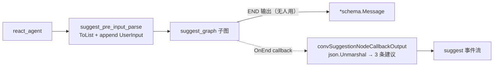

---

## 第六讲：发布与端到端 —— 从草稿到线上

### 先说人话：发布是"把草稿复制成版本"，不是"切换状态"

Coze 的 Agent 有**三形态**（第一讲）：`SingleAgentDraft`（草稿）、`SingleAgentVersion`（版本，不可变）、`SingleAgentPublish`（发布记录）。它们**在数据库里是三份数据**（`model.SingleAgentDraft` / `SingleAgentVersion`），不是一张表的 status 字段。

`PublishAgent`（`application/singleagent/publish.go:42-143`）就是把草稿"固化"成新版本，再绑定到各渠道。

### 6.1 发布七步

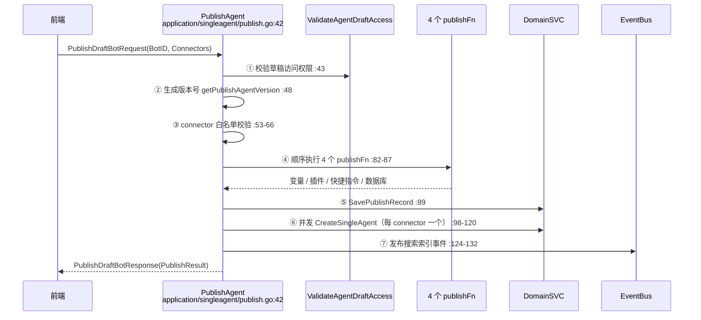

#### ① 权限校验（`:43`）
`ValidateAgentDraftAccess` 确认当前用户对 `BotID` 的草稿有访问权。

#### ② 版本号生成（`:48` → `:145-159`）

```go
func (s *SingleAgentApplicationService) getPublishAgentVersion(ctx context.Context, req *developer_api.PublishDraftBotRequest) (string, error) {
	...
	v, err := s.appContext.IDGen.GenID(ctx)
```

**用 IDGen 生成一个 ID 当版本号**，不是自增数字也不是语义化版本。所以 Coze 的版本号是那种很长的数字串。

#### ③ Connector 白名单（`:53-66`）

```go
if !entity.PublishConnectorIDWhiteList[id] {
    return nil, errorx.New(errno.ErrAgentPermissionCode, errorx.KV("msg", fmt.Sprintf("connector %d not allowed", id)))
}
```

白名单在 `domain/agent/singleagent/entity/publish.go:24-27`，只有 **WebSDK / API** 两个。其他渠道（如飞书、Discord）不在 Agent 发布路径里。

#### ④ 四个 publishFn 顺序执行（`:75-87`）

```go
publishFns := []publishFn{
    publishAgentVariables,   // :210-225 变量 PublishMeta
    publishAgentPlugins,     // :227-234 插件 PublishAgentTools
    publishShortcutCommand,  // :236-249 快捷指令 PublishCMDs
    publishDatabase,         // :252-259 数据库 PublishDatabase
}
for _, pubFn := range publishFns {
    draftAgent, err = pubFn(ctx, s.appContext, p, draftAgent)
    if err != nil { return nil, err }
}
```

**顺序执行、任一失败即中断**，且每个函数都返回新的 `draftAgent`（函数式风格，把版本信息写回实体）。

> 💡 注意 `publishAgentVariables` 里有个 **ID 重生成**：`appContext.VariablesDomainSVC.PublishMeta(ctx, *draftAgent.VariablesMetaID, publishInfo.Version)`（`:217`）返回 `newVariableMetaID`——变量元数据的 ID **在发布时会变成新的**，因为变量是"跟随版本"的（第一讲的 `Version` 字段可见端倪）。

#### ⑤ 保存发布记录（`:89`）

`SavePublishRecord(ctx, p, draftAgent)` 落 `SingleAgentPublish` 表。

#### ⑥ 并发绑定到各 channel（`:94-122`）—— ⚠️ 这里有并发 bug

```go
tasks := taskgroup.NewUninterruptibleTaskGroup(ctx, len(connectorIDs))
publishResult := make(map[string]*developer_api.ConnectorBindResult, len(connectorIDs))
lock := sync.Mutex{}

for _, connectorID := range connectorIDs {
    tasks.Go(func() error {
        _, err = s.DomainSVC.CreateSingleAgent(ctx, connectorID, version, draftAgent)   // :100  ← 注意是 err = 不是 err :=
        if err != nil { ... return err }
        lock.Lock()
        publishResult[conv.Int64ToStr(connectorID)] = ...
        lock.Unlock()
        return nil
    })
}
_ = tasks.Wait()   // :122 ← 错误被丢弃
```

**两个问题**：

1. **`:100` 用的是外层 `err` 变量**（`err =` 而非 `err :=`）。多个 goroutine **并发写同一个 `err`**，这是标准的数据竞争（`go test -race` 会报）。而且逻辑上：goroutine A 成功把 `err` 置 nil，可能**覆盖** goroutine B 刚写入的错误，导致 B 的失败被"抹掉"。
2. **`:122` `_ = tasks.Wait()` 丢弃了 TaskGroup 返回的错误**。所以任何一个 connector 的发布失败**都不会让接口返回失败**——只能从 `publishResult` 里逐个看 `PublishResultStatus_Failed`（`:104-106`）来判断。

> 🔑 换句话说：**Coze 的 Agent 发布是"部分成功"语义**。接口永远返回 200，前端必须遍历 `PublishResult` 才知道哪个渠道挂了。这在设计上说得通（一个渠道失败不该回滚其他渠道），但 `err` 共享变量是纯粹的 bug——应该写 `_, cErr := ...`。

#### ⑦ 发布搜索事件（`:124-132`）

```go
err = s.appContext.EventBus.PublishProject(ctx, &search.ProjectDomainEvent{
    OpType: search.Updated,
    Project: &search.ProjectDocument{
        ID:            draftAgent.AgentID,
        HasPublished:  ptr.Of(1),
        PublishTimeMS: ptr.Of(time.Now().UnixMilli()),
        Type:          common.IntelligenceType_Bot,
    },
})
if err != nil {
    logs.CtxWarnf(ctx, "publish project event failed, agentID: %d, err : %v", draftAgent.AgentID, err)
}
```

**索引更新失败只打 Warn 不中断**（`:133-135`）——这是正确的取舍：搜索索引是最终一致的，不应该阻塞发布。

### 6.2 端到端：一次对话的 12 跳

把六讲串起来，从 HTTP 请求到 SSE 事件：

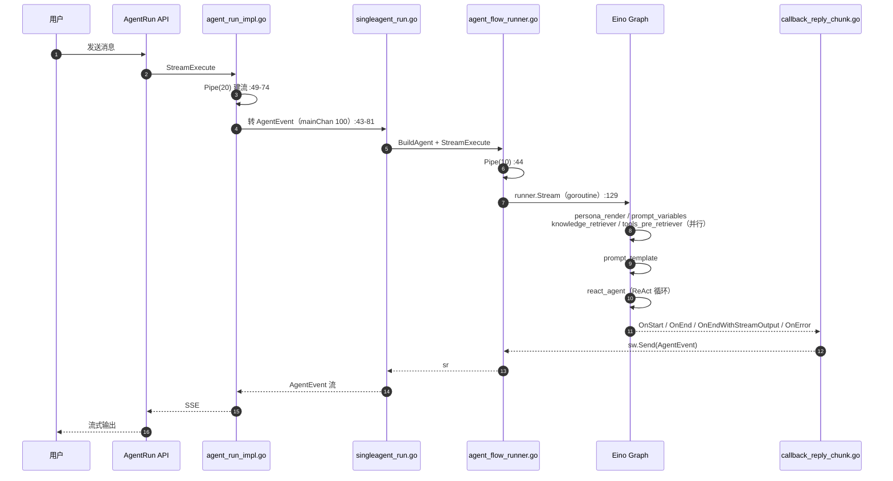

**12 个关键跳转点**：

| # | 位置 | 做什么 |
|---|------|--------|
| 1 | `agent_run_impl.go:49-74` | 建会话侧 Pipe(20) |
| 2 | `singleagent_run.go:43-81` | mainChan(100) 转 `*entity.AgentEvent` |
| 3 | `agent_flow_runner.go:44` | 建 agentflow 侧 Pipe(10) |
| 4 | `agent_flow_builder.go:63-285` | `BuildAgent` 构图 |
| 5 | `agent_flow_runner.go:129` | goroutine 内 `runner.Stream`（**返回值丢弃**） |
| 6 | `callback_reply_chunk.go` 各 handler | 8 种事件生成 |
| 7 | `agent_flow_runner.go:186-189` | 非目标节点 `output.Close()` |
| 8 | `node_retriever.go:56-93` | 知识双通道检索 |
| 9 | `node_tool_pre_retriever.go:112-134` | 伪造 ToolCall/ToolMessage 对 |
| 10 | `agent_flow_builder.go:177-189` | ReAct Agent 导出子图 |
| 11 | `node_suggest_parser.go:25-28` | 空 parser（摆设） |
| 12 | `callback_reply_chunk.go:376-402` | 真正的建议解析 |

### 6.3 三个反直觉的全局结论

1. **输出不靠返回值，靠 callback**（`agent_flow_runner.go:129`）。想在 Coze Agent 里加一种新的流式输出，你改的不是图的节点，而是 **callback handler**。
2. **能力由配置的有无决定，不由开关决定**：有工具才有 ReAct（`agent_flow_builder.go:165-171`）、有变量才有变量工具（`:140`）、`SuggestReplyMode != Disable` 才有建议子图（`node_suggest_graph.go:47`）。**删掉配置项 = 删掉代码路径**。
3. **错误大量被静默**：`tasks.Wait()` 丢弃（`:122`）、建议解析失败无日志（`:386`）、RAGFlow 三处 `nil, nil`（`node_retriever.go:108-113/130-132/136-138`）、变量工具失败返回 `"fail", nil`（`node_tool_variables.go:124`）。排查线上问题时要**主动加日志**，不能指望现有 error 通道。

### 第六讲小结：发布是"复制 + 并发绑定"，端到端是"Pipe 套 Pipe"

| 项 | 内容 |
|----|------|
| **一句话定位** | `PublishAgent` 七步把草稿固化为版本并并发绑定渠道；端到端是 `mainChan(100) → Pipe(10) → Pipe(20)` 三层流 |
| **输入** | `PublishDraftBotRequest`（发布）/ `AgentRequest`（运行） |
| **输出** | `PublishDraftBotResponse`（含每渠道结果）/ `*schema.StreamReader[*entity.AgentEvent]` |
| **三个最值得记住的点** | ① `publish.go:100` 并发共享 `err` 是真实 bug；② `_ = tasks.Wait()`（`:122`）意味着**发布是部分成功语义**；③ 版本号由 `IDGen.GenID` 生成（`:151`），不是语义化版本 |

---

## 附：学习路线、复习卡与文件索引

### 学习路线（建议 3 天）

**Day 1 —— 跑通主链路（横向）**
1. `domain/agent/singleagent/internal/agentflow/agent_flow_builder.go` 全文件读一遍（299 行），把 10 个 key 常量和边关系画成图；
2. `agent_flow_runner.go` 读 `StreamExecute`（约 200 行），重点看 `:129` 的返回值丢弃；
3. `callback_reply_chunk.go` 扫一遍所有 `conv*` 函数，理解"回调即输出"。

**Day 2 —— 拆支线（纵向）**
4. 知识：`node_retriever.go` 双通道 + `genKnowledgeRequest` 策略翻译；
5. 工具：`node_tool_database.go`（表名校验）→ `node_tool_pre_retriever.go`（伪造消息对）；
6. 建议：`node_suggest_graph.go` → `node_suggest_parser.go`（空的）→ `callback_reply_chunk.go:376-402`（真的）。

**Day 3 —— 上升到架构**
7. `application/singleagent/publish.go` 发布七步，自己找 `err` 竞争点；
8. 回到第一讲的数据模型，确认 Draft/Version/Publish 在库里是三份；
9. 对照 eino v0.4.8 的 `compose` 包，理解 `AllPredecessor`、`WithOutputKey`、`WithStatePreHandler` 三个机制。

### 30 张复习卡

| # | 问题 | 答案 | 出处 |
|---|------|------|------|
| 1 | 主图入口节点有几个？ | 4 个（persona_render / prompt_variables / knowledge_retriever / tools_pre_retriever）都从 START 出边 | `agent_flow_builder.go:247-250` |
| 2 | 什么条件下退化成裸 LLM？ | `len(agentTools) == 0` | `:165-171` |
| 3 | checkpoint 什么时候开启？ | 有工具时 `requireCheckpoint = true` | `:167` |
| 4 | 模型能力不达标会怎样？ | 直接报错 "does not support function call" | `:168-170` |
| 5 | Node 触发模式？ | `AllPredecessor` | `:272` |
| 6 | `AgentState` 存什么？ | `UserInput`（供建议子图用） | `:199-208` |
| 7 | `runner.Stream` 的返回值去哪了？ | 被丢弃 `_, _ =` | `agent_flow_runner.go:129` |
| 8 | 非目标节点为什么要 Close？ | 否则上游流不回收 | `:186-189` |
| 9 | agentflow 侧 Pipe 容量？ | 10 | `callback_reply_chunk.go:44` |
| 10 | 会话侧 Pipe 容量？ | 20 | `agent_run_impl.go:49-74` |
| 11 | mainChan 容量？ | 100 | `singleagent_run.go:43-81` |
| 12 | 数据库工具怎么防越权？ | 运行期解析 SQL 表名并与绑定表名比对 | `node_tool_database.go:82-88` |
| 13 | 数据库工具有几个？ | 每个表一个（工具名=表名） | `:116-136` |
| 14 | `promptDisabled` 时返回什么？ | 字符串 "the tool to be called is not available"，error 为 nil | `:73-75` |
| 15 | 草稿态用什么表？ | `TableType_DraftTable` | `:77-80` |
| 16 | 变量工具叫什么？ | `setKeywordMemory` | `node_tool_variables.go:80` |
| 17 | 变量工具什么时候挂？ | `len(avs) > 0` | `agent_flow_builder.go:140` |
| 18 | 变量工具失败怎么办？ | 返回 `"fail", nil` | `node_tool_variables.go:124` |
| 19 | 插件 `ExecScene` 怎么定？ | `isDraft` → DraftAgent / OnlineAgent | `node_tool_plugin.go:127-132` |
| 20 | `ExecDraftTool` 值？ | 硬编码 `false` | `:124` |
| 21 | return-directly 怎么实现？ | `TerminatePlan()==UseAnswerContent` 的工具名进 set，交给 ReAct | `node_tool_workflow.go:50-58` |
| 22 | 预调用工具怎么注入上下文？ | 伪造 ToolCall + ToolMessage 对，ID 为 `call_<uuid>` | `node_tool_pre_retriever.go:112-134` |
| 23 | 预调用插件少了什么？ | `WithPluginHTTPHeader(conversationID)` | 对比 `:139` vs `:70-77` |
| 24 | 知识双通道分叉条件？ | `RagFlowDsId != nil` | `node_retriever.go:57` |
| 25 | RAGFlow 三个硬编码值？ | `SimilarityThreshold=0.3` / `VectorSimilarityWeight=0.7` / 默认 topK=8 | `:124-125` / `:114-117` |
| 26 | 父知识库怎么展开子库？ | `MGetChildKnowledgeIDs` + 追加，失败静默降级 | `:235-251` |
| 27 | 检索结果的 score 进 prompt 吗？ | 不进（`PackRetrieveResultInfo` 只拼 content） | `:164-173` |
| 28 | `suggestParser` 做了什么？ | 什么都不做，原样返回 | `node_suggest_parser.go:25-28` |
| 29 | 建议真正解析在哪？ | callback 里 `json.Unmarshal` | `callback_reply_chunk.go:376-402` |
| 30 | 建议解析失败会怎样？ | `sg` 为 nil，建议静默消失，无日志 | `:386` |

### 文件索引

| 文件 | 行数 | 职责 |
|------|------|------|
| `domain/agent/singleagent/internal/agentflow/agent_flow_builder.go` | 299 | **核心**：`BuildAgent` 构图，10 个 key 常量 |
| `.../agent_flow_runner.go` | ~200 | `StreamExecute` 运行期入口 |
| `.../callback_reply_chunk.go` | 403 | **核心**：8 种事件的回调转换，建议真解析 |
| `.../node_persona_render.go` | — | persona Jinja2 渲染 |
| `.../node_prompt_variables.go` | — | 提示词变量装配 |
| `.../node_chat_prompt.go` | — | `chatPrompt` 模板 |
| `.../node_retriever.go` | 251 | **核心**：知识双通道检索 + 打包 |
| `.../node_tool_pre_retriever.go` | 138 | **核心**：预调用工具 + 伪造消息对 |
| `.../node_tool_plugin.go` | 148 | 插件工具 |
| `.../node_tool_workflow.go` | 64 | 工作流工具 + return-directly |
| `.../node_tool_database.go` | 301 | 数据库工具 + SQL 表名校验 |
| `.../node_tool_variables.go` | 130 | 变量工具 `setKeywordMemory` |
| `.../node_tool_knowledge.go` | 114 | ⚠️ **死代码**：未被调用的 `recallKnowledge` 工具 |
| `.../node_suggest_graph.go` | 85 | 建议子图（7 个 key） |
| `.../node_suggest_parser.go` | 28 | ⚠️ 空 parser |
| `.../node_suggest_persona_render.go` | — | 建议 persona |
| `.../node_suggest_prompt_variable.go` | — | 建议变量 |
| `.../suggest_prompt.go` | — | `SUGGESTION_PROMPT_JINJA2` |
| `.../system_prompt.go` | — | 系统提示词 |
| `application/singleagent/publish.go` | 260 | **核心**：`PublishAgent` 七步 |
| `domain/agent/singleagent/service/publish.go` | 155 | 领域层发布 |
| `domain/agent/singleagent/entity/publish.go` | 41 | 发布实体 + connector 白名单 |
| `application/singleagent/create.go` | — | 默认值（TopK=1 / MinScore=0.01 / 历史 30 轮） |
| `crossdomain/agent/model/single_agent.go` | — | 跨域模型 + Interrupt 类型枚举 |
| `api/model/app/bot_common/bot_common.go` | 9008 | IDL 生成模型 |

---

> **版本基准**：commit `5ec991c4be724b4fba2d511dc164884e86edef05`，eino `v0.4.8`（`go.mod:20`），`bot_common.go` 9008 行。
> 所有 `文件:行号` 均可用 `verify_citations.py` 校验。
