> 基于对 `internal/parser`、`internal/ingestion`、`internal/rag` 等源码的逐文件精读整理而成。
>   
> 阅读顺序即学习顺序：解析 → 分块 → 组件边界 → 任务编排 → 抽取 → 检索 → 知识编译/Agentic 检索。
>   
> 所有结论均标注了源文件位置，建议对照代码阅读。

---

## 目录

- [〇、全景地图](#〇全景地图)
- [面试速通：RAGFlow 高频问题一页纸](#面试速通ragflow-高频问题一页纸)
- [第一讲：internal/parser —— 解析与分块基础库](#第一讲internal-parser--解析与分块基础库)
- [第二讲：chunk 包逐行精读 —— 三阶段流水线](#第二讲chunk-包逐行精读--三阶段流水线)
- [第三讲：GeneralChunker —— 生产分块的"消费现场"](#第三讲generalchunker--生产分块的消费现场)
- [第四讲：Parser 组件 —— 组件边界与规范化](#第四讲parser-组件--组件边界与规范化)
- [第五讲：任务编排 —— 上游 Pipeline 与下游落库](#第五讲任务编排--上游-pipeline-与下游落库)
- [第六讲：Ingestor —— 任务派发与 NATS 消费](#第六讲ingestor--任务派发与-nats-消费)
- [第七讲：LLM 抽取链路 —— Extractor 与 KnowledgeCompiler](#第七讲llm-抽取链路--extractor-与-knowledgecompiler)
- [第八讲：检索侧 —— chunk 怎么被搜回来](#第八讲检索侧--chunk-怎么被搜回来)
- [第九讲：知识编译与 Agentic RAG —— 原理与端到端演算](#第九讲知识编译与-agentic-rag--原理与端到端演算)
- [第十讲：Agentic RAG 全流程精讲](#第十讲agentic-rag-全流程精讲)
- [第十一讲：知识编译全流程精讲](#第十一讲知识编译全流程精讲)
- [第十二讲：演进史与速查 —— Python → Go 迁移 / 模板清单 / 参数总表](#第十二讲演进史与速查--python--go-迁移--模板清单--参数总表)
- [附：学习路线与复习卡汇总](#附学习路线与复习卡汇总)

---

## 〇、全景地图

```
┌──────────────────────── 编排层 ────────────────────────┐
│ NATS JetStream (tasks.> )                              │
│   └► Ingestor.consumeLoop (worker 池派发, 防预取)        │
│        └► PipelineExecutor.Execute                     │
│             inputs{doc_id,tenant_id,kb_id,lang}         │
│             + ParserConfig(override_params)             │
│        └► Pipeline.Run: Compile(DSL+override)           │
│             SeedIngestionGlobals / SetTaskID            │
└───────────────────────────┬────────────────────────────┘
                            ▼
┌───────────────── 组件层（边界协议: map[string]any / JSON）─────────────────┐
│ File ──► Parser ──► Chunker ──► Tokenizer ──► Extractor(可选,≤1个)        │
│ 身份证   解析+规范化   两刀+合并      token+向量      LLM 抽取+per-chunk缓存 │
└──────────────────────────────┬───────────────────────────────────────────┘
                               ▼
┌──────────────────────── 落库层 ────────────────────────┐
│ processOutput → chunkIndexWriter(批+尾批refresh+重试+补偿) │
│ → engine.InsertChunks → ES/Infinity: ragflow_<tenant>   │
│ → 任务 COMPLETED → KnowledgeCompiler 消费者合并编译产物    │
└──────────────────────────────┬─────────────────────────┘
                               ▼
┌──────────────────────── 检索层 ────────────────────────┐
│ RetrievalService.Search: fulltext / vector / hybrid    │
│ + Fusion 融合 + promoteChildren 子升父 + agentic-rag    │
└────────────────────────────────────────────────────────┘
```

渲染友好版（GitHub/GitLab 直接出图，信息同上图）：

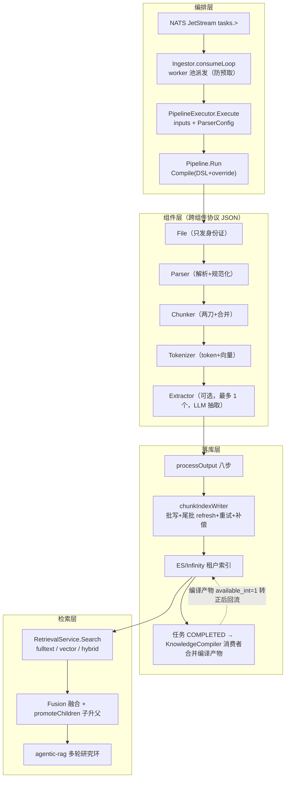

**三条主线**：

1. **数据流**：binary → ParseResult → JSON items → chunks(带向量) → 索引文档
2. **控制流**：NATS 消息 → worker → Pipeline → 组件 → 落库 → 终态标记
3. **恢复流**：失败重试 → 组件级 per-chunk 缓存命中 → 不重付 LLM/embedding 费用

---

## 面试速通：RAGFlow 高频问题一页纸

> **先给结论**：RAGFlow 的 Go ingestion 是一条「NATS 触发、Pipeline 编排、JSON 组件协议、每租户索引落库」的链路；知识编译（写侧深加工）与 Agentic RAG（读侧深检索）挂在同一链路两端，靠 `available_int` 两段式可见性与 CompiledExpander 交汇。
>
> 被追问细节时按讲次展开：第一至四讲（解析 / 分块 / 组件边界）→ 第五、六讲（编排 / 落库 / 派发）→ 第七讲（LLM 抽取与编译消费者）→ 第八讲（检索侧）→ 第九至十一讲（知识编译与 Agentic RAG 的原理与精讲）→ 第十二讲（演进史与参数速查）。
>
> 如果只记三条：**DB 是真相源（NATS 只是传输层）、编译产物 `available_int` 两段式可见性、routeSCA 记录优先于 verdict**。
>
> 本页所有结论均摘自本文档各讲小结与正文，不引入文档之外的知识点；先记表，被追问再按「深入」列翻对应讲次。

### 高频 Q&A（先结论）

下表 16 题按「上传 → 编排 → 落库 → 编译 → 检索」的主线排列，覆盖 RAGFlow / RAG 最高频考点。

| # | 面试问题 | 一句话结论 | 深入 |
|---|---------|-----------|------|
| 1 | 文档解析的完整链路是什么？ | 上传入队（DB 状态机 + NATS JetStream 发布）→ Ingestor consumeLoop 派发 → PipelineExecutor 装配 `doc_id/tenant_id/kb_id/lang` → Pipeline 跑 File→Parser→Chunker→Tokenizer → processOutput 八步落库 → 任务标记 COMPLETED | 第五、六讲 |
| 2 | NATS JetStream 是任务队列吗？DB 和 MQ 谁说了算？ | DB 是任务 durable source of truth，NATS 只是传输层；ingestor 重启靠 `ScheduleCreatedTasks` 把 DB 里 CREATED 状态的任务重新入队；编译侧租约 TTL 2min、心跳 20s，同一 KB 串行处理 | 第六、七讲 |
| 3 | worker 派发怎么防止预取？ | 「先等空闲 worker、再拉消息」：每个 ingestor 同时只有 1 个 outstanding broker 请求；拉取失败还 worker + 1s 退避防 CPU 空转；停机交接被打断时 Nack 让消息回队列 | 第六讲 |
| 4 | Parser 组件的输出契约是什么？失败时返回什么？ | 跨组件协议是 JSON（`map[string]any` 经 Marshal→Unmarshal 往返重建强类型，schema 的 json tag 即线协议），构造期无条件钉死 `output_format="json"`；`Err != nil` 时所有载荷字段为零值——失败不返回部分结果 | 第一、四讲 |
| 5 | 分块有哪几种策略？ | sentence / char / paragraph / length 四种，空或未知策略静默降级为 sentence；三阶段流水线 preprocess→split→postprocess，每阶段只读上阶段输出字段、只写自己的字段，`Origin` 永不被修改 | 第二讲 |
| 6 | `chunk_token_size=512` 指什么？ | general（naive）模板核心参数：512 token/块，生产分块由 GeneralChunker 消费（BPE token 预算）；`children_delimiters` 切子块，构成母子块结构 | 第十二讲 |
| 7 | 母子块（Mom）结构怎么落地？ | ingestion 时 `MaterializeParentChunks` 把父子关系物化成父 chunk 文档写入索引，检索时 `promoteChildren` 把命中的子块提升回父 chunk——ingestion 时备好父块，检索时才能升父 | 第五、八讲 |
| 8 | chunk 写入索引有什么讲究？ | 三策略：普通批 `InsertChunksNoRefresh` + 尾批 `InsertChunks` refresh（消灭「完成但搜不到」窗口）；三次指数退避重试 100/200/400ms（ctx.Done 优先）；失败补偿删除已写入 id 消灭半截文档；每租户一个索引 `ragflow_<tenant>` | 第五讲 |
| 9 | 知识编译有哪四个变体？ | structure（两段式先实体后关系）/ wiki（MAP→REDUCE→PLAN→REFINE）/ tree（RAPTOR 递归摘要树）/ mindmap（LLM 思维导图）；变体由编译模板 kind 推导而非 DSL 指定；GraphRAG / RAPTOR 自 v0.27.0 起分别并入 Graph / Tree 模板 | 第九、十一讲 |
| 10 | wiki 的四阶段各干什么？ | MAP 按 token 预算 2048/批分批 LLM 抽取（进程级 vCPU 大小共享编译池）；REDUCE 纯代码跨批归并不调 LLM；PLAN 规划页面（entity 模式每实体一页）；REFINE 逐页 LLM 精修，物化时批量 embedding + CosineDecider 判重（过线 UPDATE、不过线 INSERT） | 第九、十一讲 |
| 11 | 编译产物怎么做到先隐形后可见？ | `available_int` 两段式：文档 pipeline 产出后 `markCompiledProductsHidden` 以 0 隐形入库，任务 COMPLETED 后数据集级 Consumer 合并转正为 1 才检索可见——防消费者与索引 refresh 赛跑读到不完整视图 | 第五、七讲 |
| 12 | Extractor 和 KnowledgeCompiler 有什么区别？ | Extractor 是文档内组件（pipeline 图内，逐 chunk LLM 抽取，全图至多 1 个）；KnowledgeCompiler 是 dataset 级消费者（文档任务全部 COMPLETED 后才运行）——前者靠 per-chunk 缓存（key = 任务类型+模型ID+chunkID+系统提示词），后者靠 Claimer 认领防重复编译 | 第七讲 |
| 13 | 混合检索怎么融合 BM25 和向量？ | `MatchTextExpr`（BM25 全文）+ `MatchDenseExpr`（`q_<dim>_vec` cosine + similarity 阈值）经 `FusionExpr` weighted_sum 融合（权重如 0.2,0.8，atan 归一化）；查询向量必须 `Query: true` 非对称编码；hybrid 无结果时用更低阈值重试 | 第八讲 |
| 14 | Agentic RAG 的四档模式和五阶段图？ | 四档 low/medium/high/ultra（SCA 轮数 0/3/3/5，每查询 snippet –/6/8/10，ultra 多 graph_explore）；五阶段图 formalize_question → [planner → prefetch] → (rag_agent → draft → sca)* 研究环 → formalize_answer，一轮研究 = 3 次节点访问 | 第九、十讲 |
| 15 | routeSCA 靠什么决定要不要再来一轮？ | 由记录决定：unresolved slots ∪ gaps 非空 ∧ `LastRoundNew>0` 就来一轮——即使 reviewer 说 SUFFICIENT（verdict 只是一票）；NoProgress（选中视图 hash 不变）则关闭；枚举型问题硬限 2 轮 | 第九、十讲 |
| 16 | 编译产物和证据是什么关系？ | 编译产物是导航索引不是答案本体：CompiledExpander 命中普通 chunk 后用问题向量查产物行，命中行带 `source_chunk_ids`，顺链把指向的原始 chunk 拉进证据集——组稿引用仍指向原文，保引用可溯 | 第九、十讲 |

### 易错点与面试坑

- **编译产物「夹带私货」进主流 chunk 流**：Compiler 输出 schema 与上游 chunker 逐字节一致（`output_format:"chunks"`），编译产物转成 chunk 形状合并进主流，下游 Tokenizer 照常消费、无感知。
  为此 `chunkerOutputs` 在本包重新声明而不 import chunker 包——避免拖进 chunker 的 CGO 依赖，这是「重新声明而非复用」的显式代价。
  标准句：「Compiler 是 chunk 流里一个夹带私货的中间人；产物走完 Tokenizer 后照常落库，先 `available_int=0` 隐形，再由数据集级消费者转正」。
- **Dense 腿必须命名传参**：CompiledExpander 查编译产物行的硬约束是 `num_candidates=max(topN,256)`、`similarity=0.1`——位置参数写反会把 HNSW 候选列表压塌、静默摧毁召回。
  阴险之处在于它不报错、只是召回变差，线上很难察觉，所以源码里专门挂了警告注释。
  面试标准答：命名传参 + 候选下限 256 + 相似度 0.1，三件套缺一即压塌候选列表。
- **没有 pipeline 级 checkpoint**：重试每次从头跑图，省钱全靠组件级 per-chunk 缓存（Extractor 的 LLM 结果、wiki MAP 的中间产物都在里面）。
  且 `chunkcache.PurgeTask` 必须晚于所有可失败步骤——失败不清缓存，重试才不重付 LLM / embedding 费用。
  在 processOutput 八步里 PurgeTask 是第 ⑧ 步，前七步任何一步失败都不清。
  manifest 注册依赖 Pipeline 的 `SetTaskID`：不设则清理变 no-op，孤儿条目活到 7 天 TTL。
- **wiki 变体唯一断点恢复点是 MAP 的 per-chunk 不可变版本缓存**：REDUCE 及之后没有断点——《蜀汉人物志》5 chunks 按 2048 token/批分 2 批 MAP，任一批失败只需重跑该批。
  这正是「无 pipeline 级 checkpoint、重试靠组件级缓存」在编译链路的落地处。
  回答时把两层缓存一起摆出来：Extractor 的 per-chunk LLM 缓存 + wiki MAP 的 per-chunk 版本缓存，且 modelID 进 key、换模型即换 key。
  被问「编译失败重跑会不会重复烧 LLM」——答：命中缓存的批不重复计费。
- **重复投递不假设消息幂等**：redelivery 处理任务超时 / 崩溃后的重新投递，worker 侧 `claimTask` 防重复执行、心跳租约保活；多实例共享同一 JetStream consumer（queue group 语义）也不重复执行。
  根基是「NATS 消息只是触发器，任务数据以 DB 为准」——先给这句，再展开 claimTask 与心跳租约。
  易混点：别和 KC 的 Claimer 租约（TTL 2min / 心跳 20s）搞混，那是数据集级编译的并发控制，两个租约不在同一层。
  另有一条唤醒通道是 memory reconciler（默认 10s 轮询 / 批 100），NATS 之外的兜底。
- **sentence 策略的两个暗坑**：边界字符被丢弃（不写入 chunk），`3.14` 会在 `.` 处误切。
  叠加度量单位三种混用：判断大块用 rune、`buf.Len()` 是字节、paragraph 的 Index 用原始行号。
  后果是中文块提前 flush，实际合并 rune 数比 target 小——被问「merge 目标为什么没达到」就答这条。
  修复纪律在 postprocess：先 merge 再 filter，顺序反了短句会被 min_length 误杀、没机会合并。
- **指针语义 nil ≠ 0**：`SimilarityThreshold` / `KeywordsSimilarityWeight` 传指针，nil（调用方未给）必须保持 nil 让服务用自己的默认值，0 是真实的覆盖。
  取零值地址曾把「阈值 0 / 纯向量权重」强加给所有省略参数的调用方——这是文档记录的真实事故，不是假想。
  通用教训：可选参数要么传指针、要么用 functional option，忌用值类型 + 零值判断；Go 里随手 `&x` 拿零值地址是最常见的触发方式。
- **查询向量必须非对称编码**：`Query: true`（镜像 Python `encode_queries`：Cohere search_query / Voyage query / Jina retrieval.query / NVIDIA query）——用文档编码会把查询向量放错空间。
  同源坑：Extractor 缓存 key 必须含 modelID，空 modelID 会让 `chunkcache.Key` 变成空 key、缓存被静默禁用，所以组件要显式解析模型身份。
  一句话区分：入库用文档编码、查询用 query 编码，两条腿别走错空间。

### 关键数值速记

| 数值 | 含义 | 深入 |
|---|---|---|
| `chunk_token_size=512` | general 模板每块 token 预算 | 第十二讲 |
| `documentBulkSize=32` | 索引写入批量（每 32 条一批） | 第五、十二讲 |
| `chunkInsertAttempts=3` | 写索引重试次数，100/200/400ms 指数退避 | 第五讲 |
| `filename_embd_weight=0.1` | 文件名向量权重 | 第十二讲 |
| `defaultLengthChunkSize=256` | length 策略滑动窗口（runes） | 第二讲 |
| MAP token 预算 2048/批 | wiki MAP 分批 LLM 抽取的单位 | 第九、十一讲 |
| KC 租约 TTL 2min / 心跳 20s | Claimer 租约；同一 KB 同时只有一个租约 → 串行处理 | 第七、十一讲 |
| KNN topK=1024 / numCandidates=2048 / pageSize=30 | RetrievalService.Search 默认参数 | 第八讲 |
| wiki 数据集级合并阈值 0.85 | 跨文档同实体页 KNN 相似判据，过线 UPDATE 合并贡献 | 第九讲 |
| hybrid 融合权重 0.2,0.8 | FusionExpr weighted_sum，atan 归一化 | 第八讲 |
| ES keyword 32766 字节 | 超限按 UTF-8 字符边界截断，防非法 UTF-8 | 第五讲 |
| ActionMaxTurns=8 / 一轮研究 = 3 visits | rag_agent 工具循环上限 / 节点访问预算计量单位 | 第九、十讲 |
| RunTracker / chunkcache TTL 7 天 | 终态标记与缓存孤儿条目存活期 | 第五讲 |
| consumeLoop 1s 拉取超时 + 1s 退避 | 派发循环的节奏控制 | 第六讲 |
| 检索腿向量权重 hybrid 0.3 / vector 1.0 / bm25 0.0 | agentic 三工具的向量权重 | 第八、十讲 |
| memory reconciler 10s 轮询 / 批 100 | NATS 之外的第二条唤醒通道 | 第六讲 |
| `overlapped_percent=0` | general 模板块间重叠比例 | 第十二讲 |
| `delimiters` = `\n ! ? ; 。 ； ！ ？` | general 模板默认分隔符 | 第十二讲 |
| `search_method=["embedding","full_text"]` | Tokenizer 双路产出开关（不含 full_text 则不产全文 token） | 第十二讲 |
| `tree_order` = level-0 簇的平均 chunk 数 | RAPTOR 的「阶」（类比 B+ 树） | 第九、十一讲 |
| 四档 session 轮次 4/8/8/10 | low/medium/high/ultra 的会话轮次上限 | 第九、十讲 |
| ingestor 并发 `RAGFLOW_INGESTOR_MAX_CONCURRENT_WORKERS` | worker 池大小 = 消费并发上限 | 第十二讲 |

---

## 第一讲：internal/parser —— 解析与分块基础库

### 定位

RAGFlow **Go 原生**的「文档解析 + 分块」基础库，对应并正在取代旧 Python 实现的 `deepdoc/parser` 和 `rag/nlp` 部分职责（AGENTS.md 明确的 Python→Go 迁移目标）。

### 目录结构：两个子包，职责分明

```
internal/parser/
├── parser/   ← "格式 → 结构化内容"   （解析层）
└── chunk/    ← "长文本 → chunks"     （分块层）
```

### parser/ —— 格式解析层

**核心契约**（先读这两个文件）：

- `parse_result.go` —— 唯一输出接口：

```go
type ParseResultProducer interface {
    ParseWithResult(ctx context.Context, filename string, data []byte) ParseResult
}
```

`ParseResult` 的 `JSON []map[string]any` 是统一结构化载荷，每个 item 都是 `{text, doc_type_kwd}` 形状（`doc_type_kwd` 取 `text`/`table`/`image`，与 Python 契约对齐）；`Err != nil` 时所有载荷字段为零值。另有 `Markdown/Text/HTML` 三个"待规范化"字段（见第四讲）。

- `parser_type.go` —— 工厂 `GetParser(fileType)`，按 `utility.FileType` 分发到 17 种解析器。

**文件家族分组**：

| 前缀                                            | 家族     | 备注                                                      |
| --------------------------------------------- | ------ | ------------------------------------------------------- |
| `pdf_parser_*`                                | PDF    | 最复杂，多后端（miner/docling/somarel/paddle/tcadp…），带 cgo 构建标签 |
| `docx_*`/`doc_*`/`office_*`                   | Office | `_ir.go` 是中间表示，`_postprocess.go` 是后处理                   |
| `pptx_*`/`ppt_*`                              | PPT    | 同样有 IR 层                                                |
| `xlsx_*`/`xls_*`/`csv_*`                      | 表格     |                                                         |
| `html_*`/`markdown_*`/`text_*`                | 文本类    |                                                         |
| `email_parser.go`                             | 邮件     | 递归重解析附件（限一层防无限递归）                                       |
| `charset.go`/`delimiter.go`/`media_budget.go` | 横切工具   |                                                         |

### chunk/ —— 分块层（详见第二讲）

7 个文件的小包：`chunk_type.go`（Operator 接口 + ChunkContext）、`execute.go`（Run 入口）、`preprocess/split/postprocess.go`（三阶段）、`options.go`（typed 配置）、`delim.go`（分隔符工具）、`helpers.go`。

### 阅读抓手

1. **跟着接口读**：所有解析器实现 `ParseResultProducer`，所有分块阶段实现 `Operator`——理解两个接口就理解 80% 的设计。
2. **注释里有迁移坐标**：大量注释引用 `port-rag-flow-pipeline-to-go.md` 和 Python 源路径，可对照原实现。
3. **注意构建标签**：涉及原生库的文件带 `cgo` 标签，跑测试用 `build.sh` 而非裸 `go test`。

### 第一讲小结：两个接口，两个子包

**一句话定位**：`internal/parser` 是整个 ingestion 的地基——`parser/` 负责「格式 → 结构化内容」，`chunk/` 负责「长文本 → chunks」；理解 `ParseResultProducer` 和 `Operator` 两个接口就理解了 80% 的设计。


**逐环节输入/输出**：

| 环节                    | 输入                    | 输出                                    |
| --------------------- | --------------------- | ------------------------------------- |
| `GetParser(fileType)` | `utility.FileType`    | 17 种解析器之一                             |
| `ParseWithResult`     | filename + `[]byte`   | `ParseResult`；`Err != nil` 时所有载荷字段为零值 |
| `chunk.Run`           | text + `ChunkOptions` | `ResultChunks []ChunkData`            |

**三个最值得记住的点**：

1. `JSON []map[string]any` 是唯一结构化载荷，每个 item 都是 `{text, doc_type_kwd}` 形状，与 Python 契约对齐；
2. `Markdown/Text/HTML` 三个字段是「待规范化」形态，出了组件边界只有 json 一种协议（见第四讲）；
3. 涉及 cgo 的文件用 `build.sh` 跑测试，裸 `go test` 编不过。

---

## 第二讲：chunk 包逐行精读 —— 三阶段流水线

### 数据传送带

```
Run(text, opts)
 │ 构造 ChunkContext{ Origin, TextAfterPreprocess: text }  ← 两字段先指向同一文本
 ├─ [可选] PreprocessOperator: Origin ──► TextAfterPreprocess
 ├─ [必选] SplitOperator:      TextAfterPreprocess ──► SplitChunks []ChunkData
 ├─ [可选] PostprocessOperator: SplitChunks ──merge→ filter→ 重编号→ ResultChunks
 └─ 兜底：ResultChunks 为空但 SplitChunks 非空 → ResultChunks = SplitChunks
```

设计要点：**每个阶段只读上一阶段的输出字段、只写自己的字段**，`Origin` 永不被修改。

### chunk_type.go —— 类型地基

```go
type Operator interface {
    Prepare(ctx *ChunkContext) error   // 本包全部空实现
    Execute(ctx *ChunkContext) error   // 唯一干活的方法
    Finish(ctx *ChunkContext) error    // 空实现
    String() string                    // 配置快照
}

type ChunkContext struct {
    Origin              string      // ① 原始文本，只读
    TextAfterPreprocess string      // ② preprocess 输出
    SplitChunks         []ChunkData // ③ split 输出
    ResultChunks        []ChunkData // ④ 最终结果
}
```

字段平铺而非嵌套 → 跳过某阶段时下一阶段读到"上上个"数据；`Run` 预填 `TextAfterPreprocess` 让 preprocess 可跳过。

### execute.go —— Run 入口

- 三开关全 false → **不装配** preprocess（而非跑恒等算子）。
- split **无条件执行**。
- typed options → DSL map → 构造器解析回来（历史包袱：算子构造器先为 DSL 服务，`Run` 是后加的类型化外壳）。
- L90–92 兜底：保证 `Run` 成功返回时 `ResultChunks` 一定可用。

### preprocess.go —— 文本清洗（固定顺序）

1. `normalizeNewlines`：`\r\n`/`\r` → `\n`，**连续空行压成一个 `\n`**（副作用：开此开关后 paragraph 策略永远见不到连续空行）。
2. `stripWhitespace`：逐行 TrimSpace。
3. `removeEmptyLines`：丢空行。
4. `softLineBreakMerging`（DSL-only，ChunkOptions 未暴露）：按句尾 `[.!?]` 把软换行合并回段落。

### split.go —— 四种策略

分发逻辑：**空或未知 strategy 一律静默降级为 sentence，不报错**。

| 策略          | 逻辑                                                   | 关键细节                                                               |
| ----------- | ---------------------------------------------------- | ------------------------------------------------------------------ |
| `sentence`  | 手写逐 rune 扫描，边界表 `{"。","！","？",".","!","?",";","\n"}` | **边界字符被丢弃**（不写入 chunk）；`3.14` 会在 `.` 处误切                           |
| `char`      | 每 rune 一块                                            | 为配合 merge 的"原子化"，单独用无意义                                            |
| `length`    | rune 滑动窗口 + overlap                                  | overlap 钳位到 `chunkSize-1` 防死循环；提前 break 防纯 overlap 尾巴；默认 256 runes |
| `paragraph` | 按 `\n` 切 + TrimSpace + 丢空段                           | **Index 用原始行号（有空洞）**，靠 postprocess 重编号修复                           |

注意：`boundaries`/`keepSeparators` 字段解析了但 **Execute 未消费**（DSL 占位）；真正的 delimiter 通道在 `delim.go` + 上层 chunker。

### postprocess.go —— merge → filter → 重编号

- 顺序讲究：**先 merge 再 filter**（反过来短句会被 min_length 误杀，没机会合并）。
- `mergeChunks` 贪心合并：单块 ≥ target 独立直通；装不下就 flush；`+1` 是空格分隔符。
  - **度量单位混用警示**：判断大块用 rune 数，`buf.Len()` 却是字节数——中文块会提前触发 flush，实际合并 rune 数比 target 小。
- `filterChunks`：min_length（rune）/ drop_empty / drop_duplicates（保序，首次出现保留）。
- 重编号：修复 Index 空洞 + 回填 Size（注意 `Size` 用的是**字节长度**）。

### delim.go —— delimiter 的独立通道

- **反引号语法**：`` `\n\n` `` 是多字符自定义分隔符（可绕过 chunk_token_num）；裸字符各自是单字符分隔符。
- `CompileDelimiterPatternList(delims, keepBare)`：QuoteMeta 转义 + **按 rune 数降序稳定排序**（长分隔符优先于其短前缀）。
  - 主 `delimiters` 列表（keepBare=false）：裸条目被忽略；
  - `children_delimiters` 列表（keepBare=true）：所有非空条目都切。

### 端到端演算

```go
Run("a\nbb\nccc", ChunkOptions{SplitStrategy:"paragraph", MergeTargetSize:100, FilterMinLength:2, RemoveEmptyLines:true})
// paragraph 切 → ["a","bb","ccc"] → merge(8<100) → "a bb ccc" → filter 保留
// ResultChunks = [{Content:"a bb ccc", Index:0, Size:7}]
```

### 第二讲小结：一条只读上站输出字段的数据传送带

**一句话定位**：三阶段流水线的纪律是「每个阶段只读上一阶段的输出字段、只写自己的字段」，`Origin` 永不被修改。

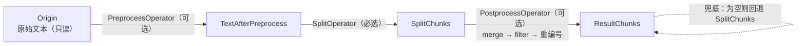

**逐阶段输入/输出**：

| 阶段          | 输入字段                  | 输出字段                  | 关键行为                                                          |
| ----------- | --------------------- | --------------------- | ------------------------------------------------------------- |
| Preprocess  | `Origin`              | `TextAfterPreprocess` | `normalizeNewlines → stripWhitespace → removeEmptyLines`，固定顺序 |
| Split       | `TextAfterPreprocess` | `SplitChunks`         | sentence/char/length/paragraph 四策略；空或未知静默降级 sentence          |
| Postprocess | `SplitChunks`         | `ResultChunks`        | 先 merge 再 filter → 重编号修 Index 空洞 + 回填 Size                    |

**三个最值得记住的点**：

1. **度量单位三种混用**：判断大块用 rune 数、`buf.Len()` 是字节数、paragraph 的 Index 用原始行号——中文块会提前 flush，实际合并 rune 数比 target 小；
2. sentence 策略的边界字符被丢弃（不写入 chunk），`3.14` 会在 `.` 处误切；
3. `boundaries`/`keepSeparators` 解析了但 Execute 未消费（DSL 占位），真正的 delimiter 通道在 `delim.go` + 上层 chunker。

---

## 第三讲：GeneralChunker —— 生产分块的"消费现场"

### 定位

Parser 组件把任意格式规范化成 `output_format="json"` 的结构化 sections（第四讲），**GeneralChunker 是这些 sections 的第一个消费者**：它按 `file_type` 选格式策略，用 BPE token 预算把 sections 切成生产级 chunks，交出 `output_format="chunks"` 给下游 Tokenizer/Extractor（全景地图的 `Parser ──► Chunker ──► Tokenizer` 一环）。

与第二讲的边界必须先说清：第二讲的 `chunk.Run` 是 **rune/char 口径的 DSL 操作库**（CLI 与轻量场景用）；GeneralChunker 是**组件现场**，不调用 `chunk.Run`，只从 chunk 包借 delim 三件套，split/merge/overlap/children 全部自己实现——生产分块要的是 BPE token 预算、媒体屏障和位置矩阵，传送带式的三阶段 DSL 喂不饱（复习卡：「两套分块引擎并存」）。

从 chunk 包借的三件套（衔接第二讲 delim.go）：

| 借用函数                         | chunk 包位置                  | 本组件消费点                                  |
| ---------------------------- | -------------------------- | ---------------------------------------- |
| `chunk.ParseDelimiterField`  | `internal/parser/chunk/delim.go:45`  | legacy 单字符串 delimiter 拆分（`general.go:111`） |
| `chunk.CompileDelimiterPatternList` | `internal/parser/chunk/delim.go:120` | 主/子分隔符正则编译（`common.go:99`、`token.go:1864`） |
| `chunk.HasCustomDelimiterList` | `internal/parser/chunk/delim.go:173` | 反引号自定义分隔符检测（`token.go:1803`）        |

### 构造与注册

- **登记**：`init()` 调 `MustRegisterChunker(ComponentNameGeneralChunker)`（`general.go:1212`），组件名常量在 `general.go:44`；`MustRegisterChunker` 把工厂包进 `imageUploadDecorator`（`register.go:50`），所以每个 chunker 出品都自动带上「写 chunk id + 图片上传」尾巴。
- **工厂分发**：`newChunkerByName` 按 DSL 名路由到 `NewGeneralChunker`（`common.go:63`）。
- **参数**：`generalChunkerParam`（`general.go:48`）六个字段——`ChunkTokenSize / Delimiters / OverlappedPercent / ChildrenDelimiters / TableContextSize / ImageContextSize`；`Defaults()` 给 `ChunkTokenSize=512`、`Delimiters=["\n"]`（`general.go:57`，生产 general 模板会用 DSL 覆盖成更全的集合，见第十二讲参数总表）；`Update()`（`general.go:65`）容忍 canonical 列表与 legacy Python 单字符串两种 delimiter 形态（`normalizeGeneralDelimiterValue`，`general.go:97`：字符串按 rune 炸开、反引号包裹的 token 保持整体）；`table/image_context_size` 钳到 `>= 0`（`general.go:87`）；`Validate()` 只校验 `ChunkTokenSize >= 0`（`general.go:129`）。

### Invoke：执行入口与五策略路由

`Invoke`（`general.go:140`）三步：

1. `decodeChunkerFromUpstream`（`token.go:246`）：`Marshal→Unmarshal` 往返把 `map[string]any` 重建为 `schema.ChunkerFromUpstream`（`schema/chunker.go:52`）——json tag 即线协议（第四讲）。
2. `file_type` 解析：显式 `file_type` 优先，缺失时从 `name` 扩展名推断并 Warn（`general.go:145`，`inferGeneralFileType` 在 `general.go:199`）；未知类型 Debug 记一笔后走 text 兜底（`general.go:156`，已知集合 `isKnownGeneralFileType` 在 `general.go:208`）。
3. `generalStrategyForFileType`（`general.go:184`）按扩展名选五条分支之一：

| 策略                        | file_type    | 入口                       | 媒体屏障态度              |
| ------------------------- | ------------ | ------------------------ | -------------------- |
| `generalStrategyPDF`      | pdf          | `chunkPDF`（`general.go:219`） | 硬：media 单元强制 flush body |
| `generalStrategyDOCX`     | docx         | `chunkDOCX`（`general.go:378`） | 软：文本合并目标穿越 media 保留  |
| `generalStrategyMarkdown` | md           | `chunkMarkdown`（`general.go:591`） | 图片是块附件，参与文本合并      |
| `generalStrategySpreadsheet` | xls/xlsx/csv | `chunkSpreadsheet`（`general.go:840`） | 表格按 token 预算切子表     |
| `generalStrategyText`     | 其余全部        | `chunkGeneral`（`general.go:926`） | 硬屏障                 |

### chunkGeneral：文本主路径（naive_merge 移植）

`chunkGeneral`（`general.go:926`）四步，是其余分支的母版：

1. `splitGeneralUnits`（`general.go:1114`）：`normalizeGeneralNewlines` 统一换行（`general.go:1139`）后，用主 delim 正则切 text 单元——注意 `splitByDelim(text, pattern, false)` 是 **drop 模式**，分隔符被丢弃（`common.go:116` 的双模语义：keepDelim=false 镜像 Python `_split_text_by_pattern` 的丢分隔符行为）。
2. **`"\n"` 前缀预算技巧**（`general.go:944`）：非自定义分隔符时，每个 text 单元按 `tokenizeStr("\n"+text)` 计 token——Python naive_merge 计数时给每个 delimiter 原子前缀了换行，这是预算细节而非内容，不带它 BPE 计数会漂移、软阈值边界不一致。
3. `mergeGeneralUnits`（`general.go:961`）：**OVER_CAP 策略**——当前块 token 数 ≤ `target×(100-overlapped_percent)/100` 才继续吞下一个单元，吞入本身可以越过 target；`count > target` 的超大单元**保持 indivisible** 独立成块（`general.go:981`，不硬切，留给 embedding 层截断）；自定义分隔符存在时整步跳过（`general.go:940`）——反引号分隔符 = 关闭 token 合并（复习卡第 5 条）。
4. `finalizeGeneralChunks`（`general.go:1144`，见下文总装线）。

### 四条格式分支的差异

- **PDF（`chunkPDF`，`general.go:219`）**：`splitGeneralUnits` → `sortPDFUnits`（`general.go:282`：把连续「有坐标」的 run 按 `(page, top, left)` 排成物理阅读序，无坐标单元是不可移动的屏障——比较器 `pdfPosRowLess` 在 `group.go:362`，取首行坐标的 `firstPositionRow` 在 `manual.go:183`）→ `attachGeneralMediaContext` → 主体循环：text 单元攒进 `body`，遇到 media 单元**先 flush 再原样落一块**（`general.go:249`，硬屏障）→ `cropImageChunks` 按需裁图 → `finalizeGeneralChunks` → `attachPDFOutline`（`general.go:341`：把 `file.Extra["outline"]` 挂到第一个 chunk 的 `__outline__`）。media 缺位置元数据时 Warn 降级（`general.go:235`）。
- **DOCX（`chunkDOCX`，`general.go:378`）**：`mergeDOCXUnits`（`general.go:406`）镜像 Python `naive_merge_docx`——`previousText` 指针**不被 media 单元重置**，后面的段落可以续接更早的文本块，media 留在原始输出位（软屏障）；自定义分隔符时每个 text 单元独立成块（`general.go:422`）；随后单独调 `applyGeneralOverlap`（`general.go:394`）。
- **Markdown（`chunkMarkdown`，`general.go:591`）**：`splitMarkdownUnits`（`general.go:616`）保留 parser 的 `ck_type`（标题识别依赖它）；`mergeMarkdownUnits`（`general.go:646`）两条特例——heading 单元强制开新块（`general.go:701`），短标题（<50 token，`isShortMarkdownHeading` 在 `general.go:746`）强制与下一单元合并；图片是**块附件**：`mergeMarkdownImagesChecked`（`general.go:777`）把两个 base64 图纵向拼成一张（限 8192px / 32M 像素，`general.go:772`），失败则保留前者、放弃合并。
- **Spreadsheet（`chunkSpreadsheet`，`general.go:840`）**：先挂 media context，再对严格 HTML 表格走 `splitSpreadsheetTable`（`general.go:878`）：`splitLargeHTMLTable`（`table_split.go:70`）按 token 预算切子表、每个子表复制 caption + 表头；**行对齐的 positions 矩阵随子表切片**（`general.go:894` 的 aligned 校验：矩阵行数 = headerRows + 末 range end 且每行 5 字段，对不齐就丢 positions 也不指全表）；装得下的表整块直通（`general.go:880`）。

### token 预算：chunk_token_size=512 的口径

- 统一入口 `tokenizeStr` → `tokenizer.NumTokensFromString`（`common.go:219`；`internal/tokenizer/tokenizer.go:609`）：**cl100k_base BPE**，与 Python `num_tokens_from_string` 同口径；BPE 表缺失**直接 panic** 不返回 0（`tokenizer.go:615`）——返回 0 会让所有预算「恰好放得下」，是静默腐败模式。
- 单元 token 数优先信 `TKNums` 字段、缺失才现算（`generalUnitTokens`，`general.go:1020`）；合并时做加法（`mergeGeneralChunk`，`general.go:1032`）；`finalizeGeneralChunks` 末尾对成品**全量重算**（`general.go:1160`）——TKNums 永远描述 chunk 当前携带的正文（`setChunkText` 的约定，`common.go:226`）。
- 512 的默认值与 Python 对齐（`TokenChunkerParam.Defaults`，`schema/chunker.go:214`）；第十二讲参数总表里 general 模板即 `chunk_token_size=512`、`overlapped_percent=0`。
- 对比第二讲：`chunk` 包 length 策略的 256 是 **rune** 口径，这里 512 是 **BPE token** 口径——同一个数字在不同引擎里含义不同。

### 母子块：children_delimiters

`finalizeGeneralChunks`（`general.go:1144`）三段总装：

1. **清洗**：`removeTag`（`group.go:353`，剥 `@@page\t...##` 位置标签）后丢空块——但 `Image == "" && ImgID == "" && text` 全空的媒体块必须保留有 `ImgID` 的（`general.go:1153`）：流式裁剪上传已把图传上 MinIO，丢块 = 孤儿对象。
2. **母子切分** `splitGeneralChildren`（`general.go:1169`）：对 text 块按 children delim 再切，**分隔符保留附着前一段**（`splitKeepingGeneralDelimiter`，`general.go:1193`——与 TokenChunker 的 lossless 契约一致），母 chunk 全文去 `\n` 前缀后写进每个子块的 `Mom` 字段。检索时子块命中可升母块回填上下文（第八讲 promoteChildren）。
3. 全量重算 TKNums（`general.go:1160`）。

### 表格/图片上下文：table_context_size / image_context_size

- `attachGeneralMediaContext`（`general.go:438`）：table 用 `TableContextSize`、image 用 `ImageContextSize` 预算，`<= 0` 关闭。
- `collectGeneralMediaContext`（`general.go:455`）：从媒体单元向上下两个方向逐单元漫游，每单元 `tokenizeStr` 计数，budget 耗尽即停；跨电子表格边界停止（`generalMediaContextCrossesSpreadsheetBoundary`，`general.go:525`：不同 sheet 的表不互相贡献上下文）。
- `takeContextSentences`（`general.go:541`）：**句子是上下文窗口的最小切割单位**——按 `contextSentencePattern`（`general.go:46`）切句，从某一端整句整句取到达标，最后一句可以超预算；无句边界的文本整体返回。general 与 token 两个 chunker 共用（注释见 `general.go:540`）。
- 上下文贡献源 `generalContextSourceText`（`general.go:498`）：text 单元贡献正文；**只有电子表格**的表格段贡献数据行单元格文本（表头不贡献）；PDF/DOCX 的 table 项无身份标识，不贡献。
- **折叠时机**：上下文不随 `ContextAbove/ContextBelow` 字段流出，`chunkOutputs` → `materializeMediaContext`（`common.go:316`）按 Python 的 `context_above + text + context_below` 顺序折进正文再清字段（`schema.ContextualText`，`schema/chunk_types.go:274`）——折进来的上下文会进 chunk id（`canonicalChunkText`，`common.go:282`），与 Python 的 id 口径一致。

### overlap：overlapped_percent

- 输入规范化 `schema.NormalizeOverlappedPercent`（`schema/chunker.go:269`）：接受 `[0,1)` 小数或 `[0,90]` 百分比，统一钳到 `[0,90]` 整数百分比（镜像 Python `common/float_utils.py`）。
- 合并阈值随之缩放：`threshold = target × (100 - overlapped_percent) / 100`（`general.go:963`）——overlap 越大，块越早封版。
- 前缀计算 `computeOverlapPrefix`（`token.go:403`）：`removeTag` 后按 rune 尾部比例切（`overlapCut`，`token.go:387`），`joinGeneralOverlapText`（`general.go:1101`）拼回时避免分隔符重复。PDF/文本路径在 merge 内部统一过 `applyGeneralOverlap`（`general.go:1077`，merge 末尾调用见 `general.go:995`），DOCX 在 merge 后单独调用（`general.go:394`），Markdown 在 merge 循环内联处理（`general.go:717`）。

### 图片裁剪上传：pdfcrop + image_upload

- **按需重开 PDF**：Parser 只转发 `doc_id/bucket/path` 存储引用（第四讲），`newPDFEngineFromUpstream`（`pdfcrop_cgo.go:40`）在 chunker 侧重新拉字节开原生引擎；非 PDF（文件头非 `%PDF-`）或无引用返回 nil engine = 不裁（best-effort，`pdfcrop_cgo.go:60`）。
- **裁剪** `cropImageChunks`（`pdfcrop_cgo.go:98`）：image/table 块裁媒体区、带 positions 的 text 块渲染文本预览（Python `restore_pdf_text_previews`，`needsCrop` 在 `pdfcrop_cgo.go:252`）；LRU 页缓存保证同页只渲染一次（`pdfcrop_pagecache.go`），裁剪并发 `cropConcurrency` 默认 `GOMAXPROCS/3`（`pdfcrop_cgo.go:73`，crop 要与 tokenizer/上传/抽取抢核）；空文本媒体块直接跳过（`pdfcrop_cgo.go:141`：剪了也没人要，还省一次 pdfium 渲染）。
- **流式上传**：裁出 PNG 立刻按 `canonicalChunkID`（`common.go:295`）为 key 传 MinIO、写 `ImgID`、清 `Image`（`pdfcrop_cgo.go:202`）——峰值内存只有一个 chunk 的图；失败不炸，留给装饰器批传兜底（幂等：有 `img_id` 就跳过，`image_upload.go:87`）。
- **装饰器批传**：`imageUploadDecorator.Invoke`（`register.go:66`）先截断 debug chunk 帽（`register.go:84`）→ 补写 `ck["id"]`（`register.go:103`）→ `uploadChunkImages`（`image_upload.go:68`）逐块上传；并发信号量默认 10（`MAX_CONCURRENT_MINIO`，`image_upload.go:40`）；debug 模式无 kb_id 直接删裸字节（`register.go:123`）。

### 位置信息：positions

- 位置矩阵是 `[page, left, right, top, bottom]` 五元组数组：parser 以 `@@...##` 标签形式混在文本里，也有结构化 `pdf_positions/positions` 字段（`firstPositionRow` 先读前者再回落后者，`manual.go:183`）。
- **合并去重**：`mergeGeneralPositions`（`general.go:1067`）→ `mergePositionMatrix`（`group.go:378`）：多矩阵按 `(page, top, left)` 排序去重，文本合并时位置随行合并。
- **PDF 重排**：`sortPDFUnits`（上文）把连续有坐标 run 排成物理阅读序——双栏 PDF 的解析顺序 ≠ 阅读顺序，这一步修复。
- **切分布局框**：`slicePositionsByTextRatio`（`positions_slice.go:60`）按文本垂直比例切 bbox，子块截图只裁自己那段；电子表格子表则整行切片（`general.go:911`）。
- **排序比较器**：`pdfPosRowLess`（`group.go:362`）按 `(page, top, left)` 即 index 0/3/1；ManualChunker 的物理排序复用同一比较器（`manual.go:149`）。

### 与其他 chunker 的共性

包内 10 个 chunker 变体（构造器：`general.go:120`、`token.go:143`、`one.go:56`、`title.go:739`、`group.go:513`、`hierarchy.go:288`、`manual.go:63`、`qa.go:71`、`table.go:58`、`page.go:58`）共享同一套骨架：

| 共性                          | 位置                           | 说明                                       |
| --------------------------- | ---------------------------- | ---------------------------------------- |
| `ChunkerInputs/Outputs`     | `register.go:133/151`        | 静态输入输出描述，所有变体一致                        |
| `decodeChunkerFromUpstream` | `token.go:246`               | 除 title 家族（`manual.go:109` 走 `extractLineRecords`）外的统一解码入口 |
| `emptyOutputs/chunkOutputs` | `common.go:244/262`          | 空产物与标准产物（`output_format="chunks"` + chunks） |
| delim 编译                     | `common.go:98`、`token.go:1863` | 主/子分隔符都委托 chunk 包                        |
| `cropImageChunks`           | `pdfcrop_cgo.go:98`          | 按需裁图 + 页缓存 + 流式上传，general/token/title 家族共用 |
| `imageUploadDecorator`      | `register.go:62`             | 每个组件注册时自动包裹                            |

分工差异：**TokenChunker** 面向纯文本、delimiter 保 lossless（keepDelim=true）；**GeneralChunker** 兼容 Python naive 语义、delimiter 丢弃（keepDelim=false）、按 file_type 分五策略；**Title/Group/Hierarchy/Manual** 走标题层级分组（`chunkFromRecords`，`manual.go:120` 与 group 共享）；**QA/One/Table/Page** 是形态特化（问答对、单块、表格、按页）。

### 端到端流转

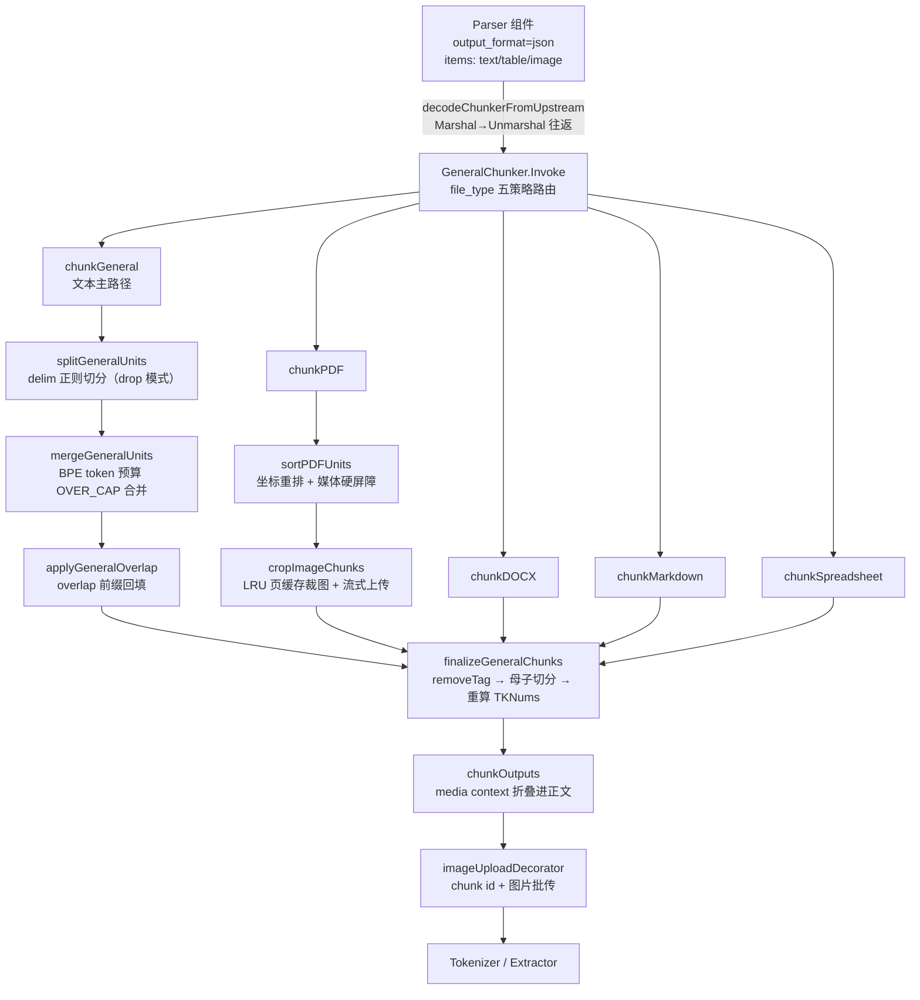

### 第三讲小结：delim 三件套的消费现场，BPE 预算的总装线

**一句话定位**：GeneralChunker 是 Parser 结构化产物的第一个消费者——不调用第二讲的 `chunk.Run`，只借 chunk 包 delim 三件套，用 BPE token 预算 + 五格式策略 + 位置矩阵，把 sections 切成生产级 chunks。

五策略媒体屏障速查：

| 分支                 | 文本合并                 | 媒体单元               | overlap         |
| ------------------ | -------------------- | ------------------ | --------------- |
| chunkGeneral       | 合并到阈值                | 独立成块               | merge 内统一       |
| chunkPDF           | 连续 text 攒批 flush    | 强制 flush + 原样保留   | 每批 merge 内      |
| chunkDOCX          | 合并目标穿越媒体            | 原位保留               | merge 后统一       |
| chunkMarkdown      | 短标题粘连下一单元           | 图片纵向拼接为块附件        | merge 循环内联     |
| chunkSpreadsheet   | 不合并                 | 超预算表切子表（复制表头）    | 不涉及            |

**三个最值得记住的点**：

1. **两套引擎的边界**：GeneralChunker 只从 chunk 包借 `ParseDelimiterField` / `CompileDelimiterPatternList` / `HasCustomDelimiterList` 三件套，split/merge/overlap/children 全部自实现——生产分块要 BPE token 预算、媒体屏障、positions，rune 口径的 DSL 传送带喂不饱；
2. **512 是 BPE 不是 rune**：`chunk_token_size` 走 cl100k_base（`tokenizer.NumTokensFromString`，缺表直接 panic）；合并阈值 = `target×(100-overlapped_percent)/100`，超大块保持 indivisible 不硬切；非自定义分隔符时每个 text 单元按 `"\n"+text` 计 token——对齐 Python naive_merge 的预算细节，不带这个前缀 BPE 计数会漂移；
3. **finalize 是总装线**：`finalizeGeneralChunks` 一气完成 removeTag 清洗（空文本但有 ImgID 的媒体块必须保留，防 MinIO 孤儿对象）、children_delimiters 母子切分（分隔符保留附着前段 + 母块全文回填 `Mom`）、全量重算 TKNums；media context 则延迟到 `chunkOutputs` 才折进正文——因此上下文会进 chunk id，与 Python 口径一致。

---

## 第四讲：Parser 组件 —— 组件边界与规范化

### 组件间协议：JSON

组件间传 `map[string]any`，消费方用 `Marshal→Unmarshal` 往返重建强类型（`decodeChunkerFromUpstream`）。**所有 schema 结构体的 json tag 就是线协议**。代价是序列化开销，收益是日志/checkpoint/跨进程中立格式。

### ParserComponent 核心流程（`internal/ingestion/component/parser.go`）

1. **构造期**：`FlattenLegacyParserSetups` 拍平旧嵌套 → `normalizeParserOutputFormats` **无条件钉死 output_format="json"**（单协议收敛）→ `Check()` 编译期校验（失败在画布编译时报错，不 mid-run 炸）。
2. **`readParserBinary`**：`[]byte` → UTF-8 string（**no try-base64**）→ bucket/path → doc_id 查 DB 再拉 → 都没有返回 nil（走空路径）。
3. **Globals 拉回**：`tenant_id`/`lang` 由 Pipeline 播种进 `CanvasState.Globals`，组件用 `globals.GlobalOrInput` 拉回本地 inputs——因为 Go 运行时只转发显式输出。
4. **file_type 三级解析**：`file_type` 显式提示（**扩展名匹配先于家族匹配**，防 `xls`→`xlsx` 折叠）→ `name` 扩展名 → `file.name` → FileTypeOTHER。
5. **媒体分发瀑布**（互斥）：PDF VLM → Video → Image → Audio → `dispatchParse`（常规路径）→ 可选视觉增强。
6. **错误分水岭**：已知家族解析失败**大声失败**；只有未知家族走 raw-text 兜底（`\f` 切页）。
7. **`normalizeParserJSON` 优先级瀑布**：JSON 直传 → Markdown **重解析成 items** → HTML 重解析（失败降级单 text item + Warn）→ Text 单 item。
   - 意义：parser 库后端产出什么形态都行（PDF 多后端有些产 Markdown 字符串），出了组件边界只有一种协议。
8. **转发存储引用** `doc_id/bucket/path`：chunker 按需重开 PDF 裁图，避免二进制跨组件传递。

### dispatchParse 的两个注入点

- `parserSetupConfigurer` 鸭子接口：解析器自己实现 `ConfigureFromSetup`，调度层对 17 种 parser 零耦合。
- `attachPDFPageProgress`：给 `*PDFParser` 注入 `OnPageDone` 回调 → 进度条实时走（仅本地 DeepDOC 后端触发）。

### 三套命名空间的换算枢纽

```
扩展名 ("md","pptx","xls") ⇄ utility.FileType（GetParser 的键）
              ⇅ pythonFamilyName / familyToExt
Python 家族名 ("markdown","slides","spreadsheet")（setups 表的键）
```

### 线协议对照（Parser 输出 → ChunkerFromUpstream）

| Parser 输出            | 结构体字段                   | 第二讲消费处                                         |
| -------------------- | ----------------------- | ---------------------------------------------- |
| `name`               | `Name`                  | `inferGeneralFileType`                         |
| `file_type`          | `FileType`              | `generalStrategyForFileType`                   |
| `json`               | `JSONResult []ChunkDoc` | unit 列表（Text/CKType 源自 `{text, doc_type_kwd}`） |
| `file`               | `File *ChunkerFileMeta` | `attachPDFOutline` 的 outline                   |
| `doc_id/bucket/path` | 同名                      | `newPDFEngineFromUpstream` 重取源 PDF             |

### 第四讲小结：出了组件边界，只有一种协议

**一句话定位**：组件间传 `map[string]any`（Marshal→Unmarshal 往返重建强类型），Parser 组件把所有异构产出在边界处归一成 json 单协议——schema 结构体的 json tag 就是线协议。

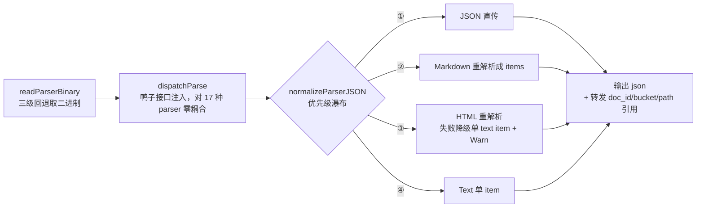

**关键设计对照**：

| 设计             | 做法                                         | 防什么               |
| -------------- | ------------------------------------------ | ----------------- |
| 单协议收敛          | 构造期无条件钉死 `output_format="json"`            | 多后端产出形态漂移         |
| 编译期校验          | `Check()` 在画布编译时报错                         | mid-run 炸         |
| Globals 拉回     | `tenant_id`/`lang` 走 `CanvasState.Globals` | Go 运行时只转发显式输出     |
| file_type 三级解析 | 显式提示（扩展名先于家族）→ name → file.name → OTHER    | `xls` 被折叠成 `xlsx` |
| 错误分水岭          | 已知家族大声失败；未知家族 raw-text 兜底（`\f` 切页）         | 静默丢内容             |

**三个最值得记住的点**：

1. 媒体分发瀑布互斥：PDF VLM → Video → Image → Audio → `dispatchParse`（常规路径）→ 可选视觉增强；
2. 转发的是存储引用（`doc_id/bucket/path`）而非二进制，chunker 按需重开 PDF 裁图；
3. 三套命名空间（扩展名 ⇄ `utility.FileType` ⇄ Python 家族名）由 `pythonFamilyName`/`familyToExt` 换算，是 setups 表配置的键。

---

## 第五讲：任务编排 —— 上游 Pipeline 与下游落库

### 5.1 FileComponent：只发身份证，不取二进制

- 两条路径：doc_id（生产，从 DB 解析文档名）→ file[0]（前端直传）；debug 快路径直传内存 binary。
- 输出 `name + doc_id + bucket + path`（+debug binary）——**取二进制是 Parser 的活**（`readParserBinary` 的三级回退正是 File"故意不干"的部分）。
- 空结构体 `struct{}`，无状态并发安全。

### 5.2 Pipeline（`internal/ingestion/pipeline/pipeline.go`）

- **编译**：`canvas.Compile(DSL, WithOverrideParams(parserConfig))` —— DSL 是骨架，每文档 ParserConfig 在**编译期**覆盖合体。
- **校验**：全图**至多一个 Extractor**（LLM 成本控制）。
- **Globals 播种**：`SeedIngestionGlobals(runCtx, inputs)`（tenant_id/kb_id/lang/doc_id…）+ `SetTaskID`（chunkcache manifest 的 key——不设则缓存清理变 no-op，孤儿条目活到 7 天 TTL）。
- **进度三通道**（全走 ctx，sink 为 nil 时全部 no-op，Pipeline 保持 DB 无关）：
  - `ProgressCallback`：组件 start/done/fail → ingestion_task_log
  - `ProgressMessageCallback`：文本消息（Parser 的 WARNING）
  - `ProgressFractionCallback`：分数（PDF 每页 → 进度条）
- **终态标记**：MarkSucceeded/Failed/Cancelled 写 Kvrocks RunTracker（TTL 7 天），用 `context.WithoutCancel`+5s 超时——运行 ctx 被取消时终态依然必须写出。
- **没有 pipeline 级断点恢复**：每次从头跑图；重试省钱靠**组件级 per-chunk 缓存**。

### 5.3 PipelineExecutor（`internal/ingestion/task/pipeline_executor.go`）

**输入装配**（第三讲所有输入的真正制造者）：

```go
inputs["doc_id"]    = Doc.ID        // File 组件生产路径输入
inputs["tenant_id"] = Tenant.ID     // → Globals → Parser 拉回
inputs["kb_id"]     = KB.ID         // → Globals → Tokenizer 解析 embedding 模型
inputs["lang"]      = KB.Language   // → Globals → 提示词语言
```

**debug / persist 双模式**：

|          | persist                                  | debug（画布试运行）                                     |
| -------- | ---------------------------------------- | ------------------------------------------------ |
| 文件交付     | file 描述符，二进制由 Parser 按 doc_id→storage 解析 | 直传 binary（无 DB 文档行）                              |
| 页数/chunk | 无限制                                      | 前 2 页（override_params 通道）/ 前 N chunk（Globals 通道） |
| 副作用      | 全套落库                                     | **零副作用**，向量留在 chunk 仅供预览                         |

### 5.4 TokenizerComponent（`component/tokenizer.go`）

产出两样东西：

1. **全文 token**：`content_ltks`/`content_sm_ltks`（C++ RAGAnalyzer CGo 绑定）、`title_tks`（文档名去扩展名分词）；仅当 `search_method` 含 full_text。
2. **embedding 向量**：`q_<dim>_vec` 字段。

四个精读亮点：

- **依赖注入纪律**：叶子包禁止 import `internal/service`（import 图规则），`DefaultEmbedderResolver` 留 nil，由 task 包 `init()` 在组合根注入。embdID 是缓存 key 的一部分——**KB 换模型则 key 变，永不 serve 旧向量**。
- **Trim 三接口瀑布**：`EmbedderTrimmer`（模型自己的 tokenizer 截）> `EmbedderMaxResolver`（声明窗口）> `MaxTokens()`。存在原因：cl100k 与模型 tokenizer 差异 ~2% 且方向不定，超限回 400 会**丢整个文档**。
- **喂 embedding 前去 HTML 表格标记**（表格 chunk 的 Text 是 HTML，标记消耗 token 无语义）。
- **ES keyword 保护**：超 32766 字节按 UTF-8 字符边界截断（字节边界硬切产生非法 UTF-8）。

输出契约：`output_format` 从 `"json"` 升级为 `"chunks"`——第二/三讲里 `PayloadFormatChunks` 分支的真实主人是它。

### 5.5 processOutput —— 落库八步

```
① NormalizeChunks            从输出 map 抽 chunk 列表
② ProcessChunksForPipeline   补文档身份（doc_id/名/时间戳/chunk id）
③ MaterializeParentChunks    Mom 母子关系 → 父 chunk 文档
④ markCompiledProductsHidden 编译产物 available_int=0（隐形）
⑤ 重读 DB 文档状态 + applyDocumentAvailability（防 pipeline 中途状态被改的陈旧快照）
⑥ indexWriter.Write          写索引（失败→补偿删除已写入 id）
⑦ reconcileCompiledProducts + Wiki active states 对账
⑧ chunkcache.PurgeTask       所有可失败步骤成功后才清缓存（失败则缓存保住，重试不重付 LLM/embedding 费）
```

**available_int 两段式可见性**：编译产物先隐形入库，任务终态 COMPLETED 后由 dataset 消费者转正——防消费者与索引 refresh 赛跑读到不完整视图。

### 5.6 chunkIndexWriter（`task/chunk_index_writer.go`）—— 写入三策略

1. **批量 no-refresh + 尾批 refresh**：普通批走 `InsertChunksNoRefresh`（省延迟），尾批走 `InsertChunks`——保证任务确认前所有批可检索，消灭"完成但搜不到"窗口。
2. **三次指数退避重试**（100/200/400ms），select 里 ctx.Done 优先——取消信号优先于重试。
3. **失败补偿**：收集已写入 chunk id 调 DeleteChunks 删掉，消灭半截文档。

最终去向：`engine.Get()` 的 DocEngine 抽象（ES/Infinity/OpenSearch/SereneDB/OceanBase 按 service_conf.yaml 选择），索引名 `ragflow_<tenantID>`（**每租户一个索引**）。


### 第五讲小结：只发身份证 → 装配四件套 → 八步落库

**一句话定位**：File 只发身份证不取二进制；PipelineExecutor 装配 `doc_id/tenant_id/kb_id/lang` 四件套（经 Globals 分发给各组件）；processOutput 用八步把 chunks 写进每租户一个的索引。

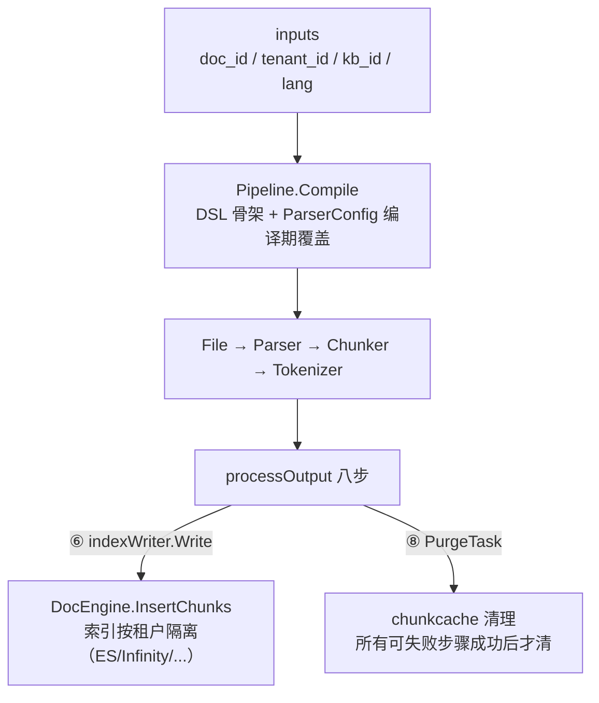

**落库八步的输入/输出与失败行为**：

| # | 步骤                         | 输入 → 输出                      | 失败行为                          |
| - | -------------------------- | ---------------------------- | ----------------------------- |
| ① | NormalizeChunks            | 输出 map → chunk 列表            | —                             |
| ② | ProcessChunksForPipeline   | chunk 列表 → 带文档身份的 chunks     | —                             |
| ③ | MaterializeParentChunks    | Mom 关系 → 父 chunk 文档          | —                             |
| ④ | markCompiledProductsHidden | 编译产物 → `available_int=0` 隐形  | —                             |
| ⑤ | 重读 DB 文档状态                 | 陈旧快照 → 当前状态                  | 防 pipeline 中途状态被改             |
| ⑥ | indexWriter.Write          | chunks → 索引文档                | 补偿删除已写入 id，消灭半截文档             |
| ⑦ | reconcileCompiledProducts  | 编译产物 ↔ Wiki active states 对账 | —                             |
| ⑧ | chunkcache.PurgeTask       | manifest → 清理                | 不清：缓存保住，重试不重付 LLM/embedding 费 |

**三个最值得记住的点**：

1. **没有 pipeline 级断点恢复**：每次从头跑图，重试省钱全靠组件级 per-chunk 缓存（清理必须晚于所有可失败步骤）；
2. **写索引三策略**：批 no-refresh + 尾批 refresh（消灭「完成但搜不到」窗口）+ 三次指数退避重试（100/200/400ms，ctx.Done 优先）；
3. **debug 零副作用双通道**：页数走 `override_params`、chunk 数走 Globals，向量留在 chunk 仅供预览。

---

## 第六讲：Ingestor —— 任务派发与 NATS 消费

> 源码：`internal/ingestion/service/ingestion_service.go`

### 启动序列（`start()`，startOnce 保护防重复启动）

```go
msgQueueEngine.InitConsumer(common.TaskSubject)   // 订阅任务主题（NATS JetStream 消费者）
ingestionTaskSvc.ScheduleCreatedTasks(ctx)        // ★ 启动恢复：DB 里 CREATED 状态的任务重新入队
e.startWorkerPool()                               // worker 池（inbox channel 模式）
e.startMemoryTaskReconciler()                     // 持久 memory 任务唤醒恢复（默认 10s 轮询/批 100）
e.startDatasetKnowledgeCompile()                  // dataset 级知识编译消费者（第七讲）
go e.consumeLoop()                                // 主派发循环
```

**`ScheduleCreatedTasks` 的意义**：ingestor 重启时，DB 中已创建但未执行（或派发后丢失）的任务被重新调度——**DB 是任务的 durable source of truth，NATS 只是传输层**。

### consumeLoop —— 防预取的 worker 派发器

```go
for {
    w := <-e.workerQueue            // ① 先等空闲 worker（并发上限 = worker 池大小）
    handle := msgQueueEngine.PullMessage(pullCtx /*1s 超时*/)  // ② 再同步拉一条
    if err != nil {
        e.returnWorker(w); e.waitAfterPullError()  // 1s 退避防 CPU 空转
        continue
    }
    w.inbox <- handle               // ③ 交接给该 worker 异步执行
    //    shutdown 打断交接时 handle.Nack() —— 消息回队列不丢
}
```

派发时序（防预取的核心是「先等 worker、再拉消息」）：

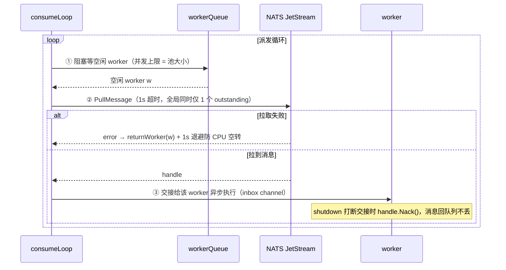

三个设计点：

1. **"等 worker 再拉取"防预取**：每个 ingestor 同时只有 **1 个 outstanding broker 请求**，拉到的任务立刻有 worker 接手——不会拉一堆任务堆在内存里然后崩溃丢失。
2. **Pull 超时 1s + 错误退避 1s**：MQ 持续故障时不会打满 CPU，退避期间其他 worker 的 Pull 不受影响。
3. **优雅停机**：交接被打断时 Nack 消息回队列；Stop 先 join 派发循环再取消任务执行。

多实例部署：多个 ingestor 共享同一 JetStream consumer（queue group 语义），配合 worker_dispatcher_integration_test 验证"共享消费不重复执行"；redelivery 机制处理任务超时/崩溃后的重新投递。

### worker 执行侧

worker 从 `inbox` 收到 handle 后：解析消息 → 定位任务（`real_consumer_pipeline_test.go` 验证 `tasks.>` 消息路由到 ExecuteTask）→ 构建 TaskContext（从 DB 加载 Doc/KB/Tenant）→ `PipelineExecutor.Execute`（第五讲）→ Ack/Nack。

### 第六讲小结：DB 是真相源，NATS 只是传输层

**一句话定位**：ingestor 重启时靠 `ScheduleCreatedTasks` 把 DB 里 CREATED 状态的任务重新入队；consumeLoop 用「等 worker 再拉取」把同时在途的 broker 请求压到 1 个。

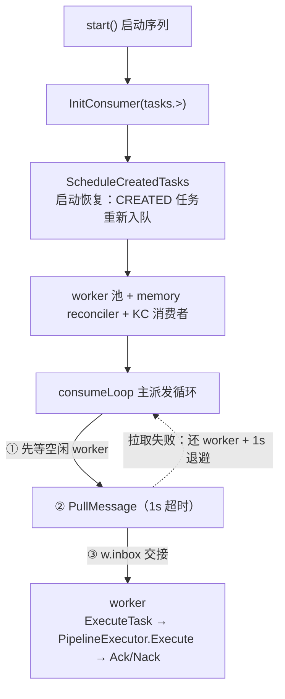

**四个机制的输入/输出**：

| 机制              | 行为                                         | 防什么            |
| --------------- | ------------------------------------------ | -------------- |
| 防预取派发           | 每个 ingestor 同时只有 1 个 outstanding broker 请求 | 拉一堆任务堆内存然后崩溃丢失 |
| 1s pull + 1s 退避 | MQ 持续故障时退避，其他 worker 的 Pull 不受影响           | CPU 空转         |
| 优雅停机            | 交接被打断时 Nack，消息回队列                          | 丢消息            |
| redelivery      | 任务超时/崩溃后重新投递                               | 任务卡死           |

**三个最值得记住的点**：

1. 多实例共享同一 JetStream consumer（queue group 语义），`worker_dispatcher_integration_test` 验证共享消费不重复执行；
2. worker 从 DB 加载 Doc/KB/Tenant 构建 TaskContext——NATS 消息只是触发器，任务数据以 DB 为准；
3. memory 任务 reconciler 默认 10s 轮询/批 100，是 NATS 之外的第二条唤醒通道。

---

## 第七讲：LLM 抽取链路 —— Extractor 与 KnowledgeCompiler

### 7.1 Extractor（`internal/ingestion/component/extractor.go`）

**定位**：管线中 Chunker/Tokenizer 之后的可选组件（**每 pipeline 至多 1 个**，`ValidatePipeline` 编译期强制），对每个 chunk 跑 LLM 抽取（元数据、关键词、分类等，由 DSL 配置决定）。

**架构纪律：PROVIDER-AGNOSTIC** —— 组件不依赖任何具体 LLM 供应商，所有 chat 调用经 `internal/entity/models` 分发。

**per-chunk 缓存**（与第五讲的恢复设计闭环）：

```go
// 缓存 key = 任务类型 + 模型ID + chunkID + 系统提示词
func extractorLLMCacheKey(taskType, modelID, systemPrompt, chunkID string) string {
    return chunkcache.Key("extractor:"+taskType, modelID, chunkID, systemPrompt)
}

func callTextCached(...) {  // callText 的缓存包装
    key := extractorLLMCacheKey(...)
    if cached, hit := chunkcache.Get(ctx, in.cache, key); hit {
        return cached // 重跑命中，不重付 LLM 费用
    }
    ...
}
```

两个精读点：

- **modelID 进缓存 key**（注释标着 "review finding #3"）：换模型 = 换 key = 重新抽取，不会 serve 旧模型的结论。
- **空 modelID 会禁用缓存**（`chunkcache.Key` 把空串变成空 key）——组件用 `extractorCacheModelID` 显式解析模型身份，防缓存静默失效。
- 缓存 client 是 `chunkcache.Client()`（构造时取，结构体携带），manifest 注册依赖 Pipeline 的 `SetTaskID`（第五讲）。

### 7.2 KnowledgeCompiler —— dataset 级知识编译

**与 Extractor 的本质区别**：Extractor 是**文档内**组件（跑在 pipeline 图里）；KnowledgeCompiler 是 **dataset 级**消费者（文档任务全部 COMPLETED 之后才运行）。

**两段式产物生命周期**（接第五讲 5.5 节）：

```
文档 pipeline 产出编译产物（compile_kwd = "wiki_page"/"wiki_section"...）
  → markCompiledProductsHidden: available_int=0 隐形入库（检索不可见）
  → 任务 COMPLETED → PublishCompleted 发布事件
  → knowledge_compile.Consumer 认领 → 合并/转正 available_int=1 → 检索可见
```

**Consumer 结构**（`internal/ingestion/knowledge_compile/consumer.go`）：

```go
func NewConsumer(scheduler Claimer, opts ...Option) *Consumer
func (c *Consumer) Run(ctx)               // 主循环
func (c *Consumer) claimAndProcess(...)   // 认领一个 dataset 的积压
func (c *Consumer) processClaim(...)      // 处理：重跑编译、产物替换、贡献对账
```

- **Claimer（认领者）模式**：多实例下通过认领机制保证一个 dataset 同时只有一个消费者处理，防重复编译。
- **Wiki 贡献对账**（`prepareWikiContributionDiff`/`commitWikiContributions`）：计算本次重编译相对上版的增删（`affectedSlugs`/`removedSlugs`），只替换受影响页，未变的保留。
- **脏替换**（`replaceDirtyWikiProducts`）：带 revision 检查（`dirty.Revision != request.Revision` 则放弃——防止旧请求覆盖新状态）；stale 产物按 id 删除。
- **进度上报**：`reportProgress` 向前端报告编译进度。

**Ingestor 侧接线**（第六讲 startup 序列的 `startDatasetKnowledgeCompile`）：

```go
e.SetKnowledgeCompileModelConfig(llmID, embedding)  // 编译用 LLM/向量模型
e.SetKnowledgeCompileConcurrency(n)                 // 并发度
```

### 7.3 检索侧对编译产物的处理

- 基础检索**默认排除** compile_kwd 行（`ExcludeCompiled`，镜像 Python hybrid_search）；`use_compiled` 控制单独的扩展步骤（agentic-rag 的 tool_executor）。
- 检索只看 `available_int=1`（`RetrievalService.Search` 默认 filter）——未转正产物天然不可见。

### 第七讲小结：文档内抽取 + 数据集级编译，两段式可见性衔接

**一句话定位**：Extractor 跑在 pipeline 图内（逐 chunk LLM 抽取，至多 1 个），KnowledgeCompiler 是图外的 dataset 级消费者（文档任务全部 COMPLETED 后才运行）；两者靠 `available_int` 两段式可见性衔接。

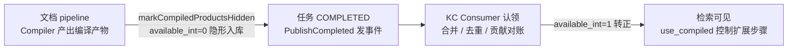

**两者的输入/输出对照**：

|       | Extractor                                   | KnowledgeCompiler                           |
| ----- | ------------------------------------------- | ------------------------------------------- |
| 层级    | 文档内组件（pipeline 图内）                          | dataset 级消费者（pipeline 图外）                   |
| 触发时机  | chunk 流经即抽取                                 | 文档任务全部 COMPLETED 后                          |
| 输入    | 单个 chunk + DSL 配置                           | 一个 dataset 的积压事件                            |
| 输出    | per-chunk 元数据（关键词/分类等）                      | 合并后的 wiki/tree/structure/mindmap 产物         |
| 缓存/账本 | per-chunk 缓存（key = 任务类型+模型ID+chunkID+系统提示词） | MySQL `knowledge_compile_docs` backlog 有序日志 |
| 并发控制  | 进程级 vCPU 大小编译池                              | Claimer 租约（TTL 2min / 心跳 20s）               |

**三个最值得记住的点**：

1. **换模型即换缓存 key**（modelID 进 key，注释标 review finding #3）；空 modelID 会禁用缓存，所以组件用 `extractorCacheModelID` 显式解析模型身份；
2. **Option E 调度**：MySQL 是调度事实源，NATS `notify.kc.workers` 只是尽力唤醒（掉了有 2s 轮询兜底）；同一 KB 串行处理，因为 wiki 跨文档合并需要看到稳定全集；
3. **脏替换带 revision 检查**：`dirty.Revision != request.Revision` 则放弃，防旧请求覆盖新状态；空 variants 的删除事件不入队（会被当 legacy 全量事件）。

---

## 第八讲：检索侧 —— chunk 怎么被搜回来

> 入口：`internal/service/nlp/retrieval.go`；引擎层：`internal/engine/{elasticsearch,infinity,serenedb,oceanbase}`；agentic：`internal/rag/agentic-rag` + `internal/agent/tool`。

### 8.1 RetrievalService.Search —— 三种检索形态

```go
// retrieval.go:671 注释的三分支：
// - 空问题:      纯 filter 查询（列表/翻页）
// - 有问题无 embedding model: 仅全文检索
// - 有问题有 embedding model:  hybrid = fulltext + vector + fusion 融合
// Hybrid 路径无结果时用更低阈值重试
```

默认参数：`available_int=1` filter、KNN topK=1024、numCandidates=2048、pageSize=30。

**查询向量化的一个关键细节**（`GetVector`，retrieval.go:972+）：

```go
// Query: true 镜像 Python Dealer.get_vector (rag/nlp/search.py:75-82)
// —— 用 encode_queries 的非对称查询编码（Cohere search_query / Voyage query /
//    Jina retrieval.query / NVIDIA query）。用文档编码会把查询向量放错空间。
embeddings, err := embModel.Embed(ctx, models.EmbedRequest{Texts: []string{txt}, Query: true}, ...)
```

### 8.2 引擎层：混合检索的物理实现

`DocEngine` 接口统一多种引擎，`SearchRequest.MatchExprs` 携带查询意图：

```
MatchTextExpr   → 全文/BM25 匹配
MatchDenseExpr  → 向量匹配（q_<dim>_vec 字段, cosine, similarity 阈值）
FusionExpr      → 融合（weighted_sum, weights "0.2,0.8", normalize=atan）
```

- **Infinity**（`engine/infinity/chunk.go`）：原生 MATCH TEXT + MATCH TENSOR + FUSION；`filter_fulltext()` 做全文侧过滤；`score()`/`similarity()` 的投影规则差异（3013 错误）有专门处理。
- **Elasticsearch**（`engine/elasticsearch/chunk.go`）：hybrid body + `_score`（注意 `SCORE` 是 Infinity 的列名，ES 读回为空——曾把每个 hybrid chunk 的分数压成 0 的真实 bug）+ pagerank 加权（`calculateScores`）+ 跨索引结果按分数重排。
- **SereneDB/OceanBase**：SQL 语义的融合（buildFusionSQL），OceanBase 有 DBMS hybrid 不可用时降级 SQL 的开关。


查询意图的物理路径：

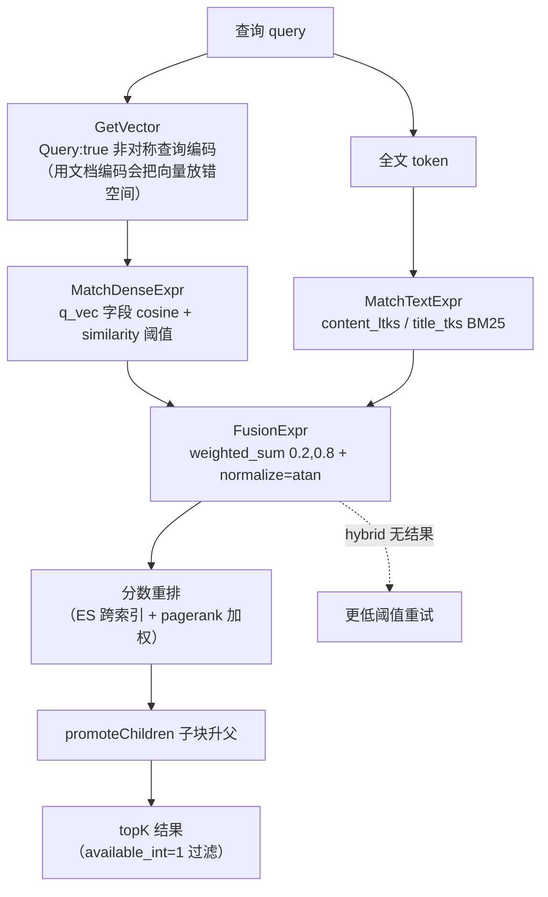

**检索字段闭环**（Infinity 输出列）：`content_ltks`/`title_tks`（第四讲 Tokenizer 产的全文 token）、`q_vec`（向量）、`doc_type_kwd`/`docnm_kwd`/`important_kwd`/`position_int`/`page_num_int`/`mom_id`（分块层元数据）、`available_int`（可见性）、`compile_kwd`（编译产物）——**ingestion 链路的每个产出在检索侧都有对应消费**。

### 8.3 promoteChildren —— 子块升父

检索命中的是子块（第二讲 children_delimiters 切出的碎片），但答案需要完整上下文——`promoteChildren` 把命中的子块**提升回父 chunk** 返回。这正是第五讲 `MaterializeParentChunks`（把 Mom 关系物化成父 chunk 文档写入索引）的检索侧对应：**ingestion 时备好父块，检索时才能升父**。

### 8.4 Agentic 检索（`internal/rag/agentic-rag/` + `internal/agent/tool/`）

**三层结构**：

1. **Agent 工具层**（`agent/tool/agentic_search.go`）：`hybrid_search`/`vector_search`/`bm25_search` 三工具，向量权重分别 0.3/1.0/0.0；`agent/tool/retrieval.go` 的 Retrieval 工具（eino-tool 信封格式）。
2. **agentic-rag 运行时**（`rag/agentic-rag/runtime/`）：`tool_executor.go` 调 `GetRetrievalService().Search`；`tool_search.go` 定义各检索腿（hybrid/vector/bm25/grep）的日志/思考块契约（与 Python `search.py` 逐行对齐的日志格式）。
3. **agentic-rag 图**（`rag/agentic-rag/`）：`agentic_rag_graph.go`（检索图编排）、`graph_fanout.go`（多 KB/多查询扇出）、`coverage_step.go`（覆盖度评估）、`grep_sed_narrow.go`（关键词先定位再收窄）、`doc_fetch.go`、`keywords.go` 等——Python rag/nlp 检索与 agentic 检索策略的 Go 移植。

**指针透传细节**（tool_executor.go:2031+）：`SimilarityThreshold`/`KeywordsSimilarityWeight` 作为指针传递——**nil（调用方未给）必须保持 nil 让服务用自己的默认值，而 0 是真实的覆盖**。取零值地址曾把"阈值0/纯向量权重"强加给所有省略参数的调用方。

### 8.5 从 ingestion 到检索的字段全景

```
ingestion 产出                          检索消费
─────────────────────────────────────────────────────────
content_ltks / title_tks          →    全文/BM25 匹配
q_<dim>_vec                       →    向量匹配（cosine + threshold）
doc_type_kwd (text/table/image)   →    类型过滤/表格渲染
positions / page_num_int          →    引用定位、前端高亮
mom_id + 父 chunk 文档             →    promoteChildren 子升父
available_int                     →    可见性（编译产物两段式转正）
compile_kwd                       →    基础检索默认排除，use_compiled 扩展
pagerank_fea                      →    ES 分数加权
```

### 第八讲小结：一个入口、三种形态、一张字段全景表

**一句话定位**：`RetrievalService.Search` 按「有没有问题、有没有 embedding model」三分支；引擎层用 `MatchExprs` 表达查询意图；ingestion 的每个产出在检索侧都有对应消费。

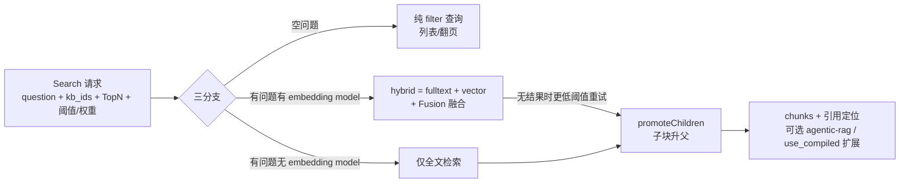

**ingestion 产出 ↔ 检索消费（字段全景）**：

| ingestion 产出                      | 检索消费                       |
| --------------------------------- | -------------------------- |
| `content_ltks` / `title_tks`      | 全文/BM25 匹配                 |
| `q_<dim>_vec`                     | 向量匹配（cosine + threshold）   |
| `doc_type_kwd` (text/table/image) | 类型过滤/表格渲染                  |
| `positions` / `page_num_int`      | 引用定位、前端高亮                  |
| `mom_id` + 父 chunk 文档             | promoteChildren 子升父        |
| `available_int`                   | 可见性（编译产物两段式转正）             |
| `compile_kwd`                     | 基础检索默认排除，`use_compiled` 扩展 |
| `pagerank_fea`                    | ES 分数加权                    |

**三个最值得记住的点**：

1. **查询向量必须用 `Query: true` 非对称编码**（镜像 Python `encode_queries`：Cohere search_query / Voyage query / Jina retrieval.query / NVIDIA query）——用文档编码会把查询向量放错空间；
2. **指针透传语义**：`SimilarityThreshold`/`KeywordsSimilarityWeight` 传指针，nil（调用方未给）必须保持 nil，0 是真实的覆盖——取零值地址曾把「阈值 0/纯向量权重」强加给所有省略参数的调用方；
3. ES 读 Infinity 的 `SCORE` 列名为空——曾把每个 hybrid chunk 的分数压成 0 的真实 bug。

---

## 第九讲：知识编译与 Agentic RAG —— 原理与端到端演算

> 写侧：`internal/ingestion/component/knowledge_compiler/`（文档级组件，pipeline 图内）+ `internal/ingestion/knowledge_compile/`（数据集级消费者，pipeline 图外）。
>   
> 读侧：`internal/rag/agentic-rag/`（五阶段研究图）+ `runtime/`（叶子能力库）。
>   
> 一枚硬币的两面：知识编译是**写侧深加工**（把散落 chunks 预组织成高密度知识产物），Agentic RAG 是**读侧深检索**（多轮工具循环逼近答案），两者在检索时直接交汇（9.8）。

### 9.1 全景：两条链路怎么接上

```
写侧（离线，每文档一次 + 每 KB 一次）：
chunks ──Compiler(文档级组件)──► 知识产物 ──available_int=0──► 隐形入库
                                    │
                          任务 COMPLETED → backlog 事件
                                    ▼
                     Consumer(数据集级) 跨文档去重合并
                                    │
                          available_int=1 → 检索可见

读侧（在线，每问题一次）：
问题 ──Agentic RAG 图──► (agent→draft→sca)* 研究环 ──► 答案
                    ▲
                    └─ CompiledExpander：命中 chunk 后用编译产物扩展证据集
```

**为什么值得**：普通 chunk 检索只看局部——问"全局主旨"或"跨文档实体关系"时召回零散。知识编译付出 LLM 成本预先组织（一次编译、每次检索受益）；Agentic RAG 付出多轮 LLM 成本逼近（证据不足就改写查询再来一轮）。

### 9.2 文档级组件：一个组件，四个变体

注册名 `"Compiler"`（component.go:46，与 Python `rag/flow/compiler/compiler.py` 对齐——前端画布和 Go 内置模板解析到同一节点）。变体不是 DSL 指定的，而是**由编译模板的 kind 推导**（`common.KindToVariant`；模板解析优先级 `compilation_template_id > compilation_template_group_id`，component.go:106-113）。

| 变体        | 包               | 原理                                                                     |
| --------- | --------------- | ---------------------------------------------------------------------- |
| structure | `structure/`    | 两段式 LLM 抽取：先实体（list/set/hypergraph）后关系，模板驱动 prompt，LLM 仲裁的 in-run 去重合并 |
| wiki      | `wiki/`（3316 行） | MAP→REDUCE→PLAN→REFINE 四阶段（9.3 演算）                                     |
| tree      | `tree/`         | RAPTOR 递归抽象摘要树（9.4 演算）                                                 |
| mindmap   | `mindmap/`      | LLM 生成思维导图结构                                                           |

**最关键的协议设计**（component.go:73-79）：输出 schema **故意与上游 chunker 逐字节一致**（`output_format:"chunks"`）。编译产物转成 chunk 形状**合并进主流 chunk 流**，下游 Tokenizer 照常消费——Compiler 是 chunk 流里一个"夹带私货"的中间人。为此 `chunkerOutputs` 在本包重新声明而不 import chunker 包：避免拖进 chunker 的 CGO 依赖。

MAP 阶段的并发纪律：所有变体共享一个**进程级、vCPU 大小的编译池**（`SetBatchSubmitter` 注入，structure.go:20-30），一个文档的编译不会打满 LLM 并发。

### 9.3 端到端演算 A：一篇文档走完 wiki 编译

输入：《蜀汉人物志》（假设 chunk 后 5 个 chunk，共约 3000 token）：

```
c1: 刘备字玄德，涿郡人，与关羽、张飞桃园结义……
c2: 关羽字云长，建安五年斩颜良于白马……后水淹七军围樊城……
c3: 张飞字益德，长坂坡据水断桥喝退曹军……
c4: 诸葛亮字孔明，隐居隆中，刘备三顾茅庐……
c5: 徐庶临行荐孔明；赵云长坂坡救阿斗……
```

**① MAP**（token 预算 2048/批 → 2 批 `{c1,c2,c3}`/`{c4,c5}`，共享池并发；每批一次 LLM 抽取）。
  
批 1 产出（示意）：

```json
{ "entities": ["刘备", "关羽", "张飞"],
  "concepts": ["桃园结义"],
  "claims": [{"s": "关羽", "p": "斩杀", "o": "颜良"},
             {"s": "关羽", "p": "围攻", "o": "樊城"},
             {"s": "张飞", "p": "据守", "o": "长坂坡"}],
  "relations": [{"from": "刘备", "rel": "结义", "to": "关羽"},
                {"from": "刘备", "rel": "结义", "to": "张飞"}],
  "topics": ["蜀汉人物"] }
```

批 2 产出类似（诸葛亮/赵云/徐庶 + "三顾茅庐" + "荐"关系）。

> MAP 结果写入 **per-chunk 不可变版本缓存**——wiki 变体唯一的断点恢复点（呼应第五讲"无 pipeline 级 checkpoint，重试靠组件级缓存"）。

**② REDUCE**（纯代码精确归并，不调 LLM）：跨批去重——"刘备"在批 1（结义关系主语）和批 2（三顾茅庐主语）各出现一次，合并为同一身份，两批 claims 挂到同一实体下。

**③ PLAN**（规划页面）：entity 模式每实体一页 → 刘备页/关羽页/张飞页/诸葛亮页/赵云页；topic 模式可把相关身份合并成一页再分配（wiki.go:398-400 注释）。

**④ REFINE**（逐页 LLM 精修）：聚合该实体全部 claims/relations 生成 wiki 风格页面 + 章节。关羽页（示意）：

```
# 关羽
字云长……
## 生平
建安五年斩颜良于白马……
## 关联事件
- 水淹七军，围樊城
## 关系
- 结义兄弟：刘备、张飞
```

**⑤ 产物物化**（wiki.go:269-331）：

- 全部页面 + 章节一次性批量 embedding（页面和章节都必须带向量，缺 embedder 直接报错）
- `MergeIntoStore` + `CosineDecider{Threshold: param.SimilarityThreshold}`：余弦相似度判重——过线 UPDATE、不过线 INSERT（统计 Inserted/Updated/DuplicatesDropped）
- 可选历史去重（`EnableHistoricalDedup`）：与库里已有 wiki 页比对
- `Outputs.Products` 回到 component.go 转成 chunk 形状合并进主流 → Tokenizer 照常处理 → 落库 **available_int=0**（第七讲 `markCompiledProductsHidden`）

**⑥ 数据集级收尾**（9.5 的 Consumer）：本篇关羽页 vs 库里另一篇文档的关羽页，KNN 相似 ≥ 0.85 → UPDATE 合并贡献而非重复建页；数据集级产物 **available_int=1** 转正。

### 9.4 端到端演算 B：RAPTOR 树

`tree_order`（B+ 树的"阶"，raptor.go:8-11）= level-0 簇的平均 chunk 数。设 6 chunks、order=3：

```
Level 0:  c1 c2 c3 c4 c5 c6        （按文档顺序）
          └─ watershed 聚类（1D 分水岭，沿文档顺序切簇）
             {c1,c2,c3}   {c4,c5,c6}
                ↓LLM摘要      ↓LLM摘要
Level 1:  s1            s2
          └─ 再聚类 {s1,s2} → LLM 摘要
                ↓
Level 2:  s_root（单节点即根，递归终止）
```

产物 = s1、s2、s_root **全部**作为 Product 落库（带层级标记）。检索收益按问题粒度命中不同层：

- 问细节（"白马之战谁斩了颜良"）→ 命中 c2（叶子层）
- 问中观（"前半部分的主线"）→ 命中 s1
- 问全局（"这篇文档讲什么"）→ 命中 s_root

一棵树同时服务三种粒度——对"chunk 检索只见局部"的根本修复。（Python 原版每层之间写 ES 中转；Go 移植全部留在内存。）

### 9.5 数据集级消费者：Option E 调度

设计核心（event.go:16-26 包注释）：**MySQL 是调度事实源，NATS 只是尽力唤醒**。

- **Publisher**：`Publish` = 事务性 backlog 追加 + NATS `notify.kc.workers` 唤醒，两者在一个调用里成对出现（`knowledge_compile_docs` 表，每 KB 一行）；NATS 掉了有 2s 轮询兜底
- **Claimer**：集群竞争 `TryClaim`（backlog→inflight 是**移动**不是复制）；每 KB 同一时间只有一个租约 → **同一 KB 串行处理**（wiki 跨文档合并需要看到稳定全集）
- **租约**：TTL 2min、心跳 20s；过期可被其他 worker 收回，旧 worker 的写因 token 不匹配被拒（`ErrClaimTokenMismatch`）
- **TOCTOU 防护**：`WithDatasetLock` 把"校验 token + 破坏性写"放进持数据集行锁的事务，堵死校验与写入之间的窗口
- backlog 是**有序日志**：同一 doc 的最后一个事件胜出，无需序列号

**演算 C：时间线**

```
t0  D1 完成 → PublishCompleted(variants=["wiki"])
      MySQL: kb1.backlog += D1(completed)   ←事务
      NATS:  notify {kb1}                    ←尽力而为
t1  W1 唤醒 → TryClaim → backlog→inflight, token=T1
t2  W1 处理中（TouchClaim 心跳 20s / TTL 2min）
t3  D2 也完成 → backlog += D2（W1 租约活着，D2 排队）
t4  W1 Ack(D1批) → 发现 backlog 非空 → 继续认领 D2
    若 W1 崩溃：租约 2min 过期 → W2 收回(token=T2)
      W1 若复活：Ack/写 → ErrClaimTokenMismatch 被拒
t5  用户删除 D3（带 wiki 产物）→ PublishDeleted(variants=["wiki"])
      → 消费者对 D3 打墓碑（tombs），撤回其数据集级贡献
      ⚠ 空 variants 的删除事件不入队——会被当 legacy 全量事件重建无关产物（event.go:127）
```

四种事件：`doc_completed / doc_deleted / doc_enabled / doc_disabled`（禁用只撤数据集级贡献，文档级产物保留供再启用）。

### 9.6 Agentic RAG：模式与五阶段图

**入口链**：对话层 → `internal/agent/retrievalbridge/harness.go` 构造 `RAGTools`（模型/TopN/阈值/权重/doc scope……所有能力的唯一依赖载体）→ `agentic_rag.Rag()`。入口先做 **LLM pre-flight**（一次最小探测——实测教训：MiniMax 余额不足曾让 think block 白叙述几秒才在组稿时失败；现在 provider 死掉在任何叙述开始前就报 `**ERROR**`，agentic_rag.go:1132-1146）。

**四档模式**（runtime/config.go:84-116）：

| 模式     | agentic | SCA | SCA轮数 | planner扇出 | session轮次 | 每查询snippet | 工具面                   |
| ------ | ------- | --- | ----- | --------- | --------- | ---------- | --------------------- |
| low    | ✗       | ✗   | 0     | ✗         | 4         | –          | 无工具（单次 direct_search） |
| medium | ✓       | ✓   | 3     | ✗         | 8         | 6          | 全工具                   |
| high   | ✓       | ✓   | 3     | ✓         | 8         | 8          | 全工具                   |
| ultra  | ✓       | ✓   | 5     | ✓         | 10        | 10         | 全工具 + graph_explore   |

未识别的档位 → NAIVE 兜底并记日志（用户输入的拼写错误不该 fail 请求）。

**五阶段图**（agentic_rag_graph.go:19-28，Eino `compose.NewGraph` Pregel 模式编译——因为研究环是环）：

```
formalize_question → [planner → prefetch] → rag_agent → draft → sca
    ├─ sufficient ─────────────────────────→ formalize_answer
    └─ insufficient → query_rewrite ──────→ rag_agent（下一轮）
```


预算三件套（L1506-1522）：**图级无总时钟**（曾有 TotalBudgetS+30s 总限时会拦腰截断流式组稿，已移除）；靠 per-node 超时 + **节点访问预算**（一轮研究 = rag_agent→draft→sca = 3 visits；按 run steps 计数会多干 3 倍活才触发保护）+ `guard` 路由。预算耗尽 → `stop` 节点**报错并丢弃 state**（不拿半成品组稿，防 slots/draft 泄漏下游）。Eino `WithMaxRunSteps(limit*2+16)` 只是防接线错误的兜底。

**routeSCA 决策表**（L989-1013 注释整理）——是否再来一轮由**记录**决定，reviewer 的 verdict 只是一票：

| 记录状态           | 判定                                                           |
| -------------- | ------------------------------------------------------------ |
| 还有活干 且 本轮还在涨证据 | 再来一轮——**即使 reviewer 说 SUFFICIENT**（它只评判读到的段落，slot 表才是框架自己的账） |
| 还有活干 且 停滞      | reviewer 决定：INSUFFICIENT 且有具体 gap → 再来；否则关闭                  |
| 没活了            | 关闭                                                           |
| UNKNOWN        | 不是判断，只有记录能要求新一轮                                              |

其中"活" = unresolved slots ∪ SCA 提取的 gaps；"涨" = `LastRoundNew>0`。**NoProgress**：scaNode 对选中的 view 做 hash，与上次 review 相同即置位（"同样视图看两遍，再多轮也不改变结论"——2026-09-14 实测教训，L958-984）。**枚举特判**（L1633-1644）：planner 声明的枚举型问题（Coverage.Ok）硬限 2 轮——三国/关羽实测第 2 轮 11→14 个成员、第 3 轮 +0 chunks 纯浪费。

### 9.7 端到端演算 D：一个问题走完 Agentic RAG（high 模式）

问题：**"桃园结义三兄弟中，斩杀颜良的那位水淹了哪座城池？军师又是谁推荐的？"**（三跳：结义→斩颜良者→水淹之城；军师→推荐人）

追踪字段：`SearchRounds / LastRoundNew / UnresolvedSlots / Verdict / NoProgress`

```
formalize_question（visit 1）
  形式化并登记 slot 表：
    slot1: 斩颜良的结义兄弟（Candidate=nil）
    slot2: 此人水淹的城池
    slot3: 军师的推荐人
planner（visit 1，high 才有）
  拆解：Q1"桃园结义三兄弟" Q2"谁斩颜良" Q3"水淹七军围哪座城" Q4"谁推荐诸葛亮"
prefetch（visit 1，跟随 fan-out 开）
  每个子问题预取一轮混合检索垫底
rag_agent（round 1，计 3 visits）
  action session 工具循环（ActionMaxTurns=8，每查询最多读 8 条 snippet）：
    search_chunks("桃园结义")   → 命中 c1 → slot1="关羽" ✓
    search_chunks("关羽 水淹")  → 命中"水淹七军围樊城" → slot2="樊城" ✓
    search_chunks("推荐诸葛亮") → 弱证据 → slot3 候选="徐庶"（strength 0.4）
  证据池 +12 chunks（LastRoundNew=12）
draft（同节点内）：草案"关羽水淹樊城；军师由徐庶推荐"
sca（同节点内）：slot3 证据弱 → Verdict=INSUFFICIENT，gaps=["推荐人证据不足"]，UnresolvedSlots=1

  ── routeSCA：work=gaps(1)>0 ✓；grew=+12>0 ✓ → wants ✓
     rounds 1<3 ✓；RemainingS 充足 ✓ → nodeQueryRewrite ──

query_rewrite（visit 1）
  按 gap 定向重写："徐庶 荐 孔明"
rag_agent（round 2，计 3 visits）
  search_chunks("徐庶 荐 诸葛") → 强证据"徐庶临行荐孔明" → slot3 确认 ✓
  LastRoundNew=+3，UnresolvedSlots=0
draft → 草案更新
sca → Verdict=SUFFICIENT，无 gaps

  ── routeSCA：work=false（无 gaps 无 unresolved）
     → "nothing left → close out" → nodeFormalizeAnswer ──

formalize_answer（visit 1）
  组稿带引用的正式回答（流式，须让模型说完——这正是移除图级总时钟的原因）
```

访问预算对账：1(formalize) + 1(planner) + 1(prefetch) + 3×2(两轮研究) + 1(rewrite) + 1(answer) = **10 visits**。若中途预算耗尽：guard → stop → 报错，state 清空返回。

反面演算（体现"记录优先于 verdict"）：

- 若 round 2 后 reviewer 说 SUFFICIENT 但 slot 表仍有 unresolved → **再来一轮**（work left ∧ still learning，L1004-1006：2026-09-15 实测 ended with unresolved=0 但答案少 6 个成员——所以空表也不是完备性证明）
- 若 round 2 一条新证据都没捞到（grew=0）且 verdict 是 UNKNOWN → 关闭（stalled 且无人主张再来）

### 9.8 交汇点：CompiledExpander

写侧产物在读侧的消费入口是 `runtime/tool_compiled_expansion.go`（`CompiledStore` 接口，镜像 Python `use_compiled=True → _expand_with_compiled`，harness.go:162-175 接线）：

- search_chunks 命中普通 chunk 后，用**问题向量**查编译产物行：`compile_kwd ∈ {tree, wiki_page, artifact_page, essence}`、`knowledge_graph_kwd ∈ {entity, relation}`、`available_int=1`
- 命中的产物行带 `source_chunk_ids` → 把指向的**原始 chunk** 拉进证据集——编译产物是导航索引，证据仍是原文（保引用可溯）
- Dense 腿硬约束（L32-42 警告）：必须命名传参 `num_candidates=max(topN,256)`、`similarity=0.1`——位置参数写反会把 HNSW 候选列表压塌、**静默摧毁召回**

### 9.9 Slots：agentic 检索的账本

runtime 的核心数据模型（action_session.go:63+）：每个未知实体一个 `Variable`（slot），工具结果以 `ToolOutcome/ApplyPatch` 回填。三条纪律：

1. slot 的 Candidate 文本**不透明**——不许拆分/计数/数值比较；类型化（`slots.Value`）才允许 merge，未类型化不合并而非猜测解析。
2. 对比落败的 claim 记进 `Alternates` 而非丢弃——框架不裁决真相，但不扔掉另一说。
3. slot 表 + SCA gaps 的并集就是 routeSCA 的"活"——研究环唯一客观的继续依据。

### 第九讲小结：一枚硬币的两面——写侧深加工 vs 读侧深检索

**一句话定位**：知识编译是写侧深加工（把散落 chunks 预组织成高密度知识产物，一次编译、每次检索受益）；Agentic RAG 是读侧深检索（多轮工具循环逼近答案）；两者在检索时经 CompiledExpander 直接交汇（读侧精讲见第十讲，写侧逐阶段拆解见第十一讲）。

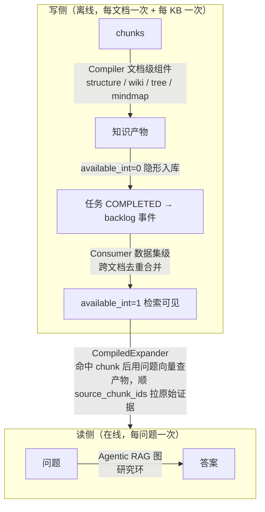

**四个变体的输入/输出**：

| 变体        | 输入                      | 输出                   | 原理                                                      |
| --------- | ----------------------- | -------------------- | ------------------------------------------------------- |
| structure | chunks + 编译模板           | 实体/关系产物              | 两段式 LLM 抽取：先实体（list/set/hypergraph）后关系，LLM 仲裁 in-run 去重 |
| wiki      | chunks（token 预算 2048/批） | wiki 页面 + 章节         | MAP→REDUCE→PLAN→REFINE 四阶段                              |
| tree      | chunks + `tree_order`   | 多层摘要节点（s1/s2/s_root） | RAPTOR 递归抽象：watershed 聚类 + LLM 摘要                       |
| mindmap   | chunks                  | 思维导图结构               | LLM 生成                                                  |

**三个最值得记住的点**：

1. **Compiler 输出伪装成 chunk 流**（schema 与 chunker 逐字节一致），下游 Tokenizer 无感知——为避免拖进 chunker 的 CGO 依赖，`chunkerOutputs` 在本包重新声明而不 import chunker 包；
2. **MAP 结果写 per-chunk 不可变版本缓存**，是 wiki 变体唯一的断点恢复点（呼应第五讲「无 pipeline 级 checkpoint，重试靠组件级缓存」）；
3. **一棵 RAPTOR 树同时服务三种粒度**：问细节命中叶子 c2、问中观命中 s1、问全局命中 s_root——这是对「chunk 检索只见局部」的根本修复。

---

## 第十讲：Agentic RAG 全流程精讲

> 读侧源码：`internal/rag/agentic-rag/`（`agentic_rag_graph.go` 图编排 + `runtime/` 叶子能力库）+ `internal/agent/tool/`（工具层）。
>   
> 本讲把第九讲 9.6–9.9 的原理落成**可逐阶段对照的输入/输出表**：每个节点吃什么、吐什么，以及一个三跳问题怎么走完两轮研究环。

### 10.1 入口链与四档模式

入口链：对话层 → `internal/agent/retrievalbridge/harness.go` 构造 `RAGTools`（模型/TopN/阈值/权重/doc scope……所有能力的唯一依赖载体）→ `agentic_rag.Rag()`。入口先做 **LLM pre-flight**（一次最小探测——实测教训：MiniMax 余额不足曾让 think block 白叙述几秒才在组稿时失败；现在 provider 死掉在任何叙述开始前就报 `**ERROR**`，agentic_rag.go:1132-1146）。

| 模式     | agentic | SCA | SCA 轮数 | planner 扇出 | session 轮次 | 每查询 snippet | 工具面                            |
| ------ | ------- | --- | ------ | ---------- | ---------- | ----------- | ------------------------------ |
| low    | ✗       | ✗   | 0      | ✗          | 4          | –           | 无工具（单次 direct_search，≈ 普通 RAG） |
| medium | ✓       | ✓   | 3      | ✗          | 8          | 6           | 全工具                            |
| high   | ✓       | ✓   | 3      | ✓          | 8          | 8           | 全工具                            |
| ultra  | ✓       | ✓   | 5      | ✓          | 10         | 10          | 全工具 + graph_explore            |

未识别的档位 → NAIVE 兜底并记日志（用户输入的拼写错误不该 fail 请求）。检索腿的向量权重：hybrid 0.3 / vector 1.0 / bm25 0.0（`agent/tool/agentic_search.go`）。

### 10.2 五阶段图：全流程一屏看懂

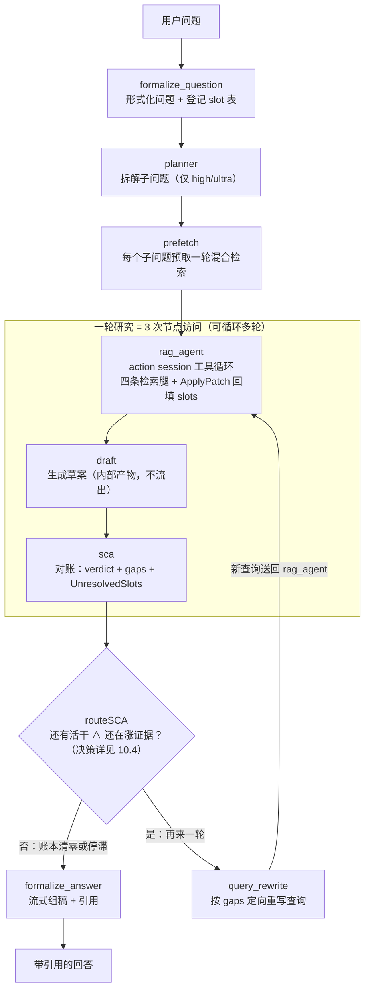

用 Eino `compose.NewGraph` Pregel 模式编译——因为研究环是环。图中子框图住的 `rag_agent → draft → sca` 就是**一轮研究**（计 3 次节点访问），可循环多轮；这也是「节点访问预算」的计量单位。

### 10.3 逐阶段输入/输出（本讲核心）

| 阶段                      | 输入                              | 输出                                                                                                     |
| ----------------------- | ------------------------------- | ------------------------------------------------------------------------------------------------------ |
| `formalize_question`    | 用户原始问题                          | 形式化问题 + **slot 表**（每个未知实体一个 Variable，Candidate 初始 nil）                                                 |
| `planner`（仅 high/ultra） | 形式化问题                           | 子问题拆解 + 多 KB/多查询扇出计划                                                                                   |
| `prefetch`              | 子问题列表                           | 每个子问题各跑一轮混合检索的垫底证据                                                                                     |
| `rag_agent`             | 当前问题 + 上轮 gaps + 已有证据池          | action session 工具循环（hybrid/vector/bm25/grep 四条检索腿）→ 证据池新增 chunks + 用 `ToolOutcome/ApplyPatch` 回填 slots |
| `draft`                 | 当前 slots + 证据池                  | 草案答案（内部产物，不流出）                                                                                         |
| `sca`                   | 草案 + 证据 + slot 表                | Verdict（SUFFICIENT/INSUFFICIENT）+ gaps + UnresolvedSlots + NoProgress 标志                               |
| `routeSCA`              | slots∪gaps、LastRoundNew、Verdict | 路由：再来一轮 or 关闭                                                                                          |
| `query_rewrite`         | 本轮 gaps                         | 定向重写后的查询 → 送回 rag_agent                                                                                |
| `formalize_answer`      | 最终 slots + 证据池                  | 带引用的正式回答（流式输出）                                                                                         |

`rag_agent` 内部是 action session 工具循环（ActionMaxTurns=8；high 档每查询最多读 8 条 snippet）。

**预算三件套**（agentic_rag_graph.go L1506-1522）：图级**无总时钟**（曾有 TotalBudgetS+30s 总限时会拦腰截断流式组稿，已移除）；靠 per-node 超时 + **节点访问预算**（一轮研究 = 3 visits；按 run steps 计数会多干 3 倍活才触发保护）+ `guard` 路由。预算耗尽 → `stop` 节点**报错并丢弃 state**（不拿半成品组稿，防 slots/draft 泄漏下游）。Eino `WithMaxRunSteps(limit*2+16)` 只是防接线错误的兜底。

### 10.4 routeSCA：记录优先于 verdict 的决策矩阵

是否再来一轮由**记录**决定，reviewer 的 verdict 只是一票——reviewer 只能评判它读到的段落，slot 表才是框架自己的账（2026-09-15 实测：ended with unresolved=0 但答案少 6 个成员，所以空表也不是完备性证明）。

|                                      | 本轮还在涨证据（LastRoundNew > 0）          | 停滞（grew = 0）                                |
| ------------------------------------ | ---------------------------------- | ------------------------------------------- |
| **还有活干**（unresolved slots ∪ gaps 非空） | **再来一轮**——即使 reviewer 说 SUFFICIENT | reviewer 裁决：INSUFFICIENT 且有具体 gap → 再来；否则关闭 |
| **没活了**                              | 关闭 → formalize_answer              | 关闭 → formalize_answer                       |

同一张矩阵的决策树形态（「是」路只有两条：有活且在涨、有活且停滞但 reviewer 拿着具体 gap 主张再来）：

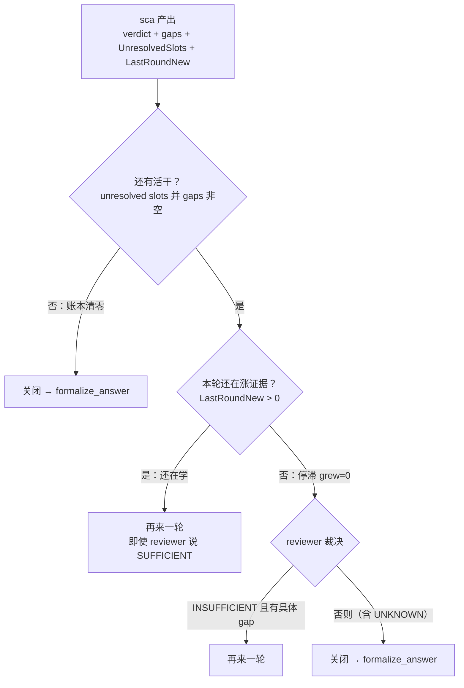

三个特判：

- **NoProgress**：sca 对选中的 view 做 hash，与上次 review 相同即置位——「同样视图看两遍，再多轮也不改变结论」（2026-09-14 实测教训，L958-984）；
- **枚举特判**（L1633-1644）：planner 声明的枚举型问题（Coverage.Ok）硬限 2 轮——三国/关羽实测第 2 轮 11→14 个成员、第 3 轮 +0 chunks 纯浪费；
- **UNKNOWN 不是判断**：只有记录能要求新一轮。

### 10.5 两个配套机制

**Slots 账本**（`runtime/action_session.go:63+`）：每个未知实体一个 slot，工具结果以 `ToolOutcome/ApplyPatch` 回填。三条纪律：

1. slot 的 Candidate 文本**不透明**——不许拆分/计数/数值比较；类型化（`slots.Value`）才允许 merge，未类型化不合并而非猜测解析；
2. 对比落败的 claim 记进 `Alternates` 而非丢弃——框架不裁决真相，但不扔掉另一说；
3. slot 表 + SCA gaps 的并集就是 routeSCA 的「活」——研究环唯一客观的继续依据。

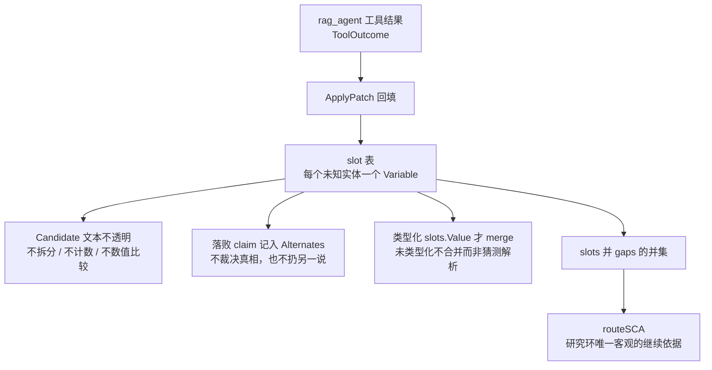

**CompiledExpander**（写读交汇点，`runtime/tool_compiled_expansion.go`，镜像 Python `use_compiled=True → _expand_with_compiled`，harness.go:162-175 接线）：`search_chunks` 命中普通 chunk 后，用**问题向量**查编译产物行（`compile_kwd ∈ {tree, wiki_page, artifact_page, essence}`、`knowledge_graph_kwd ∈ {entity, relation}`、`available_int=1`）；命中的产物行带 `source_chunk_ids` → 把指向的**原始 chunk** 拉进证据集。编译产物是导航索引，证据仍是原文（保引用可溯）。Dense 腿硬约束（L32-42 警告）：必须命名传参 `num_candidates=max(topN,256)`、`similarity=0.1`——位置参数写反会把 HNSW 候选列表压塌、**静默摧毁召回**。


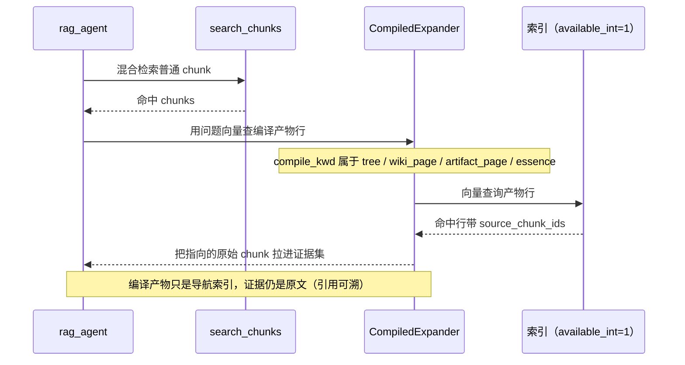

### 10.6 端到端演算：一个三跳问题走两轮研究环（high 模式）

问题：**「桃园结义三兄弟中，斩杀颜良的那位水淹了哪座城池？军师又是谁推荐的？」**（三跳：结义→斩颜良者→水淹之城；军师→推荐人）。追踪字段：`SearchRounds / LastRoundNew / UnresolvedSlots / Verdict / NoProgress`。

| 步骤 | 节点                          | 输入 → 输出                   | 账本变化                                                     |
| -- | --------------------------- | ------------------------- | -------------------------------------------------------- |
| 1  | formalize_question（visit 1） | 问题 → 形式化 + slot 表         | slot1=斩颜良的结义兄弟；slot2=此人水淹的城池；slot3=军师的推荐人（Candidate=nil） |
| 2  | planner + prefetch（visit 1） | 形式化问题 → Q1–Q4 子问题 + 各预取一轮 | 证据池垫底                                                    |
| 3  | rag_agent 第 1 轮（3 visits）   | 子问题 → 工具循环检索 ×3           | slot1=关羽 ✓；slot2=樊城 ✓；slot3=徐庶（弱 0.4）；证据 +12             |
| 4  | draft + sca 第 1 轮           | 草案「关羽水淹樊城；军师由徐庶推荐」 → 对账   | Verdict=INSUFFICIENT，gap=推荐人证据不足，UnresolvedSlots=1       |
| 5  | routeSCA                    | 有活（1）∧ 在涨（+12）            | → 再来一轮                                                   |
| 6  | query_rewrite（visit 1）      | gap → 定向重写                | 新查询「徐庶 荐 孔明」                                             |
| 7  | rag_agent 第 2 轮（3 visits）   | 新查询 → 强证据「徐庶临行荐孔明」        | slot3=徐庶 ✓；新证据 +3，UnresolvedSlots=0                      |
| 8  | draft + sca 第 2 轮           | 更新草案 → 再对账                | Verdict=SUFFICIENT，无 gaps                                |
| 9  | routeSCA                    | 没活了                       | → 关闭                                                     |
| 10 | formalize_answer（visit 1）   | slots + 证据 → 组稿           | 流式输出带引用的正式回答                                             |

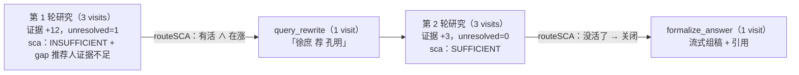

**访问预算对账**：1(formalize) + 1(planner) + 1(prefetch) + 3×2(两轮研究) + 1(rewrite) + 1(answer) = **10 visits**。若中途预算耗尽：guard → stop → 报错，state 清空返回。

**反面演算**（体现「记录优先于 verdict」）：

- 若第 2 轮后 reviewer 说 SUFFICIENT 但 slot 表仍有 unresolved → **再来一轮**（work left ∧ still learning，L1004-1006）；
- 若第 2 轮一条新证据都没捞到（grew=0）且 verdict 是 UNKNOWN → 关闭（stalled 且无人主张再来）。

### 10.7 本讲小结

**一句话**：Agentic RAG = 形式化建账（slot 表）→ 规划预取 → 多轮「检索-草稿-对账」研究环 → 账本清零才组稿。检索是工具（hybrid/vector/bm25/grep 四条腿），LLM 只做两件事：**决定搜什么、判断证据够不够**。

想深入按顺序读三个文件：`agentic_rag_graph.go`（图编排）→ `runtime/action_session.go`（slot 账本）→ `runtime/tool_executor.go`（检索工具落地）。

## 第十一讲：知识编译全流程精讲

> 写侧源码：`internal/ingestion/component/knowledge_compiler/`（文档级组件，pipeline 图内）+ `internal/ingestion/knowledge_compile/`（数据集级消费者，pipeline 图外）。
>   
> 本讲把第九讲 9.1–9.5 的原理落成**可逐阶段对照的输入/输出表**：两层结构各节点吃什么、吐什么，变体怎么定、同一 KB 谁来处理，以及三个端到端演算。与第十讲（读侧 Agentic RAG）是一枚硬币的两面。

### 11.1 入口链与四个变体

入口链：前端画布/内置模板里的 Compiler 节点 → Pipeline 编译期解析 → **变体由编译模板的 kind 推导**，不是 DSL 指定的。注册名 `"Compiler"`（component.go:46，与 Python `rag/flow/compiler/compiler.py` 对齐——前端画布和 Go 内置模板解析到同一节点）；模板解析优先级 `compilation_template_id > compilation_template_group_id`（component.go:106-113）。

| 变体        | 包               | 原理                                                                     | 产物形态                 |
| --------- | --------------- | ---------------------------------------------------------------------- | -------------------- |
| structure | `structure/`    | 两段式 LLM 抽取：先实体（list/set/hypergraph）后关系，模板驱动 prompt，LLM 仲裁的 in-run 去重合并 | 实体 + 关系              |
| wiki      | `wiki/`（3316 行） | MAP→REDUCE→PLAN→REFINE 四阶段                                             | wiki 页面 + 章节         |
| tree      | `tree/`         | RAPTOR 递归抽象摘要树                                                         | 多层摘要节点（s1/s2/s_root） |
| mindmap   | `mindmap/`      | LLM 生成思维导图结构                                                           | 思维导图                 |

**最关键的协议设计**（component.go:73-79）：输出 schema **故意与上游 chunker 逐字节一致**（`output_format:"chunks"`）——编译产物转成 chunk 形状**合并进主流 chunk 流**，下游 Tokenizer 照常消费，Compiler 是 chunk 流里一个「夹带私货」的中间人。为此 `chunkerOutputs` 在本包重新声明而不 import chunker 包：避免拖进 chunker 的 CGO 依赖。

MAP 阶段的并发纪律：所有变体共享一个**进程级、vCPU 大小的编译池**（`SetBatchSubmitter` 注入，structure.go:20-30），一个文档的编译不会打满 LLM 并发。

### 11.2 全流程图：两层结构一屏看懂

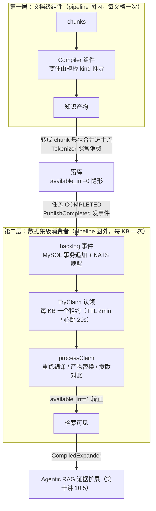

**为什么值得**：普通 chunk 检索只看局部——问「全局主旨」或「跨文档实体关系」时召回零散。知识编译付出 LLM 成本**预先组织**（一次编译、每次检索受益）；Agentic RAG 付出多轮 LLM 成本**逼近**（证据不足就改写查询再来一轮）。

### 11.3 逐阶段输入/输出（本讲核心）

**第一层：文档级组件**（以 wiki 变体为主线）：

| 阶段     | 输入                        | 输出                                                                                                                                                                                 |
| ------ | ------------------------- | ---------------------------------------------------------------------------------------------------------------------------------------------------------------------------------- |
| MAP    | chunks + token 预算（2048/批） | 每批一次 LLM 抽取 → entities/concepts/claims/relations/topics；结果写 **per-chunk 不可变版本缓存**（wiki 变体唯一的断点恢复点）                                                                                 |
| REDUCE | 多批 MAP 结果                 | 跨批精确归并（**纯代码，不调 LLM**）：同名实体合并为同一身份，两批 claims 挂到同一实体下                                                                                                                               |
| PLAN   | 归并后的实体/关系                 | 页面规划：entity 模式每实体一页；topic 模式可把相关身份合并成一页再分配（wiki.go:398-400）                                                                                                                        |
| REFINE | 每实体全部 claims/relations    | 逐页 LLM 精修 → wiki 风格页面 + 章节                                                                                                                                                         |
| 物化     | 页面 + 章节                   | 一次性批量 embedding（缺 embedder 直接报错）→ `MergeIntoStore` + `CosineDecider{Threshold}` 判重：过线 UPDATE、不过线 INSERT（统计 Inserted/Updated/DuplicatesDropped）；可选 `EnableHistoricalDedup` 与库内已有页比对 |
| 合并回流   | `Outputs.Products`        | 转 chunk 形状合并进主流 → Tokenizer 照常处理 → 落库 `available_int=0`                                                                                                                            |

tree 变体的阶段差异：**watershed 聚类**（1D 分水岭，沿文档顺序切簇）→ 每簇 LLM 摘要 → 递归到单节点根；产物 s1/s2/s_root **全部**落库（带层级标记）。structure 变体则是单阶段两段式抽取（先实体后关系），没有 MAP/REDUCE 分层。

**第二层：数据集级消费者**：

| 阶段                       | 输入                                       | 输出                                                                  |
| ------------------------ | ---------------------------------------- | ------------------------------------------------------------------- |
| Publish                  | 文档终态事件                                   | MySQL backlog 追加（事务）+ NATS `notify.kc.workers` 唤醒（尽力而为，掉了有 2s 轮询兜底） |
| TryClaim                 | 一个 KB 的 backlog                          | backlog→inflight（**移动**不是复制）+ 租约 token                              |
| processClaim             | 积压事件                                     | 重跑编译、产物替换、Wiki 贡献对账                                                 |
| commitWikiContributions  | 本次重编译相对上版的增删（affectedSlugs/removedSlugs） | 只替换受影响页，未变的保留                                                       |
| replaceDirtyWikiProducts | revision 检查                              | `dirty.Revision != request.Revision` 则放弃（防旧请求覆盖新状态）；stale 产物按 id 删除 |
| 转正                       | `available_int=0` → `1`                  | 检索可见（防消费者与索引 refresh 赛跑读到不完整视图）                                     |

### 11.4 两个决策点

**决策一：变体怎么定**——由编译模板的 kind 经 `common.KindToVariant` 推导，而非 DSL 指定；模板优先级 `compilation_template_id > compilation_template_group_id`。换模板 = 换产物形态，画布节点不用改。

**决策二：同一 KB 谁来处理**——Option E 调度：**MySQL 是调度事实源，NATS 只是尽力唤醒**。TryClaim 集群竞争 → 每 KB 同一时间只有一个租约 → **同一 KB 串行处理**（wiki 跨文档合并需要看到稳定全集）。租约 TTL 2min、心跳 20s；过期可被其他 worker 收回，旧 worker 的写因 token 不匹配被拒（`ErrClaimTokenMismatch`）；`WithDatasetLock` 把「校验 token + 破坏性写」放进持数据集行锁的事务，堵死校验与写入之间的 TOCTOU 窗口。backlog 是**有序日志**：同一 doc 的最后一个事件胜出，无需序列号。

认领与恢复时序（含 W1 崩溃被 W2 收回的完整轨迹）：

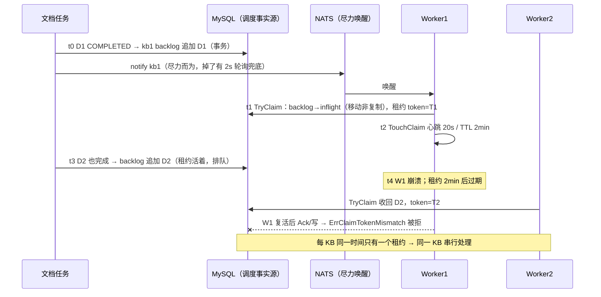

四种事件：

| 事件              | 触发             | 消费者行为                |
| --------------- | -------------- | -------------------- |
| `doc_completed` | 文档任务 COMPLETED | 编译/合并该文档的数据集级贡献      |
| `doc_deleted`   | 用户删除文档         | 打墓碑（tombs），撤回其数据集级贡献 |
| `doc_enabled`   | 文档重新启用         | 恢复数据集级贡献             |
| `doc_disabled`  | 文档禁用           | 只撤数据集级贡献，文档级产物保留供再启用 |

⚠ 空 variants 的删除事件不入队——会被当 legacy 全量事件重建无关产物（event.go:127）。

### 11.5 端到端演算

**演算 A：一篇文档走完 wiki 编译**（《蜀汉人物志》，假设 chunk 后 5 个 chunk，共约 3000 token）：

| 步骤 | 阶段     | 输入 → 输出                                                                                                                                      |
| -- | ------ | -------------------------------------------------------------------------------------------------------------------------------------------- |
| ①  | MAP    | token 预算 2048/批 → 2 批 `{c1,c2,c3}`/`{c4,c5}`（共享池并发，每批一次 LLM）→ 批 1 产出 刘备/关羽/张飞 实体 + 桃园结义 concept + claims（关羽-斩颜良-颜良 等）+ relations（刘备-结义-关羽 等） |
| ②  | REDUCE | 「刘备」在批 1（结义关系主语）和批 2（三顾茅庐主语）各出现一次 → 合并为同一身份，两批 claims 挂到同一实体下                                                                                |
| ③  | PLAN   | entity 模式每实体一页 → 刘备页/关羽页/张飞页/诸葛亮页/赵云页                                                                                                        |
| ④  | REFINE | 关羽页：`# 关羽` → 生平 / 关联事件（水淹七军围樊城）/ 关系（结义兄弟：刘备、张飞）                                                                                              |
| ⑤  | 物化     | 页面 + 章节一次性批量 embedding → CosineDecider 判重（过线 UPDATE/不过线 INSERT）→ 合并进 chunk 流 → 落库 `available_int=0`                                          |
| ⑥  | 数据集级收尾 | 本篇关羽页 vs 库里另一篇文档的关羽页，KNN 相似 ≥ 0.85 → UPDATE 合并贡献而非重复建页；数据集级产物 `available_int=1` 转正                                                           |

同一趟流程的图示（虚线框内是 MAP 阶段的两批并发）：

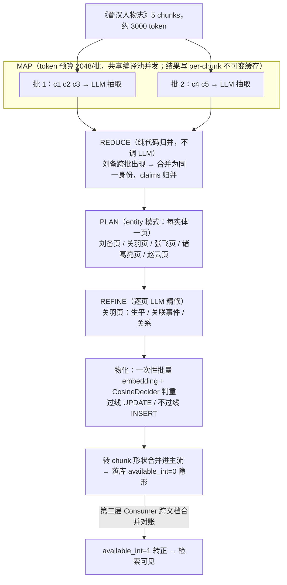

**演算 B：RAPTOR 树**（6 chunks，`tree_order=3`）：

```mermaid
flowchart TD
    L0["Level 0：c1 c2 c3 c4 c5 c6（按文档顺序）"] -->|"watershed 聚类（沿文档顺序切簇）"| CL["簇 A：c1 c2 c3；簇 B：c4 c5 c6"]
    CL -->|"每簇 LLM 摘要"| L1["Level 1：s1   s2"]
    L1 -->|"再聚类 s1 s2 + LLM 摘要"| L2["Level 2：s_root（单节点即根，递归终止）"]
```

- `tree_order`（B+ 树的「阶」，raptor.go:8-11）= level-0 簇的平均 chunk 数；
- 产物 = s1、s2、s_root **全部**作为 Product 落库（带层级标记）；
- 检索收益按问题粒度命中不同层：问细节（「白马之战谁斩了颜良」）→ 命中 c2；问中观（「前半部分的主线」）→ 命中 s1；问全局（「这篇文档讲什么」）→ 命中 s_root；
- Python 原版每层之间写 ES 中转；Go 移植全部留在内存。

**演算 C：数据集级消费者时间线**（Option E）：

| 时间 | 事件           | 系统行为                                                                                                  |
| -- | ------------ | ----------------------------------------------------------------------------------------------------- |
| t0 | D1 完成        | `PublishCompleted(variants=["wiki"])` → MySQL: kb1.backlog += D1（事务）+ NATS notify {kb1}（尽力而为）         |
| t1 | W1 唤醒        | TryClaim → backlog→inflight，token=T1                                                                  |
| t2 | W1 处理中       | TouchClaim 心跳 20s / TTL 2min                                                                          |
| t3 | D2 也完成       | backlog += D2（W1 租约活着，D2 排队）                                                                          |
| t4 | W1 Ack(D1 批) | 发现 backlog 非空 → 继续认领 D2；若 W1 崩溃：租约 2min 过期 → W2 收回（token=T2），W1 若复活则 Ack/写被 `ErrClaimTokenMismatch` 拒 |
| t5 | 用户删除 D3      | `PublishDeleted(variants=["wiki"])` → 消费者对 D3 打墓碑，撤回其数据集级贡献                                           |

### 11.6 与 Agentic RAG 的交汇

读侧消费入口是 CompiledExpander（第十讲 10.5）：`search_chunks` 命中普通 chunk 后，用问题向量查编译产物行，命中行带 `source_chunk_ids` → 把原始 chunk 拉进证据集。**写侧的每次编译，都在为读侧的多轮研究环预置导航索引**——编译产物是导航，证据仍是原文。

```mermaid
flowchart TD
    subgraph W["写侧：一次编译（本讲）"]
        A1["Compiler 产出 wiki / tree / structure / mindmap 页面"] --> A2["物化 → 合并进 chunk 流 → available_int=0 隐形入库"]
        A2 --> A3["数据集级 Consumer 跨文档合并 → available_int=1 转正"]
    end
    subgraph R["读侧：每次检索（第十讲）"]
        B1["search_chunks 命中普通 chunk"] --> B2["CompiledExpander<br/>用问题向量查编译产物行"]
        B2 --> B3["命中行带 source_chunk_ids<br/>把指向的原始 chunk 拉进证据集"]
        B3 --> B4["Agentic RAG 证据池 → 多轮研究环"]
    end
    A3 -->|"产物行检索可见：只是导航索引"| B2
    B4 -.->|"组稿引用仍指向原始 chunk，可溯"| A1
```


### 11.7 本讲小结

**一句话**：知识编译 = 文档级四变体深加工（每文档一次）+ 数据集级跨文档合并（每 KB 一次），靠 `available_int` 两段式可见性衔接；付出一次 LLM 成本预先组织知识，之后每次检索都受益。

想深入按顺序读三个文件：`component/knowledge_compiler/component.go`（协议与变体推导）→ `wiki/`（四阶段演算最完整）→ `knowledge_compile/{event,scheduler,consumer,writer}.go`（Option E 调度）。

---

## 第十二讲：演进史与速查 —— Python → Go 迁移 / 模板清单 / 参数总表

> 本章由两份配套文档合并而来：
> - 《RAGFlow文档解析与召回逻辑分析.md》（521 行，架构/流程视角）：版本演进差异、全链路时序图、内置模板清单、召回链路 Go 实现、参数速查；
> - 《知识编译和 Agentic RAG.MD》（65 行，概念视角）：编译模板业务分类、Agentic RAG 效果观察。
>
> **引用性质说明**：第一至十一讲的所有 `文件:行号` 均经源码逐行核对；本章保留的路径/行号来自上述两份架构分析文档，**RAGFlow 源码未本地检出、未经逐行复核**，请以主文档引用为准。原两份文档的独有内容已全部吸收至本章，合并后原文件删除。

### 12.1 版本演进：Python → Go 迁移对照表

RAGFlow 已完成 Python → Go 的 ingestion 全链路迁移（旧 `rag/svr/`、`rag/app/` 等已在 #20289 / #20306 删除）。理解迁移前后的对应关系，读旧版资料时才不会对不上号：

| 旧版（Python，已删除） | 新版（Go） | 说明 |
|---|---|---|
| `api/db/services/task_service.py` `queue_tasks()` | `internal/service/document/document_ingest.go` `IngestDocuments()` | 任务切分入队 → 统一 `ingestion_task` 状态机 |
| Redis Stream 任务队列 | **NATS JetStream**（`internal/engine/nats`） | `internal/common/task.go` 定义 `TaskTypeIngestionTask`、`TaskHandle` |
| `rag/svr/task_executor.py` 主循环 | `internal/ingestion/service/ingestion_service.go` `Ingestor` | 消费循环 + 心跳租约 + 状态机（第六讲） |
| `build_chunks` + `FACTORY[parser_id]` 分块器映射 | `internal/ingestion/pipeline/` DSL 模板 + `internal/ingestion/component/` 组件 | `parser_id` 即内置 pipeline 标识（如 `naive` → general 模板） |
| `rag/app/naive.py` 等 14 个分块策略文件 | `internal/ingestion/pipeline/template/ingestion_pipeline_*.json`（12 个内置模板）+ `internal/ingestion/component/chunker/` | 策略改为**声明式 DSL JSON** |
| `deepdoc/parser/`（Python 解析） | `internal/parser/parser/`（typed parsers）+ `internal/deepdoc/`（native CGO） | office_oxide / pdfium / pdf_oxide 原生库 |
| `naive_merge` / `tokenize_chunks` | `internal/parser/chunk/`（chunk 操作库，第二讲）+ Tokenizer 组件 | sentence/char/paragraph/length 四种策略 |
| `rag/llm/embedding_model` 批量编码 | `internal/ingestion/task/embedder.go` | 重试、限流、quota 冷却、token 预算阶梯 |
| `insert_chunks` 批量写 ES | `internal/ingestion/task/chunk_index_writer.go` | bulkSize=32、3 次指数退避（主文档 5.6 已核对更细策略） |
| `vector_similarity_weight` 单参数 | **`keywords_similarity_weight`**（#20385 重命名） | 与 vector 权重之和必须为 1（`internal/service/similarity_weight.go`） |

> 迁移后读旧版博客/Issue 的三个常见对坑点：①"PDF 按页切多任务 + digest 复用"的任务拆分逻辑已不存在，分页在 pipeline 内部处理（`pipeline/pdf_pages.go`）；②检索权重参数名从 `vector_similarity_weight` 单控改为 keywords/vector 双权重且强制和为 1；③`rag/nlp/search.py` 等 Python 检索文件已删除，检索全在 `internal/engine/` + `internal/agent/`。

### 12.2 全链路时序图：一次文档解析的完整交互

主文档第五、六讲给的是组件视角 flowchart；这里补一张**交互视角时序图**（从 HTTP 请求到索引落库，注意与第五讲 `processOutput` 流程图互为镜像——一个按时间、一个按数据）：

```mermaid
sequenceDiagram
    autonumber
    participant C as Client
    participant API as API Server
    participant DS as DocumentService
    participant ITS as IngestionTaskSvc
    participant DB as MySQL
    participant MQ as NATS JetStream
    participant IG as Ingestor
    participant PE as PipelineExecutor
    participant CMP as Pipeline 组件
    participant MIN as MinIO
    participant EMB as Embedder/LLM
    participant DS2 as DocStore (ES/Infinity)

    C->>API: POST 解析文档
    API->>DS: StartParseDocuments
    DS->>DS: 校验存储 / 清理旧 chunks / 加锁
    DS->>ITS: IngestDocuments → CreateForDocuments
    ITS->>DB: INSERT ingestion_task (PENDING)
    ITS->>MQ: 发布消息 task_type=ingestion_task
    MQ-->>ITS: ack
    API-->>C: 202 Accepted (task_id)

    MQ-->>IG: consumeLoop 投递 handle
    IG->>IG: NewHeartbeat + registerLease
    IG->>ITS: TransitionTaskToRunning
    ITS->>DB: UPDATE status=RUNNING
    IG->>ITS: ReloadAndValidateRunIdentity
    alt 身份失效（配置已变更）
        ITS-->>IG: reject → ack 丢弃
    else 身份有效
        IG->>IG: claimTask 防重复执行
        IG->>ITS: PrepareValidatedRun
    end

    IG->>PE: defaultRunDocumentTask → Execute
    PE->>ITS: LoadFromIngestionTask
    alt pipeline_id 为空
        PE->>PE: LoadBuiltinDSL(parser_id)
    else 自定义 pipeline
        PE->>DB: 加载 canvas DSL
    end
    PE->>PE: NewPipelineExecutor(bulkSize=32)
    PE->>CMP: Pipeline.Run File→Parser→Chunker→Extractor→Tokenizer
    CMP->>MIN: 读取文档二进制
    MIN-->>CMP: file bytes
    CMP->>CMP: dispatchParse → DeepDOC/native CGO 或远程引擎
    CMP->>CMP: GeneralChunker chunk_token_size=512
    opt Extractor 开启
        CMP->>EMB: keywords/questions/tags/metadata
        EMB-->>CMP: important_kwd / question_kwd
    end
    CMP->>EMB: embedWithRetry 批量 + 预算限流
    EMB-->>CMP: q_dim_vec

    PE->>PE: processOutput 规范化
    loop 每 32 条一批（3 次指数退避）
        PE->>DS2: indexWriter.Write (InsertChunks)
        DS2-->>PE: ok
    end
    alt 写入失败
        PE->>DS2: compensateFailedIndexWrite 按 id 删除已写入
        PE-->>IG: error → task=FAILED
    else 写入成功
        PE->>PE: reconcile 编译产物 + 更新统计
        PE-->>IG: PipelineResult (chunk_count/token/duration)
    end
    IG->>ITS: stagePendingCompileEvent → COMPLETED
    IG->>MQ: ack handle
    note over C,DS2: 文档可被检索 available_int=1
```

### 12.3 12 个内置 ingestion 模板

`internal/ingestion/pipeline/template/` 下的声明式 DSL（JSON）模板，`parser_id` 即模板 ID：

| 模板 | 典型场景 | 组件图特点 |
|---|---|---|
| `general` | 通用文档（绑定 `parser_ids: ["naive"]`） | File→Parser→GeneralChunker→Extractor→Tokenizer |
| `book` | 书籍 | 标题层级深、父子块 |
| `email` | 邮件（递归解析附件，限一层） | email_parser 逐级重解析 |
| `laws` | 法律法规 | 条款级分块（章/节/条） |
| `manual` | 手册 | 标题层级 + 图片上下文 |
| `one` | 整篇一块 | 不分块（`one` chunker） |
| `paper` | 论文 | 摘要/正文/参考文献分段 |
| `picture` | 图片 | 视觉解析 + caption |
| `presentation` | 幻灯片 | 逐页 + 备注 |
| `qa` | 问答对 | 问答结构化入库 |
| `table` | 表格 | 行级分块 + 表格上下文 |
| `audio` | 音频 | ASR 转写后走通用链路 |

general（naive）模板核心参数（节选自 `ingestion_pipeline_general.json`）：`chunk_token_size=512`、`delimiters=[\n ! ? ; 。 ； ！ ？]`、`overlapped_percent=0`、`filename_embd_weight=0.1`、`search_method=["embedding","full_text"]`。

### 12.4 编译模板的业务分类（与 11.1 代码变体互为表里）

第十一讲 11.1 讲的是**代码四变体**（structure/wiki/tree/mindmap，由编译模板 kind 推导）；这里补**产品视角的模板分类**——同一个变体在不同模板kind下的产物形态：

| 模板 | 组织方式 | 底层变体 | 适用场景 |
|---|---|---|---|
| **Wiki** | 实体/概念页面 + 图谱导航，支持编辑与版本管理 | wiki | 把零散资料组织成可浏览的知识体系 |
| **Graph** | 实体-关系交互式知识图谱 | structure | 发现跨文档的知识连接 |
| **Tree** | 按语义关系组织的层级结构，保持文档阅读序 | tree | 大型知识库分层探索 |
| **Page Index** | 保留文档标题/章节/小节逻辑的层级索引 | tree（层级摘要） | 技术手册、研究报告等长文档导航 |
| **Mind Map** | 以核心主题为中心的子主题展开 | mindmap | 快速掌握知识全貌 |
| **Timeline** | 按时间顺序组织事件序列 | structure（时间实体抽取） | 企业发展、项目里程碑、历史记录 |

**GraphRAG/RAPTOR 的归宿**（读旧资料的关键）：v0.27.0 起 GraphRAG 的实体关系提取能力并入 **Graph 模板**（底层即 structure 变体的两段式抽取），RAPTOR 的递归摘要层级结构演化为 **Tree 模板**（底层即 tree 变体的 watershed 聚类 + LLM 摘要，第九讲 9.4 有端到端演算）。编译产物统一以 `available_int=0` 落库（检索不可见），任务 COMPLETED 后由数据集级消费者合并为可用产物（`stagePendingCompileEvent`，第五讲）。

### 12.5 Agentic RAG 效果观察与模式选型

第十讲已给四档模式的完整参数表（agentic/SCA/planner 扇出/session 轮次/snippet 数）；这里补**什么时候值得开**的实践观察：

**有明显优势的场景**：

- **口语化查询**：能改写模糊、省略的问题，改善召回（避免"检索不到就答不到"）；
- **信息不足时**：会追问澄清，而非基于不完整信息强行回答；
- **证据评估**：对检索结果做相关性判断，不足时触发重试，降低"检索到什么就答什么"的风险；
- **高风险场景**：对操作类、安全类问题进入保守回答流程，不直接给出危险建议。

**代价与选型**：迭代检索增加延迟和 token 消耗。简单明确的问题传统 RAG（Naive）或 Low 已足够；Medium 及以上针对**复杂、多跳、需综合多份文档**的问答（版本差异分析、多文档对比、复杂归因）。Ultra 与 High 的差异在路径重规划的灵活度。相关端到端演算见第十讲 10.6（三跳问题走两轮研究环）。

### 12.6 关键参数速查总表

跨讲次的高频参数一页看完（主文档引用均已核对；标注※的来自合并文档、未经复核）：

| 参数 | 位置 | 默认/说明 |
|---|---|---|
| `chunk_token_size` | general 模板 DSL | **512** token/块 |
| `delimiters` | 模板 DSL | `\n ! ? ; 。 ； ！ ？` |
| `overlapped_percent` | 模板 DSL | 0（块间重叠） |
| `children_delimiters` | 模板 DSL | 子块分隔（母子块结构） |
| `defaultLengthChunkSize` | `internal/parser/chunk/split.go` | 256 runes（length 策略窗口） |
| `parse_method`（pdf/spreadsheet） | Parser 组件 setup | DeepDOC（可选 MinerU/PaddleOCR/Docling） |
| `filename_embd_weight` | Tokenizer 组件 | **0.1**，文件名向量权重 |
| `search_method` | Tokenizer 组件 | `["embedding","full_text"]` 双路 |
| Extractor 开关 | Extractor 组件 | `keywords.top_n` / `questions.top_n` / `tags.top_n` / `summary.enabled` / `metadata.enabled`（默认全关） |
| `documentBulkSize` | `defaultRunDocumentTask` | **32**（索引批量，主文档 5.6 已核对） |
| `chunkInsertAttempts` | `chunk_index_writer.go` | 3 次，100ms 起指数退避（主文档 5.6 已核对） |
| `keywords_similarity_weight` ※ | 对话/检索配置 | 与 vector 权重和为 1（`internal/service/similarity_weight.go` 校验强制，#20385 重命名） |
| 消息队列 | `internal/engine/nats` | NATS JetStream，`task_type=ingestion_task`（第六讲已核对） |
| ingestor 并发 | `RAGFLOW_INGESTOR_MAX_CONCURRENT_WORKERS` | worker 数上限（第六讲已核对） |
| ES keyword 字节上限 | 主文档 5.x | 超 32766 字节按 UTF-8 边界截断（已核对） |

### 第十二讲小结

**一句话定位**：本章是"望远镜 + 速查卡"——12.1 帮读旧资料的人对坑，12.2 补交互视角，12.3–12.4 把模板从代码变体到产品形态补齐，12.5 回答"Agentic 开不开"，12.6 一页查所有参数。

---

## 附：学习路线与复习卡汇总

### 推荐阅读顺序（由浅入深）

| 阶段 | 内容                                                           | 建议时长  |
| -- | ------------------------------------------------------------ | ----- |
| 1  | 跑测试建立体感：`bash build.sh --test ./internal/parser/...`         | 半天    |
| 2  | chunk 包 7 文件（本笔记第二讲）                                         | 1–2 天 |
| 3  | parser 包骨架：parse_result.go + parser_type.go + text_parser.go | 1 天   |
| 4  | 挑中等格式精读：csv → markdown → html                                | 2–3 天 |
| 5  | GeneralChunker（第三讲）                                          | 2 天   |
| 6  | Parser 组件 + 组件边界（第四讲）                                        | 1 天   |
| 7  | Pipeline/Executor/落库（第五讲）                                    | 2 天   |
| 8  | Ingestor 派发（第六讲）+ Extractor/KC（第七讲）                          | 1–2 天 |
| 9  | 检索侧（第八讲）                                                     | 2 天   |
| 10 | 知识编译 + Agentic RAG（第九讲，含端到端演算）                               | 2–3 天 |
| 11 | Agentic RAG 全流程精讲（第十讲，输入/输出逐阶段）                              | 1 天   |
| 12 | 知识编译全流程精讲（第十一讲，输入/输出逐阶段）                                     | 1 天   |
| 13 | （可选）PDF 多后端家族、action session 工具调度                            | 深入方向  |

### 全链路复习卡

**解析/分块：**

1. 传送带模式：`Origin → TextAfterPreprocess → SplitChunks → ResultChunks`，每站只读上站写字段。
2. typed ↔ DSL 双轨：`drop_duplicates`/`soft_line_break_merging` 等只在 DSL 通道。
3. 三种度量混用要警惕：字节 vs rune vs 原始行号。
4. 两套分块引擎并存：`chunk.Run`（CLI 用）与 GeneralChunker（生产用，BPE token 预算）。
5. 自定义分隔符（反引号）= 关闭 token 合并。
6. 媒体屏障三态度：general/PDF 硬、DOCX 软、Markdown 图片是块附件。

**组件边界：**
  
7\. 组件边界协议是 JSON 往返；json tag 即线协议。
  
8\. 单协议收敛：Parser 只对外暴露 json；Markdown/HTML 载荷在边界重解析。
  
9\. Globals 拉回模式：共享字段走 CanvasState.Globals，组件进出各拉各发。
  
10\. 已知家族失败大声失败；未知家族 raw-text 兜底。
  
11\. 鸭子类型注入（parserSetupConfigurer/OnPageDone）让调度层零耦合。

**编排/落库：**
  
12\. File 只发身份证；取二进制是 Parser 的活。
  
13\. 没有 pipeline 级恢复；重试靠组件级 per-chunk 缓存，清理在所有落库步骤成功之后。
  
14\. debug 零副作用双通道（override_params vs Globals）。
  
15\. Tokenizer 是协议升级点（json → chunks）。
  
16\. Trim 三接口瀑布防"400 丢整个文档"。
  
17\. 写索引三策略：批 no-refresh + 尾批 refresh + 失败补偿删除。
  
18\. available_int 两段式：编译产物先隐形，任务终态后消费者转正。

**派发/抽取/检索：**
  
19\. DB 是任务 durable source of truth；启动时 ScheduleCreatedTasks 恢复 CREATED 任务。
  
20\. consumeLoop "等 worker 再拉取"防预取；1 个 outstanding broker 请求；停机 Nack。
  
21\. Extractor 缓存 key 含模型 ID + 系统提示词；换模型即换 key。
  
22\. KnowledgeCompiler 是 dataset 级消费者（文档管线之外），Claimer 认领防重复编译。
  
23\. 查询编码用 Query:true 非对称编码（encode_queries）。
  
24\. promoteChildren 子升父，依赖 ingestion 物化的父 chunk。
  
25\. 指针参数：nil 与 0 语义不同（省略 vs 覆盖）。

**知识编译/Agentic RAG：**
  
26\. 知识编译两层：文档级组件（四变体，模板 kind 决定）+ 数据集级消费者（Option E：MySQL 是调度真相源，NATS 只唤醒）。
  
27\. Compiler 输出伪装成 chunk 流（schema 与 chunker 逐字节一致），下游 Tokenizer 无感知。
  
28\. wiki 四阶段 MAP→REDUCE→PLAN→REFINE；MAP 有 per-chunk 不可变缓存，是唯一断点恢复点。
  
29\. RAPTOR：文档顺序 watershed 聚类 + 递归摘要；一棵树同时服务细节/中观/全局三种粒度的问题。
  
30\. Agentic RAG 五阶段图 + 研究环；一轮研究 = 3 次节点访问；预算耗尽报错不组半成品稿。
  
31\. routeSCA 四规则：work×learning 决定一切，reviewer 的 verdict 只是一票；NoProgress=视图 hash 不变即关闭。
  
32\. 枚举型问题硬限 2 轮（实测第 3 轮 +0 chunks）。


1. 交汇点 CompiledExpander：编译产物当导航索引，顺 source_chunk_ids 摸回原始证据。
2. Agentic RAG 五阶段：formalize_question → [planner → prefetch] → (rag_agent → draft → sca)* 研究环 → formalize_answer；一轮研究 = 3 visits。
3. routeSCA：work × learning 决定是否再来一轮，reviewer 的 verdict 只是一票；NoProgress = 视图 hash 不变即关闭；枚举型问题硬限 2 轮。
4. low 档 = 无工具单次 direct_search（≈ 普通 RAG）；预算耗尽走 stop 报错并丢弃 state，不组半成品稿。
5. 知识编译两层：文档级 Compiler（四变体，模板 kind 推导）+ 数据集级 Consumer（Option E：MySQL 事实源，NATS 只唤醒）；available_int 两段式衔接。
6. wiki 四阶段 MAP→REDUCE→PLAN→REFINE：MAP 写 per-chunk 不可变缓存（唯一断点恢复点），REDUCE 纯代码归并不调 LLM，REFINE 后批量 embedding + CosineDecider 判重（过线 UPDATE/不过线 INSERT）。
7. RAPTOR 一棵树服务三种粒度（细节/中观/全局）；tree_order = level-0 簇的平均 chunk 数；Go 移植全在内存，不写 ES 中转。
8. 同一 KB 串行编译（Claimer 租约 TTL 2min/心跳 20s）；空 variants 的删除事件不入队，防被当 legacy 全量重建。

---

## 涉及文件索引

| 主题         | 文件                                                                                                                                                                                                                                               |
| ---------- | ------------------------------------------------------------------------------------------------------------------------------------------------------------------------------------------------------------------------------------------------ |
| 解析契约/工厂    | `internal/parser/parser/parse_result.go`, `parser_type.go`                                                                                                                                                                                       |
| 分块流水线      | `internal/parser/chunk/{chunk_type,execute,options,preprocess,split,postprocess,delim,helpers}.go`                                                                                                                                               |
| 生产分块       | `internal/ingestion/component/chunker/{general,common,token,table_split}.go`                                                                                                                                                                     |
| 组件边界       | `internal/ingestion/component/{parser,parser_dispatch,file}.go`, `component/schema/chunker.go`                                                                                                                                                   |
| Tokenizer  | `internal/ingestion/component/tokenizer.go`                                                                                                                                                                                                      |
| Extractor  | `internal/ingestion/component/extractor.go`                                                                                                                                                                                                      |
| 编排         | `internal/ingestion/pipeline/pipeline.go`, `internal/ingestion/task/pipeline_executor.go`, `task/chunk_index_writer.go`                                                                                                                          |
| 派发         | `internal/ingestion/service/ingestion_service.go`                                                                                                                                                                                                |
| 知识编译组件     | `internal/ingestion/component/knowledge_compiler/`（`component.go` + `wiki/`、`tree/`、`structure/`、`mindmap/`）                                                                                                                                     |
| 知识编译调度     | `internal/ingestion/knowledge_compile/{event,scheduler,consumer,writer}.go`                                                                                                                                                                      |
| 检索服务       | `internal/service/nlp/retrieval.go`                                                                                                                                                                                                              |
| 检索引擎       | `internal/engine/{elasticsearch,infinity,serenedb,oceanbase}/*.go`                                                                                                                                                                               |
| Agentic 检索 | `internal/rag/agentic-rag/{agentic_rag,agentic_rag_graph}.go`, `runtime/{action_session,tool_search,tool_executor,tool_compiled_expansion}.go`, `internal/agent/tool/{agentic_search,retrieval}.go`, `internal/agent/retrievalbridge/harness.go` |
