> 基于对 `src/` 目录下 C 源码（`ae.c`、`networking.c`、`server.c`、`object.c`、`dict.c`、`rdb.c`、`aof.c`、`replication.c`、`cluster.c` 等）的逐文件精读整理而成。
>
> 阅读顺序即学习顺序：事件循环 → 网络与协议 → 命令生命周期 → 对象与数据结构 → 持久化 → 复制与集群。
>
> 所有结论均标注了源文件位置（格式 `src/xxx.c:行号`），建议对照代码阅读。
>
> **版本基线**：Redis **8.10.2**（`src/version.h:1` `#define REDIS_VERSION "8.10.2"`）。
> **精确 commit**：`498ecd0d6d007db11ddb3aea9428552598a78622`，commit 时间 `2026-09-17 23:06:00 +0800`。

---

## 〇、全景地图

Redis 8.10.2 的整体骨架可以压缩成四层：**事件层（ae）** → **连接层（connection/anet）** → **协议与客户端层（networking）** → **命令与数据层（server/db/object）**。旁路上挂着三件"后台活"：持久化（rdb/aof）、复制（replication）、集群（cluster）。

```
┌──────────────────────── 启动层 (src/server.c) ────────────────────────┐
│ main(8051) → initServerConfig(2401) → loadServerConfig → initServer(2999) │
│   → initListeners(3249) → InitServerLast(3326) → initThreadedIO(iothread.c:991) │
│   → loadDataFromDisk → aeMain(8410)                                       │
└───────────────────────────┬────────────────────────────────────────────┘
                            ▼
┌────────────────── 事件层 (src/ae.c + src/ae_epoll.c) ──────────────────┐
│ aeEventLoop{events,fired,timeEventHead,beforesleep,aftersleep}          │
│ aeMain(ae.c:497): while(!stop) aeProcessEvents(ALL|BEFORE|AFTER_SLEEP)  │
│   ├── 文件事件: epoll_wait(ae_epoll.c:93) → fired[] → rfileProc/wfileProc │
│   └── 时间事件: processTimeEvents(ae.c:284) → serverCron(server.c:1562)   │
│ beforeSleep(server.c:1947) / afterSleep(server.c:2162) 是每轮前后钩子      │
└───────────────────────────┬────────────────────────────────────────────┘
                            ▼
┌────────────── 连接层 (src/anet.c + src/connection.c) ──────────────────┐
│ anetTcpServer(anet.c:571) → listen fd → acceptTcpHandler → createClient  │
│ connSetReadHandler(conn, readQueryFromClient)  (networking.c:133)        │
└───────────────────────────┬────────────────────────────────────────────┘
                            ▼
┌──────────── 协议/客户端层 (src/networking.c) ──────────────────────────┐
│ readQueryFromClient(3893) → querybuf → processInputBuffer(3690)         │
│   → processMultibulkBuffer(3278)/processInlineBuffer(3127) → pendingCommand │
│   → (IO 线程) enqueuePendingClientsToMainThread → 主线程 processCommand  │
│ 回复: addReply*(606~) → c->buf / c->reply → handleClientsWithPendingWrites(2958) │
└───────────────────────────┬────────────────────────────────────────────┘
                            ▼
┌──────────── 命令层 (src/server.c) ─────────────────────────────────────┐
│ processCommand(4467): lookup/ACL/cluster/maxmemory/... → call(3992)      │
│   call: c->cmd->proc(c)(4058) → dirty 计数 → alsoPropagate(4196)         │
│   → postExecutionUnitOperations(3907) → propagateNow(3744)               │
│       → feedAppendOnlyFile(aof.c:1661)                                   │
│       → replicationFeedSlaves(replication.c:652)                         │
└───────────────────────────┬────────────────────────────────────────────┘
                            ▼
┌──────────── 数据层 (src/object.c / db.c / dict.c / t_*.c) ─────────────┐
│ redisDb{keys=kvstore, expires=kvstore, subexpires=estore, watched_keys} │
│ robj/kvobj + OBJ_ENCODING_* (object.h:75~90)                            │
└────────────────────────────────────────────────────────────────────────┘
```

渲染友好版（GitHub/GitLab 直接出图，信息同上图）：

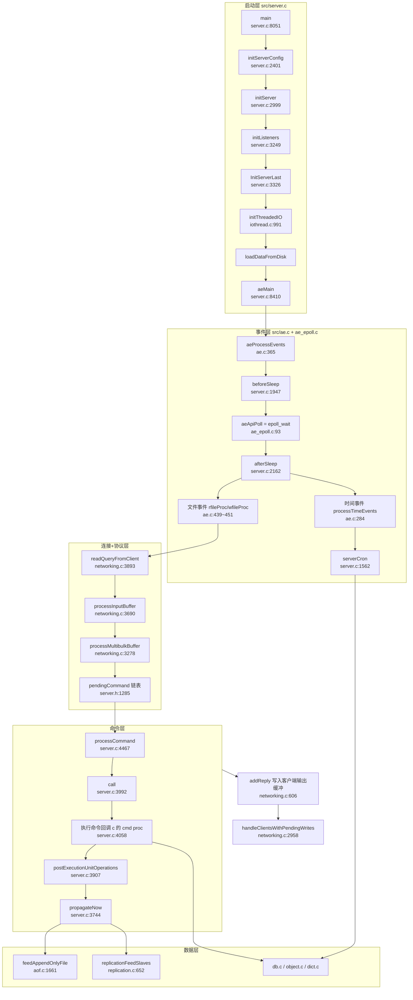

**三条主线**：

1. **命令流**：客户端 socket → `readQueryFromClient` 读入 `querybuf` → `processInputBuffer` 解析成 `pendingCommand` → `processCommand` 校验 → `call` 执行 `proc` → `addReply*` 写入输出缓冲 → `beforeSleep` 里的 `handleClientsWithPendingWrites` 真正 `write(2)` 出去。
2. **持久化流**：写命令 → `dirty++` → `alsoPropagate` 攒到 `server.also_propagate` → `postExecutionUnitOperations` → `propagateNow` → AOF `feedAppendOnlyFile` 写 `server.aof_buf`（`beforeSleep` 落盘）；同时 `serverCron` 按 `save` 参数触发 `rdbSaveBackground`（fork 子进程写临时文件 + rename）。
3. **复制/集群流**：写命令 → `replicationFeedSlaves` 写进 `server.repl_backlog` 与每个 replica 客户端 → replica 侧 `readQueryFromClient` 当作 master 流消费；集群侧 `clusterCron`（`cluster_legacy.c:4820`）用 gossip 做故障检测，`getNodeByQuery`（`cluster.c:1236`）在每次命令前做 slot 归属判定并可能返回 `MOVED`/`ASK`。

---

## 面试速通：Redis 高频问题一页纸

> 先给结论：六讲内容压成一页纸——**所有高频问题先记一句话答案，被追问再按讲次展开**。
> 使用方式：表格"深入"列指向本笔记对应讲次；每条结论都能在各讲小结里找到出处，没有文档之外的发挥。
> 覆盖面：事件循环（第一讲）→ 网络协议（第二讲）→ 命令链路（第三讲）→ 对象与过期（第四讲）→ 持久化（第五讲）→ 复制与集群（第六讲）。
> 边界说明：缓存穿透/击穿/雪崩、Sentinel 哨兵等高频话题不在本笔记的源码覆盖范围内，本章不列——宁可少一题，不给无出处的答案。
> 章内顺序即面试叙述顺序：先并发模型，再持久化，再复制集群，最后数据结构细节。

### 高频 Q&A（先结论）

| # | 面试问题 | 一句话结论 | 深入 |
| --- | --- | --- | --- |
| 1 | Redis 为什么快？ | 单线程 Reactor + epoll 多路复用 + 纯内存；ae 层 fd 直接当数组下标，注册与触发都无锁、无上下文切换 | 第一讲 |
| 2 | Redis 6.0/8.x 的多线程是什么？ | IO 线程只"搬砖"：读 socket、解析 RESP、回写 socket；命令执行仍全部在主线程，且 8.x 的 `io-threads` 是启动时固定的不可变配置 | 第一讲 |
| 3 | 单线程为什么还会阻塞？ | 慢命令（`KEYS *` 级别）靠单轮写上限 64KB 兜底；`appendfsync always` 的同步 fsync、fork 时的 COW、超大 bulk 读取都会拉长单轮循环 | 第一、五讲 |
| 4 | 收到 `+OK` 就代表落盘了吗？ | AOF 的 write 被刻意排在回复客户端之前，只有 `appendfsync always` 才给出"已确认即已持久"的承诺 | 第三、五讲 |
| 5 | RDB 快照的原理？ | fork 子进程靠 COW 看到 fork 瞬间的内存镜像，写临时文件再 rename 原子替换，全程不加锁 | 第五讲 |
| 6 | RDB 与 AOF 怎么取舍？混合持久化是什么？ | 8.x 默认 `aof-use-rdb-preamble` 开：AOF 的 BASE 文件直接用 RDB 格式（加载快），INCR 文件追加命令（丢得少），manifest 记录目录结构 | 第五讲 |
| 7 | AOF 三种 fsync 策略各丢多少？ | `no` 交给 OS；`everysec` 由 bio 线程每秒 fsync、上次 fsync 在飞时最多推迟 2 秒；`always` 同步 fsync，失败直接退出进程 | 第五讲 |
| 8 | AOF 重写（rewrite）在做什么？ | fork 子进程按当前数据集重写 BASE 文件，父进程无感继续写新 INCR；AOF 相对 base 增长超过 `aof_rewrite_perc` 时自动触发 | 第五讲 |
| 9 | 主从断线重连必须全量同步吗？ | PSYNC 靠 `replid` + offset 落在 `repl_backlog` 窗口内就回 `+CONTINUE` 部分同步；PSYNC2 的 `replid`/`replid2` 双 ID 让级联 failover 也能续传 | 第六讲 |
| 10 | 全量同步怎么传数据？ | master 跑 BGSAVE 生成 RDB 推给 replica，也支持无盘复制直接写 socket | 第六讲 |
| 11 | 过期 key 什么时候删？从库会删吗？ | 惰性（读路径判过期）+ 定期（在 CPU 预算内采样清理）；从库只标记过期不删除，等 master 合成 `DEL` | 第四讲 |
| 12 | Cluster 怎么定位一个 key？ | CRC16(key) 映射 16384 个槽，每条命令执行前做槽位归属判定，不属于本节点返回 `MOVED`/`ASK` | 第六讲 |
| 13 | Cluster 故障检测与故障转移怎么做？ | 每 100ms 发带 gossip 的 PING/PONG，延迟超时标 PFAIL，gossip 收集到多数升 FAIL，slave 发起选举接管 | 第六讲 |
| 14 | 大 key / 热 key 在源码里有什么抓手？ | 大 bulk 按需读取 + 零拷贝建对象、querybuf 上限、输出缓冲 hard/soft 双档限流；命令执行路径上有逐命令 hotkey 统计 | 第二、三讲 |
| 15 | 对象为什么有多种编码？zset 为什么快？ | 小规模用连续内存（intset/listpack）换 cache 命中，大规模转离散结构（dict/skiplist/quicklist）；zset = dict + skiplist 双结构，单点 O(1)、范围 O(logN) | 第四讲 |
| 16 | 事务 WATCH 的底层是什么？ | 键被修改时经 `touchWatchedKey` 给所有监视者打 `CLIENT_DIRTY_CAS`，EXEC 发现脏标记就整体返回 nil、一条都不执行 | 第三讲 |

> 记忆顺序建议：先背 1/2/3（并发模型），再背 5~8（持久化），最后背 9~13（复制集群）——这三组是面试出现频率最高的。
> 如果只来得及准备十分钟：背 1、2、7、9、11、13 这六条，覆盖"快/多线程/丢数据/断线重连/过期/集群"六大必考点。

### 易错点与面试坑

以下都是文档中明确强调过的反直觉点：先给坑，再给文档里的依据。

**持久化篇：**

- **fork 之后"改得越多、复制越贵"**：BGSAVE 期间内存可能翻倍，贵的不是 fork 本身，是 COW。
  依据：子进程只读不写、靠 COW 看 fork 瞬间镜像；为此 dict 在有子进程时全局禁止 resize，RDB 遍历完一个 db 还会主动丢弃桶数组——两处优化都在压 COW。
- **`everysec` 不是"最多丢 1 秒"**：最坏丢 1~2 秒。
  依据：上次 fsync 还在飞时会继续推迟、上限 2 秒；且 AOF 缓冲为空也可能触发 fsync——这是防"写完停写后页缓存迟迟不落盘"的反直觉补丁。
- **`appendfsync always` 的 fsync 失败会直接退出进程**：不是报错重试，是退出。
  依据：此时回复已进客户端输出缓冲、数据库改动无法回滚，只能以退出换"已确认即已落盘"的硬承诺。

**复制与过期篇：**

- **从库不主动删过期键**：查从库上已过期的 key 返回 nil，但字典条目还在——这不是漏删，是设计。
  依据：从库只标记过期、不物理删除，真正删除等 master 发来的合成 `DEL`，这是主从数据集逐字节一致的前提。
- **replica 的输出缓冲 hard limit 被抬到不低于 `repl-backlog-size`**：一个容易被忽略的暗坑。
  依据：不这么做，部分重同步刚成功就会因输出缓冲超限被断开，导致同步反复失败。
- **多条命令传播会自动包 `MULTI/EXEC`，但有例外**：不是所有批量传播都进事务。
  依据：直接执行的"触碰任意 key"类命令不包事务，与主动过期删随机 key 不包事务是同样的语义考虑。

**日常认知篇：**

- **`KEYS *` 真能占满事件循环**：单线程不是不会卡，是有人兜底。
  依据：普通客户端单轮写受 64KB 上限限制正是防它；但已达 maxmemory 时限量会被放开，拼命往外写。
- **AOF 在 8.x 是目录不是单文件**：还在按 `appendonly.aof` 单文件理解的都过时了。
  依据：8.x 是 BASE + INCR + manifest 的目录结构，且混合持久化默认开，"纯命令格式 AOF"反而是少数派配置。
- **慢查询与统计记的是重写前的命令**：日志里的命令和 replica 收到的可能不一样。
  依据：带 EX 的 SET 传播时会被改写成 `PXAT <绝对时间戳>`，避免 replica 上相对 TTL 累积漂移；统计也用重写前的原始命令。
- **8.10.2 的集群代码"分家"了**：照老文章在 `cluster.c` 里找 `clusterCron` 会找不到。
  依据：gossip 与故障检测在 `cluster_legacy.c`，命令面路由在 `cluster.c`，原子 slot 迁移在 `cluster_asm.c`。

### 关键数值与默认值速记

| 数值 | 含义 |
| --- | --- |
| hz = 10 | cron 基础频率，上限 500 |
| 200 | `clients/hz` 超过它即触发 dynamic hz 翻倍 |
| 1024 | events/fired 数组初始分配值，之后随 fd 翻倍懒扩容 |
| 64KB | 普通客户端单轮写入上限（已达 maxmemory 时不限） |
| 2 秒 | `everysec` 下上次 fsync 仍在飞时的最大推迟时长 |
| 16384 | Cluster 槽位数，CRC16(key) 查表映射 |
| 节点数/10 | 每个 PING 包携带的 gossip 条目数（最少 3） |
| 100ms | 集群心跳与原子 slot 迁移的调用周期 |
| 10000 | 共享整数对象个数（0~9999），引用计数不可变、可无锁共享 |
| 4 倍 / 1/8 | dict 强制扩容比例 / 缩容阈值 |
| 10n | dict 增量 rehash 的空桶扫描上限，防连续空桶拖成 O(n) |
| 20n | 主动过期单轮采样时的扫桶上限 |
| 1~10 | 过期清理 effort 取值范围 |
| 25% | effort=1 时主动过期慢循环可占用的 CPU 比例 |
| 1~128 | io-threads 取值范围，不可变配置，运行期不可改 |
| 128 | zset 从 listpack 转 skiplist 的元素数阈值 |
| 16384 / 10 | 未认证客户端的 bulk 上限 / 单命令参数个数上限 |
| 10x | repl_backlog 在 beforeSleep 中的裁剪倍速 |

> 这些数值全部能在前六讲中找到源码级出处；面试时能顺带说出"这个值是干什么用的、调大会怎样"，比干背数字更有区分度。
> 一句话串记：hz 十次一跳、IO 线程不炒菜、槽位一万六千三百八十四、everysec 最多丢两秒、从库过期不着急。

---

## 第一讲：事件驱动核心 —— ae 与 serverCron

### 定位

Redis 的全部并发模型就一个词：**单主线程 + 一个事件循环（Reactor）**。8.x 引入的 io-threads 并不改变这一点——IO 线程只负责"读 socket、解析协议、回写 socket"，**命令执行仍然全部在主线程**。理解 `ae.c` 就理解了 Redis 的"心跳"，理解 `serverCron` 就理解了 Redis 的"杂活调度表"。

### 目录结构：与事件循环相关的文件

```
src/
├── ae.h            # 事件循环结构体与常量定义（ae.h:79 aeEventLoop）
├── ae.c            # 与 OS 无关的事件循环骨架（aeMain/aeProcessEvents/processTimeEvents）
├── ae_epoll.c      # Linux 后端（aeApiState + epoll_create/epoll_ctl/epoll_wait）
├── ae_kqueue.c     # BSD/macOS 后端
├── ae_evport.c     # Solaris 后端
├── ae_select.c     # 兜底后端（select/poll）
├── anet.h / anet.c # 裸 socket 工具（非阻塞、TCP_NODELAY、listen、accept）
├── eventnotifier.c # IO 线程 ↔ 主线程 的事件通知器（8.x）
├── iothread.c      # 多线程 IO（8.x，每个 IO 线程自带 aeEventLoop）
├── threads_mngr.c  # 线程管理器（ThreadsManager_init，server.c:3005）
├── server.c        # main / initServer / serverCron / beforeSleep / afterSleep
└── monotonic.h/.c  # 单调时钟（monotime），aeTimeEvent.when 的类型来源
```

### 逐文件精读

#### 1）`src/ae.h` —— 三个结构体 + 一组位标记

`aeEventLoop`（`src/ae.h:79`）是核心，字段不多但每个都有讲究：

| 字段 | 含义 | 备注 |
| --- | --- | --- |
| `maxfd` | 当前注册的最大 fd | `aeDeleteFileEvent` 后要回扫更新（`src/ae.c:193`） |
| `setsize` | 最多跟踪多少 fd | 启动时 = `maxclients + CONFIG_FDSET_INCR`（`src/server.c:3084`，`CONFIG_FDSET_INCR` 见 `src/server.h:209`） |
| `nevents` | 已分配的 events/fired 数组长度 | 初始 `min(setsize, 1024)`（`src/ae.c:54`、`src/ae.c:46`） |
| `events` | `aeFileEvent[]`，以 fd 为下标 | **`fd` 直接当数组下标**，这是 ae 快的关键，也决定了 fd 不能超 `setsize` |
| `fired` | `aeFiredEvent[]`，`aeApiPoll` 填充 | 每次 poll 覆盖写前 `numevents` 项 |
| `timeEventHead` | 时间事件**无序单链表** | 每次 `processTimeEvents` 全表扫描找最近到期（`src/ae.c:284`） |
| `stop` | 退出标志 | `aeStop` 置 1（`src/ae.c:141`） |
| `beforesleep/aftersleep` | 前后钩子 | Redis 里是 `beforeSleep`/`afterSleep`（`src/server.c:3216`） |
| `flags` | `AE_DONT_WAIT` 开关 | 由 `aeSetDontWait`（`src/ae.c:93`）控制 |

事件掩码（`src/ae.h:21`～`src/ae.h:28`）：

- `AE_READABLE 1`、`AE_WRITABLE 2`、`AE_BARRIER 4`
- `AE_BARRIER` 的语义是"本轮里如果读事件先触发了，就**不要**再触发写事件"。注释写得很清楚：想在回复客户端之前先把东西 fsync 到磁盘时用（`src/ae.h:24`）。这保证了 AOF `appendfsync always` 的因果顺序。

`aeFileEvent`（`src/ae.h:52`）里 `rfileProc` 和 `wfileProc` 是**两个独立回调**——所以 `aeProcessEvents` 里才能判断"读写回调是否同一个"（`src/ae.c:447`），避免一次触发调两次。

#### 2）`src/ae.c` —— 事件循环骨架

后端选择是**编译期的**，靠 `#include .c` 直接把实现嵌进来（`src/ae.c:30`～`src/ae.c:44`），按性能降序：`ae_evport` > `ae_epoll` > `ae_kqueue` > `ae_select`。Linux 上走 `ae_epoll.c`。

`aeCreateEventLoop`（`src/ae.c:47`）：

```c
eventLoop->nevents = setsize < INITIAL_EVENT ? setsize : INITIAL_EVENT;  /* ae.c:54 */
eventLoop->events  = zmalloc(sizeof(aeFileEvent)*eventLoop->nevents);    /* ae.c:55 */
eventLoop->fired   = zmalloc(sizeof(aeFiredEvent)*eventLoop->nevents);   /* ae.c:56 */
eventLoop->setsize = setsize;                                            /* ae.c:58 */
eventLoop->maxfd   = -1;                                                 /* ae.c:62 */
if (aeApiCreate(eventLoop) == -1) goto err;                              /* ae.c:67 */
```

注意 `nevents` 与 `setsize` 分离：**先按 1024 分配，运行时再按 fd 增长翻倍扩容**（`src/ae.c:155`～`src/ae.c:166`）。这是 7.0 之后才有的"懒扩容"，避免了 `maxclients=100000` 时一上来就分配大数组。

`aeCreateFileEvent`（`src/ae.c:145`）先按需扩容，再 `aeApiAddEvent`，最后写 `fe->mask |= mask` 并按位装回调（`src/ae.c:173`～`src/ae.c:174`）。`aeDeleteFileEvent`（`src/ae.c:181`）有个易忽略的细节：**删 `AE_WRITABLE` 时一定要连带删 `AE_BARRIER`**（`src/ae.c:189`），否则 barrier 会残留。

`aeProcessEvents`（`src/ae.c:365`）是整个循环的心脏，顺序极为讲究：

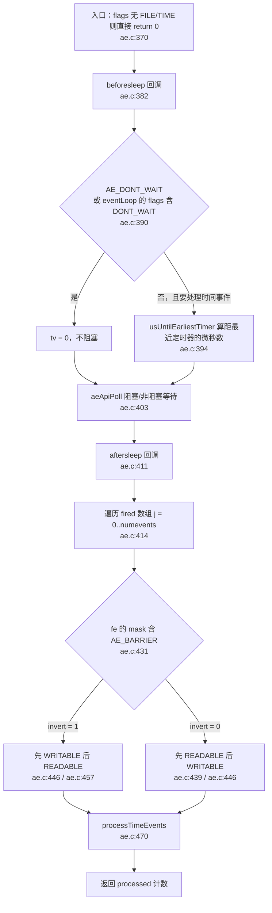

三个值得背下来的点：

1. **`beforesleep` 在 `aeApiPoll` 之前**（`src/ae.c:382`）。所以 Redis 的"回复客户端"发生在"睡觉之前"——这就是为什么命令执行完不立刻 `write`，而是攒到 `beforeSleep` 统一刷（`src/server.c:2104`）。
2. **`flags` 参数优先级高于 `eventLoop->flags`**：只要参数带 `AE_DONT_WAIT`，就一定不阻塞（`src/ae.c:390`）。`beforeSleep` 可能修改 `eventLoop->flags`，所以检查放在 `beforesleep` **之后**（`src/ae.c:385` 的注释明确解释了这一点）。
3. **每次回调后都要刷新 `fe` 指针**：`fe = &eventLoop->events[fd];`（`src/ae.c:442`、`src/ae.c:456`），因为回调里可能触发 `aeResizeSetSize` 导致数组 realloc。

`aeMain`（`src/ae.c:497`）只有 8 行，但说明了全部：

```c
while (!eventLoop->stop) {
    aeProcessEvents(eventLoop, AE_ALL_EVENTS|
                               AE_CALL_BEFORE_SLEEP|
                               AE_CALL_AFTER_SLEEP);
}
```

`processTimeEvents`（`src/ae.c:284`）遍历链表，对每条到期的 `aeTimeEvent` 调 `timeProc`，返回值若是 `AE_NOMORE`（-1）就删除，否则 `te->when = now + retval*1000` 重新排期（`src/ae.c:340`）。Redis 只有一条时间事件：`serverCron`，返回值 `1000/server.hz`（`src/server.c:1859`）。

#### 3）`src/ae_epoll.c` —— Linux 后端

`aeApiState`（`src/ae_epoll.c:14`）只有两个字段：`epfd` 和 `events`（`epoll_wait` 的输出缓冲区）。

- `aeApiCreate`（`src/ae_epoll.c:19`）：`epoll_create(1024)`（`src/ae_epoll.c:28`，注释说 1024 只是给内核的 hint），然后 `anetCloexec(state->epfd)`（`src/ae_epoll.c:34`）避免 fork 后 fd 泄漏给子进程。
- `aeApiAddEvent`（`src/ae_epoll.c:54`）：关键在 `op` 的选择——`eventLoop->events[fd].mask == AE_NONE ? EPOLL_CTL_ADD : EPOLL_CTL_MOD`（`src/ae_epoll.c:59`）。也就是说 ae 层自己维护 mask，epoll 层只做"覆盖式 MOD"。
- `aeApiPoll`（`src/ae_epoll.c:89`）：`epoll_wait` 的超时做了毫秒取整 `tvp->tv_sec*1000 + (tvp->tv_usec + 999)/1000`（`src/ae_epoll.c:94`，向上取整防止 0.5ms 被截断成 0 变成忙等）。`EPOLLERR`/`EPOLLHUP` 被同时映射为可读可写（`src/ae_epoll.c:105`～`src/ae_epoll.c:106`），让上层回调在实际 IO 时拿到真实错误。
- 一个"狠"设计：`retval == -1 && errno != EINTR` 直接 `panic`（`src/ae_epoll.c:110`）——epoll 本身出错 Redis 不打算自愈。

#### 4）`src/server.c` 的 `main` → `initServer` → `aeMain`

`main`（`src/server.c:8051`）的关键顺序（`REDIS_TEST` 分支跳过）：

```
8112  zmalloc_set_oom_handler(redisOutOfMemoryHandler)   ← OOM 先挂钩子
8130  dictSetHashFunctionSeed(hashseed)                  ← dict 哈希种子（防 HashDoS）
8135  initServerConfig()                                 ← 全部默认值
8136  ACLInit()                                          ← 注释：网络与 client 创建依赖它，必须尽早
8139  connTypeInitialize()
8140  keyMetaInit()
8280  loadServerConfig(server.configfile, ...)           ← 配置文件覆盖默认值
8288  zmalloc_reserve_thread_slots(server.io_threads_num) ← 为 IO 线程预留 used_memory 槽位
8336  initServer()
8352  initListeners()
8356  InitServerLast()
8361  aofLoadManifestFromDisk() / 8362 loadDataFromDisk() / 8366 aofOpenIfNeededOnServerStart()
8410  aeMain(server.el)
8411  aeDeleteEventLoop(server.el)
```

`initServer`（`src/server.c:2999`）里与事件循环直接相关的四件事：

| 行号 | 动作 | 说明 |
| --- | --- | --- |
| `src/server.c:3084` | `server.el = aeCreateEventLoop(server.maxclients+CONFIG_FDSET_INCR)` | 预留 fd 给 RDB/AOF/管道等内部用途 |
| `src/server.c:3201` | `aeCreateTimeEvent(server.el, 1, serverCron, NULL, NULL)` | 唯一时间事件，1ms 后首次触发，之后由返回值重排 |
| `src/server.c:3208` | `aeCreateFileEvent(server.el, server.module_pipe[0], AE_READABLE, modulePipeReadable, NULL)` | 模块线程唤醒主线程用的管道 |
| `src/server.c:3216` | `aeSetBeforeSleepProc(server.el, beforeSleep)` / `aeSetAfterSleepProc(server.el, afterSleep)` | 前后钩子 |

数据库初始化（`src/server.c:3100`～`src/server.c:3113`）在 8.x 是 **kvstore + estore** 而不是裸 dict：

```c
server.db[j].keys       = kvstoreCreate(&kvstoreExType, &dbDictType, slot_count_bits, flags);
server.db[j].expires    = kvstoreCreate(&kvstoreBaseType, &dbExpiresDictType, slot_count_bits, flags);
server.db[j].subexpires = estoreCreate(&subexpiresBucketsType, slot_count_bits);   /* server.c:3103 */
```

`subexpires` 是 **hash field 级别 TTL**（Redis 8 的 HEXPIRE）用的时间轮结构，见 `src/estore.c:42`。集群模式下 `slot_count_bits = CLUSTER_SLOT_MASK_BITS`（`src/server.c:3097`），也就是按 slot 分片建 dict——这是为原子 slot 迁移（`cluster_asm.c`）服务的。

#### 5）`serverCron`（`src/server.c:1562`）—— 频率分工表

进入先做两件事：软件看门狗（`src/server.c:1570`）和 **dynamic hz**（`src/server.c:1575`～`src/server.c:1585`）：当 `clients/hz > MAX_CLIENTS_PER_CLOCK_TICK(200)`（`src/server.h:122`）时 `hz *= 2`，上限 `CONFIG_MAX_HZ = 500`（`src/server.h:121`）。默认 `CONFIG_DEFAULT_HZ = 10`（`src/server.h:119`）。

频率控制靠 `run_with_period(ms)` 宏（`src/server.h:836`），展开为 `_run_with_period(server.cronloops, ms, server.hz)`（`src/server.h:831`）：当 `ms <= 1000/hz`（即比一个 tick 还短）时**每次都执行**，否则按 `cronloops % (ms/(1000/hz))` 取模。所以 `run_with_period(100)` 在 hz=10 时是"每次都跑"，在 hz=100 时是"每 10 次跑一次"。

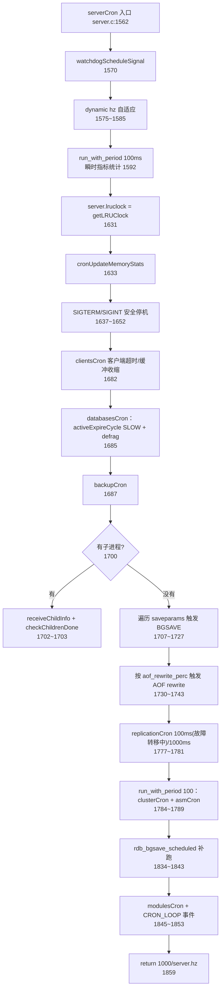

关键任务的输入/输出：

| 任务 | 位置 | 触发条件（输入） | 产出（输出） |
| --- | --- | --- | --- |
| 瞬时指标 | `src/server.c:1592` `run_with_period(100)` | `server.stat_numcommands` 等计数器 | `INFO` 里的 `instantaneous_ops_per_sec` 等 |
| 客户端 cron | `src/server.c:1682` → `src/server.c:1258` | 每次调用处理 `numclients/hz` 个（最少 `CLIENTS_CRON_MIN_ITERATIONS`） | 超时踢人、querybuf 缩容、IO 线程客户端跳过（`src/server.c:1301`） |
| 数据库 cron | `src/server.c:1685` → `src/server.c:1310` | `server.active_expire_enabled` | master 走 `activeExpireCycle(SLOW)`（`src/server.c:1315`），replica 走 `expireSlaveKeys()`（`src/server.c:1317`） |
| 自动 BGSAVE | `src/server.c:1707` | `dirty >= changes` 且 `unixtime-lastsave > seconds` 且上次成功或已过 `CONFIG_BGSAVE_RETRY_DELAY` | `rdbSaveBackground(...RDBFLAGS_NONE)`（`src/server.c:1724`） |
| 自动 AOF rewrite | `src/server.c:1730` | `aof_state==AOF_ON` 且 `aof_current_size > aof_rewrite_min_size` 且增长率 ≥ `aof_rewrite_perc` | `rewriteAppendOnlyFileBackground()`（`src/server.c:1741`） |
| 复制 cron | `src/server.c:1777` | 故障转移中 100ms，否则 1000ms | `replicationCron()`（`src/replication.c:5078`） |
| 集群 cron | `src/server.c:1784` | 100ms + `cluster_enabled` | `clusterCron()` + `asmCron()`（`src/server.c:1786`） |
| 延迟 fsync 补偿 | `src/server.c:1751` | `aof_flush_postponed_start != 0` | `flushAppendOnlyFile(0)` 重试 |

#### 6）`beforeSleep` / `afterSleep` —— 每轮事件循环的前后钩子

`beforeSleep`（`src/server.c:1947`）是 Redis 里**最重要的"批处理点"**。它有一个"精简版"分支：当 `ProcessingEventsWhileBlocked` 为真（RDB/AOF 加载中、脚本忙时重入事件循环）时只做最小集然后 return（`src/server.c:1957`～`src/server.c:1975`）。

正常路径的顺序（顺序本身是语义的一部分，源码里多处注释强调）：

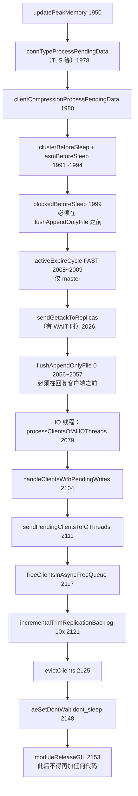

`afterSleep`（`src/server.c:2162`）则对称：先 `moduleAcquireGIL`（`src/server.c:2174`），再设置 `server.el_start`（`src/server.c:2183`，用于统计 eventloop 延迟）、`running=1`（`src/server.c:2189`）、`updateCachedTime(1)`（`src/server.c:2192`）。

#### 7）多线程 IO（io-threads）—— 8.x 的真实形态

**这是 8.x 与 6/7.x 最大的架构差异，必须按源码描述。** 在 8.10.2 中：

- 配置项 `io-threads` 是 **IMMUTABLE_CONFIG**，范围 1～128（`src/config.c:3507`），即**启动时固定，运行期无法修改**。
- `io-threads-do-reads` 已被移入 `deprecated_configs` 列表（`src/config.c:502`），也就是说**"是否把读也交给 IO 线程"这个开关已经消失，读永远由 IO 线程承担**。
- 每个 IO 线程有**自己的 `aeEventLoop`**（`src/iothread.c:1006`），跑自己的 `aeMain`（`src/iothread.c:986`），有自己的时间事件 `IOThreadCron`（`src/iothread.c:1035`，频率 `IO_DEFAULT_HZ = CONFIG_DEFAULT_HZ`，`src/iothread.c:13`）。
- 主线程与每个 IO 线程之间用 `eventNotifier` 互相唤醒（`src/iothread.c:1025` 和 `src/iothread.c:1051`）。

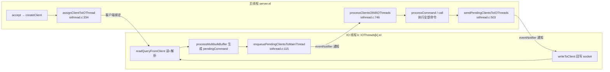

IO 线程**不执行命令**。解析完命令后如果当前不在主线程，`processInputBuffer` 会设 `CLIENT_IO_PENDING_COMMAND` 并把客户端送回主线程（`src/networking.c:3843`～`src/networking.c:3846`）。真正执行在 `processCommandAndResetClient`（`src/networking.c:3850`）。

哪些客户端**必须**留在主线程由 `isClientMustHandledByMainThread`（`src/iothread.c:292`）判定。`updateClientDataFromIOThread`（`src/iothread.c:55`）负责把 IO 线程里为避免竞争而"影子化"的字段（`io_repl_ack_time`、`io_lastinteraction`、`io_read_reploff`）合并回主结构体——只对 `CLIENT_MASTER`/`CLIENT_SLAVE` 生效。

### 第一讲的端到端视角：一次 tick 里发生了什么

假设 `hz=10`、`io-threads=4`、有一个客户端发来命令且 AOF 打开：

| 阶段 | 函数 | 位置 |
| --- | --- | --- |
| 1 | `aeProcessEvents` 调 `beforesleep` | `src/ae.c:382` |
| 2 | `beforeSleep` 刷上一轮残留回复、刷 AOF、把客户端派给 IO 线程 | `src/server.c:2104` / `2056` / `2111` |
| 3 | `afterSleep` 拿 GIL、更新缓存时间 | `src/server.c:2174` / `2192` |
| 4 | `epoll_wait` 返回，IO 线程 eventloop 收到可读 | `src/ae_epoll.c:93` |
| 5 | `readQueryFromClient` 读 + 解析成 `pendingCommand` | `src/networking.c:3893` |
| 6 | 非主线程 → 送回主线程 | `src/networking.c:3845` |
| 7 | 主线程 `processCommand` → `call` → `proc` | `src/server.c:4467` → `3992` |
| 8 | `addReply` 只写缓冲，不 write | `src/networking.c:606` |
| 9 | 下一轮 `beforeSleep` 的 `handleClientsWithPendingWrites` 真写 | `src/server.c:2104` |
| 10 | `processTimeEvents` 到点调 `serverCron` | `src/ae.c:470` |

### 第一讲小结：ae 是"一个 while"，serverCron 是"一张排班表"

**一句话定位**：`aeMain`（`src/ae.c:497`）跑一个死循环，`aeProcessEvents`（`src/ae.c:365`）按"beforesleep → poll → aftersleep → 文件事件 → 时间事件"的固定顺序推进，而 Redis 的所有后台杂活都被塞进了 `serverCron`（`src/server.c:1562`）这一张由 `run_with_period` 驱动的排班表里。

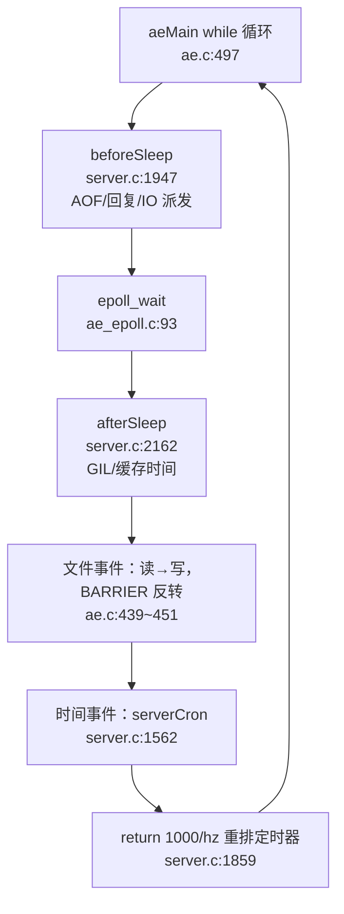

**关键机制的输入/输出**：

| 机制 | 输入 | 输出 | 源码位置 |
| --- | --- | --- | --- |
| 后端选择 | 编译期宏 `HAVE_EVPORT/EPOLL/KQUEUE` | 嵌入对应 `.c` 实现 | `src/ae.c:30`~`44` |
| 事件注册 | fd + mask + proc | `events[fd].mask |= mask`，epoll `ADD` 或 `MOD` | `src/ae.c:145` / `src/ae_epoll.c:54` |
| 懒扩容 | fd ≥ `nevents` | events/fired 翻倍 realloc | `src/ae.c:155`~`166` |
| 时间事件 | `serverCron` 返回值 `1000/hz` | 重新排期 `te->when` | `src/ae.c:340` / `src/server.c:1859` |
| 频率控制 | `server.cronloops` + `server.hz` | `run_with_period(ms)` 是否执行 | `src/server.h:831` / `836` |
| 前后钩子 | `AE_CALL_BEFORE_SLEEP`/`AFTER_SLEEP` | `beforeSleep`/`afterSleep` | `src/server.c:3216`~`3217` |
| IO 线程 | `io_threads_num > 1` | 每线程独立 `aeEventLoop` + `IOThreadCron` | `src/iothread.c:991` / `1035` |

**三个最值得记住的点**：

1. **回复不在命令里发出去**。`addReply` 只写缓冲，真正 `write(2)` 发生在下一轮 `beforeSleep` 的 `handleClientsWithPendingWrites`（`src/server.c:2104`）。配合 `AE_BARRIER`（`src/ae.h:24`）就能保证"先落盘、再回复"。
2. **IO 线程只搬砖不炒菜（8.x）**。它们读 socket、解析 RESP、回写 socket，但 `processCommand`/`call` 全在主线程；`io-threads` 还是不可变配置（`src/config.c:3507`），`io-threads-do-reads` 已废弃（`src/config.c:502`）。
3. **`run_with_period` 是取模不是定时器**。`ms <= 1000/hz` 时每次都跑，否则靠 `cronloops` 取模——所以 `hz` 一变，所有周期任务的实际频率都会跟着变（这也是 `dynamic_hz` 要把 hz 调高的原因）。

---

## 第二讲：网络层与 RESP 协议 —— anet 与 networking

### 定位

这一讲覆盖"一个字节从网卡到 `c->argv[]`，以及一个回复从 `addReply` 回到网卡"。`src/anet.c` 是最底层的 socket 工具箱（薄、无状态、可复用）；`src/networking.c` 则是 6000 行的"客户端状态机"——`client` 结构体、querybuf、协议解析、输出缓冲、输出缓冲限流全在这里。

### 目录结构

```
src/
├── anet.h / anet.c      # socket 封装：非阻塞 / keepalive / no-delay / listen / accept
├── connection.h/.c      # 连接抽象（CONN_TYPE_SOCKET / TLS / UNIX），统一 conn* API
├── socket.c             # CONN_TYPE_SOCKET 的具体实现
├── tls.c                # CONN_TYPE_TLS
├── networking.c         # client 生命周期、协议解析、addReply*、输出缓冲与限流
├── resp_parser.c/.h     # RESP 读取辅助（也被模块/客户端复用）
├── client_comp.c/.h     # 8.x：客户端级压缩（解压缩后的数据进 querybuf）
└── eventnotifier.c      # IO 线程通知
```

### 逐文件精读

#### 1）`src/anet.c` —— 只做四件事

| 函数 | 位置 | 作用 |
| --- | --- | --- |
| `anetNonBlock` / `anetBlock` | `src/anet.c:82` / `src/anet.c:86` | `fcntl` 切 `O_NONBLOCK` |
| `anetCloexec` | `src/anet.c:93` | 设 `FD_CLOEXEC`，fork 后子进程不继承 |
| `anetKeepAlive` | `src/anet.c:115` | `SO_KEEPALIVE` + 平台相关的探测参数 |
| `anetEnableTcpNoDelay` | `src/anet.c:266` | `TCP_NODELAY`，Redis 默认对每个客户端开 |
| `anetResolve` | `src/anet.c:314` | 名字解析（带缓存） |
| `anetTcpNonBlockConnect` | `src/anet.c:462` | 非阻塞 connect（复制、迁移用） |
| `_anetTcpServer` | `src/anet.c:530` | `getaddrinfo` → `socket` → `anetListen` |
| `anetTcpServer` / `anetUnixServer` | `src/anet.c:571` / `src/anet.c:581` | 对外入口 |
| `anetListen`（static） | `src/anet.c:502` | `bind` + `listen(backlog)`，unix socket 还要 `chmod` |
| `anetTcpAccept` | `src/anet.c:634` | `accept` + 取对端 ip/port |
| `anetFdToString` | `src/anet.c:665` | fd → "ip:port" 字符串（失败时填 "?:0"） |

`_anetTcpServer`（`src/anet.c:530`）用 `getaddrinfo` 遍历所有候选地址，**第一个能 bind 的就用**（`src/anet.c:553`～`src/anet.c:557`），这让 `bind 0.0.0.0` 与 IPv6 双栈行为统一。

#### 2）`client` 的诞生：`acceptCommonHandler` → `createClient`

`acceptCommonHandler`（`src/networking.c:1666`）先做准入控制：`listLength(server.clients) + getClusterConnectionsCount() >= server.maxclients` 就直接回 `-ERR max number of clients reached` 并关闭（`src/networking.c:1683`～`src/networking.c:1696`）。

`createClient`（`src/networking.c:122`）关键一步是**装读回调**：

```c
connSetReadHandler(conn, readQueryFromClient);   /* networking.c:133 */
```

以及 8.x 的新动作——**立刻把客户端分配给 IO 线程**：

```c
if (server.io_threads_num > 1) assignClientToIOThread(c);   /* networking.c:1663 */
```

`linkClient`（`src/networking.c:91`）负责把 client 挂进 `server.clients` 链表并分配 id。TLS 场景下还会尝试用证书里的用户名自动认证（`src/networking.c:1642`～`src/networking.c:1655`）。

#### 3）`readQueryFromClient`（`src/networking.c:3893`）—— 读入 querybuf

流程要点：

1. **读开关检查**（`src/networking.c:3904`）：若 `CLIENT_IO_READ_ENABLED` 未置位（或压缩数据还没解完），只标记 `pending_read = 1` 就返回，不读。
2. **读长度决策**（`src/networking.c:3918`）：默认 `PROTO_IOBUF_LEN`；若是大 bulk（`bulklen >= PROTO_MBULK_BIG_ARG`），则只读"还差多少字节"（`src/networking.c:3933`），目的是让 querybuf 里**正好躺着这一个完整 big arg**，从而 `processMultibulkBuffer` 可以零拷贝建对象。
3. **querybuf 复用**（`src/networking.c:3944`～`src/networking.c:3963`）：8.x 有 `thread_reusable_qb`——**每线程一个可复用 query buffer**，客户端用完归还。只有嵌套执行（`processEventsWhileBlocked`）导致复用缓冲被占用时才退化为 `sdsnewlen(NULL, PROTO_IOBUF_LEN)`。
4. **真正的读**：`clientConnRead`（`src/networking.c:3989`）。8.x 里 `nread`（解压后字节数）与 `network_read`（实际从 socket 读的字节数）**分离**，因为客户端级压缩（`client_comp.c`）会把网络字节解压后放进 querybuf。
5. **限流**：`c->mstate.argv_len_sums + sdslen(c->querybuf) > server.client_max_querybuf_len`，未认证客户端额外卡 1MB（`src/networking.c:4034`～`src/networking.c:4035`）。
6. **解析**：`processInputBuffer(c)`（`src/networking.c:4045`）。
7. **收尾**：归还可复用 querybuf（`src/networking.c:4055`～`src/networking.c:4058`）。

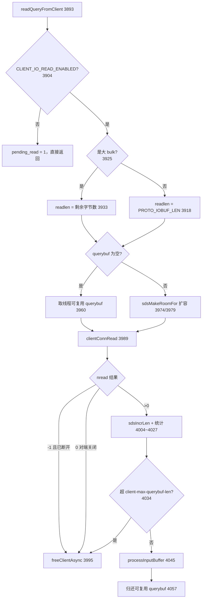

#### 4）`processInputBuffer`（`src/networking.c:3690`）—— 解析循环 + 分发

这是 8.x 变化最大的函数之一。它不再"解析一条执行一条"，而是**解析多条攒成一个 `pendingCommand` 链表，再逐条取出来执行**。

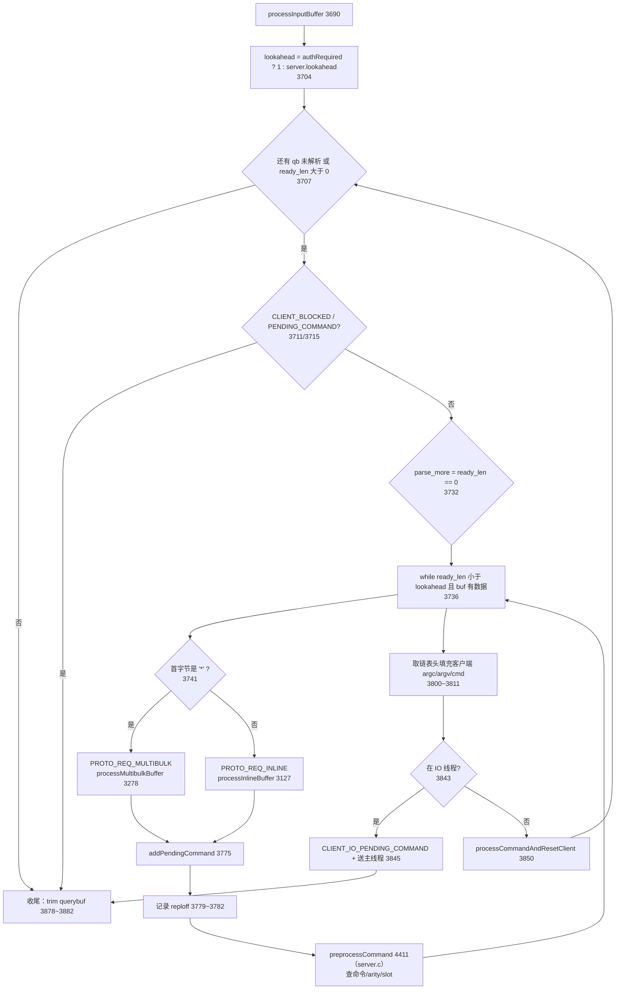

三个新机制值得注意：

- **lookahead 预读**（`src/networking.c:3704`）：未认证客户端强制为 1（注释说明：AUTH 会影响后续命令的解析），否则用 `server.lookahead`。这让 pipeline 里的多条命令能一次性解析出来，为下一步的批量 prefetch 创造条件。
- **`preprocessCommand`**（`src/server.c:4411`）：解析完立刻做**命令查找 + arity 检查 + key/slot 提取**，结果缓存在 `pendingCommand` 上（`pcmd->cmd`、`pcmd->slot`、`pcmd->keys_result`）。这步**在 IO 线程里就做完了**，主线程 `processCommand` 直接用 `c->lookedcmd`（`src/server.c:4502`）避免重复查找。这是 Redis 8 把 CPU 摊到 IO 线程的关键手法。
- **命令预取**（`src/networking.c:3817`～`src/networking.c:3824`）：解析出多条且在主线程时，调 `prefetchCommands()` 批量预取命令元数据，缓解流水线下的 cache miss。

#### 5）`processMultibulkBuffer`（`src/networking.c:3278`）—— RESP 数组解析

RESP 请求形如 `*3\r\n$3\r\nSET\r\n$3\r\nkey\r\n$5\r\nvalue\r\n`。解析分两段循环：

- **读 multibulk 长度**（`src/networking.c:3284`～`src/networking.c:3362`）：找 `\r`，`string2ll` 解析，`qb_pos` 前进；`ll <= 0` 直接返回（空命令）；分配 `pcmd->argv`。
- **逐参数读取**（`src/networking.c:3365`～）：每个参数先读 `$<len>\r\n`，再等 `len+2` 字节齐了才取。

防御性检查很密：

| 检查 | 错误码 | 位置 |
| --- | --- | --- |
| 无 `\r` 且已超 `PROTO_INLINE_MAX_SIZE` | `CLIENT_READ_TOO_BIG_MBULK_COUNT_STRING` | `src/networking.c:3292` |
| `string2ll` 失败或 > `INT_MAX` | `CLIENT_READ_INVALID_MULTIBUCK_LENGTH` | `src/networking.c:3307` |
| 未认证且参数个数 > 10 | `CLIENT_READ_UNAUTH_MBUCK_COUNT` | `src/networking.c:3310` |
| 第一个字节不是 `$` | `CLIENT_READ_EXPECTED_DOLLAR` | `src/networking.c:3382` |
| bulk 长度非法或 > `proto_max_bulk_len` | `CLIENT_READ_INVALID_BUCK_LENGTH` | `src/networking.c:3390` |
| 未认证且 bulk > 16384 | `CLIENT_READ_UNAUTH_BUCK_LENGTH` | `src/networking.c:3393` |

还有一处**性能优化细节**（`src/networking.c:3398`～`src/networking.c:3424`）：遇到大 bulk 时，如果"未解析的数据 ≤ ll+2"，就把 querybuf `sdsrange` 到 qb_pos=0 并 `sdsMakeRoomForNonGreedy(ll+2)`，让这个大参数**正好从 buffer 头部开始**，后续可以零拷贝地 `createStringObject`。

`src/networking.c:3330`～`src/networking.c:3361` 的注释还精确算了一次命令的网络字节数（用于 per-slot 统计）：`SET key value` 的 RESP 共 33 字节 = `(*3\r\n` 4) + (`$3\r\n`×2 + `$5\r\n` 12) + (SET/key/value 11) + (`\r\n`×3 6)。

`processInlineBuffer`（`src/networking.c:3127`）走的是裸命令（`SET key value` 这种 telnet 风格）：用 `sdssplitargs` 按空格切分并支持引号，超 `PROTO_INLINE_MAX_SIZE` 报 `CLIENT_READ_TOO_BIG_INLINE_REQUEST`。

#### 6）回复侧：`addReply*` → 输出缓冲 → `writeToClient`

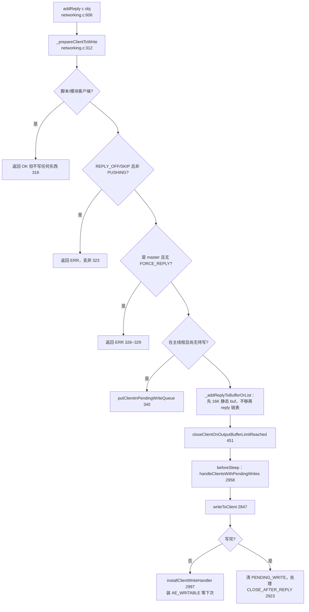

`_prepareClientToWrite`（`src/networking.c:312`）的第一行分支说明了一个事实：**Lua 脚本客户端（`CLIENT_SCRIPT`）和模块客户端（`CLIENT_MODULE`）没有 socket**，所以"写"只是往内存缓冲里堆（`src/networking.c:316`）。

输出缓冲有两级：

- 固定静态缓冲 `c->buf`（16KB 量级），先往这里塞；
- 塞不下就建 `clientReplyBlock` 挂到 `c->reply` 链表（`src/networking.c:397` `_addReplyPayloadToList`，节点至少 `PROTO_REPLY_CHUNK_BYTES`）。

8.x 新增了 **copy avoidance**：`_addBulkStrRefToBufferOrList`（`src/networking.c:573`）把一个 `bulkStrRef{obj, prefix, crlf}` 塞进缓冲（`src/networking.c:591`），只对对象 `incrRefCount`（`src/networking.c:578`），真正写的时候才在 `formatBulkStrRefPrefix`（`src/networking.c:561`）把 `$<len>\r\n` 拼出来。这避免了大 value 的一次 memcpy。

`writeToClient`（`src/networking.c:2847`）分两条路径：

- **replica 客户端**（`src/networking.c:2855`）：`while(_clientHasPendingRepliesSlave)` 一直写——因为复制缓冲必须尽快排空，否则 backlog 无限涨。
- **普通客户端**（`src/networking.c:2870`）：也循环写，但受 `NET_MAX_WRITES_PER_EVENT`（64KB，`src/server.h:125`）限制（`src/networking.c:2887`）——防止一个 `KEYS *` 把整个事件循环占满。**唯一例外**：已达 `maxmemory` 时不限制，拼命往外写（`src/networking.c:2888`～`src/networking.c:2889`）。

#### 7）`client-output-buffer-limit` 限流

配置存在 `server.client_obuf_limits[CLIENT_TYPE_OBUF_COUNT]`（`src/server.h:2302`），结构体是 `clientBufferLimitsConfig{hard_limit_bytes, soft_limit_bytes, soft_limit_seconds}`（`src/server.h:1821`）。客户端类型：`CLIENT_TYPE_NORMAL 0` / `SLAVE 1` / `PUBSUB 2` / `MASTER 3`（`src/server.h:524`～`src/server.h:528`），其中只有前 3 类参与限流（`CLIENT_TYPE_OBUF_COUNT = 3`，`src/server.h:529`）。

`checkClientOutputBufferLimits`（`src/networking.c:5375`）的规则：

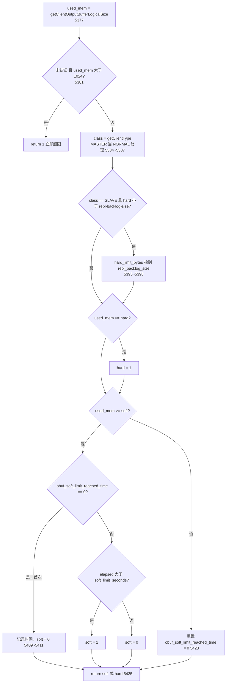

注意 `src/networking.c:5395` 那条：**replica 的 hard limit 不允许低于 `repl-backlog-size`**，否则部分重同步刚成功就被断开（注释明确说这不额外耗内存，因为 replica 客户端本来就共享 backlog 的缓冲）。

`closeClientOnOutputBufferLimitReached`（`src/networking.c:5439`）超限后的动作分两档：异步（`freeClientAsync`，`src/networking.c:5450`，打 "scheduled to be closed ASAP"）和同步（`freeClient`，`src/networking.c:5455`）。

### 第二讲小结：客户端是一个状态机，读与写被刻意解耦

**一句话定位**：`readQueryFromClient`（`src/networking.c:3893`）只负责把字节搬进 `querybuf`，`processInputBuffer`（`src/networking.c:3690`）只负责把字节切成 `pendingCommand`，`addReply`（`src/networking.c:606`）只负责把回复堆进输出缓冲——**真正的 `write(2)` 在 `beforeSleep` 里批量做**，这样一次系统调用能服务多个客户端。

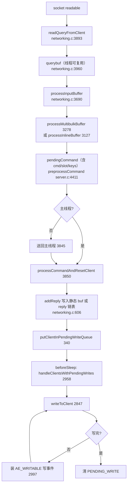

**关键环节的输入/输出**：

| 环节 | 输入 | 输出 | 源码位置 |
| --- | --- | --- | --- |
| 监听 | port + bindaddr | listen fd | `src/anet.c:571` → `src/anet.c:502` |
| 接受连接 | listen fd 可读 | `client`，装好读回调 | `src/networking.c:1666` → `122` / `133` |
| 读 | socket 字节（可能压缩） | `querybuf`（解压后） | `src/networking.c:3989` |
| 解析 | RESP 字节流 | `pendingCommand{argc,argv,cmd,slot}` | `src/networking.c:3278` |
| 预取/校验 | 已解析命令 | `pcmd->cmd`、`read_error` | `src/server.c:4411` |
| 回复缓冲 | robj / sds / C 串 | `c->buf` 或 `c->reply` 链表 | `src/networking.c:606` / `397` |
| 零拷贝 bulk | `robj` | `bulkStrRef`（只加引用计数） | `src/networking.c:573` |
| 限流 | 逻辑输出缓冲大小 | 是否 `freeClientAsync` | `src/networking.c:5375` / `5439` |

**三个最值得记住的点**：

1. **大参数读取是"按需读、零拷贝"的**。遇到 `bulklen >= PROTO_MBULK_BIG_ARG` 时只补齐这一个参数所需字节，并把 buffer `sdsrange` 到该参数起始（`src/networking.c:3398`~`3424`），让建 `robj` 时不需要 memcpy。
2. **命令查找与 key/slot 提取被前移到 IO 线程**。`preprocessCommand`（`src/server.c:4411`）在解析阶段就把 `pcmd->cmd` / `pcmd->slot` / `keys_result` 算好，主线程 `processCommand` 直接复用 `c->lookedcmd`（`src/server.c:4502`），省掉一次 `lookupCommand`。
3. **输出限流是"hard 立即 + soft 持续"**，且 replica 的 hard 会被抬到至少 `repl-backlog-size`（`src/networking.c:5395`）——一个不这么做就会让部分重同步反复失败的坑。

---
## 第三讲：命令生命周期 —— processCommand / call / propagate

### 定位

一条命令从"被解析出来"到"产生副作用并传播出去"，中间要过两道门：**`processCommand`（准入/路由）** 和 **`call`（执行/记账/传播）**。前者决定"能不能执行、要不要转发到别的节点"，后者决定"怎么记时长、怎么记统计、要不要写 AOF 和复制流"。

### 目录结构

```
src/
├── server.c          # processCommand(4467) / call(3992) / alsoPropagate(3772)
│                     # propagateNow(3744) / propagatePendingCommands(3851)
│                     # postExecutionUnitOperations(3907) / preprocessCommand(4411)
│                     # enterExecutionUnit(1407) / exitExecutionUnit(1417)
├── db.c              # lookupKey*、setKey、keyModified(1190)、propagateDeletion(2918)
├── multi.c           # touchWatchedKey(389)：WATCH 失效标记
├── acl.c             # ACLCheckAllPerm：命令 + key 权限检查
├── cluster.c         # getNodeByQuery(1236) / clusterRedirectClient(1498)
├── slowlog.c         # slowlogPushEntryIfNeeded(105)
├── latency.c         # latencyAddSampleIfNeeded
├── commands/         # 每个命令一份 JSON 元数据（生成 commands.def，共 13107 行）
└── commands.def      # 生成的命令表（arity / flags / key_specs）
```

### 逐函数精读

#### 1）`preprocessCommand`（`src/server.c:4411`）—— 8.x 的前置校验

在 IO 线程解析阶段就被调用（`src/networking.c:3784`）。做三件事：

1. 复位 `pcmd->cmd / slot / read_error`，清掉旧的 `keys_result`（`src/server.c:4412`～`src/server.c:4417`）。
2. **命令查找**：先试 `isCommandReusable(last_cmd, argv, argc)` 复用上一条命令（`src/server.c:4426`），否则 `lookupCommand`（`src/server.c:4428`）。找不到设 `CLIENT_READ_COMMAND_NOT_FOUND`（`src/server.c:4431`）。
3. **arity 检查**（`src/server.c:4435`）：`arity > 0` 时必须等于 argc，`arity < 0` 时 argc 必须 ≥ `-arity`。不合法设 `CLIENT_READ_BAD_ARITY`。
4. **key 与 slot 提取**：`extractKeysAndSlot`（`src/server.c:4442`），跨 slot 时设 `CLIENT_READ_CROSS_SLOT`（`src/server.c:4449`）。

这一步的意义：**把最费 CPU 的字典查找和 key 解析从主线程挪到 IO 线程**。

#### 2）`processCommand`（`src/server.c:4467`）—— 准入与路由

按源码顺序，检查项非常长。下面是完整的"关卡表"：

| 顺序 | 检查 | 位置 | 失败行为 |
| --- | --- | --- | --- |
| 0 | `serverAssert(!server.in_exec)` 等不变式 | `src/server.c:4473` | panic |
| 1 | 模块命令过滤器 `moduleCallCommandFilters` | `src/server.c:4483` | 改写 argv |
| 2 | 模块忙且不让处理客户端 → 推迟 `blockPostponeClient` | `src/server.c:4489` | 挂起 |
| 3 | 命令查找（复用 `c->lookedcmd` / `c->lastcmd` / `lookupCommand`） | `src/server.c:4502`~`4510` | `commandCheckExistence` 报错（`src/server.c:4529`） |
| 4 | `host:` / `post` 攻击检测 | `src/server.c:4515` | `securityWarningCommand` |
| 5 | 内部命令对非内部连接不可见 | `src/server.c:4523` | 当作未知命令 |
| 6 | arity 检查 | `src/server.c:4533` | `wrong number of arguments` |
| 7 | `CMD_PROTECTED`（DEBUG / MODULE） | `src/server.c:4540` | 拒绝 |
| 8 | 未认证（除 `CMD_NO_AUTH`） | `src/server.c:4573` | `NOAUTH` |
| 9 | `MULTI` 内不允许 `CMD_NO_MULTI` | `src/server.c:4582` | 拒绝 |
| 10 | **ACL 检查** `ACLCheckAllPerm` | `src/server.c:4590` | `-NOPERM` |
| 11 | **集群重定向** `getNodeByQuery` | `src/server.c:4603`~`4623` | `MOVED` / `ASK` / `CROSSSLOT` / `CLUSTERDOWN` |
| 12 | 客户端内存驱逐 `evictClients` | `src/server.c:4643` | 可能把自己的客户端也干掉 |
| 13 | **maxmemory** `performEvictions` + `CMD_DENYOOM` | `src/server.c:4656`~`4671` | `OOM` |
| 14 | 磁盘持久化故障（RDB/AOF 写失败） | `src/server.c:4688` | 拒绝写命令（master 侧可能 panic） |
| 15 | `min-replicas-to-write` `checkGoodReplicasStatus` | `src/server.c:4715` | `NOREPLICAS` |
| 16 | 只读 replica | `src/server.c:4722` | `READONLY` |
| 17 | 槽位 trim 中（原子迁移） | `src/server.c:4736`~`4747` | `blockPostponeClientWithType` 阻塞 master |
| 18 | RESP2 订阅上下文限制 | `src/server.c:4752` | 拒绝 |
| 19 | `replica-serve-stale-data no` 且链路断 | `src/server.c:4772` | `MASTERDOWN` |
| 20 | 加载中（`is_denyloading_command`） | `src/server.c:4782` | `LOADING` |
| 21 | 脚本/模块忙（`-BUSY`） | `src/server.c:4800` | `BUSY` |
| 22 | replica 不能碰 keyspace | `src/server.c:4816` | 拒绝 |
| 23 | `CLIENT PAUSE` | `src/server.c:4823` | `blockPostponeClient` |
| 24 | **执行**：`MULTI` 则入队，否则 `call(c, CMD_CALL_FULL)` | `src/server.c:4840` / `4844` | — |

命令 flags 的聚合（`src/server.c:4555`～`src/server.c:4571`）对 `EXEC` 做了特殊处理：从 `c->mstate.cmd_flags` / `cmd_inv_flags` 取整个事务的**或**与**非或**，这样一个事务里只要有一条是写命令，整个 EXEC 就按写命令处理。

集群重定向那段（`src/server.c:4603`）的跳过条件也值得记：**既非 movable-keys 命令、又没有任何 key、且不是 EXEC** 的命令不做重定向（比如 `PING`、`INFO`）。

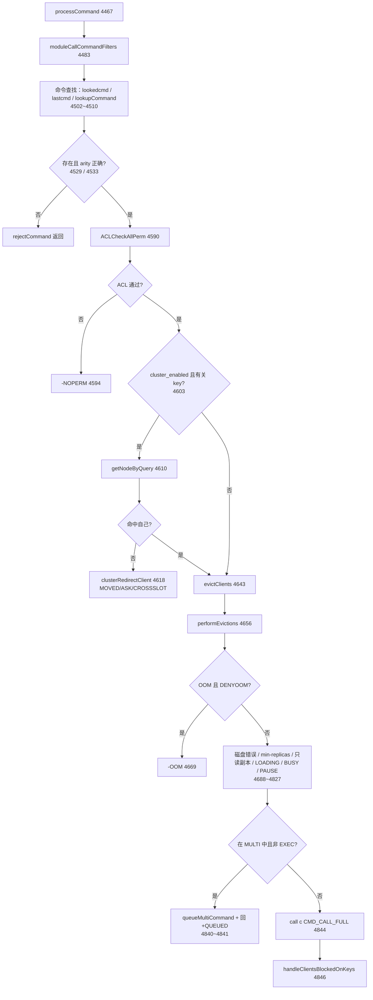

#### 3）`call`（`src/server.c:3992`）—— 执行、记账、传播

`call` 的结构非常规整，可以切成 8 段：

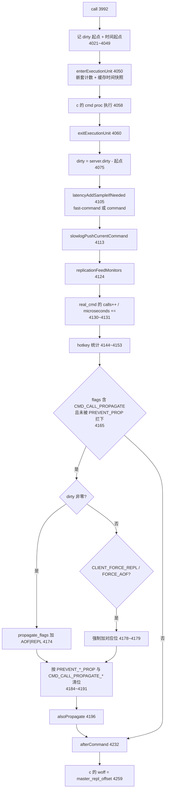

几个必须记住的细节：

- **`dirty` 是传播的唯一依据**。`call` 开头记下 `server.dirty`（`src/server.c:4021`），`proc` 执行完再算差（`src/server.c:4075`）。命令实现里想让命令被传播，就必须调 `server.dirty++`（如 `src/t_string.c:190`）；想强制传播即使没改数据，用 `forceCommandPropagation`（`src/server.c:3790`）；想完全不传播，用 `preventCommandPropagation`（`src/server.c:3799`）。
- **`realcmd` vs `cmd`**。`call` 里统计和慢查询用 `real_cmd = c->realcmd`（`src/server.c:3995`），因为 `EXPIRE`、`GEOADD` 这类命令会被重写成别的命令，`c->cmd` 可能已变（`src/server.c:4095` 的注释）。
- **慢查询与统计都跳过被阻塞的客户端**（`src/server.c:4112`、`src/server.c:4129`），因为阻塞命令要等解除阻塞时才能记最终时长。
- **执行单元嵌套**。`enterExecutionUnit`（`src/server.c:1407`）在 `execution_nesting++ == 0` 时才更新缓存时间并设 `server.cmd_time_snapshot`——保证一个执行单元内所有命令看到**同一个时间**（对 TTL 判定、EXPIRE 语义至关重要）。

#### 4）传播三件套：`alsoPropagate` → `propagatePendingCommands` → `propagateNow`

- `alsoPropagate`（`src/server.c:3772`）：**不立即传播**，而是把 argv 深拷贝一份（`incrRefCount`，`src/server.c:3782`）追加到 `server.also_propagate` 数组（`src/server.c:3784`）。
- `postExecutionUnitOperations`（`src/server.c:3907`）：只有在最外层执行单元结束时才做三件事——`firePostExecutionUnitJobs`、`propagatePendingCommands`、`flushSlavesOutputBuffersIfNeeded`。
- `propagatePendingCommands`（`src/server.c:3851`）：如果攒了**多于一条**命令，就自动包一层 `MULTI`/`EXEC`（`src/server.c:3876` 和 `src/server.c:3887`，用 `dbid=-1` 表示不复制 SELECT）。例外：**直接执行**（非脚本/事务）的 `CMD_TOUCHES_ARBITRARY_KEYS` 命令不包事务（`src/server.c:3866`~`3871`）——和 active-expire 一样，避免随机 key 的删除被包进事务造成语义问题。
- `propagateNow`（`src/server.c:3744`）：真正落地。`shouldPropagate`（`src/server.c:3713`）先做总闸判断：AOF 要求 `aof_state != AOF_OFF`；复制要求"是 master 且（有 backlog 或有 replica 或有迁移在进行）"。

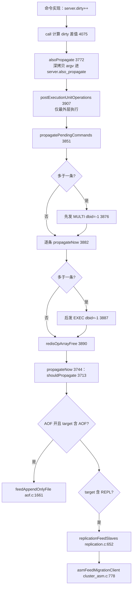

#### 5）慢查询与统计

`slowlogPushCurrentCommand`（`src/server.c:3814`）先跳过 `CMD_SKIP_SLOWLOG`，然后用 `c->original_argv`（若被重写过）记日志，调 `slowlogPushEntryIfNeeded`（`src/slowlog.c:105`）。统计更新在 `src/server.c:3824`～`src/server.c:3832`：全局 `stat_slowlog_count` / `stat_slowlog_time_us_sum` / `max`，以及每命令的 `slowlog_count` / `slowlog_time_us_sum` / `max`。

命令统计：`real_cmd->calls++` 与 `real_cmd->microseconds += c->duration`（`src/server.c:4130`~`4131`）；如果开了 `latency-tracking`，还更新 HDR 直方图（`src/server.c:4133`，函数 `updateCommandLatencyHistogram` 在 `src/server.c:3838`，上下界由 `LATENCY_HISTOGRAM_MIN_VALUE/MAX_VALUE` 截断）。

#### 6）WATCH / dirty 与事务的关系

`WATCH` 的实现核心是 `touchWatchedKey`（`src/multi.c:389`）：键被修改时把监视它的所有客户端打上 `CLIENT_DIRTY_CAS`。入口是 `keyModified`（`src/db.c:1190`），它同时做 `trackingInvalidateKey`（客户端缓存失效）。`EXEC` 时若发现 `CLIENT_DIRTY_CAS` 就返回 nil，事务不执行。

### 端到端演算 ①：一次 `SET key value` 的完整链路

假设：`io-threads = 4`，AOF 开启（`appendfsync everysec`），有一个 replica 在线，客户端发送 `*3\r\n$3\r\nSET\r\n$3\r\nkey\r\n$5\r\nvalue\r\n`（33 字节）。

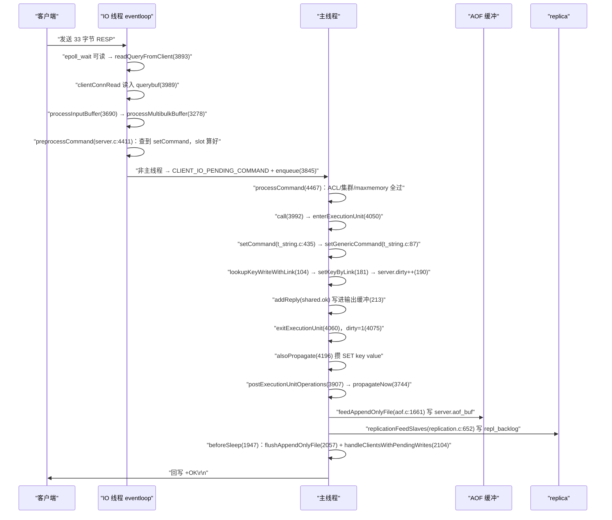

按步骤拆解（每一步都标了行号）：

| # | 发生什么 | 源码位置 |
| --- | --- | --- |
| 1 | IO 线程 eventloop `epoll_wait` 返回客户端 fd 可读 | `src/ae_epoll.c:93` |
| 2 | `readQueryFromClient` 读 33 字节到可复用 querybuf；`stat_net_input_bytes += 33` | `src/networking.c:3989` / `4025` |
| 3 | `processInputBuffer` 判定首字节 `*` → `PROTO_REQ_MULTIBULK` | `src/networking.c:3741` |
| 4 | `processMultibulkBuffer` 解出 `multibulklen=3`，逐参数读出 `SET`/`key`/`value`；`pcmd->input_bytes` 累加 33 | `src/networking.c:3305` / `3361` / `3427` |
| 5 | `preprocessCommand` 查到 `setCommand`，arity=3 通过，算出 `slot = keyHashSlot("key")` | `src/server.c:4428` / `4435` / `4442` |
| 6 | `addPendingCommand`，`pcmd->reploff` 记录复制偏移 | `src/networking.c:3775` / `3779` |
| 7 | 因为在 IO 线程 → 设 `CLIENT_IO_PENDING_COMMAND` 并送主线程 | `src/networking.c:3845` |
| 8 | 主线程 `processCommandAndResetClient` → `processCommand` | `src/networking.c:3850` |
| 9 | `c->lookedcmd` 复用，跳过重复查找 | `src/server.c:4502` |
| 10 | ACL 通过；非集群模式跳过重定向 | `src/server.c:4590` / `4603` |
| 11 | `call(c, CMD_CALL_FULL)` | `src/server.c:4844` |
| 12 | `setCommand` → `setGenericCommand`（`src/t_string.c:87`） | `src/t_string.c:435` |
| 13 | `lookupKeyWriteWithLink` 同时拿到 `dictEntryLink`（供后续无二次查找地插入） | `src/t_string.c:104` |
| 14 | `setKeyByLink` 写入，必要时 `tryObjectEncoding` 优化 value 编码 | `src/t_string.c:181` |
| 15 | `server.dirty++`；`notifyKeyspaceEvent(NOTIFY_STRING,"set",...)` | `src/t_string.c:190` / `191` |
| 16 | `addReply(c, shared.ok)` → 只写输出缓冲 | `src/t_string.c:213` |
| 17 | `call` 算出 `dirty = 1` | `src/server.c:4075` |
| 18 | 慢查询判定、命令统计 `setCommand->calls++` | `src/server.c:4113` / `4130` |
| 19 | `alsoPropagate(db->id, c->argv, 3, AOF\|REPL)` 入队 | `src/server.c:4196` |
| 20 | `postExecutionUnitOperations` → `propagatePendingCommands`（1 条，不包事务）→ `propagateNow` | `src/server.c:3907` / `3851` / `3744` |
| 21 | AOF：`feedAppendOnlyFile` 把 `*3\r\n$3\r\nSET\r\n...` 追加到 `server.aof_buf` | `src/aof.c:1661` / `1696` |
| 22 | 复制：`replicationFeedSlaves` 写 `SELECT`（若 db 变了）+ 命令进 `repl_backlog`，`master_repl_offset` 增长 | `src/replication.c:693` / `727`~`745` |
| 23 | 下一轮 `beforeSleep`：`flushAppendOnlyFile(0)` 把 aof_buf `write` 出去（everysec 下 fsync 由后台线程做） | `src/server.c:2056` / `src/aof.c:1470` |
| 24 | 同轮 `beforeSleep`：`handleClientsWithPendingWrites` → `writeToClient` 真正把 `+OK\r\n` 发给客户端 | `src/server.c:2104` / `src/networking.c:2847` |

**关键顺序结论**：`+OK` 是在**命令执行完一轮之后**才发出的，而 AOF 的 `write` 被刻意排在 `handleClientsWithPendingWrites` **之前**（`src/server.c:2053`~`2057` 的注释明说"must be done before handleClientsWithPendingWrites ... in case of appendfsync=always"）。这就是"收到 OK 就保证已落盘"语义的实现方式。

### 第三讲小结：processCommand 管准入，call 管记账，propagate 管外发

**一句话定位**：`processCommand`（`src/server.c:4467`）用二十多道关卡决定"这条命令能不能在这台机器上执行"，`call`（`src/server.c:3992`）用一个执行单元包住 `c->cmd->proc(c)` 并负责时长/慢查询/统计/传播，而传播通过 `alsoPropagate` 攒批、`postExecutionUnitOperations` 在最外层统一外发。

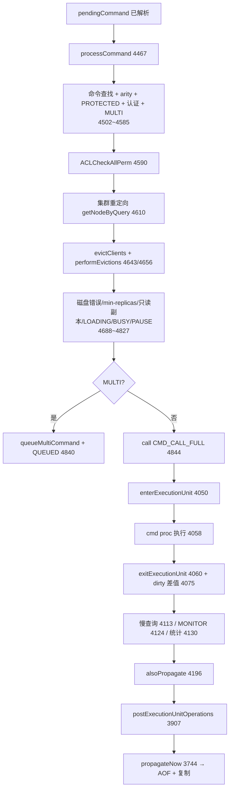

**关键环节的输入/输出**：

| 环节 | 输入 | 输出 | 源码位置 |
| --- | --- | --- | --- |
| 前置校验 | `pendingCommand` 的 argv/argc | `cmd`、`slot`、`keys_result`、`read_error` | `src/server.c:4411` |
| 命令查找 | `argv[0]` | `redisCommand*` 或 `NULL` | `src/server.c:3649` |
| ACL | 用户 + 命令 + 各 key | `ACL_OK` 或错误码 | `src/server.c:4590` |
| 集群路由 | 命令 + keys | 目标节点或重定向错误码 | `src/cluster.c:1236` |
| 执行单元 | 嵌套深度 | 统一的时间快照 | `src/server.c:1407` |
| dirty 记账 | `server.dirty` 前后差 | 是否传播的判据 | `src/server.c:4075` |
| 攒批传播 | dbid + argv + target | `server.also_propagate` | `src/server.c:3772` |
| 落地 | target | AOF 缓冲 + repl_backlog | `src/server.c:3744` |

**三个最值得记住的点**：

1. **`dirty` 决定传播**。命令不改数据就不传播；想改这条规则用 `forceCommandPropagation`（`src/server.c:3790`）/ `preventCommandPropagation`（`src/server.c:3799`）。多条 `alsoPropagate` 会被自动包进 `MULTI/EXEC`（`src/server.c:3876`）。
2. **执行单元（`enterExecutionUnit`/`exitExecutionUnit`）保证时间一致性**（`src/server.c:1407`）。最外层才更新时间快照，所以一个脚本/事务内所有命令看到同一个 `mstime`——TTL 判定才不会漂移。
3. **AOF 落盘排在回复客户端之前**（`src/server.c:2053`~`2057`）。这是 `appendfsync always` 能给出"已确认即已落盘"承诺的唯一原因，也是 `AE_BARRIER` 存在的意义。

---

## 第四讲：对象与数据结构 —— object / dict / intset / zset / 过期

### 定位

Redis 的"快"一半来自单线程无锁，另一半来自**为不同规模的数据选择不同编码**。`src/object.c` 负责对象层（类型 + 编码 + 引用计数 + LRU/LFU），`src/dict.c` / `src/intset.c` / `src/listpack.c` / `src/quicklist.c` / `src/t_zset.c` 则是各编码的具体实现。键过期则横跨 `src/db.c`（被动）和 `src/expire.c`（主动）。

### 目录结构

```
src/
├── object.h / object.c   # robj + OBJ_ENCODING_* + 引用计数 + 共享整数
├── server.h              # OBJ_STRING/LIST/SET/ZSET/HASH/MODULE/STREAM/ARRAY（875~897）
│                         # zskiplist / zset 结构（1791~1819）
├── dict.h / dict.c       # 哈希表 + 增量 rehash
├── kvstore.h / kvstore.c # 8.x：按 slot 分片的 dict 集合（替代裸 dict）
├── intset.h / intset.c   # 整数集合（有序、可升级）
├── listpack.h / listpack.c   # 紧凑列表（替代 ziplist）
├── quicklist.h / quicklist.c # listpack 组成的双向链表（list 的编码）
├── sparsearray.c         # 8.x：稀疏数组（OBJ_ENCODING_SLICED_ARRAY）
├── t_string.c / t_list.c / t_set.c / t_hash.c / t_zset.c / t_array.c
├── db.c                  # lookupKey*、setKey、expireIfNeeded(2999)
├── expire.c              # 主动过期 activeExpireCycle(287)
├── estore.c / ebuckets.c # 8.x：hash field 级 TTL 的时间轮
├── keymeta.c             # 8.x：kvobj 元数据（TTL 等）
└── evict.c / defrag.c    # 内存淘汰 / 主动碎片整理
```

### 逐文件精读

#### 1）`src/object.h` —— 编码枚举（8.10.2 实际值）

```c
#define OBJ_ENCODING_RAW 0            /* object.h:75  sds 原始字符串 */
#define OBJ_ENCODING_INT 1            /* object.h:76  ptr 直接存 long */
#define OBJ_ENCODING_HT 2             /* object.h:77  dict */
#define OBJ_ENCODING_ZIPMAP 3         /* object.h:78  已废弃 */
#define OBJ_ENCODING_LINKEDLIST 4     /* object.h:79  已废弃 */
#define OBJ_ENCODING_ZIPLIST 5        /* object.h:80  已废弃（listpack 取代） */
#define OBJ_ENCODING_INTSET 6         /* object.h:81  intset */
#define OBJ_ENCODING_SKIPLIST 7       /* object.h:82  zset 的 skiplist+dict */
#define OBJ_ENCODING_EMBSTR 8         /* object.h:83  robj 与 sds 一次分配 */
#define OBJ_ENCODING_QUICKLIST 9      /* object.h:84  list 的编码 */
#define OBJ_ENCODING_STREAM 10        /* object.h:85  rax + listpack */
#define OBJ_ENCODING_LISTPACK 11      /* object.h:86  hash/zset/list 的小编码 */
#define OBJ_ENCODING_LISTPACK_EX 12   /* object.h:87  listpack + 元数据（field TTL） */
#define OBJ_ENCODING_SLICED_ARRAY 13  /* object.h:88  稀疏数组 */
#define OBJ_ENCODING_TMPL_LP 14       /* object.h:89  hash 共享模板 + listpack 值 */
#define OBJ_ENCODING_TMPL_ARRAY 15    /* object.h:90  hash 共享模板 + sds 数组值 */
```

> **核对说明**：`OBJ_ENCODING_ZIPMAP / LINKEDLIST / ZIPLIST` 在 8.10.2 中**仅保留常量、注释标注 "No longer used"**，已无实际编码逻辑使用（list/hash/zset 一律走 listpack）。12~15 是 8.x 新增：`LISTPACK_EX` 配合 `src/estore.c` 的 hash field 级 TTL，`TMPL_LP`/`TMPL_ARRAY` 是 hash templates（共享字段名模板），`SLICED_ARRAY` 对应 `src/sparsearray.c`。

对象类型在 `src/server.h:875`～`src/server.h:897`：`OBJ_STRING 0` / `OBJ_LIST 1` / `OBJ_SET 2` / `OBJ_ZSET 3` / `OBJ_HASH 4` / `OBJ_MODULE 5` / `OBJ_STREAM 6` / `OBJ_ARRAY 7`；`OBJ_GCRA 8` 只在 `-DENABLE_GCRA` 编译开关下存在（`src/server.h:898`）。

#### 2）`src/object.c` —— 对象生命周期与编码优化

`createObject`（`src/object.c:107`）只有 8 行，初始编码一律 `OBJ_ENCODING_RAW`：

```c
o->type = type; o->encoding = OBJ_ENCODING_RAW; o->ptr = ptr;
o->refcount = 1; o->lru = 0; o->iskvobj = 0; o->metabits = 0;
```

`iskvobj` 是 8.x 的新字段——**kvobj（key-value object）把 key 和 value 放在同一次分配里**（见 `src/object.c:155`~`161` 的注释图示：robj(16) + key-hdr(1) + sdshdr5 "mykey"(7) + sdshdr8 "myvalue"(11)），减少一次分配与一次 cache miss。

`tryObjectEncodingEx`（`src/object.c:939`）是字符串优化的核心，判定顺序：

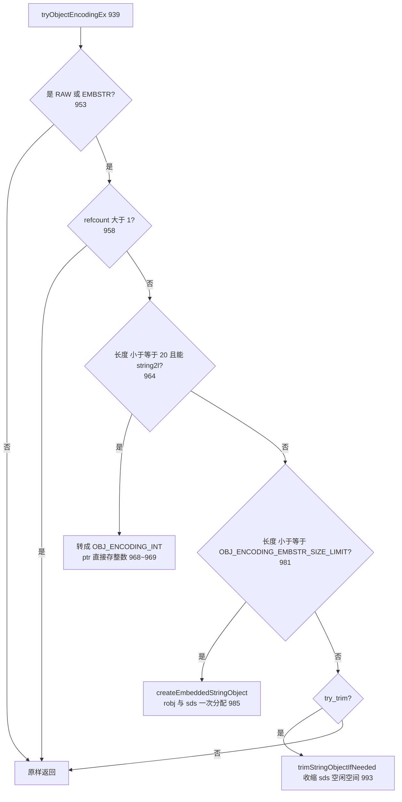

两条"不优化"的规则值得注意：**共享对象（`refcount > 1`）不做编码转换**（`src/object.c:955`~`958` 注释：共享对象可能出现在不该被编码的地方）；**`EMBSTR` 已经是 embstr 就不重复转**（`src/object.c:984`）。

**共享整数**：`createSharedObjects`（`src/server.c:2204`）里会预建 `OBJ_SHARED_INTEGERS = 10000` 个整数对象（`src/server.h:127`，数组在 `src/server.h:1780`），用 `makeObjectShared`（`src/object.c:143`）把 refcount 设为 `OBJ_SHARED_REFCOUNT`（`src/object.h:98`，即 refcount 位宽的最大值）。`incrRefCount`（`src/object.c:629`）和 `decrRefCount`（`src/object.c:643`）见到这个值就**直接返回，不改引用计数**——因为共享对象永不被释放，也因此可以被多线程无锁访问（`src/object.c:132`~`141` 的注释）。

`decrRefCount`（`src/object.c:643`）归零时的释放路径里有个 8.x 优化：**EMBSTR 快速路径**（`src/object.c:655`~`659`）——直接算 `sizeof(robj) + sdsAllocSize(ptr)` 一次 `zfree_with_size`，并给 jemalloc 提示大小以加速释放。`iskvobj` 的释放还要先 `keyMetaOnFree`（`src/object.c:668`）。

#### 3）`src/t_string.c` —— 最简单的类型也最典型

`setGenericCommand`（`src/t_string.c:87`）值得精读，因为它演示了 Redis 命令的通用套路：

- `lookupKeyWriteWithLink`（`src/t_string.c:104`）一次查找同时拿到 kvobj 和 `dictEntryLink`（避免插入时二次哈希查找）。
- NX/XX/IFEQ/IFDEQ 条件判定（`src/t_string.c:106`~`151`）。
- **已过期时间直接删**（`src/t_string.c:161`~`175`）：`SET k v EX -1` 不会插入，而是删掉旧 key 并把命令重写成 `DEL`/`UNLINK`（`src/t_string.c:165`）。
- `setKeyByLink`（`src/t_string.c:181`）+ `setExpireByLink`（`src/t_string.c:184`）。
- **`server.dirty++`**（`src/t_string.c:190`）——传播开关。
- **命令重写**（`src/t_string.c:196`~`207`）：带 EX/PX/EXAT 时改写成 `PXAT <绝对时间戳>` 再传播，避免 replica 上相对 TTL 产生漂移。这是 Redis 复制正确性的经典处理。

#### 4）`src/dict.c` —— 增量 rehash

Redis 的 dict 用两张哈希表 `ht_table[0]`/`ht_table[1]`，靠 `rehashidx` 逐步搬迁。8.x 的字段名从 `ht[0].size` 变成了 `ht_size_exp[]`（指数形式）+ `ht_used[]` + `ht_table[]`，但机制不变。

**扩容判定** `dictExpandIfNeeded`（`src/dict.c:1649`）：

- 表为空 → 扩到 `DICT_HT_INITIAL_SIZE`（`src/dict.c:1655`）。
- `can_resize == DICT_RESIZE_ENABLE` 且 `used >= size`（1:1）→ 扩（`src/dict.c:1665`~`1666`）。
- 否则只要不是 `DICT_RESIZE_FORBID`，若 `used >= dict_force_resize_ratio * size`（默认 4 倍，即强制扩容阈值）→ 也扩（`src/dict.c:1667`~`1668`）。

**缩容判定** `dictShrinkIfNeeded`（`src/dict.c:1688`）：`used * HASHTABLE_MIN_FILL <= size` 时缩（`src/dict.c:1700`），`HASHTABLE_MIN_FILL` 即 1/8。

**搬迁** `dictRehash`（`src/dict.c:406`）：

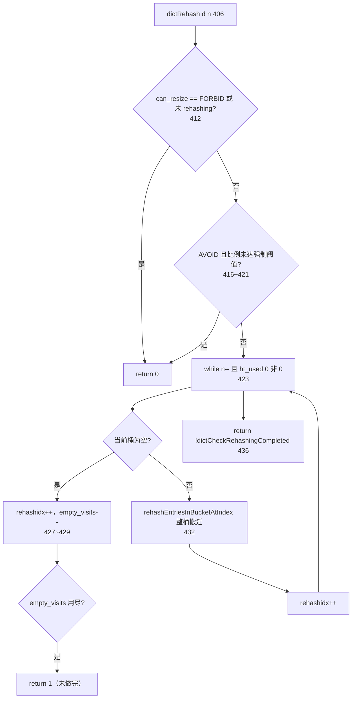

亮点是 `empty_visits = n*10`（`src/dict.c:407`）：**扫描空桶最多 10n 个**，防止大表里一片连续的空桶把一次 rehash 拖成 O(n)。

rehash 的触发点有三个，都是"搭便车"：

| 触发 | 函数 | 位置 |
| --- | --- | --- |
| 增删改查时顺带一步 | `_dictRehashStepIfNeeded` → `_dictBucketRehash` | `src/dict.c:1720` / `476` |
| 定长时间预算 | `dictRehashMilliseconds` / `dictRehashMicroseconds` | `src/dict.c:449`（由 `serverCron` 里的增量 rehash 调用） |
| 单步 | `_dictRehashStep` | `src/dict.c:471` |

`_dictRehashStepIfNeeded`（`src/dict.c:1720`）有个 cache 友好的优化：**如果要访问的桶还没搬迁，就搬这个桶**（`src/dict.c:1724`~`1727`，注释明说 "being more CPU cache friendly"），否则才按 `rehashidx` 顺序搬（`src/dict.c:1731`）。

`dictFindLinkForInsert`（`src/dict.c:1748`）体现了 rehash 期间的查表规则：先在 ht0 找（跳过 `< rehashidx` 的部分），若正在 rehash 还要在 ht1 找（`src/dict.c:1763`~`1777`）；**插入位置永远落在 ht1**（`src/dict.c:1781`）。

`dictSetResizeEnabled`（`src/dict.c:1803`）配合 `serverCron` 里的 `updateDictResizePolicy`（`src/server.c:1747`）：**有子进程（BGSAVE/AOF rewrite）时禁止 resize**，以免大量写时复制（COW）放大内存。

#### 5）`src/intset.c` —— 只升不降

intset 是"有序 int 数组"，编码为 `INTSET_ENC_INT16/INT32/INT64`（`src/intset.c:41`~`43`，值就是字节数，因此可直接比较大小）。`_intsetValueEncoding`（`src/intset.c:46`）按值域挑最小编码。

`intsetAdd`（`src/intset.c:212`）：先 `intsetSearch`（`src/intset.c:123`，二分查找返回"是否找到 + 插入位置"），若新值编码大于当前编码就走 `intsetUpgradeAndAdd`（`src/intset.c:165`），否则 `intsetMoveTail`（`src/intset.c:190`）腾位置再写入。

`intsetUpgradeAndAdd`（`src/intset.c:165`）的实现很精巧：

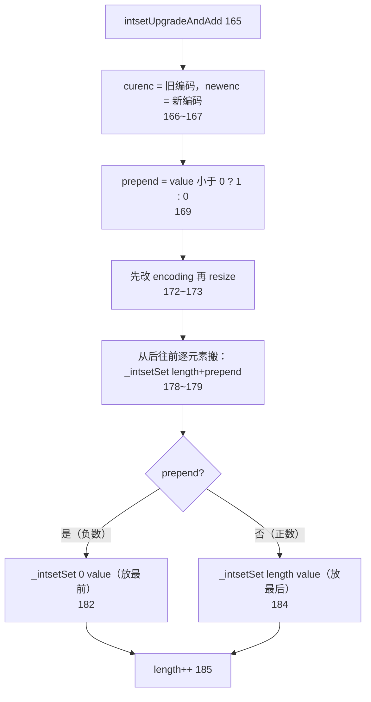

关键点：**从后往前搬**（`src/intset.c:178`）避免覆盖；新值只可能是全集合的最小值（负数）或最大值（正数），所以 `prepend` 一个布尔量就够（`src/intset.c:169` 的注释）。**intset 只升不降**——删掉大数也不会退回小编码。

#### 6）`src/listpack.c` 与 `src/quicklist.c`

listpack 是 ziplist 的替代者，解决了 ziplist 的级联更新问题。每个 entry 结构为 `encoding + data + backlen`（`backlen` 是"本 entry 总长"的变长编码，放在尾部，因此可以**从后往前遍历**）。核心 API：

| 函数 | 位置 | 说明 |
| --- | --- | --- |
| `lpNew` | `src/listpack.c:224` | 建空 listpack |
| `lpGet` | `src/listpack.c:855` | 取元素（整数走 `intbuf`，字符串返回指针） |
| `lpInsert` | `src/listpack.c:1032` | 统一入口；`elestr` 与 `eleint` 均为 NULL 时表示**删除**（`src/listpack.c:1037`） |
| `lpAppend` / `lpAppendInteger` | `src/listpack.c:1401` / `1408` | 尾部追加 |

quicklist 是"**双向链表 + 每个节点一个 listpack**"，用于 list 类型（`OBJ_ENCODING_QUICKLIST`，`src/object.h:84`）。`quicklistCreate`（`src/quicklist.c:134`）、`quicklistSetOptions`（`src/quicklist.c:169`，设置 `fill` 单节点上限与 `compress` 两端不压缩深度）、`quicklistPushHead`/`quicklistPushTail`（`src/quicklist.c:610` / `640`）、`quicklistPush`（`src/quicklist.c:1755`，按 `where` 分派）。`compress` 的意义是：**两端节点不压缩（热数据），中间节点用 LZF 压缩**（`src/quicklist.c` 里 `compress` 的语义由 `__quicklistCompressNode` 实现）。

#### 7）`src/t_zset.c` —— skiplist + dict 双结构

`zset`（`src/server.h:1816`）同时持有 `dict *dict` 与 `zskiplist *zsl`：

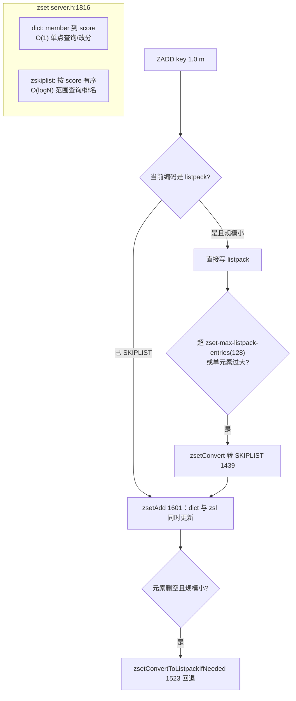

8.x 的 skiplist 节点做了内存优化：`zskiplistNode`（`src/server.h:1797`）的 `level[]` 是**柔性数组**，且 `level[0].span` 被复用为 `zskiplistNodeInfo`（`src/server.h:1791`，含 `sdsoffset` 与 `levels`）——因为 level 0 的 span 恒为 0、没人用。元素 sds 直接**嵌在节点尾部**（`src/server.h:1807` 注释），靠 `sdsoffset` 定位，又一次省掉一次分配。

`zslInsert`（`src/t_zset.c:326`）先随机层数 `zslRandomLevel`（`src/t_zset.c:254`），再走标准 skiplist 插入并维护 `span`（用于 `ZRANK`，`src/t_zset.c:645`）。

#### 8）键过期：被动 + 主动双保险

**被动过期**在 `lookupKey`（`src/db.c:302`）里：每次查键都调 `expireIfNeeded`（`src/db.c:2999`）。

```mermaid
flowchart TD
    A["expireIfNeeded 2999"] --> B{"key 在 trim 任务中?<br/>3006"}
    B -->|"是"| B1{"允许访问 trimmed?"}
    B1 -->|"是"| B2["KEY_VALID"]
    B1 -->|"否"| B3["KEY_TRIMMED"]
    B -->|"否"| C{"EXPIRE_ALLOW_ACCESS_EXPIRED 或未过期?<br/>3016~3017"}
    C -->|"是"| C1["KEY_VALID"]
    C -->|"否"| D{"是 replica 或集群?<br/>3038"}
    D -->|"当前客户端是 master"| D1["KEY_VALID 3039"]
    D -->|"是 replica 且未强制删"| D2["KEY_EXPIRED 3040（逻辑过期但不删）"]
    D -->|"否"| E{"confAllowsExpireDel?<br/>3045"}
    E -->|"否"| E1["KEY_EXPIRED"]
    E -->|"是"| F{"EXPIRE_AVOID_DELETE_EXPIRED?"}
    F -->|"是"| F1["KEY_EXPIRED 3050"]
    F -->|"否"| G{"过期动作被 PAUSE?<br/>3056"}
    G -->|"是"| G1["KEY_EXPIRED"]
    G -->|"否"| H["deleteExpiredKeyAndPropagate 3060"]
    H --> H1["KEY_DELETED 3067"]
```

**最关键的语义**：`src/db.c:3038`~`3041` —— **replica 不会自己删过期键**，只返回 `KEY_EXPIRED`（表现为"查不到"），真正删除等 master 发来的合成 `DEL`。这是为了保证主从数据集逐字节一致。`keyIsExpired`（`src/db.c:2941`）用 `commandTimeSnapshot()` 而不是当前时间——因为执行单元内时间必须一致。

`deleteExpiredKeyAndPropagate`（`src/db.c:2890`）最终走 `propagateDeletion`（`src/db.c:2918`）：把 `DEL`（或 `UNLINK`，看 `lazyfree-lazy-expire`）送进 `alsoPropagate`，**并临时把 `server.replication_allowed` 置 1**（`src/db.c:2928`~`2931`），保证"master 决定删就一定传播"。

**主动过期** `activeExpireCycle`（`src/expire.c:287`），由两处调用：

- `databasesCron`（`src/server.c:1315`）→ `ACTIVE_EXPIRE_CYCLE_SLOW`（master 上；replica 走 `expireSlaveKeys`，`src/expire.c:548`）
- `beforeSleep`（`src/server.c:2009`）→ `ACTIVE_EXPIRE_CYCLE_FAST`，但仅当 `iAmMaster()` 时

参数按 `active-expire-effort`（1~10）缩放（`src/expire.c:291`~`300`）：`effort = effort-1`，每次循环采样键数 `KEY_PER_LOOP * (1 + effort/4)`，FAST 周期时长同比放大，可接受陈旧率 `ACCEPTABLE_STALE - effort`。

```mermaid
flowchart TD
    A["activeExpireCycle 287"] --> B{"PAUSE 过期动作?<br/>316"}
    B -->|"是"| Z["return"]
    B --> C{"FAST 模式?"}
    C -->|"是"| C1{"上次未超时退出 且 陈旧率低于阈值?"}
    C1 -->|"是"| Z
    C1 --> C2{"距上次 FAST 不足 2 倍周期?"}
    C2 -->|"是"| Z
    C --> D["timelimit = 慢循环 CPU 百分比 或 FAST 固定时长<br/>347~352"]
    D --> E["for 遍历 dbs_per_call 个 db<br/>368"]
    E --> F["activeSubexpiresCycle：先处理 hash field TTL<br/>387"]
    F --> G["do-while：kvstoreScan 采样 expires 字典<br/>431"]
    G --> H["expireScanCallback → activeExpireCycleTryExpire 40"]
    H --> I{"采样够 num 或 扫描桶超 num*20?<br/>430"}
    I -->|"否"| G
    I -->|"是"| J{"repeat：db 未扫完 且 过期率高于阈值?<br/>447"}
    J -->|"是"| G
    J -->|"否"| K{"每 16 次迭代检查时间<br/>482"}
    K -->|"超时"| K1["timelimit_exit = 1，记录 stat_expired_time_cap_reached_count<br/>485~486"]
    K -->|"未超时"| E
```

三个工程细节：

1. **时间预算**（`src/expire.c:347`）：`config_cycle_slow_time_perc * 1000000 / hz / 100`，即每个 cron tick 最多用掉 CPU 的这么多个百分点（默认 25%，effort=1）。
2. **采样上限**（`src/expire.c:412`~`413`）：每次最多采 `config_keys_per_loop` 个键；**扫描桶数上限 `num*20`**（`src/expire.c:425`），避免稀疏字典里扫一大片空桶。
3. **平均 TTL 用等比数列闭式解**（`src/expire.c:464`~`476`）：原代码是循环 0.98 衰减，被改写成 `avg_ttl + (db->avg_ttl - avg_ttl) * pow(0.98, n)`，并用常量表 `avg_ttl_factor[]` 加速——注释里完整推导了几何级数求和。

### 端到端演算 ②：一个过期 key 如何被删除

场景：主库上 `SET k v PX 100`（100ms 后过期），此后无人访问，1 秒后 `INFO` 里 `expired_keys` 增加。

**阶段 A：过期时间怎么存**

| 步骤 | 动作 | 位置 |
| --- | --- | --- |
| A1 | `setGenericCommand` 解析 `PX 100` 得 `milliseconds = 100` | `src/t_string.c:95` |
| A2 | `setKeyByLink` 写入主字典 | `src/t_string.c:181` |
| A3 | `setExpireByLink` 写入 `db->expires`（kvstore），值是**绝对毫秒时间戳** | `src/t_string.c:184` |
| A4 | 命令被重写成 `SET k v PXAT <绝对时间戳>` 再传播 | `src/t_string.c:196`~`207` |

注意：**`db->expires` 存的是绝对时间**，主库和从库各自用绝对时间判定，因此时钟漂移会影响过期时点，但不会有相对 TTL 的累积误差。

**阶段 B：100ms 后无人访问 —— 主动过期接手**

```mermaid
sequenceDiagram
    participant SC as "serverCron(1562)"
    participant DC as "databasesCron(1310)"
    participant AC as "activeExpireCycle(287)"
    participant DB as "db->expires"
    participant P as "propagate 链路"

    SC->>DC: "每次 cron 调用"
    DC->>AC: "iAmMaster 为真 → SLOW 模式(1315)"
    AC->>AC: "算 timelimit(347) 与 config_keys_per_loop(293)"
    AC->>DB: "kvstoreScan 从 expires_cursor 采样(431)"
    DB->>AC: "expireScanCallback → activeExpireCycleTryExpire(40)"
    AC->>AC: "keyIsExpired：now 大于 when → 判定过期(2949)"
    AC->>P: "deleteExpiredKeyAndPropagate → propagateDeletion(2918)"
    P->>P: "alsoPropagate DEL k，临时置 replication_allowed=1(2928)"
    AC->>AC: "server.stat_expiredkeys++(2881)"
```

具体步骤：

| # | 动作 | 位置 |
| --- | --- | --- |
| B1 | `serverCron` → `databasesCron` | `src/server.c:1685` → `1310` |
| B2 | `iAmMaster()` 为真 → `activeExpireCycle(ACTIVE_EXPIRE_CYCLE_SLOW)` | `src/server.c:1315` |
| B3 | 算出 timelimit 与每次采样键数 | `src/expire.c:347` / `293` |
| B4 | 先跑 `activeSubexpiresCycle`（hash field 级 TTL 优先，因为 ebuckets 对主动过期更友好） | `src/expire.c:387` |
| B5 | `kvstoreScan(db->expires, expires_cursor, ...)` 采样 | `src/expire.c:431` |
| B6 | `activeExpireCycleTryExpire`（`src/expire.c:40`）判定并删除 | `src/expire.c:40` |
| B7 | 删除走 `deleteExpiredKeyAndPropagate` → `propagateDeletion` | `src/db.c:2890` → `2918` |
| B8 | `alsoPropagate(db->id, [DEL|UNLINK, k], 2, AOF\|REPL)` | `src/db.c:2930` |
| B9 | `server.stat_expiredkeys++` | `src/db.c:2881` |
| B10 | 调优 `db->avg_ttl`（几何级数闭式） | `src/expire.c:476` |

**阶段 C：如果 100ms 后立刻有人 `GET k` —— 被动过期抢先**

```mermaid
flowchart TD
    A["GET k → lookupKeyReadWithFlags 349"] --> B["lookupKey 内部：expireIfNeeded 302"]
    B --> C["keyIsExpired：commandTimeSnapshot 大于 when 2949"]
    C --> D["master → deleteExpiredKeyAndPropagate 3060"]
    D --> E["dbDelete + propagateDeletion DEL k 2918"]
    E --> F["返回 NULL → GET 回 nil"]
    F --> G["server.stat_keyspace_misses++ 333"]
    G --> H["notifyKeyspaceEvent keymiss 331"]
```

**阶段 D：如果在从库上**

`expireIfNeeded`（`src/db.c:3038`）发现 `server.masterhost != NULL` 且不是 `EXPIRE_FORCE_DELETE_EXPIRED` → **返回 `KEY_EXPIRED` 但不删除**（`src/db.c:3040`）。客户端 `GET` 依然拿到 nil（逻辑上已过期），但字典里的条目还在，等 master 的 `DEL` 到达后由正常命令路径删除。这是"从库过期由主库驱动"的实现。

**阶段 E：hash field 级 TTL（8.x 新增）**

如果过期的是 hash 的某个 field（`HEXPIRE`），它进的是 `db->subexpires`（`estore`，`src/server.c:3103`），由 `activeSubexpiresCycle`（`src/expire.c:387`）用 `ebuckets` 时间轮处理，编码为 `OBJ_ENCODING_LISTPACK_EX`（`src/object.h:87`），元数据放在 `kvobj` 的 `metabits`（`src/keymeta.c`）。

### 第四讲小结：编码是"规模自适应"，过期是"被动优先、主动兜底"

**一句话定位**：Redis 用 `OBJ_ENCODING_*`（`src/object.h:75`~`90`）为每种类型准备 2~3 种表示，小规模用连续内存（listpack/intset）换 cache 命中，大规模转离散结构（dict/skiplist/quicklist）换渐进复杂度；键过期则由 `expireIfNeeded`（`src/db.c:2999`）在读路径上兜底、`activeExpireCycle`（`src/expire.c:287`）在 CPU 预算内抽样清理。

```mermaid
flowchart TD
    subgraph ENC["编码选择"]
        S["string"] --> S1["INT / EMBSTR / RAW<br/>object.c:939"]
        L["list"] --> L1["QUICKLIST = 链表 + listpack<br/>quicklist.c:134"]
        H["hash"] --> H1["LISTPACK / LISTPACK_EX / HT / TMPL<br/>object.h:86~90"]
        Z["zset"] --> Z1["LISTPACK / SKIPLIST dict+zsl<br/>t_zset.c:1428"]
        ST["set"] --> ST1["INTSET / LISTPACK / HT<br/>intset.c:212"]
    end
    subgraph EXP["过期"]
        P1["读路径 expireIfNeeded db.c:2999"] --> P2{"master?"}
        P2 -->|"是"| P3["删 + 传播 DEL db.c:3060"]
        P2 -->|"否，replica"| P4["只返回 KEY_EXPIRED 不删 db.c:3040"]
        A1["serverCron → databasesCron 1315"] --> A2["activeExpireCycle SLOW expire.c:287"]
        A3["beforeSleep 2009"] --> A4["activeExpireCycle FAST"]
        A2 --> A5["kvstoreScan 采样 + 时间预算 431/347"]
        A4 --> A5
    end
```

**关键机制的输入/输出**：

| 机制 | 输入 | 输出 | 源码位置 |
| --- | --- | --- | --- |
| 字符串编码优化 | RAW/EMBSTR 字符串 | INT / EMBSTR / 收缩后的 RAW | `src/object.c:939` |
| 共享对象 | 0~9999 的整数 | refcount = `OBJ_SHARED_REFCOUNT` 的不可变对象 | `src/object.c:143` / `src/server.h:127` |
| dict 扩容 | `used` vs `size` | 是否 `dictExpand`，rehashidx 启动 | `src/dict.c:1649` |
| dict 缩容 | `used * MIN_FILL` vs `size` | 是否 `dictShrink` | `src/dict.c:1688` |
| 增量搬迁 | `rehashidx` + 桶 | 桶内 entry 迁到 ht1 | `src/dict.c:406` / `476` |
| intset 升级 | 超出当前编码的新值 | 全体元素重写为新编码 | `src/intset.c:165` |
| zset 转换 | 元素数 / 元素大小 | listpack ↔ skiplist | `src/t_zset.c:1428` / `1523` |
| 被动过期 | 一次键查找 | `KEY_VALID` / `KEY_EXPIRED` / `KEY_DELETED` | `src/db.c:2999` |
| 主动过期 | CPU 时间预算 + 采样数 | 抽样删除 + `avg_ttl` 更新 | `src/expire.c:287` |

**三个最值得记住的点**：

1. **从库不主动删过期键**（`src/db.c:3040`）。它只返回 `KEY_EXPIRED` 让查询表现为"不存在"，实际删除等主库发来的合成 `DEL`——这是主从数据集严格一致的前提。
2. **dict 的 rehash 是"搭便车 + 时间预算"**，而且有 `empty_visits = n*10` 的空桶扫描上限（`src/dict.c:407`）和"谁被访问就先搬谁"的 cache 优化（`src/dict.c:1724`）。有子进程时通过 `dictSetResizeEnabled`（`src/dict.c:1803`）全局禁止 resize 以抑制 COW。
3. **8.x 的编码表比老资料里多 4 个**：`LISTPACK_EX`(12) / `SLICED_ARRAY`(13) / `TMPL_LP`(14) / `TMPL_ARRAY`(15)（`src/object.h:87`~`90`），分别对应 hash field 级 TTL、稀疏数组和 hash 模板；`ZIPMAP`/`LINKEDLIST`/`ZIPLIST` 只剩常量、已不使用。

---
## 第五讲：持久化 —— RDB 与 AOF

### 定位

Redis 的持久化是两条独立轨道：**RDB 是"某一时刻的快照"**（fork 子进程写完整文件），**AOF 是"命令流的追加日志"**（主进程写缓冲 + 定期落盘）。8.x 里两者还被"混合持久化"（`aof-use-rdb-preamble`，默认开，`src/config.c:3423`）缝在一起：AOF 的 BASE 文件用 RDB 格式，INCR 文件用 RESP 命令格式，manifest 记录目录结构。

### 目录结构

```
src/
├── rdb.h / rdb.c        # RDB 读写（rdbSave 2180 / rdbSaveBackground 2223 / rdbLoadRio 4665）
├── aof.c                # AOF 全部逻辑（feedAppendOnlyFile 1661 / flushAppendOnlyFile 1399
│                        #  rewriteAppendOnlyFile 3117 / rewriteAppendOnlyFileBackground 3197）
├── rio.h / rio.c        # 统一 IO 抽象（file / buffer / socket / fd），带 checksum
├── childinfo.c          # 子进程 COW 大小上报（sendChildCowInfo）
├── bio.c / bio.h        # 后台 IO 线程：BIO_CLOSE_FILE / BIO_AOF_FSYNC / BIO_LAZY_FREE
├── lzf_c.c / lzf_d.c    # RDB 字符串压缩
├── crc64.c / crccombine.c  # RDB/AOF 校验和
├── redis-check-rdb.c / redis-check-aof.c  # 独立的检查工具（与 redis-server 同二进制）
└── config.c             # save / appendonly / appendfsync / aof-use-rdb-preamble 等
```

> **8.x 目录结构变化**：AOF 不再是单个 `appendonly.aof` 文件，而是**一个目录**（`appenddirname`，默认 `appendonlydir`）里的 `BASE` + `INCR` + `manifest` 多文件。`main` 里 `aofLoadManifestFromDisk()`（`src/server.c:8361`）先读 manifest，再 `loadDataFromDisk()`，最后 `aofDelHistoryFiles()` 清理历史文件。

### 逐函数精读

#### 1）RDB：`rdbSave` → `rdbSaveBackground`

`rdbSave`（`src/rdb.c:2180`）的套路是"**写临时文件 + rename 原子替换**"：

```mermaid
flowchart TD
    A["rdbSave 2180"] --> B["startSaving rdbflags 2184<br/>触发模块 PERSISTENCE 事件"]
    B --> C["tmpfile = temp 加 pid 加 .rdb 2185"]
    C --> D["rdbSaveInternal 2187"]
    D --> E{"失败?"}
    E -->|"是"| E1["stopSaving 0 + return C_ERR 2188"]
    E -->|"否"| F["rename tmpfile 到 filename 2194<br/>原子替换"]
    F --> G{"失败?"}
    G -->|"是"| G1["unlink tmpfile + stopSaving 0 2204"]
    G -->|"否"| H["fsyncFileDir：fsync 目录项 2208"]
    H --> I["server.dirty = 0 2216<br/>lastsave = now 2217<br/>lastbgsave_status = OK 2218"]
    I --> J["stopSaving 1 + return C_OK 2219"]
```

`rdbSaveBackground`（`src/rdb.c:2223`）：

```c
server.dirty_before_bgsave = server.dirty;   /* rdb.c:2229 */
server.lastbgsave_try = time(NULL);          /* rdb.c:2230 */
if ((childpid = redisFork(CHILD_TYPE_RDB)) == 0) {
    redisSetProcTitle("redis-rdb-bgsave");   /* rdb.c:2236 */
    retval = rdbSave(req, filename, rsi, rdbflags);   /* rdb.c:2238 */
    if (retval == C_OK) sendChildCowInfo(CHILD_INFO_TYPE_RDB_COW_SIZE, "RDB");  /* rdb.c:2240 */
    exitFromChild((retval == C_OK) ? 0 : 1, 0);       /* rdb.c:2242 */
}
```

**fork 后子进程只读不写**，靠 Linux COW 看到 fork 瞬间的内存镜像——这是 RDB 不需要锁的原因，也是 BGSAVE 期间内存可能翻倍的根源（改的页越多 COW 越贵）。

`rdbSaveRio`（`src/rdb.c:2027`）的文件布局（8.x 实际顺序）：

| 顺序 | 内容 | 位置 |
| --- | --- | --- |
| 1 | magic `REDIS%04d`（RDB_VERSION） | `src/rdb.c:2036` |
| 2 | `rdbSaveInfoAuxFields`（aux 字段） | `src/rdb.c:2037` |
| 3 | 模块 aux（before-rdb） | `src/rdb.c:2039` |
| 4 | `rdbSaveFunctions`（Function 代码） | `src/rdb.c:2042` |
| 5 | **`rdbSaveHashTemplates`（8.x 新增，hash 模板注册表）** | `src/rdb.c:2047` |
| 6 | 逐 db `rdbSaveDb` | `src/rdb.c:2052` |
| 7 | 模块 aux（after-rdb）与 EOF + checksum | 后续 |

第 5 步是 8.x 的 hash templates：字段名模板只存一份，具体 hash 只写"模板 id + 值"，大幅压缩同构 hash 的体积。

`dismissKvstoreBucketsMemory`（`src/rdb.c:2057`）：子进程里遍历完一个 db 就把它的桶数组"丢弃"（`madvise DONTNEED` 一类），**主动降低 COW**——这是 7.x 引入、8.x 保留的优化。

`rdbSaveKeyValuePair`（`src/rdb.c:1689`）负责单条 kv：写过期时间、LRU/LFU 信息、type、key、value。字符串压缩走 `rdbSaveRawString`（`src/rdb.c:457`，长度超阈值才尝试 LZF）。

#### 2）AOF 的写入路径：`feedAppendOnlyFile` → `flushAppendOnlyFile`

`feedAppendOnlyFile`（`src/aof.c:1661`）：把命令序列化成 RESP 追加到 `server.aof_buf`。两个细节：

- **db 切换时补 `SELECT`**（`src/aof.c:1677`~`1684`）：只有 `dictid != server.aof_selected_db` 时才写，`dbid == -1` 表示"绝不写 SELECT"。
- **时间戳注解**（`src/aof.c:1666`~`1673`）：`aof-timestamp-enabled` 开启时写 `#TS:<秒>\r\n` 注解（`genAofTimestampAnnotationIfNeeded`，`src/aof.c:1642`），供 `EXPIREAT` 之类命令的正确重放。

`catAppendOnlyGenericCommand`（`src/aof.c:1609`）就是纯粹的 RESP 编码：`*<argc>\r\n` 后跟每个参数的 `$<len>\r\n<data>\r\n`。

`flushAppendOnlyFile`（`src/aof.c:1399`）是三种 fsync 策略的落点。策略常量：`AOF_FSYNC_NO 0` / `AOF_FSYNC_ALWAYS 1` / `AOF_FSYNC_EVERYSEC 2`（`src/server.h:661`~`663`）。

```mermaid
flowchart TD
    A["flushAppendOnlyFile force 1399"] --> B{"aof_buf 为空?<br/>1404"}
    B -->|"是"| B1{"everysec 且距上次 fsync 超 1s 且无 fsync 在飞?"}
    B1 -->|"是"| T
    B1 --> B2{"always?"}
    B2 -->|"是"| T
    B2 -->|"否"| Z["return"]
    B -->|"否"| C{"everysec 且 fsync 在飞?"<br/>1438~1442"}
    C -->|"是，首次"| C1["记录 aof_flush_postponed_start，return 1446"]
    C -->|"是，不足 2s"| C2["继续推迟，return 1449"]
    C -->|"是，超过 2s"| C3["aof_delayed_fsync++，照写 1455"]
    C -->|"否"| D["aofWrite 写盘 1470"]
    C3 --> D
    D --> E{"写入字节数不符?"}
    E -->|"是"| F{"always?"}
    F -->|"是"| F1["无法回滚，exit 1 1538"]
    F -->|"否"| F2["置 aof_last_write_status = C_ERR，短写则 ftruncate 回滚<br/>1543~1552"]
    E -->|"否"| G["aof_current_size += nwritten 1563<br/>小缓冲复用，大缓冲重建 1568~1573"]
    F2 --> Z
    G --> T["try_fsync 1575"]
    T --> H{"no-appendfsync-on-rewrite 且有子进程?<br/>1578"}
    H -->|"是"| Z
    H -->|"否"| I{"always?"}
    I -->|"是"| I1["redis_fsync 同步，失败 exit 1<br/>1589~1593"]
    I --> J{"everysec 且距上次 fsync 超 1s?"}
    J -->|"是 且 无 fsync 在飞"| J1["aof_background_fsync 交给 bio 线程 1602"]
    J -->|"否"| Z
```

三种策略的真实语义（对照源码总结）：

| 策略 | write 何时发生 | fsync 何时发生 | 最坏丢多少 | 源码依据 |
| --- | --- | --- | --- | --- |
| `no` | `beforeSleep` 里 `flushAppendOnlyFile(0)` | **从不主动 fsync**，交给 OS | 取决于 OS flush 周期（通常 30s） | `src/aof.c:1582`~`1606` 两个分支都不进 |
| `everysec` | 同上，但如果上一次 fsync 还在飞，**最多推迟 2 秒** | 后台 bio 线程每秒一次 | 最多 1~2 秒的写入 | `src/aof.c:1438`~`1457` / `1599`~`1606` |
| `always` | 同上（在回复客户端之前） | **同步 `redis_fsync`**，失败直接 `exit(1)` | 0（进程崩溃也丢不了已确认的写） | `src/aof.c:1582`~`1598` |

一条容易忽略的规则：**even `aof_buf` 为空也可能触发 fsync**（`src/aof.c:1414`~`1430`）。注释解释了原因：everysec 下如果最后一次写之后用户停了写命令，页缓存里的数据会因为"缓冲非空"这个条件不再被满足而迟迟不落盘——所以补了这个空缓冲分支。

#### 3）AOF 重写（rewrite）与混合持久化

`rewriteAppendOnlyFileBackground`（`src/aof.c:3197`）的完整流程（源码注释在 `src/aof.c:3183`~`3195` 写得非常清楚）：

```mermaid
flowchart TD
    A["用户 BGREWRITEAOF 或 serverCron 自动触发"] --> B{"已有子进程 / 备份中?"}
    B -->|"是"| Z["return C_ERR 3200~3205"]
    B -->|"否"| C["aof_selected_db = -1 强制下次补 SELECT 3216"]
    C --> D["flushAppendOnlyFile 1 强制刷 3217"]
    D --> E["openNewIncrAofForAppend 开新 INCR 文件 3218"]
    E --> F{"AOF_WAIT_REWRITE?"}
    F -->|"是"| F1["bioDrainWorker BIO_AOF_FSYNC 3230<br/>避免 fsynced_reploff 前后跳变"]
    F -->|"否"| G
    F1 --> G["redisFork CHILD_TYPE_AOF 3239"]
    G --> H{"子进程?"}
    H -->|"是"| H1["rewriteAppendOnlyFile 写 temp-rewriteaof-bg 加 pid 加 .aof 3246"]
    H1 --> H2["成功：sendChildCowInfo + exit 0<br/>失败：exit 1 3249~3252"]
    H -->|"否，父进程"| I["记录 aof_rewrite_time_start，清 aof_rewrite_scheduled 3265~3266"]
```

`rewriteAppendOnlyFile`（`src/aof.c:3117`）的关键分支就是**混合持久化**：

```c
if (server.aof_use_rdb_preamble) {
    if (rdbSaveRio(SLAVE_REQ_NONE, &aof, &error, RDBFLAGS_AOF_PREAMBLE, NULL) == C_ERR)   /* aof.c:3142 */
        goto werr;
} else {
    if (rewriteAppendOnlyFileRio(&aof) == C_ERR) goto werr;   /* aof.c:3147 */
}
```

即：**BASE 文件可以是纯 RDB 二进制**（默认 `aof-use-rdb-preamble yes`，`src/config.c:3423`）。这样 AOF 加载时先按 RDB 快进到某个点，再回放后面的 INCR 命令——兼顾了 RDB 的加载速度和 AOF 的数据安全。

重写的收尾同样是"临时文件 + rename"（`src/aof.c:3162`），并额外做了 `fflush` + `fsync` + `reclaimFilePageCache`（`src/aof.c:3151`~`3156`）。

`startSaving`（`src/rdb.c:4578`）值得单独提一句：它通过 `getpid() != server.pid` 区分"是子进程还是主进程"，再结合 `RDBFLAGS_AOF_PREAMBLE` 决定给模块发四种 PERSISTENCE 子事件中的哪一个（`src/rdb.c:4581`~`4588`）——模块可以在持久化开始前做准备工作。

#### 4）加载顺序（`main` 里的 6 步）

```
server.c:8361  aofLoadManifestFromDisk()      ← 读 appendonlydir 里的 manifest
server.c:8362  loadDataFromDisk()             ← RDB 或 AOF 二选一加载
server.c:8365  aofSetupAfterPreloadFile()     ← 让磁盘 AOF 与已加载的内存数据集对齐
server.c:8366  aofOpenIfNeededOnServerStart() ← 打开 INCR 文件准备追加
server.c:8367  aofDelHistoryFiles()           ← 删掉 HISTORY 类型的旧文件
server.c:8371  applyAppendOnlyConfig()        ← 应用加载期间被推迟的 appendonly 配置变更
```

AOF 加载用的是**假客户端** `createAOFClient`（`src/aof.c:1708`）：`c->id = CLIENT_ID_AOF`，且强制 `CLIENT_DENY_BLOCKING`（`src/aof.c:1722`）——因为 AOF 回放时若被阻塞，没人能解除它，会死锁。

#### 5）自动触发点（回顾第一讲）

| 触发 | 条件 | 位置 |
| --- | --- | --- |
| BGSAVE（save 参数） | `dirty >= changes` 且 `unixtime-lastsave > seconds` | `src/server.c:1714` |
| BGSAVE（被推迟后补跑） | `rdb_bgsave_scheduled` 为 1 | `src/server.c:1834` |
| AOF rewrite（按增长百分比） | `aof_current_size` 相对 base 增长 ≥ `aof_rewrite_perc` 且 > `aof_rewrite_min_size` | `src/server.c:1738` |
| AOF rewrite（被推迟后补跑） | `aof_rewrite_scheduled` 为 1 | `src/server.c:1691` |
| AOF fsync 补偿 | `aof_flush_postponed_start != 0` | `src/server.c:1751` |

注意 `src/server.c:1831`~`1833` 的注释强调的顺序约束：**"scheduled BGSAVE" 必须在 `replicationCron()` 之后**，以便复制触发的 RDB 保存优先。

### 第五讲小结：RDB 是快照，AOF 是日志，8.x 用 manifest 把两者缝起来

**一句话定位**：RDB 靠 `fork` + COW 在子进程里写一份"写临时文件再 rename"的完整快照（`src/rdb.c:2223`）；AOF 在主进程里把命令 RESP 化后追加到 `server.aof_buf`，再由 `beforeSleep` 的 `flushAppendOnlyFile`（`src/aof.c:1399`）按 `no`/`everysec`/`always` 三种策略落盘与 fsync；`aof-use-rdb-preamble`（默认开）让 AOF 的 BASE 文件直接用 RDB 格式。

```mermaid
flowchart TD
    subgraph RDB["RDB 轨道"]
        R1["serverCron 命中 save 参数 1714"] --> R2["rdbSaveBackground 2223"]
        R2 --> R3["redisFork CHILD_TYPE_RDB 2232"]
        R3 --> R4["子进程 rdbSave 2180"]
        R4 --> R5["rdbSaveRio 2027：magic/aux/functions/templates/db"]
        R5 --> R6["临时 rdb 文件 rename 到目标名 2194"]
    end
    subgraph AOF["AOF 轨道"]
        A1["propagateNow → feedAppendOnlyFile 1661"] --> A2["server.aof_buf"]
        A2 --> A3["beforeSleep flushAppendOnlyFile 2057"]
        A3 --> A4{"appendfsync"}
        A4 -->|"no"| A5["只 write，不 fsync"]
        A4 -->|"everysec"| A6["write + bio 后台每秒 fsync"]
        A4 -->|"always"| A7["write + 同步 fsync，失败 exit"]
        A8["增长百分比达标 1738"] --> A9["rewriteAppendOnlyFileBackground 3197"]
        A9 --> A10["fork → aof_use_rdb_preamble ? rdbSaveRio : 命令重写 3140"]
        A10 --> A11["新 BASE + 新 INCR + manifest 更新"]
    end
```

**关键机制的输入/输出**：

| 机制 | 输入 | 输出 | 源码位置 |
| --- | --- | --- | --- |
| RDB 后台保存 | `server.dirty` / `lastsave` | 子进程 + `.rdb` 文件 | `src/rdb.c:2223` |
| RDB 原子替换 | 临时文件 | `rename` 后的目标文件 | `src/rdb.c:2194` |
| COW 抑制 | 已写完的 db 桶数组 | `madvise` 丢弃 | `src/rdb.c:2055` |
| AOF 命令编码 | `argv/argc` | RESP 字节追加进 `aof_buf` | `src/aof.c:1609` / `1696` |
| AOF 落盘 | `aof_buf` + fsync 策略 | `write` + 可能的 `fsync` | `src/aof.c:1470` / `1589` |
| AOF 重写 | 当前数据集 | BASE 文件（RDB 或命令）+ 新 INCR | `src/aof.c:3117` |
| 延迟 fsync 补偿 | `aof_flush_postponed_start` | 每 cron 重试一次 | `src/server.c:1751` |
| AOF 回放 | manifest + BASE + INCR | 假客户端逐条执行命令 | `src/aof.c:1708` / `2113` |

**三个最值得记住的点**：

1. **`always` 策略失败直接 `exit(1)`**（`src/aof.c:1589`~`1593`）。因为回复已经在客户端输出缓冲里、数据库的改动无法回滚，与其继续服务不如立刻退出——这是对"已确认即已持久"承诺的硬保证。
2. **even 空缓冲也要 fsync**（`src/aof.c:1414`~`1430`）。everysec 下若写完就停止写入，页缓存里的数据会因为"缓冲为空"这个判断短路而迟迟不落盘，这条分支就是补丁。
3. **AOF 在 8.x 是目录而非单文件**（BASE + INCR + manifest，`src/server.c:8361`~`8367`），且 `aof-use-rdb-preamble` 默认开（`src/config.c:3423`），所以"纯命令格式 AOF"在 8.x 反而是少数派配置。

---

## 第六讲：复制与集群概览 —— replication 与 cluster

### 定位

复制解决"数据多一份"，集群解决"数据分片 + 自动故障转移"。8.10.2 的源码组织有个重要变化：**集群实现被拆成了 `cluster.c`（新 API / 命令面）+ `cluster_legacy.c`（gossip、故障检测、failover 的经典实现）+ `cluster_asm.c`（原子 slot 迁移）**。很多老文章里写在 `cluster.c` 的函数（如 `clusterCron`）在 8.10.2 里实际位于 `cluster_legacy.c`。

### 目录结构

```
src/
├── replication.c        # 主从复制全链路（652 feedSlaves / 1007 PSYNC / 5078 replicationCron）
├── cluster.h            # clusterNode / clusterLink / clusterState 定义
├── cluster.c            # 新集群 API 面：getNodeByQuery(1236) / clusterRedirectClient(1498)
│                        #  migrateCommand(493) / clusterCommand(1057) / clusterCommonInit(2326)
├── cluster_legacy.c     # 经典实现：clusterInit(968) / clusterSendPing(3769) /
│                        #  clusterCron(4820) / clusterUpdateState(5285) / 故障转移
├── cluster_asm.c        # 8.x 原子 slot 迁移（asmCron 2683 / asmBeforeSleep 2658）
├── cluster_slot_stats.c # 每 slot 统计
├── crc16.c / crc16_slottable.h  # keyHashSlot：CRC16(key) 取模后查表映射 16384 槽
├── rdb.c（rdbSaveToSlavesSockets 5292）  # 无盘复制
└── socket.c / tls.c     # 复制链路的传输层
```

### 逐文件精读

#### 1）复制主干：`replicationFeedSlaves`（`src/replication.c:652`）

```mermaid
flowchart TD
    A["replicationFeedSlaves 652"] --> B{"server.masterhost 非空?<br/>665"}
    B -->|"是，自己是 replica"| Z["return：只转发 master 的流，保证复制 ID 与偏移一致"]
    B -->|"否"| C{"当前客户端是 master?<br/>670"}
    C -->|"是"| Z
    C -->|"否"| D{"无 backlog 且无 slave?<br/>674"}
    D -->|"是"| D1["master_repl_offset += 1（仅用于 AOF fsync 跟踪）678"]
    D -->|"否"| E["server.repl_stream_lastio = unixtime 686"]
    E --> F["prepareReplicasToWrite 690"]
    F --> G{"db 切换?"}
    G -->|"是"| G1["发 SELECT（复用 shared.select 前 N 个）693~720"]
    G -->|"否"| H
    G1 --> H["replBufWriterBegin 725"]
    H --> I["写 星号加 argc 与每个 美元符加 长度 与数据 728~743"]
    I --> J["replBufWriterEnd 745"]
```

两个提前返回（`src/replication.c:665` 和 `src/replication.c:670`）说明了一个重要设计：**中间层 replica 不重新生成复制流，而是原样转发 master 的字节流**——这样它能对外宣告与 master 相同的 `replid` 和 offset（注释 `src/replication.c:660`~`664` 明说）。

写缓冲用的是 `replBufWriter`（`src/replication.c:724`~`745`），它把命令写进 `server.repl_buffer_blocks`（`replBufBlock` 链表，`src/server.h:1214`），**所有 replica 共享同一份缓冲**（各自只持有一个 `ref_repl_buf_node` 指针 + 引用计数），这就是"1 个 backlog 服务 N 个 replica"的内存优化。

#### 2）`repl_backlog` 与 PSYNC2

`replBacklog`（`src/server.h:1424`）字段很少：`ref_repl_buf_node`（引用的缓冲块）、`unindexed_count`、`blocks_index`（**rax 索引，用于按 offset 快速定位 block**）、`histlen`（数据长度）、`offset`（首字节对应的 master 偏移）。

`masterTryPartialResynchronization`（`src/replication.c:1007`）判定能否部分重同步：

```mermaid
flowchart TD
    A["masterTryPartialResynchronization 1007"] --> B{"replid 匹配?"}
    B -->|"等于 server.replid"| C
    B -->|"等于 replid2 且 psync_offset 小于等于 second_replid_offset"| C
    B -->|"都不匹配（含 '?' 强制全量）"| N["need_full_resync 1042"]
    C{"backlog 覆盖请求的 offset?<br/>1046~1049"}
    C -->|"offset 小于 backlog.offset 或 大于 offset+histlen"| N
    C -->|"是，落在窗口内"| D["c 标记 CLIENT_SLAVE + SLAVE_STATE_ONLINE 1063~1064"]
    D --> E["加入 server.slaves 1067"]
    E --> F["回 +CONTINUE（PSYNC2 时带 replid）1071~1075"]
    F --> G["addReplyReplicationBacklog c psync_offset 1080"]
    G --> H["refreshGoodSlavesCount + 模块 REPLICA_CHANGE 事件 1089~1094"]
```

**PSYNC2 的精髓就在 `src/replication.c:1019`~`1021` 那三行**：master 同时维护 `replid` 和 `replid2`（以及 `second_replid_offset`），`replid2` 是"上一次的复制 ID"，只在 `second_replid_offset` 之前的偏移范围内有效。这让**级联复制下的 failover**（比如 A→B→C，B 挂了 C 直接连 A）能靠 replid2 命中而不用全量同步。

相关函数：`createReplicationBacklog`（`src/replication.c:265`）、`resizeReplicationBacklog`（`src/replication.c:283`）、`freeReplicationBacklog`（`src/replication.c:290`）、`createReplicationBacklogIndex`（`src/replication.c:315`，建 rax 索引）、`incrementalTrimReplicationBacklog`（`src/replication.c:405`，由 `beforeSleep` 以 10 倍速调用，`src/server.c:2121`）。

#### 3）`replicationCron`（`src/replication.c:5078`）

由 `serverCron` 调用（`src/server.c:1778` / `src/server.c:1780`），频率随 failover 状态切换。职责：更新 failover 状态、检测连接/传输超时（`repl-timeout`）并 `cancelReplicationHandshake`、向 master 发 REPLCONF ACK、定期清理等。

#### 4）集群：`getNodeByQuery`（`src/cluster.c:1236`）—— 每次命令的路由判定

```mermaid
flowchart TD
    A["getNodeByQuery 1236"] --> B{"模块关闭了重定向?<br/>1251"}
    B -->|"是"| Z["return myself"]
    B -->|"否"| C["统一按 EXEC 处理：非 EXEC 则造一个假 multiState 1263~1287"]
    C --> D["遍历每条命令的 keys<br/>1291"]
    D --> E["用缓存的 keys_result 或现算 1312~1317"]
    E --> F{"read_error == CROSS_SLOT?"}
    F -->|"是"| F1["返回 NULL + CLUSTER_REDIR_CROSS_SLOT 1326"]
    F -->|"否"| G["keyHashSlot 算槽位，getNodeBySlot 找节点 1333~1340"]
    G --> H{"所有 key 同一槽?"}
    H -->|"否"| H1["CLUSTER_REDIR_CROSS_SLOT"]
    H -->|"是"| I{"槽在我这里还是 migratING/importING?"}
    I -->|"migrating 且 key 不存在"| I1["ASK 重定向"]
    I -->|"importing"| I2["ASK / TRYAGAIN"]
    I -->|"正常"| J["返回目标节点 myself 或其他"]
```

`clusterRedirectClient`（`src/cluster.c:1498`）把错误码翻译成实际错误：

| 错误码 | 回复 | 位置 |
| --- | --- | --- |
| `CLUSTER_REDIR_CROSS_SLOT` | `-CROSSSLOT Keys in request don't hash to the same slot` | `src/cluster.c:1500` |
| `CLUSTER_REDIR_UNSTABLE` | `-TRYAGAIN Multiple keys request during rehashing of slot` | `src/cluster.c:1505` |
| `CLUSTER_REDIR_DOWN_STATE` | `-CLUSTERDOWN The cluster is down` | `src/cluster.c:1507` |
| `CLUSTER_REDIR_DOWN_RO_STATE` | `-CLUSTERDOWN ... only accepts read commands` | `src/cluster.c:1509` |
| `CLUSTER_REDIR_DOWN_UNBOUND` | `-CLUSTERDOWN Hash slot not served` | `src/cluster.c:1511` |
| `CLUSTER_REDIR_MOVED` / `_ASK` | `-MOVED/-ASK <slot> <host>:<port>` | `src/cluster.c:1517`~`1520` |
| `CLUSTER_REDIR_TRIMMING` | `-TRYAGAIN Slot is being trimmed` | `src/cluster.c:1522` |

注意 `src/cluster.c:1516`：端口按客户端是否 TLS 返回不同值（`clusterNodeClientPort(n, shouldReturnTlsInfo())`）。

#### 5）集群心跳与 gossip：`clusterCron`（`src/cluster_legacy.c:4820`）

```mermaid
flowchart TD
    A["clusterCron 4820"] --> B["clusterUpdateMyselfHostname 4834"]
    B --> C["遍历节点：回收超限 link、clusterNodeCronHandleReconnect 4851~4855"]
    C --> D{"每 10 轮一次?"}
    D -->|"是"| D1["随机取 5 个节点，挑 pong_received 最旧的发 PING 4861~4883"]
    D -->|"否"| E
    D1 --> E["遍历节点做故障检测 4894"]
    E --> F["链路半超时未收到任何数据 → freeClusterLink 重连 4926~4937"]
    F --> G{"ping_sent == 0 且 pong 超期?"}
    G -->|"是"| G1["发 PING 4949"]
    G -->|"否"| H{"node_delay 大于 cluster_node_timeout?"}
    H -->|"是"| H1["标记 PFAIL，update_state = 1 4981~4983"]
    H -->|"否"| I
    G1 --> I["统计孤儿 master / 最大 slave 数 4905~4919"]
    I --> J{"我是 slave?"}
    J -->|"是"| J1["clusterHandleManualFailover + clusterHandleSlaveFailover 5009~5011"]
    J1 --> J2{"有孤儿 master 且我所在的 master slave 最多?"}
    J2 -->|"是"| J3["clusterHandleSlaveMigration 5019"]
    J -->|"否"| K
    J3 --> K{"update_state 或 当前 CLUSTER_FAIL?"}
    K -->|"是"| K1["clusterUpdateState 5023"]
```

`clusterSendPing`（`src/cluster_legacy.c:3769`）里 gossip 条目数量的推导是源码里最有意思的一段注释（`src/cluster_legacy.c:3780`~`3800`）：

- `wanted = floor(节点数/10)`，最少 3，最多 `freshnodes = 节点数-2`（`src/cluster_legacy.c:3801`~`3803`）。
- 为什么是 1/10？注释算了：假设 N 个 master，在 `node_timeout` 内每对节点至少交换 4 个包，故障报告有效期是 `node_timeout*2`，那么一个 PFAIL 节点能收到的报告数 ≈ `(1/N) * 10 * (2*4*N) = 80`，即**总能超过 N 的半数**——所以 1/10 是保证 gossip 能在超时窗口内达成多数的下界。
- **所有 PFAIL 节点都会被无条件塞进包里**（`pfail_wanted = server.cluster->stats_pfail_nodes`，`src/cluster_legacy.c:3807`），加速 PFAIL→FAIL 的判定。

PFAIL → FAIL 的升级由 `markNodeAsFailingIfNeeded` 完成（被 `clusterCron` 在 `src/cluster_legacy.c:4985` 的单节点集群特例里直接调用），一般路径靠 gossip 收集其他主节点的失败报告后由 `clusterUpdateState`（`src/cluster_legacy.c:5285`）裁决。

#### 6）故障转移与槽位归属

- `clusterHandleSlaveFailover`（`src/cluster_legacy.c:5011` 调用）——slave 侧发起，走选举纪元（`currentEpoch` / `configEpoch`）与投票。
- `clusterFailoverReplaceYourMaster`（`src/cluster_legacy.c:4346`）——成为 master 后的接管动作。
- `clusterUpdateSlotsConfigWith`（`src/cluster_legacy.c:2386`）——收到别人的槽位声明时更新本地视图。
- `clusterHandleConfigEpochCollision`（`src/cluster_legacy.c:1817`）——configEpoch 冲突仲裁。
- `clusterSaveConfigOrDie`（`src/cluster_legacy.c:750`）——把 nodes.conf 落盘。

#### 7）key 迁移：`MIGRATE` 与原子 slot 迁移

- 传统 `migrateCommand`（`src/cluster.c:493`）：`DUMP` + `RESTORE` 的原子组合，配合 `CLUSTER SETSLOT MIGRATING/IMPORTING` 与 `ASK` 重定向。
- 8.x 新增 **原子 slot 迁移（ASM）**：`src/cluster_asm.c`。`asmCron`（`src/cluster_asm.c:2683`）由 `serverCron` 每 100ms 调用（`src/server.c:1787`），`asmBeforeSleep`（`src/cluster_asm.c:2658`）由 `beforeSleep` 调用（`src/server.c:1993`）。迁移进行中：
  - `asmFeedMigrationClient`（`src/cluster_asm.c:778`）在 `propagateNow` 里被调用（`src/server.c:3757`），把命令流同步给目标节点；
  - `asmGetTrimmingSlotForCommand`（`src/cluster_asm.c:3681`）在 `processCommand` 里拦截 master 发来的、针对正在 trim 的槽的写命令并阻塞（`src/server.c:4738`）；
  - `KEY_TRIMMED` 状态（`src/db.c:3013`）和 `-TRYAGAIN Slot is being trimmed`（`src/cluster.c:1522`）都由此而来。

### 第六讲小结：复制是"共享缓冲 + 环形 backlog"，集群是"gossip 心跳 + 槽位仲裁"

**一句话定位**：复制侧主库把命令写进所有 replica 共享的 `repl_buffer_blocks`，`repl_backlog`（`src/server.h:1424`）用 rax 索引支持按 offset 快速定位，PSYNC2 靠 `replid` + `replid2` 双 ID 让级联 failover 也能部分重同步（`src/replication.c:1019`）；集群侧每 100ms 的 `clusterCron`（`src/cluster_legacy.c:4820`）用带 gossip 的 PING/PONG 做故障检测，命令执行前由 `getNodeByQuery`（`src/cluster.c:1236`）做槽位归属判定并可能返回 `MOVED`/`ASK`。

```mermaid
flowchart TD
    subgraph REP["复制"]
        W["写命令 → replicationFeedSlaves 652"] --> BUF["repl_buffer_blocks（所有 replica 共享）"]
        BUF --> BL["replBacklog：histlen/offset/blocks_index<br/>server.h:1424"]
        BUF --> SL["各 replica 客户端 → socket"]
        PSYNC["replica 发 PSYNC replid offset"] --> MT["masterTryPartialResynchronization 1007"]
        MT -->|"replid 或 replid2 命中且 offset 在窗口内"| CONT["+CONTINUE + addReplyReplicationBacklog 1080"]
        MT -->|"不命中"| FULL["全量：BGSAVE + RDB（可无盘 5292）"]
    end
    subgraph CLU["集群"]
        CC["clusterCron 每 100ms 4820"] --> PING["clusterSendPing 3769：gossip 条数 = 节点数/10"]
        PING --> PFAIL["node_delay 超 node_timeout → PFAIL 4982"]
        PFAIL --> FAIL["gossip 收集报告 → FAIL → clusterUpdateState 5285"]
        FAIL --> FO["clusterHandleSlaveFailover → clusterFailoverReplaceYourMaster 4346"]
        CMD["命令 processCommand"] --> GNQ["getNodeByQuery 1236"]
        GNQ -->|"不在我这儿"| RD["clusterRedirectClient 1498：MOVED/ASK/CROSSSLOT"]
        GNQ -->|"在我这儿"| EX["正常执行"]
        ASM["asmCron 2683 / asmBeforeSleep 2658"] --> TRIM["slot trim：KEY_TRIMMED / TRYAGAIN"]
    end
```

**关键机制的输入/输出**：

| 机制 | 输入 | 输出 | 源码位置 |
| --- | --- | --- | --- |
| 复制流写入 | dbid + argv | 共享缓冲块 + `master_repl_offset` | `src/replication.c:652` |
| backlog 索引 | offset | rax 索引定位 block | `src/replication.c:315` / `src/server.h:1424` |
| 部分重同步 | `replid`（或 `replid2`）+ offset | `+CONTINUE` + backlog 数据 | `src/replication.c:1007` |
| 全量同步 | 无法部分同步 | RDB（磁盘或无盘） | `src/rdb.c:5292` |
| backlog 裁剪 | 每次 `beforeSleep`（10 倍速） | 释放已消费的块 | `src/replication.c:405` |
| 槽位路由 | 命令 + keys | 目标节点或重定向错误码 | `src/cluster.c:1236` |
| gossip 心跳 | 节点表 | PING/PONG（含 gossip 条目） | `src/cluster_legacy.c:3769` |
| 故障检测 | `ping_delay`/`data_delay` | PFAIL → FAIL | `src/cluster_legacy.c:4978`~`4989` |
| 原子迁移 | 迁移中的 slot | trim 拦截 + 命令流同步 | `src/cluster_asm.c:778` / `3681` |

**三个最值得记住的点**：

1. **中间层 replica 转发而非重造复制流**（`src/replication.c:665` / `670`）。这让它能对外宣告与 master 相同的 `replid`，是 PSYNC2 级联 failover 能工作的前提。
2. **gossip 条数 = 节点数/10 是有数学依据的**（`src/cluster_legacy.c:3780`~`3803`），而且**所有 PFAIL 节点无条件入包**（`src/cluster_legacy.c:3807`）——前者保证常态下故障报告能收敛到多数，后者保证异常时 PFAIL→FAIL 尽快完成。
3. **8.10.2 里集群实现分家了**：`clusterCron`/`clusterSendPing`/`clusterUpdateState` 等经典函数在 `cluster_legacy.c`，`getNodeByQuery`/`clusterRedirectClient`/`clusterCommand` 在 `cluster.c`，原子 slot 迁移在 `cluster_asm.c`。照着老文章在 `cluster.c` 里找 `clusterCron` 会找不到。

---

## 附：学习路线与复习卡汇总

### 建议阅读顺序

```
第 1 周  事件循环：  ae.h → ae.c → ae_epoll.c → server.c 的 main/initServer/serverCron/beforeSleep
第 2 周  网络协议：  anet.c → connection.c → networking.c（readQueryFromClient → processInputBuffer → addReply）
第 3 周  命令链路：  server.c 的 processCommand → call → propagate → db.c 的 setKey/lookupKey
第 4 周  数据结构：  object.c → dict.c → intset.c → listpack.c → quicklist.c → t_zset.c
第 5 周  持久化：    rdb.c → aof.c → rio.c → bio.c
第 6 周  复制集群：  replication.c → cluster.h → cluster.c → cluster_legacy.c → cluster_asm.c
```

### 复习卡（按讲次编号，便于回查）

**事件循环：**  
1\. `aeMain` = 一个 while + `aeProcessEvents(ALL|BEFORE|AFTER_SLEEP)`（ae.c:497）。  
2\. 顺序固定：beforesleep → poll → aftersleep → 文件事件（先读后写，BARRIER 反转）→ 时间事件。  
3\. `events` 数组以 fd 为下标，先按 1024 分配再懒扩容（ae.c:54 / 155）。  
4\. `run_with_period` 是取模不是定时器，hz 变化会改变所有周期任务的实际频率（server.h:831）。  
5\. `beforeSleep` 是批处理点：AOF 落盘 → IO 线程回收 → 回复客户端 → 客户端回收 → backlog 裁剪（server.c:1947）。  
6\. 8.x IO 线程各有独立 eventloop，只搬砖不执行命令；`io-threads` 不可变，`io-threads-do-reads` 已废弃（iothread.c:991 / config.c:3507 / config.c:502）。

**网络与协议：**  
7\. 大 bulk 按需读取 + `sdsrange` 对齐，实现零拷贝建对象（networking.c:3398~3424）。  
8\. querybuf 有线程级复用缓冲，用完归还（networking.c:3960 / 4057）。  
9\. `processInputBuffer` 支持 lookahead 预读多条，配合 `prefetchCommands` 缓解流水线 cache miss（networking.c:3704 / 3823）。  
10\. 命令查找 + arity + key/slot 提取被前移到 IO 线程的 `preprocessCommand`（server.c:4411）。  
11\. 回复写两级缓冲（静态 buf + reply 链表），8.x 增加了 `bulkStrRef` 零拷贝（networking.c:573）。  
12\. 输出限流：hard 立即、soft 持续；replica 的 hard 不低于 `repl-backlog-size`（networking.c:5375 / 5395）。  
13\. 普通客户端单轮写入受 `NET_MAX_WRITES_PER_EVENT`（64KB，server.h:125）限制，但已超 maxmemory 时不限制（networking.c:2887）。

**命令链路：**  
14\. `processCommand` 有 20+ 道关卡，顺序即语义（server.c:4467）。  
15\. `dirty` 是传播的唯一依据；`forceCommandPropagation`/`preventCommandPropagation` 是逃生口（server.c:4075 / 3790 / 3799）。  
16\. 多条 `alsoPropagate` 自动包 `MULTI/EXEC`，但直接执行的 `CMD_TOUCHES_ARBITRARY_KEYS` 例外（server.c:3876 / 3866）。  
17\. 执行单元保证一个事务/脚本内时间快照一致（server.c:1407）。  
18\. AOF 的 write 刻意排在回复客户端之前（server.c:2053~2057）。  
19\. 统计与慢查询用 `realcmd` 而非 `cmd`，因为命令可能被重写（server.c:3995 / 4095）。

**对象与结构：**  
20\. 编码表到 15：8.x 新增 LISTPACK_EX / SLICED_ARRAY / TMPL_LP / TMPL_ARRAY（object.h:87~90）。  
21\. 共享整数 0~9999 用 `OBJ_SHARED_REFCOUNT`，引用计数不可变、可多线程无锁访问（object.c:143 / object.h:98）。  
22\. EMBSTR 释放有快速路径，一次 `zfree_with_size` 并提示 jemalloc 大小（object.c:655）。  
23\. dict 增量 rehash 有空桶扫描上限 10n 与"访问谁先搬谁"的 cache 优化（dict.c:407 / 1724）。  
24\. rehash 期间插入永远落在 ht1（dict.c:1781）；有子进程时全局禁 resize 以抑制 COW（dict.c:1803）。  
25\. intset 只升不降，升级时从后往前搬且用 `prepend` 布尔量决定新值放头还是尾（intset.c:165）。  
26\. zset = dict + skiplist；8.x 复用 `level[0].span` 存节点元信息，元素 sds 嵌在节点尾部（server.h:1791 / 1816）。  
27\. 从库不主动删过期键，只返回 `KEY_EXPIRED`（db.c:3040）。  
28\. 主动过期有 CPU 时间预算、采样上限、空桶上限三重护栏（expire.c:347 / 412 / 425）。

**持久化：**  
29\. RDB 是 fork + COW + 临时文件 rename（rdb.c:2223 / 2194）。  
30\. AOF 三种 fsync 策略：`no` 不 fsync、`everysec` 后台最多推迟 2s、`always` 同步且失败即退出（aof.c:1582~1606）。  
31\. 空缓冲也可能触发 fsync，是 everysec 的补丁（aof.c:1414~1430）。  
32\. 混合持久化默认开，AOF 的 BASE 文件就是 RDB（aof.c:3140 / config.c:3423）。  
33\. AOF 在 8.x 是目录（BASE + INCR + manifest），加载有 6 步（server.c:8361~8371）。  
34\. AOF 回放用假客户端且强制 `CLIENT_DENY_BLOCKING`（aof.c:1708 / 1722）。

**复制与集群：**  
35\. 中间层 replica 转发而非重造复制流（replication.c:665 / 670）。  
36\. PSYNC2 = `replid` + `replid2`（仅对 `second_replid_offset` 之前的偏移有效）（replication.c:1019~1021）。  
37\. backlog 用 rax 索引按 offset 定位 block（replication.c:315 / server.h:1424）。  
38\. gossip 条数 = 节点数/10，PFAIL 节点无条件入包（cluster_legacy.c:3801 / 3807）。  
39\. 8.10.2 集群代码分家：`cluster.c`（API 面）/ `cluster_legacy.c`（gossip+failover）/ `cluster_asm.c`（原子迁移）。

### 无法核对 / 需注意的说明

- 本笔记全部行号基于 commit `498ecd0d6d007db11ddb3aea9428552598a78622`（Redis 8.10.2）逐文件核对。
- `OBJ_ENCODING_ZIPMAP / LINKEDLIST / ZIPLIST` 三个常量仍在 `src/object.h:78`~`80`，但注释已标 "No longer used"，8.10.2 中**未见**任何编码逻辑使用它们。
- 老资料中常提到的 `src/cluster.c` 里的 `clusterCron`、`clusterSendPing`、`clusterUpdateState`、`clusterInit` 在 8.10.2 中位于 `src/cluster_legacy.c`（分别 4820 / 3769 / 5285 / 968），`src/cluster.c` 保留的是新 API 面。
- `redisFork` 的定义不在 `src/rdb.c`（8.10.2 中通过 `server.h` 声明，在 `src/*.c` 的调用点分别使用 `CHILD_TYPE_RDB`/`CHILD_TYPE_AOF`/`CHILD_TYPE_MODULE`/`CHILD_TYPE_LDB`），本版本未在单一文件中找到形如 `pid_t redisFork(...)` 的独立定义行可引用。
- `io-threads-do-reads` 在 8.10.2 已进入 deprecated 列表（`src/config.c:502`），不再作为可生效的开关；读操作由 IO 线程承担是默认行为。
- `src/cluster_asm.c`、`src/estore.c`、`src/keymeta.c`、`src/sparsearray.c`、`src/client_comp.c`、`src/threads_mngr.c` 等为 8.x 新增文件，本笔记只在相关章节做了概览级核对，未逐行精读。

---

## 涉及文件索引

| 主题 | 文件 |
| --- | --- |
| 事件循环 | `src/ae.h`, `src/ae.c`, `src/ae_epoll.c`, `src/ae_kqueue.c`, `src/ae_evport.c`, `src/ae_select.c`, `src/monotonic.c` |
| 多线程 IO | `src/iothread.c`, `src/eventnotifier.c`, `src/threads_mngr.c`, `src/setcpuaffinity.c` |
| socket 与连接 | `src/anet.h`, `src/anet.c`, `src/connection.h`, `src/connection.c`, `src/socket.c`, `src/tls.c` |
| 客户端与协议 | `src/networking.c`, `src/resp_parser.c`, `src/resp_parser.h`, `src/client_comp.c` |
| 服务器主体 | `src/server.c`, `src/server.h`, `src/config.c`, `src/config.h`, `src/version.h` |
| 命令表 | `src/commands.def`, `src/commands.c`, `src/commands/`（每命令一份 JSON） |
| 命令生命周期 | `src/server.c`, `src/db.c`, `src/multi.c`, `src/acl.c`, `src/slowlog.c`, `src/latency.c`, `src/blocked.c` |
| 对象层 | `src/object.h`, `src/object.c`, `src/keymeta.c`, `src/keymeta.h` |
| 底层结构 | `src/dict.h`, `src/dict.c`, `src/kvstore.h`, `src/kvstore.c`, `src/intset.c`, `src/listpack.c`, `src/quicklist.c`, `src/sparsearray.c`, `src/rax.c`, `src/ebuckets.c`, `src/estore.c` |
| 类型实现 | `src/t_string.c`, `src/t_list.c`, `src/t_set.c`, `src/t_hash.c`, `src/t_zset.c`, `src/t_stream.c`, `src/t_array.c` |
| 键空间与过期 | `src/db.c`, `src/expire.c`, `src/evict.c`, `src/defrag.c`, `src/lazyfree.c` |
| 持久化 | `src/rdb.h`, `src/rdb.c`, `src/aof.c`, `src/rio.h`, `src/rio.c`, `src/childinfo.c`, `src/bio.c`, `src/lzf_c.c`, `src/lzf_d.c`, `src/crc64.c`, `src/crccombine.c` |
| 复制 | `src/replication.c`, `src/syncio.c` |
| 集群 | `src/cluster.h`, `src/cluster.c`, `src/cluster_legacy.c`, `src/cluster_asm.c`, `src/cluster_slot_stats.c`, `src/crc16.c`, `src/crc16_slottable.h` |
| 其它相关 | `src/pubsub.c`, `src/notify.c`, `src/module.c`, `src/script.c`, `src/functions.c`, `src/eval.c`, `src/debug.c`, `src/util.c`, `src/sds.c`, `src/zmalloc.c`（`deps/` 下） |
