> 基于对 Spring Boot 4.1.1 源码的逐文件精读整理而成。
> 仓库：`D:/work/2026/deep-dive/sources/spring-boot`，版本 tag `v4.1.1`。
> Commit：`6fdf67ea1552691e932604d4bf67a5e08ff0b0ea`，提交时间：`2026-08-11 18:12:26 +0200`（git shallow clone，工作区已从该 commit 对象还原）。
> 阅读顺序即学习顺序：启动流（`SpringApplication.run`）→ 配置流（外部化配置 → Environment → Bean）→ 自动配置（条件注解家族）→ Web 流（内嵌容器启动与请求）→ 构建生态（starter/repackage/loader）。
> 所有结论均标注了源文件位置（相对仓库根的路径 + 行号），建议对照代码阅读。下文路径如 `core/spring-boot/...` 均相对于仓库根目录；Boot 4 已扁平化，`core/spring-boot` 即 Boot 3 的 `spring-boot-project/spring-boot`，`core/spring-boot-autoconfigure` 即 `spring-boot-project/spring-boot-autoconfigure`。

---

## 〇、全景地图

```
┌──────────────────────── 启动流（SpringApplication.run） ────────────────────────┐
│ new SpringApplication(primarySources)                                          │
│   ├─ WebApplicationType.deduce()            ← classpath 探测（Deducer SPI）     │
│   ├─ SpringFactoriesLoader 加载 BootstrapRegistryInitializer /                 │
│   │    ApplicationContextInitializer / ApplicationListener                      │
│   └─ deduceMainApplicationClass()            ← StackWalker 找 main 方法         │
│ run(args):                                                                    │
│   Startup.create → createBootstrapContext → configureHeadlessProperty          │
│   → getRunListeners → listeners.starting                                     │
│   → prepareEnvironment → printBanner → createApplicationContext                 │
│   → prepareContext → refreshContext → afterRefresh → listeners.started          │
│   → callRunners → listeners.ready                                              │
│ 异常：handleRunFailure → FailureAnalyzer 报告 + context.close + 退出码          │
└───────────────────────────────────┬───────────────────────────────────────────┘
                                    ▼
┌──────────────────────── 配置流（外部化配置） ──────────────────────────────────┐
│ ConfigDataEnvironmentPostProcessor（EnvironmentPostProcessor，order=H+10）      │
│   ConfigDataEnvironment.processAndApply():                                     │
│     spring.config.import / additional-location / location（默认 classpath:/、  │
│     file:./、file:./config/）→ ConfigDataImporter                              │
│       → ConfigDataLocationResolver 解析位置（application[-profile].{properties,  │
│         yaml,yml}）→ ConfigDataLoader 读文件 → OriginTrackedMapPropertySource   │
│     → Profiles 激活（spring.profiles.active/group/include）                    │
│     → applyToEnvironment：addLast 进 MutablePropertySources                   │
│ Binder.get(environment)：松弛绑定 + 占位符解析 + 类型转换                       │
│   → @ConfigurationProperties Bean（ConfigurationPropertiesBindingPostProcessor）│
└───────────────────────────────────┬───────────────────────────────────────────┘
                                    ▼
┌──────────────────────── Web 流（内嵌容器） ────────────────────────────────────┐
│ ServletWebServerApplicationContext.onRefresh → createWebServer                 │
│   getWebServerFactory()：唯一 ServletWebServerFactory Bean                      │
│     （TomcatServletWebServerFactory，由 TomcatServletWebServerAutoConfiguration │
│       提供，ServerProperties 经 ServletWebServerFactoryCustomizer 定制）        │
│   factory.getWebServer(selfInitializer)                                        │
│     → createTomcat：Connector(protocol) + customizeConnector(端口/SSL/HTTP2)    │
│     → prepareContext：TomcatEmbeddedContext + ServletContextInitializer        │
│     → new TomcatWebServer：initialize（bindOnInit=false，只初始化不绑定端口）   │
│   registerSingleton("webServerGracefulShutdown", WebServerGracefulShutdown…)   │
│ finishRefresh → LifecycleProcessor.start → webServer.start()（真正 bind 端口） │
│ 请求：Connector → Http11NioProtocol → DispatcherServlet → HandlerMapping        │
└────────────────────────────────────────────────────────────────────────────────┘
```

渲染友好版（GitHub/GitLab 直接出图，信息同上图）：

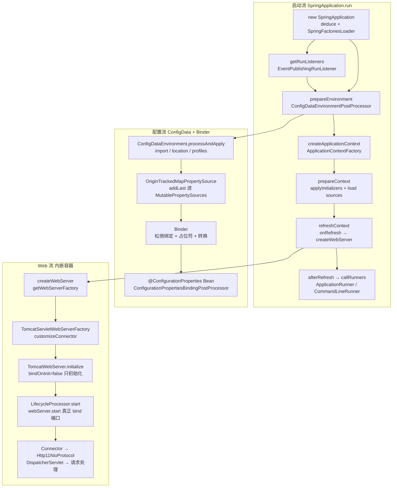

**三条主线**：

1. **启动流**：`SpringApplication.run` —— 从 `new SpringApplication`（推断 Web 类型、加载 SpringFactoriesLoader 扩展）到 `refreshContext` + `callRunners` + `listeners.ready` 的完整生命周期，失败时 `handleRunFailure` 统一收口；
2. **配置流**：外部化配置（命令行参数/环境变量/`application.yml`）→ `Environment`（PropertySource 链）→ `Binder`（松弛绑定）→ `@ConfigurationProperties` Bean；自动配置候选则经 `AutoConfigurationImportSelector` 过滤后由条件注解逐个裁决；
3. **Web 流**：`onRefresh` 钩子内创建内嵌容器（Servlet 栈 `TomcatServletWebServerFactory`、Reactive 栈 `NettyReactiveWebServerFactory`），`initialize` 与 `start` 两阶段分离（先建对象后绑端口），请求最终进入 `DispatcherServlet`。

---

## 面试速通：Spring Boot 高频问题一页纸

> **先给结论**：Spring Boot 的"魔法"可以压缩成六件事——starter 依赖约定、`.imports` 候选登记、条件注解裁决、ConfigData/Binder 配置收敛、内嵌容器两阶段启动、repackage/loader 可执行 jar。
> 面试被追问时按讲次展开：启动流找第一讲，自动配置找第二讲，Web 容器找第三讲，外部化配置找第四讲，构建生态找第五讲。
> 下表每条结论都出自对应讲次的小结，是"一页纸"的最低配置；`深入` 列指向讲次，供二次展开。
> 使用方式：先报一句话结论稳住场面，再按讲次递进；细节全部能在本笔记中找到源码级依据。
> 边界：本章只收文档正文出现过的结论，未展开的细节请回到对应讲次查证，不引入文档外知识点。

### 高频 Q&A（先结论）

先结论、后细节：16 个最高频问题各配一句话，覆盖启动流、自动配置、Web 容器、外部化配置与构建生态五条主线；
回答时避免一上来就陷入实现细节，先给结论再按 `深入` 列回讲次展开。

| # | 面试问题 | 一句话结论 | 深入 |
|---|---|---|---|
| 1 | Spring Boot 自动配置原理？ | 候选自动配置类全部登记在 `META-INF/spring/*.imports`（Boot 4 核心模块仅 12 个，全仓约 100 份），`AutoConfigurationImportSelector` 以"加载 → 去重 → 排除 → 过滤 → 排序"五步漏斗处理，再由条件注解逐个裁决；用户 Bean 永远先注册，自动配置只做"查漏补缺" | 第二讲 |
| 2 | 条件注解如何求值？ | `FilteringSpringBootCondition` 双通道：导入前读 `spring-autoconfigure-metadata.properties` 元数据对类名数组批量过滤（不加载类、可并行），refresh 期才真正加载类求值；`OnBeanCondition` 锁死 `REGISTER_BEAN` 阶段，这是 `@ConditionalOnMissingBean` 可靠性的根基 | 第二讲 |
| 3 | 自动配置类的加载顺序怎么定？ | 三段论：类名字母序打底保证确定性 → `@AutoConfigureOrder` → `@AutoConfigureBefore/After` 拓扑展开（递归补齐关系类、遇环即抛异常）；全程只读 ASM 元数据，候选类不在 classpath 上也能排 | 第二讲 |
| 4 | starter 机制是什么？ | 一个 starter jar 通常零代码，全部内容就是构建脚本里的依赖声明；引入一个坐标 = 引入一组传递依赖 + 一批自动配置候选——"约定优于配置"的物理基础就是依赖传递，classpath 即配置 | 第五讲 |
| 5 | 如何自定义一个 starter？ | 沿用同一约定：写一个只做依赖聚合的 jar，按需附带自动配置类并登记进 `META-INF/spring/org.springframework.boot.autoconfigure.AutoConfiguration.imports`（每行一个全限定名，`#` 为注释），用户引入即生效 | 第五讲 |
| 6 | `SpringApplication.run` 的流程？ | 九步流水线：推断类型 → starting → 准备 Environment → 创建 Context → prepareContext 装 Bean → refresh → started → callRunners → ready；每步经 `SpringApplicationRunListener` 7 个回调广播事件，任何异常统一汇入 `handleRunFailure` | 第一讲 |
| 7 | `spring.main.*` 为什么能关掉启动行为？ | 因为 `bindToSpringApplication` 发生在 ConfigData 处理之后——所以 `spring.main.web-application-type=none`、`spring.main.banner-mode=off` 这些"控制启动本身"的开关才生效；配合默认属性三处 `moveToEnd`，"默认值永远最低优先级"是双保险 | 第一讲 |
| 8 | 启动失败怎么排查？ | 失败三件套：退出码（`ExitCodeExceptionMapper` → `ExitCodeGenerator`，第一个非零胜出）+ FailureAnalyzer 人话报告（内置 18 个，Description/Action 结构）+ `AbandonedRunException` 静默短路；看到 "APPLICATION FAILED TO START" 先读 Action 段，它不是堆栈 | 第一讲 |
| 9 | 外部化配置的优先级顺序？ | "后来者居上"：命令行参数 `addFirst` 永远最高，其下是系统属性/环境变量，ConfigData `addLast` 进链尾，`@PropertySource` 反而低于 `application.yml`，`DefaultPropertiesPropertySource` 被三处 `moveToEnd` 永远垫底 | 第四讲 |
| 10 | Profile 机制？ | 只认 `spring.profiles.active`，`default`/`group`/`include` 都是派生量；ConfigData 两轮处理——先无 profile 拿到激活属性，再带 profile 加载 `application-{profile}`；休眠配置里写 `include` 会抛 `InactiveConfigDataAccessException` | 第四讲 |
| 11 | `@ConfigurationProperties` 与宽松绑定？ | 装配链 `@EnableConfigurationProperties` → `EnableConfigurationPropertiesRegistrar` → `ConfigurationPropertiesBindingPostProcessor` → `ConfigurationPropertiesBinder` → `Binder`；`max-attempts`/`MAX_ATTEMPTS`/`maxAttempts` 收敛到同一 UNIFORM 规范名，绑定发生在每个 Bean 初始化前 | 第四讲 |
| 12 | Binder 的绑定过程？ | 松弛名匹配 → `${...}` 占位符解析（`PropertySourcesPlaceholdersResolver`）→ 类型转换（`ConversionService`）→ setter/构造器注入 → JSR-303 校验；`ignoreUnknownFields` 默认 true，未知键静默忽略，设 false 才暴露拼写错误 | 第四讲 |
| 13 | `@SpringBootApplication` 三合一注解？ | `@SpringBootConfiguration` + `@EnableAutoConfiguration` + `@ComponentScan`：主类作为 primary source 在 `prepareContext` 的 `load` 阶段进入容器，refresh 时被 `ConfigurationClassPostProcessor` 解析出 `AutoConfigurationImportSelector`，自动配置自此导入 | 第一、二讲 |
| 14 | 内嵌 Tomcat 启动原理？ | `onRefresh` 里从容器取唯一的 `ServletWebServerFactory` Bean 造出 `TomcatWebServer`：`initialize` 阶段 `bindOnInit=false` 只初始化不绑端口，`finishRefresh` 后 `LifecycleProcessor` 才调 `start()` 真正 bind——"Bean 全就绪才开放流量"，零半启动窗口 | 第三讲 |
| 15 | 优雅停机怎么做的？ | 三段式：`doClose` 先发 `REFUSING_TRAFFIC` 摘流量 → `WebServerGracefulShutdownLifecycle`（专用 phase，早于 stop lifecycle）→ `GracefulShutdown` pause 连接器并每 50ms 轮询在途请求归零；`server.shutdown=graceful` 才开启，默认 immediate | 第三讲 |
| 16 | 可执行 jar 的原理？ | repackage 三件事：classes 搬进 `BOOT-INF/classes`、依赖原样嵌进 `BOOT-INF/lib/`、MANIFEST 把 `Main-Class` 换成 `JarLauncher`（原主类记入 `Start-Class`）；`java -jar` 的真实入口是 loader——注册 `jar:nested:` 协议 → `LaunchedClassLoader` → 反射调 `Start-Class`，嵌套 jar 全程不解压 | 第五讲 |
| 17 | SpringBoot 和 Spring 的区别是什么？ | Spring 是 IoC/AOP 容器 + 一库可选模块，用要自己凑（选版本、写配置、配 Web 容器）；Spring Boot 是**约定大于配置的脚手架**：自动配置 + starter 依赖管理 + 内嵌容器 + 生产级端点，把"拼装"变成"开箱即用"。Boot 不替换 Spring，只是把 Spring 的装配自动化了 | 第一讲 |
| 18 | Spring 中的 Bean 是线程安全的吗？ | 容器本身不管线程安全：单例 Bean 被所有请求共享，**无状态的（只读依赖别人）安全，有可变状态的（成员变量累加/缓存）不安全**。默认单例下要共享状态就上 `ThreadLocal`、原型作用域、或把状态挪到方法局部变量/数据库。Spring 的有状态 Bean（controller/service）默认写法就是"无状态" | spring-core.md |
| 19 | Spring AOP 在什么场景下会失效？ | 四种经典翻车：①同类内自调用（`this.method()` 绕过代理，本质是没走代理对象）；②方法非 public（CGLIB/JDK 代理都拦不了，`@Transactional` 明确要求 public）；③final 方法/类（CGLIB 无法继承）；④切点表达式写错没匹配上。解法：注入自身代理（`AopContext.currentProxy()`）、拆类、换 `AopContext` 暴露代理开关 | spring-core.md |
| 20 | Spring 中用到了哪些设计模式？ | 工厂（`BeanFactory`/`FactoryBean`）、单例（默认 bean 作用域，三级缓存池化）、代理（AOP 动态代理）、模板方法（`JdbcTemplate`/`RestTemplate` 固定流程留钩子）、策略（`InstantiationStrategy`、`Resource` 加载）、观察者（事件/监听器 `ApplicationEventPublisher`）、适配器（`HandlerAdapter` MVC）、责任链（拦截器链/Filter 链）、建造者（`BeanDefinitionBuilder`）——面试答"BeanFactory+三级缓存解决循环依赖"最加分 | spring-core.md |
| 21 | Spring 事务失效可能是哪些原因？ | 六个高频原因：非 public 方法上标注；同类自调用绕过代理；异常被 try-catch 吞了（默认只对 `RuntimeException`/`Error` 回滚，checked 要配 `rollbackFor`）；抛出的异常类型不对（`Exception` 不回滚）；数据库引擎不支持事务（MyISAM）；没走 Spring 代理（手动 new 的对象）。排查先看"代理有没有生效、异常有没有穿透" | spring-core.md |
| 22 | Spring Boot Controller 层怎么实现并发安全的？ | Controller 默认单例且被所有请求共享，并发安全靠"**无状态**"：不把请求相关数据放成员变量，参数从方法签名进、结果往响应写；要复用重对象用 `ThreadLocal`（用完 remove）。真正要串行化的共享状态（库存/名额）下沉到数据库（乐观锁 version）或分布式锁——Web 层并发安全的答案永远是"别在单例里藏状态" | spring-core.md |

### 易错点与面试坑

以下都是文档中强调过的反直觉点，每一条对应一个"知道即加分、不知道就翻车"的瞬间；
按优先级排好了，前三条是源码结论与直觉冲突最厉害的地方。
每条都附了"怎么躲"：改法或排障入口，直接可用。

- **`@PropertySource` 优先级低于 `application.yml`**（最反直觉的一条）：前者 refresh 期才加入、后者 `addLast` 在前，链式语义"后来者居上"；
  想让 `@PropertySource` 赢，需要它 `addFirst` 或改用 ConfigData import。
  这也是"我把配置从 yml 挪到注解里为什么不生效"这类问题的标准答案。
- **同一位置 `.properties` 优先于 `.yaml`**：loader 顺序是 `[Properties, Yaml]`，倒序插入后 properties 后被应用，官方结论代码可印证；
  同一目录混排两种格式时，这是个典型的暗坑。
- **自动配置顺序会"静默跳过"**：`@AutoConfigureBefore/After` 指向的关系类不可用时直接跳过不报错，只有检测到环才抛 "AutoConfigure cycle detected"；
  顺序写错可能无声无息，排障时打开 `--debug` 的条件评估报告。
- **`@ConditionalOnBean` 顺序敏感**：`OnBeanCondition` 在 `REGISTER_BEAN` 阶段只统计"将要注册"的 Bean 定义，自动配置之间并不真正互相注入；
  用户代码里写 `@ConditionalOnBean` 要警惕顺序，`@ConditionalOnMissingBean` 才是自动配置的正确姿势。
- **排除项写错类名会炸启动**：`spring.autoconfigure.exclude` 排一个不在候选中的类直接抛 `IllegalStateException`（防拼写错误静默失效）；
  `spring.boot.enableautoconfiguration=false` 则是整体关闭自动配置的总开关。
- **`ignoreUnknownFields` 默认 true**：yml 里多写的键被静默忽略，设 false 才抛 `UnboundConfigurationPropertiesException`；
  排查"值怎么没绑上"先看 Origin——`OriginTrackedMapPropertySource` 记录每个值来自哪个文件哪一行。
- **端口冲突报错发生在启动末端**：`bindOnInit=false` + START_EVENT 摘除 connector，使 `tomcat.start()` 只初始化不监听，报错推迟到 `LifecycleProcessor.start`；
  `server.port=0` 时真实端口从 `connector.getLocalPort()` 取并回填 `local.server.port`。
- **内嵌容器与外部容器的分界**：一旦定义任何 `ServletContextInitializer` Bean，自动注册 Servlet/Filter 的行为就关闭（防双注册）；
  Boot 4 里 `spring-boot-starter-web` 已 deprecated、Undertow 支持被移除，换容器 = 换 `-runtime` starter，编译期零改动。
  同一个容器里出现两个 `ServletWebServerFactory` Bean 会直接抛异常，排障时先查依赖树。

### 关键概念与默认值速记

默认值全部来自文档正文，考前过一遍这张表即可；讲次列即出处，可回查验证。

| 项 | 默认值/取值 | 说明 | 讲次 |
|---|---|---|---|
| 默认端口 | 8080（端到端示例取值） | `server.port=0` 改用 OS 分配端口，`local.server.port` 回填真实值 | 第三讲 |
| 连接器协议 | `Http11NioProtocol` | `createTomcat` 默认；URI 编码默认 UTF-8 | 第三讲 |
| `bindOnInit` | false | Boot 强制设置，两阶段分离的结构前提 | 第三讲 |
| `server.shutdown` | immediate | 改为 graceful 才启用在途请求排空 | 第三讲 |
| 优雅停机轮询间隔 | 50ms | 依据 `getInProgressAsyncCount`/`getCountAllocated` 归零判定 | 第三讲 |
| Host `autoDeploy` / ClassLoader `delegate` | false / true | 内嵌 Tomcat 关闭热部署、类加载委派给父加载器 | 第三讲 |
| MBean registry | 默认关闭 | `createTomcat` 入口即 `Registry.disableRegistry()` | 第三讲 |
| 非守护 await 线程 | `initialize` 阶段创建 | `startNonDaemonAwaitThread` 保活，防止 JVM 退出 | 第三讲 |
| 默认搜索位置 | `optional:classpath:/`、`classpath:/config/`、`file:./`、`file:./config/`、`file:./config/*/` | `import` 附加导入、`additional-location` 前置、`location` 整体覆盖 | 第四讲 |
| 默认 config name | `application` | 可配多个：`spring.config.name=app,myapp` | 第四讲 |
| 默认 profile | `default` | 无 active 时的兜底集合 | 第四讲 |
| loader 顺序 | `[Properties, Yaml]` | 同位置 `.properties` 优先于 `.yaml` | 第四讲 |
| 内置 EnvironmentPostProcessor | 5 个 | ConfigData 的排最前（order 见下一行） | 第四讲 |
| EPP order | `HIGHEST_PRECEDENCE+10` | `ConfigDataEnvironmentPostProcessor` 最先跑 | 第四讲 |
| 绑定后处理器 order | `HIGHEST_PRECEDENCE+1` | `ConfigurationPropertiesBindingPostProcessor` | 第二讲 |
| `AutoConfigureOrder` 默认 | `DEFAULT_ORDER` | 字母序打底之后才比较 order | 第二讲 |
| `ignoreUnknownFields` | true | 未知键静默忽略 | 第四讲 |
| 宽松绑定合法字符 | 首字符小写字母，后续可含数字与 `-` | `_` 不算合法字符，环境变量名由 `SystemEnvironmentPropertySource` 事先转换 | 第四讲 |
| 内置 FailureAnalyzer | 18 个 | Description/Action 结构的人话报告 | 第一讲 |
| RunListener 回调 | 7 个 | starting → … → ready / failed | 第一讲 |
| `.imports` 候选 | 核心 12 个 / 全仓约 100 份 | Boot 4 模块化拆分的直接体感 | 第二讲 |
| 启动日志语义 | "Started"；CRaC 恢复打 "Restored" | `Startup.create()` 检测 CRaC MXBean 切换 | 第一讲 |
| 版本坐标 | 4.1.1 / Spring 7.0.9 / Tomcat 11.0.24 / Graal 25 | 至少 Java 17；native image 与 AOT Cache 需 JDK 25+ | 第五讲 |

> 用法：先背 Q&A 的一句话结论，再用"深入"列回对应讲次查证；
> 易错点与默认值表建议面试当天早上再过一遍，尤其是优先级顺序和两阶段启动这两条。
> 时间紧就只记三件事：ConfigData addLast 进链尾、Tomcat 先 initialize 后 bind、自动配置永远排在用户 Bean 之后。

---

## 第一讲：SpringApplication.run —— 一次启动的全流程

### 定位

`SpringApplication` 是 Spring Boot 的"总装配线"：它把一个普通的 `main` 方法编排成「推断环境 → 准备 Environment → 创建 ApplicationContext → 加载 Bean 定义 → refresh → 回调 Runner」的标准流水线，并把每一步通过 `SpringApplicationRunListener` 事件暴露给扩展方。理解这一个类（1876 行）的 `run(String...)` 方法，就理解了 Spring Boot 应用 90% 的启动行为。本讲所有行号均对应 `core/spring-boot/src/main/java/org/springframework/boot/SpringApplication.java`。

### 目录结构：core/spring-boot 模块（Boot 4 的主模块）

```
core/spring-boot/src/main/java/org/springframework/boot/
├── SpringApplication.java            ← 启动总装线（1876 行）
├── SpringApplicationRunListener.java ← 运行监听器 SPI（7 个回调）
├── SpringApplicationRunListeners.java← 监听器集合 + ApplicationStartup 打点
├── WebApplicationType.java           ← NONE/SERVLET/REACTIVE 推断
├── ApplicationContextFactory.java    ← 按 Web 类型创建 Context 的策略接口
├── DefaultApplicationContextFactory.java
├── ApplicationEnvironment.java       ← 默认 Environment（ApplicationEnvironment）
├── ApplicationArguments.java / DefaultApplicationArguments.java
├── Runner.java / ApplicationRunner.java / CommandLineRunner.java
├── ExitCodeGenerator.java / ExitCodeGenerators.java / ExitCodeEvent.java / ExitCodeExceptionMapper.java
├── BeanDefinitionLoader.java         ← Class/XML/Groovy/Package 四类 source 装载
├── StartupInfoLogger.java            ← "Starting ... Started in 1.234 seconds"
├── SpringApplicationBannerPrinter.java / Banner.java / SpringBootBanner.java
├── SpringApplicationShutdownHook.java / SpringApplicationShutdownHandlers.java
├── SpringBootExceptionHandler.java / SpringBootExceptionReporter.java
├── bootstrap/                        ← BootstrapRegistry / DefaultBootstrapContext
├── context/event/EventPublishingRunListener.java ← 默认 RunListener（发 SpringApplicationEvent）
├── diagnostics/FailureAnalyzers.java ← FailureAnalyzer 入口（SpringBootExceptionReporter 实现）
├── env/                              ← PropertySourceLoader、RandomValuePropertySource 等（第四讲）
├── web/                              ← servlet/reactive/error 子包（第三讲）
└── context/config/                   ← ConfigDataEnvironmentPostProcessor 等（第四讲）
core/spring-boot/src/main/resources/META-INF/spring.factories   ← 全部 SPI 注册清单
```

Boot 4 的结构性变化：Boot 3 的 `spring-boot-project/spring-boot` 在 4.x 中改名为顶层 `core/spring-boot`（见 `settings.gradle` 的 `include "core:spring-boot"`），Web 服务器实现则整体下沉到 `module/spring-boot-web-server`、`module/spring-boot-tomcat` 等独立模块（第三讲详述）。

### SpringApplication.java —— 逐段精读

#### 1. 构造器：启动前的"家底盘点"（L274–296）

```java
public SpringApplication(@Nullable ResourceLoader resourceLoader, Class<?>... primarySources) {
    this.resourceLoader = resourceLoader;
    this.primarySources = new LinkedHashSet<>(Arrays.asList(primarySources));
    this.properties.setWebApplicationType(WebApplicationType.deduce());          // L278
    this.bootstrapRegistryInitializers = new ArrayList<>(
            getSpringFactoriesInstances(BootstrapRegistryInitializer.class));    // L279-280
    setInitializers((Collection) getSpringFactoriesInstances(ApplicationContextInitializer.class)); // L281
    setListeners((Collection) getSpringFactoriesInstances(ApplicationListener.class));              // L282
    this.mainApplicationClass = deduceMainApplicationClass();                    // L283
}
```

三件事：**推断 Web 应用类型**、加载三类 SPI 扩展（BootstrapRegistryInitializer / ApplicationContextInitializer / ApplicationListener）、**推断主类**。`deduceMainApplicationClass()`（L286–296）用 `StackWalker`（`RETAIN_CLASS_REFERENCE`）沿调用栈找第一个名为 `main` 的方法声明类——这是"Starting MyApplication"日志里应用名的来源，也是无需显式传主类的原因。

Web 类型推断 `WebApplicationType.deduce()`（`WebApplicationType.java:63–71`）在 Boot 4 改为 **SPI 化**：先遍历 `SpringFactoriesLoader` 加载的 `WebApplicationType.Deducer`（L64），找不到才回退到 `isServletApplication()`（L70，检查 `jakarta.servlet.Servlet` 与 `org.springframework.web.context.ConfigurableWebApplicationContext` 两个指示类是否在 classpath，L55–56）。Reactive 判定由 `module/spring-boot-webflux` 的 `WebFluxWebApplicationTypeDeducer` 提供（`module/spring-boot-webflux/src/main/java/org/springframework/boot/webflux/WebFluxWebApplicationTypeDeducer.java:35`，经 `module/spring-boot-webflux/src/main/resources/META-INF/spring.factories` 注册）——这是 Boot 4 模块拆分后核心模块不再直接依赖 spring-web 的必然结果。

#### 2. run(String...)：主流水线（L304–342）

```java
public ConfigurableApplicationContext run(String... args) {
    Startup startup = Startup.create();                                          // L305
    if (this.properties.isRegisterShutdownHook()) {
        SpringApplication.shutdownHook.enableShutdownHookAddition();             // L306-308
    }
    DefaultBootstrapContext bootstrapContext = createBootstrapContext();         // L309
    ConfigurableApplicationContext context = null;
    configureHeadlessProperty();                                                 // L311
    SpringApplicationRunListeners listeners = getRunListeners(args);             // L312
    listeners.starting(bootstrapContext, this.mainApplicationClass);             // L313
    try {
        ApplicationArguments applicationArguments = new DefaultApplicationArguments(args); // L315
        ConfigurableEnvironment environment = prepareEnvironment(listeners, bootstrapContext, applicationArguments); // L316
        Banner printedBanner = printBanner(environment);                         // L317
        context = createApplicationContext();                                    // L318
        context.setApplicationStartup(this.applicationStartup);                  // L319
        prepareContext(bootstrapContext, context, environment, listeners, applicationArguments, printedBanner); // L320
        refreshContext(context);                                                 // L321
        afterRefresh(context, applicationArguments);                             // L322
        Duration timeTakenToStarted = startup.started();                         // L323
        if (this.properties.isLogStartupInfo()) { ... }                          // L324-326
        listeners.started(context, timeTakenToStarted);                          // L327
        callRunners(context, applicationArguments);                              // L328
    }
    catch (Throwable ex) {
        throw handleRunFailure(context, ex, listeners);                          // L330-331
    }
    try {
        if (context.isRunning()) { listeners.ready(context, startup.ready()); }  // L334-335
    }
    catch (Throwable ex) { throw handleRunFailure(context, ex, null); }           // L338-339
    return context;
}
```

注意两个细节：

- **`ready` 与 `started` 分开**（L327 vs L335）：`started` 在 `callRunners` 之前发出，`ready` 在 Runner 全部执行完后发出；`EventPublishingRunListener` 借这两点分别发布 `LivenessState.CORRECT` 与 `ReadinessState.ACCEPTING_TRAFFIC`（`context/event/EventPublishingRunListener.java:105、111`）——K8s 探针的存活/就绪信号就来自这里。
- **异常一律走 `handleRunFailure`**（L330–331、L338–339）：无论是启动失败还是 ready 阶段失败，都统一转换为可抛出的 RuntimeException（原始是 RuntimeException 则原样抛，否则包 `IllegalStateException`，L826–827）。

#### 3. prepareEnvironment：Environment 的"二次加工"（L350–368）

```java
ConfigurableEnvironment environment = getOrCreateEnvironment();                  // L353
configureEnvironment(environment, applicationArguments.getSourceArgs());         // L354
ConfigurationPropertySources.attach(environment);                               // L355
listeners.environmentPrepared(bootstrapContext, environment);                   // L356 ← 触发 ConfigDataEnvironmentPostProcessor
ApplicationInfoPropertySource.moveToEnd(environment);                           // L357
DefaultPropertiesPropertySource.moveToEnd(environment);                         // L358
Assert.state(!environment.containsProperty("spring.main.environment-prefix"), …);// L359-360
bindToSpringApplication(environment);                                           // L361 ← spring.main.* 绑定到 this.properties
if (!this.isCustomEnvironment) { environment = environmentConverter.convertEnvironmentIfNecessary(...); } // L362-365
```

顺序即优先级：先 `configureEnvironment`（L498–504：安装 `ApplicationConversionService` → `configurePropertySources` 把命令行参数 `SimpleCommandLinePropertySource` **addFirst**（L529）、defaultProperties 合并、`ApplicationInfoPropertySource` **addLast**（L532）→ `configureProfiles` 空模板方法 L543–544），再 `listeners.environmentPrepared` 让 `ConfigDataEnvironmentPostProcessor` 把 `application.yml` 等 ConfigData **addLast** 追加（第四讲）。最后 `bindToSpringApplication`（L550–557）用 `Binder.get(environment).bind("spring.main", Bindable.ofInstance(this.properties))` 把 `spring.main.*` 属性绑回 SpringApplication 自身——所以 `spring.main.web-application-type=none`、`spring.main.banner-mode=off` 这些"控制启动本身的开关"必须在 ConfigData 处理之后才能生效。

`EnvironmentConverter`（L362–365）负责把自定义 Environment 转成与 Web 类型匹配的类型（如 servlet 的 `ApplicationServletEnvironment`）。

#### 4. createApplicationContext 与 ApplicationContextFactory（L579–584）

`createApplicationContext()` 委托 `applicationContextFactory.create(webApplicationType)`。默认实现 `DefaultApplicationContextFactory`（`DefaultApplicationContextFactory.java:38`）又通过 `SpringFactoriesLoader` 询问所有候选工厂（L80–86），任一返回非空即采用；全部落空时回退 `createDefaultApplicationContext()`（L69–74）：非 AOT 模式 `new AnnotationConfigApplicationContext()`，AOT 模式 `new GenericApplicationContext()`。在标准 Web 依赖下，`ServletWebServerApplicationContext` 由 `module/spring-boot-web-server` 注册的工厂提供（第三讲）。

#### 5. prepareContext：refresh 前的最后装配（L380–419）

```java
context.setEnvironment(environment);                       // L383
postProcessApplicationContext(context);                    // L384（beanNameGenerator/resourceLoader/conversionService）
addAotGeneratedInitializerIfNecessary(this.initializers);  // L385
// 允许循环引用 / bean 定义覆盖开关                             L386-392
applyInitializers(context);                                // L393
listeners.contextPrepared(context);                        // L394
bootstrapContext.close(context);                           // L395 ← BootstrapContext 在此关闭
// 日志：logStartupInfo + logStartupProfileInfo               L396-399
beanFactory.registerSingleton("springApplicationArguments", applicationArguments); // L401
if (printedBanner != null) beanFactory.registerSingleton("springBootBanner", printedBanner); // L402-404
if (lazyInitialization) context.addBeanFactoryPostProcessor(new LazyInitializationBeanFactoryPostProcessor()); // L405-407
if (keepAlive) context.addApplicationListener(new KeepAlive()); // L408-410
context.addBeanFactoryPostProcessor(new PropertySourceOrderingBeanFactoryPostProcessor(context)); // L411
if (!AotDetector.useGeneratedArtifacts()) { load(context, sources.toArray(new Object[0])); } // L412-417
listeners.contextLoaded(context);                          // L418
```

要点：

- `PropertySourceOrderingBeanFactoryPostProcessor`（L411，定义见 L1594–1612）order 为 `HIGHEST_PRECEDENCE`，职责是在 refresh 后把 `DefaultPropertiesPropertySource` 挪到末尾——因为用户 `@PropertySource`/ConfigData 引入的 property source 是在 `ConfigurationClassPostProcessor` 解析 `@Configuration` 类时才加入的，默认属性必须让位（L1608–1610）。
- `load(...)`（L683–698）经 `BeanDefinitionLoader`（`BeanDefinitionLoader.java:62`）把 primarySources（Class→AnnotatedBeanDefinitionReader、Resource→XmlBeanDefinitionReader、CharSequence→包扫描，L134–150）注册为 BeanDefinition。`@SpringBootApplication` 的主类就是在这里进入容器，随后 refresh 时 `ConfigurationClassPostProcessor` 解析出 `@EnableAutoConfiguration` → `AutoConfigurationImportSelector`（第二讲）。

#### 6. refreshContext 与 afterRefresh（L441–446、L764–765）

`refreshContext` 先 `shutdownHook.registerApplicationContext(context)`（L442–444，注册 JVM 关闭钩子），再 `refresh(context)`（L755–757）——即标准 Spring `AbstractApplicationContext.refresh()`，其中 `onRefresh()` 钩子由各 Web ApplicationContext 实现创建内嵌容器（第三讲）。`afterRefresh` 默认空实现，留给子类/定制者。

#### 7. callRunners：启动后的业务钩子（L767–801）

```java
String[] beanNames = beanFactory.getBeanNamesForType(Runner.class);   // L769
// IdentityHashMap 收集实例 → beanName                          L770-773
Comparator<Object> comparator = getOrderComparator(beanFactory)
    .withSourceProvider(new FactoryAwareOrderSourceProvider(beanFactory, instancesToBeanNames)); // L774-775
instancesToBeanNames.keySet().stream().sorted(comparator).forEach((runner) -> callRunner(runner, args)); // L776
```

`Runner` 是 `ApplicationRunner` 与 `CommandLineRunner` 的共同父接口（`Runner.java`）。同一个 bean 若两个接口都实现会被调用两次（L786–794：先 `ApplicationRunner.run(ApplicationArguments)` 后 `CommandLineRunner.run(String[])`）。排序用 `AnnotationAwareOrderComparator` + `FactoryAwareOrderSourceProvider`（L1843–1874：从 `@Bean` 工厂方法/targetType 提取 `@Order`）。注意 `getBeanNamesForType(Runner.class)` 会**触发 Runner bean 的实例化**——Runner 在启动末期才被创建。

#### 8. 异常传播：FailureAnalyzer 与退出码（L803–920）

```java
private RuntimeException handleRunFailure(context, exception, listeners) {
    if (exception instanceof AbandonedRunException e) return e;        // L805-807 静默退出
    try {
        try {
            handleExitCode(context, exception);                        // L810
            if (listeners != null) listeners.failed(context, exception); // L811-813
        } finally {
            reportFailure(getExceptionReporters(context), exception);  // L816
            if (context != null) { context.close(); shutdownHook.deregisterFailedApplicationContext(context); } // L817-820
        }
    } catch (Exception ex) { logger.warn("Unable to close ApplicationContext", ex); }
    return (exception instanceof RuntimeException re) ? re : new IllegalStateException(exception); // L826-827
}
```

退出码计算链（L894–920）：先 `ExitCodeExceptionMapper` Bean 映射（`getExitCodeFromMappedException`，L902–910，经 `ExitCodeGenerators` 聚合，`ExitCodeGenerators.java:92–108`：**第一个非零退出码胜出**，任一 generator 抛异常记 1），再沿 `getCause()` 链找 `ExitCodeGenerator`（L912–920）。`handleExitCode`（L881–892）在 exitCode≠0 时发 `ExitCodeEvent` 并注册到 `SpringBootExceptionHandler`（L887–890）——后者是 main 线程的 `UncaughtExceptionHandler`（`SpringBootExceptionHandler.java:66–78`），确保 JVM 以非零码退出且已打印的堆栈不重复打印（L80–119：`isRegistered` 判断）。

`reportFailure`（L842–867）遍历 `SpringBootExceptionReporter`（唯一内置实现是 `diagnostics/FailureAnalyzers.java:49`）：逐个 `FailureAnalyzer.analyze`（L90–103，内置 18 个分析器见 `core/spring-boot/src/main/resources/META-INF/spring.factories` 的 `FailureAnalyzer` 段，如 `BeanNotOfRequiredTypeFailureAnalyzer`、`BindFailureAnalyzer`、`PortInUseFailureAnalyzer` 等），分析成功则由 `FailureAnalysisReporter`（默认 `LoggingFailureAnalysisReporter`）输出"原因 + 处置建议"格式的人话报告。这解释了启动失败时经典的：

```
***************************
APPLICATION FAILED TO START
***************************

Description:

Parameter 0 of constructor in ... required a bean of type ... that could not be found.

Action:

Consider defining a bean of type ... in your configuration.
```

`AbandonedRunException`（L1620–1650）是"静默放弃"通道：直接原样抛出，不做 FailureAnalyzer、不关闭 context（L805–807 短路）。

#### 9. Startup 与 CRaC（L1744–1837）

`Startup.create()`（L1771–1776）检测 classpath 是否有 `jdk.crac.management.CRaCMXBean` 与 `org.crac.management.CRaCMXBean`：有则用 `CoordinatedRestoreAtCheckpointStartup`（L1812–1837，`action()` 返回 "Restored"，起始时间取 CRaC 恢复时刻），否则 `StandardStartup`（L1783–1807，`action()` 返回 "Started"）。所以 checkpoint/restore 部署下日志会打 "Restored MyApplication in ... seconds" 而非 "Started"。

### SpringApplicationRunListener 时序：七个回调一张图

`SpringApplicationRunListener`（`SpringApplicationRunListener.java:42`）定义 7 个 default 回调，`SpringApplicationRunListeners`（`SpringApplicationRunListeners.java:40`）负责逐个调用并用 `ApplicationStartup` 打点（L116–128，step 名如 `spring.boot.application.starting`）：

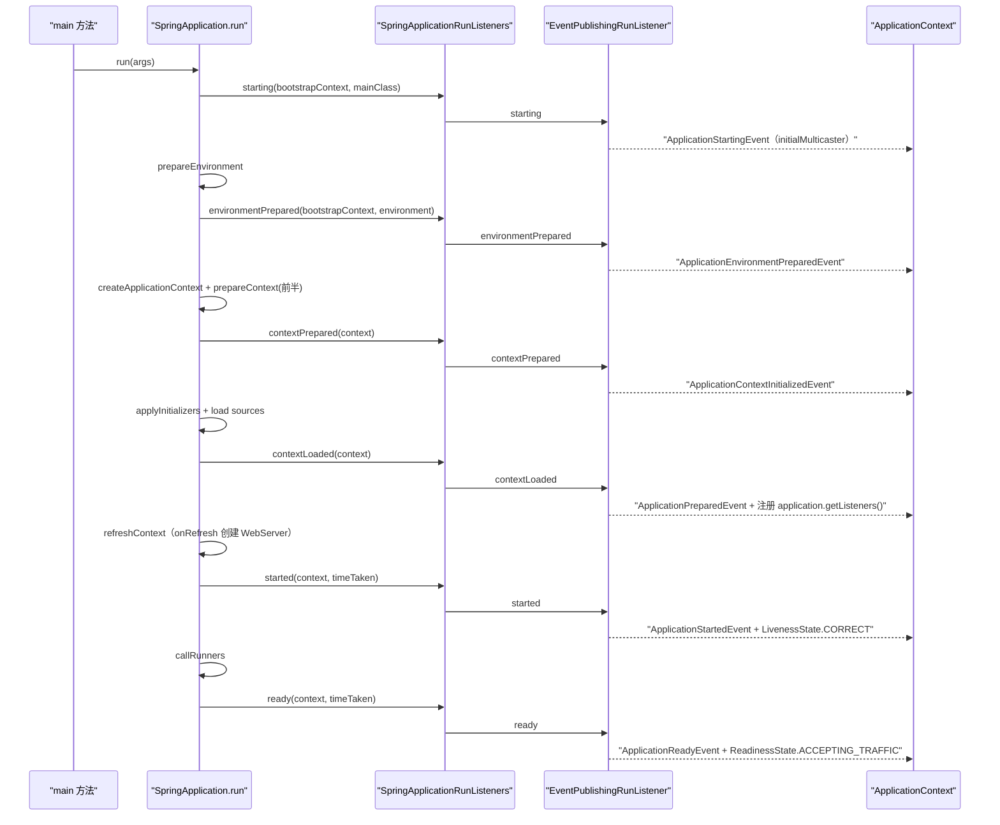

`EventPublishingRunListener`（`context/event/EventPublishingRunListener.java:55`，经 `spring.factories` 的 `SpringApplicationRunListener` 注册）用内部 `SimpleApplicationEventMulticaster` 在 context 可用前发早期事件（L61–67），`contextLoaded` 时才把 `SpringApplication.getListeners()` 里的监听器注册进 context（L93–98）——所以监听 `ApplicationStartingEvent`/`ApplicationEnvironmentPreparedEvent` 的 Bean 能早于 context 生效。

### 输入/输出表：run 各阶段

| # | 阶段（行号） | 输入 | 输出 / 副作用 |
|---|---|---|---|
| ① | 构造器 L274–284 | primarySources + classpath | `WebApplicationType`、三类 SPI 列表、mainApplicationClass |
| ② | `run` L305–313 | args | Startup、BootstrapContext、RunListeners、`starting` 事件 |
| ③ | `prepareEnvironment` L350–368 | listeners + args | ConfigurableEnvironment（含命令行参数 + ConfigData）、`spring.main.*` 绑定 |
| ④ | `createApplicationContext` L579–584 | WebApplicationType | 未 refresh 的 ApplicationContext |
| ⑤ | `prepareContext` L380–419 | context + environment | initializer 应用、singleton 注册（arguments/banner）、BeanDefinition 装载、`contextLoaded` 事件 |
| ⑥ | `refreshContext` L441–446 | context | refresh（含 `onRefresh` 创建 WebServer）、shutdownHook 注册 |
| ⑦ | `afterRefresh` + `started` L322–327 | context | 子类钩子、启动耗时日志、`started` 事件 |
| ⑧ | `callRunners` L767–777 | context | 按序调用 ApplicationRunner/CommandLineRunner |
| ⑨ | `ready` L334–335 | context | `ready` 事件、就绪信号 |
| ⑩ | 失败路径 L803–828 | Throwable | 退出码计算、`failed` 事件、FailureAnalyzer 报告、context.close() |

### 第一讲小结：一次 run 就是一条"事件驱动的装配流水线"

**一句话定位**：`SpringApplication.run` 把「推断类型 → 准备 Environment → 建 Context → 装 Bean → refresh → 回调 Runner」固化为九步流水线，每一步都通过 `SpringApplicationRunListener` 的 7 个回调广播事件，失败时由 `FailureAnalyzer` + `ExitCodeGenerators` 统一收口。

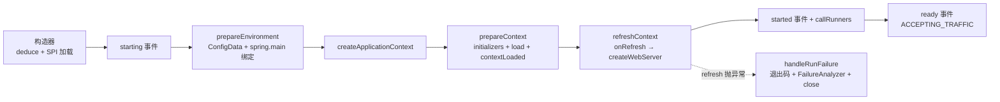

**run 各阶段的输入/输出**：

| 阶段 | 输入 | 输出 |
|---|---|---|
| `prepareEnvironment` | args + SpringFactoriesLoader 扩展 | Environment（命令行 addFirst、ConfigData addLast、`spring.main.*` 回绑） |
| `prepareContext` | Environment + initializers | 注册 singleton（arguments/banner）+ BeanDefinition + `contextLoaded` |
| `refreshContext` | 未 refresh 的 context | refresh 完成（Web 容器已创建）+ shutdown hook 已注册 |
| `callRunners` | context | 按 `@Order` 调用 ApplicationRunner/CommandLineRunner |
| `handleRunFailure` | Throwable | 非零退出码 + FailureAnalyzer 人话报告 + context 已关闭 |

**三个最值得记住的点**：

1. **事件顺序即生命周期**：`starting → environmentPrepared → contextPrepared → contextLoaded → started → ready → failed`，`EventPublishingRunListener` 把它们转成 `Application*Event`；`started` 与 `ready` 之间夹着 `callRunners`，二者分别驱动存活/就绪探针信号（LivenessState.CORRECT / ReadinessState.ACCEPTING_TRAFFIC）；
2. **`spring.main.*` 的绑定发生在 ConfigData 之后**（L356→L361）：这正是 `spring.main.web-application-type=none`、`spring.main.banner-mode=off` 能关掉启动行为的原因；而 `DefaultPropertiesPropertySource.moveToEnd` + `PropertySourceOrderingBeanFactoryPostProcessor` 双保险保证"默认属性永远最低优先级"；
3. **失败路径三件套**：退出码（`ExitCodeExceptionMapper` → `ExitCodeGenerator`，第一个非零胜出）、FailureAnalyzer 报告（18 个内置分析器，输出 Description/Action 结构）、`AbandonedRunException` 静默退出短路——排查"APPLICATION FAILED TO START"时先看 Action 段，它由具体 FailureAnalyzer 生成而非堆栈。

---

## 第二讲：自动配置 —— @EnableAutoConfiguration 与条件注解家族

### 定位

自动配置要回答一个问题：**classpath 上有什么，用户就最可能需要什么 Bean**。Spring Boot 的答案是：所有"候选自动配置类"登记在 `META-INF/spring/*.imports` 文件里，`@EnableAutoConfiguration` 通过 `AutoConfigurationImportSelector`（一个 `DeferredImportSelector`）把它们全部导入，再用**条件注解家族**逐个裁决"当前环境是否匹配"，匹配的才成为真正的 Bean 定义。本讲所有路径相对仓库根；Boot 4 中该机制核心位于 `core/spring-boot-autoconfigure`（条件注解）与 `core/spring-boot`（`context/annotation/ImportCandidates`、Binder）。

### 目录结构：自动配置的家底

```
core/spring-boot-autoconfigure/src/main/
├── resources/META-INF/spring/
│   └── org.springframework.boot.autoconfigure.AutoConfiguration.imports   ← 12 个核心候选
└── java/org/springframework/boot/autoconfigure/
    ├── EnableAutoConfiguration.java          ← @Import(AutoConfigurationImportSelector.class)
    ├── AutoConfiguration.java                ← @Configuration(proxyBeanMethods=false) 元注解
    ├── AutoConfigurationImportSelector.java  ← 候选加载/排除/过滤/排序（573 行）
    ├── AutoConfigurationSorter.java          ← @AutoConfigureBefore/After 拓扑排序（297 行）
    ├── AutoConfigurationPackages.java        ← 记录 @EnableAutoConfiguration 所在包
    ├── AutoConfigurationExcludeFilter.java   ← 组件扫描排除自动配置类
    ├── AutoConfigurationMetadata.java / AutoConfigurationMetadataLoader.java ← spring-autoconfigure-metadata.properties
    ├── ImportAutoConfiguration.java / ImportAutoConfigurationImportSelector.java
    ├── context/ConfigurationPropertiesAutoConfiguration.java ← @AutoConfiguration + @EnableConfigurationProperties
    └── condition/                            ← 条件注解家族（43 个文件）
        ├── SpringBootCondition.java          ← 所有 Condition 基类（日志 + 评估报告）
        ├── FilteringSpringBootCondition.java ← 兼做 AutoConfigurationImportFilter 的基类
        ├── ConditionalOnClass / ConditionalOnMissingClass / OnClassCondition
        ├── ConditionalOnBean / ConditionalOnMissingBean / ConditionalOnSingleCandidate / OnBeanCondition
        ├── ConditionalOnWebApplication / ConditionalOnNotWebApplication / OnWebApplicationCondition
        ├── ConditionalOnProperty / ConditionalOnProperties / ConditionalOnBooleanProperty / OnPropertyCondition
        ├── ConditionalOnResource / OnResourceCondition
        ├── ConditionalOnExpression / OnExpressionCondition
        ├── ConditionalOnCloudPlatform / OnCloudPlatformCondition
        ├── ConditionalOnJava / OnJavaCondition / ConditionalOnJndi / OnJndiCondition
        └── ConditionalOnThreading / OnThreadingCondition / ConditionalOnCheckpointRestore / ...
module/spring-boot-{tomcat,webmvc,jdbc,...}/src/main/resources/META-INF/spring/
└── org.springframework.boot.autoconfigure.AutoConfiguration.imports   ← 技术模块各自登记
```

**Boot 4 的关键结构变化**：`core/spring-boot-autoconfigure` 的 imports 文件从 Boot 3 的 150+ 行缩减到 **12 行**（只保留 admin/aop/availability/context/info/jmx/ssl/task 等横切关注点），其余全部下沉到技术模块——全仓库 `find . -name "*.imports" | wc -l` = **100**。例如 `module/spring-boot-tomcat` 的 imports 登记 5 个类（`TomcatServletWebServerAutoConfiguration` 等），`module/spring-boot-webmvc` 登记 6 个（`WebMvcAutoConfiguration`、`DispatcherServletAutoConfiguration` 等）。**引入 spring-boot-starter-webmvc 才会有 MVC 自动配置**，这是模块化拆分后的直接体感。

### .imports 文件格式与 ImportCandidates

文件格式极简：**每行一个类的全限定名，`#` 开头为注释**（`core/spring-boot/src/main/java/org/springframework/boot/context/annotation/ImportCandidates.java:47`：`LOCATION = "META-INF/spring/%s.imports"`；L81–92 `load` 遍历 classpath 上所有同名资源合并）。它取代了 Boot 2.x 时代在 `spring.factories` 里登记自动配置的做法（性能：文件小、无需加载整个 factories）。核心模块 12 行候选（`core/spring-boot-autoconfigure/.../AutoConfiguration.imports`）：

```
org.springframework.boot.autoconfigure.admin.SpringApplicationAdminJmxAutoConfiguration
org.springframework.boot.autoconfigure.aop.AopAutoConfiguration
org.springframework.boot.autoconfigure.availability.ApplicationAvailabilityAutoConfiguration
org.springframework.boot.autoconfigure.context.ConfigurationPropertiesAutoConfiguration
org.springframework.boot.autoconfigure.context.LifecycleAutoConfiguration
org.springframework.boot.autoconfigure.context.MessageSourceAutoConfiguration
org.springframework.boot.autoconfigure.context.PropertyPlaceholderAutoConfiguration
org.springframework.boot.autoconfigure.info.ProjectInfoAutoConfiguration
org.springframework.boot.autoconfigure.jmx.JmxAutoConfiguration
org.springframework.boot.autoconfigure.ssl.SslAutoConfiguration
org.springframework.boot.autoconfigure.task.TaskExecutionAutoConfiguration
org.springframework.boot.autoconfigure.task.TaskSchedulingAutoConfiguration
```

### AutoConfigurationImportSelector：五步漏斗（573 行）

入口 `selectImports`（L119–125）→ `getAutoConfigurationEntry`（L142–155），五步：

```java
protected AutoConfigurationEntry getAutoConfigurationEntry(AnnotationMetadata annotationMetadata) {
    if (!isEnabled(annotationMetadata)) return EMPTY_ENTRY;                     // L143-145
    AnnotationAttributes attributes = getAttributes(annotationMetadata);        // L146
    List<String> configurations = getCandidateConfigurations(annotationMetadata, attributes); // L147 ①加载全部候选
    configurations = removeDuplicates(configurations);                          // L148 ②去重
    Set<String> exclusions = getExclusions(annotationMetadata, attributes);     // L149 ③收集排除项
    checkExcludedClasses(configurations, exclusions);                           // L150 校验：排除了不存在的类要报错
    configurations.removeAll(exclusions);                                       // L151 应用排除
    configurations = getConfigurationClassFilter().filter(configurations);      // L152 ④条件过滤器
    fireAutoConfigurationImportEvents(configurations, exclusions);              // L153 发事件
    return new AutoConfigurationEntry(configurations, exclusions);              // L154
}
```

1. **加载候选**（`getCandidateConfigurations` L200–210）：`ImportCandidates.load(AutoConfiguration.class, beanClassLoader)` 读取全部 100 个 `.imports` 文件；为空则断言失败并提示"检查打包是否正确"（L205–208）。
2. **去重**（L305–307）：`LinkedHashSet` 保序。
3. **排除**（`getExclusions` L247–255）：三个来源合并——注解属性 `exclude`/`excludeName`（L250–251）、`spring.autoconfigure.exclude` 属性（L253，`getExcludeAutoConfigurationsProperty` L263–276 用 `Binder` 绑定 `String[]`）、`AutoConfigurationReplacements` 替换（L254，用于 spring-boot-autoconfigure-classic 模块做类名迁移映射）。`checkExcludedClasses`（L212–223）对"类存在但不在候选中"的排除抛 `IllegalStateException`——防拼写错误静默失效。
4. **条件过滤**（`getConfigurationClassFilter` L282–293 + `ConfigurationClassFilter` L388–429）：每个 `AutoConfigurationImportFilter`（`SpringFactoriesLoader` 加载，L278–280）对**全部候选类名数组**批量 `match(candidates, autoConfigurationMetadata)`（L404），不匹配的位置置 null 后剔除（L415–420）。这就是 `@ConditionalOnClass` 等无需加载类即可快速过滤的通道——它读的是 `spring-autoconfigure-metadata.properties` 里的预处理元数据（`AutoConfigurationMetadataLoader.loadMetadata` L395）。
5. **排序**发生在 `AutoConfigurationGroup.selectImports`（L489–505）：合并多个 `@EnableAutoConfiguration` 的 entry、去重、再排除，最后 `sortAutoConfigurations`（L520–527）交给 `AutoConfigurationSorter`。

`isEnabled`（L162–167）：`spring.boot.enableautoconfiguration=false` 可整体关闭（`EnableAutoConfiguration.ENABLED_OVERRIDE_PROPERTY`，L84）。

`getImportGroup()`（L157–160）返回 `AutoConfigurationGroup`——`DeferredImportSelector.Group` 机制保证**所有用户的 `@Configuration` 类都注册完之后**才处理自动配置（"Auto-configuration is always applied after user-defined beans"，见 `EnableAutoConfiguration` 类注释 L48），这样 `@ConditionalOnMissingBean` 才能看到用户自定义的 Bean。

### AutoConfigurationSorter：先字母序，再 order，最后拓扑（297 行）

`getInPriorityOrder`（L65–82）三步：

```java
List<String> alphabeticallyOrderedClassNames = new ArrayList<>(classNames);
Collections.sort(alphabeticallyOrderedClassNames);                    // ① 先按类名字母序（保证确定性）
AutoConfigurationClasses classes = new AutoConfigurationClasses(..., alphabeticallyOrderedClassNames); // 读元数据
orderedClassNames.sort((o1, o2) -> Integer.compare(classes.get(o1).getOrder(), classes.get(o2).getOrder())); // ② @AutoConfigureOrder
orderedClassNames = sortByAnnotation(classes, orderedClassNames);     // ③ @AutoConfigureBefore/After 拓扑
```

- `getOrder()`（L243–257）优先读 `spring-autoconfigure-metadata.properties` 的 `AutoConfigureOrder` 键（AOT/已处理场景），否则读注解；默认 `AutoConfigureOrder.DEFAULT_ORDER`。
- `sortByAnnotation`（L84–94）把 before/after 关系展开成完整类集合（`addToClasses` L134–151 递归补齐，不可用的类直接跳过），`doSortByAfterAnnotation`（L96–112）深度优先把"要求在本类之后的类"先入队；`checkForCycles`（L114–117）检测到环立即抛 "AutoConfigure cycle detected"。
- 全程只读 `MetadataReader`（ASM 字节码，L280–293），**不加载类**——排序阶段候选类甚至不在 classpath 上也没关系。

### 条件注解家族：统一基类 + 双通道设计

所有条件实现继承 `SpringBootCondition`（`condition/SpringBootCondition.java:39`）。`matches` 是 final（L44–62）：调用子类 `getMatchOutcome` 拿 `ConditionOutcome`（带人话 message），打 trace 日志，并**把每次评估记入 `ConditionEvaluationReport`**（L102–107，即 `/actuator/conditions` 端点的数据源）；`NoClassDefFoundError` 会被包装成带排查提示的 `IllegalStateException`（L52–58，提示"是否在默认包误加了 @ComponentScan"）。

`FilteringSpringBootCondition`（L42）是"双通道"关键：既实现 Spring 的 `Condition`（用于普通 `@Conditional`），又实现 `AutoConfigurationImportFilter`（用于导入前批量过滤，L51–70 `match` 返回 `boolean[]`）。两条通道读同一套 `AutoConfigurationMetadata`，行为一致。

**家族一览**（注解 → Condition 实现 → 判定依据）：

| 注解 | Condition | 判定逻辑 | 源码位置 |
|---|---|---|---|
| `@ConditionalOnClass` / `@ConditionalOnMissingClass` | `OnClassCondition` | 指定类在/不在 classpath；`value` 与 `name` 合并收集 | `OnClassCondition.java:87–115`；注解 `ConditionalOnClass.java:86 行` |
| `@ConditionalOnBean` / `@ConditionalOnMissingBean` / `@ConditionalOnSingleCandidate` | `OnBeanCondition` | BeanFactory 中存在/不存在指定类型 bean；`ConfigurationPhase.REGISTER_BEAN` | `OnBeanCondition.java:89–94、128–155` |
| `@ConditionalOnWebApplication` / `@ConditionalOnNotWebApplication` | `OnWebApplicationCondition` | `type=SERVLET/REACTIVE/ANY`：指示类 + `ConfigurableWebEnvironment` + `session` scope 三路证据 | `OnWebApplicationCondition.java:74–89、128–160` |
| `@ConditionalOnProperty` | `OnPropertyCondition` | 属性存在性 + `havingValue` 匹配 + `matchIfMissing` | `OnPropertyCondition.java:99–116、166–187` |
| `@ConditionalOnResource` | `OnResourceCondition` | 资源存在性 | `OnResourceCondition.java:83 行` |
| `@ConditionalOnExpression` | `OnExpressionCondition` | SpEL 求值 | `OnExpressionCondition.java:84 行` |
| `@ConditionalOnCloudPlatform` | `OnCloudPlatformCondition` | `CloudPlatform.getActive()` | `OnCloudPlatformCondition.java:57 行` |
| `@ConditionalOnJava` / `@ConditionalOnJndi` / `@ConditionalOnThreading` / `@ConditionalOnCheckpointRestore` | 对应 On*Condition | Java 版本范围 / JNDI 查找 / 虚拟线程 / CRaC | 同包 |

三个值得细看的实现：

- **OnClassCondition 的并行过滤**（L49–62）：候选数 >1 且多核时，把候选数组**对半拆成两个线程**并行解析（`ThreadedOutcomesResolver` L145–181，主线程算后半、新线程算前半，L66–76 合并）；注释明确"单个额外线程性能最好，更多线程反而更差"（L52–53）。过滤阶段读元数据（`autoConfigurationMetadata.get(cls, "ConditionalOnClass")`，L215），只有到 `getMatchOutcome` 阶段才真正 `Class.forName`。
- **OnBeanCondition 的阶段锁定**（L92–94）：`ConfigurationPhase.REGISTER_BEAN` 保证它在"注册 Bean 定义"阶段求值而非"解析配置类"阶段——这正是 `@ConditionalOnMissingBean` 能可靠工作的前提（用户 Bean 定义已注册、实例还未创建）。`getMatchingBeans`（L212+）按 `SearchStrategy`（CURRENT/ANCESTORS/ALL）决定是否跨父容器，并排除 scoped target。
- **OnPropertyCondition 的多注解合并**（L56–69）：同时扫描 `@ConditionalOnProperty`/`@ConditionalOnProperties`（可重复注解）与 `@ConditionalOnBooleanProperty`/`...Properties`，任一 noMatch 则整体 noMatch；`isMatch`（L182–187）语义：未指定 `havingValue` 时属性值只要不是 `"false"`（忽略大小写）即算匹配。

### @EnableConfigurationProperties 与 Binder：属性绑定的装配

`@EnableConfigurationProperties`（`core/spring-boot/src/main/java/org/springframework/boot/context/properties/EnableConfigurationProperties.java:41`）通过 `@Import(EnableConfigurationPropertiesRegistrar.class)` 生效。registrar（L39）做三件事（L44–50）：

```java
registerInfrastructureBeans(registry);       // L46：注册 ConfigurationPropertiesBindingPostProcessor + BoundConfigurationProperties
registerMethodValidationExcludeFilter(registry); // L47：方法校验排除过滤器
ConfigurationPropertiesBeanRegistrar beanRegistrar = new ConfigurationPropertiesBeanRegistrar(registry);
getTypes(metadata).forEach(beanRegistrar::register);  // L48-49：把注解 value() 里的类注册为 Bean
```

绑定发生在 `ConfigurationPropertiesBindingPostProcessor`（L46，`PriorityOrdered`，order=`HIGHEST_PRECEDENCE+1`）：

```java
public Object postProcessBeforeInitialization(Object bean, String beanName) {   // L82-87
    if (!hasBoundValueObject(beanName)) {
        bind(ConfigurationPropertiesBean.get(this.applicationContext, bean, beanName)); // L84
    }
    return bean;
}
```

即**每个 Bean 初始化前**，若它带 `@ConfigurationProperties`（或 BeanDefinition 上标注了前缀），就用 `ConfigurationPropertiesBinder` 绑定（L93–106，失败包 `ConfigurationPropertiesBindException`）。`ConfigurationPropertiesBinder.bind`（`ConfigurationPropertiesBinder.java:92–97`）构造 `Bindable` + `BindHandler` 链（L113–131：`ignoreInvalidFields`→`IgnoreErrorsBindHandler`、`ignoreUnknownFields=false`→`NoUnboundElementsBindHandler`、JSR-303 `@Validated`→`ValidationBindHandler`），最后 `getBinder().bind(annotation.prefix(), target, bindHandler)`（L96）——Binder 的 property sources 来自 `PropertySourcesDeducer`（L87，而非直接拿 Environment：兼容非标准 Environment 场景）。

`ConfigurationPropertiesAutoConfiguration`（`context/ConfigurationPropertiesAutoConfiguration.java:36`）自身就是 `@AutoConfiguration + @EnableConfigurationProperties` 的空壳——它保证即使主类没写 `@EnableConfigurationProperties`，绑定后处理器也已就位。

**Binder 架构**（`core/spring-boot/src/main/java/org/springframework/boot/context/properties/bind/Binder.java:62`）：

- 构造时按 `BindMethod` 分派 `DataObjectBinder`（L217–223）：`VALUE_OBJECT`→`ValueObjectBinder`（构造器绑定），`JAVA_BEAN`→`JavaBeanBinder`（setter 绑定），null（自动探测）→两者都试；
- `bind(name, target, handler)`（L287–290）→ 私有 `bind`（L355–381）：`handler.onStart` 可替换 target → `bindObject` → `handleBindResult`（`bindOrCreate` 时无值则创建实例，L390–404）→ `handler.onFinish`；
- `bindObject`（L423–449）：先 `findProperty` 找直接值（能转换则 `bindProperty`，L433–435）；找不到或转换失败时递归 `bindDataObject`；聚合类型（Map/Collection/数组）走 `getAggregateBinder`（L451–463）分派 `MapBinder`/`CollectionBinder`/`ArrayBinder`；
- `Binder.get(environment)`（静态工厂）自动包装 `ConfigurationPropertySources.get(environment)`——Environment 的每个 PropertySource 被适配成 `ConfigurationPropertySource`，提供 `getConfigurationProperty(name)` 的**松弛查找**能力。

**松弛绑定（relaxed binding）的机制**在 `ConfigurationPropertyName`（`core/spring-boot/src/main/java/org/springframework/boot/context/properties/source/ConfigurationPropertyName.java`）：名称被拆成 element 序列，每个 element 记录类型（L1056–1076 `updateType`）：`UNIFORM`（全小写字母数字）、`DASHED`（含 `-`）、`NON_UNIFORM`（含大写，如 `myProperty` 会被判为非均匀）、索引型（`[0]`）。匹配时统一转换到 **UNIFORM 形态**（`convertToUniformElement` L184–186：转小写 + 过滤非字母数字；`getElement(index, Form.UNIFORM)` L149–173）——所以 `spring.main.log-startup-info`、`SPRING_MAIN_LOGSTARTUPINFO`（环境变量）、`spring.main.logStartupInfo`（JavaBean）三种写法全部收敛到同一个规范名。`isValidChar`（L1126–1128）：首字符必须小写字母、后续可含数字与 `-`——`_` 不算合法字符，环境变量名由 Spring 的 `SystemEnvironmentPropertySource` 事先做下划线/点转换。

### 自动配置全链路时序

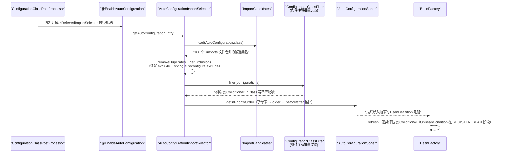

### 输入/输出表：自动配置管线

| 环节 | 输入 | 输出 |
|---|---|---|
| `ImportCandidates.load` | classpath 上 100 个 `.imports` 文件 | 候选类全名字符串列表（保序） |
| `getExclusions` | 注解属性 + `spring.autoconfigure.exclude` + Replacements | 排除集合；无效排除抛异常 |
| `ConfigurationClassFilter.filter` | 候选数组 + `AutoConfigurationMetadata` | 剔除后的候选（不加载类） |
| `AutoConfigurationSorter` | 过滤后候选 + 元数据 | 满足 order/before/after 的最终顺序 |
| refresh 期 `@Conditional` 评估 | BeanDefinition + BeanFactory/Environment | `ConditionOutcome` → 注册或跳过（记入 ConditionEvaluationReport） |
| `ConfigurationPropertiesBindingPostProcessor` | Bean 实例 + `@ConfigurationProperties` | 绑定后的属性值（JSR-303 校验可选） |

### 第二讲小结：候选登记 → 五步漏斗 → 条件裁决 → 拓扑排序

**一句话定位**：自动配置 = "`.imports` 登记全部候选" + "`AutoConfigurationImportSelector` 五步漏斗（加载/去重/排除/过滤/排序）" + "条件注解在 refresh 期逐个裁决"；用户 Bean 永远先注册，自动配置只做"查漏补缺"（`@ConditionalOnMissingBean`）。

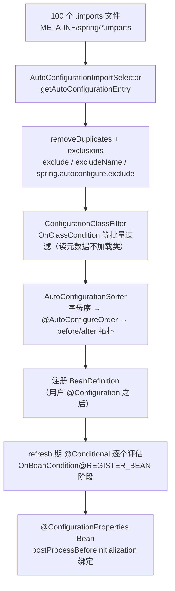

**自动配置各环节的输入/输出**：

| 环节 | 输入 | 输出 |
|---|---|---|
| `.imports` + `ImportCandidates` | 文件系统资源 | 候选类名列表（12 核心 + 88 技术模块） |
| `getExclusions` | 注解 + 属性 | 排除集；无效排除 → IllegalStateException |
| `ConfigurationClassFilter` | 候选 + metadata | 过滤后候选（并行两线程，不加载类） |
| `AutoConfigurationSorter` | 候选 + metadata | 最终导入顺序（环检测） |
| 条件注解（refresh 期） | BeanDefinition + 上下文 | 匹配/不匹配 + ConditionEvaluationReport |

**三个最值得记住的点**：

1. **双通道过滤**：`FilteringSpringBootCondition` 同时实现 `Condition` 与 `AutoConfigurationImportFilter`——导入前用 `spring-autoconfigure-metadata.properties` 对**类名数组**批量过滤（OnClassCondition 甚至对半开两个线程并行），导入后才对幸存者真正加载类求值；这保证几百个候选的过滤在毫秒级完成且不会因缺类炸启动；
2. **排序三步与环检测**：字母序打底（确定性）→ `@AutoConfigureOrder` → `@AutoConfigureBefore/After` 拓扑展开（递归补齐关系类、深度优先入队、遇环即抛）；全程只读 ASM 元数据，候选类不在 classpath 也能排；
3. **`REGISTER_BEAN` 阶段是 `@ConditionalOnMissingBean` 可靠性的根基**：`OnBeanCondition.getConfigurationPhase()` 锁死该阶段（L92–94），配合 `DeferredImportSelector.Group` 保证"用户配置先于自动配置注册"——于是"用户定义了 X，自动配置就退让"成为确定性命中而非竞态；同理，`spring.autoconfigure.exclude` 排一个不存在的类会直接报错，防止 silently 失效。

---

## 第三讲：内嵌 Web 容器 —— ServletWebServerApplicationContext 与 Tomcat

### 定位

Spring Boot 的"内嵌容器"不是新写的服务器，而是**把 Tomcat/Jetty/Undertow/Reactor Netty 当普通 Bean 装配进 Spring 容器**：`ServletWebServerApplicationContext.onRefresh()` 在 refresh 的特定阶段调用 `createWebServer()`，从容器里取出唯一的 `ServletWebServerFactory` Bean，由它把 `ServletContextInitializer`（DispatcherServlet、Filter 等）注册进 Tomcat Context。Boot 4 把这套代码从核心模块整体迁到了独立模块 `module/spring-boot-web-server`（包名 `org.springframework.boot.web.server`），Tomcat/Jetty 实现分别在 `module/spring-boot-tomcat`、`module/spring-boot-jetty`。

### 目录结构：Web 服务器模块族

```
module/spring-boot-web-server/src/main/java/org/springframework/boot/web/server/
├── WebServer.java                        ← start/stop/getPort/shutDownGracefully/destroy 接口
├── servlet/
│   ├── ServletWebServerFactory.java      ← 创建 WebServer 的工厂接口
│   ├── ConfigurableServletWebServerFactory.java
│   ├── ContextPath.java / Session.java / Jsp.java / Compression.java / Http2.java / Cookie.java
│   └── context/
│       ├── ServletWebServerApplicationContext.java   ← 核心：onRefresh → createWebServer（323 行）
│       └── WebServerGracefulShutdownLifecycle.java   ← SmartLifecycle 优雅停机（83 行）
├── reactive/AbstractReactiveWebServerFactory.java
│   └── context/ReactiveWebServerApplicationContext.java / WebServerManager.java
├── context/
│   ├── WebServerApplicationContext.java  ← GRACEFUL_SHUTDOWN_PHASE 等常量
│   ├── ServerPortInfoApplicationContextInitializer.java
│   └── MissingWebServerFactoryBeanException/FailureAnalyzer.java
├── autoconfigure/
│   ├── ServerProperties.java             ← server.* 属性载体
│   ├── ReactiveWebServerConfiguration.java
│   └── servlet/
│       ├── ServletWebServerConfiguration.java          ← 提供 factory customizer Bean
│       └── ServletWebServerFactoryCustomizer.java       ← ServerProperties → factory 的搬运工
├── GracefulShutdownCallback.java / GracefulShutdownResult.java
├── PortInUseException.java / PortInUseFailureAnalyzer.java
└── ...

module/spring-boot-tomcat/src/main/java/org/springframework/boot/tomcat/
├── TomcatWebServerFactory.java            ← createTomcat + customizeConnector（503 行）
├── TomcatWebServer.java                   ← initialize/start/stop/destroy（458 行）
├── GracefulShutdown.java                  ← Tomcat 优雅停机实现（134 行）
├── TomcatEmbeddedContext.java / TomcatEmbeddedWebappClassLoader.java
├── ConfigurableTomcatWebServerFactory.java / TomcatConnectorCustomizer.java / SslConnectorCustomizer.java
├── CompressionConnectorCustomizer.java / DisableReferenceClearingContextCustomizer.java
└── servlet/TomcatServletWebServerFactory.java  ← 面向 Servlet 栈的工厂（709 行）

module/spring-boot-jetty/...               ← JettyServletWebServerFactory + GracefulShutdown（对偶实现）
module/spring-boot-reactor-netty/...       ← NettyReactiveWebServerFactoryCustomizer + GracefulShutdown
module/spring-boot-undertertow 不存在      ← Boot 4 移除了 Undertow 支持
```

（Undertow 已从 Boot 4 移除：`settings.gradle` 的 module 列表中只有 `spring-boot-jetty`、`spring-boot-tomcat`、`spring-boot-reactor-netty`，无 undertow。）

### ServletWebServerApplicationContext：refresh 里的 createWebServer 钩子

`ServletWebServerApplicationContext`（`module/spring-boot-web-server/src/main/java/org/springframework/boot/web/server/servlet/context/ServletWebServerApplicationContext.java:95`）继承 `GenericWebApplicationContext`，重写三个关键方法：

```java
@Override
public final void refresh() {                    // L141-158
    try { super.refresh(); }
    catch (RuntimeException ex) {                // refresh 失败：已创建的 webServer 要 stop+destroy
        WebServer webServer = this.webServer;
        if (webServer != null) { try { webServer.stop(); webServer.destroy(); } catch (...) { ex.addSuppressed(...); } }
        throw ex;
    }
}

@Override
protected void onRefresh() {                     // L161-169
    super.onRefresh();
    try { createWebServer(); }
    catch (Throwable ex) { throw new ApplicationContextException("Unable to start web server", ex); }
}

private void createWebServer() {                 // L183-206
    WebServer webServer = this.webServer;
    ServletContext servletContext = getServletContext();
    if (webServer == null && servletContext == null) {
        StartupStep createWebServer = getApplicationStartup().start("spring.boot.webserver.create"); // L187
        ServletWebServerFactory factory = getWebServerFactory();          // L188
        createWebServer.tag("factory", factory.getClass().toString());    // L189
        webServer = factory.getWebServer(getSelfInitializer());           // L190 ← 容器诞生
        this.webServer = webServer;
        createWebServer.end();
        getBeanFactory().registerSingleton("webServerGracefulShutdown",
                new WebServerGracefulShutdownLifecycle(webServer));       // L193-194 优雅停机 lifecycle
        getBeanFactory().registerSingleton("webServerStartStop", new WebServerStartStopLifecycle(this, webServer)); // L195
    }
    else if (servletContext != null) { ... }      // L197-204：传统 WAR 部署，只跑 selfInitializer
    initPropertySources();                       // L205：把 servletContext 参数挂成 PropertySource
}
```

三个设计要点：

1. **onRefresh 时机**：`AbstractApplicationContext.refresh()` 的 `onRefresh()` 发生在 `invokeBeanFactoryPostProcessors` **之后**、`finishBeanFactoryInitialization` 之前——所以 `ServletWebServerFactory` 及其依赖（ServerProperties、SslBundles）已就绪，而 Servlet/Filter Bean 的实例化由随后 `getSelfInitializer()` 触发的 `onStartup` 完成；
2. **工厂唯一性**：`getWebServerFactory()`（L214–226）按 bean name 查 `ServletWebServerFactory` 类型：0 个抛 `MissingWebServerFactoryBeanException`（有专门 FailureAnalyzer，提示加 spring-boot-starter-web），>1 个抛 `ApplicationContextException`（防 Tomcat/Jetty 同时引入）；
3. **selfInitializer**（L234–236）：`new WebApplicationContextInitializer(this)::initialize`——把本 context 里所有 `ServletContextInitializer` Bean（`ServletRegistrationBean`/`FilterRegistrationBean`）收集起来在 Tomcat 启动时执行；`ServletWebServerApplicationContext` 类注释（L77–81）明确：**一旦定义了任何 `ServletContextInitializer` Bean，自动注册 Servlet/Filter Bean 的行为就关闭**（防双注册）。

### ServletWebServerFactory 与 Tomcat 实现链

`ServletWebServerFactory`（`servlet/ServletWebServerFactory.java:28`）只有一个方法：`WebServer getWebServer(ServletContextInitializer... initializers)`。Tomcat 侧实现链：

**`TomcatServletWebServerFactory.getWebServer`**（`module/spring-boot-tomcat/src/main/java/org/springframework/boot/tomcat/servlet/TomcatServletWebServerFactory.java:163–168`）：

```java
public WebServer getWebServer(ServletContextInitializer... initializers) {
    TempDirs tempDirs = new TempDirs(getPort());      // L164
    Tomcat tomcat = createTomcat(tempDirs);           // L165 ← 父类 TomcatWebServerFactory
    prepareContext(tomcat.getHost(), initializers, tempDirs); // L166 ← Context 装配
    return getTomcatWebServer(tomcat);                // L167
}
```

**`TomcatWebServerFactory.createTomcat`**（`module/spring-boot-tomcat/src/main/java/org/springframework/boot/tomcat/TomcatWebServerFactory.java:389–413`）：

```java
protected Tomcat createTomcat(TempDirs tempDirs) {
    if (this.isDisableMBeanRegistry()) { Registry.disableRegistry(); }   // L390-392 默认关 MBean
    Tomcat tomcat = new Tomcat();
    File baseDir = (getBaseDirectory() != null) ? getBaseDirectory() : tempDirs.createTempDir("tomcat").toFile(); // L394
    tomcat.setBaseDir(baseDir.getAbsolutePath());                        // L395
    ...
    Connector connector = new Connector(getProtocol());                 // L400 默认 Http11NioProtocol（L69）
    connector.setThrowOnFailure(true);                                  // L401
    tomcat.getService().addConnector(connector);                        // L402
    customizeConnector(connector);                                      // L403 ← 定制入口
    tomcat.setConnector(connector);                                     // L404
    registerConnectorExecutor(tomcat, connector);                       // L405
    tomcat.getHost().setAutoDeploy(false);                              // L406
    configureEngine(tomcat.getEngine());                                // L407
    for (Connector additionalConnector : this.getAdditionalConnectors()) { ... } // L408-411 额外连接器（SSL/AJP）
    return tomcat;
}
```

**`customizeConnector`**（L415–440）是"定制连接器"的总装线，顺序即语义：

```java
protected void customizeConnector(Connector connector) {
    int port = Math.max(getPort(), 0);                    // L416-417 端口（-1 → 0 随机）
    connector.setPort(port);
    if (StringUtils.hasText(getServerHeader())) { connector.setProperty("server", getServerHeader()); } // L418-420
    if (connector.getProtocolHandler() instanceof AbstractProtocol<?> abstractProtocol) { customizeProtocol(abstractProtocol); } // L421-423 绑定地址
    invokeProtocolHandlerCustomizers(connector.getProtocolHandler());    // L424 TomcatProtocolHandlerCustomizer
    if (getUriEncoding() != null) { connector.setURIEncoding(getUriEncoding().name()); } // L425-427 默认 UTF-8
    if (getHttp2() != null && getHttp2().isEnabled()) { connector.addUpgradeProtocol(new Http2Protocol()); } // L428-430
    Ssl ssl = getSsl();
    if (Ssl.isEnabled(ssl)) { customizeSsl(connector, ssl); }           // L431-434 SSL bundles 热更新
    TomcatConnectorCustomizer compression = new CompressionConnectorCustomizer(getCompression()); // L435-436
    compression.customize(connector);
    for (TomcatConnectorCustomizer customizer : this.getConnectorCustomizers()) { customizer.customize(connector); } // L437-439
}
```

**`prepareContext`**（`TomcatServletWebServerFactory.java:189–229`）装配 `TomcatEmbeddedContext`：docBase/资源根（L194–204）、`FixContextListener`（L205）、`TomcatEmbeddedWebappClassLoader` + `delegate=true`（L213–216，让容器优先父类加载器=应用类）、默认 Servlet 映射 `/`（L217–219）、TLD 扫描过滤（L262–267）、`configureContext`（L227，注册 `DeferredServletContainerInitializers` 把 ServletContextInitializer 们推迟到 context start 时执行，L312–319）与 `postProcessContext` 钩子（L228、L418–419 空实现）。

### TomcatWebServer：initialize 与 start 的两阶段分离

`TomcatWebServer`（`module/spring-boot-tomcat/src/main/java/org/springframework/boot/tomcat/TomcatWebServer.java:105–111`）构造即 `initialize()`：

```java
public TomcatWebServer(Tomcat tomcat, boolean autoStart, Shutdown shutdown) {
    this.gracefulShutdown = (shutdown == Shutdown.GRACEFUL) ? new GracefulShutdown(tomcat) : null; // L109
    initialize();                                                                                // L110
}

private void initialize() throws WebServerException {   // L113-153
    logger.info("Tomcat initialized with " + getPortsDescription(false));
    synchronized (this.monitor) {
        addInstanceIdToEngineName();                    // L117 多实例 engine 名去重
        Context context = findContext();
        context.addLifecycleListener((event) -> {       // L120-126
            if (context.equals(event.getSource()) && Lifecycle.START_EVENT.equals(event.getType())) {
                removeServiceConnectors();              // ← START_EVENT 时先把 connector 摘掉
            }
        });
        disableBindOnInit();                            // L128 所有 connector bindOnInit=false
        this.tomcat.start();                            // L131 启动 Tomcat：初始化但不绑端口
        rethrowDeferredStartupExceptions();             // L134 Servlet 启动失败在此抛出
        ...
        startNonDaemonAwaitThread();                    // L145 非守护 await 线程（保活）
    }
}
```

这段是 Boot 内嵌容器最精巧的设计：**`initialize` 阶段把 connector 的 `bindOnInit` 设为 false 并在 context START_EVENT 时临时摘除 connector**（L120–126、L181–190），于是 `tomcat.start()` 完成全部初始化（Servlet 实例化、Listener 回调）却**不监听端口**；真正的端口绑定推迟到 `start()`：

```java
@Override
public void start() throws WebServerException {          // L226-255
    synchronized (this.monitor) {
        if (this.started) { return; }
        try {
            addPreviouslyRemovedConnectors();            // L233 把摘掉的 connector 加回去
            Connector connector = this.tomcat.getConnector();
            if (connector != null && this.autoStart) { performDeferredLoadOnStartup(); } // L235-237
            checkThatConnectorsHaveStarted();            // L238 校验端口真的起来了
            this.started = true;
            logger.info(getStartedLogMessage());         // L240 "Tomcat started on port(s): 8080 (http)"
        }
        catch (ConnectorStartFailedException ex) { stopSilently(); throw ex; }
        catch (Exception ex) {
            PortInUseException.throwIfPortBindingException(ex, () -> this.tomcat.getConnector().getPort()); // L247 端口占用翻译
            throw new WebServerException("Unable to start embedded Tomcat server", ex);
        }
        ...
    }
}
```

为什么分离？因为 `initialize` 在 **context refresh 期间**执行，而 `start` 由 Spring 生命周期 `LifecycleProcessor` 在 `finishRefresh()` 触发（`WebServerStartStopLifecycle`，phase 默认）。好处：**refresh 全部成功（所有 Bean 就绪）之后才开放端口接收流量**——避免"端口先开、Bean 还没好"的半启动窗口；refresh 失败时 `ServletWebServerApplicationContext.refresh()` 的 catch（L141–158）还能干净地 stop+destroy 已初始化的服务器。

`getPort()`（L401–408）返回 `connector.getLocalPort()`——`server.port=0` 时这是 OS 分配的真实端口，`ServerPortInfoApplicationContextInitializer` 把它写回 `local.server.port` 属性，测试与多实例场景靠它发现实际端口。

停机链：`stop()`（L347–366）先 `gracefulShutdown.abort()`（终止等待中的优雅停机）、再 `removeServiceConnectors()`（摘掉连接器即停止接受新连接）；`destroy()`（L369–380）`stopTomcat()` + `tomcat.destroy()`。

### 优雅停机：GracefulShutdown 与 WebServerGracefulShutdownLifecycle

链路：JVM 关闭钩子（第一讲 `SpringApplicationShutdownHook`）→ `context.close()` → `doClose()` 发布 `ReadinessState.REFUSING_TRAFFIC`（`ServletWebServerApplicationContext.java:174`，先摘流量）→ `LifecycleProcessor.stop()` → `WebServerGracefulShutdownLifecycle.stop(Runnable)`（`WebServerGracefulShutdownLifecycle.java:63–66`，phase=`WebServerApplicationContext.GRACEFUL_SHUTDOWN_PHASE`，保证**先于** `WebServerStartStopLifecycle` 执行）→ `webServer.shutDownGracefully(callback)`（`WebServer.java:60–62` 默认立即 IMMEDIATE；Tomcat 覆写为真优雅，`TomcatWebServer.java:450–456`）→ `GracefulShutdown.shutDownGracefully`（`module/spring-boot-tomcat/src/main/java/org/springframework/boot/tomcat/GracefulShutdown.java:53–63`）：

```java
void shutDownGracefully(GracefulShutdownCallback callback) {
    logger.info("Commencing graceful shutdown. Waiting for active requests to complete");
    CountDownLatch shutdownUnderway = new CountDownLatch(1);
    new Thread(() -> doShutdown(callback, shutdownUnderway), "tomcat-shutdown").start(); // L56
    shutdownUnderway.await();                          // L58 等"停机已开始"信号（关连接器完成）
}
```

`doShutdown`（L65–83）三步：`close(connector)`——`connector.pause()` + `closeServerSocketGraceful()`（L93–96，**停止接受新连接但保留已建立连接**）；`awaitInactiveOrAborted()`（L98–111）每 50ms 轮询 context 的 `getInProgressAsyncCount()` 与 wrapper 的 `getCountAllocated()`（L113–128，在途请求数归零才算完成）；回调 `GracefulShutdownResult.IDLE` 或被 `stop()`  abort 后 `REQUESTS_ACTIVE`（L71–78）。开关：`server.shutdown=graceful`（默认 immediate），经 `ServletWebServerFactoryCustomizer` 的 `map.from(serverProperties::getShutdown).to(factory::setShutdown)` 生效。

### server.* 属性如何到达工厂

`ServletWebServerConfiguration`（`module/spring-boot-web-server/src/main/java/org/springframework/boot/web/server/autoconfigure/servlet/ServletWebServerConfiguration.java:62`，由 `module/spring-boot-web-server` 的 imports 登记）经 `@EnableConfigurationProperties(ServerProperties.class)` 注册属性 Bean，并提供 `ServletWebServerFactoryCustomizer`（L64–70）。`ServletWebServerFactoryCustomizer.customize`（L66–98）用 `PropertyMapper` 把 `ServerProperties` 逐项搬到工厂：

```java
map.from(this.serverProperties::getPort).to(factory::setPort);                          // server.port
map.from(this.serverProperties::getAddress).to(factory::setAddress);                    // server.address
map.from(this.serverProperties.getServlet()::getContextPath).to(factory::setContextPath); // server.servlet.context-path
map.from(this.serverProperties::getSsl).to(factory::setSsl);                            // server.ssl
map.from(this.serverProperties::getCompression).to(factory::setCompression);            // server.compression.*
map.from(this.serverProperties.getShutdown()).to(factory::setShutdown);                 // server.shutdown
...
```

`WebServerFactoryCustomizerBeanPostProcessor`（由 `BeanPostProcessorsRegistrar` L89–119 提前注册为 synthetic Bean）在工厂 Bean 创建后按序应用所有 customizer——这是"自定义 `TomcatServletWebServerFactory` Bean 即可完全接管，但 `server.*` 属性仍然生效"的机制。

### Reactive 侧简述

`ReactiveWebServerApplicationContext`（`module/spring-boot-web-server/src/main/java/org/springframework/boot/web/server/reactive/context/ReactiveWebServerApplicationContext.java`）结构对偶：`onRefresh` → `createWebServer`（L97–113）找唯一 `ReactiveWebServerFactory` Bean（L115–127，0 个抛 `MissingWebServerFactoryBeanException`）、包 `WebServerManager`（L105，支持 lazy init 与多 server）、注册同款 graceful shutdown lifecycle（L107–108）。默认实现 `NettyReactiveWebServerFactoryCustomizer` 在 `module/spring-boot-reactor-netty`（imports 登记 `NettyReactiveWebServerAutoConfiguration`），底层 Reactor Netty 的 `HttpServer`；WebFlux 的 `DispatcherHandler`（`HttpHandler` Bean，L138–151 同样要求唯一）经 `HttpHandlerAdapter` 接入。优雅停机由 `module/spring-boot-reactor-netty` 的 `GracefulShutdown` 实现（`disposeGracefully` 等 API 与 Tomcat 版本同构）。

### 端到端时序：从 refresh 到第一个请求

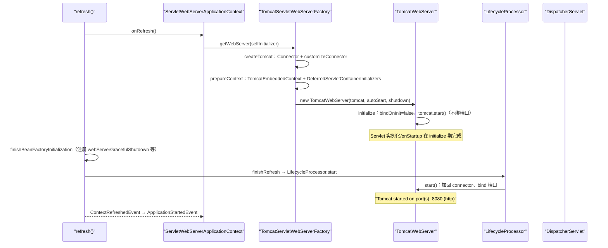

### 输入/输出表：Web 容器装配

| 环节 | 输入 | 输出 |
|---|---|---|
| `getWebServerFactory()` | BeanFactory | 唯一 `ServletWebServerFactory` Bean（0 个/多个都报错） |
| `createTomcat` | port/address/ssl/compression 配置 | 装配好的 `Tomcat` + 定制化 `Connector` |
| `prepareContext` | `ServletContextInitializer` 列表 | `TomcatEmbeddedContext`（docBase/classloader/TLD/错误页） |
| `TomcatWebServer.initialize` | Tomcat | 已初始化未绑端口的服务器 + 非守护 await 线程 |
| `start()` | initialize 后的服务器 | 绑定端口、`"Tomcat started on port(s)"` 日志 |
| `shutDownGracefully` | 在途请求 | `IDLE`（请求完成）/ `REQUESTS_ACTIVE`（被 abort） |

### 第三讲小结：refresh 到一半造容器，refresh 完了才绑端口

**一句话定位**：`ServletWebServerApplicationContext.onRefresh()` 在 refresh 中段从容器取出唯一 `ServletWebServerFactory` 造出 `TomcatWebServer`（initialize：初始化但不绑端口），`finishRefresh` 时 `LifecycleProcessor` 才调 `start()` 真正 bind——"Bean 全就绪才开放流量"，优雅停机则由 `GRACEFUL_SHUTDOWN_PHASE` 相位的 SmartLifecycle 倒序执行。

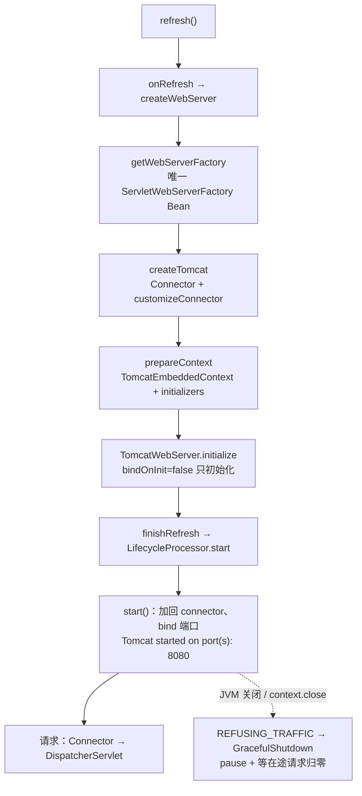

**Web 容器装配各环节的输入/输出**：

| 环节 | 输入 | 输出 |
|---|---|---|
| `createWebServer` | selfInitializer + BeanFactory | WebServer + 两个 lifecycle singleton |
| `customizeConnector` | port/ssl/http2/compression 配置 | 定制化 Connector |
| `initialize` | Tomcat | 未绑端口的运行态（Servlet 已初始化） |
| `start` | initialize 后的服务器 | 端口绑定 + 启动日志 |
| `shutDownGracefully` | 在途请求 | IDLE / REQUESTS_ACTIVE |

**三个最值得记住的点**：

1. **两阶段分离（initialize/start）是"零半启动窗口"的关键**：`disableBindOnInit` + START_EVENT 时摘除 connector（`TomcatWebServer.java:120–126、181–190`）让 `tomcat.start()` 只初始化不监听；`start()` 被 `LifecycleProcessor` 推迟到 `finishRefresh` 之后——refresh 失败还能在 catch 里干净销毁（`ServletWebServerApplicationContext.java:141–158`）；`server.port=0` 靠 `getLocalPort()` 回填真实端口；
2. **工厂 Bean 唯一性 + FailureAnalyzer 是排障第一现场**：0 个 factory → `MissingWebServerFactoryBeanException`（提示补 starter），多个 → 明确报出 bean 名（Tomcat/Jetty 冲突）；端口占用被翻译成 `PortInUseException`（`TomcatWebServer.java:247`）；
3. **优雅停机三段式**：`doClose` 先发 `REFUSING_TRAFFIC`（L174 摘流量）→ `WebServerGracefulShutdownLifecycle`（专用 phase，早于 stop lifecycle）→ `GracefulShutdown` pause 连接器 + 50ms 轮询在途请求（`getInProgressAsyncCount`/`getCountAllocated`），超时可被 `stop()` abort；`server.shutdown=graceful` 只是换了个枚举，链路本身内建。

---

## 第四讲：外部化配置与 Environment —— ConfigData 与 Binder

### 定位

外部化配置解决"同一份代码在不同环境跑不同行为"。Spring Boot 的答案是两级：**Environment 层**把所有来源（命令行/环境变量/`application.yml`/SPRING_APPLICATION_JSON…）统一成有序的 `PropertySource` 链，由 `ConfigDataEnvironmentPostProcessor` 负责把文件类配置（ConfigData）装进链尾；**Binder 层**把 `Environment` 适配成 `ConfigurationPropertySource` 集合，提供松弛绑定、占位符解析与类型转换，最终灌进 `@ConfigurationProperties` Bean。本讲路径相对仓库根，核心在 `core/spring-boot/src/main/java/org/springframework/boot/env/` 与 `core/spring-boot/src/main/java/org/springframework/boot/context/config/`。

### 目录结构：配置处理的家底

```
core/spring-boot/src/main/java/org/springframework/boot/
├── ApplicationEnvironment.java            ← 默认 StandardEnvironment（48 行）
├── env/
│   ├── EnvironmentPostProcessor.java      ← SPI：postProcessEnvironment(environment, application)
│   ├── PropertySourceLoader.java          ← SPI：加载 .properties/.yaml 等
│   ├── PropertiesPropertySourceLoader.java / YamlPropertySourceLoader.java
│   ├── OriginTrackedMapPropertySource.java ← 带 Origin 追踪的 Map PropertySource
│   ├── OriginTrackedPropertiesLoader.java / OriginTrackedYamlLoader.java
│   ├── RandomValuePropertySource.java     ← random.* 属性
│   ├── DefaultPropertiesPropertySource.java ← setDefaultProperties 的载体（永远垫底）
│   └── ConfigTreePropertySource.java      ← spring.config.import=configtree: 支持
├── support/
│   ├── EnvironmentPostProcessorApplicationListener.java ← 在 environmentPrepared 事件触发所有 EPP
│   ├── RandomValuePropertySourceEnvironmentPostProcessor.java
│   ├── SpringApplicationJsonEnvironmentPostProcessor.java  ← SPRING_APPLICATION_JSON
│   └── SystemEnvironmentPropertySourceEnvironmentPostProcessor.java
├── context/config/                        ← ConfigData 引擎（43 个文件）
│   ├── ConfigDataEnvironmentPostProcessor.java ← 入口 EnvironmentPostProcessor（173 行）
│   ├── ConfigDataEnvironment.java         ← 位置解析 + profile 激活 + 应用（416 行）
│   ├── ConfigDataEnvironmentContributors.java ← 贡献者集合与导入处理
│   ├── ConfigDataImporter.java            ← 驱动 resolve → load 循环
│   ├── ConfigDataLocation.java            ← 位置（optional: 前缀、profile 占位）
│   ├── ConfigDataLocationResolver.java / ConfigDataLocationResolvers.java
│   ├── StandardConfigDataLocationResolver.java ← application[-profile].{properties,yaml} 解析
│   ├── ConfigDataLoader.java / ConfigDataLoaders.java
│   ├── StandardConfigDataLoader.java      ← 用 PropertySourceLoader 读资源
│   ├── Profiles.java                      ← active/default/group/include 计算
│   ├── ConfigDataActivationContext.java   ← 当前激活 profile 上下文
│   ├── ConfigDataEnvironmentUpdateListener.java
│   └── ConfigDataNotFoundAction/FailureAnalyzer.java
└── context/properties/
    ├── bind/Binder.java                   ← 绑定引擎（700 行，第二讲已述）
    ├── bind/PropertySourcesPlaceholdersResolver.java ← ${...} 占位符解析（86 行）
    └── source/ConfigurationPropertyName.java ← 松弛绑定规范名（1144 行）
```

### Environment 的加载触发链

`SpringApplication.prepareEnvironment` L356 调用 `listeners.environmentPrepared(...)` → `EventPublishingRunListener` 发 `ApplicationEnvironmentPreparedEvent` → `EnvironmentPostProcessorApplicationListener`（`support/EnvironmentPostProcessorApplicationListener.java:65`，`spring.factories` 注册，order=`HIGHEST_PRECEDENCE+10`，L72）响应：

```java
public boolean supportsEventType(Class<? extends ApplicationEvent> eventType) {   // L111-115
    return ApplicationEnvironmentPreparedEvent.class.isAssignableFrom(eventType)
        || ApplicationPreparedEvent.class.isAssignableFrom(eventType)
        || ApplicationFailedEvent.class.isAssignableFrom(eventType);
}
```

它从 `spring.factories` 的 `org.springframework.boot.EnvironmentPostProcessor` 段加载全部实现并按 order 排序执行。内置 5 个（`core/spring-boot/src/main/resources/META-INF/spring.factories`）：`CloudFoundryVcapEnvironmentPostProcessor`、**`ConfigDataEnvironmentPostProcessor`**、`RandomValuePropertySourceEnvironmentPostProcessor`、`SpringApplicationJsonEnvironmentPostProcessor`、`SystemEnvironmentPropertySourceEnvironmentPostProcessor`。`ConfigDataEnvironmentPostProcessor` 的 order 为 `Ordered.HIGHEST_PRECEDENCE + 10`（`ConfigDataEnvironmentPostProcessor.java:52`）——**最先跑**，保证后续 EPP 与 `spring.main.*` 绑定能看到 ConfigData 的产物。

### ConfigDataEnvironment：位置 → 加载 → 激活 → 应用

`ConfigDataEnvironmentPostProcessor.postProcessEnvironment`（L89–98）构造 `ConfigDataEnvironment` 并调 `processAndApply()`（`ConfigDataEnvironment.java:236–248`）：

```java
void processAndApply() {
    ConfigDataImporter importer = new ConfigDataImporter(this.logFactory, this.notFoundAction, this.resolvers, this.loaders); // L237
    registerBootstrapBinder(this.contributors, null, DENY_INACTIVE_BINDING);      // L239
    ConfigDataEnvironmentContributors contributors = processInitial(this.contributors, importer);  // L240 ①无 profile 处理初始导入
    ConfigDataActivationContext activationContext = createActivationContext(...); // L241-242 ②建激活上下文
    contributors = processWithoutProfiles(contributors, importer, activationContext); // L243 ③
    activationContext = withProfiles(contributors, activationContext);            // L244 ④推导 profiles
    contributors = processWithProfiles(contributors, importer, activationContext);// L245 ⑤带 profile 再处理
    applyToEnvironment(contributors, activationContext, importer.getLoadedLocations(), importer.getOptionalLocations()); // L246 ⑥应用
}
```

四步读法：

1. **位置从哪来**（`getInitialImportContributors` L201–207）：按 `spring.config.import`（L203，不注册独立位置、作为现有位置的附加导入）→ `spring.config.additional-location`（L204，追加在默认位置**之前**）→ `spring.config.location`（L205，**覆盖**默认位置）的优先级取；都没有则用 `DEFAULT_SEARCH_LOCATIONS`（L91–97）：`optional:classpath:/;optional:classpath:/config/` + `optional:file:./;optional:file:./config/;optional:file:./config/*/`。注意 L212–215 的**倒序注册**（`for (int i = locations.length - 1; i >= 0; i--)`）——后注册的贡献者优先级更高，配合最后的 addLast 语义实现"同名属性 file:./ 覆盖 classpath:/"。
2. **已有 PropertySource 也被包装成贡献者**（`createContributors` L166–189）：Environment 里既有的 property source（命令行参数、系统属性等）逐个包成 `ConfigDataEnvironmentContributor.ofExisting`（L178），唯独 `DefaultPropertiesPropertySource` 被揪出来最后包装（L183–187）——保证"默认属性永远垫底"在导入后依然成立。
3. **profile 激活两轮**（`withProfiles` L279–297）：先用无 profile 的贡献者建 `Profiles`（读 `spring.profiles.active`/`group`，`Profiles.java:62`+），再用激活后的 profile 集处理 profile 专属文件（`application-{profile}.yml`）。`getIncludedProfiles`（L299–321）还支持 `spring.profiles.include`（递归拉入），并对**未激活贡献者**里的 include 属性抛 `InactiveConfigDataAccessException`（L310–315，防止"休眠配置里写 include 悄悄改激活集合"）。
4. **应用**（`applyToEnvironment` L338–353）：

```java
checkForInvalidProperties(contributors);        // L341 非法属性名（如空元素）立即抛
checkMandatoryLocations(contributors, activationContext, loadedLocations, optionalLocations); // L342 mandatory 位置没找到 → notFoundAction（默认 FAIL）
MutablePropertySources propertySources = this.environment.getPropertySources();
applyContributor(contributors, activationContext, propertySources);  // L344
DefaultPropertiesPropertySource.moveToEnd(propertySources);          // L345 再次兜底
this.environment.setDefaultProfiles(...);                            // L349
this.environment.setActiveProfiles(...);                             // L351
```

`applyContributor`（L355–374）只应用 `Kind.BOUND_IMPORT` 且激活的贡献者，`propertySources.addLast(propertySource)`（L368）——**ConfigData 一律进链尾**（低于命令行参数、系统属性、环境变量，与官方优先级表一致）；profile 未激活的属性源整条跳过（L361–364）。

### ConfigDataLoader 与 LocationResolver：文件如何变成 PropertySource

`StandardConfigDataLocationResolver`（`context/config/StandardConfigDataLocationResolver.java:59`）：

- `CONFIG_NAME_PROPERTY = "spring.config.name"`，默认 `{"application"}`（L65–67，可多名字：`spring.config.name=app,myapp`）；
- `resolve`（L118–147）区分目录与文件：目录展开为 `getReferencesForDirectory`（L191–199，对每个 configName × 每个 loader 的每个扩展名生成引用），`getReferencesForConfigName`（L201–214）用 `addFirst` 倒序插入——loaders 顺序是 `[Properties, Yaml]`（spring.factories），最终 deque 头是 yaml、尾是 properties，**properties 后被应用故优先级更高**（官方文档："同一位置 .properties 优先于 YAML"，`documentation/spring-boot-docs/src/docs/antora/modules/reference/pages/features/external-config.adoc:42`）；
- `resolveProfileSpecific`（L145–148）为每个激活 profile 生成 `application-{profile}` 引用。

`StandardConfigDataLoader.load`（`context/config/StandardConfigDataLoader.java:41–54`）：把 resource 包成 `OriginTrackedResource`（带 `Origin`：来自哪个 location），委托 `PropertySourceLoader`（`PropertiesPropertySourceLoader`/`YamlPropertySourceLoader`）解析成 `OriginTrackedMapPropertySource` 列表（YAML 多文档会产生多个），按 `resource.getProfile() != null` 打上 `PROFILE_SPECIFIC` 选项标记（供后续 IGNORE_PROFILES 等逻辑使用）。

### 配置属性来源优先级：官方清单 + 代码印证

官方顺序（`documentation/spring-boot-docs/src/docs/antora/modules/reference/pages/features/external-config.adoc:13–32`，"Later property sources can override the values defined in earlier ones"）：

| # | 来源 | 代码印证 |
|---|---|---|
| 1 | Default properties（`setDefaultProperties`） | `DefaultPropertiesPropertySource`，`ConfigDataEnvironment.java:183–187` 最后包装 + L345 moveToEnd |
| 2 | `@PropertySource` 注解 | refresh 期由 `ConfigurationClassPostProcessor` 加入，故晚于 ConfigData；`PropertySourceOrderingBeanFactoryPostProcessor`（`SpringApplication.java:1594–1612`）负责把默认属性压到尾端 |
| 3 | **Config data（`application.properties`/yaml）** | `applyContributor` addLast（`ConfigDataEnvironment.java:368`） |
| 4 | `RandomValuePropertySource`（`random.*`） | `RandomValuePropertySourceEnvironmentPostProcessor` |
| 5 | OS 环境变量 | `SystemEnvironmentPropertySourceEnvironmentPostProcessor`（`SystemEnvironmentPropertySource` 由 Spring 提供，做 `_`→`.`/大写转换） |
| 6 | Java System properties | Spring `StandardEnvironment` 系统属性源 |
| 7–9 | JNDI / ServletContext / ServletConfig 参数 | Spring web 环境标准源 |
| 10 | `SPRING_APPLICATION_JSON` | `SpringApplicationJsonEnvironmentPostProcessor` |
| 11 | **命令行参数** | `SimpleCommandLinePropertySource` **addFirst**（`SpringApplication.java:529`） |
| 12–13 | 测试 `properties`/`DynamicPropertySource`/`TestPropertySource` | 测试框架源 |
| 14 | Devtools 全局设置 | devtools 模块 |

一个反直觉但重要的结论：**`@PropertySource` 加的属性源优先级低于 `application.yml`**（因为前者 refresh 才加入、后者 addLast 在前——后加入者优先级高）。想让 `@PropertySource` 赢，需要它 addFirst 或改用 ConfigData import。

### Profiles：激活/默认/分组三级

`Profiles`（`context/config/Profiles.java:53`）构造时计算：

- `spring.profiles.group.{name}=a,b`（L62–63）：profile 组，激活组名等价于激活其成员；
- active profiles：先看 `environment.getProperty("spring.profiles.active")` 与 `environment.getActiveProfiles()`（L100+ 的 `getProfiles`），再 binder 绑定配置文件里的值；`expandProfiles` 展开组；
- default profiles：无 active 时用 `spring.profiles.default`，再兜底 `{"default"}`；
- `additionalProfiles`（`SpringApplication.setAdditionalProfiles`/`Augmented.withAdditionalProfiles`）合并进 active（`ConfigDataEnvironment.java:286–288`）。

激活结果经 `ConfigDataEnvironment.applyToEnvironment` L349–351 写回 Environment。注意 profile 的判定**只认 `spring.profiles.active`**，`spring.profiles.default`/`include`/`group` 是派生量。

### PropertySourcesPlaceholdersResolver 与 Binder 收口

`PropertySourcesPlaceholdersResolver`（`context/properties/bind/PropertySourcesPlaceholdersResolver.java:36`）用 Spring 的 `PropertyPlaceholderHelper`（L53–56，前缀 `${`、后缀 `}`、值分隔符 `:`、转义 `\`、ignoreUnresolvablePlaceholders=true）逐源查找替换（L60–77）——**Binder 的每个值在绑定时都会过一遍占位符解析**，所以 `url: http://${host}:${port}/api` 这类组合值能正确组装。`ConfigurationPropertiesBinder.getBinder()`（`ConfigurationPropertiesBinder.java:185–193`）把它连同 `ConfigurationPropertySources.from(propertySources)`（L195–197）与转换服务一起装进 Binder——属性绑定的完整闭环：**松弛名匹配 → 占位符解析 → 类型转换（ConversionService）→ setter/构造器注入 → JSR-303 校验**。

### 端到端演算②：一个 @ConfigurationProperties 从 application.yml 到 Bean

设 `application.yml`（classpath 根）：

```yaml
acme:
  greeting: "Hello, ${user.name:World}"
  retry:
    max-attempts: 3
    backoff: 2s
```

与配置类：

```java
@ConfigurationProperties(prefix = "acme")
public class AcmeProperties {
    private String greeting;
    private final Retry retry = new Retry();
    public static class Retry {
        private int maxAttempts;
        private Duration backoff;
        // getters/setters 省略
    }
}
```

取值链路逐步：

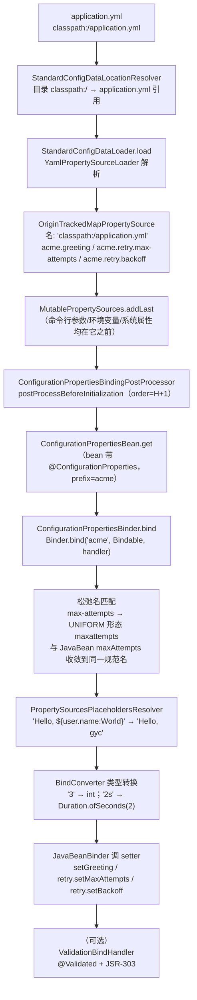

逐步对照源码：

1. **文件 → PropertySource**：refresh 前 `environmentPrepared` 事件触发 `ConfigDataEnvironmentPostProcessor`（`ConfigDataEnvironmentPostProcessor.java:89–98`）；默认位置 `optional:classpath:/` 被 `StandardConfigDataLocationResolver` 展开为 `application.properties`/`application.yml` 引用（L191–214），`StandardConfigDataLoader` 用 `YamlPropertySourceLoader` 读出扁平化 map（`StandardConfigDataLoader.java:47–49`），包上 Origin（位置 + 行号）后 `addLast` 进 Environment（`ConfigDataEnvironment.java:368`）；
2. **Bean 识别**：`AcmeProperties` 若由 `@EnableConfigurationProperties(AcmeProperties.class)` 或 `@ConfigurationPropertiesScan` 注册，refresh 实例化时 `ConfigurationPropertiesBindingPostProcessor.postProcessBeforeInitialization`（L82–87）命中；
3. **绑定目标**：`ConfigurationPropertiesBean.get` 从 BeanDefinition/注解提取 prefix="acme"，`ConfigurationPropertiesBinder.bind`（`ConfigurationPropertiesBinder.java:92–97`）构造 Bindable（JavaBean 模式）与 handler 链；
4. **松弛匹配**：`acme.retry.max-attempts` 与 JavaBean 属性 `maxAttempts` 各自转成 `ConfigurationPropertyName`，element 统一到 UNIFORM 形态（`ConfigurationPropertyName.java:184–186`）后比较，命中；
5. **占位符**：greeting 值里的 `${user.name:World}` 由 `PropertySourcesPlaceholdersResolver` 在 bindProperty 时解析（L60–65），`user.name` 取自系统属性、缺省 "World"；
6. **转换**：`max-attempts` 的 "3" → int、`backoff` 的 "2s" → `Duration`（`BindConverter` + `ApplicationConversionService`，Binder 构造 L212）；
7. **写入**：`JavaBeanBinder` 调 setter（`retry` 字段已预初始化，嵌套对象递归绑定）；`ignoreUnknownFields` 默认 true——yml 里多写的键静默忽略，设 false 则抛 `UnboundConfigurationPropertiesException`。

一句话：**yml 只是 Environment 链尾的一个 OriginTrackedMapPropertySource；绑定 = 松弛名匹配 + 占位符解析 + 类型转换 + setter 注入，全部发生在 Bean 初始化前的一个 BeanPostProcessor 里**。

### 输入/输出表：配置管线

| 环节 | 输入 | 输出 |
|---|---|---|
| `EnvironmentPostProcessorApplicationListener` | `ApplicationEnvironmentPreparedEvent` | 按 order 执行 5 个 EPP |
| `ConfigDataEnvironment.processAndApply` | locations + profiles 属性 | 导入并应用所有 ConfigData |
| `StandardConfigDataLocationResolver` | `classpath:/` 等位置 + configName | `application[-profile].{properties,yaml}` 引用列表 |
| `StandardConfigDataLoader` | 资源 + Origin | `OriginTrackedMapPropertySource` 列表 |
| `applyContributor` | 激活的贡献者 | addLast 进 `MutablePropertySources` |
| `Profiles` | `spring.profiles.*` 属性 | active/default 集合（组展开、include 递归） |
| `Binder.bind` | prefix + Bindable + sources | 绑定后的对象（松弛名 + 占位符 + 转换） |

### 第四讲小结：ConfigData 进链尾，Binder 做收敛，profile 两轮激活

**一句话定位**：`ConfigDataEnvironmentPostProcessor` 以 `HIGHEST_PRECEDENCE+10` 的 order 最先跑，把 `spring.config.import/additional-location/location`（默认 `classpath:/`、`file:./` 等）解析出的 `application[-profile].{properties,yaml}` 全部 `addLast` 进 Environment 链尾，profile 经"无 profile 一轮 + 有 profile 一轮"两轮处理激活；随后 Binder 以松弛名匹配 + 占位符解析 + 类型转换，把前缀命中的值灌进 `@ConfigurationProperties` Bean。

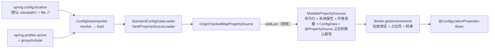

**配置管线各环节的输入/输出**：

| 环节 | 输入 | 输出 |
|---|---|---|
| 位置解析 | `spring.config.*` 属性 | location 列表（import 附加 / additional 前置 / location 覆盖） |
| 文件加载 | location + configName + profile | `OriginTrackedMapPropertySource`（.properties 优先于 .yaml） |
| profile 处理 | `spring.profiles.*` | active/default 集合；`application-{profile}` 文件条件应用 |
| 应用 | 激活贡献者 | addLast 进链 + setActiveProfiles 回写 |
| 绑定 | prefix + Environment | Bean 属性值（松弛名/占位符/转换/校验） |

**三个最值得记住的点**：

1. **优先级不是玄学是代码**：命令行 `SimpleCommandLinePropertySource` addFirst（`SpringApplication.java:529`）永远最高；ConfigData addLast（`ConfigDataEnvironment.java:368`）永远垫底（在默认属性之上、`@PropertySource` 之下）；`DefaultPropertiesPropertySource` 被三处 moveToEnd 反复压底（`ConfigDataEnvironment.java:345`、`SpringApplication.java:358`、`PropertySourceOrderingBeanFactoryPostProcessor`）——"后来者居上"的链式语义全靠 addFirst/addLast 的顺序工程；
2. **profile 两轮处理 + 休眠保护**：先无 profile 处理（拿到激活所需的 `spring.profiles.*`），再带 profile 处理 `application-{profile}` 文件；未激活贡献者里的 `spring.profiles.include` 会抛 `InactiveConfigDataAccessException`（`ConfigDataEnvironment.java:310–315`）——防止休眠配置悄悄改激活集合；同位置 `.properties` 因 addFirst 倒序（`StandardConfigDataLocationResolver.java:210–214`）而优先于 YAML；
3. **Binder 是"配置的最终收敛点"**：松弛绑定收敛三种命名（`max-attempts`/`MAX_ATTEMPTS`/`maxAttempts` → UNIFORM `maxattempts`，`ConfigurationPropertyName.java:184–186`）；`PropertySourcesPlaceholdersResolver` 在绑定时解析 `${...}`（默认值用 `:`）；`ignoreUnknownFields` 默认 true 静默忽略未知键，设 false 立即暴露拼写错误——排障时先看 Origin（`OriginTrackedMapPropertySource` 记录每个值的文件和行号）。

---

## 第五讲：starter 与构建生态 —— 约定、repackage 与 loader

### 定位

前三讲讲"运行时的 Spring Boot"，本讲讲"出厂前的 Spring Boot"：starter 如何用**依赖约定**替代显式配置（引入一个 jar = 引入一组坐标 + 自动配置候选）、`spring-boot-maven-plugin` 如何把普通 jar **重打包**成可执行 jar、loader 如何在 `java -jar` 时用自定义 ClassLoader 从嵌套 jar 里加载类，最后以 Boot 4 的模块化新特性收尾。

### 目录结构：构建生态模块

```
starter/                                  ← 130+ 个 starter（只聚合依赖，几乎无代码）
├── spring-boot-starter/build.gradle     ← 核心 starter：logging + autoconfigure + yaml
├── spring-boot-starter-web/build.gradle ← 聚合 webmvc + tomcat（Boot 4 已标记 deprecated）
├── spring-boot-starter-webmvc/build.gradle
├── spring-boot-starter-tomcat/build.gradle          ← 编译期依赖（spring-boot-tomcat 模块）
├── spring-boot-starter-tomcat-runtime/build.gradle  ← 运行期依赖（tomcat-embed-*，transitive=false）
├── spring-boot-starter-test/build.gradle
└── ...
loader/
├── spring-boot-loader/                  ← 运行时：JarLauncher / LaunchedClassLoader / jar 协议
│   └── src/main/java/org/springframework/boot/loader/
│       ├── launch/JarLauncher.java      ← java -jar 的 Main-Class（43 行）
│       ├── launch/Launcher.java        ← launch 骨架：classpath 装配 + main 反射调用
│       ├── launch/LaunchedClassLoader.java ← 嵌套 jar 的自定义 ClassLoader
│       ├── launch/WarLauncher.java / PropertiesLauncher.java / JarModeRunner.java
│       └── net/protocol/Handlers.java  ← jar:nested: 协议处理器注册
└── spring-boot-loader-tools/            ← 构建时：Repackager / JarWriter / Layouts
    └── src/main/java/org/springframework/boot/loader/tools/
        ├── Repackager.java              ← repackage 入口（160 行）
        ├── Packager.java                ← write 流程（manifest + loader classes + libs）
        ├── AbstractJarWriter.java / JarWriter.java / EntryWriter.java
        ├── Layouts.java / LayoutFactory.java ← Jar/War/Expanded 布局
        └── Library / Libraries / Layer(s) / ImplicitLayerResolver.java
build-plugin/spring-boot-maven-plugin/   ← Maven 插件
└── src/main/java/org/springframework/boot/maven/
    ├── RepackageMojo.java               ← repackage goal（254 行）
    ├── AbstractPackagerMojo.java        ← 与 Gradle 共享的打包基座
    ├── BuildImageMojo.java / RunMojo.java / StartMojo.java / StopMojo.java / BuildInfoMojo.java
    └── ...
module/spring-boot-actuator/             ← 运行时监控（endpoint 基础设施）
module/spring-boot-actuator-autoconfigure/ ← actuator 自动配置
platform/spring-boot-dependencies/       ← BOM：统一管理第三方版本
```

### starter 组成约定：只聚合，不实现

starter 的约定是：**一个 starter jar 里通常没有任何代码**，它的全部内容就是一份构建脚本里的依赖声明。以核心 starter 为例（`starter/spring-boot-starter/build.gradle`）：

```groovy
plugins { id "org.springframework.boot.starter" }
description = "Core starter, including auto-configuration support, logging and YAML"
dependencies {
    api(project(":starter:spring-boot-starter-logging"))
    api(project(":core:spring-boot-autoconfigure"))
    api("jakarta.annotation:jakarta.annotation-api")
    api("org.yaml:snakeyaml")
}
```

即：`spring-boot-starter` = 日志（logback 默认）+ **autoconfigure 模块**（携带全部 `.imports` 候选）+ yaml 解析器。用户 `引入 spring-boot-starter` 的瞬间，classpath 上就有了全部自动配置候选——**"约定优于配置"的物理基础就是依赖传递**。

技术 starter 同样是纯聚合（`starter/spring-boot-starter-tomcat/build.gradle`）：

```groovy
dependencies {
    api(project(":starter:spring-boot-starter"))
    api(project(":starter:spring-boot-starter-tomcat-runtime"))
    api(project(":module:spring-boot-tomcat"))   // 编译期：TomcatServletWebServerFactory 所在
}
```

**Boot 4 的新约定——compile/runtime 拆分**：`spring-boot-starter-tomcat-runtime` 只带运行期必需的 tomcat-embed 坐标且显式 `transitive = false`（`starter/spring-boot-starter-tomcat-runtime/build.gradle`）：

```groovy
api(project(":module:spring-boot-tomcat")) { transitive = false }
api(project(":module:spring-boot-web-server")) { transitive = false }
api("org.apache.tomcat.embed:tomcat-embed-core") { exclude group: "org.apache.tomcat", module: "tomcat-annotations-api" }
api("org.apache.tomcat.embed:tomcat-embed-el")
api("org.apache.tomcat.embed:tomcat-embed-websocket") { ... }
```

好处：业务代码编译期只依赖 Boot API（`spring-boot-tomcat` 的编译期制品），运行期才拉进完整嵌入式 Tomcat；想换 Jetty 只需把 `spring-boot-starter-tomcat-runtime` 换成 `spring-boot-starter-jetty-runtime`，编译期代码零改动。同期的另一信号：`spring-boot-starter-web` 已标记 deprecated（描述字段明示 "deprecated in favor of spring-boot-starter-webmvc"），官方推荐直接依赖 `spring-boot-starter-webmvc`/`spring-boot-starter-webflux`。

### spring-boot-maven-plugin repackage：原理是"重写 jar 结构 + 换 Main-Class"

`RepackageMojo`（`build-plugin/spring-boot-maven-plugin/src/main/java/org/springframework/boot/maven/RepackageMojo.java:58`）绑定 `package` 阶段（L55–57，`requiresDependencyResolution = COMPILE_PLUS_RUNTIME`）：

```java
@Override
public void execute() throws MojoExecutionException, MojoFailureException {   // L174-185
    if (this.project.getPackaging().equals("pom")) { return; }
    if (this.skip) { return; }
    repackage();
}

private void repackage() throws MojoExecutionException {                       // L187-203
    Artifact source = getSourceArtifact(this.classifier);
    File target = getTargetFile(this.finalName, this.classifier, this.outputDirectory);
    ...
    Repackager repackager = getRepackager(source.getFile());                   // L194
    Libraries libraries = getLibraries(this.requiresUnpack);                  // L195
    try { repackager.repackage(target, libraries, parseOutputTimestamp()); }   // L197
    catch (IOException ex) { throw new MojoExecutionException(ex.getMessage(), ex); }
    updateArtifact(source, target, repackager.getBackupFile());               // L202 原 jar 改名 .original
}
```

核心在 `Repackager.repackage`（`loader/spring-boot-loader-tools/src/main/java/org/springframework/boot/loader/tools/Repackager.java:110–138`）：原 jar 备份为 `*.jar.original`，以新 `JarWriter` 写出目标 jar；`Packager.write`（`Packager.java:196–206`）决定写什么：

```java
private void write(JarFile sourceJar, AbstractJarWriter writer, PackagedLibraries libraries) throws IOException {
    if (isLayered()) { writer.useLayers(this.layers, this.layersIndex); }
    writer.writeManifest(buildManifest(sourceJar));        // ① 新 MANIFEST：Main-Class=JarLauncher、Start-Class=原主类
    writeLoaderClasses(writer);                            // ② loader 自身的类（JarLauncher 等）
    writer.writeEntries(sourceJar, getEntityTransformer(), ...); // ③ 原 jar 内容 → BOOT-INF/classes/
    Map<String, Library> writtenLibraries = libraries.write(writer); // ④ 每个依赖 jar → BOOT-INF/lib/
    writeNativeImageArgFile(writer, sourceJar, writtenLibraries);   // ⑤ （可选）native 参数文件
    if (isLayered()) { writeLayerIndex(writer); }          // ⑥ （可选）layers.idx
    writeSignatureFileIfNecessary(writtenLibraries, writer);        // ⑦ 签名 jar 去除旧签名
}
```

产物结构（`Layouts.Jar`，`loader/spring-boot-loader-tools/src/main/java/org/springframework/boot/loader/tools/Layouts.java:66–80`）：

```
app.jar
├── META-INF/
│   ├── MANIFEST.MF          ← Main-Class: org.springframework.boot.loader.launch.JarLauncher
│   │                           Start-Class: com.example.MyApplication
│   │                           Spring-Boot-Version: 4.1.1
│   └── ...（loader 类不在这里，在根包路径）
├── org/springframework/boot/loader/...   ← loader 运行时类（JarLauncher、LaunchedClassLoader）
├── BOOT-INF/
│   ├── classes/             ← 原 jar 全部内容（应用的 .class 与资源）
│   └── lib/                 ← 每个依赖一个嵌套 jar（不拆开，靠自定义 ClassLoader 读）
└── ...（其他顶层条目按 layout 规则处理）
```

关键点：**依赖 jar 原样嵌套**（不解压），MANIFEST 的 `Main-Class` 被**换成 loader 的 `JarLauncher`**，原主类记到 `Start-Class`。`updateArtifact`（L223–236）默认把原 artifact 替换为重打包版、原文件改名 `.original`（attach 语义见 L238–252）。

### loader：java -jar 之后发生什么

`java -jar app.jar` → JVM 读 MANIFEST → `JarLauncher.main`（`loader/spring-boot-loader/src/main/java/org/springframework/boot/loader/launch/JarLauncher.java:39–41`）→ `Launcher.launch`（`loader/spring-boot-loader/src/main/java/org/springframework/boot/loader/launch/Launcher.java:56–69`）：

```java
protected void launch(String[] args) throws Exception {
    if (!isExploded()) { Handlers.register(); }                 // L58 注册 jar:nested: 等 URL 协议
    try {
        ClassLoader classLoader = createClassLoader(getClassPathUrls());  // L61 装配 classpath
        String jarMode = System.getProperty("jarmode");
        String mainClassName = hasLength(jarMode) ? JAR_MODE_RUNNER_CLASS_NAME : getMainClass(); // L62-63
        launch(classLoader, mainClassName, args);               // L64
    } catch (UncheckedIOException ex) { throw ex.getCause(); }
}
```

1. **协议注册**（L58）：`Handlers.register()` 装上 Boot 自研的 `jar` 协议处理器——之后 `jar:nested:/app.jar/BOOT-INF/lib/xxx.jar!/` 这类"jar 中的 jar"URL 可被 `URLConnection` 直接读取（`loader/net/protocol/`），无需解压；
2. **ClassLoader**（L81–88）：`new LaunchedClassLoader(isExploded(), getArchive(), urls, parent)`——classpath URL 来自 `getClassPathUrls()`（`JarFileArchive` 遍历，`isLibraryFileOrClassesDirectory` L183–189：`BOOT-INF/classes/` 与 `BOOT-INF/lib/*` 才入链，顺序即优先级）；
3. **main 反射调用**（L97–108）：设置 TCCL 为 LaunchedClassLoader，`Class.forName(mainClassName, false, classLoader)`——此时才**触发应用主类及其依赖的加载**（此前只有 loader 类被加载）；`getMainClass()` 从 MANIFEST 读 `Start-Class`（即用户的 `com.example.MyApplication`）；
4. 之后就是第一讲的 `SpringApplication.run` 全流程。

`java -Djarmode=tools -jar app.jar` 则把主类换成 `JarModeRunner`（L62–63），提供 `classpath`/`layertools` 等维护工具（`loader/spring-boot-jarmode-tools`）。

### actuator 简述

Boot 4 的 actuator 拆成两个模块：`module/spring-boot-actuator`（endpoint 基础设施）与 `module/spring-boot-actuator-autoconfigure`（自动配置，imports 登记 `EndpointAutoConfiguration`、`HealthEndpointAutoConfiguration` 等一批）。核心抽象在 `module/spring-boot-actuator/src/main/java/org/springframework/boot/actuate/endpoint/`：`ExposableEndpoint`/`Operation`（一个 endpoint 多个操作）、`EndpointId`（URL 段）、`Access`（READ/WRITE/NONE）+ `EndpointAccessResolver`（与 Spring Security 集成做权限）、`EndpointsSupplier`（收集）。技术模块再各自贡献端点（`module/spring-boot-tomcat` 的 `actuate/web/server/TomcatServletManagementContextAutoConfiguration` 支持独立管理端 child context）。引入 `spring-boot-starter-actuator` 即获得 `/actuator/health`、`/env`、`/beans`、`/conditions`（第二讲 ConditionEvaluationReport 的出口）、`/configprops` 等——排障三板斧全在这里。

### Boot 4 新特性速览（均有源码/文档印证）

1. **模块扁平化重构**：Boot 3 的 `spring-boot-project/*` 全部拆散为顶层 `core/`、`module/`（~110 个技术模块）、`starter/`、`loader/`、`build-plugin/`、`platform/`（见 `settings.gradle`）；`spring-boot-autoconfigure` 核心只剩 12 个候选，其余按技术栈下沉——"引什么starter才有什么自动配置"成为硬边界；
2. **Web 服务器独立**：`org.springframework.boot.web.server` 全族迁入 `module/spring-boot-web-server`；Undertow 支持移除（`settings.gradle` 无 undertow 模块）；
3. **WebApplicationType 推断 SPI 化**：`deduce()` 改走 `Deducer` SPI（`WebApplicationType.java:63–71`，`@since 4.0.1`），Reactive 判定由 webflux 模块提供，核心模块不再硬依赖 spring-web；
4. **starter compile/runtime 拆分**：`spring-boot-starter-tomcat-runtime` 等 `-runtime` starter 把容器依赖移到运行期（transitive=false），`spring-boot-starter-web`  deprecated → `webmvc`/`webflux`；
5. **CRaC 一等公民**：`Startup.create()` 自动检测 CRaC MXBean 切换"Restored"语义（`SpringApplication.java:1771–1776`），新增 `@ConditionalOnCheckpointRestore`；
6. **版本基线**：`gradle.properties`：`version=4.1.1`、`springFrameworkVersion=7.0.9`、`tomcatVersion=11.0.24`、`graalVersion=25`；系统要求"至少 Java 17、最高兼容 Java 26"（`documentation/spring-boot-docs/src/docs/antora/modules/ROOT/pages/system-requirements.adoc:4`）；native image 需 JDK 25（`SpringApplication.NativeImageRequirementsException` L1655–1673，`MINIMUM_REQUIRED_JAVA_VERSION = JavaVersion.TWENTY_FIVE`）；AOT Cache 需 Java 25+（`documentation/.../packaging/aot-cache.adoc:17`）；
7. **API 演进信号**：`prepareContext(Host, ServletContextInitializer[], TempDirs)` 取代旧签名（`@since 4.1.0`，旧方法标 `forRemoval since 4.1.0`，`TomcatServletWebServerFactory.java:174–180`）——4.x 仍在高速迭代，升级时注意 deprecation 警告。

### 端到端演算①：java -jar app.jar 到第一个 HTTP 请求可处理

把五讲串成一条完整时序（以 servlet Web 应用为例，`mvn package` 后 `java -jar target/app.jar --server.port=8080`）：

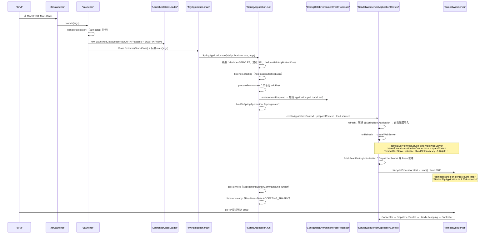

时序里的六个关键坐标（均在前文有行号）：**loader 阶段**（`Launcher.java:56–108`）→ **Environment 阶段**（`SpringApplication.java:350–368` + `ConfigDataEnvironment.java:236–248`）→ **自动配置阶段**（`AutoConfigurationImportSelector.java:142–155`）→ **容器初始化阶段**（`ServletWebServerApplicationContext.java:183–206` + `TomcatWebServer.java:113–153`）→ **端口绑定阶段**（`TomcatWebServer.java:226–255`）→ **Runner 与就绪阶段**（`SpringApplication.java:767–777、334–335`）。第一个请求可处理的准确时刻 = `start()` 完成（端口 bind）且 `callRunners` 结束——`ready` 事件就是"可接流量"的官方信号点。

### 输入/输出表：构建生态

| 环节 | 输入 | 输出 |
|---|---|---|
| starter 依赖聚合 | `spring-boot-starter-webmvc` 坐标 | classpath：autoconfigure + webmvc + tomcat(-runtime) |
| `RepackageMojo.execute` | 原 jar + 运行时依赖 | 可执行 jar（`.original` 备份） |
| `Packager.write` | 原 jar + Libraries | `BOOT-INF/classes` + `BOOT-INF/lib/*` + 新 MANIFEST |
| `JarLauncher/Launcher` | 可执行 jar + args | LaunchedClassLoader + 应用 main 被调用 |
| `LaunchedClassLoader` | `jar:nested:` URL | 嵌套 jar 内的类加载（不解压） |
| actuator starter | classpath 检测 | `/actuator/*` 端点（health/env/beans/conditions） |

### 第五讲小结：starter 管依赖约定，repackage 管结构，loader 管加载

**一句话定位**：starter 用"纯依赖聚合"实现约定优于配置（Boot 4 再把容器拆成 compile/runtime 两个 starter）；`spring-boot-maven-plugin` 的 repackage 把普通 jar 改写成 `BOOT-INF/classes` + `BOOT-INF/lib/*` 结构并把 MANIFEST 的 `Main-Class` 换成 `JarLauncher`；运行时 `Launcher` 注册 `jar:nested:` 协议、构造 `LaunchedClassLoader`，反射调用 `Start-Class`——嵌套 jar 不解压，靠自定义 ClassLoader 直接读。

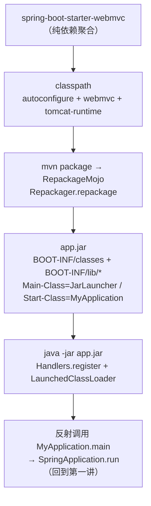

**构建生态各环节的输入/输出**：

| 环节 | 输入 | 输出 |
|---|---|---|
| starter | 一个坐标 | 一组传递依赖（含 autoconfigure 候选） |
| repackage | 普通 jar + 依赖 | 可执行 jar（原 jar → .original） |
| JarLauncher | 可执行 jar | LaunchedClassLoader + 应用 main 启动 |
| LaunchedClassLoader | `BOOT-INF/lib/*` 嵌套 jar | 按需加载的类（协议：`jar:nested:`） |

**三个最值得记住的点**：

1. **starter 零代码是特性不是偷懒**：约定全在构建脚本里（`starter/spring-boot-starter/build.gradle` 五行依赖），换容器 = 换 starter（Boot 4 的 `-runtime` 拆分让这件事连编译期都不受影响）；自动配置候选跟着 starter 走，classpath 即配置；
2. **repackage 只做三件事**：内容搬家（classes → `BOOT-INF/classes`、依赖 → `BOOT-INF/lib/`）、MANIFEST 改写（`Main-Class=JarLauncher`、`Start-Class`=原主类）、签名清理（`writeSignatureFileIfNecessary` 剔除旧签名文件防 SecurityException）——依赖 jar 原样嵌套不解压，这是"大应用启动也不慢"的结构前提；
3. **`java -jar` 的真实入口是 loader 而非你的 main**：`Handlers.register()` 装 `jar:nested:` 协议 → `LaunchedClassLoader` 以 `BOOT-INF/classes` + `BOOT-INF/lib/*` 为 classpath → 反射调 `Start-Class`；排查"嵌套 jar 里读资源/ClassNotFound"问题时，先怀疑 `LaunchedClassLoader` 的可见性与 `jar:nested:` 协议是否注册（ exploded 部署不走协议注册，`Launcher.java:57`）。

---

## 附：学习路线与复习卡汇总

### 推荐阅读顺序（由浅入深）

| 阶段 | 内容 | 建议时长 |
|---|---|---|
| 1 | 建立体感：用 `spring-boot-starter-webmvc` 写一个最小应用，加 `--debug` 跑一次看条件评估报告 | 半天 |
| 2 | 第一讲：`SpringApplication.java` 逐段精读（run 九步流水线 + 七个回调） | 2 天 |
| 3 | 第一讲余料：RunListener 家族、`spring.factories`、失败分析与退出码 | 半天 |
| 4 | 第四讲配置侧：`external-config.adoc` 官方优先级清单 + `ConfigDataEnvironmentPostProcessor` | 1–2 天 |
| 5 | 第二讲前半：`AutoConfiguration.imports` → `ImportCandidates` → `AutoConfigurationImportSelector` 五步漏斗 | 1–2 天 |
| 6 | 第二讲后半：`AutoConfigurationSorter` + 条件注解家族（含双通道设计） | 2 天 |
| 7 | 第二讲/第四讲交叉：`Binder` + `ConfigurationPropertyName` 松弛绑定原理 | 1 天 |
| 8 | 第四讲端到端演算②：亲手跟一遍 `application.yml` → `@ConfigurationProperties` Bean | 半天 |
| 9 | 第三讲前半：`ServletWebServerApplicationContext.createWebServer` 钩子 | 1 天 |
| 10 | 第三讲中段：Tomcat 实现链（Factory / WebServer / Connector + 两阶段分离） | 2 天 |
| 11 | 第三讲后段：优雅停机链路 + Reactive 侧对称结构 | 半天 |
| 12 | 第五讲：starter 约定 → repackage → loader 三件套 | 1–2 天 |
| 13 | 端到端演算①复盘（`java -jar` 到第一个请求）+ Boot 4 新特性印证 | 1 天 |

### 全链路复习卡

**启动流：**
1. `run` 九步流水线：`Startup.create` → `getRunListeners` → `prepareEnvironment` → `prepareContext` → `refreshContext` → `afterRefresh` → `callRunners` → `listeners.ready`；任一步异常都汇入 `handleRunFailure` 统一收口。
2. 七个回调是扩展的全部缝隙：`starting / environmentPrepared / contextPrepared / contextLoaded / started / ready / failed`，`EventPublishingRunListener` 负责把它们翻成 ApplicationEvent。
3. Web 类型推断看 classpath：Boot 4 改为 `WebApplicationType.Deducer` SPI（`@since 4.0.1`），WebFlux 侧由 `WebFluxWebApplicationTypeDeducer` 贡献。
4. 失败三件套：`handleRunFailure` → `FailureAnalyzer`（内置 18 个，输出 Description/Action 结构）→ `ExitCodeGenerators` 汇总退出码；`AbandonedRunException` 是静默放弃短路。
5. `Startup` 感知 CRaC：正常启动打 "Started"，检查点恢复打 "Restored"；native image 场景缺 JDK 25 会抛 `NativeImageRequirementsException`。

**配置流：**
6. `ConfigDataEnvironmentPostProcessor` 的 order 是 `HIGHEST_PRECEDENCE+10`，先于一切用户 EnvironmentPostProcessor 执行，保证后续的 `spring.main.*` 等绑定能看到文件配置。
7. 位置三通道：`spring.config.import`（显式导入）> `additional-location`（追加，默认位置仍生效）> `location`（整体替换默认）；默认为 `classpath:/` 与 `file:./`、`file:./config/`。
8. Profile 两轮激活：先按当前激活集加载 `application[-profile].{properties,yaml,yml}`，再处理 `spring.profiles.active/group/include` 触发第二轮。
9. 优先级三条铁律：命令行参数 `addFirst`（最前）、ConfigData 产物 `addLast`（链尾）、`DefaultPropertiesPropertySource` 三处 `moveToEnd`（永远垫底）。
10. 松弛绑定的本质是 `ConfigurationPropertyName` 的元素类型（UNIFORM/DASHED/NON_UNIFORM）+ UNIFORM 规范化：`server.port`、`SERVER_PORT`、`server-port` 收敛到同一规范名。
11. `@ConfigurationProperties` 装配链：`@EnableConfigurationProperties` → `EnableConfigurationPropertiesRegistrar` → `ConfigurationPropertiesBindingPostProcessor` → `ConfigurationPropertiesBinder` → `Binder`。
12. 占位符解析在绑定之前：`PropertySourcesPlaceholdersResolver` 负责 `${...}`，与 Binder 的类型转换接力完成；循环占位符快速失败，报错链带 Origin（来源文件 + 行号）。

**自动配置：**
13. 候选登记格式换代：Boot 4 用 `META-INF/spring/%s.imports`（`ImportCandidates` 读取），彻底告别 `spring.factories` 的 `EnableAutoConfiguration` 键。
14. `AutoConfigurationImportSelector` 五步漏斗：读候选 → 去重/排除过滤 → `FilteringSpringBootCondition` 双通道过滤 → `AutoConfigurationSorter` 排序 → 输出注册列表。
15. 双通道是保险丝：import 阶段的 `AutoConfigurationImportFilter` 与 refresh 阶段的 `@Condition` 结论必须一致，`OnClassCondition` 用线程池并行化类存在性检查。
16. 排序三段论：类名字母序打底 → `@AutoConfiguration` 的 `order/before/after` → 拓扑排序（检测到环直接抛异常，宁可启动失败）。
17. `OnBeanCondition` 的 REGISTER_BEAN 阶段只统计"将要注册"的 Bean 定义，自动配置之间不真正互相注入 Bean——这是顺序不敏感的根源；`@ConditionalOnBean` 写在用户代码里要警惕顺序。
18. 家底盘点：`AutoConfiguration.imports` 只有 12 个核心候选，全仓库 `.imports` 文件约 100 份——引入哪个 starter 决定你有哪些候选。

**Web 流：**
19. `createWebServer` 挂在 `onRefresh`：`getWebServerFactory` 要求容器内唯一的 `ServletWebServerFactory` Bean，多一个直接抛异常。
20. 两阶段分离是设计核心：`initialize`（`bindOnInit=false`，只建对象不绑端口）→ `START_EVENT` 之后 `LifecycleProcessor` 才调 `webServer.start()` 真正 bind——端口冲突报错发生在启动末端。
21. `customizeConnector` 是连接器配置收口点：协议、端口、SSL、HTTP2、`ConnectorCustomizer` 全在这里生效，源头是 `ServerProperties` 经 `ServletWebServerFactoryCustomizer` 回调。
22. 优雅停机链：`server.shutdown=graceful` → `GracefulShutdown` 挂进 Tomcat → `WebServerGracefulShutdownLifecycle` 在 `GRACEFUL_SHUTDOWN_PHASE` 等请求排空后才继续 stop。
23. Reactive 栈与 Servlet 栈接口同构：`ReactiveWebServerApplicationContext` + `NettyReactiveWebServerFactory`，读懂一边就能推另一边。

**构建生态：**
24. starter 零代码是特性：约定全在 `build.gradle`；Boot 4 再把容器拆成 compile/runtime 两个 starter（`spring-boot-starter-tomcat-runtime`，`transitive=false`），换容器不动编译期。
25. repackage 只做三件事：内容搬家（`BOOT-INF/classes` + `BOOT-INF/lib/`）、MANIFEST 改写（`Main-Class=JarLauncher`、`Start-Class`=原主类）、签名清理；原 jar 备份为 `.original`。
26. `java -jar` 的真实入口是 loader：`Handlers.register()` 注册 `jar:nested:` 协议 → `LaunchedClassLoader` 以嵌套 jar 为 classpath → 反射调 `Start-Class`；嵌套 jar 全程不解压。
27. 排障嵌套 jar 问题先查两件事：`LaunchedClassLoader` 可见性与 `jar:nested:` 协议是否注册（exploded 部署不走协议注册）。

**端到端与排障：**
28. 端到端①主线：`java -jar` → 协议注册 → loader 反射调 main → `SpringApplication.run` → `onRefresh` 建 Tomcat（initialize）→ `START_EVENT` → `start` 绑端口 → `DispatcherServlet` 接住第一个请求。
29. 端到端②主线：`application.yml` → ConfigDataEnvironmentPostProcessor → LocationResolver 解析位置 → Loader 读成 `OriginTrackedMapPropertySource`（`addLast`）→ `Binder.bind` → BindingPostProcessor 灌进 `@ConfigurationProperties` Bean。
30. `--debug` 打印条件评估报告（`ConditionEvaluationReport`），是排查"自动配置为什么没生效"的第一工具。
31. `ApplicationRunner` 与 `CommandLineRunner` 的区别：前者收 `ApplicationArguments`（解析过的选项/非选项参数），后者拿原始 `String[]`；`callRunners` 在 `started` 之后、`ready` 之前执行。
32. Banner、`spring.banner.location`、`printBanner` 都是 `SpringApplication` 自己的小事——启动期一切"环境相关行为"最终都能回溯到这个类。

---

## 涉及文件索引

| 主题 | 文件 |
|---|---|
| 启动主类 | `core/spring-boot/src/main/java/org/springframework/boot/SpringApplication.java` |
| 运行监听器 | `core/spring-boot/src/main/java/org/springframework/boot/{SpringApplicationRunListener,SpringApplicationRunListeners,EventPublishingRunListener}.java` |
| Web 类型推断 | `core/spring-boot/src/main/java/org/springframework/boot/WebApplicationType.java`, `module/spring-boot-webflux/src/main/java/org/springframework/boot/webflux/WebFluxWebApplicationTypeDeducer.java` |
| Context 工厂 | `core/spring-boot/src/main/java/org/springframework/boot/{ApplicationContextFactory,DefaultApplicationContextFactory}.java` |
| 启动失败/退出码 | `core/spring-boot/src/main/java/org/springframework/boot/{SpringBootExceptionHandler,FailureAnalyzers,ExitCodeGenerators,Startup}.java` |
| SPI 注册表 | `core/spring-boot/src/main/resources/META-INF/spring.factories` |
| 自动配置候选 | `core/spring-boot-autoconfigure/src/main/resources/META-INF/spring/AutoConfiguration.imports`, `core/spring-boot/src/main/java/org/springframework/boot/ImportCandidates.java` |
| 选择器/排序 | `core/spring-boot-autoconfigure/src/main/java/org/springframework/boot/autoconfigure/{AutoConfigurationImportSelector,AutoConfigurationSorter}.java` |
| 条件注解家族 | `core/spring-boot-autoconfigure/src/main/java/org/springframework/boot/autoconfigure/condition/` 全包（`SpringBootCondition` / `FilteringSpringBootCondition` / `OnClassCondition` / `OnBeanCondition` / `OnWebApplicationCondition` / `OnPropertyCondition`） |
| 属性绑定 | `core/spring-boot/src/main/java/org/springframework/boot/context/properties/{ConfigurationPropertiesBinder,ConfigurationPropertiesBindingPostProcessor,EnableConfigurationPropertiesRegistrar}.java` + `bind/Binder.java` + `source/ConfigurationPropertyName.java` |
| Web 容器入口 | `module/spring-boot-web-server/src/main/java/org/springframework/boot/web/server/servlet/context/ServletWebServerApplicationContext.java` |
| Tomcat 实现链 | `module/spring-boot-tomcat/src/main/java/org/springframework/boot/tomcat/{TomcatServletWebServerFactory,TomcatWebServerFactory,TomcatWebServer,GracefulShutdown}.java` |
| 优雅停机 | `module/spring-boot-web-server/src/main/java/org/springframework/boot/web/server/context/WebServerGracefulShutdownLifecycle.java` |
| 配置数据引擎 | `core/spring-boot/src/main/java/org/springframework/boot/context/config/{ConfigDataEnvironmentPostProcessor,ConfigDataEnvironment,Profiles,StandardConfigDataLocationResolver,StandardConfigDataLoader}.java` |
| Environment/占位符 | `core/spring-boot/src/main/java/org/springframework/boot/ApplicationEnvironment.java`, `core/spring-boot/src/main/java/org/springframework/boot/support/EnvironmentPostProcessorApplicationListener.java`, `core/spring-boot/src/main/java/org/springframework/boot/context/properties/bind/PropertySourcesPlaceholdersResolver.java` |
| 官方文档 | `documentation/spring-boot-docs/src/docs/antora/modules/reference/pages/features/external-config.adoc`, `documentation/spring-boot-docs/src/docs/antora/modules/ROOT/pages/system-requirements.adoc` |
| starter 约定 | `starter/spring-boot-starter/build.gradle`, `starter/spring-boot-starter-webmvc/build.gradle`, `starter/spring-boot-starter-tomcat-runtime/build.gradle` |
| repackage | `build-plugin/spring-boot-maven-plugin/src/main/java/org/springframework/boot/maven/RepackageMojo.java`, `loader/spring-boot-loader-tools/src/main/java/org/springframework/boot/loader/tools/{Repackager,Packager,Layouts}.java` |
| loader 运行时 | `loader/spring-boot-loader/src/main/java/org/springframework/boot/loader/launch/{JarLauncher,Launcher}.java` |
| 版本坐标 | `gradle.properties`（version=4.1.1 / springFrameworkVersion=7.0.9 / tomcatVersion=11.0.24 / graalVersion=25） |
