> 基于对 `spring-cloud-commons`、`spring-cloud-gateway`、`spring-cloud-openfeign` 三个仓库 tag **v5.0.3** 源码的逐文件精读整理而成。
>
> 精确 commit（由 `git rev-parse HEAD` / `git log -1 --format=%ci` 实测）：
>
> | 仓库 | version | commit | commit date |
> | --- | --- | --- | --- |
> | spring-cloud-commons | 5.0.3 | `9e19c8233fd4d1f23e0e2953fedfdd474acedf33` | 2026-08-13 14:35:38 -0400 |
> | spring-cloud-gateway | 5.0.3 | `dd7de544068bf90d68f8f68f7220d65864ddf4dd` | 2026-08-13 10:51:51 -0400 |
> | spring-cloud-openfeign | 5.0.3 | `91b17171d1626d1e31f87d4e8a30f214fbf8d6ec` | 2026-08-10 19:49:21 -0400 |
>
> 阅读顺序即学习顺序：**release train / BOM → commons 抽象 → 负载均衡 → Gateway → OpenFeign**。
>
> 所有结论均标注了源文件位置；引用路径为**该仓库内的完整相对路径**，并在首次出现时标注所属仓库（`commons` / `gateway` / `openfeign`），建议对照代码阅读。

---

## 〇、全景地图

```
┌──────────────────────── 版本层 ─────────────────────────┐
│ spring-cloud-build 5.0.3（三个仓库的共同 Maven parent）    │
│   └► 每个子项目导出自己的 -dependencies BOM（pom 打包）      │
│        spring-cloud-commons-dependencies            [commons]
│        spring-cloud-gateway-dependencies           [gateway]
│        spring-cloud-openfeign-dependencies       [openfeign]
│   └► starter 只做「依赖聚合」，不含业务代码                  │
└───────────────────────────┬────────────────────────────┘
                            ▼
┌───────────────────── 抽象层（commons）─────────────────────┐
│ ServiceInstance / DiscoveryClient / ReactiveDiscoveryClient │
│ ServiceRegistry / Registration / AbstractAutoServiceReg...  │
│ LoadBalancerClient（blocking）  ReactiveLoadBalancer（反应式）│
│ ServiceInstanceListSupplier 过滤器链（缓存/健康检查/区域/…）  │
└───────────────────────────┬───────────────────────────────┘
                            ▼
┌────────── 消费方 A：Gateway ─────────┐ ┌─── 消费方 B：OpenFeign ───┐
│ RouteDefinition → Route（RouteLocator）│ │ @FeignClient → BD 注册     │
│ RoutePredicateHandlerMapping 匹配路由  │ │ FeignClientFactoryBean     │
│ FilteringWebHandler：Global + 路由过滤 │ │ Contract 解析 Spring MVC   │
│ lb:// → ReactiveLoadBalancerClient... │ │ FeignBlockingLoadBalancer  │
│ NettyRoutingFilter → Reactor Netty    │ │ Client → 真实 HTTP          │
└──────────────────┬────────────────────┘ └────────────┬──────────────┘
                   ▼                                    ▼
           下游服务实例（host:port）           下游服务实例（host:port）
```

渲染友好版（GitHub/GitLab 直接出图，信息同上图）：

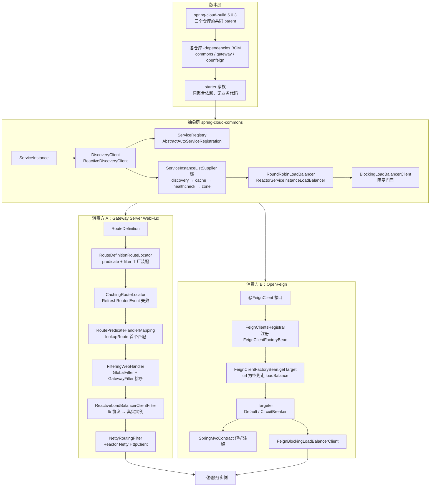

**三条主线**：

1. **注册/发现流**：应用启动 → `WebServerInitializedEvent` → `AbstractAutoServiceRegistration.start` → `ServiceRegistry.register` → 实例进入注册中心；消费侧 `DiscoveryClientServiceInstanceListSupplier` 拉取实例列表 → 经缓存/健康检查过滤器链 → `RoundRobinLoadBalancer` 选出一个 `ServiceInstance`。
2. **请求流**：外部请求 → `RoutePredicateHandlerMapping` 匹配 `Route` → `FilteringWebHandler` 执行 `GlobalFilter` + 路由过滤器 → `lb://` 被 `ReactiveLoadBalancerClientFilter` 换成真实 URL → `NettyRoutingFilter` 用 Reactor Netty 发出 → 响应由 `NettyWriteResponseFilter` 回写。另一条：`@FeignClient` 代理方法 → `SpringMvcContract` 产出的 `MethodMetadata` → `RequestTemplate` → `RequestInterceptor` → `FeignBlockingLoadBalancerClient` 选实例并改写 URL → 真实 `Client`。
3. **配置流**：`spring-cloud-build` parent 定版本 → 各 `-dependencies` BOM 定模块版本 → 自动配置通过 `META-INF/spring/org.springframework.boot.autoconfigure.AutoConfiguration.imports` 注册 → `@ConfigurationProperties`（`spring.cloud.gateway.server.webflux.*`、`spring.cloud.openfeign.client.*`、`spring.cloud.loadbalancer.*`）覆盖默认 → 运行期 `RefreshRoutesEvent` / `RefreshScopeRefreshedEvent` 触发路由重建。

---

## 面试速通：Spring Cloud 高频问题一页纸

> **先给结论**：Spring Cloud v5.0.3 = 一个 release train（三个仓库共用 `spring-cloud-build:5.0.3` 作 parent，train 版本即 parent 版本）+ commons 定义的三族契约（DiscoveryClient / ServiceRegistry / LoadBalancer），gateway 与 openfeign 都是这套契约的消费方；负载均衡算法全系只有 Reactor 一份，阻塞侧是 `.block()` 门面。
>
> 被追问再按讲次展开：
>
> - 第一讲：版本与模块——train / BOM / starter 各解决什么问题；
> - 第二讲：commons 抽象与负载均衡——注册发现、Supplier 链、轮询与两套调用栈；
> - 第三讲：Gateway——Route / Predicate / Filter / 限流 / 路由刷新；
> - 第四讲：OpenFeign——动态代理、Contract、Encoder / Decoder、熔断。
>
> 用法：下面每行先给一句话结论，答完就停；细节按"深入"列指到的讲次取。易错点用于第二轮追问，对照表用于区分易混概念。

### 高频 Q&A（先结论）

| # | 面试问题 | 一句话结论 | 深入 |
| --- | --- | --- | --- |
| 1 | Spring Cloud 和 Spring Boot 是什么关系？ | 一组独立发版的 Spring Boot 子项目 + 一套 release train 版本协调机制，不是单体框架 | 第一讲 |
| 2 | release train 怎么对齐版本？ | train 版本就是 parent 版本——三个仓库 pom 都指向 `spring-cloud-build:5.0.3`，没有中央注册表 | 第一讲 |
| 3 | BOM 和 starter 有什么用？ | 各仓库导出 `-dependencies` BOM 锁版本（连 `feign-bom` / `okhttp-bom` 一起锁）；starter 只聚合依赖、无业务代码，透传链决定默认行为 | 第一讲 |
| 4 | commons 为什么是地基？ | 提供 DiscoveryClient / ServiceRegistry / LoadBalancer 三族契约，gateway、openfeign 单向依赖它 | 第一、二讲 |
| 5 | 服务注册发现抽象长什么样？ | 注册侧走 `WebServerInitializedEvent` → `AbstractAutoServiceRegistration.start` → `ServiceRegistry.register`；消费侧 `DiscoveryClient`（阻塞）与 `ReactiveDiscoveryClient`（反应式）同名不同栈 | 第二讲 |
| 6 | `ServiceInstanceListSupplier` 是什么？ | 装饰器过滤器链：发现 → 缓存 → 健康检查 → 区域；顺序由 `ServiceInstanceListSupplierBuilder` 的调用顺序决定，缓存默认包在发现层外面 | 第二讲 |
| 7 | 负载均衡算法怎么实现的？ | `RoundRobinLoadBalancer` 只做 `pos % size`：`incrementAndGet() & Integer.MAX_VALUE` 无锁环形计数，单实例不推进 position；阻塞与反应式共用同一份 Reactor 算法，唯一分界线是 `BlockingLoadBalancerClient` 的 `.block()` | 第二讲 |
| 8 | OpenFeign 的工作原理？ | `@FeignClient` 被注册成 `FeignClientFactoryBean` → `getTarget` 判断有无 url → `Targeter` 生成 JDK 动态代理；调用时 `SpringMvcContract` 产出的 `MethodMetadata` → `RequestTemplate` → `RequestInterceptor` → LB Client 改写 URL | 第四讲 |
| 9 | Contract / Encoder / Decoder 怎么分工？ | Contract 把 Spring MVC 注解翻成 `MethodMetadata`；Encoder / Decoder 委托 Spring `HttpMessageConverter`；logger / encoder / decoder / contract 四类 Bean 缺失直接抛异常 | 第四讲 |
| 10 | Feign 和 RestTemplate 有什么区别？ | 同属阻塞侧、共用同一套 LB 门面和 URL 改写；区别在声明式（接口 + 动态代理 + Contract）vs 命令式（`LoadBalancerInterceptor` 拦截） | 第二、四讲 |
| 11 | Gateway 的核心概念？ | `RouteDefinition`（配置态）经 `RouteDefinitionRouteLocator` 装配成 `Route`（运行态六元组：`AsyncPredicate` + `List<GatewayFilter>`）；`RoutePredicateHandlerMapping` 取首个命中，`FilteringWebHandler` 按 order 串链 | 第三讲 |
| 12 | Gateway 和 Servlet 容器什么关系？ | 5.x 起 Gateway 拆成 `-server-webflux` / `-server-webmvc` 两个 starter，不再 WebFlux only；本文深读的 webflux 实现请求模型是 `ServerWebExchange`，出口是 Reactor Netty | 第一、三讲 |
| 13 | GlobalFilter 和路由过滤器谁先执行？ | 没有固定先后——`FilteringWebHandler` 把两类过滤器放进同一个 list 按 order 排序；无 order 的路由过滤器 order = 声明下标 + 1，`defaultFilters` 永远在前 | 第三讲 |
| 14 | Gateway 怎么限流？ | `RequestRateLimiterGatewayFilterFactory` + 可替换的 `RateLimiter`（Redis 令牌桶 / Bucket4j 本地桶）+ 可替换的 `KeyResolver`，三者经 `Config` 解耦；空 key 默认 403，被限流默认 429 | 第三讲 |
| 15 | 超时和重试怎么配？ | `NettyRoutingFilter` 超时映射 504；Feign 侧的重试变体 `RetryableFeignBlockingLoadBalancerClient` 由条件注解控制是否装配 | 第三、四讲 |
| 16 | Feign 的熔断怎么接入？ | `FeignCircuitBreakerTargeter` 按 `fallback` / `fallbackFactory` 分三条路给 builder 塞 `circuitBreakerFactory`；没有 fallback 就退化成普通代理 | 第四讲 |

**答题范式**：先报一句话结论（机制名 + 版本事实），答完就停；
被追问再报关键类名和调用链，最后才展开源码细节；
三条主线——注册发现流、请求流、配置流——任何一讲的问题都能挂回去，别孤立地背结论。

### 易错点与面试坑

- **5.x 的 Gateway 不再是"WebFlux only"**：starter 按 server 类型拆成 `-server-webflux` 与 `-server-webmvc`，`spring-cloud-gateway-server` 模块只剩一个配置元数据 JSON，Java 代码全在另两个模块里。
  面试答"Gateway 基于 WebFlux、不能进 Servlet 容器"已经过期——5.x 起两种 server 类型各有 starter。
  连带坑：引用路径写错模块名会直接找不到文件；本文深读的是 webflux 实现，请求模型是 `ServerWebExchange`。
- **过滤器没有"全局先、路由后"**：`FilteringWebHandler` 把 GlobalFilter 和 GatewayFilter 放进同一个 list 再按 order 排序。
  没有显式 order 的路由过滤器 order = 声明下标 + 1，且 `defaultFilters` 永远在前——YAML 里的书写顺序就是执行顺序。
  同理别搞反方向：多路由竞争时 `lookupRoute` 取首个命中（`filterWhen` + `next()`）。
  而一个 Route 内的多个 predicate 之间是 AND——全部命中才算匹配，书写顺序不影响结果。
- **predicate 抛异常会被吞掉当 false**：`lookupRoute` catch 住异常只记 error 日志，一个坏 predicate 不会让网关 500。
  排错时要去日志里找 "Error applying predicate for route"，而不是等一个 500——该 Route 会被当成没匹配上，继续试下一条。
  与之对照，过滤器链没有这种静默：index 越界返回 `Mono.empty()`；顺序错了只会"该改的没改到"，不会报错。
- **Feign 写了 url 就一定不走服务发现**：`getTarget` 会特意识别并 unwrap 掉 `FeignBlockingLoadBalancerClient`（及其重试变体）取 delegate。
  即使 classpath 上有 loadbalancer 也一样——"配了 url 又想按服务名调用"是自相矛盾的配置。
  记忆点：url 有无是运行期分岔点；没有 Client Bean 时报错会提示缺 `starter-loadbalancer`。
- **Feign"属性优先"是默认行为**：`defaultToProperties` 默认 `true`，yml 会后应用并覆盖 `@Configuration` 里定义的 `ErrorDecoder` / `Retryer` / `Options`。
  yml 里配的 `requestInterceptors` 是**追加**不是替换——"我的拦截器没生效"先查这条。
  loggerLevel、超时、重试器等几乎每一项都能按 client 名字单独配，不用写 `@Configuration` 类。
  想让配置类赢过 yml，就把 `spring.cloud.openfeign.client.default-to-properties` 设成 `false`。
- **`FeignClientFactoryBean` 里禁止 `@Autowired`**（类注释 WARNING）：FactoryBean 创建时机与常规 Bean 注入存在竞态，依赖全部手动 `getBean`。
  logger / encoder / decoder / contract 四类必需 Bean 缺失时直接抛 `IllegalStateException`，启动即失败，不是运行期才炸。
  记忆点：每个 Feign client 一个子上下文，Bean 查找走子上下文 + `inheritParentContext` 继承语义。
  `inheritParentContext=false` 时严格只看子上下文——跨 client 共享 Bean 的写法会失效。
- **三个消费方无实例时失败语义各不相同**：Feign 返回 503 响应、Gateway 抛 `NotFoundException`、阻塞 LB 抛 `IllegalStateException`。
  限流场景还要再分一层：空 key 默认 403（`denyEmptyKey`），被限流默认 429。
  再加上 `NettyRoutingFilter` 的超时 504——四个状态码对应四种失败，排错时别记混。
- **5.x 没有 `RoutesRefresher`**：路由刷新走 `RefreshRoutesEvent` → `CachingRouteLocator.onApplicationEvent`，缓存用 `CacheFlux`，支持按 metadata 局部刷新。
  management 子上下文和 LoadBalancer 子上下文的刷新都不触发路由重建，否则每个服务级子上下文创建都会引发一次全量重建。
  刷新完成回发 `RefreshRoutesResultEvent`，失败也发（带 Throwable）不静默。
  触发入口之一是 `POST /actuator/gateway/refresh`；`RouteRefreshListener` 还监听上下文刷新与心跳事件。

### 关键概念对照表

| 概念 A | 概念 B | 关键差异 |
| --- | --- | --- |
| Spring Cloud LoadBalancer | Netflix Ribbon | LoadBalancer 是取代 Ribbon 的官方方案，算法层只有 Reactor 一份，阻塞侧是 `.block()` 门面 |
| `-server-webflux` | `-server-webmvc` | 5.x 起 Gateway 按 server 类型拆成两个 starter；本文深读 webflux，`spring-cloud-gateway-server` 只剩元数据 JSON |
| Feign | RestTemplate | 声明式（接口 + JDK 动态代理 + Contract）vs 命令式（`LoadBalancerInterceptor` 拦截）；共用 `.block()` LB 门面与 URL 改写 |
| GlobalFilter | GatewayFilter | 前者是全局 Bean，后者随 Route 装配；执行顺序统一按 order 混排，不是"全局先、路由后" |
| `RouteDefinition` | `Route` | 配置态（`@NotEmpty` predicates）vs 运行态六元组（`AsyncPredicate` + `List<GatewayFilter>`），中间隔一次装配 |
| `DiscoveryClient` | `ReactiveDiscoveryClient` | 同名不同栈：阻塞 vs 反应式；`probe()` 已 `Deprecated(forRemoval)`，改用 `reactiveProbe()` |
| 有 url 的 `@FeignClient` | 无 url 的 `@FeignClient` | 前者 unwrap 掉 LB Client 走固定地址，后者走 `loadBalance` 服务名调用 |
| `defaultToProperties=true` | `defaultToProperties=false` | 前者 yml 覆盖 `@Configuration`（默认），后者配置类赢过 yml |
| `FilteringWebHandler` | `RoutePredicateHandlerMapping` | 前者把 global + route 过滤器合并排序后逐条执行；后者只负责取首个命中的 Route 并写 `GATEWAY_ROUTE_ATTR` |
| `CachingRouteLocator` | `RouteDefinitionRouteLocator` | 前者用 `CacheFlux` 缓存 Route 并监听 `RefreshRoutesEvent`；后者负责把配置态装配成运行态 |
| `RedisRateLimiter` | `Bucket4jRateLimiter` | 同为可替换的 `RateLimiter` 实现：前者 Redis + Lua 令牌桶（分布式），后者本地桶 |
| `FeignBlockingLoadBalancerClient` | `RetryableFeignBlockingLoadBalancerClient` | 后者是前者的重试变体，由条件注解控制装配；有 url 时两者都会被 unwrap 掉 |
| `ErrorDecoder` | `FeignErrorDecoderFactory` | 先找 `ErrorDecoder` Bean，没有再找 Factory 调 `create(type)`；属性里配的类名可反射创建 |

**最后提醒**：本页结论均出自前四讲的源码深读，默认值与状态码以 v5.0.3 为准；
答不上来时回到对应讲次的小结，按输入/输出表复述调用链。

---

## 第一讲：Spring Cloud 是什么与 release train

### 定位

Spring Cloud 不是一个「框架」，而是**一组独立发版的 Spring Boot 子项目**加上一套**统一版本协调机制（release train）**。这一讲回答三个问题：版本怎么对齐、commons 为什么是所有子项目的地基、starter 到底是什么。

### 目录结构：三个仓库的模块划分

```
spring-cloud-commons/                                        [commons]
├── pom.xml                          parent = spring-cloud-build:5.0.3
├── spring-cloud-commons/            抽象层（DiscoveryClient / LB / ServiceRegistry）
├── spring-cloud-commons-dependencies/   BOM（packaging=pom）
├── spring-cloud-context/            RefreshScope / Environment 等基础设施
├── spring-cloud-loadbalancer/       Spring Cloud LoadBalancer 实现
├── spring-cloud-starter/  spring-cloud-starter-bootstrap/
├── spring-cloud-starter-loadbalancer/  spring-cloud-test-support/
└── docs/src/main/asciidoc/

spring-cloud-gateway/                                        [gateway]
├── pom.xml                          parent = spring-cloud-build:5.0.3
├── spring-cloud-gateway-dependencies/    BOM（packaging=pom）
├── spring-cloud-gateway-server/     只含 src/main/resources/META-INF/
│                                    additional-spring-configuration-metadata.json
├── spring-cloud-gateway-server-webflux/   真正的 WebFlux 实现（本文主角）
├── spring-cloud-gateway-server-webmvc/    WebMVC 实现（5.x 新增）
├── spring-cloud-gateway-proxyexchange-webflux/  -webmvc/
├── spring-cloud-starter-gateway-server-webflux/  -webmvc/
├── spring-cloud-gateway-sample/  spring-cloud-gateway-integration-tests/
└── docs/

spring-cloud-openfeign/                                      [openfeign]
├── pom.xml                          parent = spring-cloud-build:5.0.3
├── spring-cloud-openfeign-core/     核心实现（本文主角）
├── spring-cloud-openfeign-dependencies/  BOM（packaging=pom）
├── spring-cloud-starter-openfeign/
└── docs/
```

> **重要发现（5.x 与 4.x 的模块划分差异）**：gateway 仓库里**没有** `spring-cloud-gateway-server/src/main/java`。`spring-cloud-gateway-server` 模块只有一个资源文件 `spring-cloud-gateway-server/src/main/resources/META-INF/additional-spring-configuration-metadata.json`（用于配置元数据提示），Java 代码全部落在 `spring-cloud-gateway-server-webflux/` 与 `spring-cloud-gateway-server-webmvc/`。本文第三讲的所有路径都用 `spring-cloud-gateway-server-webflux/src/main/java/...`。

### 1.1 release train：三个仓库怎么对齐版本

**证据 1 —— 共同的 Maven parent**。三个仓库根 `pom.xml` 都把 parent 指向 `org.springframework.cloud:spring-cloud-build:5.0.3`：

- `spring-cloud-commons/pom.xml:13-18`
- `spring-cloud-gateway/pom.xml:16-21`
- `spring-cloud-openfeign/pom.xml:13-18`

```xml
<parent>  <!-- spring-cloud-commons/pom.xml:13-18；gateway:16-21；openfeign:13-18 三处相同 -->
    <groupId>org.springframework.cloud</groupId>
    <artifactId>spring-cloud-build</artifactId>
    <version>5.0.3</version>
</parent>
```

这就是 release train 的**机械实现**：train 版本 = `spring-cloud-build` 的版本。谁想进这一列车，就把 parent 指到这个版本。三个仓库各自 `<version>5.0.3</version>`（`spring-cloud-commons/pom.xml:8`、`spring-cloud-gateway/pom.xml:9`、`spring-cloud-openfeign/pom.xml:7`）与 parent 同号，不是巧合，而是 train 的约定。

**证据 2 —— 每个子项目导出自己的 BOM**。三个仓库都有 `-dependencies` 模块，`<packaging>pom</packaging>`，parent 是 `spring-cloud-dependencies-parent`：

| BOM（仓库内相对路径） | dependencyManagement 管了什么 |
| --- | --- |
| `spring-cloud-commons/spring-cloud-commons-dependencies/pom.xml:22-83` | `spring-cloud-commons`、`spring-cloud-context`、`spring-cloud-loadbalancer`、`spring-cloud-starter`、`spring-cloud-starter-bootstrap`、`spring-cloud-starter-loadbalancer`、`spring-cloud-test-support`，外加第三方 `okhttp-bom`、`spring-retry`、`bc-jdk18on-bom` |
| `spring-cloud-gateway/spring-cloud-gateway-dependencies/pom.xml` | `spring-cloud-gateway-proxyexchange-webflux`、`spring-cloud-gateway-proxyexchange-webmvc`、`spring-cloud-gateway-server-webflux`、`spring-cloud-gateway-server-webmvc`、`spring-cloud-starter-gateway-server-webflux`、`spring-cloud-starter-gateway-server-webmvc` |
| `spring-cloud-openfeign/spring-cloud-openfeign-dependencies/pom.xml` | `spring-cloud-openfeign-core`、`spring-cloud-starter-openfeign`，外加第三方 `feign-bom` |

**关键观察**：`spring-cloud-openfeign-dependencies` 里出现 `feign-bom`（:34），`spring-cloud-commons-dependencies` 里出现 `okhttp-bom`（:65）与 `bc-jdk18on-bom`（:77）。这说明 BOM 的职责不只是管自家模块，**还要把"被 Spring Cloud 包装的第三方库"的版本锁死**——OpenFeign 锁 feign，commons 锁 okhttp。这就是"你引入 starter 后不用自己写版本号"的底层原因：版本决策从应用侧上移到 BOM。

**证据 3 —— 跨项目的版本引用走属性**。`spring-cloud-gateway/pom.xml:87` 用 `${spring-cloud-commons.version}` 引用 commons，`spring-cloud-openfeign/pom.xml:162,177` 同样用 `${spring-cloud-commons.version}`。这些属性由 `spring-cloud-build` / `spring-cloud-dependencies-parent` 提供，而不是在本仓库里硬编码——这是 train 保证"同一列车内跨项目版本自洽"的第二道锁。

### 1.2 spring-cloud-commons 的定位：所有子项目共享的抽象

commons 不是"工具类集合"，它定义的是**契约（interface）**，实现留给各注册中心/负载均衡器。

| 抽象 | 文件（仓库：commons） |
| --- | --- |
| 服务实例 | `spring-cloud-commons/src/main/java/org/springframework/cloud/client/ServiceInstance.java` |
| 服务发现（阻塞） | `spring-cloud-commons/src/main/java/org/springframework/cloud/client/discovery/DiscoveryClient.java` |
| 服务发现（反应式） | `spring-cloud-commons/src/main/java/org/springframework/cloud/client/discovery/ReactiveDiscoveryClient.java` |
| 服务注册 | `spring-cloud-commons/src/main/java/org/springframework/cloud/client/serviceregistry/ServiceRegistry.java` |
| 自动注册生命周期 | `spring-cloud-commons/src/main/java/org/springframework/cloud/client/serviceregistry/AbstractAutoServiceRegistration.java` |
| 客户端负载均衡（阻塞） | `spring-cloud-commons/src/main/java/org/springframework/cloud/client/loadbalancer/LoadBalancerClient.java` |
| 客户端负载均衡（反应式） | `spring-cloud-commons/src/main/java/org/springframework/cloud/client/loadbalancer/reactive/ReactiveLoadBalancer.java` |

依赖方向是单向的：gateway 和 openfeign 都依赖 commons（见 starter pom 里的 `spring-cloud-commons`），commons 不依赖它们。这就是为什么读 Spring Cloud 必须先读 commons——**Gateway 的 `lb://` 和 OpenFeign 的服务名调用，最终都调用同一套 commons 接口**。

自动配置注册入口（仓库：commons）：

- `spring-cloud-commons/src/main/resources/META-INF/spring/org.springframework.boot.autoconfigure.AutoConfiguration.imports`（17 行）
- `spring-cloud-loadbalancer/src/main/resources/META-INF/spring/org.springframework.boot.autoconfigure.AutoConfiguration.imports`（5 行）

commons 的 17 个自动配置里有 `CommonsClientAutoConfiguration`、`ReactiveCommonsClientAutoConfiguration`、`SimpleDiscoveryClientAutoConfiguration`、`ServiceRegistryAutoConfiguration`、`AutoServiceRegistrationAutoConfiguration`、`CompatibilityVerifierAutoConfiguration` 等；loadbalancer 的 5 个是 `LoadBalancerAutoConfiguration`、`BlockingLoadBalancerClientAutoConfiguration`、`LoadBalancerCacheAutoConfiguration`、`OAuth2LoadBalancerClientAutoConfiguration`、`LoadBalancerStatsAutoConfiguration`。

### 1.3 starter 家族概览

starter 的**唯一职责是聚合依赖**，看 pom 就知道它不含业务代码：

| starter | 仓库内相对路径 | 聚合的关键依赖 |
| --- | --- | --- |
| `spring-cloud-starter-loadbalancer` | `spring-cloud-commons/spring-cloud-starter-loadbalancer/pom.xml:27-39` | `spring-cloud-starter`、`spring-cloud-loadbalancer`、`spring-boot-starter-cache`、`evictor` |
| `spring-cloud-starter-gateway-server-webflux` | `spring-cloud-gateway/spring-cloud-starter-gateway-server-webflux/pom.xml:26-34` | `spring-cloud-starter`、`spring-cloud-gateway-server-webflux`、`spring-boot-starter-webflux` |
| `spring-cloud-starter-openfeign` | `spring-cloud-openfeign/spring-cloud-starter-openfeign/pom.xml:28-52` | `spring-cloud-starter`、`spring-cloud-openfeign-core`、`spring-web`、`spring-cloud-commons`、`feign-core`、`feign-slf4j`、`spring-cloud-starter-loadbalancer` |

三点值得注意：

1. **`spring-cloud-starter-loadbalancer` 引入了 `spring-boot-starter-cache` 和 `evictor`**——因为默认缓存实现 `DefaultLoadBalancerCacheManager` 依赖 `ConcurrentMapWithTimedEviction`。**缓存不是可选的装饰，而是 loadbalancer 的默认装配环节**。
2. **`spring-cloud-starter-openfeign` 传递依赖 `spring-cloud-starter-loadbalancer`**——这解释了为什么 OpenFeign 默认就能用服务名调用，也解释了 `FeignClientFactoryBean.java:441-442` 那句报错文案的来历（"Did you forget to include spring-cloud-starter-loadbalancer?"）。
3. **gateway 的 starter 按 server 类型分裂成两个**（webflux / webmvc）。5.x 起 Gateway 不再是"WebFlux only"，这是模块划分上最显著的变化。

### 第一讲小结：Spring Cloud 是"版本列车 + 一组契约"，不是单体框架

**一句话定位**：三个仓库共用 `spring-cloud-build:5.0.3` 作 parent（train 版本即 parent 版本），各自导出 `-dependencies` BOM 锁死自家模块与被包装的第三方库版本；commons 提供 DiscoveryClient / ServiceRegistry / LoadBalancer 三族契约，gateway 与 openfeign 都是这套契约的消费方。

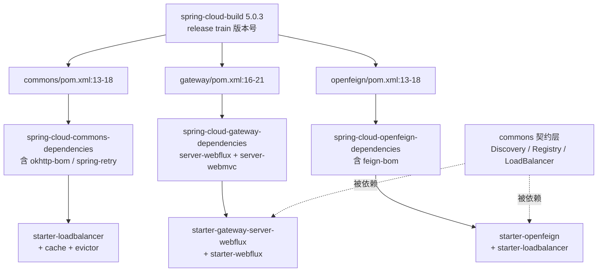

**输入/输出**：

| 机制 | 输入 | 输出 | 副作用 |
| --- | --- | --- | --- |
| release train | parent 坐标 `spring-cloud-build:5.0.3` | 全列车统一版本基线 | 跨仓库版本不再各自为政 |
| BOM | `-dependencies` 模块 dependencyManagement | 应用侧无需写版本号 | 顺带锁第三方（feign-bom / okhttp-bom） |
| commons 契约 | 一组 interface + 自动配置 imports | 可替换的注册中心 / LB 实现 | gateway、openfeign 单向依赖 commons |
| starter | 若干已有模块坐标 | 一个"开箱即用"依赖 | 无业务代码，只做聚合 |

**三个最值得记住的点**：

1. **train 版本就是 parent 版本**：三个仓库 `pom.xml` 都指向 `spring-cloud-build:5.0.3`，这是 release train 唯一的实现机制，没有任何中央注册表。
2. **5.x 的 gateway 已按 server 类型拆模块**：`spring-cloud-gateway-server` 只剩一个配置元数据 JSON，Java 代码全在 `spring-cloud-gateway-server-webflux` / `-webmvc`；引用路径写错模块名会直接找不到文件。
3. **starter 透传决定了默认行为**：`starter-openfeign → starter-loadbalancer → spring-boot-starter-cache + evictor` 这条链，决定了"服务名调用 + 实例缓存"是开箱默认，而不是需要额外配置的能力。

---

## 第二讲：commons 抽象与负载均衡

### 定位

这一讲覆盖两个模块（都在 commons 仓库）：

- `spring-cloud-commons` —— **契约**：服务实例、发现、注册、负载均衡接口。
- `spring-cloud-loadbalancer` —— **实现**：Spring Cloud LoadBalancer（取代 Netflix Ribbon 的官方方案）。

核心命题是：**同一套"选实例"逻辑，如何同时服务阻塞式（RestTemplate/RestClient/Feign）和反应式（WebClient/Gateway）两种调用栈**。答案是：算法层统一用 Reactor 表达（`Mono`/`Flux`），阻塞侧用一个薄薄的 `.block()` 门面。

### 目录结构

```
spring-cloud-commons/src/main/java/org/springframework/cloud/client/   [commons]
├── ServiceInstance.java  DefaultServiceInstance.java  CommonsClientAutoConfiguration.java
├── ConditionalOn{BlockingDiscovery,Discovery,ReactiveDiscovery,DiscoveryHealthIndicator}Enabled.java
├── discovery/
│   ├── DiscoveryClient.java  ReactiveDiscoveryClient.java  ManagementServerPortUtils.java
│   ├── EnableDiscoveryClient.java  EnableDiscoveryClientImportSelector.java
│   └── composite/  health/  simple/  event/
├── serviceregistry/
│   ├── ServiceRegistry.java  Registration.java  ServiceRegistryAutoConfiguration.java
│   ├── AbstractAutoServiceRegistration.java  AutoServiceRegistration*.java
│   └── endpoint/
├── loadbalancer/
│   ├── LoadBalancerClient.java  ServiceInstanceChooser.java
│   ├── LoadBalancerRequest.java  LoadBalancerRequestFactory.java
│   ├── LoadBalancerRequestAdapter.java  LoadBalancerRequestTransformer.java
│   ├── LoadBalancerInterceptor.java  RetryLoadBalancerInterceptor.java
│   ├── LoadBalancerUriTools.java  LoadBalancer{,Clients}Properties.java
│   ├── LoadBalancerAutoConfiguration.java
│   ├── Request/Response/Default{Request,Response}/EmptyResponse/RequestData.java
│   └── reactive/  ReactiveLoadBalancer.java
│       ReactorLoadBalancerExchangeFilterFunction.java
│       RetryableLoadBalancerExchangeFilterFunction.java
│       ReactorLoadBalancerClientAutoConfiguration.java
└── circuitbreaker/  hypermedia/  actuator/  commons/{config,publisher,security,util}/

spring-cloud-loadbalancer/src/main/java/org/springframework/cloud/loadbalancer/   [commons]
├── core/
│   ├── ServiceInstanceListSupplier.java          ← 过滤器链接口
│   ├── DelegatingServiceInstanceListSupplier.java ← 装饰器基类
│   ├── DiscoveryClientServiceInstanceListSupplier.java ← 链的底座
│   ├── CachingServiceInstanceListSupplier.java   ← 缓存
│   ├── HealthCheck / ZonePreference / RetryAware / SameInstancePreference.java
│   ├── RequestBasedStickySession / HintBased / Subset / Weighted.java
│   ├── ReactiveApiVersion / BlockingApiVersionServiceInstanceListSupplier.java
│   ├── ServiceInstanceListSupplierBuilder.java   ← 装配器
│   ├── ReactorLoadBalancer.java  ReactorServiceInstanceLoadBalancer.java
│   ├── RoundRobinLoadBalancer.java  RandomLoadBalancer.java
│   └── SelectedInstanceCallback.java
├── blocking/client/BlockingLoadBalancerClient.java   ← 阻塞门面
├── cache/  CaffeineBasedLoadBalancerCacheManager / DefaultLoadBalancerCacheManager
├── config/ LoadBalancer{AutoConfiguration,CacheAutoConfiguration,StatsAutoConfiguration}.java
│           BlockingLoadBalancerClientAutoConfiguration.java  LoadBalancerZoneConfig.java
├── annotation/LoadBalancerClientConfiguration.java   ← 默认装配出处
└── support/LoadBalancerClientFactory.java            ← 每个 serviceId 一个子上下文
```

### 2.1 ServiceInstance：整个 Spring Cloud 的"最小数据单元"

`spring-cloud-commons/src/main/java/org/springframework/cloud/client/ServiceInstance.java:30-92`

只有 7 个 getter（:42-74），外加一个静态工具 `createUri`（:82-90）：

| 方法 | 行号 | 说明 |
| --- | --- | --- |
| `getInstanceId()` | 35 | default 返回 `null`，唯一实例标识 |
| `getServiceId()` | 42 | **唯一非 default 的标识方法**，逻辑服务名 |
| `getHost()` | 47 | 主机名 |
| `getPort()` | 52 | 端口 |
| `isSecure()` | 57 | 是否 HTTPS |
| `getUri()` | 62 | 服务 URI |
| `getMetadata()` | 67 | 元数据 map，可空 |
| `getScheme()` | 72 | default 返回 `null`，留给实现覆盖 |

`createUri(:82-90)` 的兜底逻辑是理解"为什么有时没配端口也能跑通"的关键：`port <= 0` 时按 `isSecure()` 取 443/80（:85-87）。而且 `getScheme()` 是 5.x 之后才有的 default 方法——**新增能力用 default 方法加，不破坏已有实现类**，这是 commons 保持向后兼容的惯用手法。

### 2.2 DiscoveryClient 与 ReactiveDiscoveryClient：同名不同栈

`spring-cloud-commons/src/main/java/org/springframework/cloud/client/discovery/DiscoveryClient.java:32-79`

```java
public interface DiscoveryClient extends Ordered {
    int DEFAULT_ORDER = 0;                       // :37
    String description();                        // :43
    List<ServiceInstance> getInstances(String);  // :50
    List<String> getServices();                  // :55
    default void probe() { getServices(); }      // :66
    default int getOrder() { return DEFAULT_ORDER; }  // :75
}
```

`spring-cloud-commons/src/main/java/org/springframework/cloud/client/discovery/ReactiveDiscoveryClient.java:34-107` 是它的反应式孪生：

- `Flux<ServiceInstance> getInstances(String)`（:54）、`Flux<String> getServices()`（:59）
- `probe()` 被标记 `@Deprecated(forRemoval = true)`（:75-82），注释明确写了原因：*"the method called within returns a Flux, which is not accessible for subscription or blocking from within"* —— 在返回 `void` 的方法里调 `Flux` 等于什么都没做。**这是一个真实的历史 bug，靠加 `reactiveProbe()`（:94-96，`getServices().then()` 返回 `Mono<Void>`）来修正**，保留旧方法只为不破坏下游实现。

两者都 `extends Ordered` 且 `DEFAULT_ORDER = 0`（:37 / :41）——**多个 DiscoveryClient 并存时靠 order 决定优先级**，这是 `CompositeDiscoveryClient` 能工作的前提。

### 2.3 `@EnableDiscoveryClient` 与自动注册

`spring-cloud-commons/src/main/java/org/springframework/cloud/client/discovery/EnableDiscoveryClient.java:33-46` 只有一个属性：

```java
@Import(EnableDiscoveryClientImportSelector.class)   // :37
boolean autoRegister() default true;                 // :44
```

真正的动作在 `EnableDiscoveryClientImportSelector.java`：

| 分支 | 行号 | 行为 |
| --- | --- | --- |
| 读注解属性 | 43-49 | 取 `autoRegister`，解析失败时兜底 `true` |
| `autoRegister == true` | 51-55 | 往 imports 里追加 `AutoServiceRegistrationConfiguration` |
| `autoRegister == false` | 56-65 | 往 Environment 追加一个名为 `springCloudDiscoveryClient` 的 property source，置 `spring.cloud.service-registry.auto-registration.enabled=false` |
| `isEnabled()` | 71-73 | 总开关 `spring.cloud.discovery.enabled`，默认 `true` |
| `hasDefaultFactory()` | 76-78 | 返回 `true`（没有具体实现也不报错） |

注意两种关闭方式的差别：`autoRegister=false` 是**加 property source**（`addLast`，:62，优先级最低，可被用户配置覆盖），不是硬关闭。而 `spring.cloud.discovery.enabled=false` 是**连导入都跳过**。

### 2.4 ServiceRegistry 与 AbstractAutoServiceRegistration：注册侧的生命周期

`spring-cloud-commons/src/main/java/org/springframework/cloud/client/serviceregistry/ServiceRegistry.java:28-66`：

```java
void register(@Nullable R registration);      // :35
void deregister(@Nullable R registration);    // :41
void close();                                 // :46
void setStatus(R registration, String status);// :55
<T> T getStatus(R registration);             // :64
```

两个方法签名带 `@Nullable`（:35、:41）——**注销时必须容忍"注册对象已经不存在"**，这是优雅停机场景的常见坑。

`AbstractAutoServiceRegistration.java` 是生命周期模板（:48-314）：

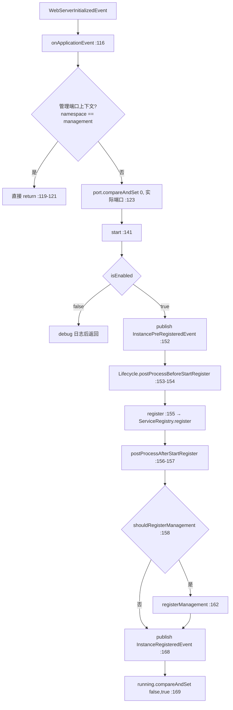

反向的 `stop()`（:293-312）：先 `postProcessBeforeStopRegister` → `deregister()` → `postProcessAfterStopRegister` → 管理端口同理 → 最后 `serviceRegistry.close()`（:310）。`@PreDestroy` 标注在 `destroy()`（:230-233）上，保证容器关闭时一定走到 `stop()`。

两个细节：
- `onApplicationEvent` 里先判 `ConfigurableWebServerApplicationContext` 的 server namespace 是否 `management`（:118-121），**避免 management 端口的 WebServer 启动事件触发重复注册**。
- `AtomicInteger port` 用 `compareAndSet(0, ...)`（:123）——**只有第一次事件能写入端口**，后续事件（如 management 端口）不会覆盖。

### 2.5 LoadBalancerClient：阻塞侧门面

`spring-cloud-commons/src/main/java/org/springframework/cloud/client/loadbalancer/LoadBalancerClient.java:29-69`

```java
public interface LoadBalancerClient extends ServiceInstanceChooser {
    <T> T execute(String serviceId, LoadBalancerRequest<T> request) throws IOException;              // :42
    <T> T execute(String serviceId, ServiceInstance si, LoadBalancerRequest<T> request) throws ...; // :56
    URI reconstructURI(ServiceInstance instance, URI original);                                     // :67
}
```

三个方法分工很清晰：**先选实例、再执行、URL 改写独立出来**。`reconstructURI` 独立成接口方法，是因为 Gateway、Feign、RestTemplate 三处都要用它，但各自的"原始 URI"来源不同。

`LoadBalancerRequestFactory.java:35-58` 极简——`createRequest(...)（:52-56）` 只是把 `HttpRequest` + body + execution 包成 `BlockingLoadBalancerRequest`，并带上 `List<LoadBalancerRequestTransformer>`（:39）。**它是"拦截器装配点"，不是算法所在**。

`LoadBalancerUriTools.java` 是 URL 改写的唯一实现（`reconstructURI` :91，`doReconstructURI` :98）：

- 若 host/port/scheme 三者都没变，**直接返回原 URI 对象**（:104-107），零分配。
- `computeScheme`（:113-119）：实例 `isSecure()` 且原 scheme 在 `INSECURE_SCHEME_MAPPINGS` 里（`http→https`、`ws→wss`，:50-53）才升级。
- `containsEncodedParts`（:58-73）判断 `rawQuery`/`rawPath`/`rawFragment` 是否含 `%`，并对"部分编码"做宽容处理（`build(true)` 失败则视为未编码，:63-70）。

### 2.6 两条调用栈：blocking 与 Reactive

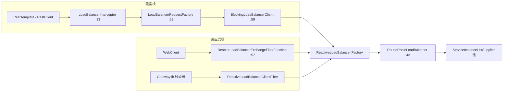

**阻塞侧**：`LoadBalancerInterceptor.java:33-58` 的 `intercept` 只有 4 行有效逻辑：取 `originalUri.getHost()` 作 serviceName（:53-54），然后 `loadBalancer.execute(serviceName, requestFactory.createRequest(...))`（:55）。

`BlockingLoadBalancerClient.java`（loadbalancer 模块）是默认实现，字段只有一个 `ReactiveLoadBalancer.Factory<ServiceInstance>`（:61-65）——**它自己没有算法，算法在反应式栈里**。

| 步骤 | 行号 | 说明 |
| --- | --- | --- |
| 取 hint | 69 | `spring.cloud.loadbalancer.hint.<serviceId>`，无则取 `default`，再无则字面量 `"default"`（:170-175） |
| 包 `LoadBalancerRequestAdapter<T, TimedRequestContext>` | 70-71 | 把用户请求适配成带上下文的 LB 请求 |
| `onStart` 回调 | 73 | 生命周期钩子 |
| `choose` | 74 | **`.block()` 就发生在 :163** |
| 无实例 | 75-79 | `onComplete(DISCARD)` 后抛 `IllegalStateException("No instances available for ...")` |
| 执行 | 80 / 95-124 | `request.apply(serviceInstance)`（:106），IOException 与其它 Exception 分别回调 `FAILED`（:113-122） |

`buildRequestContext`（:83-92）区分了两种请求：若原始请求是 `HttpRequestLoadBalancerRequest` 且能拿到 `HttpRequest`，就构造 `RequestDataContext`（含 `RequestData`），否则退化为 `DefaultRequestContext`。**上下文类型决定后续 `HintBasedServiceInstanceListSupplier`、`RequestBasedStickySessionServiceInstanceListSupplier` 能否生效**——拿不到 `RequestData` 的请求享受不到按请求路由的能力。

**反应式侧**：`ReactiveLoadBalancer.java:37-88`：

```java
Request<DefaultRequestContext> REQUEST = new DefaultRequest<>();   // :42 无参选实例的默认请求
Publisher<Response<T>> choose(Request request);                    // :50
default Publisher<Response<T>> choose() { return choose(REQUEST); } // :52
interface Factory<T> { ... }                                       // :56 按 serviceId 取 LB
```

`Factory` 是**每个 serviceId 一套配置**的入口：`getInstance(serviceId)`（:62）、`getInstances(name, type)`（:72，可取该服务专属的 `LoadBalancerLifecycle`）、`getProperties(serviceId)`（:58）。

`ReactorLoadBalancerExchangeFilterFunction.java:57-131` 是 WebClient 的接入点（配合 `ReactorLoadBalancerClientAutoConfiguration.java:53` 注册）：

- `serviceId == null` → 直接返回 400（:75-81）
- 无可用实例 → 返回 **503**（:98-100），与阻塞侧抛异常形成对照
- `choose`（:123-129）里 `loadBalancer == null` 返回 `EmptyResponse`，而不是报错

`ReactorLoadBalancerClientAutoConfiguration.java` 的两条分支很值得记：

| 条件 | Bean | 行号 |
| --- | --- | --- |
| `spring.cloud.loadbalancer.retry.enabled` != true（默认） | `ReactorLoadBalancerExchangeFilterFunction` | :49-58 |
| `=true` | `RetryableLoadBalancerExchangeFilterFunction` + `LoadBalancerRetryPolicy.Factory` | :60-77 |

### 2.7 ServiceInstanceListSupplier：过滤器链

这是 Spring Cloud LoadBalancer 最漂亮的设计。接口本身只有三行有效代码（`core/ServiceInstanceListSupplier.java:33-45`）：

```java
public interface ServiceInstanceListSupplier extends Supplier<Flux<List<ServiceInstance>>> {
    String getServiceId();                                        // :35
    default Flux<List<ServiceInstance>> get(Request request) { return get(); }  // :37
    static ServiceInstanceListSupplierBuilder builder() { ... }    // :41
}
```

注意 `get(Request)` 的默认实现直接忽略 request（:37-39）——**只有需要按请求内容过滤的实现（Hint、StickySession）才覆写它**。

`DelegatingServiceInstanceListSupplier.java:32-72` 是装饰器基类，四个默认行为：

| 方法 | 行号 | 行为 |
| --- | --- | --- |
| 构造 | 37-40 | `Assert.notNull(delegate)`，委托不可空 |
| `getServiceId()` | 47-49 | 透传给 delegate |
| `selectedServiceInstance()` | 52-56 | **向下传播**选中的实例（若 delegate 也是 `SelectedInstanceCallback`） |
| `afterPropertiesSet` / `destroy` | 59-70 | **生命周期也向下传播** |

`selectedServiceInstance` 向下传播这一点很关键：`RetryAwareServiceInstanceListSupplier` 需要知道上一次选了谁才能在重试时换一个，而它通常位于链的**上层**，选中结果由**下层**的 `CachingServiceInstanceListSupplier`（它持有缓存）记录。

**链的底座**：`DiscoveryClientServiceInstanceListSupplier.java:47-123`——两个构造器，一个吃 `DiscoveryClient`（:62-76），一个吃 `ReactiveDiscoveryClient`（:78-91）：

```java
// 阻塞版 :67-75
Flux.defer(() -> Mono.fromCallable(() -> delegate.getInstances(serviceId)))
    .timeout(timeout, Flux.defer(() -> { logTimeout(); return Flux.just(new ArrayList<>()); }),
             Schedulers.boundedElastic())
    .onErrorResume(error -> { logException(error); return Flux.just(new ArrayList<>()); });
```

三个防御点：
1. `Flux.defer` —— **每次订阅才真的去注册中心拉**，不是构造时拉一次。
2. `timeout` 默认 30s（:56），由 `spring.cloud.loadbalancer.service-discovery.timeout` 覆盖（:52，用 `DurationStyle.detectAndParse` 解析，:106）；**超时降级为空列表**（:68-71），不是抛异常。
3. `onErrorResume`（:72-75 / :87-90）——**注册中心挂了不影响调用方**，只是没有实例可选。阻塞版还特意用 `Schedulers.boundedElastic()`（:71）避免阻塞调用占用事件循环。

**缓存层**：`CachingServiceInstanceListSupplier.java:40-89`，用 Reactor 的 `CacheFlux`：

- 缓存名固定为 `CachingServiceInstanceListSupplierCache`（:47-48，源码里还留着 `// TODO: configurable cache name`，:56）
- `lookup` 命中且非空则直接用（:64-68）；空或 null 视为 miss（:65-67）
- miss 时 `delegate.get().take(1)`（:70）——**只取第一个元素就写缓存**（`andWriteWith`，:71-81）
- 缓存找不到时只记 error 日志，不抛（:58-62、:75-77）

缓存管理器由 `LoadBalancerCacheAutoConfiguration.java` 决定（:74-157）：

| 条件 | Bean | 行号 |
| --- | --- | --- |
| Caffeine + `CaffeineCacheManager` 在类路径 | `CaffeineBasedLoadBalancerCacheManager` | :77-86 |
| 二者缺失且 `ConcurrentMapWithTimedEviction` 在 | `DefaultLoadBalancerCacheManager` + 一条 WARN | :88-104 |
| 总开关 | `spring.cloud.loadbalancer.enabled`（默认 true）**且** `spring.cloud.loadbalancer.cache.enabled`（默认 true） | :124-140 |

`LoadBalancerCaffeineWarnLogger`（:142-155）会在用默认缓存时明确打印"生产环境请换 Caffeine"——**框架主动告诉你默认实现不适合生产**。两个缓存 bean 都标了 `@Bean(autowireCandidate = false)`（:80、:93），避免被 `@Autowired CacheManager` 误注入。

**装配器**：`ServiceInstanceListSupplierBuilder.java:58-469`。`baseCreator` 只能有一个（:62，重复设置会 WARN，:76-78、:94-96），`creators` 是装饰器列表（:64），`build()`（:384-394）先建 base 再逐个包：

| 方法 | 行号 | 包装成 |
| --- | --- | --- |
| `withBlockingDiscoveryClient()` | 75 | `DiscoveryClientServiceInstanceListSupplier`（阻塞版） |
| `withDiscoveryClient()` | 93 | `DiscoveryClientServiceInstanceListSupplier`（Reactive 版） |
| `withBase(supplier)` | 111 | 用户自定义底座 |
| `withCaching()` | 306 | `CachingServiceInstanceListSupplier`；**`LoadBalancerCacheManager` 不可用时原样返回 delegate**（:310-316，只 WARN） |
| `withHealthChecks()` / `withBlockingHealthChecks()` | 153 / 198 | `HealthCheckServiceInstanceListSupplier`（WebClient / RestTemplate / RestClient 三种探针，:396-441） |
| `withZonePreference()` | 258 | `ZonePreferenceServiceInstanceListSupplier` |
| `withRetryAwareness()` | 322 | `RetryAwareServiceInstanceListSupplier` |
| `withHints()` | 328 | `HintBasedServiceInstanceListSupplier` |
| `withSubset()` | 337 | `SubsetServiceInstanceListSupplier` |
| `withWeighted()` | 121 | `WeightedServiceInstanceListSupplier` |
| `withSameInstancePreference()` | 184 | `SameInstancePreferenceServiceInstanceListSupplier` |
| `withRequestBasedStickySession()` | 289 | `RequestBasedStickySessionServiceInstanceListSupplier` |
| `withReactiveApiVersioning()` / `withBlockingApiVersioning()` | 347 / 356 | API 版本过滤 |

健康检查探针的实现值得单独看（:396-406）：**判定成功的唯一标准是 `HttpStatus.OK.equals(statusCode)`**，其它状态码或异常一律 `onErrorReturn(false)`（:405）。而 `getUri`（:443-449）决定探测地址：`healthCheckPath` 为空就打实例根路径，否则拼路径并自动补 `/`。

**默认装配出处**：`annotation/LoadBalancerClientConfiguration.java`：

| Bean | 行号 | 内容 |
| --- | --- | --- |
| `reactorServiceInstanceLoadBalancer` | 73-78 | `new RoundRobinLoadBalancer(factory.getLazyProvider(name, ServiceInstanceListSupplier.class), name)` |
| `discoveryClientServiceInstanceListSupplier`（默认） | 95-98 | `builder().withDiscoveryClient().withCaching().build(context)` |
| 区域优先变体 | 104-111 | `withDiscoveryClient().withCaching().withZonePreference()` |
| 健康检查变体 | 124 | `withDiscoveryClient().withHealthChecks()` |
| 阻塞版默认 | 205 | `withBlockingDiscoveryClient().withCaching()` |
| 顺序常量 | 69 | `REACTIVE_SERVICE_INSTANCE_SUPPLIER_ORDER = 193827465` |

注意 :97 的 `withCaching()` 在 `withDiscoveryClient()` **之后**调用 → 缓存包在发现层外面。而 :106-110 的顺序是 discovery → caching → zonePreference，即**最外层是区域过滤**。这个顺序不是随意的：`build()` 按 `creators` 添加顺序由内向外包装（:389-391）。

`getLazyProvider`（:77）也要留意——**延迟解析 supplier**，避免构造 `RoundRobinLoadBalancer` 时强制初始化整条链造成循环依赖。

### 2.8 RoundRobinLoadBalancer：算法只有 20 行

`core/RoundRobinLoadBalancer.java:43-122`

```java
public Mono<Response<ServiceInstance>> choose(Request request) {                  // :82
    ServiceInstanceListSupplier supplier = serviceInstanceListSingletonSupplier.obtain();  // :83
    return supplier.get(request).next().map(sis -> processInstanceResponse(supplier, sis));
}   // 只取 Flux 的第一个列表（:85），不消费后续推送
```

| 逻辑 | 行号 | 说明 |
| --- | --- | --- |
| supplier 兜底 | 72-73 | 没有 provider 时用 `NoopServiceInstanceListSupplier` |
| `SingletonSupplier` | 72 | supplier 只解析一次 |
| `.next()` | 85 | **只取 Flux 的第一个列表**，不消费后续推送 |
| 回调 `selectedServiceInstance` | 93-95 | 把选中结果告诉链（仅当 supplier 是 `SelectedInstanceCallback`） |
| 空列表 | 100-105 | WARN + `EmptyResponse` |
| **单实例不推进 position** | 109-111 | 注释明写"some suppliers have already filtered instances" |
| position 推进 | 115 | `incrementAndGet() & Integer.MAX_VALUE` —— **忽略符号位**，从 0 顺序循环到 `Integer.MAX_VALUE` |
| 取模 | 117 | `instances.get(pos % instances.size())` |

`& Integer.MAX_VALUE`（:115）是为了让 `position` 溢出到负数时仍能取到非负下标——**教科书级的无锁环形计数器写法**。而"单实例不推进"（:109-111）则避免了上游已经过滤到只剩 1 个实例时（比如 sticky session）不必要的状态变化。

`ReactorServiceInstanceLoadBalancer.java:28-30` 只是个 marker：`interface ReactorServiceInstanceLoadBalancer extends ReactorLoadBalancer<ServiceInstance> {}`，**用来在按类型查 Bean 时区分"选 ServiceInstance 的 LB"和其它 LB**。Gateway 的 `ReactiveLoadBalancerClientFilter.java:160-161` 正是按这个类型查的。

### 2.9 端到端演算 ①：服务注册 → 被另一服务通过 Feign + LoadBalancer 调用

**场景**：服务 `order-service`（两个实例 `10.0.0.1:8080`、`10.0.0.2:8080`）注册到注册中心；服务 `user-service` 用 `@FeignClient(name = "order-service")` 调用 `GET /orders/{id}`。

**阶段一：注册（order-service 启动）**

| # | 动作 | 源码位置 |
| --- | --- | --- |
| 1 | `@EnableDiscoveryClient(autoRegister=true)` → 导入 `AutoServiceRegistrationConfiguration` | `EnableDiscoveryClientImportSelector.java:51-55` |
| 2 | WebServer 启动完成，发布 `WebServerInitializedEvent` | — |
| 3 | `AbstractAutoServiceRegistration.onApplicationEvent` 判非 management 上下文 | `:118-121` |
| 4 | `port.compareAndSet(0, 8080)` | `:123` |
| 5 | `start()` → 发布 `InstancePreRegisteredEvent` | `:152` |
| 6 | `RegistrationLifecycle.postProcessBeforeStartRegister` | `:153-154` |
| 7 | `register()` → `ServiceRegistry.register(registration)` | `:155` / `:262-264` |
| 8 | `postProcessAfterStartRegister` | `:156-157` |
| 9 | 发布 `InstanceRegisteredEvent`（**Gateway 的 `RouteRefreshListener` 会监听它刷新路由**） | `:168` |
| 10 | `running.compareAndSet(false, true)` | `:169` |

两个实例各自执行一遍，注册中心出现 `order-service → [10.0.0.1:8080, 10.0.0.2:8080]`。

**阶段二：user-service 发起调用**

| # | 动作 | 源码位置 |
| --- | --- | --- |
| 1 | `FeignClientFactoryBean.getTarget()` 发现 `url` 为空且配置里也没有 | `FeignClientFactoryBean.java:474` |
| 2 | 拼出 `url = "http://order-service"` | `:479-485` |
| 3 | 走 `loadBalance(...)` | `:486` / `:432-443` |
| 4 | `Client` bean 是 `FeignBlockingLoadBalancerClient` | `loadbalancer/FeignBlockingLoadBalancerClient.java:57` |
| 5 | `execute()` 取 host 作 serviceId | `:79-82` |
| 6 | 构造 `DefaultRequest<RequestDataContext>` + hint | `:84-85` |
| 7 | `loadBalancerClient.choose("order-service", lbRequest)` | `:91` |
| 8 | → `BlockingLoadBalancerClient.choose` → `Mono.from(loadBalancer.choose(request)).block()` | `BlockingLoadBalancerClient.java:158-168`（block 在 :163） |
| 9 | `RoundRobinLoadBalancer.choose` → `supplier.get(request).next()` | `RoundRobinLoadBalancer.java:82-87` |
| 10 | 链：`CachingServiceInstanceListSupplier` 查 `CachingServiceInstanceListSupplierCache` | `CachingServiceInstanceListSupplier.java:55-69` |
| 11 | miss → `DiscoveryClientServiceInstanceListSupplier` 调 `delegate.getInstances("order-service")`，30s 超时兜底空列表 | `DiscoveryClientServiceInstanceListSupplier.java:67-75` |
| 12 | 得到 `[10.0.0.1:8080, 10.0.0.2:8080]`；假设 position=0 → `pos=1` → 选 **`10.0.0.2:8080`** | `RoundRobinLoadBalancer.java:115-117` |
| 13 | `selectedServiceInstance` 沿链向下传播 | `DelegatingServiceInstanceListSupplier.java:52-56` |
| 14 | 写回缓存 `andWriteWith` | `CachingServiceInstanceListSupplier.java:71-81` |
| 15 | `reconstructURI(instance, originalUri)`：`http://order-service/orders/1` → **`http://10.0.0.2:8080/orders/1`** | `LoadBalancerUriTools.java:91-111` |
| 16 | 经 `LoadBalancerFeignRequestTransformer` 变换后由 delegate 发出真实 HTTP | `FeignBlockingLoadBalancerClient.java:108-111` |
| 17 | 成功 → `onComplete(SUCCESS)`；失败 → `onComplete(FAILED)` | `BlockingLoadBalancerClient.java:109-121` |

**如果注册中心此时挂了**：步骤 11 会走到 `onErrorResume`（`DiscoveryClientServiceInstanceListSupplier.java:72-75`），返回空列表 → 步骤 12 走到 `instances.isEmpty()`（`RoundRobinLoadBalancer.java:100-105`）→ 返回 `EmptyResponse` → `BlockingLoadBalancerClient.choose` 得到 `null` → **抛 `IllegalStateException("No instances available for order-service")`（`BlockingLoadBalancerClient.java:78`）**。注意：不是 503，是异常——**阻塞栈与反应式栈（503）的失败语义不同**。

### 第二讲小结：算法只有一份（Reactor），阻塞侧是 `.block()` 门面

**一句话定位**：`ServiceInstanceListSupplier` 用装饰器链把"发现 / 缓存 / 健康检查 / 区域 / 提示 / 重试感知"层层包在实例列表上，`RoundRobinLoadBalancer` 只做 `pos % size` 一件事；`BlockingLoadBalancerClient` 用 `.block()` 把同一套 Reactor 算法暴露给 RestTemplate / Feign。

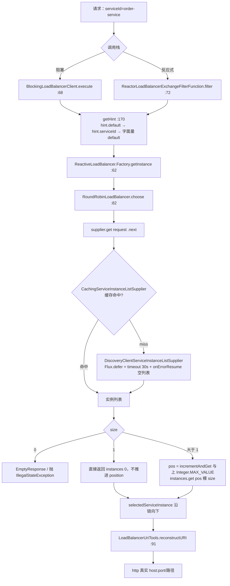

**输入/输出**：

| 组件 | 输入 | 输出 | 失败语义 |
| --- | --- | --- | --- |
| `DiscoveryClientServiceInstanceListSupplier` | serviceId | `Flux<List<ServiceInstance>>` | 超时/异常 → 空列表（不抛） |
| `CachingServiceInstanceListSupplier` | delegate + `CacheManager` | 缓存命中或 miss 后回填 | 无缓存 → 只 WARN，用 delegate |
| `ServiceInstanceListSupplierBuilder.build` | baseCreator + creators 列表 | 最外层 supplier | baseCreator 为 null → `Assert` 失败 |
| `RoundRobinLoadBalancer.choose` | `Request` | `Mono<Response<ServiceInstance>>` | 空列表 → `EmptyResponse` + WARN |
| `BlockingLoadBalancerClient.execute` | serviceId + `LoadBalancerRequest` | 业务响应 | 无实例 → `IllegalStateException` |
| `ReactorLoadBalancerExchangeFilterFunction.filter` | `ClientRequest` | `Mono<ClientResponse>` | 无实例 → **503**；无 host → 400 |
| `LoadBalancerUriTools.reconstructURI` | `ServiceInstance` + 原 URI | 改写后的 URI | instance 为 null → `IllegalArgumentException` |

**三个最值得记住的点**：

1. **算法层只有 Reactor 一份**：`BlockingLoadBalancerClient.java:163` 的 `.block()` 是阻塞栈与反应式栈的唯一分界线——阻塞侧没有独立的轮询实现，改算法只需动 `RoundRobinLoadBalancer`。
2. **链的顺序由 `ServiceInstanceListSupplierBuilder` 的调用顺序决定，且缓存默认在最内层之外**：`withDiscoveryClient().withCaching()`（`LoadBalancerClientConfiguration.java:97`）意味着缓存包在发现层外面；区域/健康检查再包在更外层（:106-110、:124）。想加自己的过滤器就用 `with(DelegateCreator)`（:371-376）。
3. **失败是"降级为空列表"而不是抛异常**：`DiscoveryClientServiceInstanceListSupplier` 的 `timeout`（:68）+ `onErrorResume`（:72）都返回空列表，注册中心不可用时业务方拿到的是"没有实例"而非"调用崩溃"——但阻塞侧会把它翻译成 `IllegalStateException`（`BlockingLoadBalancerClient.java:78`），反应式侧翻译成 503。

---

## 第三讲：Spring Cloud Gateway —— 路由与过滤器链

### 定位

Gateway 是 Spring Cloud 的 **API 网关**：把"外部请求 → 下游服务"的映射、过滤、限流、负载均衡集中在一处。5.x 的实现分成 `spring-cloud-gateway-server-webflux`（本文主角）与 `spring-cloud-gateway-server-webmvc`。

它的骨架可以概括为三个"Locator / Mapping / Handler"：

| 角色 | 类 | 干什么 |
| --- | --- | --- |
| 路由定义 → 路由对象 | `RouteDefinitionRouteLocator` | 把配置里的 predicate/filter 名字变成真实对象 |
| 路由缓存 | `CachingRouteLocator` | 用 `CacheFlux` 缓存，`RefreshRoutesEvent` 时失效 |
| 请求 → 路由匹配 | `RoutePredicateHandlerMapping` | 遍历路由，取第一个 predicate 命中的 |
| 过滤器链执行 | `FilteringWebHandler` | `GlobalFilter` + 路由过滤器合并排序后串成链 |

### 目录结构（仓库：gateway，模块 `spring-cloud-gateway-server-webflux`）

```
spring-cloud-gateway-server-webflux/src/main/java/org/springframework/cloud/gateway/
├── route/
│   ├── Route.java                      ← 运行期路由（不可变，含 AsyncPredicate）
│   ├── RouteDefinition.java            ← 配置期路由（id/predicates/filters/uri/order）
│   ├── RouteLocator.java  RouteDefinitionLocator.java
│   ├── RouteDefinitionRouteLocator.java ← 定义 → 路由的装配器
│   ├── CachingRouteLocator.java         ← 缓存 + RefreshRoutesEvent
│   ├── CompositeRouteLocator.java  CompositeRouteDefinitionLocator.java
│   ├── InMemoryRouteDefinitionRepository.java  RedisRouteDefinitionRepository.java
│   ├── RouteRefreshListener.java  builder/（Java DSL）
├── handler/
│   ├── RoutePredicateHandlerMapping.java ← 匹配入口
│   ├── FilteringWebHandler.java  AsyncPredicate.java
│   └── predicate/
│       ├── RoutePredicateFactory.java        AbstractRoutePredicateFactory.java
│       ├── Path / Host / Method / Header / Query / CookieRoutePredicateFactory.java
│       ├── After / Before / Between / RemoteAddr / XForwardedRemoteAddr.java
│       ├── Weight / ReadBody / Version / CloudFoundryRouteService.java
│       ├── GatewayPredicate.java  PredicateDefinition.java
├── filter/
│   ├── GatewayFilter.java  GatewayFilterChain.java  GlobalFilter.java
│   ├── OrderedGatewayFilter.java  FilterDefinition.java
│   ├── RouteToRequestUrlFilter.java        ← order 10000，拼下游 URL
│   ├── ReactiveLoadBalancerClientFilter.java ← order 10150，lb:// 解析
│   ├── NettyRoutingFilter.java             ← order LOWEST，真正发请求
│   ├── NettyWriteResponseFilter.java       ← 回写响应
│   ├── Forward{Routing,Path}Filter / WebsocketRoutingFilter / WeightCalculatorWebFilter
│   ├── AdaptCachedBodyGlobalFilter / RemoveCachedBodyFilter / GatewayMetricsFilter
│   ├── factory/  ← 40+ 个工厂（RewritePath / AddRequestHeader / Retry …）
│   │   └── RequestRateLimiterGatewayFilterFactory.java
│   ├── ratelimit/  RateLimiter.java KeyResolver.java
│   │               RedisRateLimiter.java Bucket4jRateLimiter.java
│   └── headers/   HttpHeadersFilter 家族（XForwarded / Forwarded / RemoveHopByHop …）
├── config/
│   ├── GatewayAutoConfiguration.java   ← 主自动配置
│   ├── GatewayProperties.java          ← spring.cloud.gateway.server.webflux.*
│   ├── PropertiesRouteDefinitionLocator.java  GatewayLoadBalancerProperties.java
│   └── HttpClient{Properties,Factory,Customizer}.java  GatewayReactiveLoadBalancer*.java
├── actuate/  GatewayControllerEndpoint（POST /gateway/refresh 等）
├── event/    RefreshRoutesEvent / RefreshRoutesResultEvent / FilterArgsEvent …
├── support/  ServerWebExchangeUtils / ConfigurationService / ShortcutConfigurable …
└── discovery/ DiscoveryClientRouteDefinitionLocator（按注册中心自动生成路由）
```

### 3.1 Route 与 RouteDefinition：配置态 vs 运行态

`route/RouteDefinition.java:41-163` 是**配置态**，字段全是简单类型，带 Jakarta 校验：

| 字段 | 行号 | 说明 |
| --- | --- | --- |
| `id` | 43 | 可空（自动生成） |
| `predicates` | 45-47 | `@NotEmpty @Valid`，**不允许空** |
| `filters` | 49-50 | `@Valid` |
| `uri` | 52 | 可空 |
| `metadata` | 54 | 用于按元数据查询/刷新 |
| `order` | 56 | 默认 0 |
| `enabled` | 58 | 默认 true |

`RouteDefinition(String text)`（:63-79）支持 `id=uri,pred1,pred2` 这种紧凑写法：先找 `=`（:64-66，找不到抛 `ValidationException`），第一个参数是 uri（:74），其余都当 predicate（:76-78）。

`route/Route.java:46-342` 是**运行态**，六元组（:48-58）：`id` / `uri` / `order` / `AsyncPredicate<ServerWebExchange>` / `List<GatewayFilter>` / `Map<String,Object> metadata`。构造私有（:60），只能通过 Builder。

`AbstractBuilder.uri(URI)`（:199-215）里有两处防御值得记住：

```java
Assert.hasText(scheme, "The parameter [...] format is incorrect, scheme can not be empty");   // :202
if (scheme.equalsIgnoreCase("localhost")) { throw new IllegalArgumentException(...); }        // :203-208
if (this.uri.getPort() < 0 && scheme.startsWith("http")) {                                    // :209
    int port = this.uri.getScheme().equals("https") ? 443 : 80;                               // :211
    this.uri = UriComponentsBuilder.fromUri(this.uri).port(port).build(false).toUri();         // :212
}
```

1. **把 `localhost` 当 scheme 显式报错**（:203-208）——这是最常见的配置错误（`lb://localhost:8080` 或漏写 `//`），源码注释直接写着 `// common error`。
2. **http/https 未指定端口时自动补 80/443**（:209-213）。

`build()`（:253-260）对 `id`、`uri`、`predicate` 三个都做 `Objects.requireNonNull`。Builder 有两个：`AsyncBuilder`（:264，直接持有 `AsyncPredicate`）和 `Builder`（:308，持有同步 `Predicate`，在 `getPredicate()` 时用 `toAsyncPredicate` 转换，:318-320）。**配置驱动走 Async，Java DSL 走同步**。

### 3.2 RoutePredicateFactory 家族：名字 → 对象

`handler/predicate/RoutePredicateFactory.java:34-78`：

```java
@FunctionalInterface
public interface RoutePredicateFactory<C> extends ShortcutConfigurable, Configurable<C> {
    String PATTERN_KEY = "pattern";                     // :39
    default Predicate<ServerWebExchange> apply(Consumer<C> consumer) { ... }  // :42-47
    default AsyncPredicate<ServerWebExchange> applyAsync(Consumer<C> c) { ... } // :49-54
    Predicate<ServerWebExchange> apply(C config);        // :68 唯一抽象方法
    default AsyncPredicate<ServerWebExchange> applyAsync(C config) {           // :70
        return toAsyncPredicate(apply(config));
    }
    default String name() { return NameUtils.normalizeRoutePredicateName(getClass()); } // :74
}
```

关键点：
- **只有一个抽象方法 `apply(C)`**（:68），所以是 `@FunctionalInterface`。
- `applyAsync` 的默认实现就是把同步 predicate 包一层（:70-72）——**绝大多数工厂不需要真的异步**。
- 名字由类名推导（:74），所以 `PathRoutePredicateFactory` → `Path`。这就是 YAML 里 `Path=/foo/**` 的 `Path` 的来历。

以 `PathRoutePredicateFactory.java:48-187` 为例看**快捷配置（shortcut）机制**：

```java
public List<String> shortcutFieldOrder() { return Arrays.asList("patterns", MATCH_TRAILING_SLASH); }  // :76-78
public ShortcutType shortcutType() { return ShortcutType.GATHER_LIST_TAIL_FLAG; }                    // :81-83
```

`GATHER_LIST_TAIL_FLAG` 的含义是：把前 N 个参数收集成列表，最后一个布尔参数作标志位。于是 `Path=/foo/**,/bar/**,true` 能被解析成 `patterns=[/foo/**, /bar/**], matchTrailingSlash=true`——**这就是 YAML 里一行写完全部参数的原因**。

匹配逻辑在 `apply`（:86-152）返回的匿名 `GatewayPredicate` 里（:105）：

| 步骤 | 行号 | 说明 |
| --- | --- | --- |
| 解析 PathPattern（带 `synchronized`） | 88-104 | `PathPatternParser` 非线程安全，所以加锁 |
| 支持 `webFluxProperties.getBasePath()` 前缀 | 92-100 | 有 basePath 时自动拼接 |
| 取 path 容器（缓存在 attribute） | 108-110 | `computeIfAbsent` 避免重复 `parsePath` |
| 逐个 pattern 匹配，命中即 break | 113-119 | **第一个命中为准** |
| 提取 URI 模板变量 | 123-126 | `putUriTemplateVariables` 供下游 filter 使用 |
| 记录匹配到的路径和 routeId | 127-132 | 供指标/日志使用 |

源码里还留着一条 5.0 的 TODO（:89-90）：`// FIXME: 5.0.0 setMatchOptionalTrailingSeparator missing`——`matchTrailingSlash` 目前**没有真正生效**，这是个已知的未完成项。

### 3.3 RouteLocator 三层与装配

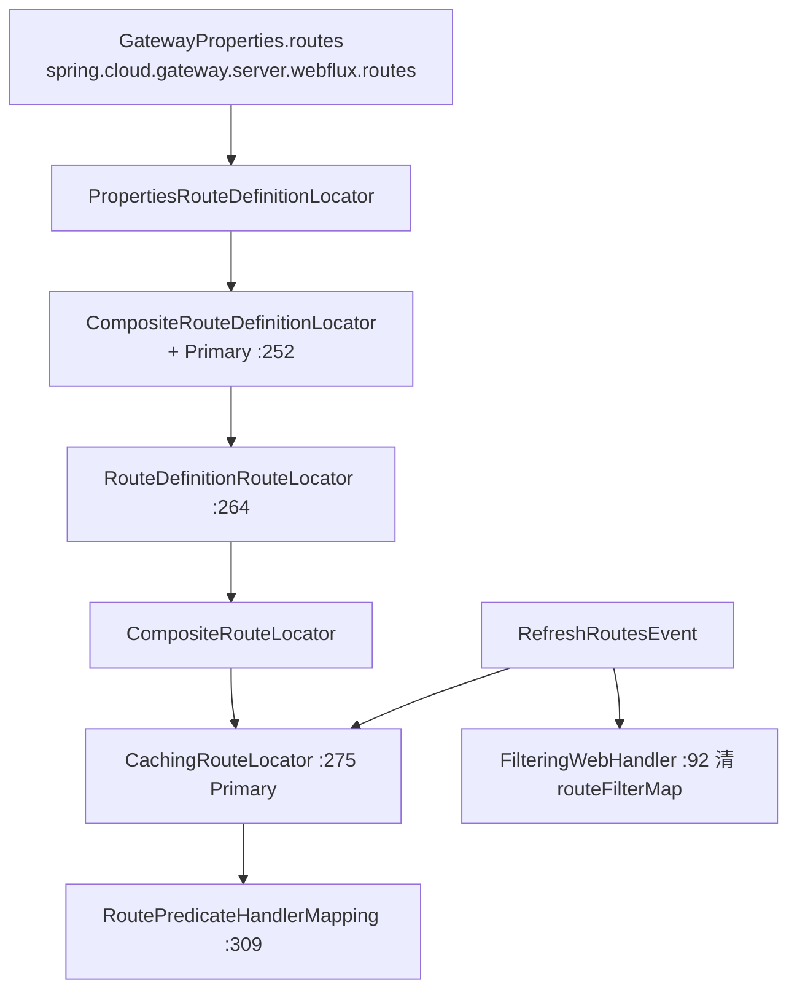

`config/GatewayAutoConfiguration.java` 里的四个关键 bean：

| Bean | 行号 | 内容 |
| --- | --- | --- |
| `routeDefinitionLocator` | 250-254 | `@Primary`，`CompositeRouteDefinitionLocator` 聚合所有 `RouteDefinitionLocator` |
| `routeDefinitionRouteLocator` | 263-269 | `new RouteDefinitionRouteLocator(...)` |
| `cachedCompositeRouteLocator` | 271-277 | `@Primary`，`new CachingRouteLocator(new CompositeRouteLocator(...))` |
| `routePredicateHandlerMapping` | 307-316 | 注入 `FilteringWebHandler` + `RouteLocator` + CORS 配置 |

**装配细节：`RouteDefinitionRouteLocator.java:52-237`**

`initFactories`（:81-93）把所有 `RoutePredicateFactory` 按 `factory.name()` 放进 `LinkedHashMap`；**重名时 WARN 并覆盖**（:84-87）。同名 `GatewayFilterFactory` 放进 `HashMap`（:77）——注意这里**没有重名检查**，行为与 predicate 侧不一致。

`convertToRoute`（:131-136）三步：`combinePredicates` → `getFilters` → `Route.async(routeDefinition).asyncPredicate(...).replaceFilters(...).build()`。

`combinePredicates`（:199-209）：

```java
if (predicates == null || predicates.isEmpty()) {
    return AsyncPredicate.from(exchange -> true);              // :203 无 predicate = 匹配所有
}
return predicates.stream().map(p -> lookup(routeDefinition, p))                      // :206-208
                 .reduce(AsyncPredicate.from(exchange -> true), AsyncPredicate::and);
```

**一个 Route 的所有 predicate 是 AND 关系**（:208）。

`loadGatewayFilters`（:139-179）是"名字 → 对象"的核心：

| 步骤 | 行号 | 说明 |
| --- | --- | --- |
| 按名字查工厂，找不到抛 `IllegalArgumentException` | 143-147 | 错误信息含 factory 名，排错很直接 |
| `configurationService.with(factory).name(...).properties(...).eventFunction(...).bind()` | 154-160 | 参数绑定 + 发 `FilterArgsEvent` |
| 若配置实现 `HasRouteId`，注入 routeId | 165-167 | 部分过滤器需要知道自己在哪条路由上 |
| `factory.apply(configuration)` | 169 | 得到 `GatewayFilter` |
| **非 `Ordered` 的按声明序号 `i + 1` 排序** | 170-175 | `new OrderedGatewayFilter(gatewayFilter, i + 1)` |

最后一行（:174）解释了"为什么 YAML 里过滤器的书写顺序就是执行顺序"——**没有显式 order 的过滤器，order 等于它在列表中的下标 + 1**。

`getFilters`（:181-197）：先加 `gatewayProperties.getDefaultFilters()`（:185-188），再加路由自己的（:190-193），最后整体 `AnnotationAwareOrderComparator.sort`（:195）。源码里留了 TODO（:184）：`// TODO: support option to apply defaults after route specific filters?`——**目前 default filters 永远排在路由过滤器之前（序号更小）**。

### 3.4 RoutePredicateHandlerMapping：匹配入口

`handler/RoutePredicateHandlerMapping.java:45-195`

| 步骤 | 行号 | 说明 |
| --- | --- | --- |
| 管理端口判断 | 66-73 / 82-86 | `DISABLED` / `SAME` / `DIFFERENT` 三态；`DIFFERENT` 时落在管理端口的请求直接返回 empty |
| 打上 `GATEWAY_HANDLER_MAPPER_ATTR` | 87 | 供指标使用 |
| `Mono.deferContextual` 保存 Reactor 上下文 | 89-90 | 供下游需要 context 的组件使用 |
| `lookupRoute` | 91 / 131-157 | 核心匹配 |
| 命中 | 93-101 | 移除临时属性、debug 日志、`GATEWAY_ROUTE_ATTR` 放入路由、返回 `webHandler` |
| 未命中 | 102-108 | 移除属性、**清理缓存的 request body**、`switchIfEmpty` → 继续走其它 handler mapping |

`lookupRoute`（:131-157）：

```java
return this.routeLocator.getRoutes().filterWhen(route -> {
        exchange.getAttributes().put(GATEWAY_PREDICATE_ROUTE_ATTR, route.getId());  // :134
        try { return route.getPredicate().apply(exchange); }                        // :136
        catch (Exception e) { logger.error("Error applying predicate for route: " + route.getId(), e); }
        return Mono.just(false);                                                    // :141
    })
    .next()                                                                         // :143 取第一个
    .map(route -> { validateRoute(route, exchange); return route; });               // :145-151
```

三点：
1. **`filterWhen` 是异步的**——predicate 可以返回 `Mono<Boolean>`，这是 `AsyncPredicate` 存在的意义。
2. **predicate 抛异常会被吞掉当 false**（:138-141），只记 error 日志。一个坏 predicate 不会让整个网关 500。
3. **`.next()` 取第一个命中**（:143），所以 `order` 小的路由优先；`CachingRouteLocator.fetch()` 已经按 `AnnotationAwareOrderComparator` 排过序（`CachingRouteLocator.java:65`）。

`validateRoute`（:169-170）是空实现，注释说明是给子类覆盖用的扩展点。

### 3.5 FilteringWebHandler：GlobalFilter + 路由过滤器合成一条链

`handler/FilteringWebHandler.java:55-191`

**构造期**（:65-68 / :74-89）：把 `List<GlobalFilter>` 适配成 `List<GatewayFilter>`：

```java
// 实现 Ordered 接口 → 用 getOrder()；否则找 @Order 注解 → 用其 value；都没有则不加顺序
new GatewayFilterAdapter(filter)  // :76
    → new OrderedGatewayFilter(gatewayFilter, ordered.getOrder())  // :79
    → new OrderedGatewayFilter(gatewayFilter, order.value())       // :84
    → gatewayFilter（无顺序）                                        // :87
```

**order 来源有两条**：实现 `Ordered` 接口（:77-80）或标注 `@Order`（:82-85）。`GatewayFilterAdapter`（:163-189）就是个一行的转接器（:172-174），同时实现 `DecoratingProxy`（:163）以便日志能显示被包装的真实类型。

**执行期**（:99-108 / :110-125）：

```java
Route route = exchange.getRequiredAttribute(GATEWAY_ROUTE_ATTR);   // :100
List<GatewayFilter> combined = getCombinedFilters(route);          // :101
return new DefaultGatewayFilterChain(combined).filter(exchange);   // :107
```

`getAllFilters`（:119-125）：`new ArrayList<>(globalFilters)` → `addAll(route.getFilters())` → `AnnotationAwareOrderComparator.sort(combined)`。**全局过滤器和路由过滤器在同一个列表里排序，不存在"全局一定先执行"这回事**，完全由 order 决定。

`getCombinedFilters`（:110-117）在 `spring.cloud.gateway.server.webflux.route-filter-cache-enabled=true`（`GatewayProperties.java:74`）时用 `ConcurrentHashMap<Route, List<GatewayFilter>>` 缓存（:61），并在 `RefreshRoutesEvent` 时清空（:92-96）。**用 `Route` 对象本身当 key，依赖 `Route.equals()` 覆盖全部六元组**（`Route.java:132-144`）。

`DefaultGatewayFilterChain`（:127-161）是最精简的链表式责任链：

```java
return Mono.defer(() -> {
    if (this.index < filters.size()) {
        GatewayFilter filter = filters.get(this.index);                          // :151
        DefaultGatewayFilterChain chain = new DefaultGatewayFilterChain(this, this.index + 1);  // :152
        return filter.filter(exchange, chain);                                   // :153
    }
    return Mono.empty();                                                         // :156 链尾 = 完成
});
```

`Mono.defer`（:149）保证**每次订阅才构建下一步**，链是惰性的。`index == size` 时返回 `Mono.empty()`（:156）——链走完意味着"请求已被某个过滤器处理完"，而不是错误。

`GatewayFilter.java:34-55` 与 `GatewayFilterChain.java:31-39` 都是 5.0 新引入的接口（`@since 5.0`，:32 / :29），注释明确写 "Copied from WebFilter / Copied from framework WebFilterChain"——**5.x 把这两个契约从内部类提升为公开接口**。`GlobalFilter.java:35-46` 的注释写得很直白："Only applies to matched gateway routes."

### 3.6 关键 GlobalFilter 与 `lb://` 链路

三个过滤器串起了整个代理过程：

| 过滤器 | order | 常量行号 | 作用 |
| --- | --- | --- | --- |
| `RouteToRequestUrlFilter` | **10000** | `RouteToRequestUrlFilter.java:44` | 把 route.uri 的 scheme/host/port 拼到请求 URL 上，写入 `GATEWAY_REQUEST_URL_ATTR` |
| `ReactiveLoadBalancerClientFilter` | **10150** | `ReactiveLoadBalancerClientFilter.java:70` | 若 scheme 是 `lb`，选实例并把 URL 换成真实地址 |
| `NettyRoutingFilter` | `Ordered.LOWEST_PRECEDENCE` | `NettyRoutingFilter.java:79` | 用 Reactor Netty `HttpClient` 真正发出请求 |

**`RouteToRequestUrlFilter.filter`（:63-96）**：

- `route == null` 直接放行（:65-67）
- `hasAnotherScheme(routeUri)`（:73-78 / :52-55）：形如 `lb:ws://foo` 这种**双 scheme** 写法，把外层 scheme 存进 `GATEWAY_SCHEME_PREFIX_ATTR`，内层当真 URI 用
- `lb` 且 host 为空 → 抛 `IllegalStateException("Invalid host: ...")`（:80-85），注释解释是主机名含下划线等非法字符导致 URI 解析失败
- 用 `UriComponentsBuilder` 合并（:87-93），写入 `GATEWAY_REQUEST_URL_ATTR`（:94）

**`ReactiveLoadBalancerClientFilter.filter`（:88-152）**：

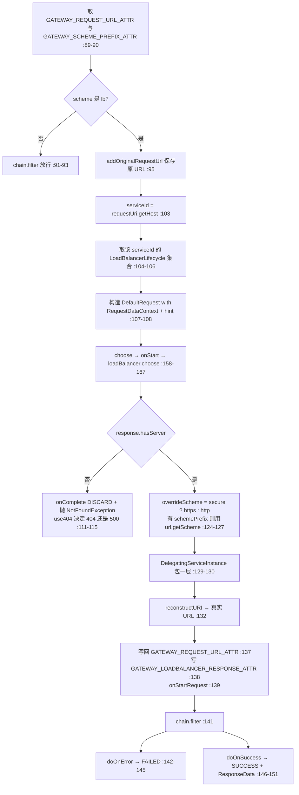

`choose`（:158-167）的类型查询很值得注意：

```java
ReactorLoadBalancer<ServiceInstance> loadBalancer =
    this.clientFactory.getInstance(serviceId, ReactorServiceInstanceLoadBalancer.class);   // :160-161
if (loadBalancer == null) { throw new NotFoundException("No loadbalancer available for " + serviceId); }
```

**Gateway 按 `ReactorServiceInstanceLoadBalancer` 这个 marker 类型查**（第二讲 :28-30 提到的 marker 在这里派上用场），而不是按 `ReactiveLoadBalancer` 查。找不到就抛 `NotFoundException`，不是返回 503。

与 Feign 侧的对照：`FeignBlockingLoadBalancerClient.java:94-107` 在无实例时返回 **503** 响应体；Gateway 侧抛 `NotFoundException`，是否转 404 由 `spring.cloud.gateway.server.webflux.loadbalancer.use404` 决定（`GatewayLoadBalancerProperties.java:24` 前缀 = `GatewayProperties.PREFIX + ".loadbalancer"`，字段 `use404` :27，读取处 `ReactiveLoadBalancerClientFilter.java:114`）。

**`NettyRoutingFilter.filter`（:113-203）**：

| 步骤 | 行号 | 说明 |
| --- | --- | --- |
| 取 `GATEWAY_REQUEST_URL_ATTR`，scheme 非 http/https 或已路由则放行 | 114-119 | `isAlreadyRouted` 防止重复路由 |
| `setAlreadyRouted(exchange)` | 120 | 打标记 |
| 请求头过滤（`HttpHeadersFilter.filterRequest`） | 127-130 | hop-by-hop 头在这里被剔除 |
| `preserveHost` 时保留 HOST 头，否则由 Netty 处理 | 132 / 138-143 | 默认删掉 HOST |
| `getHttpClientMono(route, exchange)` | 135 | 路由级 HttpClient（可带 SSL 配置） |
| `.send(...)` 转发请求体 | 144-149 | `request.getBody().map(this::getByteBuf)` |
| `.responseConnection(...)` 接收响应 | 150-190 | **不立即写响应** |
| 响应放进 `CLIENT_RESPONSE_ATTR` | 155 | 交给 `NettyWriteResponseFilter` 后续写回 |
| 响应头过滤 + 状态设置 | 160-187 | TRANSFER_ENCODING 与 CONTENT_LENGTH 互斥处理（:176-183） |
| 响应超时 | 192-200 | 超时 → `TimeoutException` → 映射成 **504 GATEWAY_TIMEOUT** |

关键设计：**"Defer committing the response until all route filters have run"**（:152-154）。响应只是被放进 exchange 属性，真正的 `write` 由 `NettyWriteResponseFilter` 完成——这样后序过滤器仍能修改响应头/状态码。

`getByteBuf`（:205-216）处理两种 `DataBuffer`：`NettyDataBuffer` 直接取 native buffer，非 Netty 的用 `Unpooled.wrappedBuffer` 包装（:211-214），其它类型抛 `IllegalArgumentException`。

### 3.7 RequestRateLimiter 限流

`filter/factory/RequestRateLimiterGatewayFilterFactory.java:43-239`

两个注入的默认组件（:53-55）：`RateLimiter defaultRateLimiter` 与 `KeyResolver defaultKeyResolver`。

三个类级开关（可被路由级配置覆盖）：

| 开关 | 字段行号 | 默认值 | 含义 |
| --- | --- | --- | --- |
| `denyEmptyKey` | 60 | `true` | KeyResolver 返回空 key 时拒绝请求 |
| `emptyKeyStatusCode` | 63 | `HttpStatus.FORBIDDEN` | 空 key 时返回的状态码 |
| `throwOnLimit` | 69 | `false` | 被限流时抛 `HttpClientErrorException` 而非返回状态码 |

`apply`（:111-151）的执行顺序：

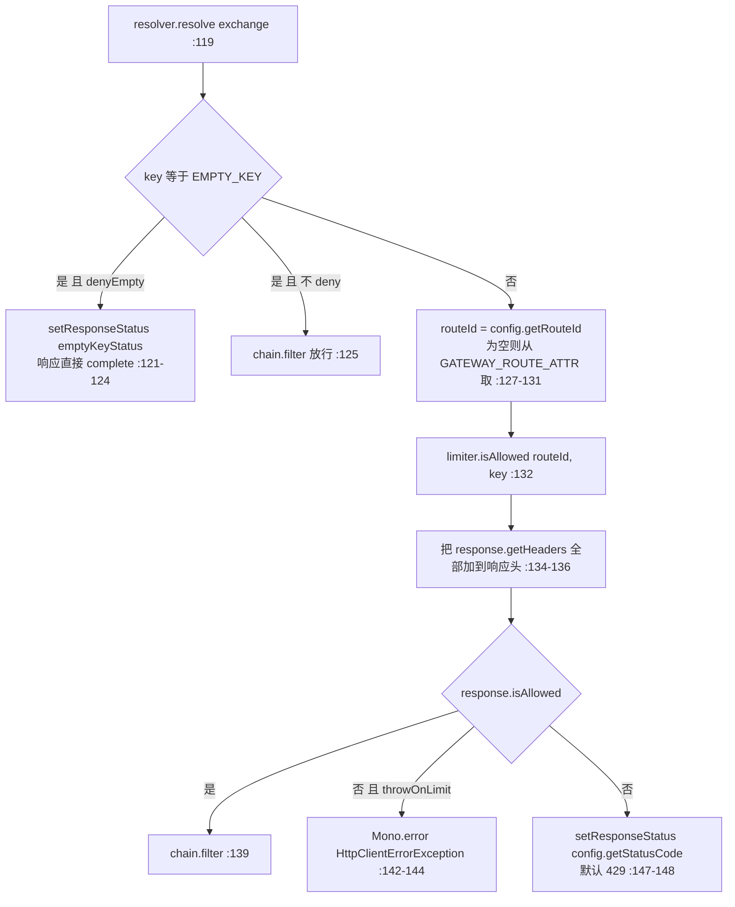

四个值得注意的点：

1. **`resolve` 用 `defaultIfEmpty(EMPTY_KEY)`**（:119），`EMPTY_KEY = "____EMPTY_KEY__"`（:51）——空 key 不是异常路径，是被显式建模的状态。
2. **限流响应头在允许和拒绝时都会被写入**（:134-136），所以 `X-RateLimit-Remaining` 这类头在正常请求里也能看到。
3. **默认拒绝状态码是 429**（`Config.statusCode`，:163），而空 key 是 403（:63）——**两者语义不同，排错时别混淆**。
4. routeId 优先取 `config.getRouteId()`（:127），取不到才从 exchange 拿（:129-131）——因为 `Config implements HasRouteId`（:157），装配时 `RouteDefinitionRouteLocator.java:165-167` 已经注入过了。

`ratelimit/RateLimiter.java:30-69` 是极简契约：`Mono<Response> isAllowed(String routeId, String id)`（:32）+ 内部 `Response`（:34-67，含 `allowed`、`tokensRemaining`、`headers`）。`KeyResolver.java:26-30` 更简单：`Mono<String> resolve(ServerWebExchange exchange)`。

实现有两个：`RedisRateLimiter`（令牌桶，Redis + Lua）与 `Bucket4jRateLimiter`（本地桶）。**限流的"算法"是可替换的，"谁被限流"（KeyResolver）也是可替换的**，两者通过 `Config` 解耦（:159-161）。

### 3.8 配置刷新

> **注意**：任务指引里提到的 `RoutesRefresher` 类在本仓库（v5.0.3）**不存在**——`grep -rn "RoutesRefresher" --include=*.java` 无任何匹配。5.x 的路由刷新走的是**事件 + `CachingRouteLocator`** 机制，下面按实际代码描述。

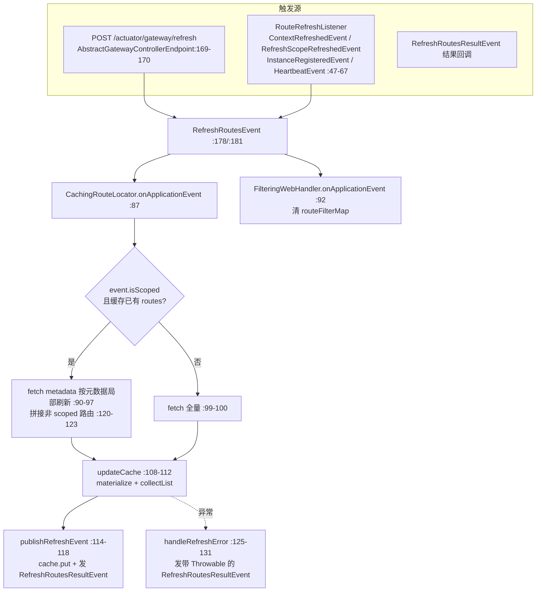

| 组件 | 行号 | 职责 |
| --- | --- | --- |
| `RouteRefreshListener` | 35-79 | 监听四类事件；`HeartbeatMonitor.update` 判断心跳值是否变化（:69-73），变了才 reset（:75-77） |
| `CachingRouteLocator.refresh()` | 81-84 | 主动 `cache.remove(CACHE_KEY)` |
| `CachingRouteLocator.onApplicationEvent` | 87-106 | 区分 scoped（按元数据）与全量刷新 |
| `publishRefreshEvent` | 114-118 | 写缓存后发 `RefreshRoutesResultEvent`，**让调用方知道刷新完成** |
| `handleRefreshError` | 125-131 | 刷新失败也发 `RefreshRoutesResultEvent`（带 `Throwable`），不静默 |

`RouteRefreshListener.onApplicationEvent`（:47-67）里有个容易忽略的过滤：

```java
boolean isManagementCtxt = WebServerApplicationContext.hasServerNamespace(ctx, "management");       // :49-50
boolean isLoadBalancerCtxt = ctx.getDisplayName() != null
        && ctx.getDisplayName().startsWith("LoadBalancerClientFactory-");                            // :51-52
if (!isManagementCtxt && !isLoadBalancerCtxt) { reset(); }                                          // :54-56
```

**management 子上下文和 LoadBalancer 的子上下文刷新时都不触发路由刷新**——否则每个服务级子上下文的创建都会引发一次全量路由重建。

缓存用的是 `CacheFlux.lookup(cache, CACHE_KEY, Route.class).onCacheMissResume(this::fetch)`（`CachingRouteLocator.java:61`），`CACHE_KEY = "routes"`（:49）。

### 3.9 端到端演算 ②：外部请求经 Gateway 到达下游服务

**场景**：客户端请求 `GET http://gw:8080/api/orders/1`，网关配置：

```yaml
spring:
  cloud:
    gateway:
      server:
        webflux:
          routes:
            - id: order-route
              uri: lb://order-service
              predicates:
                - Path=/api/orders/**
              filters:
                - StripPrefix=1
                - name: RequestRateLimiter
                  args:
                    redis-rate-limiter.replenishRate: 10
                    redis-rate-limiter.burstCapacity: 20
```

下游 `order-service` 有两个实例：`10.0.0.1:8080`、`10.0.0.2:8080`。

| # | 动作 | 源码位置 |
| --- | --- | --- |
| 1 | 启动时 `PropertiesRouteDefinitionLocator` 读 `GatewayProperties.routes` | `config/GatewayProperties.java:54` |
| 2 | `RouteDefinitionRouteLocator.convertToRoute` 装配：`Path=/api/orders/**` → `PathRoutePredicateFactory`；`StripPrefix=1`、`RequestRateLimiter` → 对应工厂 | `RouteDefinitionRouteLocator.java:131-136` |
| 3 | `lookup` 用 `ConfigurationService` 绑定参数并发布 `PredicateArgsEvent` | `:212-235` |
| 4 | 无 order 的过滤器按声明序号定 order：`StripPrefix`=1，`RequestRateLimiter`=2 | `:174` |
| 5 | `CachingRouteLocator` 排序后缓存，key = `routes` | `CachingRouteLocator.java:61-65` |
| 6 | 请求进来 → `RoutePredicateHandlerMapping.getHandlerInternal` | `:80-110` |
| 7 | `lookupRoute`：`routeLocator.getRoutes().filterWhen(...)` → `PathRoutePredicateFactory` 的 `GatewayPredicate.test` 匹配 `/api/orders/1` → true | `:131-143` / `PathRoutePredicateFactory.java:107-134` |
| 8 | 同时把 URI 模板变量写入 attribute | `PathRoutePredicateFactory.java:123-126` |
| 9 | 命中，写入 `GATEWAY_ROUTE_ATTR`，handler = `FilteringWebHandler` | `:99-100` |
| 10 | `FilteringWebHandler.handle` → `getAllFilters`：globalFilters + `[StripPrefix(1), RequestRateLimiter(2)]` 一起排序 | `FilteringWebHandler.java:119-125` |
| 11 | 构建 `DefaultGatewayFilterChain`，从 index 0 开始执行 | `:107` / `:148-159` |
| 12 | `RouteToRequestUrlFilter`（order 10000）：`routeUri = lb://order-service`，scheme 为 `lb` 且 host 非空 → 合并得 `lb://order-service/api/orders/1`，写入 `GATEWAY_REQUEST_URL_ATTR` | `RouteToRequestUrlFilter.java:87-94` |
| 13 | `ReactiveLoadBalancerClientFilter`（order 10150）：scheme 是 `lb` → 保存原 URL、取 serviceId=`order-service`、构造 `RequestDataContext + hint` | `ReactiveLoadBalancerClientFilter.java:95-108` |
| 14 | 经 `RoundRobinLoadBalancer` 选中 `10.0.0.2:8080`（第二讲演算 ① 的同款链路） | `ReactiveLoadBalancerClientFilter.java:158-167` |
| 15 | `reconstructURI` → `http://10.0.0.2:8080/api/orders/1`，写回 `GATEWAY_REQUEST_URL_ATTR` | `:132` / `:137` |
| 16 | `RequestRateLimiter`（order 2，但因为 order 小其实在 10000 之前就执行了）：`KeyResolver.resolve` → key；`RedisRateLimiter.isAllowed("order-route", key)` → allowed=true → 放行 | `RequestRateLimiterGatewayFilterFactory.java:119-139` |
| 17 | `StripPrefix=1`：`/api/orders/1` → `/orders/1` | `StripPrefixGatewayFilterFactory` |
| 18 | `NettyRoutingFilter`（最低优先级）：scheme=http，`setAlreadyRouted`，头过滤，`HttpClient.request(GET).uri(...)` 发出 | `NettyRoutingFilter.java:113-149` |
| 19 | 收到响应，只把 `CLIENT_RESPONSE_ATTR` 放进 exchange，**不写回** | `:150-190` |
| 20 | `NettyWriteResponseFilter` 最终把响应写给客户端 | — |

**限流拒绝分支**：若第 16 步 `isAllowed=false` 且 `throwOnLimit=false`（默认），则 `setResponseStatus(exchange, 429)` 后 `exchange.getResponse().setComplete()`（`RequestRateLimiterGatewayFilterFactory.java:147-148`）——**链路在此终止，不会走到 `NettyRoutingFilter`**，`StripPrefix` 也不会执行。这就是"限流在路由过滤器阶段就短路"的含义。

**无实例分支**：若第 14 步拿不到实例，抛 `NotFoundException`，按 `use404` 决定 404 还是 500（`ReactiveLoadBalancerClientFilter.java:111-115`）。

### 第三讲小结：Route 是"定义装配出来的一等对象"，链的执行顺序全靠 order

**一句话定位**：`RouteDefinition`（配置态）经 `RouteDefinitionRouteLocator` 装配成 `Route`（运行态，含 `AsyncPredicate` + `List<GatewayFilter>`），`RoutePredicateHandlerMapping` 取第一个命中的路由，`FilteringWebHandler` 把 `GlobalFilter` 与路由过滤器合并按 order 排序串成一条 `DefaultGatewayFilterChain`，最后由 `NettyRoutingFilter` 用 Reactor Netty 发出并把响应延后提交。

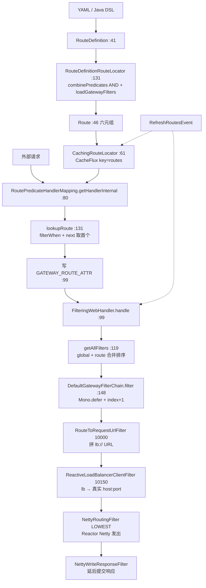

**输入/输出**：

| 组件 | 输入 | 输出 | 关键约束 |
| --- | --- | --- | --- |
| `RouteDefinitionRouteLocator.convertToRoute` | `RouteDefinition` | `Route` | 多个 predicate 是 AND（:208） |
| `loadGatewayFilters` | `List<FilterDefinition>` | `List<GatewayFilter>` | 无 order 者按下标 +1（:174） |
| `RoutePredicateHandlerMapping.lookupRoute` | `ServerWebExchange` | `Mono<Route>`（可能 empty） | predicate 异常当 false（:138-141） |
| `FilteringWebHandler.getAllFilters` | `Route` | 排序后的 `List<GatewayFilter>` | global 与 route 混合排序（:121-123） |
| `DefaultGatewayFilterChain.filter` | `ServerWebExchange` | `Mono<Void>` | index 越界返回 `Mono.empty()`（:156） |
| `RouteToRequestUrlFilter` | route + 请求 URI | `GATEWAY_REQUEST_URL_ATTR` | `lb` 无 host → `IllegalStateException`（:84） |
| `ReactiveLoadBalancerClientFilter` | `lb://` URL | 真实 URL | 无 LB → `NotFoundException`（:163） |
| `NettyRoutingFilter` | 真实 URL | `CLIENT_RESPONSE_ATTR` | 超时 → 504（:192-200） |
| `RequestRateLimiterGatewayFilterFactory` | exchange + Config | 放行 / 429 / 403 | 空 key 默认 403 且与 429 不同（:63 / :163） |
| `CachingRouteLocator.onApplicationEvent` | `RefreshRoutesEvent` | 重填缓存 + `RefreshRoutesResultEvent` | 支持按 metadata 局部刷新（:89-97） |

**三个最值得记住的点**：

1. **`lb://` 的解析只是 order 10150 的一个普通 GlobalFilter**：Gateway 没有"专门的负载均衡模块"，`ReactiveLoadBalancerClientFilter` 与第二讲的 `ReactorLoadBalancer` 是同一套东西，通过 `ReactorServiceInstanceLoadBalancer` marker 类型（:160-161）取到。
2. **过滤器顺序完全由 order 决定，不是"全局先、路由后"**：`FilteringWebHandler.java:119-125` 把两类过滤器放进同一个 list 再排序。没有显式 order 的路由过滤器，order = 声明下标 + 1（`RouteDefinitionRouteLocator.java:174`），所以 YAML 里的书写顺序就是执行顺序。
3. **响应是"延后提交"的**：`NettyRoutingFilter` 只把响应塞进 `CLIENT_RESPONSE_ATTR`（:155），真正写回由 `NettyWriteResponseFilter` 完成——这是所有响应改写类过滤器（`RewriteResponseHeader`、`DedupeResponseHeader`…）能生效的前提。

---

## 第四讲：OpenFeign —— 声明式客户端与动态代理

### 定位

OpenFeign 把"写一个 interface + 加 `@FeignClient`"变成"能发 HTTP 请求的 Bean"。本质是：**在 Spring 的 BeanDefinition 注册阶段塞一个 `FactoryBean`，运行期由它用 Feign 的 `Feign.Builder.target(...)` 生成 JDK 动态代理**。

Spring Cloud OpenFeign 相对原生 Feign 增加了四件事：

1. 用 **Spring MVC 注解**（`@RequestMapping`/`@GetMapping`/`@PathVariable`…）代替 Feign 原生注解 —— `SpringMvcContract`
2. 用 **Spring 的 `HttpMessageConverter`** 做编解码 —— `SpringEncoder` / `SpringDecoder`
3. **每个 client 一个子 ApplicationContext** —— `FeignClientFactory`
4. **接上 Spring Cloud LoadBalancer** —— `FeignBlockingLoadBalancerClient`

### 目录结构（仓库：openfeign，模块 `spring-cloud-openfeign-core`）

```
spring-cloud-openfeign-core/src/main/java/org/springframework/cloud/openfeign/
├── EnableFeignClients.java        ← 开关注解（导入 FeignClientsRegistrar）
├── FeignClient.java               ← 声明注解（name/url/path/contextId/fallback…）
├── FeignClientsRegistrar.java     ← 扫描 + 注册 BeanDefinition
├── FeignClientFactoryBean.java    ← 核心：FactoryBean，生成代理
├── FeignClientFactory.java        ← NamedContextFactory，每 client 一个子上下文
├── FeignClientsConfiguration.java ← 子上下文默认 Bean（Encoder/Decoder/Contract…）
├── FeignAutoConfiguration.java  FeignClientSpecification.java
├── Targeter.java  DefaultTargeter.java  FeignCircuitBreakerTargeter.java
├── FeignCircuitBreaker.java  FeignCircuitBreakerInvocationHandler.java
├── FeignBuilderCustomizer.java  OptionsFactoryBean.java
├── FeignClientProperties.java     ← spring.cloud.openfeign.client.*
├── FeignErrorDecoderFactory.java  FallbackFactory.java  CircuitBreakerNameResolver.java
├── PropertyBasedTarget.java  RefreshableUrl.java  RefreshableHardCodedTarget.java
├── CachingCapability.java  CollectionFormat.java  SpringQueryMap.java
├── annotation/   ← 8 个 AnnotatedParameterProcessor
│   ├── PathVariableParameterProcessor.java  RequestParamParameterProcessor.java
│   ├── RequestHeaderParameterProcessor.java RequestPartParameterProcessor.java
│   └── QueryMapParameterProcessor.java  MatrixVariableParameterProcessor.java
│       CookieValueParameterProcessor.java
├── support/
│   ├── SpringMvcContract.java     ← 注解 → MethodMetadata
│   ├── SpringEncoder.java  SpringDecoder.java  ResponseEntityDecoder.java
│   ├── PageableSpringEncoder.java  PageableSpringQueryMapEncoder.java
│   └── FeignEncoderProperties.java  FeignHttpClientProperties.java
├── loadbalancer/
│   ├── FeignBlockingLoadBalancerClient.java        ← 默认
│   ├── RetryableFeignBlockingLoadBalancerClient.java
│   ├── DefaultFeignLoadBalancerConfiguration.java
│   ├── FeignLoadBalancerAutoConfiguration.java
│   ├── HttpClient5 / Http2ClientFeignLoadBalancerConfiguration.java
│   └── LoadBalancerFeignRequestTransformer.java  LoadBalancerUtils.java
├── clientconfig/  FeignClientConfigurer.java  HttpClient5FeignConfiguration.java
├── encoding/      gzip 请求/响应拦截器
├── hateoas/  security/  aot/
```

### 4.1 从 `@FeignClient` 到 BeanDefinition

`FeignClientsRegistrar.java` 负责扫描与注册。三条主路径：

| 方法 | 行号 | 作用 |
| --- | --- | --- |
| `registerFeignClients` | 172 | 扫包，对每个带 `@FeignClient` 的接口先注册配置（:202）再注册 client（:204） |
| `registerClientConfiguration` | 462-464 | 用 `FeignClientSpecification` 承载该 client 的自定义配置类 |
| `registerFeignClient` | 209-220 | 按 `spring.cloud.openfeign.lazy-attributes-resolution` 分两条路 |

`eagerlyRegisterFeignClientBeanDefinition`（:222-263）是默认路径：

```java
definition = BeanDefinitionBuilder.genericBeanDefinition(FeignClientFactoryBean.class);  // :225
  setProperty: url:226  path:227  name:229  contextId:231  type:232  dismiss404:233
  setAutowireMode(AUTOWIRE_BY_TYPE);                                                     // :244
  setAttribute(FactoryBean.OBJECT_TYPE_ATTRIBUTE, type);                                 // :255
  setPrimary(primary);                                                                   // :258
  registerRefreshableBeanDefinition(... Request.Options.class, OptionsFactoryBean.class);       // :261
  registerRefreshableBeanDefinition(... RefreshableUrl.class, RefreshableUrlFactoryBean.class); // :262
```

四点值得注意：

1. **注册的是 `FeignClientFactoryBean`，不是接口本身**（:225），`FactoryBean.OBJECT_TYPE_ATTRIBUTE` 让 Spring 在按类型注入时能正确识别（:255）。
2. **qualifier 默认是 `contextId + "FeignClient"`**（:246-249），所以 `@Autowired @Qualifier("orderServiceFeignClient")` 能工作。
3. **注册 `OptionsFactoryBean` 和 `RefreshableUrlFactoryBean`**（:261-262）——超时配置和 URL 支持运行期刷新（配合 `@RefreshScope`）。
4. `lazy-attributes-resolution=true` 时走 `lazilyRegisterFeignClientBeanDefinition`（:265-…），url/path 改成在 Supplier 里解析（:279-281），**支持 url 里写 `${}` 占位符**。

### 4.2 FeignClientFactoryBean：代理的诞生地

`FeignClientFactoryBean.java:81-756`。类注释第 84-87 行有个醒目的警告：

```java
/***********************************
 * WARNING! Nothing in this class should be @Autowired. It causes NPEs because of some
 * lifecycle race condition.
 ***********************************/
```

**这个 FactoryBean 里不能用 `@Autowired`**——生命周期竞态会导致 NPE。所有依赖都通过 `ApplicationContextAware` / `BeanFactoryAware`（:645-648、:752-754）拿到的 `beanFactory` 手动 `getBean`。

**`feign(FeignClientFactory)`（:140-156）**：装配 `Feign.Builder` 的四要素：

```java
Feign.Builder builder = get(context, Feign.Builder.class)     // :145
        .logger(logger)                                        // :147
        .encoder(get(context, Encoder.class))                  // :148
        .decoder(get(context, Decoder.class))                  // :149
        .contract(get(context, Contract.class));               // :150
```

`logger/encoder/decoder/contract` 注释标为 "required values"（:146）——**这四类缺失直接抛异常**（`get` 的实现见 :402-408，`instance == null` 时抛 `IllegalStateException("No bean found of type ... for ...")`）。

**`configureFeign`（:171-195）**：决定"配置类 vs 属性"谁先谁后：

```java
if (properties != null && inheritParentContext) {
    if (properties.isDefaultToProperties()) {   // 默认 true（FeignClientProperties.java:52）
        configureUsingConfiguration(context, builder);            // :180  配置类先
        configureUsingProperties(default, contextId, builder);    // :181-182  属性后 → 属性赢
    } else { /* 顺序相反：:185-187 */ }
    configureDefaultRequestElements(...);                         // :189-190
}
```

**`defaultToProperties` 默认 true = 属性覆盖配置类**。想让 `@Configuration` 类赢过 yml，就设 `spring.cloud.openfeign.client.default-to-properties=false`。

`configureUsingConfiguration`（:197-259）依次从子上下文取：`Logger.Level`（:198）、`Retryer`（:202）、`ErrorDecoder`（:206）、`Request.Options`（:217）、`RequestInterceptor` 集合（:228-234，**排序后设置**，:232）、`ResponseInterceptor`（:235）、`QueryMapEncoder`（:239）、`dismiss404`（:243-245）、`ExceptionPropagationPolicy`（:246）、`Capability` 集合（:252-258，排序后 `addCapability`）。

**ErrorDecoder 有两条来源**（:206-216）：先找 `ErrorDecoder` Bean，没有再找 `FeignErrorDecoderFactory` 并调 `create(type)`（:211-215）。

`getInheritedAwareOptional`（:414-421）与 `getInheritedAwareInstances`（:423-430）体现 `inheritParentContext` 语义：`true` 时从子上下文取（会继承父上下文 Bean），`false` 时用 `getInstanceWithoutAncestors` / `getInstancesWithoutAncestors`（`FeignClientFactory.java:52-63`）**严格只看子上下文**。

**`configureUsingProperties`（:274-339）** 把 `FeignClientProperties.FeignClientConfiguration` 的每一项映射到 builder：

| 属性 | 行号 | builder 调用 |
| --- | --- | --- |
| `loggerLevel` | 280-282 | `logLevel` |
| `connectTimeout` / `readTimeout` / `followRedirects` | 284-292 | `new Request.Options(...)`（**`refreshableClient` 为 true 时跳过**，:284） |
| `retryer` | 294-297 | `retryer`（`getOrInstantiate` 无 Bean 则反射创建，:393-400） |
| `errorDecoder` | 299-302 | `errorDecoder` |
| `requestInterceptors` | 304-310 | `requestInterceptor`（**追加而非替换**，注释明写 :305） |
| `responseInterceptor` | 312-314 | `responseInterceptor` |
| `encoder` / `decoder` / `contract` | 316-326 | 对应 setter |
| `exceptionPropagationPolicy` | 328-330 | `exceptionPropagationPolicy` |
| `capabilities` | 332-334 | `addCapability` |
| `queryMapEncoder` | 336-338 | `queryMapEncoder` |

`configureDefaultRequestElements`（:341-368）把 `defaultRequestHeaders`（:355-366）和 `defaultQueryParameters`（:370-379）**实现为 `RequestInterceptor`**（:371-378、:383-390），且只在 key 不存在时才写入（`if (!headers.containsKey(key))`，:386）。

### 4.3 getTarget：有 url 还是走负载均衡

`FeignClientFactoryBean.java:470-519`：

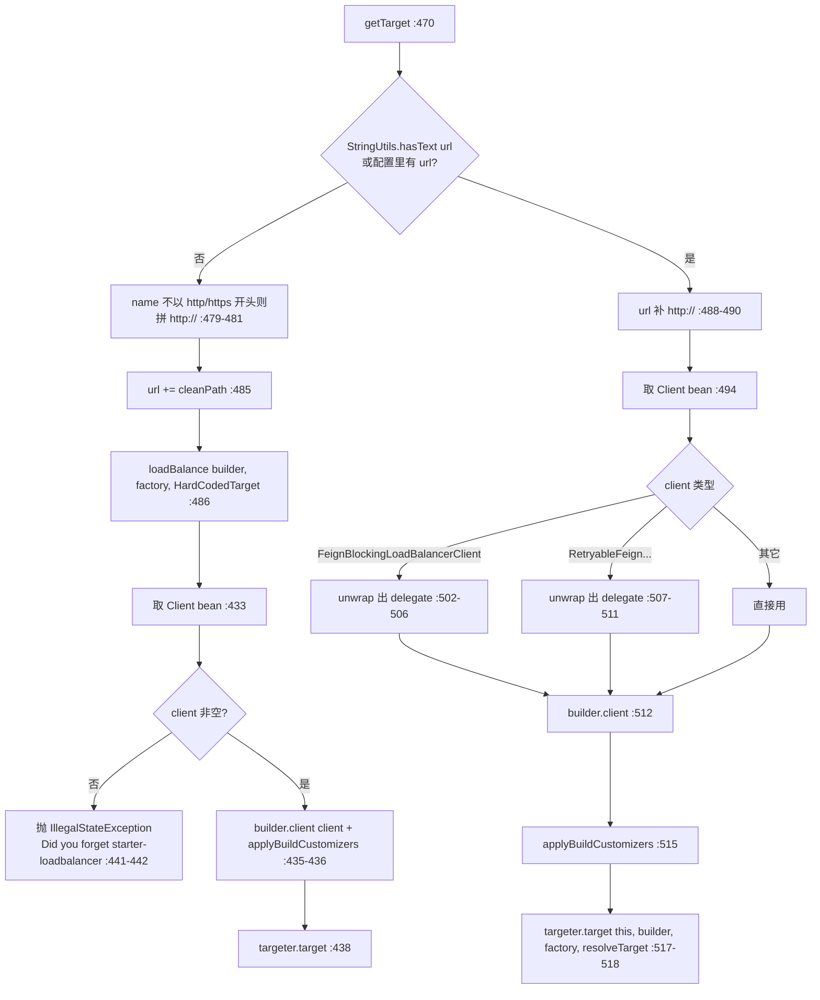

**最关键的一行是 :502-511**：写了 `url` 就不该走负载均衡，但 classpath 上有 Spring Cloud LoadBalancer 时 `Client` Bean 恰好就是 `FeignBlockingLoadBalancerClient`——于是**把它拆开，取出里面的 delegate 直接用**。注释写得非常直白：*"not load balancing because we have a url, but Spring Cloud LoadBalancer is on the classpath, so unwrap"*（:503-504）。

`resolvedContextIds`（:91）是个静态 Set，用来检测同一个 contextId 被初始化多次并 WARN（:496-501）——提示"确保 Client Bean 是 Singleton，否则连接池耗尽"。

`resolveTarget`（:538-557）决定目标类型：有 url → `HardCodedTarget`（:540）；无 url 但 `refreshableClient` → `RefreshableHardCodedTarget`（:543-548）；都没有 → `PropertyBasedTarget`（:550-556），**再找不到就抛 `IllegalStateException("Provide Feign client URL either in @FeignClient() or in config properties.")`**（:552-553）。

### 4.4 Targeter：代理生成的最后一跳

`Targeter.java:25-30` 只有一个方法：

```java
<T> T target(FeignClientFactoryBean factory, Feign.Builder feign, FeignClientFactory context,
             Target.HardCodedTarget<T> target);
```

两个实现：

| 实现 | 文件 / 行号 | 行为 |
| --- | --- | --- |
| `DefaultTargeter` | `DefaultTargeter.java:25-33` | **一行**：`return feign.target(target);`（:30） |
| `FeignCircuitBreakerTargeter` | `FeignCircuitBreakerTargeter.java:30-117` | 带熔断：按 `fallback` / `fallbackFactory` 分三条路（:52-60），最终给 builder 塞 `circuitBreakerFactory` + `feignClientName` + `circuitBreakerGroupEnabled` + `circuitBreakerNameResolver`（:110-115） |

`FeignCircuitBreakerTargeter.target` 的第一步判断很关键（:48-50）：

```java
if (!(feign instanceof FeignCircuitBreaker.Builder builder)) {
    return feign.target(target);      // 不是熔断 builder 就退化成普通代理
}
```

**Targeter 是"代理生成策略"的扩展点**：想换掉默认的 JDK 动态代理（比如换成 AOP 织入、`FeignCachingInvocationHandlerFactory`），就在这里做。

### 4.5 SpringMvcContract：Spring MVC 注解 → MethodMetadata

`support/SpringMvcContract.java:98`，继承 `Contract.BaseContract`。三个覆写点：

**① `processAnnotationOnClass`（:191-202）**：

```java
RequestMapping classAnnotation = findMergedAnnotation(clz, RequestMapping.class);
if (classAnnotation != null) {
    LOG.error("Cannot process class: ...");
    throw new IllegalArgumentException("@RequestMapping annotation not allowed on @FeignClient interfaces");  // :196
}
```

**接口上不允许 `@RequestMapping`**（:192-197）——这不是"不支持"，是**主动报错**。理由：Feign 的 `configKey` 与 Spring MVC 的类级路径合并语义会打架。同时在这里处理类级 `@CollectionFormat`（:198-201）。

**② `parseAndValidateMetadata`（:205-220）**：除调用父类解析（:207）外，加了一条**编译期风格的告警**（:209-217）：方法是 GET 且参数没有任何 HTTP 注解时，WARN 提示"可能运行期退化成 POST"。判定逻辑在 `hasHttpAnnotations`（:235-249），白名单是 `RequestParam` / `RequestHeader` / `PathVariable` / `SpringQueryMap` / `QueryMap`。**首个参数是 `URI` 类型会被跳过**（:228-231）。

**③ `processAnnotationOnMethod`（:252-305）**：

| 步骤 | 行号 | 说明 |
| --- | --- | --- |
| 处理 `@CollectionFormat` | 253-256 | 设置 collectionFormat |
| 非 `RequestMapping` 系注解直接返回 | 258-261 | 但 `annotationType().isAnnotationPresent(RequestMapping.class)` 也算（:259，这样 `@GetMapping` 等组合注解能命中） |
| HTTP method | 265-270 | **未指定则默认 GET**（:266-268）；`checkOne` 限制只能一个 |
| path | 273-290 | 自动补 `/`（:279-281）、按 `removeTrailingSlash` 去尾斜杠（:282-284）、`decodeSlash` 修正（:286-288） |
| produces / consumes / headers / params | 293-302 | 四个 parse 方法 |
| `indexToExpander` | 304 | 初始化为空 LinkedHashMap |

**④ `processAnnotationsOnParameter`（:326-…）**：先处理 `Pageable`（:330-337，无 QueryMap 时自动当 queryMap），再交给 8 个 `AnnotatedParameterProcessor` 处理具体注解（`annotation/` 包下的 `PathVariableParameterProcessor`、`RequestParamParameterProcessor` 等）。

### 4.6 Encoder / Decoder / RequestInterceptor

| 组件 | 文件 / 行号 | 说明 |
| --- | --- | --- |
| `SpringEncoder` | `support/SpringEncoder.java:68`，`encode` :90 | 委托 Spring `HttpMessageConverter`；表单走 `springFormEncoder`（:101） |
| `SpringDecoder` | `support/SpringDecoder.java:43`，`decode` :52 | 用 `HttpMessageConverter` 把 `Response` 转成目标类型 |
| `ResponseEntityDecoder` | `support/ResponseEntityDecoder.java:41`，`decode` :50 | 包装在 `SpringDecoder` 外层，支持 `ResponseEntity<T>` 返回类型（:54-62） |
| `PageableSpringEncoder` | `support/PageableSpringEncoder.java` | 支持 Spring Data `Pageable` 参数 |

`RequestInterceptor` 在 Feign 里只有一个方法：`void apply(RequestTemplate template)`。Spring Cloud 里有三处会往 builder 里塞它：

1. 子上下文里的 `RequestInterceptor` Bean（`FeignClientFactoryBean.java:228-234`，排序后设置）
2. 属性 `requestInterceptors`（:304-310，**追加**）
3. `defaultRequestHeaders` / `defaultQueryParameters` 被包装成拦截器（:381-391、:370-379）

**"追加而非替换"**（:305 注释）是排查"我的拦截器没生效"时的关键：yml 里配的拦截器不会覆盖 `@Bean` 定义的，两者共存。

`encoding/` 包下的 `FeignContentGzipEncodingInterceptor` / `FeignAcceptGzipEncodingInterceptor` 就是 `BaseRequestInterceptor` 的具体实现，通过 `FeignContentGzipEncodingAutoConfiguration` / `FeignAcceptGzipEncodingAutoConfiguration` 按需装配。

### 4.7 FeignBlockingLoadBalancerClient：接上 Spring Cloud LoadBalancer

`loadbalancer/FeignBlockingLoadBalancerClient.java:57-141`。它实现 feign 的 `Client` 接口，是**装饰器**：字段 `delegate`（:61，真正发 HTTP 的 Client）+ `loadBalancerClient`（:63）+ `loadBalancerClientFactory`（:65）+ `transformers`（:67）。

`execute`（:79-112）：

| 步骤 | 行号 | 说明 |
| --- | --- | --- |
| 取 host 作 serviceId | 80-82 | `Assert.state(serviceId != null, "Request URI does not contain a valid hostname: ...")` |
| 构造 LB 请求 | 84-85 | `DefaultRequest<RequestDataContext>(new RequestDataContext(buildRequestData(request), hint))` |
| 取生命周期处理器 | 86-89 | 按 `RequestDataContext` / `ResponseData` / `ServiceInstance` 三个类型过滤 |
| `onStart` | 90 | 生命周期回调 |
| **选实例** | 91 | `loadBalancerClient.choose(serviceId, lbRequest)` |
| 无实例 | 94-107 | WARN + `onComplete(DISCARD)` + **返回 503 响应**（:102-106），不抛异常 |
| 改写 URL | 108 | `loadBalancerClient.reconstructURI(instance, originalUri)` |
| 变换 + 执行 | 109-111 / :119-127 | `LoadBalancerFeignRequestTransformer` 逐个 transform |
| 生命周期收尾 | 110 | `executeWithLoadBalancerLifecycleProcessing`（`LoadBalancerUtils`） |

**与 Gateway 的语义差异**：同样"没有可用实例"，Feign 侧返回 **503 响应对象**（:104），Gateway 侧抛 `NotFoundException`。**调用方拿到的东西不同：Feign 是"下游返回了 503"，Gateway 是"网关自己报 404/500"**。

`getHint`（:134-139）与 `BlockingLoadBalancerClient.getHint`（:170-175）逻辑完全一致：`hint.default` → `hint.<serviceId>` → 字面量 `"default"`。

`RetryableFeignBlockingLoadBalancerClient` 是它的重试变体，由 `OnRetryNotEnabledCondition` 控制是否装配；`FeignClientFactoryBean.java:507-511` 会识别并 unwrap 它。

### 4.8 ErrorDecoder 与 FeignClientProperties

`ErrorDecoder` 有三个配置入口（优先级从低到高）：

| 入口 | 位置 | 说明 |
| --- | --- | --- |
| 子上下文 `@Bean ErrorDecoder` | `FeignClientFactoryBean.java:206-209` | 直接注入 |
| `FeignErrorDecoderFactory` | `FeignClientFactoryBean.java:211-215` | 兜底，按 `type` 创建 |
| 属性 `errorDecoder`（类名） | `FeignClientFactoryBean.java:299-302` | `getOrInstantiate` 反射创建（:393-400） |

`FeignClientProperties.java:50`（`@ConfigurationProperties("spring.cloud.openfeign.client")`，:49）：

| 属性 | 行号 | 默认 | 说明 |
| --- | --- | --- | --- |
| `defaultToProperties` | 52 | `true` | **属性优先于配置类** |
| `defaultConfig` | 54 | `"default"` | 默认配置段名 |
| `config` | 56 | 空 Map | key 是 contextId |
| `decodeSlash` | 62 | `true` | 是否解码 `/`（注释明写 Feign 默认不编码 `/`，:58-61） |
| `removeTrailingSlash` | 67 | `false` | 去掉 URL 尾斜杠 |

内嵌类 `FeignClientConfiguration`（:131-…）涵盖 `loggerLevel`、`connectTimeout`、`readTimeout`、`retryer`、`errorDecoder`、`requestInterceptors`、`responseInterceptor`、`encoder`、`decoder`、`contract`、`capabilities`、`queryMapEncoder`、`dismiss404`、`defaultRequestHeaders`、`defaultQueryParameters` —— **几乎每一项都能在 yml 里按 client 名字单独配**。

### 第四讲小结：@FeignClient 的本质是一个 FactoryBean + 子上下文 + 装饰器 Client

**一句话定位**：`FeignClientsRegistrar` 把接口注册成 `FeignClientFactoryBean`；运行期 `getTarget` 判断"有没有 url"决定走 `loadBalance`（服务名）还是直接用 delegate（固定地址），最后由 `Targeter` 调 `feign.target(...)` 生成 JDK 动态代理，调用时经 `SpringMvcContract` 产出的 `MethodMetadata` 构建 `RequestTemplate`，再由 `FeignBlockingLoadBalancerClient` 选实例并改写 URL。

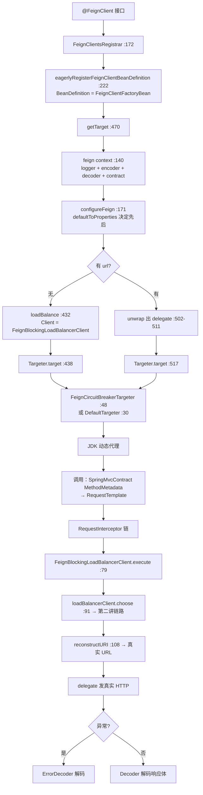

**输入/输出**：

| 组件 | 输入 | 输出 | 失败语义 |
| --- | --- | --- | --- |
| `FeignClientsRegistrar` | `@FeignClient` 元数据 | `FeignClientFactoryBean` BD + `FeignClientSpecification` BD | 缺少 url 且配置也无 → 运行期才报错 |
| `FeignClientFactoryBean.feign` | `FeignClientFactory` | `Feign.Builder` | 四类必需 Bean 缺失 → `IllegalStateException`（:405） |
| `configureFeign` | `FeignClientProperties` | 配置好的 builder | `defaultToProperties` 决定属性/配置类优先级 |
| `getTarget` | contextId / url / type | 代理对象 | 无 Client Bean → 提示缺 starter-loadbalancer（:441-442） |
| `SpringMvcContract.processAnnotationOnClass` | 接口 Class | `MethodMetadata` 初值 | 接口上有 `@RequestMapping` → `IllegalArgumentException`（:196） |
| `processAnnotationOnMethod` | 方法 + 注解 | method / path / produces / consumes | 多个 HTTP method → `checkOne` 失败（:269） |
| `FeignBlockingLoadBalancerClient.execute` | feign `Request` + `Options` | feign `Response` | 无实例 → **503 响应**（:102-106） |
| `ErrorDecoder` | HTTP 状态码 + 响应 | `Exception` | 三处来源，属性配置可反射创建 |

**三个最值得记住的点**：

1. **有 url 时会把负载均衡"拆掉"**：`FeignClientFactoryBean.java:502-511` 特意识别 `FeignBlockingLoadBalancerClient` / `RetryableFeignBlockingLoadBalancerClient` 并 `getDelegate()` 取出真实 Client——**写了 url 就一定不走服务发现**，即使 classpath 上有 loadbalancer。
2. **`FeignClientFactoryBean` 里禁止 `@Autowired`**（:84-87 的 WARNING）：所有依赖走 `beanFactory.getBean`，因为 FactoryBean 的创建时机与常规 Bean 注入存在竞态。
3. **"属性优先"是默认行为**：`FeignClientProperties.defaultToProperties` 默认 `true`（:52），`configureFeign` 里属性后应用（:180-182）——yml 会覆盖 `@Configuration` 类里定义的 `ErrorDecoder` / `Retryer` / `Options`。想反过来就把它设为 `false`。

---

## 附：学习路线与复习卡汇总

### 推荐阅读顺序（按"先契约后实现，先抽象后消费"）

1. **版本与模块**：三个仓库的 `pom.xml` parent → 三个 `-dependencies` BOM → 三个 starter pom（第一讲）
2. **commons 契约**：`ServiceInstance` → `DiscoveryClient` / `ReactiveDiscoveryClient` → `ServiceRegistry` / `AbstractAutoServiceRegistration`（第二讲 2.1-2.4）
3. **负载均衡**：`LoadBalancerClient` / `ReactiveLoadBalancer` → `ServiceInstanceListSupplier` 链 → `RoundRobinLoadBalancer` → `BlockingLoadBalancerClient`（第二讲 2.5-2.8）
4. **Gateway**：`RouteDefinition` / `Route` → `RouteDefinitionRouteLocator` → `CachingRouteLocator` → `RoutePredicateHandlerMapping` → `FilteringWebHandler` → `RouteToRequestUrlFilter` / `ReactiveLoadBalancerClientFilter` / `NettyRoutingFilter`（第三讲）
5. **OpenFeign**：`FeignClientsRegistrar` → `FeignClientFactoryBean.getTarget` → `Targeter` → `SpringMvcContract` → `FeignBlockingLoadBalancerClient`（第四讲）
6. **横向对照**：把"Gateway 的 lb 解析"与"Feign 的 lb 解析"放在一起看——两者最终都落到第二讲的同一套 `ReactorLoadBalancer`

### 复习卡

**版本/模块：**

**版本/模块：** train 的实现机制 = 三个仓库共用 `spring-cloud-build:5.0.3` 作 parent；BOM 不只管自家模块，还锁被包装的第三方（`feign-bom` / `okhttp-bom` / `bc-jdk18on-bom`）；5.x 的 gateway 拆成 `-server-webflux` 与 `-server-webmvc`，`spring-cloud-gateway-server` 模块只剩一个配置元数据 JSON；`starter-openfeign → starter-loadbalancer → spring-boot-starter-cache + evictor` 决定了"服务名调用 + 实例缓存"是默认能力。

**commons / 负载均衡：** `ServiceInstance` 只有 `getServiceId()` 是非 default，新增能力都用 default 方法加；`ReactiveDiscoveryClient.probe()` 已 `Deprecated(forRemoval = true)`——返回 `void` 却调 `Flux` 是历史 bug，改用 `reactiveProbe()`；`@EnableDiscoveryClient(autoRegister=false)` 是往 Environment 加 property source（`addLast`），不是硬关闭；`AbstractAutoServiceRegistration` 用 `port.compareAndSet(0, ...)` 保证只有第一个 WebServer 事件能写端口；`ServiceInstanceListSupplier` 链是装饰器模式，`DelegatingServiceInstanceListSupplier` 连生命周期和 `selectedServiceInstance` 都向下传播；`DiscoveryClientServiceInstanceListSupplier` 的三重防御（`Flux.defer` + 30s `timeout` + `onErrorResume`）都降级为空列表；`CachingServiceInstanceListSupplier` 用 `CacheFlux`，`LoadBalancerCacheManager` 不可用时原样返回 delegate 只 WARN；`RoundRobinLoadBalancer` 的 `position` 用 `incrementAndGet() & Integer.MAX_VALUE` 做无锁环形计数且**单实例不推进**；阻塞与反应式的分界线只有一处——`BlockingLoadBalancerClient.java:163` 的 `.block()`。

**Gateway：** `RouteDefinition` 是配置态（`@NotEmpty` predicates），`Route` 是运行态六元组，`uri()` 里 `localhost` 当 scheme 会显式报错；`RoutePredicateFactory` 是 `@FunctionalInterface`，名字由类名推导；快捷配置靠 `shortcutFieldOrder()` + `shortcutType()`（Path 用 `GATHER_LIST_TAIL_FLAG`）；一个 Route 的多个 predicate 是 **AND**；无 order 的路由过滤器 order = 声明下标 + 1 且 `defaultFilters` 永远在前；`lookupRoute` 用 `filterWhen` + `next()`，predicate 抛异常当 false 只记日志；`getAllFilters` 把 global 和 route 过滤器放进**同一个 list** 排序；三个关键 GlobalFilter 的 order 是 10000 → 10150 → LOWEST；`ReactiveLoadBalancerClientFilter` 按 `ReactorServiceInstanceLoadBalancer` marker 类型查 LB，找不到抛 `NotFoundException`；`NettyRoutingFilter` 只把响应放进 `CLIENT_RESPONSE_ATTR`（延后提交），超时映射 504；限流空 key 默认 **403**、被限流默认 **429**；5.x **没有** `RoutesRefresher`，刷新走 `RefreshRoutesEvent` → `CachingRouteLocator.onApplicationEvent`，支持按 metadata 局部刷新并回发 `RefreshRoutesResultEvent`。

**OpenFeign：** `@FeignClient` 接口注册的是 `FeignClientFactoryBean`（`FactoryBean.OBJECT_TYPE_ATTRIBUTE` 保证按类型注入可用）；`FeignClientFactoryBean` 里禁止 `@Autowired`（类注释 WARNING），依赖全部手动 `getBean`；`defaultToProperties` 默认 `true` → **yml 覆盖 `@Configuration`**；有 url 时 unwrap 掉 `FeignBlockingLoadBalancerClient` 取 delegate——写 url 就不走服务发现；接口上不允许 `@RequestMapping`，直接抛 `IllegalArgumentException`；方法未指定 HTTP method 默认 GET，GET + 无注解参数会 WARN"可能退化成 POST"；yml 里配的 `requestInterceptors` 是**追加**不是替换；无可用实例时 Feign 返回 **503 响应**、Gateway 抛 `NotFoundException`、阻塞 LB 抛 `IllegalStateException`——**三个消费方的失败语义各不相同**。

---

## 涉及文件索引

### 仓库：spring-cloud-commons（`9e19c82`）

| 主题 | 文件（仓库内相对路径） |
| --- | --- |
| release train / BOM | `pom.xml`, `spring-cloud-commons-dependencies/pom.xml`, `spring-cloud-starter-loadbalancer/pom.xml` |
| 服务实例 | `spring-cloud-commons/src/main/java/org/springframework/cloud/client/ServiceInstance.java`, `DefaultServiceInstance.java` |
| 服务发现 | `spring-cloud-commons/src/main/java/org/springframework/cloud/client/discovery/{DiscoveryClient,ReactiveDiscoveryClient,EnableDiscoveryClient,EnableDiscoveryClientImportSelector}.java` |
| 服务注册 | `spring-cloud-commons/src/main/java/org/springframework/cloud/client/serviceregistry/{ServiceRegistry,Registration,AbstractAutoServiceRegistration,AutoServiceRegistrationAutoConfiguration,ServiceRegistryAutoConfiguration}.java` |
| 负载均衡契约（阻塞） | `spring-cloud-commons/src/main/java/org/springframework/cloud/client/loadbalancer/{LoadBalancerClient,LoadBalancerRequest,LoadBalancerRequestFactory,LoadBalancerInterceptor,RetryLoadBalancerInterceptor,LoadBalancerUriTools,LoadBalancerProperties,LoadBalancerAutoConfiguration}.java` |
| 负载均衡契约（反应式） | `spring-cloud-commons/src/main/java/org/springframework/cloud/client/loadbalancer/reactive/{ReactiveLoadBalancer,ReactorLoadBalancerExchangeFilterFunction,RetryableLoadBalancerExchangeFilterFunction,ReactorLoadBalancerClientAutoConfiguration,LoadBalancerBeanPostProcessorAutoConfiguration}.java` |
| 自动配置注册 | `spring-cloud-commons/src/main/resources/META-INF/spring/org.springframework.boot.autoconfigure.AutoConfiguration.imports` |
| Supplier 链 | `spring-cloud-loadbalancer/src/main/java/org/springframework/cloud/loadbalancer/core/{ServiceInstanceListSupplier,DelegatingServiceInstanceListSupplier,DiscoveryClientServiceInstanceListSupplier,CachingServiceInstanceListSupplier,HealthCheckServiceInstanceListSupplier,ZonePreferenceServiceInstanceListSupplier,RetryAwareServiceInstanceListSupplier,ServiceInstanceListSupplierBuilder}.java` |
| 负载均衡算法 | `spring-cloud-loadbalancer/src/main/java/org/springframework/cloud/loadbalancer/core/{RoundRobinLoadBalancer,RandomLoadBalancer,ReactorLoadBalancer,ReactorServiceInstanceLoadBalancer,SelectedInstanceCallback}.java` |
| 阻塞门面 | `spring-cloud-loadbalancer/src/main/java/org/springframework/cloud/loadbalancer/blocking/client/BlockingLoadBalancerClient.java` |
| 缓存 | `spring-cloud-loadbalancer/src/main/java/org/springframework/cloud/loadbalancer/cache/{LoadBalancerCacheManager,CaffeineBasedLoadBalancerCacheManager,DefaultLoadBalancerCacheManager,LoadBalancerCacheProperties}.java` |
| 自动配置 | `spring-cloud-loadbalancer/src/main/java/org/springframework/cloud/loadbalancer/config/{LoadBalancerAutoConfiguration,BlockingLoadBalancerClientAutoConfiguration,LoadBalancerCacheAutoConfiguration,LoadBalancerStatsAutoConfiguration,LoadBalancerZoneConfig}.java` |
| 默认装配出处 | `spring-cloud-loadbalancer/src/main/java/org/springframework/cloud/loadbalancer/annotation/{LoadBalancerClientConfiguration,LoadBalancerClientSpecification,LoadBalancerClients}.java` |
| 子上下文工厂 | `spring-cloud-loadbalancer/src/main/java/org/springframework/cloud/loadbalancer/support/{LoadBalancerClientFactory,LoadBalancerEagerContextInitializer}.java` |

### 仓库：spring-cloud-gateway（`dd7de54`）

| 主题 | 文件（仓库内相对路径，模块 `spring-cloud-gateway-server-webflux`） |
| --- | --- |
| 版本/BOM | `pom.xml`, `spring-cloud-gateway-dependencies/pom.xml`, `spring-cloud-starter-gateway-server-webflux/pom.xml` |
| 路由模型 | `spring-cloud-gateway-server-webflux/src/main/java/org/springframework/cloud/gateway/route/{Route,RouteDefinition,RouteLocator,RouteDefinitionLocator}.java` |
| 路由装配 | `spring-cloud-gateway-server-webflux/src/main/java/org/springframework/cloud/gateway/route/{RouteDefinitionRouteLocator,CachingRouteLocator,CompositeRouteLocator,CompositeRouteDefinitionLocator,RouteRefreshListener}.java` |
| 路由存储 | `spring-cloud-gateway-server-webflux/src/main/java/org/springframework/cloud/gateway/route/{InMemoryRouteDefinitionRepository,RedisRouteDefinitionRepository}.java` |
| 匹配 | `spring-cloud-gateway-server-webflux/src/main/java/org/springframework/cloud/gateway/handler/{RoutePredicateHandlerMapping,FilteringWebHandler,AsyncPredicate}.java` |
| 谓词工厂 | `spring-cloud-gateway-server-webflux/src/main/java/org/springframework/cloud/gateway/handler/predicate/{RoutePredicateFactory,AbstractRoutePredicateFactory,PathRoutePredicateFactory,HostRoutePredicateFactory,MethodRoutePredicateFactory,HeaderRoutePredicateFactory,QueryRoutePredicateFactory,CookieRoutePredicateFactory,AfterRoutePredicateFactory,BeforeRoutePredicateFactory,BetweenRoutePredicateFactory,RemoteAddrRoutePredicateFactory,WeightRoutePredicateFactory,ReadBodyRoutePredicateFactory,VersionRoutePredicateFactory,PredicateDefinition,GatewayPredicate}.java` |
| 过滤器契约 | `spring-cloud-gateway-server-webflux/src/main/java/org/springframework/cloud/gateway/filter/{GatewayFilter,GatewayFilterChain,GlobalFilter,OrderedGatewayFilter,FilterDefinition}.java` |
| 关键全局过滤器 | `spring-cloud-gateway-server-webflux/src/main/java/org/springframework/cloud/gateway/filter/{RouteToRequestUrlFilter,ReactiveLoadBalancerClientFilter,NettyRoutingFilter,NettyWriteResponseFilter,ForwardRoutingFilter,ForwardPathFilter,WebsocketRoutingFilter,AdaptCachedBodyGlobalFilter,RemoveCachedBodyFilter,WeightCalculatorWebFilter,GatewayMetricsFilter}.java` |
| 限流 | `spring-cloud-gateway-server-webflux/src/main/java/org/springframework/cloud/gateway/filter/factory/RequestRateLimiterGatewayFilterFactory.java`, `filter/ratelimit/{RateLimiter,KeyResolver,RedisRateLimiter,Bucket4jRateLimiter,PrincipalNameKeyResolver,AbstractRateLimiter}.java` |
| 过滤器工厂家族 | `spring-cloud-gateway-server-webflux/src/main/java/org/springframework/cloud/gateway/filter/factory/{GatewayFilterFactory,AbstractGatewayFilterFactory,RewritePathGatewayFilterFactory,StripPrefixGatewayFilterFactory,AddRequestHeaderGatewayFilterFactory,SetPathGatewayFilterFactory,RetryGatewayFilterFactory,SpringCloudCircuitBreakerFilterFactory,CacheRequestBodyGatewayFilterFactory}.java` |
| 头过滤 | `spring-cloud-gateway-server-webflux/src/main/java/org/springframework/cloud/gateway/filter/headers/{HttpHeadersFilter,XForwardedHeadersFilter,ForwardedHeadersFilter,RemoveHopByHopHeadersFilter,TrustedProxies}.java` |
| 配置 | `spring-cloud-gateway-server-webflux/src/main/java/org/springframework/cloud/gateway/config/{GatewayAutoConfiguration,GatewayProperties,PropertiesRouteDefinitionLocator,GatewayLoadBalancerProperties,HttpClientProperties,HttpClientFactory,HttpClientCustomizer,GlobalCorsProperties}.java` |
| 事件 | `spring-cloud-gateway-server-webflux/src/main/java/org/springframework/cloud/gateway/event/{RefreshRoutesEvent,RefreshRoutesResultEvent,FilterArgsEvent,PredicateArgsEvent,WeightDefinedEvent}.java` |
| 端点 | `spring-cloud-gateway-server-webflux/src/main/java/org/springframework/cloud/gateway/actuate/{AbstractGatewayControllerEndpoint,GatewayControllerEndpoint,GatewayLegacyControllerEndpoint}.java` |
| 服务发现路由 | `spring-cloud-gateway-server-webflux/src/main/java/org/springframework/cloud/gateway/discovery/{DiscoveryClientRouteDefinitionLocator,DiscoveryLocatorProperties,GatewayDiscoveryClientAutoConfiguration}.java` |
| 工具 | `spring-cloud-gateway-server-webflux/src/main/java/org/springframework/cloud/gateway/support/{ServerWebExchangeUtils,ConfigurationService,ShortcutConfigurable,HasRouteId,DelegatingServiceInstance}.java` |
| 配置元数据 | `spring-cloud-gateway-server/src/main/resources/META-INF/additional-spring-configuration-metadata.json` |

### 仓库：spring-cloud-openfeign（`91b1717`）

| 主题 | 文件（仓库内相对路径，模块 `spring-cloud-openfeign-core`） |
| --- | --- |
| 版本/BOM | `pom.xml`, `spring-cloud-openfeign-dependencies/pom.xml`, `spring-cloud-starter-openfeign/pom.xml` |
| 注解 | `spring-cloud-openfeign-core/src/main/java/org/springframework/cloud/openfeign/{EnableFeignClients,FeignClient,SpringQueryMap,CollectionFormat}.java` |
| 注册 | `spring-cloud-openfeign-core/src/main/java/org/springframework/cloud/openfeign/{FeignClientsRegistrar,FeignClientSpecification,FeignClientFactory}.java` |
| 代理生成 | `spring-cloud-openfeign-core/src/main/java/org/springframework/cloud/openfeign/{FeignClientFactoryBean,Targeter,DefaultTargeter,FeignCircuitBreakerTargeter,FeignBuilderCustomizer,OptionsFactoryBean}.java` |
| 熔断 | `spring-cloud-openfeign-core/src/main/java/org/springframework/cloud/openfeign/{FeignCircuitBreaker,FeignCircuitBreakerInvocationHandler,CircuitBreakerNameResolver,FallbackFactory,FeignCircuitBreakerDisabledConditions}.java` |
| 目标地址 | `spring-cloud-openfeign-core/src/main/java/org/springframework/cloud/openfeign/{PropertyBasedTarget,RefreshableUrl,RefreshableHardCodedTarget,RefreshableUrlFactoryBean}.java` |
| 契约解析 | `spring-cloud-openfeign-core/src/main/java/org/springframework/cloud/openfeign/support/SpringMvcContract.java`, `annotation/{PathVariableParameterProcessor,RequestParamParameterProcessor,RequestHeaderParameterProcessor,RequestPartParameterProcessor,QueryMapParameterProcessor,MatrixVariableParameterProcessor,CookieValueParameterProcessor}.java`, `AnnotatedParameterProcessor.java` |
| 编解码 | `spring-cloud-openfeign-core/src/main/java/org/springframework/cloud/openfeign/support/{SpringEncoder,SpringDecoder,ResponseEntityDecoder,PageableSpringEncoder,PageableSpringQueryMapEncoder,FeignEncoderProperties}.java` |
| 负载均衡 | `spring-cloud-openfeign-core/src/main/java/org/springframework/cloud/openfeign/loadbalancer/{FeignBlockingLoadBalancerClient,RetryableFeignBlockingLoadBalancerClient,DefaultFeignLoadBalancerConfiguration,FeignLoadBalancerAutoConfiguration,LoadBalancerFeignRequestTransformer,LoadBalancerUtils}.java` |
| 配置属性 | `spring-cloud-openfeign-core/src/main/java/org/springframework/cloud/openfeign/{FeignClientProperties,FeignClientConfigurer,FeignErrorDecoderFactory,FeignLoggerFactory}.java` |
| 自动配置 | `spring-cloud-openfeign-core/src/main/java/org/springframework/cloud/openfeign/{FeignAutoConfiguration,FeignClientsConfiguration}.java` |
| HTTP 客户端 | `spring-cloud-openfeign-core/src/main/java/org/springframework/cloud/openfeign/clientconfig/{HttpClient5FeignConfiguration,Http2ClientFeignConfiguration,FeignClientConfigurer}.java` |
| 压缩 | `spring-cloud-openfeign-core/src/main/java/org/springframework/cloud/openfeign/encoding/{BaseRequestInterceptor,FeignContentGzipEncodingInterceptor,FeignAcceptGzipEncodingInterceptor,HttpEncoding}.java` |
