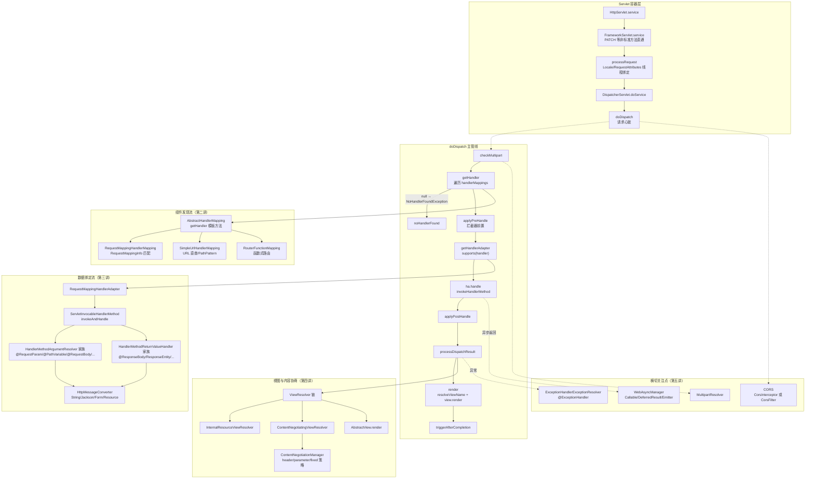
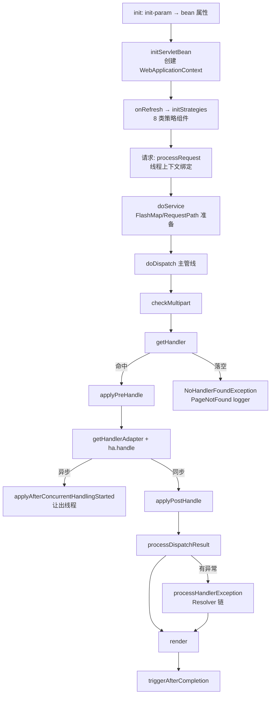
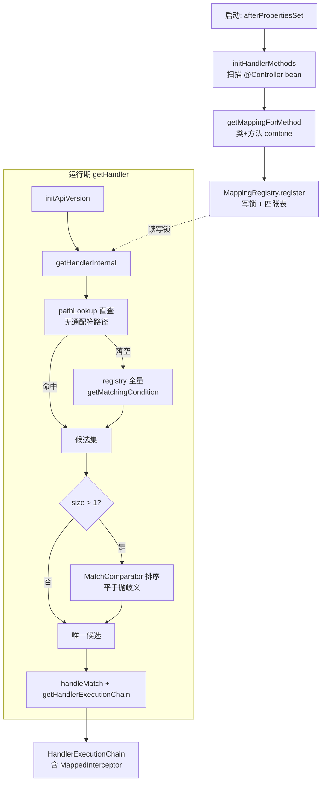
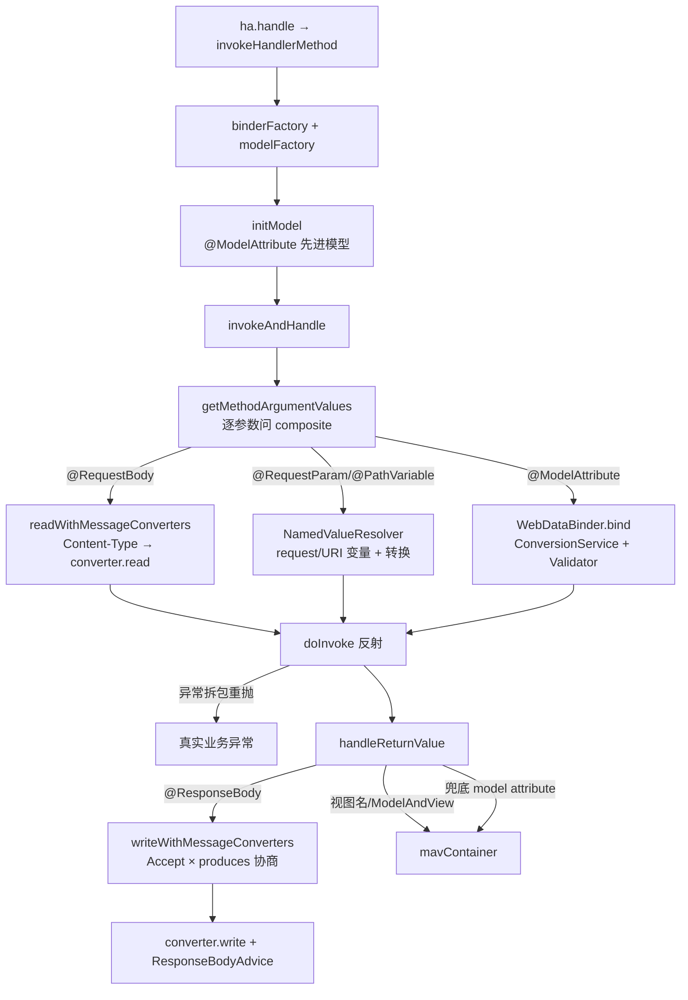
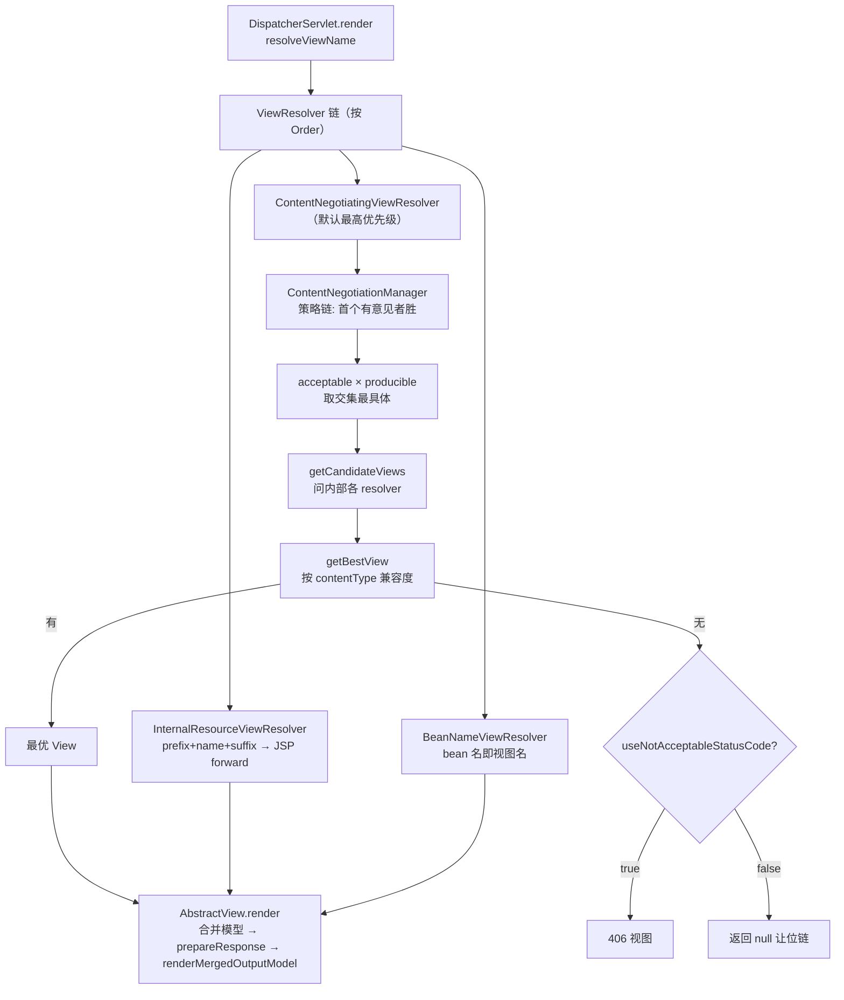
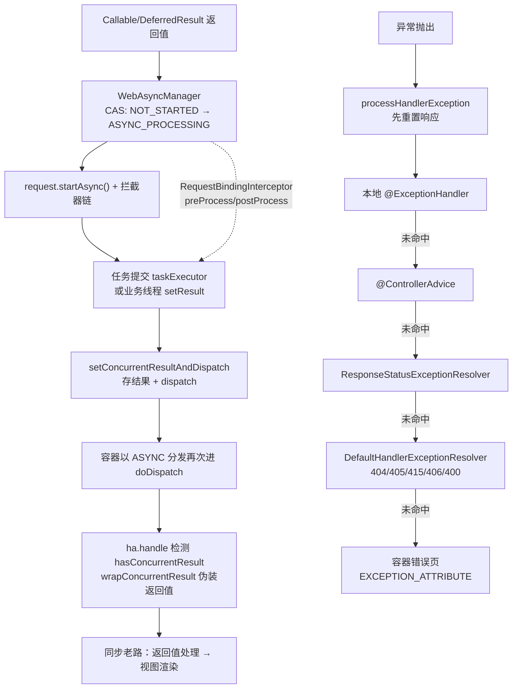

> 基于对 Spring Framework `spring-webmvc`（及支撑模块 `spring-web`）源码的逐文件精读整理而成。
> 阅读顺序即学习顺序：请求生命周期（DispatcherServlet）→ 组件发现流（HandlerMapping）→ 数据绑定流（HandlerAdapter）→ 视图与内容协商 → 异步/CORS/拦截器/异常。
> 所有结论均标注了源文件位置（相对路径 + 行号），建议对照代码阅读。
>
> - 仓库：`D:/work/2026/deep-dive/sources/spring-framework`（git shallow clone，tag `v7.0.9`，只读未改动）
> - 版本：Spring Framework 7.0.9（Jakarta EE 10 / `jakarta.servlet` 命名空间）
> - Commit：`82a6b40b9366ec181ededdad282b307ee5381a52`
> - 提交时间：2026-08-14 09:12:18 +0200
> - 源码基线命令：`git -C <repo> rev-parse HEAD` 与 `git log -1 --format=%ci`

---

## 〇、全景地图

```
┌────────────────────────── Servlet 容器层 ──────────────────────────┐
│ HttpServlet.service                                                │
│  └► FrameworkServlet.service (L870)  非标准方法(PATCH/WebDAV)直通   │
│       └► doGet/doPost/doPut/doDelete (L889-926) → processRequest   │
│            ├─ buildLocaleContext / buildRequestAttributes           │
│            ├─ initContextHolders（Locale/Request 线程绑定）          │
│            └► doService → DispatcherServlet.doService (L829)        │
│                 └► doDispatch (L935) ◄── 一次请求的真正心脏          │
└──────────────────────────────────┬──────────────────────────────────┘
                                   ▼
┌──────────────────────── doDispatch 主管线 ────────────────────────┐
│ checkMultipart → getHandler → applyPreHandle → getHandlerAdapter    │
│      → ha.handle → applyDefaultViewName → applyPostHandle           │
│      → processDispatchResult → render → triggerAfterCompletion      │
│         （异常则 processHandlerException 走 HandlerExceptionResolver）│
└───────┬──────────────────┬──────────────────┬──────────────────────┘
        ▼                  ▼                  ▼
┌───────────────┐  ┌────────────────┐  ┌──────────────────┐
│ HandlerMapping │  │ HandlerAdapter │  │  ViewResolver    │
│ 组件发现流      │  │ 数据绑定流      │  │ 视图渲染          │
│ ①AbstractHandler│  │①RequestMapping  │  │①InternalResource │
│  Mapping        │  │ HandlerAdapter │  │ ViewResolver     │
│ ②RequestMapping │  │  invokeHandler │  │②BeanNameView     │
│  HandlerMapping│  │  Method:       │  │ Resolver         │
│ ③SimpleUrl/    │  │  - Argument    │  │③ContentNegotiating│
│  RouterFunction│  │    Resolvers   │  │ ViewResolver     │
│                │  │  - ReturnValue │  │                  │
│                │  │    Handlers    │  │                  │
│                │  │  - Message     │  │                  │
│                │  │    Converters  │  │                  │
└───────┬────────┘  └───────┬────────┘  └────────┬─────────┘
        │ HandlerExecutionChain（handler + 拦截器链）│                │
        ▼                   ▼                      ▼
┌──────────────────── 横切关注点（第五讲）──────────────────────────┐
│ WebAsyncManager（Callable/DeferredResult/ResponseBodyEmitter）     │
│ CORS（AbstractHandlerMapping.CorsInterceptor 或 CorsFilter）       │
│ ExceptionHandlerExceptionResolver（@ControllerAdvice 兜底）        │
│ MultipartResolver（StandardServletMultipartResolver）              │
└──────────────────────────────────────────────────────────────────┘
```

渲染友好版（GitHub/GitLab 直接出图，信息同上图）：



**三条主线**：

1. **请求流（控制流）**：`service → processRequest → doService → doDispatch → checkMultipart → getHandler → applyPreHandle → ha.handle → applyPostHandle → processDispatchResult → render → triggerAfterCompletion`，异常在 `processHandlerException` 处汇入 `HandlerExceptionResolver` 链；
2. **组件发现流**：`initStrategies` 按类型从 `WebApplicationContext` 收集九大类策略 bean → 请求时 `getHandler` 按序问遍每个 `HandlerMapping` → `AbstractHandlerMethodMapping.MappingRegistry` 用 `pathLookup` 直查 + `registry` 全量匹配两级查找 → `MatchComparator` 选出唯一最优；
3. **数据绑定流**：`HandlerMethod` → `ServletInvocableHandlerMethod.invokeAndHandle` → 逐个 `MethodParameter` 问 `HandlerMethodArgumentResolverComposite`（带 256 容量缓存）→ `WebDataBinder` + `ConversionService` 完成 String→POJO 转换 → 反射调用 → `HandlerMethodReturnValueHandler` 决定写回方式 → `HttpMessageConverter` 按 Accept/produces 协商序列化。

---

## 面试速通：Spring MVC 高频问题一页纸

> **先给结论**：Spring MVC 的面试题万变不离一条主线——
> 启动时 `initStrategies` 按类型从 `WebApplicationContext` 收集策略组件，请求时 `doDispatch` 用一条写死的管线把它们编排起来。
> 四个核心组件各回答一个问题：
>
> - **HandlerMapping**：这个请求交给谁？
> - **HandlerAdapter**：找到之后怎么执行？
> - **ViewResolver**：结果怎么渲染成响应？
> - **HandlerExceptionResolver**：任何一环出错谁兜底？
>
> 被追问细节时按讲次展开：第一讲管线编排、第二讲查找注册表、第三讲参数绑定、第四讲视图与内容协商、第五讲异步/CORS/拦截器/异常。
> 本章所有结论均出自前五讲小结，不引入外部资料；「深入」列就是回查入口。
> 用法：先记「一句话结论」扛住第一轮，再按讲次逐层展开。

### 高频 Q&A（先结论）

一张表覆盖 Spring MVC 最高频的 16 个问题：先记住「一句话结论」扛住第一轮；
被追问「为什么」「底层怎么做的」时，按「深入」列回查对应讲次；
表中结论均直接提炼自该讲小结的「三个最值得记住的点」，可放心引用。

| # | 面试问题 | 一句话结论 | 深入 |
|---|---|---|---|
| 1 | DispatcherServlet 的工作流程？ | 一条固定管线：`checkMultipart → getHandler → applyPreHandle → ha.handle → applyPostHandle → processDispatchResult → render → triggerAfterCompletion`；双层 try 把异常变成数据统一汇入 `processDispatchResult`，连 `Error` 也被包成 `ServletException` 进 `@ExceptionHandler` | 第一讲 |
| 2 | Spring MVC 九大组件有哪些？ | 7.0 实际装配 **8 类策略**（历史第 9 类 `ThemeResolver` 已在 6.0 移除）：MultipartResolver、LocaleResolver、HandlerMapping、HandlerAdapter、HandlerExceptionResolver、RequestToViewNameTranslator、ViewResolver、FlashMapManager；默认值读类路径 `DispatcherServlet.properties` 且经 BeanFactory 实例化 | 第一讲 |
| 3 | HandlerMapping 的映射原理？ | 启动期注解扫描注册进 `MappingRegistry`（四张表一把读写锁）；运行期 `pathLookup` 直查先挡掉无变量路径，落空才全量条件匹配，`MatchComparator` 仲裁，**平手即抛 `IllegalStateException`** | 第二讲 |
| 4 | `@RequestMapping` 的匹配条件？多个都能匹配怎么办？ | `RequestMappingInfo` = 路径模式 + methods + params + headers + consumes + produces + version + custom，任一子条件不过则整体不过；`compareTo` 越具体越排前，返回 0 即歧义失败——显式失败而非静默取一 | 第二讲 |
| 5 | HandlerAdapter 怎么执行方法？参数怎么解析？ | `RequestMappingHandlerAdapter` 用「supports 先问、resolve 后行」的组合链 + 256 容量按参数缓存，逐个 `MethodParameter` 找 `HandlerMethodArgumentResolver`；兜底哲学：没人认的参数也有归宿——无注解简单类型当请求参数、复杂类型当 model attribute | 第三讲 |
| 6 | `@RequestBody` / `@ResponseBody` 的原理？ | `RequestResponseBodyMethodProcessor` 读写两端都过 `HttpMessageConverter`：读按 Content-Type 选转换器，写按 Accept × produces 协商；默认转换器只有 ByteArray/String/Form 三件套，**不含 Jackson**——「不强制依赖 Jackson」的物理证据 | 第三讲 |
| 7 | 415 和 406 有什么区别？ | 415 = 读失败（无 converter 能读该 Content-Type），406 = 写失败（Accept 与 produces 无交集）；且只有 POST/PUT/PATCH 配报 415，GET/HEAD/DELETE 无 converter 也静默返回 null | 第三讲 |
| 8 | `@Valid` 校验失败会发生什么？ | 看下一个参数：不是 `Errors`/`BindingResult` 就抛 `BindException`（可被 `@ExceptionHandler` 接住）；是则把错误安静装进 `Errors` 参数、方法照常执行——「加个 BindingResult 就不抛异常」的源码依据 | 第三讲 |
| 9 | 统一异常处理怎么实现？ | 五级兜底：本地 `@ExceptionHandler` → `@ControllerAdvice`（按 basePackages/assignableTypes 过滤）→ `ResponseStatusExceptionResolver` → `DefaultHandlerExceptionResolver`（404/405/415/406/400）→ 容器错误页；处理器收异常全部 cause + 原 `HandlerMethod`，自身炸了返回 null 继续兜底 | 第五讲 |
| 10 | 拦截器和 Filter 的区别？ | 拦截器是 MVC 管线内的一环（`HandlerExecutionChain`，拿得到 handler 与 `ModelAndView`，`preHandle` 返回 false 即中断）；Filter 在 Servlet 容器层（`CorsFilter`/`MultipartFilter`），不依赖 MVC 映射，适合静态资源与非 DispatcherServlet 场景 | 第一、五讲 |
| 11 | ViewResolver 的工作原理？ | 责任链：`resolveViewName` 返回 null 即让位，按 `Ordered` 遍历首个非 null 生效，全落空抛 `ServletException`；`ContentNegotiatingViewResolver` 默认最高优先级，包住其他 resolver 按媒体类型选优 | 第四讲 |
| 12 | 内容协商怎么做的？ | `ContentNegotiationManager` 自身就是策略链：首个「有意见」（非 `MEDIA_TYPE_ALL`）的策略获胜，顺序即优先级——parameter 策略放前面即可用 `?format=` 覆盖 Accept 头；扩展名只认安全扩展名防 RFD | 第四讲 |
| 13 | 转发和重定向的区别？模型怎么到视图？ | 转发经 `exposeModelAsRequestAttributes` 把模型塞进 request 属性再 `RequestDispatcher.forward`（浏览器地址不变）；重定向发 302 + Location，模型默认按 URI 模板展开成查询串，flash 属性改走 FlashMap | 第四讲 |
| 14 | 异步请求怎么处理？ | 「中断 + 续跑」而非另一条渲染管线：`setConcurrentResultAndDispatch` 存结果后容器以 `DispatcherType.ASYNC` 重进 `doDispatch`，`wrapConcurrentResult` 把结果伪装成同步返回值走老路；`RequestBindingInterceptor` 保证异步线程里线程变量不丢 | 第五讲 |
| 15 | CORS 怎么实现？ | 两处入口（HandlerMapping 内嵌注入 `CorsInterceptor` / `CorsFilter`）共用 `DefaultCorsProcessor`；preflight 直接换 `PreFlightHttpRequestHandler` 且不继续链；`allowedOriginPatterns` 才允许通配 origin 与凭据共存 | 第二、五讲 |
| 16 | 文件上传的原理？ | `MultipartResolver` 把 request 包成 `MultipartHttpServletRequest`；7.0 只剩 `StandardServletMultipartResolver`（Servlet 3.0 `Part` API，`CommonsMultipartResolver` 已彻底移除），且要求 bean 名 `multipartResolver`（默认无）；临时文件清理必须覆盖整个异步周期 | 第一、五讲 |

### 易错点与面试坑

以下都是文档中强调过的反直觉点——只背结论不够，面试官专挑这些追问；
按「出丑概率」从口径题排到调试题。

- **「九大组件」是历史口径**：7.0 的 `initStrategies` 实际只装配 8 类策略，`ThemeResolver` 已在 6.0 移除（文档全文检索无命中）。
  按「9」记只能是「8 类策略 + DispatcherServlet 自身」。
  面试脱口而出 ThemeResolver，暴露的是背的老笔记——先纠正口径，再展开八类各自职责。

- **404 ≠ 405**：404 是 `getHandler` 问遍所有 HandlerMapping 全部落空（`NoHandlerFoundException`，路径没人认）；
  405 是方法不匹配（`HttpRequestMethodNotSupportedException`，路径有人认但方法没对上）。
  两者同由 `DefaultHandlerExceptionResolver` 兜底映射，但是不同异常、不同排查方向——报错时先分清是 URL 写错还是方法用错。

- **415 不属于 GET**：`SUPPORTED_METHODS` 只有 POST/PUT/PATCH，无 body 语义的方法即使没有 converter 能读也静默返回 null，不会 415。
  读请求体时 Content-Type 缺失按 `application/octet-stream` 记 `noContentType`；
  `EmptyBodyCheckingHttpInputMessage` 借 `mark/reset` 探一个字节判断空 body，空 body 走 `RequestBodyAdvice.handleEmptyBody`。

- **忘了 `@ResponseBody`，返回值会静默变成模型属性**：没人认领的返回值兜底当 model attribute（`public User foo()` 自动以 `user` 之名进模型），本该返回 JSON 的接口于是跑去解析视图。
  反之 `@ResponseBody`/`ResponseEntity` 路径 `mavContainer.isRequestHandled()` 为 true，`getModelAndView` 直接返回 null，短路掉整个视图渲染。
  这是「接口莫名在找视图」的高频根因。

- **`@Valid` 失败不是默默失败**：下一个参数没有 `Errors`/`BindingResult` 就抛 `BindException`（可被 `@ExceptionHandler` 接住）。
  加一个 `BindingResult` 参数，错误就安静装进 `Errors`、方法照常执行。
  「加了参数反而不抛异常」不是 bug，是 `isBindExceptionRequired` 的分流规则；方法级校验还有 6.1+ 的 `shouldValidateArguments`。

- **拦截器 `preHandle` 返回 false 之后发生了什么**：立即对**已执行过的**拦截器逆序 `triggerAfterCompletion`，然后 `doDispatch` 直接 return——`ha.handle` 不执行，`applyPostHandle` 也不执行。
  `triggerAfterCompletion` 单个失败只记日志不阻断其余；
  `interceptorIndex` 游标是安全网：中断时只对已执行的拦截器补 `afterCompletion`，不会误伤链上后面的。

- **重定向传值有两条路，别走错**：普通模型由 `RedirectView` 按 URI 模板展开成查询串跟在 URL 后，只有 `RedirectAttributes` 的 flash 属性走 `FlashMapManager`。
  完整闭环：redirect 前 `saveOutputFlashMap` 保存 → 下次请求 `doService` 阶段 `retrieveAndUpdate` 取回 → `invokeHandlerMethod` 灌进 `mavContainer`。
  面试常追问「redirect 后属性为什么丢了」——答案就在这条闭环的任一环节断裂上。

- **平手即失败，不是猜一个**：两个候选 `compareTo` 返回 0 直接抛 `IllegalStateException`，Spring 用快速失败对抗「静默取一」。
  同一思路还有 7.0 新增的 CGLIB 代理校验——代理类上的 private 方法启动期就抛 `IllegalStateException`；
  把「私有方法突然 404」这类灵异问题变成启动即失败，是读 7.0 源码最值的投资。

### 关键概念对照表

容易混淆的几组概念，一次对照清楚。
分组均依据文档中出现过的家族划分，不引入外部分类法。

| 概念组 | 成员 | 一句话区分 |
|---|---|---|
| 横切三件套 | Filter vs Interceptor vs @ControllerAdvice | Filter 在 Servlet 容器层，不依赖 MVC 映射；Interceptor 在 `HandlerExecutionChain` 内，能拿 handler 与 `ModelAndView`、`preHandle` 可中断链路；@ControllerAdvice 是启动期扫出的全局 Advice 缓存（`@ModelAttribute`/`@InitBinder`/`RequestBodyAdvice`/`ResponseBodyAdvice`），按 basePackages/assignableTypes/annotations 决定适用哪些 bean |
| @RequestMapping 变体 | 类级 `@RequestMapping` vs 方法级 `@GetMapping`/`@PostMapping` | 类级与方法级 info `combine`：路径拼接、条件合并；空映射补 `""` 与 `"/"` 两个路径，保证 `/user` 与 `/user/` 都命中；6.1+ `pathPrefixes` 在最后叠加路径前缀 |
| HandlerMapping 家族 | Abstract / AbstractUrl / AbstractHandlerMethod / RequestMappingHandlerMapping | 骨架（顺序、默认 handler、拦截器合并、CORS 注入）；URL 直查表 + PathPattern；`MappingRegistry` 注册表；`@Controller` 注解专用层（只认 `@Controller`，`@RestController` 因元注解天然入选） |
| ViewResolver 家族 | InternalResource / BeanName / ContentNegotiating | `prefix+name+suffix` 拼 JSP 路径 forward；bean 名即视图名（两级检查都失败才返回 null 让位）；默认最高优先级、自己不渲染、按媒体类型包住其他 resolver 选优 |
| 参数解析链 | 注解型 / 类型型 / 自定义 / 兜底 | 顺序即优先级；自定义插在「注解型/类型型」与「兜底」之间，永远优先于兜底；兜底两形态：`useDefaultResolution=true` 与 `annotationNotRequired=true` |
| 异步三兄弟 | Callable / DeferredResult / ResponseBodyEmitter（SseEmitter） | Callable 是「任务」、DeferredResult 是「结果容器」、Emitter 是「流」，三者共用同一套「存结果 + 重新 dispatch」续跑机制 |
| 异常兜底链 | 本地 → Advice → ResponseStatus → DefaultHandler → 容器 | 每级软失败把异常继续往下传；DefaultHandlerExceptionResolver 把 404/405/415/406/400 一网打尽；处理器方法收异常全 cause 链作参数 |
| 协商策略 | Header / Parameter / Fixed / 扩展名 | Accept 头（默认）；`?format=xxx` 查询参数；构造时写死类型；URL 扩展名（只认安全扩展名，与 `addContentDispositionHeader` 同属防 RFD 战线） |

---

## 第一讲：DispatcherServlet —— 请求生命周期的总装配车间

### 定位

`DispatcherServlet` 是整个 Spring MVC 的「总装配车间」：它自己不干业务活，而是在启动时按类型从 `WebApplicationContext` 收集一整套策略组件（HandlerMapping/HandlerAdapter/HandlerExceptionResolver/ViewResolver/...），在请求时把它们编排成一条固定管线。理解这一讲的关键是接受一个设计哲学：**DispatcherServlet 的每个环节都是一个可替换的策略接口，框架只定义编排顺序，不定义具体实现**。

类继承链：`HttpServletBean`（把 `ServletConfig` init-param 当 bean 属性设置）→ `FrameworkServlet`（创建并持有自己的 `WebApplicationContext`，把 doGet/doPost 全部收敛到 `processRequest`）→ `DispatcherServlet`（装配九大策略 + `doDispatch` 编排）。

### 目录结构：三个文件，一条继承链

```
spring-webmvc/src/main/java/org/springframework/web/servlet/
├── HttpServletBean.java        244 行  init() 把 init-param 映射为 bean 属性
├── FrameworkServlet.java      1211 行  WebApplicationContext 生命周期 + 请求入口收敛
├── DispatcherServlet.java     1408 行  九大策略装配 + doDispatch 编排（本讲主角）
├── HandlerExecutionChain.java  211 行  handler + 拦截器链 + 三个 apply/trigger 方法
├── FlashMapManager.java         58 行  redirect 跨请求传参的存储接口
├── NoHandlerFoundException.java       404 异常的载体
├── HandlerMapping.java / HandlerAdapter.java / HandlerExceptionResolver.java
├── ViewResolver.java / View.java / ModelAndView.java   （第四讲主角）
├── handler/                            AbstractHandlerMapping 等（第二讲）
├── mvc/method/annotation/              RequestMappingHandlerAdapter 等（第三讲）
└── view/                               ViewResolver 家族（第四讲）
```

### 1.1 HttpServletBean.java —— init-param 即 bean 属性

`HttpServletBean.init()`（`HttpServletBean.java:150`，`final` 不可覆写）只做两件事：

1. 用 `ServletConfigPropertyValues`（`HttpServletBean.java:209` 内部类）把 `web.xml` 里 `<init-param>` 全量搬进 `PropertyValues`，缺必填属性直接抛 `ServletException`（`HttpServletBean.java:236`）；
2. 通过 `BeanWrapper`（`HttpServletBean.java:156`）把属性值 set 进 servlet 实例——**类型转换自动完成**，并注册 `ResourceEditor` 让 `contextConfigLocation` 这类值可以写成 classpath 路径。

之后调用模板方法 `initServletBean()`（`HttpServletBean.java:192`）。这个「配置即属性」的机制意味着 `DispatcherServlet` 的所有开关（`detectAllHandlerMappings`、`cleanupAfterInclude` 等，`DispatcherServlet.java:378-426`）都能用 init-param 控制。

### 1.2 FrameworkServlet.java —— 上下文托管与请求入口收敛

**启动侧**（`FrameworkServlet.initServletBean`，`FrameworkServlet.java:520`）：调用 `initWebApplicationContext()`（`FrameworkServlet.java:558`）。这里有三条来源分支，优先级从高到低：

1. 构造器注入的上下文（`FrameworkServlet.java:563`）——Servlet 3.0 编程式注册场景；未 refresh 的会补设 parent/ID 后 `configureAndRefreshWebApplicationContext`（`FrameworkServlet.java:667`）；
2. `findWebApplicationContext()`（`FrameworkServlet.java:617`）——按 `contextAttribute` 名字从 `ServletContext` 属性里找（`ContextLoaderListener` 提前放好的）；
3. 都没有才 `createWebApplicationContext()`（`FrameworkServlet.java:645`）自建一个 `XmlWebApplicationContext`（或 `contextClass` 指定的类）， refresh 后作为 servlet 属性发布。

`onRefresh` 的触发有两条路径保证必达：`ContextRefreshedEvent` 监听器（`FrameworkServlet.java:832`，置 `refreshEventReceived=true`）或初始化末尾的手动补偿调用（`FrameworkServlet.java:589-596`）。

**请求侧**：`FrameworkServlet` 把 `HttpServlet` 的 `doGet/doPost/doPut/doDelete` 全部 `final` 化并统一委托给 `processRequest`（`FrameworkServlet.java:889-926`）；`service()`（`FrameworkServlet.java:870`）对 PATCH 等非标准方法绕过 `HttpServlet` 的分发直接进 `processRequest`。

`processRequest`（`FrameworkServlet.java:982`）才是请求真正的入口，它做四件与 MVC 无关但必不可少的事：

1. `buildLocaleContext` + `buildRequestAttributes`（`FrameworkServlet.java:988-992`）构造线程上下文；
2. `initContextHolders`（`FrameworkServlet.java:997`）把 `LocaleContext`/`RequestAttributes` 绑到 `LocaleContextHolder`/`RequestContextHolder` 线程变量——**这是整个框架「任何地方能拿到当前请求」的根基**；
3. `WebAsyncUtils.getAsyncManager(request).registerCallableInterceptor(...)`（`FrameworkServlet.java:994-995`）注册 `RequestBindingInterceptor`，保证异步线程里线程变量不丢（详见第五讲）；
4. `try { doService(...) } finally { resetContextHolders + requestCompleted + logResult + publishRequestHandledEvent }`（`FrameworkServlet.java:999-1018`）——`ServletRequestHandledEvent` 让监控/审计可以订阅每个请求的耗时与结局。

### 1.3 DispatcherServlet.onRefresh / initStrategies —— 九大组件装配

`DispatcherServlet.onRefresh`（`DispatcherServlet.java:433`）只有一句：`initStrategies(context)`。`initStrategies`（`DispatcherServlet.java:441-450`）依次调用 8 个 init 方法，对应 8 类可替换策略：

| # | init 方法 | 字段 | 缺失时的默认值（来自 `DispatcherServlet.properties`） |
|---|---|---|---|
| 1 | `initMultipartResolver` L457 | `multipartResolver` | **无默认**（null = 不支持文件上传） |
| 2 | `initLocaleResolver` L481 | `localeResolver` | `AcceptHeaderLocaleResolver` |
| 3 | `initHandlerMappings` L506 | `handlerMappings` | `BeanNameUrlHandlerMapping` + `RequestMappingHandlerMapping` + `RouterFunctionMapping` |
| 4 | `initHandlerAdapters` L552 | `handlerAdapters` | `HttpRequestHandlerAdapter` + `SimpleControllerHandlerAdapter` + `RequestMappingHandlerAdapter` + `HandlerFunctionAdapter` |
| 5 | `initHandlerExceptionResolvers` L591 | `handlerExceptionResolvers` | `ExceptionHandlerExceptionResolver` + `ResponseStatusExceptionResolver` + `DefaultHandlerExceptionResolver` |
| 6 | `initRequestToViewNameTranslator` L630 | `viewNameTranslator` | `DefaultRequestToViewNameTranslator` |
| 7 | `initViewResolvers` L656 | `viewResolvers` | `InternalResourceViewResolver` |
| 8 | `initFlashMapManager` L695 | `flashMapManager` | `SessionFlashMapManager` |

> **口径说明**：老资料常说「九大组件」，本版本 `initStrategies` 实际装配 **8 类**——历史上第 9 类 `ThemeResolver` 已在 6.0 移除（全文检索 `ThemeResolver` 无任何命中）。若按「9」记：8 类策略 + `DispatcherServlet` 自身。

收集策略的统一套路（以 `initHandlerMappings` 为例，`DispatcherServlet.java:506-545`）：

- `detectAllHandlerMappings=true` 时用 `BeanFactoryUtils.beansOfTypeIncludingAncestors(..., true, false)` 按类型收集**含父上下文**的所有 bean，`AnnotationAwareOrderComparator.sort` 排序（`DispatcherServlet.java:512-517`）；
- `false` 时只取名为 `handlerMapping` 的单 bean（`DispatcherServlet.java:521`）；
- 一个都没找到才回落到 `getDefaultStrategies`（`DispatcherServlet.java:766`）读类路径下的 `DispatcherServlet.properties`，逐逗号分割类名，经 `AutowireCapableBeanFactory.createBean` 实例化（`DispatcherServlet.java:819`）——**默认策略也走 Spring 生命周期，能注入依赖**。

`initHandlerMappings` 末尾还有一个易漏的细节（`DispatcherServlet.java:539-544`）：只要有任一 mapping 的 `usesPathPatterns()` 为 true，就置 `parseRequestPath=true`，这决定了 `doService` 里是否提前解析并缓存 `RequestPath`（见 1.4）。

### 1.4 DispatcherServlet.doService —— 请求级准备

`doService`（`DispatcherServlet.java:829`）在 `doDispatch` 之前准备请求级状态：

1. `logRequest`（`DispatcherServlet.java:881`，委托 `LogFormatUtils.traceDebug`）打请求日志，敏感参数默认 `masked`，只有 `enableLoggingRequestDetails=true` 才明文；
2. include 请求时给 request 属性拍快照（`DispatcherServlet.java:834-844`），finish 时还原（`restoreAttributesAfterInclude`，`DispatcherServlet.java:1372`）——**include 场景下不允许视图污染主请求属性**，由 `cleanupAfterInclude` 开关控制；
3. 把 `WebApplicationContext`/`LocaleResolver` 挂到 request 属性（`DispatcherServlet.java:847-848`），标签库和视图据此取框架对象；
4. FlashMap 三件套（`DispatcherServlet.java:850-857`）：`retrieveAndUpdate` 取出上次 redirect 存入的 input map，新建 output map 与 manager 引用挂属性；
5. `parseRequestPath` 时预解析 `RequestPath` 并缓存（`DispatcherServlet.java:859-863`），finish 里恢复原值。

### 1.5 doDispatch 逐行精读 —— 一次请求的心脏

`doDispatch`（`DispatcherServlet.java:935-1004`）是全文最重要的方法。整体是一个**双层 try 结构**：内层把异常捕获进 `dispatchException` 变量继续往下走，外层兜底触发 `triggerAfterCompletion` 并向上抛。

```
processedRequest = request
mappedHandler    = null
multipartRequestParsed = false
asyncManager = WebAsyncUtils.getAsyncManager(request)     // L940

try {                                                     // L942 外层
  ModelAndView mv = null; Exception dispatchException = null;
  try {                                                   // L946 内层
    processedRequest = checkMultipart(request)            // L947  multipart 包装
    multipartRequestParsed = (processedRequest != request) // L948
    mappedHandler = getHandler(processedRequest)          // L951  问遍 HandlerMapping
    if (mappedHandler == null) { noHandlerFound(...); return }  // L952-955
    if (!mappedHandler.applyPreHandle(...)) return        // L957-959 拦截器前置
    HandlerAdapter ha = getHandlerAdapter(mappedHandler.getHandler()) // L962
    mv = ha.handle(processedRequest, response, mappedHandler.getHandler()) // L963 执行！
    if (asyncManager.isConcurrentHandlingStarted()) return // L965-967 异步已启动则让出
    applyDefaultViewName(processedRequest, mv)            // L969  默认视图名推导
    mappedHandler.applyPostHandle(processedRequest, response, mv) // L970 拦截器后置
  }
  catch (Exception ex) { dispatchException = ex }          // L972-974
  catch (Throwable err) {                                   // L975-979
    dispatchException = new ServletException("Handler dispatch failed: " + err, err)
  }
  processDispatchResult(processedRequest, response, mappedHandler, mv, dispatchException) // L980
}
catch (Exception ex)  { triggerAfterCompletion(..., ex) }   // L982-984
catch (Throwable err) { triggerAfterCompletion(..., new ServletException(...)) } // L985-988
finally {                                                   // L989-1003
  if (asyncManager.isConcurrentHandlingStarted()) {
    mappedHandler.applyAfterConcurrentHandlingStarted(...)  // L993
    asyncManager.setMultipartRequestParsed(multipartRequestParsed) // L995
  }
  else if (multipartRequestParsed || asyncManager.isMultipartRequestParsed()) {
    cleanupMultipart(processedRequest)                     // L1000 清理临时文件
  }
}
```

几个值得停下来想一想的设计：

- **`Throwable` 也进异常链**（L975-979）：4.3 起 handler 抛的 `Error` 也被包成 `ServletException` 交给 `@ExceptionHandler`，不会直接穿透到容器；
- **异步提前 return 的纪律**（L965）：`ha.handle` 一旦启动并发处理，`postHandle`/`afterCompletion` 都不在本线程执行，改由 `applyAfterConcurrentHandlingStarted` 处理（L993），并记住 multipart 已解析的事实（L995）供异步完成后的 dispatch 清理；
- **finally 的 multipart 清理双条件**（L999）：`multipartRequestParsed`（本线程解析的）或 `asyncManager.isMultipartRequestParsed()`（异步 dispatch 记住的）任一为真才清理——防止重复清理或漏清理。

#### checkMultipart：multipart 包装与容错

`checkMultipart`（`DispatcherServlet.java:1089`）在 multipartResolver 存在且 `isMultipart(request)` 为真时把 request 包成 `MultipartHttpServletRequest`。三条保护分支值得记住：

- 已被 `MultipartFilter` 解析过的不重复解析（L1091-1095）；
- 本次请求此前 multipart 解析就失败过（`hasMultipartException` 查 `jakarta.servlet.error.exception` 属性链，L1122-1131），为「无干扰错误渲染」跳过重解析（L1096-1099）；
- error dispatch 场景下解析失败只记 debug 不抛出（L1104-1112）——**错误页渲染不该被 multipart 错误二次打断**。

#### getHandler：按序问遍，先到先得

`getHandler`（`DispatcherServlet.java:1154-1164`）极其简单：**for 循环第一个返回非 null 的 `HandlerMapping` 胜出**。映射的优先级由 bean 的 `Ordered` 决定（装配时已排序）。全部落空返回 null，由 `noHandlerFound`（`DispatcherServlet.java:1172`）抛 `NoHandlerFoundException`，并用独立 logger `org.springframework.web.servlet.PageNotFound`（`DispatcherServlet.java:244, 259`）打 warn——**把「404 噪音」从普通 debug 日志里分离出来**是该 logger 存在的全部理由。

#### processDispatchResult：异常 → ModelAndView 的统一汇入口

`processDispatchResult`（`DispatcherServlet.java:1022-1062`）把「正常 mv」和「异常」两条路合并：

1. 异常是 `ModelAndViewDefiningException` 直接取其 mv（L1029-1032）；
2. 否则 `processHandlerException`（L1035）走 `HandlerExceptionResolver` 链，返回的 mv 标记为 `errorView`；
3. mv 非空且未被 clear 才 `render`（L1041-1046），错误视图渲染后 `WebUtils.clearErrorRequestAttributes` 清理（L1044）；
4. 渲染前再查一次异步（L1053-1056）——**渲染中也可能启动异步**（例如 SSE）；
5. 最后 `mappedHandler.triggerAfterCompletion(request, response, null)`（L1060）——注意这里异常已消化，传 null。

`processHandlerException`（`DispatcherServlet.java:1207-1256`）有两个工程细节：进链前先**重置响应**（清 `Content-Type`/`Content-Disposition` 头 + `resetBuffer`，L1214-1218，已提交则容忍 `IllegalStateException`）——**成功响应的半截内容不能污染错误响应**；解析出的空 mv（`exMv.isEmpty()`）只把异常挂 `EXCEPTION_ATTRIBUTE` 属性（L1234-1236）供容器错误页使用，自己不渲染。所有 resolver 都返回 null 则原样抛异常（L1255）上行给容器。

#### render：视图名 → View 对象 → 渲染

`render`（`DispatcherServlet.java:1267-1313`）三步：`resolveViewName` 遍历 viewResolvers 找 View（`resolveViewNameInternal`，`DispatcherServlet.java:1345`，返回 null 直接抛 `ServletException`）→ `SmartView` 递归解析嵌套视图（L1292-1294）→ 设置 status 后 `view.render(mv.getModelInternal(), request, response)`（L1305）。

### 1.6 HandlerExecutionChain 与 FlashMapManager

**HandlerExecutionChain**（`HandlerExecutionChain.java:40`）= handler + 拦截器列表 + `interceptorIndex` 游标。三个方法的执行语义是面试级考点：

| 方法 | 行号 | 方向 | 关键行为 |
|---|---|---|---|
| `applyPreHandle` | L142 | 正序 | 任一 `preHandle` 返回 false，立即对**已执行过的**拦截器逆序 `triggerAfterCompletion` 并返回 false（L146） |
| `applyPostHandle` | L157 | **逆序** | 从 `size()-1` 到 0 |
| `triggerAfterCompletion` | L171 | **逆序** | 只对 `interceptorIndex` 及以下的执行，单个抛异常只记日志不中断（L177-179） |
| `applyAfterConcurrentHandlingStarted` | L186 | 逆序 | 仅对 `AsyncHandlerInterceptor` 类型调用，异常同样只记日志 |

构造器还有一个「链套链」展平逻辑（`HandlerExecutionChain.java:77-80`）：传入的 handler 若本身是 chain，取其 handler 并合并其拦截器——`AbstractHandlerMapping` 子类返回预建 chain 时靠它合并静态拦截器。

**FlashMapManager**（`FlashMapManager.java:31`）只有两个方法：`retrieveAndUpdate`（L44，请求开始取出并失效上次的 map）和 `saveOutputFlashMap`（L56，redirect 前保存）。redirect 传参的完整闭环：`RedirectAttributes` → `RequestMappingHandlerAdapter.getModelAndView` 把 flashAttributes 塞进 output map（`RequestMappingHandlerAdapter.java:1049-1055`）→ `RedirectView` 渲染时调 `saveOutputFlashMap` → 下次请求 `doService` 阶段 `retrieveAndUpdate` 取回 → `invokeHandlerMethod` 把 input map 灌进 `ModelAndViewContainer`（`RequestMappingHandlerAdapter.java:918`）。

### 1.7 输入/输出表

| 环节 | 输入 | 输出 | 异常去向 |
|---|---|---|---|
| `HttpServletBean.init` | `ServletConfig` init-param | servlet bean 属性 | 缺必填属性 → `ServletException` |
| `FrameworkServlet.processRequest` | HttpServletRequest/Response | 线程上下文已绑定的请求 | 包装为 `ServletException` 上抛 |
| `initStrategies` | `WebApplicationContext` | 8 类策略组件（List/单例） | 默认策略类加载失败 → `BeanInitializationException` |
| `checkMultipart` | 原始 request | 可能被 multipart 包装 | error dispatch 下失败只记日志 |
| `getHandler` | processedRequest | `HandlerExecutionChain` 或 null | null → `NoHandlerFoundException` |
| `getHandlerAdapter` | handler 对象 | 首个 `supports` 为真的 adapter | 无 → `ServletException`（致命） |
| `ha.handle` | request/response/handler | `ModelAndView` 或 null | 捕获进 `dispatchException` |
| `processHandlerException` | 异常 + handler | 错误 `ModelAndView` | 无人处理 → 原样上抛 |
| `render` | `ModelAndView` | 响应体 | 视图解析失败 → `ServletException` |

### 1.8 端到端演算（简版走查）

一次 `GET /users/42`（无拦截器、无异步、命中 `@GetMapping("/users/{id}")`）：

1. `service` → 标准方法 → `doGet` → `processRequest`：绑定 `ServletRequestAttributes`，注册 `RequestBindingInterceptor`；
2. `doService`：挂上下文属性，FlashMap 取回（无），`parseRequestPath=true` 预解析 `/users/42`；
3. `doDispatch`：`checkMultipart` 原样返回 → `getHandler` 遍历到 `RequestMappingHandlerMapping` 命中 → `applyPreHandle` 空链直接 true；
4. `getHandlerAdapter` 选中 `RequestMappingHandlerAdapter` → `handle` 返回 `ModelAndView("userDetail", model)`；
5. `applyDefaultViewName` 已有视图名不动 → `applyPostHandle` 空转 → `processDispatchResult` → `render`；
6. `resolveViewName("userDetail")` 经 `InternalResourceViewResolver` 得到 JSP 视图 → forward 渲染；
7. 外层 finally：非异步、非 multipart，无清理；`processRequest.finally` 重置线程变量、发布 `ServletRequestHandledEvent`。

### 第一讲小结：一套策略接口加一条固定编排管线

**一句话定位**：`DispatcherServlet` 把「可替换的策略组件」在启动时按类型收齐（8 类），请求时用一条写死的 `doDispatch` 管线把它们编排起来；它的价值全在编排顺序与异常汇流设计上。



**逐环节输入/输出**：

| 环节 | 输入 | 输出 | 失败行为 |
|---|---|---|---|
| `initStrategies` | 上下文 bean | 8 类策略 | 回落 `DispatcherServlet.properties` 默认类 |
| `checkMultipart` | request | 包装后 request | error dispatch 失败静默 |
| `getHandler` | request | `HandlerExecutionChain` | 全部落空 → 404 异常 |
| `getHandlerAdapter` | handler | adapter | 无适配器 → 致命 `ServletException` |
| `ha.handle` | 三元组 | `ModelAndView`/null | 进 `dispatchException` |
| `processHandlerException` | 异常 | 错误 mv | 链尾无人处理 → 上抛容器 |
| `render` | mv | 响应 | 视图名解析失败 → `ServletException` |

**三个最值得记住的点**：

1. **双层 try 是精心设计不是炫技**：内层把异常变成数据（`dispatchException`）让 `processDispatchResult` 统一汇流，外层只管 `triggerAfterCompletion` + 上抛；`Error` 也被包成 `ServletException` 进 `@ExceptionHandler`；
2. **拦截器游标 `interceptorIndex` 是安全网**：`preHandle` 中断时只对已执行的拦截器补 `afterCompletion`，`triggerAfterCompletion` 单个失败只记日志不阻断其余；
3. **错误响应前必须重置响应**（清 Content-Type + `resetBuffer`）且容忍已提交——成功响应的半截 body 混进错误响应是最难排查的 bug 之一。

---
## 第二讲：HandlerMapping 家族 —— 组件发现流

### 定位

`HandlerMapping` 回答一个问题：**这个请求该交给谁？** 第一讲里 `DispatcherServlet.getHandler` 只是「按序问到第一个非 null 为止」，本讲精读「问」的内部机制。家族分四层：

- `AbstractHandlerMapping`：所有 mapping 的骨架——顺序、默认 handler、拦截器合并、CORS 注入、API 版本；
- `AbstractUrlHandlerMapping`：URL 直查表 + `PathPattern` 模式匹配（`SimpleUrlHandlerMapping`、`BeanNameUrlHandlerMapping`、WebSocket 映射的地基）；
- `AbstractHandlerMethodMapping<T>`：方法级映射的注册/查找/并发安全注册表（`MappingRegistry`）；
- `RequestMappingInfoHandlerMapping` → `RequestMappingHandlerMapping`：`@RequestMapping` 注解体系，Spring MVC 的默认主角。

### 目录结构

```
spring-webmvc/src/main/java/org/springframework/web/servlet/handler/
├── AbstractHandlerMapping.java          824 行  骨架（本讲 2.1）
├── AbstractUrlHandlerMapping.java       555 行  URL 表 + PathPattern（2.5）
├── SimpleUrlHandlerMapping.java         191 行  静态 URL → bean（2.5）
├── BeanNameUrlHandlerMapping.java               bean 名即 URL（2.5 简述）
├── AbstractHandlerMethodMapping.java    817 行  MappingRegistry（2.3）
├── MappedInterceptor.java                      带路径条件的拦截器
├── HandlerMappingIntrospector.java             路由内省（供 MVC 配置用）
├── MatchableHandlerMapping.java                可匹配性接口
├── SimpleMappingExceptionResolver.java         老式异常映射（2.7 提及）
└── ...（ConversionServiceExposingInterceptor 等横切）

spring-webmvc/src/main/java/org/springframework/web/servlet/mvc/method/
├── RequestMappingInfo.java             1084 行  匹配条件全集合（2.4）
├── RequestMappingInfoHandlerMapping.java        注解 mapping 中间基类（2.4）
└── condition/                                   PatternsRequestCondition 等子条件

spring-webmvc/src/main/java/org/springframework/web/servlet/mvc/method/annotation/
└── RequestMappingHandlerMapping.java     601 行  @Controller 专用（2.2/2.4）

spring-webmvc/src/main/java/org/springframework/web/servlet/function/support/
└── RouterFunctionMapping.java           239 行  函数式路由（2.6）

spring-web/src/main/java/org/springframework/web/util/pattern/
├── PathPatternParser.java               132 行  模式解析器（2.4.3）
├── PathPattern.java                     759 行  编译后的匹配链 + 排序器
└── InternalPathPatternParser.java             逐字符状态机（非线程安全，每次 parse 新建）
```

### 2.1 AbstractHandlerMapping —— 骨架的三板斧

**字段即世界观**（`AbstractHandlerMapping.java:93-113`）：`defaultHandler`（兜底）、`patternParser`（默认非空，即**默认启用 PathPattern**，L95）、`urlPathHelper`/`pathMatcher`（L97-99，7.0 已标记 `forRemoval`）、`adaptedInterceptors`、`corsConfigurationSource`、`versionStrategy`（7.0 新增 API 版本）、`order`（默认 `LOWEST_PRECEDENCE`）。

`getHandler` 是 `final` 模板方法（`AbstractHandlerMapping.java:542-591`），编排顺序：

```
initApiVersion(request)                    // L543  解析 API 版本，挂 API_VERSION_ATTRIBUTE
handler = getHandlerInternal(request)      // L544  子类真正查找
handler == null → getDefaultHandler()      // L546-547 兜底
handler == null → return null              // L548-550
版本解析出错且非 ERROR dispatch → 抛错     // L552-554
handler 是 String → getBean(handlerName)   // L557-559 支持 bean 名寻址
确保 lookupPath 已缓存（initLookupPath）   // L562-564
executionChain = getHandlerExecutionChain(handler, request)  // L566 合拦截器
有 CORS 配置或是 preflight → 注入 CORS 链   // L577-588
return executionChain                      // L590
```

**`getHandlerExecutionChain`（L681-706）**是拦截器合并的中枢：映射自带的 `adaptedInterceptors` 逐个加入，`MappedInterceptor` 还要先 `matches(request)` 命中路径条件才加入（L687-690）——这就是「拦截器可以按 URL 生效」的实现点；`versionStrategy` 存在且命中版本时，追加 `ApiVersionDeprecationHandlerInterceptor`（L697-703）在响应头打弃用警告。

**CORS 注入（`getCorsHandlerExecutionChain`，L746-758）**设计得很俏皮：preflight 请求直接把 handler 换成 `PreFlightHttpRequestHandler`（空 handler，L795-811），真正的 CORS 响应头由插到链首的它自己的 `preHandle` 发；普通请求则插入 `CorsInterceptor`（L761-792）到链首。**CORS 不是 filter 的专利，它就在拦截器链的最前面**。`CorsInterceptor.preHandle` 还专门跳过 ASYNC 分发（L779-781，`hasConcurrentResult` 时直接放行）。

**`initLookupPath`（L641-651）**是 PathPattern 与旧式匹配的分水岭：启用 parsed patterns 时用 `requestPath.pathWithinApplication()` 并去分号内容；否则走 `UrlPathHelper.resolveAndCacheLookupPath`。`getRequestPath`（L653-659）还做了「有 DispatcherServlet 属性就用预解析的，否则现场 parse 并缓存」的兼容。

**`initApplicationContext`（L451-455）**：`extendInterceptors`（子类钩子）→ `detectMappedInterceptors`（按类型从上下文（含父）收集 `MappedInterceptor` bean，L478-481）→ `initInterceptors`（`WebRequestInterceptor` 适配成 `HandlerInterceptor`，L513-523）。

### 2.2 RequestMappingHandlerMapping —— 注解映射的专用层

`RequestMappingHandlerMapping`（`RequestMappingHandlerMapping.java:81`，继承 `RequestMappingInfoHandlerMapping`）的核心贡献：

**① `isHandler`（L181-183）**：只认类上带 `@Controller` 注解的 bean——**`@RestController` 是 `@Controller` 的元注解所以天然入选**，而普通 `@Component` 即使有 `@RequestMapping` 方法也不会被这个 mapping 扫到。

**② `getMappingForMethod`（L204-222）**：方法级 info 与类级 info `combine`（L211，路径拼接、条件合并）；空映射（只有注解没写路径）补 `""` 和 `"/"` 两个路径（L213-215，保证 `/user` 和 `/user/` 都能命中）；`pathPrefixes`（Spring 6.1+ 的路径前缀机制，如 `@Prefix("/api")`）在最后叠加（L216-219）。

**③ `afterPropertiesSet`（L146-159）**：先构造 `RequestMappingInfo.BuilderConfiguration` 并装入 `ContentNegotiationManager`、`ApiVersionStrategy`、`PatternParser`/`PathMatcher`，再调 `super.afterPropertiesSet()`——**顺序要紧：配置必须先于映射注册**（`AbstractHandlerMethodMapping.setPatternParser` 会断言注册表为空，`AbstractHandlerMethodMapping.java:104-106`）。

**④ CGLIB 代理校验（`validateCglibProxyMethodVisibility`，L228-254，7.0 新增）**：CGLIB 子类上的 private 方法、跨包的 package-private 方法直接抛 `IllegalStateException` 并给出修复建议——把「私有方法突然 404」这类灵异问题变成启动即失败。

**⑤ `initCorsConfiguration`（L492-512）**：类上与方法上 `@CrossOrigin` 合并，`@CrossOrigin` 没写 methods 时用 `@RequestMapping` 的方法集补齐（L506-510）——CORS 放行的方法永远和路由方法一致。

**⑥ `updateConsumesCondition`（L463-475）**：注册时若 consumes 条件非空，找到方法的 `@RequestBody` 参数，把 `required` 回灌给 `ConsumesRequestCondition.setBodyRequired`——**`consumes` 条件匹配时对「无 body 的 GET」会特殊放行**（`ConsumesRequestCondition` 内部据此判断）。

### 2.3 AbstractHandlerMethodMapping 与 MappingRegistry —— 注册表的并发美学

**注册侧**（`AbstractHandlerMethodMapping.java:217-297`）：`afterPropertiesSet → initHandlerMethods` 对每个候选 bean 名（跳过 `scopedTarget.` 前缀，L219）`processCandidateBean`：先用 `getType(beanName)` 拿类型**不实例化**（L252），是 handler 才 `detectHandlerMethods`：`MethodIntrospector.selectMethods` 逐个方法问 `getMappingForMethod`（L276-285），非空的注册。`createHandlerMethod`（L336-344）对 bean 名形式延迟到请求期解析 bean——**支持 handler bean 懒加载**。

**查找侧**（`getHandlerInternal`，L372-382 + `lookupHandlerMethod`，L393-434）两级加速 + 一次仲裁：

```
directPathMatches = pathLookup.get(lookupPath)     // L395 直查（无通配符的路径）
非空 → addMatchingMappings(directPathMatches, ...)  // L397
仍空 → addMatchingMappings(registry.keySet(), ...)  // L400 全量条件匹配
matches 非空：
  size>1 → MatchComparator 排序，取 bestMatch          // L405-407
  preflight 且全部有 CORS 配置 → 返回 PREFLIGHT_AMBIGUOUS_MATCH // L411-414
  best 与 second 比较为 0 → 抛 IllegalStateException 歧义 // L417-424
  挂 BEST_MATCHING_HANDLER_ATTRIBUTE + handleMatch     // L427-428
matches 空 → handleNoMatch（默认返回 null）             // L432
```

**`MappingRegistry`（L543-715）**是本讲的并发设计样板：`registry`（mapping → registration）+ `pathLookup`（直路径索引）+ `nameLookup`（映射名 → 方法）+ `corsLookup`，四张表一把 `ReentrantReadWriteLock`（L553）：**写（register/unregister）持写锁，读（查找）持读锁**（`acquireReadLock` L589）。`register`（L600-635）内还做 `validateMethodMapping` 重复注册检测（L637-646，同 mapping 不同方法直接报歧义）。运行时 `registerMapping`/`unregisterMapping`（L180-197）就是靠这把锁支持热插拔。

### 2.4 RequestMappingInfo 与 PathPattern —— 条件的组合与排序

**`RequestMappingInfo`（`RequestMappingInfo.java:66`）**是「一个路由的全部匹配条件」：pathPatterns（或旧 patterns）+ methods + params + headers + consumes + produces + version + custom。它实现 `RequestCondition<RequestMappingInfo>`，两个核心方法：

- **`getMatchingCondition`（L421-466）**：逐个问子条件的 `getMatchingCondition`，**任一返回 null 整体返回 null**（短路）；全过则构造「裁剪版」info——只保留命中的路径模式，且**最佳匹配排前面**（L464-465）。
- **`compareTo`（L476-519）**：多候选仲裁顺序（翻译成大白话）：HEAD 特殊处理 → 路径特异性 → params → headers → consumes → produces → version → 显式方法 vs 隐式方法 → custom。**越具体的越排前**，全平手返回 0，上层抛歧义异常。

**`PathPatternsRequestCondition`**（`spring-webmvc/src/main/java/org/springframework/web/servlet/mvc/condition/PathPatternsRequestCondition.java:190-196`）单模式时走 `pattern.matches(path)` 快路径，多模式时收集全部匹配并按 `SPECIFICITY_COMPARATOR` 排序。

**PathPatternParser（`PathPatternParser.java:36`）**只有两个可配项：`caseSensitive`（默认 true）与 `pathOptions`（默认 `HTTP_PATH`）。`parse`（L99-101）每次 `new InternalPathPatternParser(this)`——**内部解析器非线程安全，用「每次新建」换并发安全**。`defaultInstance`（L113-130）是只读共享单例，任何 setter 调用直接抛 `UnsupportedOperationException`。

**PathPattern 的语法与排序**（`PathPattern.java:41-49` 语法规则 + L60-76 示例 + L97-104 排序器）：

| 语法 | 语义 |
|---|---|
| `?` | 匹配一个字符 |
| `*` | 匹配段内零到多字符 |
| `**` | 匹配零到多个**路径段**直到末尾 |
| `{name}` | 匹配一整段并捕获为变量 |
| `{name:[a-z]+}` | 段内正则约束 |
| `{*name}` | 捕获剩余全部路径为变量 |

排序器 `SPECIFICITY_COMPARATOR`（`PathPattern.java:97-104`）五级：null 排最后 → 通吃模式排最后 → 都是通吃比归一化长度（长的赢）→ 比通配符/变量数（少的赢）→ 比归一化长度（长的赢）。**「更确定的模式优先」是路由匹配的通用仲裁哲学**。

**PathPattern vs AntPathMatcher 的迁移阵痛**（`AbstractHandlerMapping.java:158-161, 235-285`）：6.0 起默认 PathPattern；旧 API（`setUrlPathHelper`/`setPathMatcher`/`setAlwaysUseFullPath`/`setRemoveSemicolonContent`/`setUrlDecode`）全部 `@Deprecated(forRemoval=true)`，且 setter 存在时**互相排斥**——设了 `patternParser` 其余全被忽略。这是读 7.0 源码最常见的困惑点：**注释说「mutually exclusive and ignored」不是客套，是断言**。

### 2.5 AbstractUrlHandlerMapping 与 SimpleUrlHandlerMapping —— URL 直查派

`AbstractUrlHandlerMapping`（`AbstractUrlHandlerMapping.java:65`）维护两张表：`handlerMap`（URL 字符串 → handler）+ `pathPatternHandlerMap`（`PathPattern` → handler，L71-73），外加两个特座位：`rootHandler`（`/`）与 `wildcardHandler`（`/*`，L81，注释明确 WebSocketHandlerMapping 复用它）。

`getHandlerInternal`（L242-275）：PathPattern 模式走 `lookupHandler(path, lookupPath, request)`（L287 起）：先 `getDirectMatch` 字符串直查，再遍历 pattern 表 `pattern.matches(path.pathWithinApplication())` 收集，多命中按 `SPECIFICITY_COMPARATOR` 排序取首（L306-312），并用 `extractPathWithinPattern` 算出 `pathWithinMapping` 暴露给视图；没命中时按 root → wildcard → defaultHandler 顺序兜底（L255-264），且兜底也会 `buildPathExposingHandler` 暴露路径属性（L271）。

`registerHandler`（L147-191）的三特例分支（`/` → root、`/*` → wildcard、其余入表）与**冲突检测**（L160-167，同 URL 不同 handler 直接抛异常）保证了静态映射表的确定性。`SimpleUrlHandlerMapping`（`SimpleUrlHandlerMapping.java:58`）只是给它加了个 `urlMap` 属性入口（`setMappings`/`setUrlMap`，L103-117），经典用法：

```xml
<bean class="org.springframework.web.servlet.handler.SimpleUrlHandlerMapping">
  <property name="urlMap">
    <map><entry key="/hello.htm" value-ref="helloController"/></map>
  </property>
</bean>
```

`BeanNameUrlHandlerMapping` 更进一步：**bean 名本身就是 URL**，零配置，是「没有注解时的最古老默认」。

### 2.6 RouterFunctionMapping 与 WebSocketHandlerMapping —— 两个变种

**RouterFunctionMapping**（`RouterFunctionMapping.java:60`）把函数式路由接进 MVC：`afterPropertiesSet`（L127-151）从上下文收集所有 `RouterFunction` bean 用 `andOther` 串成一条（L169），**强制要求 PathPattern**（没有就自建，L138-142），并用 `RouterFunctions.changeParser` 让已注册的谓词换用同一解析器（L143）；`getHandlerInternal`（L208-216）把 `HttpServletRequest` 包成 `ServerRequest` 后 `routerFunction.route(request)` 返回 `HandlerFunction`。它的消息转换器默认只有三件：`ByteArrayHttpMessageConverter`、`StringHttpMessageConverter`、`AllEncompassingFormHttpMessageConverter`（L198-203）——**函数式栈默认不引入 Jackson，要 JSON 得自己注册**。

**WebSocketHandlerMapping**（`spring-websocket` 模块，`org.springframework.web.socket.server.support`）继承 `AbstractUrlHandlerMapping` 家族，把 URL 映射到 `WebSocketHandler`，`/*` 通配 handler 机制正是为它预留；握手升级后请求进入 WebSocket 自己的消息循环，**不再经过本笔记的 MVC 管线**，故只在此点名。

### 2.7 输入/输出表与走查

| 环节 | 输入 | 输出 | 关键失败 |
|---|---|---|---|
| `detectHandlerMethods` | 候选 bean | `Method → RequestMappingInfo` | 非法映射 → `IllegalStateException`（L282-284） |
| `MappingRegistry.register` | info/handler/method | 四张表登记 | 同 mapping 不同方法 → 歧义异常（L641-644） |
| `lookupHandlerMethod` | lookupPath + request | 最佳 `HandlerMethod` | 两个平手 → `IllegalStateException`（L422-423） |
| `getHandlerExecutionChain` | handler + request | `HandlerExecutionChain` | — |
| `getCorsHandlerExecutionChain` | chain + config | 注入 CORS 的 chain | preflight 换空 handler |

**一次 `GET /orders/7` 的发现流走查**：`initApiVersion`（无策略，EMPTY）→ `RequestMappingHandlerMapping.getHandlerInternal` → `initLookupPath` 得 `/orders/7` → `pathLookup` 直查落空（有 `{id}` 变量）→ 全量遍历 registry，`getMatchingCondition` 里 PathPatterns 条件 `matches` 成功、methods 条件 `GET` 命中 → 候选 1 个无歧义 → `handleMatch` 挂 `PATH_WITHIN_HANDLER_MAPPING_ATTRIBUTE` → `createWithResolvedBean()` 解析 controller bean → 回到 `AbstractHandlerMapping.getHandler` 包上 `MappedInterceptor` 匹配上的拦截器 → CORS 检查 → 返回。

### 第二讲小结：一条注册表加一把读写锁，查找靠「直查 + 全量 + 仲裁」

**一句话定位**：`HandlerMapping` 家族用「启动期注解扫描注册、运行期直查+全量两级匹配、平手即报歧义」的三段式把请求路由到 handler；`MappingRegistry` 的读写锁是运行时热插拔映射的安全基础。



**逐环节输入/输出**：

| 环节 | 输入 | 输出 | 失败行为 |
|---|---|---|---|
| `initHandlerMethods` | 上下文 bean 名 | 已注册 mapping | `scopedTarget.` 跳过；类型解析失败忽略 |
| `register` | mapping/handler/method | 四表登记 | 重复映射不同方法 → `IllegalStateException` |
| `lookupHandlerMethod` | lookupPath | 最佳 HandlerMethod | 多候选平手 → 歧义异常 |
| `getHandlerExecutionChain` | handler | chain | — |
| CORS 注入 | chain + config | 新 chain | preflight 替换为空 handler |

**三个最值得记住的点**：

1. **查找是两级加速不是全表扫描**：`pathLookup` 直查先挡掉无变量路径，只有落空才全量条件匹配；`HandlerMethodArgumentResolverComposite` 在第三讲用同一招（256 容量缓存）；
2. **歧义是显式失败而非静默取一**：`compareTo` 返回 0 的两个候选直接抛 `IllegalStateException`——Spring 用启动期/请求期快速失败对抗「猜一个」；
3. **PathPattern 已是默认且旧 API 标记移除**：`patternParser` 默认非空，`UrlPathHelper`/`AntPathMatcher` 一系 setter 在 7.0 全部 `forRemoval`，读老代码迁移时「mutually exclusive」注释是硬约束。

---
## 第三讲：HandlerAdapter —— 数据绑定流的执行引擎

### 定位

第二讲解决了「请求交给谁」，本讲解决「怎么执行它」：`HandlerAdapter` 把 `DispatcherServlet` 认不认识的任何 handler 类型适配成统一签名 `handle(request, response, handler) → ModelAndView`。家族真正的主角是 `RequestMappingHandlerAdapter`——它为 `@RequestMapping` 方法提供参数解析、返回值处理、数据绑定、消息转换四大能力，是 Spring MVC「魔法感」的主要来源。

### 目录结构

```
spring-webmvc/src/main/java/org/springframework/web/servlet/mvc/method/annotation/
├── RequestMappingHandlerAdapter.java      1092 行  适配器总装（3.1）
├── ServletInvocableHandlerMethod.java      327 行  可调用的 handler 方法（3.2）
├── AbstractMessageConverterMethodProcessor.java    写响应 + 媒体协商（3.5）
├── AbstractMessageConverterMethodArgumentResolver.java  读请求体（3.5）
├── RequestResponseBodyMethodProcessor.java  216 行  @RequestBody/@ResponseBody（3.5）
├── HttpEntityMethodProcessor.java                HttpEntity 进/出
├── RequestPartMethodArgumentResolver.java        @RequestPart / MultipartFile
├── ServletModelAttributeMethodProcessor.java    168 行  @ModelAttribute 绑定（3.6）
├── ServletRequestDataBinderFactory.java          WebDataBinder 工厂
├── ExceptionHandlerExceptionResolver.java      562 行  @ExceptionHandler（第五讲）
├── RedirectAttributesMethodArgumentResolver.java  RedirectAttributes
├── PathVariableMethodArgumentResolver.java     160 行  @PathVariable（3.3 抽查）
├── ViewNameMethodReturnValueHandler.java       106 行  返回视图名（3.4 抽查）
├── ResponseBodyEmitter.java / SseEmitter.java         SSE（第五讲）
└── ...（共 55 个文件，参数解析器/返回值处理器/Advice 三大类）

spring-web/src/main/java/org/springframework/web/method/
├── HandlerMethod.java                             handler + method + bean 三元组
├── support/InvocableHandlerMethod.java      381 行  反射调用 + 参数解析编排（3.2）
├── support/HandlerMethodArgumentResolverComposite.java  143 行  组合 + 缓存（3.3）
├── support/ModelAndViewContainer.java             视图名/状态/是否已处理的容器
└── annotation/RequestParamMethodArgumentResolver.java   @RequestParam（3.3 抽查）

spring-webmvc/src/main/java/org/springframework/http/converter/
├── StringHttpMessageConverter.java / ByteArrayHttpMessageConverter.java
├── ResourceHttpMessageConverter.java / ResourceRegionHttpMessageConverter.java
├── AllEncompassingFormHttpMessageConverter.java
├── json/Jackson2HttpMessageConverter.java（Jackson 集成）
└── ...（3.5 列表）
```

### 3.1 RequestMappingHandlerAdapter —— 四套默认链

`RequestMappingHandlerAdapter`（`RequestMappingHandlerAdapter.java:130`）继承 `AbstractHandlerMethodAdapter`。`supportsInternal` 永远返回 true（L826-828）——**它假定任何方法参数都有某种处理方式**：没人认的参数若是简单类型就当请求参数，否则当 model attribute；没人认的返回值就当 model attribute。这种「永不拒绝」的兜底哲学是理解全家族的钥匙。

`afterPropertiesSet`（L549-573）装配四套链，顺序要紧：

1. `initControllerAdviceCache`（L551 → L585-629）：扫 `@ControllerAdvice` bean，把 `@ModelAttribute` 方法、`@InitBinder` 方法、`RequestBodyAdvice`/`ResponseBodyAdvice` 分三个缓存（`modelAttributeAdviceCache`/`initBinderAdviceCache`/`requestResponseBodyAdvice`，L592-614）——**Advice 是全局横切，先于一切装配**；
2. `initMessageConverters`（L575-583）：空列表时只放三件套（ByteArray/String/AllEncompassingForm）——**注意：没有 Jackson**！这是「Spring MVC 不强制依赖 Jackson」的物理证据，有 Jackson on classpath 时由 `WebMvcConfigurationSupport` 补 `Jackson2HttpMessageConverter` 等；
3. 参数解析器链（L554-557）+ `@InitBinder` 专用短链（L558-561）+ 返回值处理器链（L562-565）；
4. Bean Validation 在场时构造 `HandlerMethodValidator`（L566-572），只对 `ModelAttributeMethodProcessor`/`RequestParamMethodArgumentResolver` 支持的参数生效。

**默认参数解析器链**（`getDefaultArgumentResolvers`，L644-690，列表容量 30、实际约 28 个）按四段排列，顺序即优先级：

| 段 | 解析器（部分） | 行号 |
|---|---|---|
| 注解型 | `RequestParam`、`RequestParamMap`、`PathVariable`、`PathVariableMap`、`MatrixVariable`、`MatrixVariableMap`、`ServletModelAttribute(false)`、`RequestResponseBody`、`RequestPart`、`RequestHeader`、`RequestHeaderMap`、`CookieValue`、`ExpressionValue`、`SessionAttribute`、`RequestAttribute` | L648-662 |
| 类型型 | `ServletRequest`、`ServletResponse`、`HttpEntity`、`RedirectAttributes`、`Model`、`Map`、`Errors`、`SessionStatus`、`UriComponentsBuilder`、`ApiVersion` | L665-674 |
| 自定义 | `getCustomArgumentResolvers()` | L680-682 |
| 兜底 | `Principal`、`RequestParam(useDefaultResolution=true)`、`ServletModelAttribute(true)` | L685-687 |

**末尾两个 `useDefaultResolution=true`/`annotationNotRequired=true` 的兜底是「无注解简单类型按请求参数、无注解复杂类型按 model attribute」的落点**——所以 `public String hi(String name)` 不写 `@RequestParam` 也能绑定。

**默认返回值处理器链**（`getDefaultReturnValueHandlers`，L730-776）：单用途型（`ModelAndView`/`Model`/`View`/`ResponseBodyEmitter`/`StreamingResponseBody`/`ResponseEntity`/`HttpHeaders`/`Callable`/`DeferredResult`/`AsyncTask`，L742-751）→ 注解型（`@ModelAttribute`、`@ResponseBody`，L754-756）→ 多用途（`ViewName`、`Map`，L759-760）→ 自定义 → 兜底（`ServletModelAttribute(true)` 或 `ModelAndViewResolver`，L768-773）。

**`handleInternal`（L831-866）**：`synchronizeOnSession` 开启时用 `WebUtils.getSessionMutex` 同步锁包住调用（L838-849）；返回后按 `@SessionAttributes` 有无决定缓存头策略（L856-863）。

### 3.2 invokeHandlerMethod —— 一次方法调用的完整装配

`invokeHandlerMethod`（`RequestMappingHandlerAdapter.java:885-940`）是数据绑定流的总装线：

```
asyncManager / asyncWebRequest 装配 + 超时设置        // L888-890（异步伏笔）
response 包成 asyncWebRequest 的 native response      // L898（Servlet 规范 2.3.3.4 生命周期）
binderFactory = getDataBinderFactory(handlerMethod)   // L903  @InitBinder + WebBindingInitializer
modelFactory  = getModelFactory(handlerMethod, ...)   // L904  @ModelAttribute 方法 + SessionAttributes
invocableMethod = createInvocableHandlerMethod(...)   // L906  ServletInvocableHandlerMethod
装配 resolvers / returnValueHandlers / nameDiscoverer / methodValidator // L907-915
mavContainer = new ModelAndViewContainer()            // L917
mavContainer.addAllAttributes(getInputFlashMap(request)) // L918  flash 属性进模型
modelFactory.initModel(webRequest, mavContainer, invocableMethod) // L919  先填 @ModelAttribute
if (asyncManager.hasConcurrentResult()) {             // L921-932  ASYNC 分发续跑
  恢复 result + mavContainer + wrapConcurrentResult   // L922-931
}
invocableMethod.invokeAndHandle(webRequest, mavContainer) // L934  真正调用 + 处理返回值
if (asyncManager.isConcurrentHandlingStarted()) return null // L935-937
return getModelAndView(mavContainer, modelFactory, webRequest) // L939
```

`getModelAndView`（L1037-1057）：`modelFactory.updateModel` 回填 session 属性；`mavContainer.isRequestHandled()` 为 true 返回 null（**返回值已被 handler 直接写响应，不需要视图**）；否则用视图名 + 模型 + status 构造 `ModelAndView`；`RedirectAttributes` 的 flash 属性塞进 output flash map（L1049-1055）。

**`ServletInvocableHandlerMethod.invokeAndHandle`（L114-144）**分三半：`invokeForRequest` 反射调用；`setResponseStatus`（L149-168）把 `@ResponseStatus` 落到 response 并挂 `View.RESPONSE_STATUS_ATTRIBUTE` 供 `RedirectView` 使用；返回值分流——**null 且（304 未修改 / 已有 status / 请求已处理）→ 标记 requestHandled 直接收工**（L120-126）；否则交给 `HandlerMethodReturnValueHandlerComposite.handleReturnValue`（L135-136）。异常在返回值处理阶段抛出会原样带格式重抛（L138-143）——**栈追踪留给后续 `@ExceptionHandler` 用**。

**`InvocableHandlerMethod.getMethodArgumentValues`（`InvocableHandlerMethod.java:200-238`）**是参数解析的节拍器：逐个参数先问 `findProvidedArgument`（providedArgs 优先，L212）→ 问 `resolvers.supportsParameter`（L220，不支持抛 `IllegalStateException("No suitable resolver")`）→ `resolveArgument`（L224），异常只记 debug 日志后原样重抛（L226-235，注释写明「异常可能后续被解析处理，别现在就打满栈」）。`doInvoke`（L243-276）反射调用，`InvocationTargetException` **拆包取出真实异常**按 Runtime/Error/Exception 重抛（L260-274）——`@ExceptionHandler` 拿到的是业务异常，不是反射包装。

### 3.3 参数解析器家族抽查

**组合与缓存**（`HandlerMethodArgumentResolverComposite.java:40`）：`supportsParameter` 顺序问、首个命中者入 `argumentResolverCache`（`ConcurrentHashMap(256)`，L44-45, 129-140）；`resolveArgument` 直取缓存命中者，未命中抛 `IllegalArgumentException` 并提醒「should be called first」（L114-123）。**「先 supports 后 resolve」的两段式 + 按参数缓存**是这套体系高性能的关键。

抽查 8 个实现：

**① RequestParamMethodArgumentResolver**（`RequestParamMethodArgumentResolver.java:78`，extends `AbstractNamedValueMethodArgumentResolver`）：`supportsParameter`（L127-152）对 `@RequestParam` 特判 Map 型（Map 且注解没写 name 的让位给 `RequestParamMapMethodArgumentResolver`，L129-132）；无注解时支持 `MultipartFile`/`Part`，或默认模式下所有 `BeanUtils.isSimpleProperty` 类型（L145-147）。`resolveName`（L161 起）从请求参数取值，名字来源是注解 value/name 或参数名（`ParameterNameDiscoverer`）。

**② PathVariableMethodArgumentResolver**（`PathVariableMethodArgumentResolver.java:66`）：`resolveName`（L93-97）从 `HandlerMapping.URI_TEMPLATE_VARIABLES_ATTRIBUTE` 取变量表——**路径变量是 HandlerMapping 匹配时顺手挂进请求属性的**，两个讲在这里闭环。`handleResolvedValue`（L113-124）还把值回填到 `View.PATH_VARIABLES` 供视图拼链接用。

**③ RequestResponseBodyMethodProcessor**（216 行）：同时实现参数解析与返回值处理——读时委托 `readWithMessageConverters`，写时委托 `writeWithMessageConverters`（见 3.5）。

**④ RequestPartMethodArgumentResolver**：`@RequestPart` + multipart，body 部分也走消息转换器（文件用 `Resource`，JSON part 用 Jackson）。

**⑤ ServletModelAttributeMethodProcessor**（L60 起，`annotationNotRequired` 双形态即兜底/专用）：`createAttribute`（L73-86）先尝试「请求值直接转」——URI 变量或请求参数与属性名相同且 `ConversionService` 能转时一步成型（`createAttributeFromRequestValue`，L130-144），否则走基类标准路径：`constructAttribute`（L150-155，`ServletRequestDataBinder.construct`）→ `bindRequestParameters`（L161-166，`bind`）→ `validateIfApplicable`。

**⑥ ServletRequestMethodArgumentResolver / ServletResponseMethodArgumentResolver**：类型命中即返回原生 request/response（或包装）。

**⑦ RedirectAttributesMethodArgumentResolver**：每次新建 `RedirectAttributesModelMap`，重定向场景专用。

**⑧ PrincipalMethodArgumentResolver**（兜底段）：`Principal` 类型参数从 `HttpServletRequest.getUserPrincipal()` 取。

自定义扩展点：`setCustomArgumentResolvers` 插在「注解型/类型型」与「兜底」之间（L680-682）——**自定义解析器永远优先于兜底，不会被默认行为吞掉**。

### 3.4 返回值处理器抽查

- **ViewNameMethodReturnValueHandler**（106 行）：String 且不是 CharSequence 特例时当视图名塞进 `mavContainer`；
- **ResponseEntityReturnValueHandler**：委托内部 `HttpEntityMethodProcessor`，status/headers/body 三件套全接管；
- **ResponseBodyEmitterReturnValueHandler** / **StreamingResponseBodyReturnValueHandler**：异步写（第五讲）；
- **CallableMethodReturnValueHandler / DeferredResultMethodReturnValueHandler / AsyncTaskMethodReturnValueHandler**：三种异步返回值入口（第五讲）；
- **ServletModelAttributeMethodProcessor(true)**（兜底）：没人认的返回值当 model attribute——`public User foo()` 的返回值自动以 `user` 之名进模型。

### 3.5 HttpMessageConverter 与媒体协商

**读**（`AbstractMessageConverterMethodArgumentResolver.readWithMessageConverters`，L147-246）：

1. 取 `Content-Type`，缺失按 `application/octet-stream` 并记 `noContentType`（L166-169）；
2. `EmptyBodyCheckingHttpInputMessage`（L355-395）用 `mark/reset` 或 `PushbackInputStream` **探一个字节判断 body 是否为空**（L363-379）；
3. 遍历转换器按三级能力探测：`GenericHttpMessageConverter.canRead` → `SmartHttpMessageConverter.canRead` → 普通 `canRead`（L181-196）；
4. 命中且 body 非空：`advice.beforeBodyRead` → 按类型三态 `read` → `advice.afterBodyRead`（L198-207）；body 为空走 `advice.handleEmptyBody`（L209）；
5. 无转换器可用：`body==NO_VALUE` 时，若**方法为 null、或方法不在 `SUPPORTED_METHODS`、或（无 content-type 且无 body）** → 返回 null；否则抛 `HttpMediaTypeNotSupportedException`（L230-236）。注意 `SUPPORTED_METHODS = Set.of(POST, PUT, PATCH)`（L77）——**只有带 body 语义的方法才配报 415，GET/HEAD/DELETE 等无 body 方法静默返回 null**。

**写**（`AbstractMessageConverterMethodProcessor.writeWithMessageConverters`，L205-368）是**内容协商的主战场**，顺序：

```
CharSequence 特例按 String 处理                    // L213-217
Resource 特例：Accept-Ranges + Range 请求 → 206 部分内容 // L224-241
contentType 已被预设且具体 → 直接用它              // L243-251（isContentTypePreset）
否则：
  acceptableTypes = contentNegotiationManager.resolveMediaTypes(request) // L256  Accept 头/参数/扩展名
  producibleTypes = getProducibleMediaTypes(...)   // L269  优先 @RequestMapping.produces 属性
  body 非空但 producible 为空 → HttpMessageNotWritableException // L270-273
  compatible = determineCompatibleMediaTypes(acceptable, producible) // L275 笛卡尔积 isCompatibleWith
  ProblemDetail 兜底 RFC 9457 格式                  // L278-280
  compatible 空 → 406 HttpMediaTypeNotAcceptableException // L282-290
  sortBySpecificity + 取第一个具体类型               // L292-303
按 selectedMediaType 遍历转换器 canWrite             // L315-330
命中：beforeBodyWrite → addContentDispositionHeader（RFD 防护）→ write // L332-345
```

`getProducibleMediaTypes`（L420-446）优先级：**request 属性里的 `PRODUCIBLE_MEDIA_TYPES_ATTRIBUTE`（`@RequestMapping.produces` 或 `@ExceptionHandler` produces 塞的，第四/五讲闭环）> 转换器自报能力集 > `MediaType.ALL`**。`addContentDispositionHeader`（L490 起）会在 2xx 响应且 URL 尾段带「不安全扩展名」时补 `Content-Disposition: attachment; filename="f.txt"`——**防 Reflected File Download 攻击**，是安全细节教科书。

**家族清单**（`spring-webmvc/.../http/converter/`）：`ByteArrayHttpMessageConverter`、`StringHttpMessageConverter`（默认 UTF-8，支持写 charset）、`ResourceHttpMessageConverter`、`ResourceRegionHttpMessageConverter`（Range 支持）、`AllEncompassingFormHttpMessageConverter`（表单 + multipart 转发自 spring-http 的 `FormHttpMessageConverter`）、`json/Jackson2HttpMessageConverter`（Jackson 在场时注册，泛型用 `ResolvableType` 保留）、`xml/Jaxb2RootElementHttpMessageConverter` 等。协商机制统一为：**Accept（客户端想要）× produces（服务端能给）→ 取交集最具体者 → 找第一个 canWrite 的转换器**。

### 3.6 WebDataBinder / ConversionService / Validator

数据绑定的三件套在 `ServletRequestDataBinderFactory`（第三讲目录）汇合：`@InitBinder` 方法列表 + `WebBindingInitializer`（装配 `ConversionService`、`Validator`、`PropertyEditorRegistrar`）。`WebDataBinder.bind` 把 `Map<String, String[]>` 请求参数按属性名灌进 POJO，`ConversionService` 负责 String→目标类型（`StringToNumber` 等内置 Converter 或自定义），`binder.validate` 在 `validateIfApplicable`（`AbstractMessageConverterMethodArgumentResolver.java:285-294`）被触发——**只要参数上带 `@Valid`/`@Validated` 或名字以 Valid 开头的注解**（`ValidationAnnotationUtils.determineValidationHints`）。校验失败的分流规则 `isBindExceptionRequired`（L303-308）：**下一个参数不是 `Errors`/`BindingResult` 就抛 `BindException`**（进而可能被 `@ExceptionHandler` 捕获），否则安静地把错误放进 `Errors` 参数——这就是「加个 `BindingResult` 参数就不抛异常」的源码依据。6.1+ 还有方法级校验：`shouldValidateArguments`/`applyArgumentValidation`（`InvocableHandlerMethod.java:179-189`）。

### 3.7 输入/输出表与走查

| 环节 | 输入 | 输出 | 关键失败 |
|---|---|---|---|
| `getDefaultArgumentResolvers` | beanFactory | 30 个解析器链 | — |
| `getMethodArgumentValues` | MethodParameter[] | Object[] 实参 | 无合适解析器 → `IllegalStateException` |
| `readWithMessageConverters` | HttpInputMessage + 目标类型 | 参数对象 | 无转换器 → `HttpMediaTypeNotSupportedException` |
| `doInvoke` | 实参数组 | 业务返回值 | 反射异常拆包重抛真实异常 |
| `handleReturnValue` | 返回值 + returnType | 写响应/塞 mav | 无转换器 → `HttpMediaTypeNotAcceptableException` |
| `getModelAndView` | mavContainer | ModelAndView/null | requestHandled → null（无视图） |

### 3.8 端到端走算：`@PostMapping` 保存一个 User

`@PostMapping("/users") public User create(@RequestBody @Valid User user, BindingResult br)`：

1. `getDataBinderFactory` 找到 `@InitBinder` 方法（若有）→ `ServletRequestDataBinderFactory`；
2. `getModelFactory` 处理 `@ModelAttribute` 方法与 `@SessionAttributes`；
3. `invokeAndHandle` → `invokeForRequest` → `getMethodArgumentValues`：
   - 参数 1 问 composite：`RequestResponseBodyMethodProcessor.supportsParameter` 命中（有 `@RequestBody`）→ `readWithMessageConverters`：Content-Type `application/json` → `Jackson2HttpMessageConverter.canRead` 命中 → `read` 成 User → `validateIfApplicable`（有 `@Valid`）→ 有错误但参数 2 是 `BindingResult` → 不抛；
   - 参数 2 问 composite：`ErrorsMethodArgumentResolver` 命中，返回同一个 binder 的 `BindingResult`；
4. `doInvoke` 反射调用；
5. 返回值 User：`ServletModelAttributeMethodProcessor(true)` 兜底命中 → 进模型（或若标了 `@ResponseBody` 则走 `writeWithMessageConverters` 协商出 JSON 写回）。

### 第三讲小结：一条组合链加一个缓存，读写两端都过协商

**一句话定位**：`RequestMappingHandlerAdapter` 用「supports 先问、resolve 后行、按参数缓存」的组合链把任意方法参数/返回值与 HTTP 世界对译，`readWithMessageConverters`/`writeWithMessageConverters` 是 JSON 进出的唯一关口，媒体协商（Accept × produces）在写的入口完成。



**逐环节输入/输出**：

| 环节 | 输入 | 输出 | 失败行为 |
|---|---|---|---|
| `supportsParameter` | MethodParameter | 命中解析器（入缓存） | 无一命中 → `IllegalStateException` |
| `readWithMessageConverters` | body + 目标类型 | 参数对象 | 无转换器 → 415 |
| `doInvoke` | 实参数组 | 返回值 | `InvocationTargetException` 拆包 |
| `writeWithMessageConverters` | 返回值 | 响应体 | 无兼容类型 → 406 |
| `getModelAndView` | mavContainer | ModelAndView/null | requestHandled → null |

**三个最值得记住的点**：

1. **「supports 先问、resolve 后行」+ 256 容量参数缓存**：每个 `MethodParameter` 只做一次解析器选择，这是近 30 个解析器线性扫描却不拖垮性能的原因；
2. **读写都过协商但方向相反**：读用 Content-Type 选 converter（客户端说话），写用 Accept × produces 选（双方说话），两边失败码分别是 415 与 406；
3. **兜底哲学贯穿全链**：参数无人认 → 简单类型当请求参数/复杂类型当 model attribute；返回值无人认 → model attribute；转换器空列表只注册三件套不含 Jackson——框架只做最小假设，其余靠 classpath 与配置补齐。

---
## 第四讲：视图与内容协商 —— ModelAndView 的最后一公里

### 定位

第三讲的终点是 `ModelAndView`（或已被直接写响应的 null），本讲处理后者：把「视图名 + 模型」变成 HTTP 响应体。两个子问题：**视图名怎么变成 View 对象**（ViewResolver 家族，责任链模式）与**多个候选时选哪个**（ContentNegotiationManager，策略模式）。

### 目录结构

```
spring-webmvc/src/main/java/org/springframework/web/servlet/view/
├── ViewResolver.java                       13 行  策略接口（resolveViewName → View|null）
├── AbstractView.java                      494 行  视图骨架：静态属性合并 + prepareResponse（4.3）
├── AbstractCachingViewResolver.java              视图缓存基类
├── UrlBasedViewResolver.java                      URL 前缀/后缀解析
├── InternalResourceViewResolver.java     117 行  JSP forward 默认实现（4.1）
├── InternalResourceView.java / JstlView.java      servlet forward 执行体
├── BeanNameViewResolver.java              84 行  bean 名即视图名（4.1）
├── ContentNegotiatingViewResolver.java   371 行  协商型总 resolver（4.2）
├── ViewResolverComposite.java                   多 resolver 合成一个
├── RedirectView.java                            重定向（4.4）
├── AbstractTemplateViewResolver.java             模板引擎集成点（4.4）
├── DefaultRequestToViewNameTranslator.java 175 行  请求 → 默认视图名（第一讲 L1321 调用）
├── json/（MappingJackson2JsonView）、document/、feed/、freemarker/、groovy/、script/、xslt/
└── ...

spring-web/src/main/java/org/springframework/web/accept/
├── ContentNegotiationManager.java        184 行  策略编排者（4.2）
├── ContentNegotiationStrategy.java              策略接口
├── HeaderContentNegotiationStrategy.java   65 行  Accept 头（默认）
├── ParameterContentNegotiationStrategy.java 71 行  ?format=xxx
├── FixedContentNegotiationStrategy.java   70 行  写死一个类型
├── MediaTypeFileExtensionResolver.java          扩展名 → 媒体类型
└── MappingMediaTypeFileExtensionResolver.java   Spring Boot 的扩展名注册表
```

### 4.1 ViewResolver 家族 —— 责任链

`ViewResolver` 接口只有一句话：`@Nullable View resolveViewName(String viewName, Locale locale)`。**返回 null 表示「我不认识，下一个」**——这就是责任链的契约。`DispatcherServlet.resolveViewNameInternal`（第一讲 L1345）按 `Ordered` 序遍历，首个非 null 生效，全落空抛 `ServletException`（第一讲 L1278-1281）。

三个代表实现：

- **InternalResourceViewResolver**（117 行）：`UrlBasedViewResolver` 子类，把 `prefix + viewName + suffix` 拼成 JSP 路径产出 `InternalResourceView`，渲染时 `RequestDispatcher.forward`——**服务器内部转发，浏览器地址不变**，是 JSP 方案的默认。`setRedirectContextRelative` 等开关可改重定向语义。
- **BeanNameViewResolver**（`BeanNameViewResolver.java:46`）：`resolveViewName`（L67-82）先 `containsBean(viewName)` 再 `isTypeMatch(viewName, View.class)`，两者都过才 `getBean`。**两级检查都失败时返回 null 让链继续**（L71-79）——它面对的是通用上下文，不能因为「有同名 bean 但不是 View」就截断链，这个细节很克制。
- **ContentNegotiatingViewResolver**（4.2）：它自己不渲染，而是**把其他 resolver 集体包起来按媒体类型选优**，通常配 `Ordered.HIGHEST_PRECEDENCE`（L103）排在最前。

### 4.2 ContentNegotiatingViewResolver 与 ContentNegotiationManager

**两级协商**。第一级在 resolver 入口（`ContentNegotiatingViewResolver.getMediaTypes`，L250-274）：

```
acceptableMediaTypes = contentNegotiationManager.resolveMediaTypes(webRequest)  // L254
producibleMediaTypes = request 属性 PRODUCIBLE_MEDIA_TYPES_ATTRIBUTE 或 ALL   // L255（L277-286）
compatible = acceptable × producible 的 isCompatibleWith 交集 + getMostSpecificMediaType // L256-263
sortBySpecificity 后返回                                                       // L264-266
```

第二级在 `resolveViewName`（L218-243）：拿 `getCandidateViews`（遍历被包裹的 viewResolvers，加上 `defaultViews`）→ `getBestView` 按 View 的 contentType 与 requestedMediaTypes 兼容度取最优（L223-224）→ 没有则按 `useNotAcceptableStatusCode` 返回 406 视图或 null 让链继续（L233-242）。**返回 null 而不是 406 是默认行为**（L127-131）——把决定权交回链上其他 resolver，是可组合性的体现。

**`ContentNegotiationManager`（`ContentNegotiationManager.java:51`）本身就是个 `ContentNegotiationStrategy`**（L51），内部持策略列表，`resolveMediaTypes`（L126-135）的策略链极其简单：

```
for strategy in strategies:
    mediaTypes = strategy.resolveMediaTypes(request)
    if mediaTypes != MEDIA_TYPE_ALL_LIST:   # 该策略有明确意见
        return mediaTypes                    # 首个有意见的策略获胜
return MEDIA_TYPE_ALL_LIST                   # 全没意见 → 通吃
```

内置三策略（Spring Boot 默认追加扩展名策略）：

| 策略 | 依据 | 文件/行号 |
|---|---|---|
| `HeaderContentNegotiationStrategy` | `Accept` 头（65 行） | `HeaderContentNegotiationStrategy.java` |
| `ParameterContentNegotiationStrategy` | `?format=json` 类查询参数（71 行） | `ParameterContentNegotiationStrategy.java` |
| `FixedContentNegotiationStrategy` | 构造时写死的类型（70 行） | `FixedContentNegotiationStrategy.java` |
| `MappingMediaTypeFileExtensionResolver` | URL 扩展名 `.json` → `application/json` | `MappingMediaTypeFileExtensionResolver.java` |

**「首个有意见的策略获胜」意味着策略顺序即优先级**：把 parameter 策略放前面就能实现「URL 参数覆盖 Accept 头」。安全注记：Spring 5.x 后扩展名查找只认注册表内的「安全扩展名」（`SAFE_EXTENSIONS`），防止 RFD（Reflected File Download）——与第三讲 `addContentDispositionHeader` 是同一场战役的两个防线。

### 4.3 AbstractView —— 渲染骨架

`render`（`AbstractView.java:296-308`）三步：`createMergedOutputModel` 合并模型 → `prepareResponse` → `renderMergedOutputModel`（抽象，子类实现）。

**`createMergedOutputModel`（L314-341）的合并优先级**：静态属性 < path 变量 < 动态模型（后写覆盖先写，L326-333），再挂 `requestContextAttribute`（L336-338）。**模型能覆盖静态属性，反之不行**——静态属性是配置底线，模型是请求数据。

`prepareResponse`（L367-372）默认只对下载类内容（`generatesDownloadContent()`，L384-386，子类如 Excel/PDF 视图覆写为 true）设 `Pragma: private` + `Cache-Control: private, must-revalidate`——一个 IE over HTTPS 下载的历史补丁，`writeToResponse`（L458-467）配 `createTemporaryOutputStream`（L448）先算准 Content-Length 再落盘。

`setResponseContentType`（L475-483）展示了协商的收尾：**响应 Content-Type 优先取 `View.SELECTED_CONTENT_TYPE` 请求属性**（ContentNegotiatingViewResolver 选优时放的），否则用视图自己配置的 contentType。

### 4.4 转发、重定向与模板引擎集成点

- **转发（forward）**：`InternalResourceView.renderMergedOutputModel` 用 `exposeModelAsRequestAttributes`（L430-441，把模型逐项 set 进 request 属性，null 值 removeAttribute）后 `RequestDispatcher.forward`。请求属性是 JSP/FreeMarker 取模型的通道——**「模型最终以 request attribute 形态到达视图」是转发型视图的统一事实**。
- **重定向（redirect）**：`RedirectView` 发 302 + `Location`，模型默认按 URI 模板展开成查询串；`RedirectAttributes` 的 flash 属性不走 URL 而走 `FlashMapManager.saveOutputFlashMap`（第一讲闭环），重定向后由下个请求的 `retrieveAndUpdate` 取回。
- **模板引擎集成点**：`AbstractTemplateViewResolver` + `AbstractTemplateView` 是所有非 JSP 引擎的统一抽象：resolver 负责「视图名 → 模板 URL + 配置」，view 的 `renderMergedOutputModel` 里把模型塞进引擎上下文（FreeMarker 的 `Configuration`、Thymeleaf 的 `ITemplateEngine`、Groovy 的 `TemplateEngine`）。`spring-webmvc/view/{freemarker,groovy,script,xslt,document,feed}` 每套都是一个「resolver + view + 引擎配置」三件套——**想接新引擎，实现这三个类即可**。

### 4.5 输入/输出表与走查

| 环节 | 输入 | 输出 | 失败行为 |
|---|---|---|---|
| `resolveViewName`（链） | 视图名 + locale | View 或 null | 全链落空 → `ServletException`（第一讲 L1279） |
| `ContentNegotiationManager.resolveMediaTypes` | request | 媒体类型列表 | Accept 非法 → `HttpMediaTypeNotAcceptableException` |
| `getBestView` | 候选视图 + 媒体类型 | 最优 View | 无 → null 或 406 视图 |
| `AbstractView.render` | 模型 | 响应体 | 子类异常上抛 |
| `prepareResponse` | request/response | 缓存头 | — |

**一次 `GET /report?format=pdf` 的视图解析走查**：`ContentNegotiatingViewResolver`（order 最高）→ `getMediaTypes`：parameter 策略先从 `format=pdf` 得到 `[application/pdf]`（若注册了该参数映射）→ produces 交集 → `getCandidateViews("report")` 问内部各 resolver → `getBestView` 选中 contentType 为 `application/pdf` 的 PdfView → 返回。若 parameter 策略未注册 format 映射，则落到 Accept 头，`.pdf` 扩展名策略也可能参与。

### 第四讲小结：视图解析是责任链，内容协商是策略链

**一句话定位**：ViewResolver 用「返回 null 即让位」的责任链把视图名变成 View，ContentNegotiatingViewResolver 再用「首个有意见的策略获胜」的策略链从候选视图里按媒体类型选优；两条链都靠「软失败（返回 null）」保持可组合性。



**逐环节输入/输出**：

| 环节 | 输入 | 输出 | 失败行为 |
|---|---|---|---|
| `resolveMediaTypes` | request | 媒体类型列表 | 策略全无意见 → `MEDIA_TYPE_ALL` |
| `getCandidateViews` | 视图名 | 候选 View 列表 | 无候选 → 空 |
| `getBestView` | 候选 + 类型 | 最优 View | 无兼容 → null/406 |
| `createMergedOutputModel` | 模型 + 静态属性 | 合并模型 | 动态覆盖静态 |
| `renderMergedOutputModel` | 合并模型 | 响应 | 子类实现 |

**三个最值得记住的点**：

1. **责任链的契约是「返回 null 让位」**：BeanNameViewResolver 遇到「同名 bean 但不是 View」也返回 null 不截断链——框架宁可漏过也不错杀；
2. **协商是两级的**：ContentNegotiationManager 定「客户端要什么」的优先级（策略链），ContentNegotiatingViewResolver 定「候选里哪个最合适」；`PRODUCIBLE_MEDIA_TYPES_ATTRIBUTE` 请求属性是第三讲 `@RequestMapping.produces` 与第四/五讲视图/异常处理的跨讲信使；
3. **转发靠 request attribute、重定向靠 FlashMap**：模型到视图的传递机制取决于这两种完全不同的语义，`AbstractView.exposeModelAsRequestAttributes` 是转发侧的物理通道。

---

## 第五讲：异步、CORS、拦截器与异常 —— 横切关注点

### 定位

前四讲是「同步请求的一条直线」，本讲收拾四类横切关注点：**异步**（让出 Servlet 线程，结果就绪再续跑）、**CORS**（浏览器跨域关卡）、**拦截器**（HandlerExecutionChain 的用户扩展点，第一讲已见骨架，本讲补异步分支）、**异常**（`@ExceptionHandler` 兜底网）。外加 `MultipartResolver`——文件上传的入口包装。

### 目录结构

```
spring-web/src/main/java/org/springframework/web/context/request/async/
├── WebAsyncManager.java                  553 行  异步状态机总装（5.1）
├── WebAsyncTask.java                     209 行  Callable + 超时 + 拦截器
├── WebAsyncUtils.java                     91 行  getAsyncManager + 属性常量
├── CallableProcessingInterceptor.java            拦截器接口（beforePreProcess/... 五回调）
├── DeferredResultProcessingInterceptor.java      DeferredResult 版
├── DeferredResult.java                    354 行  结果容器 + 回调注册（5.1）
├── StandardServletAsyncWebRequest.java           AsyncWebRequest 的 servlet 实现
├── TimeoutCallableProcessingInterceptor.java     超时兜底
└── ...

spring-webmvc/src/main/java/org/springframework/web/servlet/
├── AsyncHandlerInterceptor.java            79 行  异步专用拦截器接口（5.2）
├── handler/AbstractHandlerExceptionResolver.java  305 行  异常解析骨架（5.4）
├── handler/AbstractHandlerMethodExceptionResolver.java  92 行
└── mvc/method/annotation/ExceptionHandlerExceptionResolver.java  562 行（5.4）

spring-web/src/main/java/org/springframework/web/cors/
├── CorsConfiguration.java                 825 行  配置模型（5.3）
├── CorsProcessor.java / DefaultCorsProcessor.java  223 行  执行器（5.3）
├── CorsConfigurationSource.java / CorsUtils.java
└── ...

spring-web/src/main/java/org/springframework/web/filter/CorsFilter.java   94 行  filter 形态（5.3）

spring-web/src/main/java/org/springframework/web/multipart/
├── MultipartResolver.java                 119 行  接口（5.5）
└── support/StandardServletMultipartResolver.java  131 行  Servlet 3.0 标准实现（5.5）
```

### 5.1 server/async —— 让出线程，稍后续跑

**`WebAsyncManager`（`WebAsyncManager.java:62`）**是每个请求一份的异步状态机，核心状态：`concurrentResult`（`RESULT_NONE` 哨兵，L84）+ `state`（`AtomicReference<State>`，L88，NOT_STARTED/ASYNC_PROCESSING/RESULT_SET/DISPATCHED 等）。

**Callable 路径**（`startCallableProcessing`，L303-381）：

1. `compareAndSet(NOT_STARTED, ASYNC_PROCESSING)` 防重入（L309-312）；
2. 装配拦截器链：任务自带 + 全局注册的 + 超时兜底（L324-327）；
3. 注册三个容器回调：timeout（L332-340，触发 `triggerAfterTimeout`，有结果才 dispatch）、error（L342-353，客户端断线包成 `AsyncRequestNotUsableException`）、completion（L355-356）；
4. `applyBeforeConcurrentHandling` + `startAsyncProcessing`（L358-359）——**这里才真正调 `request.startAsync()`**；
5. 提交任务到 `taskExecutor`（L361-374）：preProcess → `callable.call()` → postProcess → `setConcurrentResultAndDispatch(result)`；
6. `setConcurrentResultAndDispatch`（L491 起）存结果并 `asyncWebRequest.dispatch()`——**容器在另一个线程重新把请求派发回 DispatcherServlet**，`DispatcherType.ASYNC` 再次走 `doDispatch`，此时 `ha.handle` 里 `asyncManager.hasConcurrentResult()` 为真（第三讲 L921），用 `wrapConcurrentResult`（`ServletInvocableHandlerMethod.java:202-204`）把「异步结果」伪装成一次普通方法返回值，**之后走的全是同步老路**（返回值处理、视图渲染）。

**DeferredResult 路径**（`startDeferredResultProcessing`，L398 起）：不提交任务，而是给 `DeferredResult` 装 `DeferredResultHandler`；业务方任意线程调 `setResult`（`DeferredResult.java:234`）/`setErrorResult`（L278）时存结果并 dispatch。`onTimeout`（L165）/`onError`（L178）注册用户回调。**DeferredResult 是「结果容器」，Callable 是「任务」，Emitter 是「流」**——三者共用同一套 dispatch 续跑机制。

**线程绑定不丢的秘诀**：`FrameworkServlet.processRequest` 启动时注册的 `RequestBindingInterceptor`（第一讲 L995）会在 `preProcess` 把 `RequestAttributes` 重新绑到异步线程，`postProcess` 解绑——**这是「异步线程里也能用 `RequestContextHolder`」的全部秘密**。

### 5.2 AsyncHandlerInterceptor —— 拦截器的异步分支

`AsyncHandlerInterceptor`（`AsyncHandlerInterceptor.java:60`）只加一个默认方法 `afterConcurrentHandlingStarted`（L75-77）。语义（类注释 L28-52 说得很清楚）：**异步启动后 `postHandle`/`afterCompletion` 都不在原线程执行**，改用这个方法做「清理线程变量」类工作；异步完成、容器再次 dispatch 回来后，`preHandle/postHandle/afterCompletion` 照常执行，此时用 `request.getDispatcherType()` 区分首次请求（REQUEST）与续跑（ASYNC）。超时/网络错误场景容器不 dispatch，两类回调都不来——那种情况要靠 `WebAsyncManager.registerCallableInterceptor` 主动挂 `CallableProcessingInterceptor` 的 `afterTimeout/afterError`。`HandlerExecutionChain.applyAfterConcurrentHandlingStarted`（第一讲 L186-200）只对实现了该接口的拦截器调用，单个失败只记日志。

### 5.3 CORS —— 两处入口，一个处理器

**入口 A：HandlerMapping 内嵌**（第二讲 L577-588、L746-758）——`CorsConfiguration` 来自三处：handler 自身（`@CrossOrigin` 在注册时经 `initCorsConfiguration` 存进 `corsLookup`）、全局 `corsConfigurationSource`（`UrlBasedCorsConfigurationSource` 按 URL 匹配）、以及两者的 `combine`（`AbstractHandlerMapping.java:577-587`）。`validateAllowCredentials`（L584）在装配期就校验「允许凭据 + 通配 origin」的非法组合。

**入口 B：CorsFilter**（`CorsFilter.java`，`doFilterInternal` L81-90）：`configSource.getCorsConfiguration(request)` → `processor.processRequest(...)` → preflight 或非法直接 return 不过链。filter 形态不依赖 MVC 映射，适合静态资源或非 DispatcherServlet 场景。

**两者共用 `DefaultCorsProcessor`**（223 行）：preflight 请求回 `Access-Control-Allow-Methods/Headers/Max-Age` 并**不继续链**；普通请求校验 Origin/Method/Headers 后回 `Access-Control-Allow-Origin` 等头放行。配置模型 `CorsConfiguration`（825 行）支持 `allowedOrigins`/`allowedOriginPatterns`（后者可配 `*` 且允许凭据，前者不允许）、`allowedMethods`、`allowedHeaders`、`exposedHeaders`、`maxAge`、`allowCredentials`、`allowPrivateNetwork`，`applyPermitDefaultValues`（`RequestMappingHandlerMapping.java:511`）对缺省项补全放行值。

### 5.4 @ControllerAdvice / @ExceptionHandler —— 兜底网

`ExceptionHandlerExceptionResolver`（562 行）继承 `AbstractHandlerMethodExceptionResolver`（92 行）→ `AbstractHandlerExceptionResolver`（305 行，提供 `resolveException` 模板：构建 `ServletWebRequest`、异常拆链、委托 `doResolveHandlerMethodException`）。

**查找**（`getExceptionHandlerMethod`，L505-560）两级：

1. 先本地：`handlerMethod.getBeanType()` 的 `ExceptionHandlerMethodResolver`（每个类型一个，缓存 L117）按异常类型 + **Accept 媒体类型**解析（`resolveExceptionMapping(exception, mediaType)`，L528）——`@ExceptionHandler` 也能标 `produces`，命中的 produces 会塞回 `PRODUCIBLE_MEDIA_TYPES_ATTRIBUTE`（L530-532）**保证错误响应的内容类型可预期**；
2. 后全局：遍历 `@ControllerAdvice` bean 的 resolver 缓存（L543-557），`advice.isApplicableToBeanType` 按 basePackages/assignableTypes/annotations 过滤。

**调用**（`doResolveHandlerMethodException`，L426-492）：把异常**及其所有 cause** 逐个作为 providedArgs（L451-459）——`@ExceptionHandler` 方法可以直接接 `Exception` 的任意上层 cause；再加原 `HandlerMethod` 本身（L459）。调用失败且不是原异常链成员 → 记 warn 并返回 null 让后续 resolver 继续（L462-473，**兜底网自己破了不能把异常吞了**）。返回空 `ModelAndView`（requestHandled）或正常 mv，flash 属性同样处理（L486-489）。

**兜底顺序全景**：本地 `@ExceptionHandler` → `@ControllerAdvice` `@ExceptionHandler` → `ResponseStatusExceptionResolver`（`@ResponseStatus` 注解 → 状态码）→ `DefaultHandlerExceptionResolver`（Spring 内置：`NoHandlerFoundException`→404、`HttpRequestMethodNotSupportedException`→405、`HttpMediaTypeNotSupportedException`→415、`HttpMediaTypeNotAcceptableException`→406、`MissingServletRequestParameterException`→400 等）→ 都失败 → 容器错误页（`processHandlerException` 把异常挂 `EXCEPTION_ATTRIBUTE` 后上抛，第一讲 L1234-1236、L1255）。**前三者就是 `DispatcherServlet.properties` 里 HandlerExceptionResolver 默认列表的顺序**。

### 5.5 MultipartResolver —— 上传入口

`MultipartResolver` 接口（119 行）：`isMultipart(request)` 判定、`resolveMultipart(request)` 包装、`cleanupMultipart(request)` 清理临时文件。**7.0.9 只剩 `StandardServletMultipartResolver`（131 行）一个实现**：委托 Servlet 3.0 `Part` API（`request.getParts()`），无需 commons-fileupload。重要事实：**`CommonsMultipartResolver` 已被完全移除**——全仓库检索（含测试、文档）无任何命中，Spring 7 彻底摆脱了对 commons-fileupload 的可选依赖。装配仍是「bean 名 `multipartResolver` 匹配才生效」（第一讲 L457-474，默认无）。

清理时机在第一讲 `doDispatch.finally`（L999-1001）：同步场景本线程清理；异步场景把「已解析」事实存进 `WebAsyncManager.setMultipartRequestParsed`（`WebAsyncManager.java:244-246`），续跑 dispatch 后再清理——**临时文件的寿命必须覆盖整个异步周期**。

### 5.6 输入/输出表

| 环节 | 输入 | 输出 | 失败行为 |
|---|---|---|---|
| `startCallableProcessing` | Callable | `concurrentResult` + dispatch | 状态机 CAS 失败 → `IllegalStateException` |
| `setConcurrentResultAndDispatch` | 结果/异常 | 续跑 dispatch | — |
| `DefaultCorsProcessor.processRequest` | config + request | CORS 响应头 + 是否放行 | 非法 → 拒绝（403 语义） |
| `getExceptionHandlerMethod` | 异常 + handler | `ServletInvocableHandlerMethod` | 找不到 → null（继续链） |
| `doResolveHandlerMethodException` | 异常 + 方法 | mv / 空 mv | 处理器自身炸 → 返回 null 继续链 |
| `resolveMultipart` | 原始 request | `MultipartHttpServletRequest` | error dispatch 下静默（第一讲 L1104-1112） |

### 第五讲小结：异步续跑复用同步老路，异常链逐级兜底

**一句话定位**：异步用「存结果 + 重新 dispatch」把并发结果伪装成同步返回值，之后完全复用前四讲管线；CORS 在映射内嵌与 filter 两处入口共用 `DefaultCorsProcessor`；异常处理按「本地 → Advice → ResponseStatus → Default → 容器」五级兜底，每级软失败把异常继续往下传。



**逐环节输入/输出**：

| 环节 | 输入 | 输出 | 失败行为 |
|---|---|---|---|
| `startCallableProcessing` | Callable | 异步已启动 | CAS 失败 → 抛异常 |
| `wrapConcurrentResult` | 异步结果 | 伪装 handler 方法 | — |
| `getExceptionHandlerMethod` | 异常 + 媒体类型 | 处理方法 | null → 下一级 |
| `processRequest(CORS)` | 配置 + 请求 | 响应头 + 放行标志 | 不合法 → 拒绝 |

**三个最值得记住的点**：

1. **异步不是另一条渲染管线而是「中断+续跑」**：`setConcurrentResultAndDispatch` 让容器以 `DispatcherType.ASYNC` 重新进入 `doDispatch`，`wrapConcurrentResult` 把结果塞回同步路径——理解这一点，异步的视图渲染、`@ExceptionHandler`、FlashMap 全部行为都无需另学；
2. **`@ExceptionHandler` 收 cause 链也收 `HandlerMethod`**：exceptions 列表 + handlerMethod 作为 providedArgs，是「一个方法通吃 `IOException` 及其子类原因」和「错误处理器里拿原始 handler」的实现基础；
3. **`CommonsMultipartResolver` 在 7.0 已彻底移除**：全仓库无命中，multipart 支持收敛到 Servlet 3.0 标准 `Part` API 的唯一实现上。

---
## 六、端到端演算：两条完整链路

### 6.1 演算一：`POST /api/users` JSON 请求，从 doDispatch 到 ResponseBody

**场景**：

```java
@PostMapping(value = "/api/users", consumes = "application/json", produces = "application/json")
public ResponseEntity<User> create(@RequestBody @Valid User user) { ... }
```

请求：`POST /api/users`，`Content-Type: application/json`，`Accept: application/json`，body 为 User 的 JSON。

| # | 阶段 | 源码位置 | 发生了什么 |
|---|---|---|---|
| 1 | `service` | `FrameworkServlet.java:870` | 标准方法走 `HttpServlet.service` 分发到 `doPost`（L900） |
| 2 | `processRequest` | `FrameworkServlet.java:982` | 绑定 `RequestAttributes`/`LocaleContext`；注册 `RequestBindingInterceptor` |
| 3 | `doService` | `DispatcherServlet.java:829` | 挂上下文属性；FlashMap input 为空、新建 output map；解析缓存 `RequestPath`（`parseRequestPath=true`） |
| 4 | `doDispatch` 入口 | `DispatcherServlet.java:935` | 取 `WebAsyncManager` |
| 5 | `checkMultipart` | `DispatcherServlet.java:1089` | 非 multipart，原样返回 |
| 6 | `getHandler` | `DispatcherServlet.java:1154` → `AbstractHandlerMapping.java:542` | API 版本（无策略）→ `getHandlerInternal` |
| 7 | 方法查找 | `AbstractHandlerMethodMapping.java:393` | `pathLookup` 直查 `/api/users`（无变量，命中）→ `RequestMappingInfo.getMatchingCondition`（L421）：methods `POST` 过、params 过、consumes `application/json` 与 Content-Type 兼容过、produces 过 → 单候选无歧义 |
| 8 | 拦截器合并 | `AbstractHandlerMapping.java:681` | `MappedInterceptor` 逐个 `matches`；有 `@CrossOrigin` 则 `initCorsConfiguration`（注册时已存 `corsLookup`）→ 链首插 `CorsInterceptor` |
| 9 | `applyPreHandle` | `HandlerExecutionChain.java:142` | CORS 拦截器先跑：`DefaultCorsProcessor.processRequest` 回 CORS 头；其余正序 |
| 10 | `getHandlerAdapter` | `DispatcherServlet.java:1185` | `RequestMappingHandlerAdapter.supports` 恒真，命中 |
| 11 | `ha.handle` | `RequestMappingHandlerAdapter.java:831` → L885 `invokeHandlerMethod` | 无 session 同步；装配 asyncWebRequest/binderFactory/modelFactory/invocableMethod |
| 12 | `initModel` | L919 | `@ModelAttribute` 方法先填模型（本例无） |
| 13 | `invokeAndHandle` | `ServletInvocableHandlerMethod.java:114` | `invokeForRequest` → `getMethodArgumentValues` |
| 14 | 参数解析 | `InvocableHandlerMethod.java:224` | composite 缓存命中 `RequestResponseBodyMethodProcessor` → `readWithMessageConverters`（`AbstractMessageConverterMethodArgumentResolver.java:147`）：Content-Type `application/json` → `Jackson2HttpMessageConverter.canRead` → read 成 User → `validateIfApplicable` 跑 `@Valid` |
| 15 | `doInvoke` | `InvocableHandlerMethod.java:243` | 反射调用；`InvocationTargetException` 拆包（本例无异常） |
| 16 | 返回值处理 | `ServletInvocableHandlerMethod.java:135` | `ResponseEntityReturnValueHandler` 命中（`ResponseEntity` 单用途，链中优先） |
| 17 | 写响应 | `AbstractMessageConverterMethodProcessor.java:205` | `Accept: application/json` × produces `application/json` → 交集 `application/json` → `Jackson2HttpMessageConverter.canWrite` → `beforeBodyWrite`（Advice 链）→ `addContentDispositionHeader`（本例 URL 无危险扩展名，跳过）→ `write` 序列化 JSON；status 201 由 ResponseEntity 携带 |
| 18 | 回上游 | `RequestMappingHandlerAdapter.java:939` → L1041 | `mavContainer.isRequestHandled()` 为 true → 返回 null；`ha.handle` 拿到 null |
| 19 | `applyDefaultViewName` | `DispatcherServlet.java:1009` | mv 为 null，跳过 |
| 20 | `applyPostHandle` | `HandlerExecutionChain.java:157` | 拦截器逆序 postHandle |
| 21 | `processDispatchResult` | `DispatcherServlet.java:1022` | mv 为 null → 不渲染；`triggerAfterCompletion`（L1060） |
| 22 | doDispatch finally | `DispatcherServlet.java:989` | 非异步、非 multipart：无清理 |
| 23 | `processRequest` finally | `FrameworkServlet.java:1011` | 重置线程变量；`requestCompleted`；`logResult`；发布 `ServletRequestHandledEvent` |

**净结果**：HTTP 201 + `Content-Type: application/json` + User JSON。全程 `ModelAndView` 为 null——**`@ResponseBody`/`ResponseEntity` 路径的「视图渲染」被 `mavContainer.setRequestHandled(true)` 短路掉了**。

### 6.2 演算二：参数绑定失败到 @ExceptionHandler 兜底

**场景**：上例 body 是非法 JSON（如 `{"name": }`）。

| # | 阶段 | 源码位置 | 发生了什么 |
|---|---|---|---|
| 1-12 | 同演算一 | — | 直到 `readWithMessageConverters` |
| 13 | 读取失败 | `AbstractMessageConverterMethodArgumentResolver.java:221-223` | Jackson 抛 `JsonParseException`（IOException 子类）→ 包装为 `HttpMessageNotReadableException` 抛出 |
| 14 | 参数解析记录 | `InvocableHandlerMethod.java:226-235` | 只记 debug 日志，原样重抛（栈留给后面） |
| 15 | 异常上浮 | `invokeForRequest` L184 之前抛出 → `invokeHandlerMethod` L934 抛出 → `ha.handle` 抛出 | 一路原样（无包装） |
| 16 | doDispatch 内层捕获 | `DispatcherServlet.java:972-974` | `dispatchException = HttpMessageNotReadableException`；`mv` 保持 null |
| 17 | processDispatchResult | `DispatcherServlet.java:1028-1037` | 有异常且非 `ModelAndViewDefiningException` → `processHandlerException` |
| 18 | 重置响应 | `DispatcherServlet.java:1211-1221` | 移除 `PRODUCIBLE_MEDIA_TYPES_ATTRIBUTE`；清 Content-Type/Content-Disposition 头 + `resetBuffer`（容忍已提交） |
| 19 | Resolver 链第一环 | `ExceptionHandlerExceptionResolver.java:426` | `getExceptionHandlerMethod`：本地无 → 扫描 `@ControllerAdvice`；`GlobalExceptionHandler` 有 `@ExceptionHandler(HttpMessageNotReadableException.class) public ProblemDetail handle(...)` → 命中；其 `produces`（若有）塞回 `PRODUCIBLE_MEDIA_TYPES_ATTRIBUTE`（L530-532） |
| 20 | 调用处理器 | `ExceptionHandlerExceptionResolver.java:460` | 异常 + 全部 cause + 原 HandlerMethod 作为 providedArgs → `invokeAndHandle` |
| 21 | 错误体写回 | 同演算一 #16-17 | 返回 `ResponseEntity<ProblemDetail>` → `writeWithMessageConverters`：Accept 与 produces 协商 → RFC 9457 `application/problem+json` 序列化 |
| 22 | 空 mv 分支 | `ExceptionHandlerExceptionResolver.java:475-477` | `mavContainer.isRequestHandled()` 为 true → 返回空 `ModelAndView` |
| 23 | errorView 渲染 | `DispatcherServlet.java:1041-1045` | mv 空 → 不 render；`errorView=true` 分支跳过（mv 空走 else L1047-1051） |
| 24 | 收尾 | 同演算一 #21-23 | 若第 19 步无人命中：链继续问 `ResponseStatusExceptionResolver`、`DefaultHandlerExceptionResolver`（把 `HttpMessageNotReadableException` 映射 400），仍无人 → L1255 上抛容器错误页 |

**净结果**：HTTP 400 + `application/problem+json` 错误体，且响应已被重置过——**不会残留任何成功响应的字节**。第 19 步若 `@ExceptionHandler` 方法自身抛异常且不在原 cause 链上，返回 null 继续兜底（L462-473）——**兜底网破了不会吞异常**。

两条链合起来还验证了一个跨讲事实：**`PRODUCIBLE_MEDIA_TYPES_ATTRIBUTE` 这一个请求属性，串起了 `@RequestMapping.produces`（第二讲）→ 内容协商（第三/四讲）→ 异常处理（第五讲）三处**，是「错误响应的内容类型可预期」的物理载体。

---

## 附：学习路线与复习卡汇总

### 推荐阅读顺序（由浅入深）

| 阶段 | 内容 | 建议时长 |
|---|---|---|
| 1 | 跑通一个最小 MVC 应用 + 开 DEBUG 日志看 `doDispatch` 各环节 | 半天 |
| 2 | 第一讲：三个文件 2863 行（HttpServletBean 244 + FrameworkServlet 1211 + DispatcherServlet 1408） | 1-2 天 |
| 3 | 第二讲：AbstractHandlerMapping 824 + RequestMappingInfo 1084 + MappingRegistry（AbstractHandlerMethodMapping 817） | 2 天 |
| 4 | 第二讲余部：PathPattern 759、AbstractUrlHandlerMapping 555、RouterFunctionMapping 239 | 1 天 |
| 5 | 第三讲：RequestMappingHandlerAdapter 1092 + InvocableHandlerMethod 381 + 两个 MessageConverter 基类 | 2-3 天 |
| 6 | 第三讲余部：抽查 8 个参数解析器 + WebDataBinder 绑定链 | 1 天 |
| 7 | 第四讲：AbstractView 494 + ContentNegotiatingViewResolver 371 + ContentNegotiationManager 184 | 1 天 |
| 8 | 第五讲：WebAsyncManager 553 + ExceptionHandlerExceptionResolver 562 + CORS 三件套 | 2 天 |
| 9 | 端到端演算两节（第六讲）对照源码逐步走查 | 1 天 |
| 10 | （可选）函数式 WebFlux 栈对照读（RouterFunction 与注解栈同构） | 深入方向 |

### 全链路复习卡

**请求生命周期（第一讲）：**
1. `initStrategies` 装配 8 类策略（历史「九大」中的 ThemeResolver 已在 6.0 移除，全文检索无命中）。
2. 策略收集三来源：注入上下文 → servlet 属性查找 → 自建；默认值全部来自类路径 `DispatcherServlet.properties` 且经 BeanFactory 实例化。
3. `doDispatch` 双层 try：内层把异常变数据统一汇入 `processDispatchResult`，外层只管 `triggerAfterCompletion` + 上抛。
4. 异步三条提前 return 纪律：`ha.handle` 后、`processDispatchResult` 渲染前、finally 里的 `applyAfterConcurrentHandlingStarted`。
5. 错误响应三连：移除 produces 属性、清 Content-Type + `resetBuffer`、容忍已提交。
6. `interceptorIndex` 游标保证 `preHandle` 中断时只对已执行拦截器补 `afterCompletion`，单个失败只记日志。
7. FlashMap 闭环：`RedirectAttributes` → output map → `saveOutputFlashMap`（redirect 前）→ 下次 `retrieveAndUpdate` → `invokeHandlerMethod` 灌进 mavContainer（L918）。

**组件发现（第二讲）：**
8. 查找两级加速：`pathLookup` 直查挡无变量路径，落空才全量 `getMatchingCondition`。
9. 平手即失败：`RequestMappingInfo.compareTo` 返回 0 → `IllegalStateException` 歧义。
10. `MappingRegistry` 四张表一把 `ReentrantReadWriteLock`：注册/查找/热插拔全部有锁保护。
11. CORS 注入即拦截器：preflight 换 `PreFlightHttpRequestHandler`，普通请求链首插 `CorsInterceptor` 且跳过 ASYNC 分发。
12. PathPattern 默认启用；`UrlPathHelper`/`AntPathMatcher` 系 setter 在 7.0 全部 `forRemoval` 且与 patternParser 互斥。
13. `PathPatternParser.parse` 每次新建 `InternalPathPatternParser` 换线程安全；`SPECIFICITY_COMPARATOR` 五级：null 最后、通吃最后、变量/通配符少者优先、归一化长度长者优先。
14. `RouterFunctionMapping` 默认转换器只有 ByteArray/String/Form 三件，无 Jackson。

**数据绑定（第三讲）：**
15. 「supports 先问、resolve 后行」+ 256 容量 `ConcurrentHashMap` 按参数缓存解析器。
16. 参数解析链四段：注解型 → 类型型 → 自定义 → 兜底（`useDefaultResolution=true`），自定义永远优先于兜底。
17. 读用 Content-Type 选 converter（失败 415），写用 Accept × produces 协商（失败 406）；`PRODUCIBLE_MEDIA_TYPES_ATTRIBUTE` 优先级最高。
18. `EmptyBodyCheckingHttpInputMessage` 探一字节辨空 body，空 body 走 `RequestBodyAdvice.handleEmptyBody`。
19. `InvocationTargetException` 一律拆包出真实异常再抛——`@ExceptionHandler` 拿到的是业务异常。
20. 校验失败分流：下个参数是 `Errors`/`BindingResult` 则不抛，否则 `BindException`。
21. 默认消息转换器只有三件套（无 Jackson），Jackson 在场由配置类补——「不强制依赖」的物理证据。
22. 写响应补 `Content-Disposition` 防 RFD（Reflected File Download），2xx + 危险扩展名才触发。

**视图与协商（第四讲）：**
23. 责任链契约是「返回 null 让位」；BeanNameViewResolver 遇「同名非 View bean」也不截断链。
24. `ContentNegotiationManager` 自身即策略：首个「有意见」（非 MEDIA_TYPE_ALL）的策略获胜，策略顺序即优先级。
25. `ContentNegotiatingViewResolver` 默认最高优先级，找不到兼容视图时默认返回 null（而非 406）保持可组合。
26. `AbstractView` 模型合并优先级：静态属性 < path 变量 < 动态模型。
27. 转发经 `exposeModelAsRequestAttributes` 变 request attribute；重定向经 FlashMap；模板引擎统一抽象是 `AbstractTemplateViewResolver` + `AbstractTemplateView` 三件套。

**横切（第五讲）：**
28. 异步 = 中断 + 续跑：`setConcurrentResultAndDispatch` → 容器以 ASYNC 分发重进 `doDispatch` → `wrapConcurrentResult` 伪装返回值走同步老路。
29. 线程绑定靠 `RequestBindingInterceptor`：`preProcess` 绑、`postProcess` 解绑，异步线程里 `RequestContextHolder` 可用。
30. `WebAsyncManager` 状态机 CAS：`NOT_STARTED → ASYNC_PROCESSING`，重复启动即抛。
31. 异常五级兜底：本地 `@ExceptionHandler` → `@ControllerAdvice` → `ResponseStatus` → `DefaultHandler`（404/405/415/406/400）→ 容器错误页。
32. `@ExceptionHandler` 方法收 cause 链 + 原 `HandlerMethod` 作 providedArgs；处理器自身炸且不在 cause 链 → 返回 null 继续兜底。
33. `@ExceptionHandler` 也参与内容协商（produces 塞回请求属性），错误响应类型可预期。
34. CORS 两入口（HandlerMapping 内嵌 / CorsFilter）共用 `DefaultCorsProcessor`；`allowedOriginPatterns` 才允许通配 + 凭据组合。
35. `CommonsMultipartResolver` 在 7.0 已彻底移除，multipart 收敛到 Servlet 3.0 `Part` API；临时文件清理需覆盖异步全周期（`setMultipartRequestParsed` 记忆）。

---

## 涉及文件索引

| 主题 | 文件（相对仓库根） |
|---|---|
| 请求生命周期 | `spring-webmvc/src/main/java/org/springframework/web/servlet/{HttpServletBean,FrameworkServlet,DispatcherServlet,HandlerExecutionChain,FlashMapManager,NoHandlerFoundException}.java` |
| 默认策略清单 | `spring-webmvc/src/main/resources/org/springframework/web/servlet/DispatcherServlet.properties` |
| 策略接口 | `spring-webmvc/.../servlet/{HandlerMapping,HandlerAdapter,HandlerExceptionResolver,ViewResolver,View,LocaleResolver,ModelAndView,SmartView}.java` |
| HandlerMapping 骨架 | `spring-webmvc/.../servlet/handler/{AbstractHandlerMapping,AbstractUrlHandlerMapping,SimpleUrlHandlerMapping,BeanNameUrlHandlerMapping,AbstractHandlerMethodMapping,MappedInterceptor,HandlerMappingIntrospector}.java` |
| 注解映射 | `spring-webmvc/.../servlet/mvc/method/{RequestMappingInfo,RequestMappingInfoHandlerMapping}.java` + `.../annotation/RequestMappingHandlerMapping.java` + `.../mvc/condition/PathPatternsRequestCondition.java` |
| 函数式映射 | `spring-webmvc/.../servlet/function/support/{RouterFunctionMapping,HandlerFunctionAdapter}.java` |
| 路径模式 | `spring-web/src/main/java/org/springframework/web/util/pattern/{PathPatternParser,PathPattern,InternalPathPatternParser}.java` |
| HandlerAdapter | `spring-webmvc/.../mvc/method/annotation/RequestMappingHandlerAdapter.java` + `.../mvc/HttpRequestHandlerAdapter.java` + `.../mvc/SimpleControllerHandlerAdapter.java` |
| 调用编排 | `spring-web/src/main/java/org/springframework/web/method/support/{InvocableHandlerMethod,HandlerMethodArgumentResolverComposite,ModelAndViewContainer}.java` + `spring-webmvc/.../annotation/ServletInvocableHandlerMethod.java` |
| 参数解析器 | `spring-web/.../method/annotation/{RequestParamMethodArgumentResolver,RequestHeaderMethodArgumentResolver,AbstractNamedValueMethodArgumentResolver}.java` + `spring-webmvc/.../annotation/{PathVariableMethodArgumentResolver,ServletModelAttributeMethodProcessor,RequestResponseBodyMethodProcessor,RequestPartMethodArgumentResolver,HttpEntityMethodProcessor,ServletRequestMethodArgumentResolver,RedirectAttributesMethodArgumentResolver,PrincipalMethodArgumentResolver}.java` |
| 返回值处理 | `spring-webmvc/.../annotation/{ViewNameMethodReturnValueHandler,ResponseEntityReturnValueHandler,ResponseBodyEmitterReturnValueHandler,StreamingResponseBodyReturnValueHandler,CallableMethodReturnValueHandler,DeferredResultMethodReturnValueHandler,AsyncTaskMethodReturnValueHandler}.java` |
| 消息转换 | `spring-webmvc/.../annotation/{AbstractMessageConverterMethodProcessor,AbstractMessageConverterMethodArgumentResolver}.java` + `spring-webmvc/.../http/converter/{StringHttpMessageConverter,ByteArrayHttpMessageConverter,ResourceHttpMessageConverter,AllEncompassingFormHttpMessageConverter,json/Jackson2HttpMessageConverter}.java` |
| 数据绑定 | `spring-webmvc/.../annotation/ServletRequestDataBinderFactory.java` + `spring-context`/`spring-web` 的 `WebDataBinder`/`ConversionService`/`Validator` |
| 视图 | `spring-webmvc/.../servlet/view/{AbstractView,InternalResourceViewResolver,InternalResourceView,BeanNameViewResolver,ContentNegotiatingViewResolver,UrlBasedViewResolver,AbstractCachingViewResolver,RedirectView,AbstractTemplateViewResolver,DefaultRequestToViewNameTranslator}.java` |
| 内容协商 | `spring-web/src/main/java/org/springframework/web/accept/{ContentNegotiationManager,HeaderContentNegotiationStrategy,ParameterContentNegotiationStrategy,FixedContentNegotiationStrategy,MappingMediaTypeFileExtensionResolver}.java` |
| 异步 | `spring-web/src/main/java/org/springframework/web/context/request/async/{WebAsyncManager,WebAsyncTask,WebAsyncUtils,CallableProcessingInterceptor,DeferredResultProcessingInterceptor,DeferredResult,StandardServletAsyncWebRequest,TimeoutCallableProcessingInterceptor}.java` + `spring-webmvc/.../servlet/AsyncHandlerInterceptor.java` + `spring-webmvc/.../annotation/{CallableMethodReturnValueHandler,DeferredResultMethodReturnValueHandler,ResponseBodyEmitter,SseEmitter,StreamingResponseBody}.java` |
| CORS | `spring-web/src/main/java/org/springframework/web/cors/{CorsConfiguration,CorsProcessor,DefaultCorsProcessor,CorsConfigurationSource,CorsUtils,PreFlightRequestHandler}.java` + `spring-web/.../filter/CorsFilter.java` + `spring-web/.../cors/UrlBasedCorsConfigurationSource` |
| 异常处理 | `spring-webmvc/.../servlet/handler/{AbstractHandlerExceptionResolver,AbstractHandlerMethodExceptionResolver}.java` + `spring-webmvc/.../mvc/method/annotation/{ExceptionHandlerExceptionResolver,ResponseEntityExceptionHandler}.java` + `spring-webmvc/.../mvc/annotation/ResponseStatusExceptionResolver.java` + `spring-webmvc/.../mvc/support/DefaultHandlerExceptionResolver.java` + `spring-web/.../method/annotation/ExceptionHandlerMethodResolver.java` |
| 文件上传 | `spring-web/src/main/java/org/springframework/web/multipart/MultipartResolver.java` + `spring-web/.../multipart/support/StandardServletMultipartResolver.java` |
| ControllerAdvice | `spring-webmvc/.../method/annotation/ControllerAdviceBean`（`org.springframework.web.method.ControllerAdviceBean`，spring-web） |

> **核对说明**：本文所有行号均以 commit `82a6b40`（tag v7.0.9）逐文件 Read/Grep 核对；「无法核对项」：① 注释中对历史版本行为的描述（如「As of 4.3」）未回溯旧版验证；② `DispatcherServlet.properties` 默认策略类仅核对类名与顺序，未逐个实例化验证；③ WebFlux 对照内容仅作延伸提示，未精读。
